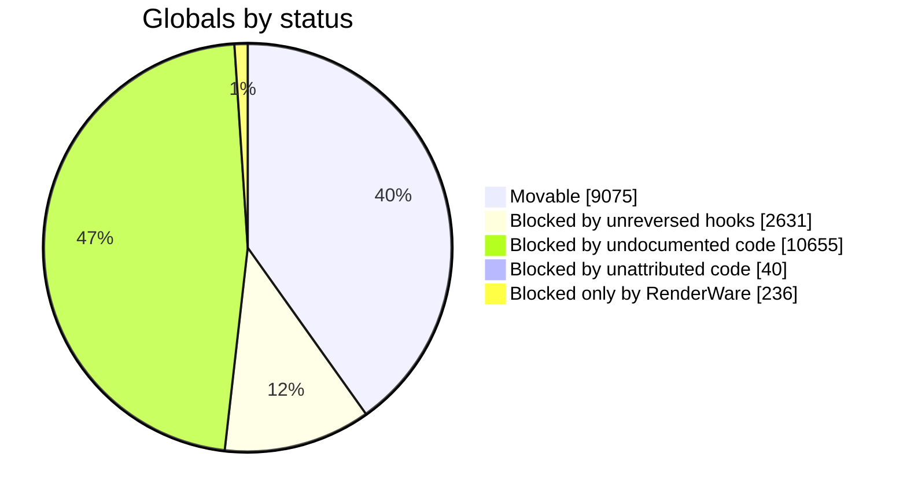
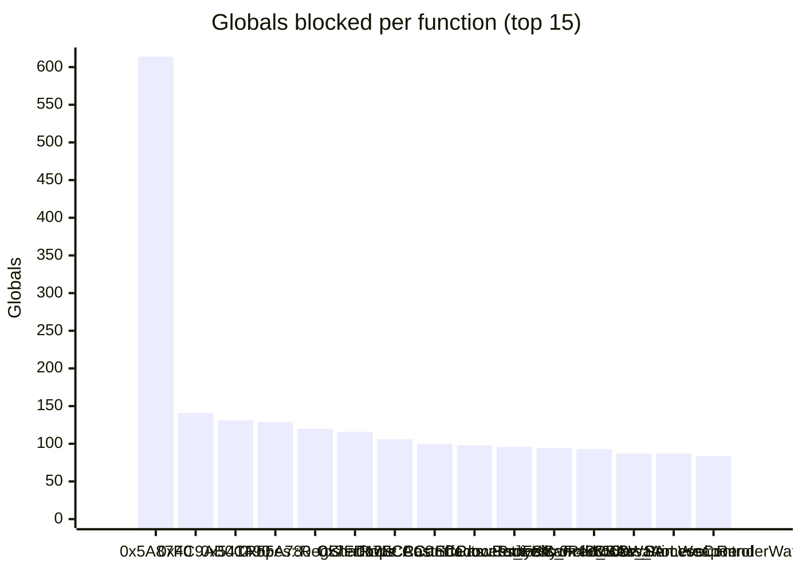

# Globals coverage (*): 40%
This file is updated automatically together with `ReversedClasses.md`. It counts the globals of the original executable (every address in `.rdata` and `.data` that code references) and says for each one whether every function that touches it has been reversed. A global can only leave the executable once that is true.

Last update was at Oct 13, 2026 at 09:27:29 UTC

## (*) Disclaimers
**A row is one address.** Sizes of globals are not known, so a reference to a field of a larger object is its own row, named `Owner+0xOFFSET` after the nearest named global before it in the same section.

**Names** come from the `StaticRef` declarations in the source tree; addresses no declaration covers are listed as unnamed.

**Hook state is ignored.** A global counts as movable when every function referencing it is reversed, whether or not those hooks are currently switched on or locked.

**RenderWare** functions (the addresses named under `source/game_sa/RenderWare/`) are counted as blockers of their own kind, since they are not reversed as part of this project.

**The RenderWare set is only the API the project forwards.** RenderWare's internal functions count as undocumented code and appear at the top of "Reverse this next".

**`.rdata` rows** also include vtables, floating-point literals and strings, not only tables the game code reads. The import address table is left out of the export.

## Summary

- 9075 of 22637 globals are referenced only by reversed code (40%); 9075 of 22401 without the ones blocked only by RenderWare (40%).
- `.rdata`: 2846 of 9076 (read-only data; copying it is safe, but see the disclaimers).
- Blocked: 13562, of which 236 only by RenderWare.

## Per class

158 groups

| Class | Rows | Movable | Blocked | Share | All movable |
|---|---|---|---|---|---|
| BoneNodeManager_c | 4 | 4 | 0 | ██████████ 100% | yes |
| C2dEffect | 12 | 5 | 7 | ████░░░░░░ 41% |  |
| C3dMarkers | 197 | 196 | 1 | █████████░ 99% |  |
| CAEAudioUtility | 23 | 5 | 18 | ██░░░░░░░░ 21% |  |
| CAEMFDecoder | 2 | 1 | 1 | █████░░░░░ 50% |  |
| CAERadioTrackManager | 75 | 50 | 25 | ██████░░░░ 66% |  |
| CAEWMADecoder | 9 | 0 | 9 | ░░░░░░░░░░ 0% |  |
| CAccidentManager | 7 | 1 | 6 | █░░░░░░░░░ 14% |  |
| CAnimManager | 39 | 29 | 10 | ███████░░░ 74% |  |
| CAudioZones | 71 | 61 | 10 | ████████░░ 85% |  |
| CBirds | 40 | 39 | 1 | █████████░ 97% |  |
| CBouncingPanel | 6 | 6 | 0 | ██████████ 100% | yes |
| CBrightLights | 20 | 20 | 0 | ██████████ 100% | yes |
| CBulletInfo | 36 | 30 | 6 | ████████░░ 83% |  |
| CBulletTraces | 120 | 120 | 0 | ██████████ 100% | yes |
| CCamera | 10 | 0 | 10 | ░░░░░░░░░░ 0% |  |
| CCarCtrl | 43 | 4 | 39 | ░░░░░░░░░░ 9% |  |
| CCarEnterExit | 282 | 102 | 180 | ███░░░░░░░ 36% |  |
| CCarFXRenderer | 3 | 1 | 2 | ███░░░░░░░ 33% |  |
| CCarGenerator | 23 | 5 | 18 | ██░░░░░░░░ 21% |  |
| CCheat | 72 | 47 | 25 | ██████░░░░ 65% |  |
| CCheckpoints | 79 | 79 | 0 | ██████████ 100% | yes |
| CClock | 26 | 8 | 18 | ███░░░░░░░ 30% |  |
| CClothes | 14 | 0 | 14 | ░░░░░░░░░░ 0% |  |
| CClouds | 57 | 50 | 7 | ████████░░ 87% |  |
| CColAccel | 17 | 11 | 6 | ██████░░░░ 64% |  |
| CColStore | 5 | 5 | 0 | ██████████ 100% | yes |
| CCollision | 44 | 39 | 5 | ████████░░ 88% |  |
| CCollisionPlugin | 8 | 0 | 8 | ░░░░░░░░░░ 0% |  |
| CConversations | 65 | 19 | 46 | ██░░░░░░░░ 29% |  |
| CCoronas | 60 | 54 | 6 | █████████░ 90% |  |
| CCover | 90 | 57 | 33 | ██████░░░░ 63% |  |
| CCredits | 9 | 1 | 8 | █░░░░░░░░░ 11% |  |
| CCreepingFire | 7 | 1 | 6 | █░░░░░░░░░ 14% |  |
| CCullZones | 50 | 37 | 13 | ███████░░░ 74% |  |
| CCustomBuildingDNPipeline | 9 | 2 | 7 | ██░░░░░░░░ 22% |  |
| CCustomBuildingPipeline | 5 | 5 | 0 | ██████████ 100% | yes |
| CCustomCarEnvMapPipeline | 48 | 46 | 2 | █████████░ 95% |  |
| CCustomCarPlateMgr | 9 | 9 | 0 | ██████████ 100% | yes |
| CCustomRoadsignMgr | 4 | 4 | 0 | ██████████ 100% | yes |
| CCutsceneMgr | 103 | 82 | 21 | ███████░░░ 79% |  |
| CDarkel | 42 | 36 | 6 | ████████░░ 85% |  |
| CDecisionMakerTypes | 9 | 0 | 9 | ░░░░░░░░░░ 0% |  |
| CDraw | 12 | 2 | 10 | █░░░░░░░░░ 16% |  |
| CEntryExit | 3 | 1 | 2 | ███░░░░░░░ 33% |  |
| CEntryExitManager | 17 | 7 | 10 | ████░░░░░░ 41% |  |
| CEscalators | 6 | 5 | 1 | ████████░░ 83% |  |
| CEventScanner | 7 | 0 | 7 | ░░░░░░░░░░ 0% |  |
| CExplosion | 56 | 55 | 1 | █████████░ 98% |  |
| CFileLoader | 9 | 3 | 6 | ███░░░░░░░ 33% |  |
| CFileMgr | 6 | 6 | 0 | ██████████ 100% | yes |
| CFont | 61 | 12 | 49 | █░░░░░░░░░ 19% |  |
| CGame | 13 | 4 | 9 | ███░░░░░░░ 30% |  |
| CGameLogic | 43 | 22 | 21 | █████░░░░░ 51% |  |
| CGamma | 4 | 0 | 4 | ░░░░░░░░░░ 0% |  |
| CGangWars | 45 | 7 | 38 | █░░░░░░░░░ 15% |  |
| CGangs | 44 | 23 | 21 | █████░░░░░ 52% |  |
| CGarages | 71 | 27 | 44 | ███░░░░░░░ 38% |  |
| CGenericGameStorage | 32 | 10 | 22 | ███░░░░░░░ 31% |  |
| CGlass | 84 | 77 | 7 | █████████░ 91% |  |
| CGrassRenderer | 6 | 6 | 0 | ██████████ 100% | yes |
| CHud | 107 | 0 | 107 | ░░░░░░░░░░ 0% |  |
| CInformFriendsEventQueue | 6 | 5 | 1 | ████████░░ 83% |  |
| CInformGroupEventQueue | 13 | 6 | 7 | ████░░░░░░ 46% |  |
| CIniFile | 21 | 18 | 3 | ████████░░ 85% |  |
| CLoadingScreen | 31 | 23 | 8 | ███████░░░ 74% |  |
| CLocalisation | 3 | 3 | 0 | ██████████ 100% | yes |
| CMBlur | 2 | 0 | 2 | ░░░░░░░░░░ 0% |  |
| CMemoryMgr | 1 | 0 | 1 | ░░░░░░░░░░ 0% |  |
| CMenuManager | 2 | 1 | 1 | █████░░░░░ 50% |  |
| CMenuSystem | 10 | 3 | 7 | ███░░░░░░░ 30% |  |
| CMessages | 57 | 54 | 3 | █████████░ 94% |  |
| CMirrors | 14 | 13 | 1 | █████████░ 92% |  |
| CModelInfo | 94 | 64 | 30 | ██████░░░░ 68% |  |
| CMotionBlurStreaks | 54 | 54 | 0 | ██████████ 100% | yes |
| CObjectData | 59 | 58 | 1 | █████████░ 98% |  |
| COccluder | 42 | 36 | 6 | ████████░░ 85% |  |
| COcclusion | 40 | 40 | 0 | ██████████ 100% | yes |
| CPad | 261 | 101 | 160 | ███░░░░░░░ 38% |  |
| CPathFind | 15 | 4 | 11 | ██░░░░░░░░ 26% |  |
| CPedAcquaintanceScanner | 1 | 0 | 1 | ░░░░░░░░░░ 0% |  |
| CPedDamageResponseCalculator | 2 | 1 | 1 | █████░░░░░ 50% |  |
| CPedGroupDefaultTaskAllocators | 6 | 0 | 6 | ░░░░░░░░░░ 0% |  |
| CPedGroups | 49 | 15 | 34 | ███░░░░░░░ 30% |  |
| CPedIK | 4 | 2 | 2 | █████░░░░░ 50% |  |
| CPedIntelligence | 13 | 6 | 7 | ████░░░░░░ 46% |  |
| CPedScriptedTaskRecord | 10 | 9 | 1 | █████████░ 90% |  |
| CPedStats | 7 | 0 | 7 | ░░░░░░░░░░ 0% |  |
| CPedToPlayerConversations | 14 | 0 | 14 | ░░░░░░░░░░ 0% |  |
| CPedType | 1 | 1 | 0 | ██████████ 100% | yes |
| CPickups | 91 | 33 | 58 | ███░░░░░░░ 36% |  |
| CPlaneTrails | 7 | 7 | 0 | ██████████ 100% | yes |
| CPlantMgr | 66 | 63 | 3 | █████████░ 95% |  |
| CPlantSurfPropMgr | 22 | 21 | 1 | █████████░ 95% |  |
| CPlayerSkin | 1 | 0 | 1 | ░░░░░░░░░░ 0% |  |
| CPointLights | 37 | 36 | 1 | █████████░ 97% |  |
| CPopCycle | 49 | 26 | 23 | █████░░░░░ 53% |  |
| CPopulation | 107 | 75 | 32 | ███████░░░ 70% |  |
| CPostEffects | 165 | 122 | 43 | ███████░░░ 73% |  |
| CProjectileInfo | 11 | 3 | 8 | ██░░░░░░░░ 27% |  |
| CQuadTreeNode | 1 | 0 | 1 | ░░░░░░░░░░ 0% |  |
| CRadar | 61 | 36 | 25 | █████░░░░░ 59% |  |
| CReferences | 12 | 6 | 6 | █████░░░░░ 50% |  |
| CRenderer | 51 | 29 | 22 | █████░░░░░ 56% |  |
| CReplay | 190 | 181 | 9 | █████████░ 95% |  |
| CRestart | 42 | 31 | 11 | ███████░░░ 73% |  |
| CRoadBlocks | 78 | 69 | 9 | ████████░░ 88% |  |
| CRopes | 137 | 8 | 129 | ░░░░░░░░░░ 5% |  |
| CRunningScript | 1 | 1 | 0 | ██████████ 100% | yes |
| CScripted2dEffects | 39 | 5 | 34 | █░░░░░░░░░ 12% |  |
| CScriptedBrainTaskStore | 18 | 5 | 13 | ██░░░░░░░░ 27% |  |
| CSetPieces | 25 | 14 | 11 | █████░░░░░ 56% |  |
| CShadows | 225 | 48 | 177 | ██░░░░░░░░ 21% |  |
| CShinyTexts | 32 | 32 | 0 | ██████████ 100% | yes |
| CShopping | 48 | 28 | 20 | █████░░░░░ 58% |  |
| CSkidmarks | 81 | 75 | 6 | █████████░ 92% |  |
| CSpecialFX | 4 | 2 | 2 | █████░░░░░ 50% |  |
| CSprite | 34 | 32 | 2 | █████████░ 94% |  |
| CSprite2d | 71 | 60 | 11 | ████████░░ 84% |  |
| CStats | 191 | 38 | 153 | █░░░░░░░░░ 19% |  |
| CStencilShadows | 21 | 18 | 3 | ████████░░ 85% |  |
| CStreaming | 136 | 109 | 27 | ████████░░ 80% |  |
| CStreamingInfo | 2 | 2 | 0 | ██████████ 100% | yes |
| CStuntJumpManager | 15 | 7 | 8 | ████░░░░░░ 46% |  |
| CTagManager | 12 | 2 | 10 | █░░░░░░░░░ 16% |  |
| CTaskSequences | 20 | 0 | 20 | ░░░░░░░░░░ 0% |  |
| CTempColModels | 92 | 57 | 35 | ██████░░░░ 61% |  |
| CTheCarGenerators | 18 | 15 | 3 | ████████░░ 83% |  |
| CTheScripts | 720 | 252 | 468 | ███░░░░░░░ 35% |  |
| CTheZones | 92 | 79 | 13 | ████████░░ 85% |  |
| CTimeCycle | 153 | 134 | 19 | ████████░░ 87% |  |
| CTimer | 27 | 16 | 11 | █████░░░░░ 59% |  |
| CTrafficLights | 35 | 20 | 15 | █████░░░░░ 57% |  |
| CTxdStore | 4 | 2 | 2 | █████░░░░░ 50% |  |
| CUserDisplay | 24 | 3 | 21 | █░░░░░░░░░ 12% |  |
| CVehicleAnimGroupData | 3 | 1 | 2 | ███░░░░░░░ 33% |  |
| CVehicleRecording | 124 | 105 | 19 | ████████░░ 84% |  |
| CVehicleStructure | 1 | 0 | 1 | ░░░░░░░░░░ 0% |  |
| CVisibilityPlugins | 87 | 79 | 8 | █████████░ 90% |  |
| CWanted | 11 | 3 | 8 | ██░░░░░░░░ 27% |  |
| CWaterCannon | 24 | 18 | 6 | ███████░░░ 75% |  |
| CWaterCannons | 4 | 3 | 1 | ███████░░░ 75% |  |
| CWaterLevel | 130 | 25 | 105 | █░░░░░░░░░ 19% |  |
| CWeapon | 37 | 17 | 20 | ████░░░░░░ 45% |  |
| CWeaponInfo | 68 | 57 | 11 | ████████░░ 83% |  |
| CWeather | 62 | 42 | 20 | ██████░░░░ 67% |  |
| CWindModifiers | 18 | 9 | 9 | █████░░░░░ 50% |  |
| CWorld | 108 | 36 | 72 | ███░░░░░░░ 33% |  |
| C_PcSave | 7 | 0 | 7 | ░░░░░░░░░░ 0% |  |
| FurnitureManager_c | 18 | 5 | 13 | ██░░░░░░░░ 27% |  |
| ModelIndices | 163 | 90 | 73 | █████░░░░░ 55% |  |
| RenderBuffer | 8 | 0 | 8 | ░░░░░░░░░░ 0% |  |
| VideoPlayer | 5 | 4 | 1 | ████████░░ 80% |  |
| WaterCreatureManager_c | 2 | 2 | 0 | ██████████ 100% | yes |
| cBuoyancy | 20 | 14 | 6 | ███████░░░ 70% |  |
| (global) | 6084 | 1947 | 4137 | ███░░░░░░░ 32% |  |
| Unnamed (.data) | 1535 | 419 | 1116 | ██░░░░░░░░ 27% |  |
| Unnamed (.rdata) | 7538 | 2342 | 5196 | ███░░░░░░░ 31% |  |

## Reverse this next

Functions that are not reversed yet, by the number of globals they keep in the executable.

6998 functions

| Function | Address | Kind | Globals blocked |
|---|---|---|---|
| `0x5A87F0` | 0x5A87F0 | undocumented | 614 |
| `0x4C9AB0` | 0x4C9AB0 | undocumented | 141 |
| `0x541490` | 0x541490 | undocumented | 131 |
| `0x55A780` | 0x55A780 | undocumented | 129 |
| `CRopes::RegisterRope` | 0x556B40 | documented | 120 |
| `0x7FD100` | 0x7FD100 | undocumented | 116 |
| `0x7FCAC0` | 0x7FCAC0 | undocumented | 106 |
| `CShadows::CastShadowEntityXY` | 0x7086B0 | documented | 100 |
| `CPostEffects::Radiosity` | 0x702080 | documented | 98 |
| `CCam::Process_FollowPed_SA` | 0x522D40 | documented | 96 |
| `CCam::Process_FollowCar_SA` | 0x5245B0 | documented | 94 |
| `0x468560` | 0x468560 | undocumented | 93 |
| `CCam::Process_AimWeapon` | 0x521500 | documented | 87 |
| `CBike::ProcessControl` | 0x6B9250 | documented | 87 |
| `CWaterLevel::RenderWater` | 0x6EF650 | documented | 84 |
| `CShadows::AddPermanentShadow` | 0x706F60 | documented | 83 |
| `CClouds::RenderBottomFromHeight` | 0x7154B0 | documented | 79 |
| `0x472310` | 0x472310 | undocumented | 78 |
| `CWeaponEffects::Render` | 0x742CF0 | documented | 76 |
| `0x76FC66` | 0x76FC66 | undocumented | 76 |
| `0x588880` | 0x588880 | undocumented | 70 |
| `0x516560` | 0x516560 | undocumented | 69 |
| `CCam::Process_M16_1stPerson` | 0x5105C0 | documented | 68 |
| `0x5C0B70` | 0x5C0B70 | undocumented | 68 |
| `0x55A210` | 0x55A210 | undocumented | 66 |
| `0x5BEDC0` | 0x5BEDC0 | undocumented | 66 |
| `0x483BD0` | 0x483BD0 | undocumented | 65 |
| `0x430050` | 0x430050 | undocumented | 63 |
| `0x490DB0` | 0x490DB0 | undocumented | 63 |
| `0x481300` | 0x481300 | undocumented | 62 |
| `CPostEffects::HeatHazeFX` | 0x701780 | documented | 62 |
| `0x4762D0` | 0x4762D0 | undocumented | 61 |
| `0x80D680` | 0x80D680 | undocumented | 61 |
| `CPopulation::AddToPopulation` | 0x614720 | documented | 60 |
| `0x587000` | 0x587000 | undocumented | 59 |
| `0x58EAF0` | 0x58EAF0 | undocumented | 58 |
| `0x7F5F70` | 0x7F5F70 | undocumented | 58 |
| `0x474900` | 0x474900 | undocumented | 57 |
| `0x47A760` | 0x47A760 | undocumented | 57 |
| `0x48EAA0` | 0x48EAA0 | undocumented | 57 |
| `0x58B6E0` | 0x58B6E0 | undocumented | 56 |
| `CCam::Process` | 0x526FC0 | documented | 55 |
| `CPlane::ProcessFlyingCarStuff` | 0x6CB7C0 | documented | 55 |
| `0x44AA50` | 0x44AA50 | undocumented | 54 |
| `CCamera::CamControl` | 0x527FA0 | documented | 54 |
| `CPickups::DoPickUpEffects` | 0x455720 | documented | 53 |
| `0x46D050` | 0x46D050 | undocumented | 53 |
| `0x496E00` | 0x496E00 | undocumented | 53 |
| `CCam::Process_FollowPedWithMouse` | 0x50F970 | documented | 52 |
| `0x478000` | 0x478000 | undocumented | 51 |
| `CCam::Process_1rstPersonPedOnPC` | 0x50EB70 | documented | 51 |
| `CCam::Process_Cam_TwoPlayer_InCarAndShooting` | 0x519810 | documented | 49 |
| `CRope::Update` | 0x557530 | documented | 49 |
| `CStencilShadows::Render` | 0x710D50 | documented | 49 |
| `0x559AF0` | 0x559AF0 | undocumented | 48 |
| `CConversations::DoneSettingUpConversation` | 0x43ADB0 | documented | 47 |
| `0x48B590` | 0x48B590 | undocumented | 47 |
| `0x58B180` | 0x58B180 | undocumented | 47 |
| `0x6AAB50` | 0x6AAB50 | undocumented | 47 |
| `CGangWars::Update` | 0x446610 | documented | 46 |
| `0x456F20` | 0x456F20 | undocumented | 46 |
| `0x470A90` | 0x470A90 | undocumented | 45 |
| `0x493FE0` | 0x493FE0 | undocumented | 44 |
| `CPlane::PreRender` | 0x6C94A0 | documented | 44 |
| `CWeapon::FireInstantHit` | 0x73FB10 | documented | 44 |
| `0x48A320` | 0x48A320 | undocumented | 43 |
| `CPlayerInfo::Process` | 0x56F8D0 | documented | 43 |
| `0x7F8F20` | 0x7F8F20 | undocumented | 43 |
| `CCamera::TryToStartNewCamMode` | 0x51E560 | documented | 42 |
| `0x589650` | 0x589650 | undocumented | 42 |
| `CClothesBuilder::ConstructTextures` | 0x5A6040 | documented | 42 |
| `0x6E8780` | 0x6E8780 | undocumented | 42 |
| `0x7FE420` | 0x7FE420 | undocumented | 42 |
| `0x58FAE0` | 0x58FAE0 | undocumented | 41 |
| `0x6C58E0` | 0x6C58E0 | undocumented | 41 |
| `CGangWars::CreateAttackWave` | 0x444810 | documented | 40 |
| `CCamera::Process` | 0x52B730 | documented | 40 |
| `CShadows::UpdatePermanentShadows` | 0x70C950 | documented | 40 |
| `0x793567` | 0x793567 | undocumented | 40 |
| `CCam::Process_DW_CamManCam` | 0x51B120 | documented | 39 |
| `0x5E2530` | 0x5E2530 | undocumented | 39 |
| `CProjectileInfo::AddProjectile` | 0x737C80 | documented | 39 |
| `CProjectileInfo::Update` | 0x738B20 | documented | 39 |
| `0x423000` | 0x423000 | undocumented | 38 |
| `CCam::Process_DW_PlaneSpotterCam` | 0x51C250 | documented | 37 |
| `0x6E91D0` | 0x6E91D0 | undocumented | 37 |
| `0x7999F2` | 0x7999F2 | undocumented | 37 |
| `0x479DA0` | 0x479DA0 | undocumented | 36 |
| `CWaterLevel::RenderWaterFog` | 0x6E7760 | documented | 36 |
| `0x47FA30` | 0x47FA30 | undocumented | 35 |
| `0x58AA50` | 0x58AA50 | undocumented | 35 |
| `0x58CC80` | 0x58CC80 | undocumented | 35 |
| `0x58D9A0` | 0x58D9A0 | undocumented | 35 |
| `0x6E6870` | 0x6E6870 | undocumented | 35 |
| `0x6E6A10` | 0x6E6A10 | undocumented | 35 |
| `CTrain::DoTrainGenerationAndRemoval` | 0x6F7900 | documented | 35 |
| `CShadows::StoreShadowForVehicle` | 0x70BDA0 | documented | 35 |
| `0x4CA5A0` | 0x4CA5A0 | undocumented | 34 |
| `CAEAmbienceTrackManager::UpdateAmbienceTrackAndVolume` | 0x4D6E60 | documented | 34 |
| `CCamera::ImproveNearClip` | 0x516B20 | documented | 34 |
| `CCam::Process_DW_BirdyCam` | 0x51B850 | documented | 34 |
| `0x489500` | 0x489500 | undocumented | 33 |
| `CAEVehicleAudioEntity::ProcessGenericJet` | 0x4FF900 | documented | 33 |
| `0x588A50` | 0x588A50 | undocumented | 33 |
| `0x58C080` | 0x58C080 | undocumented | 33 |
| `0x792945` | 0x792945 | undocumented | 33 |
| `0x424210` | 0x424210 | undocumented | 32 |
| `0x46B460` | 0x46B460 | undocumented | 32 |
| `0x4D56F0` | 0x4D56F0 | undocumented | 32 |
| `CCam::Process_Cam_TwoPlayer` | 0x525E50 | documented | 31 |
| `0x55EB90` | 0x55EB90 | undocumented | 31 |
| `0x771A47` | 0x771A47 | undocumented | 31 |
| `0x452270` | 0x452270 | undocumented | 30 |
| `0x47C100` | 0x47C100 | undocumented | 30 |
| `CBike::ProcessRiderAnims` | 0x6B7280 | documented | 30 |
| `CShadows::StoreStaticShadow` | 0x70BA00 | documented | 30 |
| `CFont::PrintChar` | 0x718A10 | documented | 30 |
| `CFont::RenderFontBuffer` | 0x719840 | documented | 30 |
| `0x719B40` | 0x719B40 | undocumented | 30 |
| `0x47E090` | 0x47E090 | undocumented | 29 |
| `0x48CDD0` | 0x48CDD0 | undocumented | 29 |
| `0x58A330` | 0x58A330 | undocumented | 29 |
| `CPed::KillPedWithCar` | 0x5F0360 | documented | 29 |
| `0x6DE880` | 0x6DE880 | undocumented | 29 |
| `0x76D9F0` | 0x76D9F0 | undocumented | 29 |
| `0x429A70` | 0x429A70 | undocumented | 28 |
| `0x435830` | 0x435830 | undocumented | 28 |
| `CRoadBlocks::CreateRoadBlockBetween2Points` | 0x4619C0 | documented | 28 |
| `CCam::Process_WheelCam` | 0x512110 | documented | 28 |
| `CCam::Process_DW_PlaneCam1` | 0x51C760 | documented | 28 |
| `0x58C250` | 0x58C250 | undocumented | 28 |
| `0x58C6A0` | 0x58C6A0 | undocumented | 28 |
| `0x60BA80` | 0x60BA80 | undocumented | 28 |
| `0x7C3267` | 0x7C3267 | undocumented | 28 |
| `0x434900` | 0x434900 | undocumented | 27 |
| `CCam::Process_DW_HeliChaseCam` | 0x51A740 | documented | 27 |
| `CCamera::CameraColDetAndReact` | 0x520190 | documented | 27 |
| `0x58E020` | 0x58E020 | undocumented | 27 |
| `CPlane::ProcessControlInputs` | 0x6CADD0 | documented | 27 |
| `CTrain::InitTrains` | 0x6F7440 | documented | 27 |
| `CPostEffects::SpeedFX` | 0x7030A0 | documented | 27 |
| `0x43B0F0` | 0x43B0F0 | undocumented | 26 |
| `0x466DE0` | 0x466DE0 | undocumented | 26 |
| `CCam::ProcessArrestCamOne` | 0x518500 | documented | 26 |
| `CCam::Process_DW_PlaneCam2` | 0x51CC30 | documented | 26 |
| `CCam::LookBehind` | 0x520690 | documented | 26 |
| `0x56EC80` | 0x56EC80 | undocumented | 26 |
| `0x56EF90` | 0x56EF90 | undocumented | 26 |
| `0x5D2620` | 0x5D2620 | undocumented | 26 |
| `CTaskGangHassleVehicle::ControlSubTask` | 0x6637C0 | documented | 26 |
| `0x6AA290` | 0x6AA290 | undocumented | 26 |
| `CBike::ProcessControlInputs` | 0x6BE310 | documented | 26 |
| `CBmx::ProcessDrivingAnims` | 0x6BFB50 | documented | 26 |
| `CWaterLevel::FindNearestWaterAndItsFlow` | 0x6E9D70 | documented | 26 |
| `0x76BA82` | 0x76BA82 | undocumented | 26 |
| `0x7F7F70` | 0x7F7F70 | undocumented | 26 |
| `0x7FD810` | 0x7FD810 | undocumented | 26 |
| `0x829B99` | 0x829B99 | undocumented | 26 |
| `0x82EE29` | 0x82EE29 | undocumented | 26 |
| `0x51D770` | 0x51D770 | undocumented | 25 |
| `0x559230` | 0x559230 | undocumented | 25 |
| `0x55BC50` | 0x55BC50 | undocumented | 25 |
| `0x5E8CD0` | 0x5E8CD0 | undocumented | 25 |
| `CBmx::ProcessAI` | 0x6C1470 | documented | 25 |
| `0x747EB0` | 0x747EB0 | undocumented | 25 |
| `0x423940` | 0x423940 | undocumented | 24 |
| `0x58AEA0` | 0x58AEA0 | undocumented | 24 |
| `0x5D2740` | 0x5D2740 | undocumented | 24 |
| `CPopCycle::PickPedMIToStreamInForCurrentZone` | 0x60FFD0 | documented | 24 |
| `0x7D3AB0` | 0x7D3AB0 | undocumented | 24 |
| `0x815E60` | 0x815E60 | undocumented | 24 |
| `0x83537E` | 0x83537E | undocumented | 24 |
| `0x8357A7` | 0x8357A7 | undocumented | 24 |
| `CAEPedAudioEntity::Service` | 0x4E2EE0 | documented | 23 |
| `0x604500` | 0x604500 | undocumented | 23 |
| `CTaskUtilityLineUpPedWithCar::ProcessPed` | 0x6513A0 | documented | 23 |
| `0x6C4E60` | 0x6C4E60 | undocumented | 23 |
| `0x6D73B0` | 0x6D73B0 | undocumented | 23 |
| `0x79665B` | 0x79665B | undocumented | 23 |
| `0x7A9D19` | 0x7A9D19 | undocumented | 23 |
| `0x83319E` | 0x83319E | undocumented | 23 |
| `0x4A09C0` | 0x4A09C0 | undocumented | 22 |
| `0x514030` | 0x514030 | undocumented | 22 |
| `CPed::DoFootLanded` | 0x5E5380 | documented | 22 |
| `0x760CF0` | 0x760CF0 | undocumented | 22 |
| `0x825A79` | 0x825A79 | undocumented | 22 |
| `0x47D210` | 0x47D210 | undocumented | 21 |
| `0x4A0610` | 0x4A0610 | undocumented | 21 |
| `FxEmitterBP_c::Render` | 0x4A2C40 | documented | 21 |
| `0x58D240` | 0x58D240 | undocumented | 21 |
| `CBike::DoBurstAndSoftGroundRatios` | 0x6B6950 | documented | 21 |
| `0x6C7050` | 0x6C7050 | undocumented | 21 |
| `0x7D43E0` | 0x7D43E0 | undocumented | 21 |
| `0x7F6CB0` | 0x7F6CB0 | undocumented | 21 |
| `0x425440` | 0x425440 | undocumented | 20 |
| `0x512EF0` | 0x512EF0 | undocumented | 20 |
| `CCam::ProcessPedsDeadBaby` | 0x519250 | documented | 20 |
| `0x58D59A` | 0x58D59A | undocumented | 20 |
| `0x5A7A20` | 0x5A7A20 | undocumented | 20 |
| `0x629920` | 0x629920 | undocumented | 20 |
| `CTaskSimpleUseGun::ProcessPed` | 0x62A380 | documented | 20 |
| `CBike::PreRender` | 0x6BD090 | documented | 20 |
| `0x7C307E` | 0x7C307E | undocumented | 20 |
| `0x7C381F` | 0x7C381F | undocumented | 20 |
| `0x428053` | 0x428053 | undocumented | 19 |
| `0x432DD0` | 0x432DD0 | undocumented | 19 |
| `CEntryExit::TransitionFinished` | 0x4404A0 | documented | 19 |
| `0x4471E0` | 0x4471E0 | undocumented | 19 |
| `CAEPoliceScannerAudioEntity::PlayLoadedDialogue` | 0x4E6F60 | documented | 19 |
| `CAEVehicleAudioEntity::ProcessPlayerBicycle` | 0x500040 | documented | 19 |
| `CCam::Process_AttachedCam` | 0x512B10 | documented | 19 |
| `CCam::Process_FlyBy` | 0x5B25F0 | documented | 19 |
| `CBike::FixHandsToBars` | 0x6B7F90 | documented | 19 |
| `0x6C4830` | 0x6C4830 | undocumented | 19 |
| `0x7F7730` | 0x7F7730 | undocumented | 19 |
| `0x82567C` | 0x82567C | undocumented | 19 |
| `0x424CE0` | 0x424CE0 | undocumented | 18 |
| `0x4336D0` | 0x4336D0 | undocumented | 18 |
| `0x469390` | 0x469390 | undocumented | 18 |
| `0x49E660` | 0x49E660 | undocumented | 18 |
| `0x49FB30` | 0x49FB30 | undocumented | 18 |
| `CCam::Process_DW_PlaneCam3` | 0x51D100 | documented | 18 |
| `0x55C780` | 0x55C780 | undocumented | 18 |
| `0x5DA790` | 0x5DA790 | undocumented | 18 |
| `CTaskComplexGangFollower::ControlSubTask` | 0x662A10 | documented | 18 |
| `0x6669D0` | 0x6669D0 | undocumented | 18 |
| `0x6E7210` | 0x6E7210 | undocumented | 18 |
| `0x436A90` | 0x436A90 | undocumented | 17 |
| `0x49EE10` | 0x49EE10 | undocumented | 17 |
| `0x4CC970` | 0x4CC970 | undocumented | 17 |
| `CAERadioTrackManager::ChooseDJBanterIndex` | 0x4EA2D0 | documented | 17 |
| `0x559760` | 0x559760 | undocumented | 17 |
| `0x588D40` | 0x588D40 | undocumented | 17 |
| `CPed::CalculateNewVelocity` | 0x5E4C50 | documented | 17 |
| `0x627600` | 0x627600 | undocumented | 17 |
| `CQuadBike::ProcessControl` | 0x6CDCC0 | documented | 17 |
| `0x6E7B30` | 0x6E7B30 | undocumented | 17 |
| `CWeapon::FireInstantHitFromCar` | 0x73EC40 | documented | 17 |
| `0x7A3EA2` | 0x7A3EA2 | undocumented | 17 |
| `0x424F80` | 0x424F80 | undocumented | 16 |
| `0x42AEB0` | 0x42AEB0 | undocumented | 16 |
| `0x437C20` | 0x437C20 | undocumented | 16 |
| `0x44A3C0` | 0x44A3C0 | undocumented | 16 |
| `0x454451` | 0x454451 | undocumented | 16 |
| `CRunningScript::CharInAngledAreaCheckCommand` | 0x487F60 | documented | 16 |
| `CRunningScript::ObjectInAngledAreaCheckCommand` | 0x4883F0 | documented | 16 |
| `0x49F750` | 0x49F750 | undocumented | 16 |
| `0x49FF20` | 0x49FF20 | undocumented | 16 |
| `0x4A0170` | 0x4A0170 | undocumented | 16 |
| `0x4A03C0` | 0x4A03C0 | undocumented | 16 |
| `CAEVehicleAudioEntity::ProcessDummyBicycle` | 0x4FFDC0 | documented | 16 |
| `0x55C470` | 0x55C470 | undocumented | 16 |
| `0x588BE0` | 0x588BE0 | undocumented | 16 |
| `CPed::PlayFootSteps` | 0x5E57F0 | documented | 16 |
| `0x6060A0` | 0x6060A0 | undocumented | 16 |
| `0x60DC50` | 0x60DC50 | undocumented | 16 |
| `CPopulation::ManageObject` | 0x615DC0 | documented | 16 |
| `0x61DB30` | 0x61DB30 | undocumented | 16 |
| `CTaskSimpleFightingControl::ProcessPed` | 0x62A0A0 | documented | 16 |
| `CTaskComplexKillCriminal::ControlSubTask` | 0x68E950 | documented | 16 |
| `CTrain::ReadAndInterpretTrackFile` | 0x6F55D0 | documented | 16 |
| `CScripted2dEffects::Init` | 0x6FA6F0 | documented | 16 |
| `0x76C3C1` | 0x76C3C1 | undocumented | 16 |
| `0x76F70A` | 0x76F70A | undocumented | 16 |
| `0x795267` | 0x795267 | undocumented | 16 |
| `0x79AA6F` | 0x79AA6F | undocumented | 16 |
| `0x812D40` | 0x812D40 | undocumented | 16 |
| `0x82FE68` | 0x82FE68 | undocumented | 16 |
| `0x8306FA` | 0x8306FA | undocumented | 16 |
| `0x4325C0` | 0x4325C0 | undocumented | 15 |
| `0x465E60` | 0x465E60 | undocumented | 15 |
| `0x47F370` | 0x47F370 | undocumented | 15 |
| `0x49EB00` | 0x49EB00 | undocumented | 15 |
| `0x49F970` | 0x49F970 | undocumented | 15 |
| `0x4A2580` | 0x4A2580 | undocumented | 15 |
| `CAEVehicleAudioEntity::ProcessDummyHovercraft` | 0x500F50 | documented | 15 |
| `CCamera::CopyCameraMatrixToRWCam` | 0x50AFA0 | documented | 15 |
| `CCam::LookRight` | 0x520E40 | documented | 15 |
| `0x53E600` | 0x53E600 | undocumented | 15 |
| `0x58A160` | 0x58A160 | undocumented | 15 |
| `FurnitureSubGroup_c::AddFurniture` | 0x5C00C0 | documented | 15 |
| `0x60A9C0` | 0x60A9C0 | undocumented | 15 |
| `0x60C840` | 0x60C840 | undocumented | 15 |
| `CTaskComplexKillPedOnFootArmed::CreateNextSubTask` | 0x62C190 | documented | 15 |
| `CTaskSimpleCarDrive::ProcessPed` | 0x644470 | documented | 15 |
| `CBike::VehicleDamage` | 0x6B8EC0 | documented | 15 |
| `CBmx::PreRender` | 0x6C0810 | documented | 15 |
| `CPlane::DoPlaneGenerationAndRemoval` | 0x6CD2F0 | documented | 15 |
| `CTrain::Constructor` | 0x6F6030 | documented | 15 |
| `CShadows::GeneratePolysForStaticShadow` | 0x70B730 | documented | 15 |
| `0x72A640` | 0x72A640 | undocumented | 15 |
| `0x7485C0` | 0x7485C0 | undocumented | 15 |
| `0x8322EE` | 0x8322EE | undocumented | 15 |
| `0x426EF0` | 0x426EF0 | undocumented | 14 |
| `CRunningScript::ScriptTaskPickUpObject` | 0x46AF50 | documented | 14 |
| `CRunningScript::FlameInAngledAreaCheckCommand` | 0x488780 | documented | 14 |
| `0x49ABD0` | 0x49ABD0 | undocumented | 14 |
| `0x49F040` | 0x49F040 | undocumented | 14 |
| `CAEPoliceScannerAudioEntity::AddAudioEvent` | 0x4E71E0 | documented | 14 |
| `CAEPoliceScannerAudioEntity::Service` | 0x4E7630 | documented | 14 |
| `CAERadioTrackManager::UpdateRadioVolumes` | 0x4EA010 | documented | 14 |
| `0x509A30` | 0x509A30 | undocumented | 14 |
| `0x5267C0` | 0x5267C0 | undocumented | 14 |
| `0x526950` | 0x526950 | undocumented | 14 |
| `0x526AE0` | 0x526AE0 | undocumented | 14 |
| `0x526E20` | 0x526E20 | undocumented | 14 |
| `CRopes::FindCoorsAlongRope` | 0x555E40 | documented | 14 |
| `0x588E30` | 0x588E30 | undocumented | 14 |
| `CPedGroupPlacer::PlaceRandomGroup` | 0x5FD330 | documented | 14 |
| `CInterestingEvents::ScanForNearbyEntities` | 0x605A30 | documented | 14 |
| `0x619910` | 0x619910 | undocumented | 14 |
| `0x61D5F0` | 0x61D5F0 | undocumented | 14 |
| `CTaskSimplePlayerOnFoot::PlayerControlFighter` | 0x687530 | documented | 14 |
| `0x6C6520` | 0x6C6520 | undocumented | 14 |
| `CPlane::VehicleDamage` | 0x6CC4B0 | documented | 14 |
| `0x6E61B0` | 0x6E61B0 | undocumented | 14 |
| `CTrain::FindPositionOnTrackFromCoors` | 0x6F6CC0 | documented | 14 |
| `CFont::ProcessCurrentString` | 0x71A220 | documented | 14 |
| `0x76EDAE` | 0x76EDAE | undocumented | 14 |
| `0x771F9D` | 0x771F9D | undocumented | 14 |
| `0x79EDB5` | 0x79EDB5 | undocumented | 14 |
| `0x7A698E` | 0x7A698E | undocumented | 14 |
| `0x7F5940` | 0x7F5940 | undocumented | 14 |
| `0x7F5D20` | 0x7F5D20 | undocumented | 14 |
| `0x7F7100` | 0x7F7100 | undocumented | 14 |
| `0x7F8300` | 0x7F8300 | undocumented | 14 |
| `0x426BC0` | 0x426BC0 | undocumented | 13 |
| `0x428DE0` | 0x428DE0 | undocumented | 13 |
| `0x42BD20` | 0x42BD20 | undocumented | 13 |
| `0x42DE80` | 0x42DE80 | undocumented | 13 |
| `0x433280` | 0x433280 | undocumented | 13 |
| `0x43C190` | 0x43C190 | undocumented | 13 |
| `CRunningScript::LocateCarCommand` | 0x487A20 | documented | 13 |
| `0x526C80` | 0x526C80 | undocumented | 13 |
| `0x559860` | 0x559860 | undocumented | 13 |
| `0x5890A0` | 0x5890A0 | undocumented | 13 |
| `0x5893B0` | 0x5893B0 | undocumented | 13 |
| `Interior_c::PlaceObject` | 0x5934E0 | documented | 13 |
| `0x5B7670` | 0x5B7670 | undocumented | 13 |
| `CGenericGameStorage::OpenFileForReading` | 0x5D0D20 | documented | 13 |
| `0x602C00` | 0x602C00 | undocumented | 13 |
| `0x60B650` | 0x60B650 | undocumented | 13 |
| `0x621960` | 0x621960 | undocumented | 13 |
| `0x628350` | 0x628350 | undocumented | 13 |
| `CTaskSimpleCarDrive::ProcessArmBopping` | 0x642AE0 | documented | 13 |
| `CPed::MakeTyresMuddySectorList<CPtrListSingleLink<CPhysical*>>` | 0x6AE0D0 | documented | 13 |
| `0x6B0690` | 0x6B0690 | undocumented | 13 |
| `0x6C79A0` | 0x6C79A0 | undocumented | 13 |
| `0x6D7C90` | 0x6D7C90 | undocumented | 13 |
| `CTrain::FindMaximumSpeedToStopAtStations` | 0x6F5BA0 | documented | 13 |
| `CStencilShadows::RegisterStencilShadows` | 0x711760 | documented | 13 |
| `CProjectileInfo::Initialise` | 0x737B40 | documented | 13 |
| `0x747DB0` | 0x747DB0 | undocumented | 13 |
| `0x7C2D95` | 0x7C2D95 | undocumented | 13 |
| `0x7C2EF0` | 0x7C2EF0 | undocumented | 13 |
| `0x7C3737` | 0x7C3737 | undocumented | 13 |
| `0x827F4B` | 0x827F4B | undocumented | 13 |
| `0x82872C` | 0x82872C | undocumented | 13 |
| `0x82D520` | 0x82D520 | undocumented | 13 |
| `0x833344` | 0x833344 | undocumented | 13 |
| `0x835177` | 0x835177 | undocumented | 13 |
| `0x428BE0` | 0x428BE0 | undocumented | 12 |
| `0x4650F0` | 0x4650F0 | undocumented | 12 |
| `0x493360` | 0x493360 | undocumented | 12 |
| `0x49F3D0` | 0x49F3D0 | undocumented | 12 |
| `CCam::Process_Cam_TwoPlayer_Separate_Cars` | 0x513510 | documented | 12 |
| `0x558FA0` | 0x558FA0 | undocumented | 12 |
| `0x559010` | 0x559010 | undocumented | 12 |
| `0x55C990` | 0x55C990 | undocumented | 12 |
| `0x55CC00` | 0x55CC00 | undocumented | 12 |
| `0x589270` | 0x589270 | undocumented | 12 |
| `0x58D7D0` | 0x58D7D0 | undocumented | 12 |
| `CPed::UpdatePosition` | 0x5E1B10 | documented | 12 |
| `0x5E37C0` | 0x5E37C0 | undocumented | 12 |
| `CTaskComplexPlayHandSignalAnim::ControlSubTask` | 0x61B580 | documented | 12 |
| `CTaskComplexKillPedOnFootArmed::CreateSubTask` | 0x626FC0 | documented | 12 |
| `0x627CC0` | 0x627CC0 | undocumented | 12 |
| `CTaskComplexUseClosestFreeScriptedAttractor::ComputeClosestFreeScriptedEffect` | 0x634740 | documented | 12 |
| `0x63A380` | 0x63A380 | undocumented | 12 |
| `CCarEnterExit::IsPlayerToQuitCarEnter` | 0x64F240 | documented | 12 |
| `0x691D50` | 0x691D50 | undocumented | 12 |
| `0x745650` | 0x745650 | undocumented | 12 |
| `0x771724` | 0x771724 | undocumented | 12 |
| `0x7920AE` | 0x7920AE | undocumented | 12 |
| `0x7C2AAE` | 0x7C2AAE | undocumented | 12 |
| `0x7C3B40` | 0x7C3B40 | undocumented | 12 |
| `0x7D3E90` | 0x7D3E90 | undocumented | 12 |
| `0x7E2EE0` | 0x7E2EE0 | undocumented | 12 |
| `0x7F3EA0` | 0x7F3EA0 | undocumented | 12 |
| `0x7FDCD0` | 0x7FDCD0 | undocumented | 12 |
| `0x814460` | 0x814460 | undocumented | 12 |
| `0x82589A` | 0x82589A | undocumented | 12 |
| `0x830141` | 0x830141 | undocumented | 12 |
| `0x833A20` | 0x833A20 | undocumented | 12 |
| `0x422760` | 0x422760 | undocumented | 11 |
| `0x427740` | 0x427740 | undocumented | 11 |
| `0x429090` | 0x429090 | undocumented | 11 |
| `0x42C2B0` | 0x42C2B0 | undocumented | 11 |
| `CRunningScript::CharInAreaCheckCommand` | 0x488B50 | documented | 11 |
| `CRunningScript::CarInAreaCheckCommand` | 0x488EC0 | documented | 11 |
| `CRunningScript::ObjectInAreaCheckCommand` | 0x489150 | documented | 11 |
| `CEventHandler::ComputePedCollisionWithPedResponse` | 0x4BDB80 | documented | 11 |
| `CEventHandler::ComputePedCollisionWithPlayerResponse` | 0x4BE7D0 | documented | 11 |
| `0x55BF20` | 0x55BF20 | undocumented | 11 |
| `0x55CAC0` | 0x55CAC0 | undocumented | 11 |
| `0x589190` | 0x589190 | undocumented | 11 |
| `0x5BA850` | 0x5BA850 | undocumented | 11 |
| `0x5C3940` | 0x5C3940 | undocumented | 11 |
| `CCustomBuildingRenderer::UpdateDayNightBalanceParam` | 0x5D7F80 | documented | 11 |
| `0x5FB8C0` | 0x5FB8C0 | undocumented | 11 |
| `CPedGroupPlacer::PlaceChatGroup` | 0x5FCE80 | documented | 11 |
| `0x60A610` | 0x60A610 | undocumented | 11 |
| `0x61D6F0` | 0x61D6F0 | undocumented | 11 |
| `0x62D3B0` | 0x62D3B0 | undocumented | 11 |
| `0x6A2F80` | 0x6A2F80 | undocumented | 11 |
| `0x6EABA0` | 0x6EABA0 | undocumented | 11 |
| `0x749760` | 0x749760 | undocumented | 11 |
| `0x76CCAD` | 0x76CCAD | undocumented | 11 |
| `0x770859` | 0x770859 | undocumented | 11 |
| `0x776904` | 0x776904 | undocumented | 11 |
| `0x7DA080` | 0x7DA080 | undocumented | 11 |
| `0x7DAB30` | 0x7DAB30 | undocumented | 11 |
| `0x7F6B00` | 0x7F6B00 | undocumented | 11 |
| `0x813A10` | 0x813A10 | undocumented | 11 |
| `0x8195C0` | 0x8195C0 | undocumented | 11 |
| `0x823BDB` | 0x823BDB | undocumented | 11 |
| `0x825491` | 0x825491 | undocumented | 11 |
| `0x830940` | 0x830940 | undocumented | 11 |
| `0x42D0E0` | 0x42D0E0 | undocumented | 10 |
| `0x45B730` | 0x45B730 | undocumented | 10 |
| `CRunningScript::LocateCharCommand` | 0x486D80 | documented | 10 |
| `CRunningScript::LocateObjectCommand` | 0x487D10 | documented | 10 |
| `0x493280` | 0x493280 | undocumented | 10 |
| `0x493420` | 0x493420 | undocumented | 10 |
| `0x493480` | 0x493480 | undocumented | 10 |
| `0x4CB7C0` | 0x4CB7C0 | undocumented | 10 |
| `0x50D590` | 0x50D590 | undocumented | 10 |
| `0x5179E0` | 0x5179E0 | undocumented | 10 |
| `CPlayerInfo::FindObjectToSteal` | 0x56DBD0 | documented | 10 |
| `0x58D490` | 0x58D490 | undocumented | 10 |
| `0x5F7E80` | 0x5F7E80 | undocumented | 10 |
| `0x60D5B0` | 0x60D5B0 | undocumented | 10 |
| `0x619D60` | 0x619D60 | undocumented | 10 |
| `0x619FA0` | 0x619FA0 | undocumented | 10 |
| `0x61CBA0` | 0x61CBA0 | undocumented | 10 |
| `0x630600` | 0x630600 | undocumented | 10 |
| `0x695090` | 0x695090 | undocumented | 10 |
| `0x69B1B0` | 0x69B1B0 | undocumented | 10 |
| `CBike::ProcessAI` | 0x6BC930 | documented | 10 |
| `0x6C6D30` | 0x6C6D30 | undocumented | 10 |
| `CWaterLevel::GetWaterLevelNoWaves` | 0x6E8580 | documented | 10 |
| `0x72CAE0` | 0x72CAE0 | undocumented | 10 |
| `CProjectileInfo::RemoveDetonatorProjectiles` | 0x738860 | documented | 10 |
| `0x766088` | 0x766088 | undocumented | 10 |
| `0x774678` | 0x774678 | undocumented | 10 |
| `0x7BC2C0` | 0x7BC2C0 | undocumented | 10 |
| `0x7DBCB0` | 0x7DBCB0 | undocumented | 10 |
| `0x7E71A0` | 0x7E71A0 | undocumented | 10 |
| `0x7F99B0` | 0x7F99B0 | undocumented | 10 |
| `0x812AC0` | 0x812AC0 | undocumented | 10 |
| `0x830D43` | 0x830D43 | undocumented | 10 |
| `0x8355EF` | 0x8355EF | undocumented | 10 |
| `0x83660B` | 0x83660B | undocumented | 10 |
| `0x426970` | 0x426970 | undocumented | 9 |
| `0x42EC90` | 0x42EC90 | undocumented | 9 |
| `0x436540` | 0x436540 | undocumented | 9 |
| `0x44E790` | 0x44E790 | undocumented | 9 |
| `0x45AE80` | 0x45AE80 | undocumented | 9 |
| `CRunningScript::PlayAnimScriptCommand` | 0x470150 | documented | 9 |
| `CRunningScript::LocateCharCarCommand` | 0x487420 | documented | 9 |
| `CRunningScript::LocateCharObjectCommand` | 0x487720 | documented | 9 |
| `0x49BDD0` | 0x49BDD0 | undocumented | 9 |
| `CAEPedAudioEntity::HandlePedSwing` | 0x4E1A40 | documented | 9 |
| `0x508F90` | 0x508F90 | undocumented | 9 |
| `0x517BF0` | 0x517BF0 | undocumented | 9 |
| `0x558EC0` | 0x558EC0 | undocumented | 9 |
| `Interior_c::Kitchen_FurnishEdges` | 0x596930 | documented | 9 |
| `0x5C9510` | 0x5C9510 | undocumented | 9 |
| `CGenericGameStorage::SaveWorkBuffer` | 0x5D0F80 | documented | 9 |
| `0x5D6480` | 0x5D6480 | undocumented | 9 |
| `0x5E3630` | 0x5E3630 | undocumented | 9 |
| `CPedGeometryAnalyser::CanPedJumpObstacle-contacted` | 0x5F32D0 | documented | 9 |
| `0x6043A0` | 0x6043A0 | undocumented | 9 |
| `0x606BA0` | 0x606BA0 | undocumented | 9 |
| `0x60D1C0` | 0x60D1C0 | undocumented | 9 |
| `0x60E530` | 0x60E530 | undocumented | 9 |
| `CGenericGameStorage::DoGameSpecificStuffAfterSucessLoad` | 0x618E90 | documented | 9 |
| `0x6240B0` | 0x6240B0 | undocumented | 9 |
| `0x693610` | 0x693610 | undocumented | 9 |
| `0x6C5420` | 0x6C5420 | undocumented | 9 |
| `CPlane::BlowUpCar` | 0x6CCCF0 | documented | 9 |
| `CShadows::CastShadowEntityXYZ` | 0x70A040 | documented | 9 |
| `0x728150` | 0x728150 | undocumented | 9 |
| `0x728200` | 0x728200 | undocumented | 9 |
| `CProjectileInfo::RemoveAllProjectiles` | 0x7399B0 | documented | 9 |
| `0x745920` | 0x745920 | undocumented | 9 |
| `0x750280` | 0x750280 | undocumented | 9 |
| `0x76E033` | 0x76E033 | undocumented | 9 |
| `0x77C8D2` | 0x77C8D2 | undocumented | 9 |
| `0x78CD38` | 0x78CD38 | undocumented | 9 |
| `0x79E96A` | 0x79E96A | undocumented | 9 |
| `0x79FB55` | 0x79FB55 | undocumented | 9 |
| `0x7C2CA4` | 0x7C2CA4 | undocumented | 9 |
| `0x7C3A40` | 0x7C3A40 | undocumented | 9 |
| `0x7C4120` | 0x7C4120 | undocumented | 9 |
| `0x7C4220` | 0x7C4220 | undocumented | 9 |
| `0x7D1D60` | 0x7D1D60 | undocumented | 9 |
| `0x7D36D0` | 0x7D36D0 | undocumented | 9 |
| `0x7E2770` | 0x7E2770 | undocumented | 9 |
| `0x7E38A0` | 0x7E38A0 | undocumented | 9 |
| `0x7E3CF0` | 0x7E3CF0 | undocumented | 9 |
| `0x7EAF60` | 0x7EAF60 | undocumented | 9 |
| `0x7F5840` | 0x7F5840 | undocumented | 9 |
| `0x7F6BF0` | 0x7F6BF0 | undocumented | 9 |
| `0x7F7540` | 0x7F7540 | undocumented | 9 |
| `0x7FDB80` | 0x7FDB80 | undocumented | 9 |
| `0x7FE0A0` | 0x7FE0A0 | undocumented | 9 |
| `0x802280` | 0x802280 | undocumented | 9 |
| `0x80E425` | 0x80E425 | undocumented | 9 |
| `0x819520` | 0x819520 | undocumented | 9 |
| `0x82101D` | 0x82101D | undocumented | 9 |
| `0x8232F0` | 0x8232F0 | undocumented | 9 |
| `0x82ED15` | 0x82ED15 | undocumented | 9 |
| `0x82ED94` | 0x82ED94 | undocumented | 9 |
| `0x830068` | 0x830068 | undocumented | 9 |
| `0x830380` | 0x830380 | undocumented | 9 |
| `0x853540` | 0x853540 | undocumented | 9 |
| `0x855FD0` | 0x855FD0 | undocumented | 9 |
| `0x41B980` | 0x41B980 | undocumented | 8 |
| `0x42B7D0` | 0x42B7D0 | undocumented | 8 |
| `CGangWars::AddKillToProvocation` | 0x443950 | documented | 8 |
| `CRunningScript::LocateCharCharCommand` | 0x4870F0 | documented | 8 |
| `0x4A0DE0` | 0x4A0DE0 | undocumented | 8 |
| `0x4CC5C0` | 0x4CC5C0 | undocumented | 8 |
| `CAERadioTrackManager::StopRadio` | 0x4E9820 | documented | 8 |
| `CAERadioTrackManager::Service` | 0x4EB9A0 | documented | 8 |
| `0x5132D0` | 0x5132D0 | undocumented | 8 |
| `0x55CEB0` | 0x55CEB0 | undocumented | 8 |
| `0x588FC0` | 0x588FC0 | undocumented | 8 |
| `Interior_c::AddPickups` | 0x591F90 | documented | 8 |
| `Interior_c::FurnishLounge` | 0x597740 | documented | 8 |
| `0x59F660` | 0x59F660 | undocumented | 8 |
| `0x5B2090` | 0x5B2090 | undocumented | 8 |
| `FxPrimBP_c::Load` | 0x5C2010 | documented | 8 |
| `0x5C70D0` | 0x5C70D0 | undocumented | 8 |
| `CGenericGameStorage::LoadWorkBuffer` | 0x5D10B0 | documented | 8 |
| `CPed::PositionPedOutOfCollision` | 0x5E0820 | documented | 8 |
| `0x5EE470` | 0x5EE470 | undocumented | 8 |
| `0x5EE540` | 0x5EE540 | undocumented | 8 |
| `0x5EE610` | 0x5EE610 | undocumented | 8 |
| `0x5EE6E0` | 0x5EE6E0 | undocumented | 8 |
| `0x5EE7C0` | 0x5EE7C0 | undocumented | 8 |
| `0x5EE890` | 0x5EE890 | undocumented | 8 |
| `0x5EE960` | 0x5EE960 | undocumented | 8 |
| `0x5EEA30` | 0x5EEA30 | undocumented | 8 |
| `0x5EEB00` | 0x5EEB00 | undocumented | 8 |
| `0x5EEBD0` | 0x5EEBD0 | undocumented | 8 |
| `CPedGeometryAnalyser::ComputeRouteRoundEntityBoundingBox-2` | 0x5F3DD0 | documented | 8 |
| `0x5F7F40` | 0x5F7F40 | undocumented | 8 |
| `0x5FB800` | 0x5FB800 | undocumented | 8 |
| `CPedGroupPlacer::PlaceFormationGroup` | 0x5FC9B0 | documented | 8 |
| `0x6098F0` | 0x6098F0 | undocumented | 8 |
| `CTaskSimpleChoking::ProcessPed` | 0x620490 | documented | 8 |
| `CTaskSimpleCarDrive::ProcessHeadBopping` | 0x6428C0 | documented | 8 |
| `CTaskComplexGangFollower::CreateNextSubTask` | 0x665E00 | documented | 8 |
| `0x676D30` | 0x676D30 | undocumented | 8 |
| `0x677920` | 0x677920 | undocumented | 8 |
| `0x683AD0` | 0x683AD0 | undocumented | 8 |
| `0x684380` | 0x684380 | undocumented | 8 |
| `CMonsterTruck::ProcessSuspension` | 0x6C83A0 | documented | 8 |
| `0x6DFC50` | 0x6DFC50 | undocumented | 8 |
| `0x6E3440` | 0x6E3440 | undocumented | 8 |
| `0x6E5BB0` | 0x6E5BB0 | undocumented | 8 |
| `0x6E5E90` | 0x6E5E90 | undocumented | 8 |
| `CStencilShadows::RenderForObject` | 0x710310 | documented | 8 |
| `0x719670` | 0x719670 | undocumented | 8 |
| `0x741FD0` | 0x741FD0 | undocumented | 8 |
| `0x769C1F` | 0x769C1F | undocumented | 8 |
| `0x76C2A4` | 0x76C2A4 | undocumented | 8 |
| `0x77514F` | 0x77514F | undocumented | 8 |
| `0x789A92` | 0x789A92 | undocumented | 8 |
| `0x79897F` | 0x79897F | undocumented | 8 |
| `0x79A3CE` | 0x79A3CE | undocumented | 8 |
| `0x79F184` | 0x79F184 | undocumented | 8 |
| `0x7AC746` | 0x7AC746 | undocumented | 8 |
| `0x7B32C6` | 0x7B32C6 | undocumented | 8 |
| `0x7B7861` | 0x7B7861 | undocumented | 8 |
| `0x7B8227` | 0x7B8227 | undocumented | 8 |
| `0x7B9AB9` | 0x7B9AB9 | undocumented | 8 |
| `0x7BA36D` | 0x7BA36D | undocumented | 8 |
| `0x7C1EC0` | 0x7C1EC0 | undocumented | 8 |
| `0x7C68E0` | 0x7C68E0 | undocumented | 8 |
| `0x7DF4B0` | 0x7DF4B0 | undocumented | 8 |
| `0x7E21F0` | 0x7E21F0 | undocumented | 8 |
| `0x7E4500` | 0x7E4500 | undocumented | 8 |
| `0x7E5A10` | 0x7E5A10 | undocumented | 8 |
| `0x7F6B40` | 0x7F6B40 | undocumented | 8 |
| `0x7FB480` | 0x7FB480 | undocumented | 8 |
| `0x7FBD30` | 0x7FBD30 | undocumented | 8 |
| `0x7FEA70` | 0x7FEA70 | undocumented | 8 |
| `0x7FEB70` | 0x7FEB70 | undocumented | 8 |
| `0x816190` | 0x816190 | undocumented | 8 |
| `0x819700` | 0x819700 | undocumented | 8 |
| `0x8219F0` | 0x8219F0 | undocumented | 8 |
| `0x823820` | 0x823820 | undocumented | 8 |
| `0x823F35` | 0x823F35 | undocumented | 8 |
| `0x824570` | 0x824570 | undocumented | 8 |
| `0x82524D` | 0x82524D | undocumented | 8 |
| `0x826A72` | 0x826A72 | undocumented | 8 |
| `0x830B60` | 0x830B60 | undocumented | 8 |
| `0x832F74` | 0x832F74 | undocumented | 8 |
| `0x835CA8` | 0x835CA8 | undocumented | 8 |
| `0x422620` | 0x422620 | undocumented | 7 |
| `0x422B20` | 0x422B20 | undocumented | 7 |
| `0x42C740` | 0x42C740 | undocumented | 7 |
| `0x42D4F0` | 0x42D4F0 | undocumented | 7 |
| `0x44ECA0` | 0x44ECA0 | undocumented | 7 |
| `0x450FB0` | 0x450FB0 | undocumented | 7 |
| `0x453E40` | 0x453E40 | undocumented | 7 |
| `0x45BA90` | 0x45BA90 | undocumented | 7 |
| `0x49ACD0` | 0x49ACD0 | undocumented | 7 |
| `0x49F300` | 0x49F300 | undocumented | 7 |
| `0x4A0D70` | 0x4A0D70 | undocumented | 7 |
| `0x4A0FA0` | 0x4A0FA0 | undocumented | 7 |
| `FxEmitterBP_c::RenderHeatHaze` | 0x4A1940 | documented | 7 |
| `0x4A4460` | 0x4A4460 | undocumented | 7 |
| `CEventHandler::ComputeKnockOffBikeResponse` | 0x4B9FF0 | documented | 7 |
| `0x4D1680` | 0x4D1680 | undocumented | 7 |
| `CAEFrontendAudioEntity::AddAudioEvent` | 0x4DD4A0 | documented | 7 |
| `CAERadioTrackManager::TrackRadioStation` | 0x4EAC30 | documented | 7 |
| `CAEScriptAudioEntity::UpdateParameters` | 0x4EC970 | documented | 7 |
| `CCamera::HandleCameraMotionForDucking` | 0x50CFA0 | documented | 7 |
| `0x515D80` | 0x515D80 | undocumented | 7 |
| `0x522C80` | 0x522C80 | undocumented | 7 |
| `CPlayerInfo::FindClosestCarSectorList` | 0x56F4E0 | documented | 7 |
| `0x572800` | 0x572800 | undocumented | 7 |
| `Interior_c::FurnishBedroom` | 0x593FC0 | documented | 7 |
| `InteriorGroup_c::SetupHousePeds` | 0x5965E0 | documented | 7 |
| `CClothesBuilder::PreprocessClothesDesc` | 0x5A44C0 | documented | 7 |
| `CClothesBuilder::ConstructGeometryArray` | 0x5A55A0 | documented | 7 |
| `CGenericGameStorage::OpenFileForWriting` | 0x5D0DD0 | documented | 7 |
| `CGenericGameStorage::MakeValidSaveName` | 0x5D0E90 | documented | 7 |
| `0x5E3E90` | 0x5E3E90 | undocumented | 7 |
| `CPedGeometryAnalyser::ComputeEntityBoundingBoxCornersUncached` | 0x5F1FA0 | documented | 7 |
| `0x5F7E40` | 0x5F7E40 | undocumented | 7 |
| `CEntityScanner::ScanForEntitiesInRange` | 0x5FFA20 | documented | 7 |
| `CInterestingEvents::Add` | 0x602590 | documented | 7 |
| `0x607E30` | 0x607E30 | undocumented | 7 |
| `0x61D400` | 0x61D400 | undocumented | 7 |
| `0x61FF40` | 0x61FF40 | undocumented | 7 |
| `0x623B10` | 0x623B10 | undocumented | 7 |
| `0x624710` | 0x624710 | undocumented | 7 |
| `CCarEnterExit::IsRoomForPedToLeaveCar` | 0x6504C0 | documented | 7 |
| `CTaskGangHasslePed::CreateFirstSubTask` | 0x664380 | documented | 7 |
| `0x666780` | 0x666780 | undocumented | 7 |
| `0x6772E0` | 0x6772E0 | undocumented | 7 |
| `CBike::DoSoftGroundResistance` | 0x6B6D40 | documented | 7 |
| `CBike::SetupSuspensionLines` | 0x6B89B0 | documented | 7 |
| `CTrain::AddNearbyPedAsRandomPassenger` | 0x6F8170 | documented | 7 |
| `0x6FBA20` | 0x6FBA20 | undocumented | 7 |
| `0x6FFA10` | 0x6FFA10 | undocumented | 7 |
| `CStencilShadows::RenderForVehicle` | 0x70FAE0 | documented | 7 |
| `CProjectileInfo::RemoveIfThisIsAProjectile` | 0x739A40 | documented | 7 |
| `0x73DF00` | 0x73DF00 | undocumented | 7 |
| `CWeapon::FindNearestTargetEntityWithScreenCoors` | 0x73E240 | documented | 7 |
| `0x74D8E0` | 0x74D8E0 | undocumented | 7 |
| `0x752270` | 0x752270 | undocumented | 7 |
| `0x76077B` | 0x76077B | undocumented | 7 |
| `0x766124` | 0x766124 | undocumented | 7 |
| `0x774C33` | 0x774C33 | undocumented | 7 |
| `0x77BE0F` | 0x77BE0F | undocumented | 7 |
| `0x781A87` | 0x781A87 | undocumented | 7 |
| `0x7A316C` | 0x7A316C | undocumented | 7 |
| `0x7A49FB` | 0x7A49FB | undocumented | 7 |
| `0x7B5059` | 0x7B5059 | undocumented | 7 |
| `0x7B9037` | 0x7B9037 | undocumented | 7 |
| `0x7BA7E6` | 0x7BA7E6 | undocumented | 7 |
| `0x7CB9B0` | 0x7CB9B0 | undocumented | 7 |
| `0x7DCAB0` | 0x7DCAB0 | undocumented | 7 |
| `0x7E48E0` | 0x7E48E0 | undocumented | 7 |
| `0x7E5520` | 0x7E5520 | undocumented | 7 |
| `0x7E9570` | 0x7E9570 | undocumented | 7 |
| `0x7EE110` | 0x7EE110 | undocumented | 7 |
| `0x7EFEF0` | 0x7EFEF0 | undocumented | 7 |
| `0x7FB370` | 0x7FB370 | undocumented | 7 |
| `0x80E020` | 0x80E020 | undocumented | 7 |
| `0x823B76` | 0x823B76 | undocumented | 7 |
| `0x8290D4` | 0x8290D4 | undocumented | 7 |
| `0x82C556` | 0x82C556 | undocumented | 7 |
| `0x82DB26` | 0x82DB26 | undocumented | 7 |
| `0x82EB9C` | 0x82EB9C | undocumented | 7 |
| `0x83082F` | 0x83082F | undocumented | 7 |
| `0x830C68` | 0x830C68 | undocumented | 7 |
| `0x83138A` | 0x83138A | undocumented | 7 |
| `0x832F9D` | 0x832F9D | undocumented | 7 |
| `0x428990` | 0x428990 | undocumented | 6 |
| `0x42A750` | 0x42A750 | undocumented | 6 |
| `0x42B270` | 0x42B270 | undocumented | 6 |
| `0x42CE40` | 0x42CE40 | undocumented | 6 |
| `0x42DAB0` | 0x42DAB0 | undocumented | 6 |
| `0x42F5A0` | 0x42F5A0 | undocumented | 6 |
| `0x434400` | 0x434400 | undocumented | 6 |
| `0x44CB10` | 0x44CB10 | undocumented | 6 |
| `0x451B70` | 0x451B70 | undocumented | 6 |
| `CPickups::CreatePickupCoorsCloseToCoors-` | 0x458A80 | documented | 6 |
| `0x49F670` | 0x49F670 | undocumented | 6 |
| `FxSystem_c::Update` | 0x4AAF70 | documented | 6 |
| `0x4CB9C0` | 0x4CB9C0 | undocumented | 6 |
| `0x4CC170` | 0x4CC170 | undocumented | 6 |
| `0x4CC1D0` | 0x4CC1D0 | undocumented | 6 |
| `0x4CCD70` | 0x4CCD70 | undocumented | 6 |
| `0x4CCE60` | 0x4CCE60 | undocumented | 6 |
| `CAEPedAudioEntity::HandlePedHit` | 0x4E1CC0 | documented | 6 |
| `CAEPedAudioEntity::HandlePedJacked` | 0x4E2350 | documented | 6 |
| `CAERadioTrackManager::ChooseAdvertIndex` | 0x4E9570 | documented | 6 |
| `CAERadioTrackManager::QueueUpTracksForStation` | 0x4EA670 | documented | 6 |
| `CAERadioTrackManager::CheckForStationRetune` | 0x4EB660 | documented | 6 |
| `CAEScriptAudioEntity::ProcessMissionAudioEvent` | 0x4ECCF0 | documented | 6 |
| `CAEStaticChannel::SetAudioBuffer` | 0x4F0C40 | documented | 6 |
| `0x515BD0` | 0x515BD0 | undocumented | 6 |
| `0x540E80` | 0x540E80 | undocumented | 6 |
| `0x55CFC0` | 0x55CFC0 | undocumented | 6 |
| `InteriorGroup_c::SetupPaths` | 0x595590 | documented | 6 |
| `Interior_c::Lounge_AddTV` | 0x597240 | documented | 6 |
| `0x5AFA50` | 0x5AFA50 | undocumented | 6 |
| `0x5D8590` | 0x5D8590 | undocumented | 6 |
| `CPed::PositionAttachedPed` | 0x5DFDF0 | documented | 6 |
| `0x5EF420` | 0x5EF420 | undocumented | 6 |
| `0x5F7200` | 0x5F7200 | undocumented | 6 |
| `0x5FB930` | 0x5FB930 | undocumented | 6 |
| `0x603570` | 0x603570 | undocumented | 6 |
| `0x606890` | 0x606890 | undocumented | 6 |
| `0x60C1E0` | 0x60C1E0 | undocumented | 6 |
| `0x60CD20` | 0x60CD20 | undocumented | 6 |
| `0x60D350` | 0x60D350 | undocumented | 6 |
| `0x632E00` | 0x632E00 | undocumented | 6 |
| `CTaskSimpleCarDrive::StartBopping` | 0x642760 | documented | 6 |
| `0x6479B0` | 0x6479B0 | undocumented | 6 |
| `CTaskGangHasslePed::ControlSubTask` | 0x65FFE0 | documented | 6 |
| `0x6682D0` | 0x6682D0 | undocumented | 6 |
| `0x66FDA0` | 0x66FDA0 | undocumented | 6 |
| `0x672700` | 0x672700 | undocumented | 6 |
| `0x673540` | 0x673540 | undocumented | 6 |
| `0x684930` | 0x684930 | undocumented | 6 |
| `CTaskComplexKillCriminal::CreateFirstSubTask` | 0x68DC60 | documented | 6 |
| `0x6A2B10` | 0x6A2B10 | undocumented | 6 |
| `CPlane::FindPlaneCreationCoors` | 0x6CD090 | documented | 6 |
| `0x6E5750` | 0x6E5750 | undocumented | 6 |
| `0x6EDDC0` | 0x6EDDC0 | undocumented | 6 |
| `CTrain::FindNextStationPositionInDirection` | 0x6F5F00 | documented | 6 |
| `CTrain::SkipToNextAllowedStation` | 0x6F72F0 | documented | 6 |
| `CWeapon::DoDriveByAutoAiming` | 0x73D720 | documented | 6 |
| `0x745CC0` | 0x745CC0 | undocumented | 6 |
| `0x749520` | 0x749520 | undocumented | 6 |
| `0x755BF0` | 0x755BF0 | undocumented | 6 |
| `0x77196B` | 0x77196B | undocumented | 6 |
| `0x77FF46` | 0x77FF46 | undocumented | 6 |
| `0x789E5C` | 0x789E5C | undocumented | 6 |
| `0x78B343` | 0x78B343 | undocumented | 6 |
| `0x7A0C35` | 0x7A0C35 | undocumented | 6 |
| `0x7B0316` | 0x7B0316 | undocumented | 6 |
| `0x7B1277` | 0x7B1277 | undocumented | 6 |
| `0x7B6670` | 0x7B6670 | undocumented | 6 |
| `0x7CCF6C` | 0x7CCF6C | undocumented | 6 |
| `0x7D0DF0` | 0x7D0DF0 | undocumented | 6 |
| `0x7DD7B0` | 0x7DD7B0 | undocumented | 6 |
| `0x7E2B20` | 0x7E2B20 | undocumented | 6 |
| `0x7E4C40` | 0x7E4C40 | undocumented | 6 |
| `0x7EC780` | 0x7EC780 | undocumented | 6 |
| `0x7F16C0` | 0x7F16C0 | undocumented | 6 |
| `0x7F98D0` | 0x7F98D0 | undocumented | 6 |
| `0x7FBB00` | 0x7FBB00 | undocumented | 6 |
| `0x7FDC30` | 0x7FDC30 | undocumented | 6 |
| `0x7FDC80` | 0x7FDC80 | undocumented | 6 |
| `0x7FE1F0` | 0x7FE1F0 | undocumented | 6 |
| `0x7FE240` | 0x7FE240 | undocumented | 6 |
| `0x7FE290` | 0x7FE290 | undocumented | 6 |
| `0x7FE2E0` | 0x7FE2E0 | undocumented | 6 |
| `0x7FEC70` | 0x7FEC70 | undocumented | 6 |
| `0x7FED00` | 0x7FED00 | undocumented | 6 |
| `0x801FD0` | 0x801FD0 | undocumented | 6 |
| `0x80A780` | 0x80A780 | undocumented | 6 |
| `0x80E7D8` | 0x80E7D8 | undocumented | 6 |
| `0x82134F` | 0x82134F | undocumented | 6 |
| `0x825550` | 0x825550 | undocumented | 6 |
| `0x828FD9` | 0x828FD9 | undocumented | 6 |
| `0x82AC74` | 0x82AC74 | undocumented | 6 |
| `0x82C5C9` | 0x82C5C9 | undocumented | 6 |
| `0x834B8A` | 0x834B8A | undocumented | 6 |
| `0x84FF30` | 0x84FF30 | undocumented | 6 |
| `0x4217C0` | 0x4217C0 | undocumented | 5 |
| `0x422090` | 0x422090 | undocumented | 5 |
| `0x4224E0` | 0x4224E0 | undocumented | 5 |
| `0x423DE0` | 0x423DE0 | undocumented | 5 |
| `0x424000` | 0x424000 | undocumented | 5 |
| `0x426350` | 0x426350 | undocumented | 5 |
| `0x429300` | 0x429300 | undocumented | 5 |
| `0x43AA40` | 0x43AA40 | undocumented | 5 |
| `0x43AC40` | 0x43AC40 | undocumented | 5 |
| `0x447E40` | 0x447E40 | undocumented | 5 |
| `0x44CC20` | 0x44CC20 | undocumented | 5 |
| `CRunningScript::ShutdownThisScript` | 0x465AA0 | documented | 5 |
| `0x477DA0` | 0x477DA0 | undocumented | 5 |
| `FxEmitterBP_c::UpdateParticle` | 0x4A21D0 | documented | 5 |
| `0x4CAAE0` | 0x4CAAE0 | undocumented | 5 |
| `0x4CAEA0` | 0x4CAEA0 | undocumented | 5 |
| `0x4CBE20` | 0x4CBE20 | undocumented | 5 |
| `0x4CBF20` | 0x4CBF20 | undocumented | 5 |
| `0x4CBF80` | 0x4CBF80 | undocumented | 5 |
| `0x4CBFD0` | 0x4CBFD0 | undocumented | 5 |
| `0x4CC020` | 0x4CC020 | undocumented | 5 |
| `0x4CD050` | 0x4CD050 | undocumented | 5 |
| `CAEPoliceScannerAudioEntity::LoadSlots` | 0x4E6CD0 | documented | 5 |
| `CAERadioTrackManager::ChooseIdentIndex` | 0x4E94C0 | documented | 5 |
| `CCamera::SetNearClipBasedOnPedCollision` | 0x50CB90 | documented | 5 |
| `0x50E090` | 0x50E090 | undocumented | 5 |
| `CPhysical::RemoveAndAdd` | 0x542560 | documented | 5 |
| `0x55D0E0` | 0x55D0E0 | undocumented | 5 |
| `0x583AF0` | 0x583AF0 | undocumented | 5 |
| `Interior_c::IsVisible` | 0x5929F0 | documented | 5 |
| `InteriorGroup_c::SetupShopPeds` | 0x594C10 | documented | 5 |
| `0x5A42B0` | 0x5A42B0 | undocumented | 5 |
| `0x5A8660` | 0x5A8660 | undocumented | 5 |
| `0x5B2330` | 0x5B2330 | undocumented | 5 |
| `0x5C4760` | 0x5C4760 | undocumented | 5 |
| `CGenericGameStorage::CheckDataNotCorrupt` | 0x5D1170 | documented | 5 |
| `0x5F7F10` | 0x5F7F10 | undocumented | 5 |
| `0x603720` | 0x603720 | undocumented | 5 |
| `0x603E70` | 0x603E70 | undocumented | 5 |
| `0x606580` | 0x606580 | undocumented | 5 |
| `0x607560` | 0x607560 | undocumented | 5 |
| `0x60CC50` | 0x60CC50 | undocumented | 5 |
| `0x616920` | 0x616920 | undocumented | 5 |
| `0x619780` | 0x619780 | undocumented | 5 |
| `0x61D0B0` | 0x61D0B0 | undocumented | 5 |
| `0x621B10` | 0x621B10 | undocumented | 5 |
| `0x624A40` | 0x624A40 | undocumented | 5 |
| `0x627B20` | 0x627B20 | undocumented | 5 |
| `0x632D90` | 0x632D90 | undocumented | 5 |
| `0x6408D0` | 0x6408D0 | undocumented | 5 |
| `0x65ED40` | 0x65ED40 | undocumented | 5 |
| `CTaskGangHasslePed::CreateNextSubTask` | 0x6642C0 | documented | 5 |
| `CTaskGoToVehicleAndLean::ControlSubTask` | 0x664E60 | documented | 5 |
| `CTaskComplexGangFollower::CreateFirstSubTask` | 0x666160 | documented | 5 |
| `0x666360` | 0x666360 | undocumented | 5 |
| `0x66AB40` | 0x66AB40 | undocumented | 5 |
| `CTaskComplexGotoDoorAndOpen::CreateFirstSubTask` | 0x66BD40 | documented | 5 |
| `0x675890` | 0x675890 | undocumented | 5 |
| `0x677780` | 0x677780 | undocumented | 5 |
| `0x691AE0` | 0x691AE0 | undocumented | 5 |
| `0x695E40` | 0x695E40 | undocumented | 5 |
| `0x6A2530` | 0x6A2530 | undocumented | 5 |
| `0x6C4190` | 0x6C4190 | undocumented | 5 |
| `0x6C69C0` | 0x6C69C0 | undocumented | 5 |
| `CMonsterTruck::SetupSuspensionLines` | 0x6C7FB0 | documented | 5 |
| `CPlane::ProcessControl` | 0x6C9260 | documented | 5 |
| `0x6E0050` | 0x6E0050 | undocumented | 5 |
| `0x6EB810` | 0x6EB810 | undocumented | 5 |
| `CTrain::FindClosestTrackNode` | 0x6F6BD0 | documented | 5 |
| `CWeapon::DoTankDoomAiming` | 0x73D1E0 | documented | 5 |
| `0x745560` | 0x745560 | undocumented | 5 |
| `0x74B060` | 0x74B060 | undocumented | 5 |
| `0x766732` | 0x766732 | undocumented | 5 |
| `0x766ED0` | 0x766ED0 | undocumented | 5 |
| `0x76C8F1` | 0x76C8F1 | undocumented | 5 |
| `0x76EC4D` | 0x76EC4D | undocumented | 5 |
| `0x76FB07` | 0x76FB07 | undocumented | 5 |
| `0x781567` | 0x781567 | undocumented | 5 |
| `0x797168` | 0x797168 | undocumented | 5 |
| `0x7A377B` | 0x7A377B | undocumented | 5 |
| `0x7A71CB` | 0x7A71CB | undocumented | 5 |
| `0x7ABBBC` | 0x7ABBBC | undocumented | 5 |
| `0x7AC299` | 0x7AC299 | undocumented | 5 |
| `0x7AD6B6` | 0x7AD6B6 | undocumented | 5 |
| `0x7AFACE` | 0x7AFACE | undocumented | 5 |
| `0x7B25D6` | 0x7B25D6 | undocumented | 5 |
| `0x7B416C` | 0x7B416C | undocumented | 5 |
| `0x7C1D80` | 0x7C1D80 | undocumented | 5 |
| `0x7CB2B0` | 0x7CB2B0 | undocumented | 5 |
| `0x7D03B0` | 0x7D03B0 | undocumented | 5 |
| `0x7D61A0` | 0x7D61A0 | undocumented | 5 |
| `0x7DFA90` | 0x7DFA90 | undocumented | 5 |
| `0x7E1410` | 0x7E1410 | undocumented | 5 |
| `0x7E41A0` | 0x7E41A0 | undocumented | 5 |
| `0x7E4F60` | 0x7E4F60 | undocumented | 5 |
| `0x7E5240` | 0x7E5240 | undocumented | 5 |
| `0x7F3D00` | 0x7F3D00 | undocumented | 5 |
| `0x7F4AE0` | 0x7F4AE0 | undocumented | 5 |
| `0x7F5800` | 0x7F5800 | undocumented | 5 |
| `0x7FB650` | 0x7FB650 | undocumented | 5 |
| `0x7FB8E0` | 0x7FB8E0 | undocumented | 5 |
| `0x7FE1A0` | 0x7FE1A0 | undocumented | 5 |
| `0x7FE330` | 0x7FE330 | undocumented | 5 |
| `0x7FE380` | 0x7FE380 | undocumented | 5 |
| `0x7FE3D0` | 0x7FE3D0 | undocumented | 5 |
| `0x8082E0` | 0x8082E0 | undocumented | 5 |
| `0x80BCA0` | 0x80BCA0 | undocumented | 5 |
| `0x810BF0` | 0x810BF0 | undocumented | 5 |
| `0x815C20` | 0x815C20 | undocumented | 5 |
| `0x8212ED` | 0x8212ED | undocumented | 5 |
| `0x824269` | 0x824269 | undocumented | 5 |
| `0x824416` | 0x824416 | undocumented | 5 |
| `0x825183` | 0x825183 | undocumented | 5 |
| `0x827DEC` | 0x827DEC | undocumented | 5 |
| `0x828B31` | 0x828B31 | undocumented | 5 |
| `0x82A941` | 0x82A941 | undocumented | 5 |
| `0x82ACBD` | 0x82ACBD | undocumented | 5 |
| `0x82BB1E` | 0x82BB1E | undocumented | 5 |
| `0x82D1C2` | 0x82D1C2 | undocumented | 5 |
| `0x830660` | 0x830660 | undocumented | 5 |
| `0x830FB8` | 0x830FB8 | undocumented | 5 |
| `0x833BA6` | 0x833BA6 | undocumented | 5 |
| `0x835F6D` | 0x835F6D | undocumented | 5 |
| `0x84A720` | 0x84A720 | undocumented | 5 |
| `0x84B1C0` | 0x84B1C0 | undocumented | 5 |
| `0x84C000` | 0x84C000 | undocumented | 5 |
| `0x8566A0` | 0x8566A0 | undocumented | 5 |
| `0x40C450` | 0x40C450 | undocumented | 4 |
| `0x41B1D0` | 0x41B1D0 | undocumented | 4 |
| `0x422F80` | 0x422F80 | undocumented | 4 |
| `0x424130` | 0x424130 | undocumented | 4 |
| `0x429890` | 0x429890 | undocumented | 4 |
| `0x42AAD0` | 0x42AAD0 | undocumented | 4 |
| `0x42B470` | 0x42B470 | undocumented | 4 |
| `0x42D950` | 0x42D950 | undocumented | 4 |
| `0x42F3C0` | 0x42F3C0 | undocumented | 4 |
| `0x42FC40` | 0x42FC40 | undocumented | 4 |
| `0x432420` | 0x432420 | undocumented | 4 |
| `0x433BA0` | 0x433BA0 | undocumented | 4 |
| `0x433EA0` | 0x433EA0 | undocumented | 4 |
| `0x448330` | 0x448330 | undocumented | 4 |
| `0x449220` | 0x449220 | undocumented | 4 |
| `0x449FF0` | 0x449FF0 | undocumented | 4 |
| `0x44A240` | 0x44A240 | undocumented | 4 |
| `0x44A660` | 0x44A660 | undocumented | 4 |
| `0x44A750` | 0x44A750 | undocumented | 4 |
| `0x44D520` | 0x44D520 | undocumented | 4 |
| `0x44DF60` | 0x44DF60 | undocumented | 4 |
| `0x44EFC0` | 0x44EFC0 | undocumented | 4 |
| `0x44F2C0` | 0x44F2C0 | undocumented | 4 |
| `0x44F460` | 0x44F460 | undocumented | 4 |
| `0x44FEE0` | 0x44FEE0 | undocumented | 4 |
| `0x45AB10` | 0x45AB10 | undocumented | 4 |
| `0x493960` | 0x493960 | undocumented | 4 |
| `0x49CD50` | 0x49CD50 | undocumented | 4 |
| `0x49EA90` | 0x49EA90 | undocumented | 4 |
| `FxSystem_c::AddParticle-v3d` | 0x4AA440 | documented | 4 |
| `CPedDamageResponseCalculator::AccountForPedArmour` | 0x4AD550 | documented | 4 |
| `0x4B4830` | 0x4B4830 | undocumented | 4 |
| `CPedDamageResponseCalculator::ComputeDamageResponse` | 0x4B5AC0 | documented | 4 |
| `CPedDamageResponseCalculator::IsBleedingWeapon` | 0x4B5C2A | documented | 4 |
| `0x4CB730` | 0x4CB730 | undocumented | 4 |
| `0x4CBB00` | 0x4CBB00 | undocumented | 4 |
| `0x4CBD80` | 0x4CBD80 | undocumented | 4 |
| `0x4CBDE0` | 0x4CBDE0 | undocumented | 4 |
| `0x4CBE80` | 0x4CBE80 | undocumented | 4 |
| `0x4CC0C0` | 0x4CC0C0 | undocumented | 4 |
| `0x4D5980` | 0x4D5980 | undocumented | 4 |
| `0x4D6DF0` | 0x4D6DF0 | undocumented | 4 |
| `CAERadioTrackManager::ChooseTalkRadioShow` | 0x4E8E40 | documented | 4 |
| `0x4F41B0` | 0x4F41B0 | undocumented | 4 |
| `0x50A0A0` | 0x50A0A0 | undocumented | 4 |
| `0x50B830` | 0x50B830 | undocumented | 4 |
| `CCamera::HandleCameraMotionForDuckingDuringAim` | 0x50D090 | documented | 4 |
| `0x50E760` | 0x50E760 | undocumented | 4 |
| `CCamera::CalculateFrustumPlanes` | 0x514D60 | documented | 4 |
| `0x516010` | 0x516010 | undocumented | 4 |
| `0x540F80` | 0x540F80 | undocumented | 4 |
| `CPhysical::Add` | 0x544A30 | documented | 4 |
| `0x55D030` | 0x55D030 | undocumented | 4 |
| `0x57C5E0` | 0x57C5E0 | undocumented | 4 |
| `0x588B60` | 0x588B60 | undocumented | 4 |
| `0x589070` | 0x589070 | undocumented | 4 |
| `Interior_c::PlaceFurniture` | 0x592AA0 | documented | 4 |
| `Interior_c::Init` | 0x593BF0 | documented | 4 |
| `Interior_c::Office_PlaceEdgeFillers` | 0x599210 | documented | 4 |
| `Interior_c::Office_PlaceEdgeDesks` | 0x5995B0 | documented | 4 |
| `0x59A840` | 0x59A840 | undocumented | 4 |
| `0x59C300` | 0x59C300 | undocumented | 4 |
| `0x59F050` | 0x59F050 | undocumented | 4 |
| `0x5A70F0` | 0x5A70F0 | undocumented | 4 |
| `0x5A7490` | 0x5A7490 | undocumented | 4 |
| `0x5A74F0` | 0x5A74F0 | undocumented | 4 |
| `0x5A75B0` | 0x5A75B0 | undocumented | 4 |
| `0x5BA120` | 0x5BA120 | undocumented | 4 |
| `0x5BB9F0` | 0x5BB9F0 | undocumented | 4 |
| `0x5CD860` | 0x5CD860 | undocumented | 4 |
| `0x5CDA90` | 0x5CDA90 | undocumented | 4 |
| `0x5D0570` | 0x5D0570 | undocumented | 4 |
| `0x5D7120` | 0x5D7120 | undocumented | 4 |
| `0x5ECAB0` | 0x5ECAB0 | undocumented | 4 |
| `0x5ECB30` | 0x5ECB30 | undocumented | 4 |
| `0x5ECBB0` | 0x5ECBB0 | undocumented | 4 |
| `0x5ECC30` | 0x5ECC30 | undocumented | 4 |
| `0x5ECCB0` | 0x5ECCB0 | undocumented | 4 |
| `0x5EECA0` | 0x5EECA0 | undocumented | 4 |
| `CPedGeometryAnalyser::ComputePedShotSide` | 0x5F13F0 | documented | 4 |
| `CPedGeometryAnalyser::IsWanderPathClear` | 0x5F2F70 | documented | 4 |
| `CPedGeometryAnalyser::IsEntityBlockingTarget` | 0x5F3970 | documented | 4 |
| `CPedGeometryAnalyser::ComputeClearTarget` | 0x5F5D80 | documented | 4 |
| `CGroupEventHandler::ComputeResponseLeaderEnteredCar` | 0x5F8900 | documented | 4 |
| `0x5FFFD0` | 0x5FFFD0 | undocumented | 4 |
| `0x6008A0` | 0x6008A0 | undocumented | 4 |
| `0x603BF0` | 0x603BF0 | undocumented | 4 |
| `0x607050` | 0x607050 | undocumented | 4 |
| `CPlayerPed::GetButtonSprintResults` | 0x60A820 | documented | 4 |
| `CGenericGameStorage::DoGameSpecificStuffBeforeSave` | 0x618F50 | documented | 4 |
| `0x61C7F0` | 0x61C7F0 | undocumented | 4 |
| `0x632DD0` | 0x632DD0 | undocumented | 4 |
| `0x634D60` | 0x634D60 | undocumented | 4 |
| `0x638290` | 0x638290 | undocumented | 4 |
| `0x6396C0` | 0x6396C0 | undocumented | 4 |
| `CTaskComplexSunbathe::CreateFirstSubTask` | 0x639CB0 | documented | 4 |
| `0x640730` | 0x640730 | undocumented | 4 |
| `CCarEnterExit::GetPositionToOpenCarDoor` | 0x64E740 | documented | 4 |
| `CTaskUtilityLineUpPedWithCar::GetLocalPositionToOpenCarDoor` | 0x64FC10 | documented | 4 |
| `0x6563D0` | 0x6563D0 | undocumented | 4 |
| `0x6575F0` | 0x6575F0 | undocumented | 4 |
| `0x65A110` | 0x65A110 | undocumented | 4 |
| `CTaskGangHassleVehicle::CreateNextSubTask` | 0x65FC80 | documented | 4 |
| `CTaskComplexSignalAtPed::CreateNextSubTask` | 0x660B30 | documented | 4 |
| `CTaskComplexSignalAtPed::CreateFirstSubTask` | 0x660CC0 | documented | 4 |
| `CTaskGangHassleVehicle::CreateFirstSubTask` | 0x664BA0 | documented | 4 |
| `CTaskComplexGoToPointAiming::ControlSubTask` | 0x6689E0 | documented | 4 |
| `0x66ADE0` | 0x66ADE0 | undocumented | 4 |
| `0x66C4E0` | 0x66C4E0 | undocumented | 4 |
| `0x66F6C0` | 0x66F6C0 | undocumented | 4 |
| `0x670B00` | 0x670B00 | undocumented | 4 |
| `0x675300` | 0x675300 | undocumented | 4 |
| `0x676640` | 0x676640 | undocumented | 4 |
| `CTaskComplexArrestPed::CreateSubTask` | 0x68CF80 | documented | 4 |
| `CTaskComplexArrestPed::ControlSubTask` | 0x68D350 | documented | 4 |
| `0x6962A0` | 0x6962A0 | undocumented | 4 |
| `0x6A3BD0` | 0x6A3BD0 | undocumented | 4 |
| `CBike::BurstTyre` | 0x6BEB20 | documented | 4 |
| `0x6E7680` | 0x6E7680 | undocumented | 4 |
| `CTrain::FindCoorsFromPositionOnTrack` | 0x6F59E0 | documented | 4 |
| `CTrain::CreateMissionTrain` | 0x6F7550 | documented | 4 |
| `CShadows::CastShadowSectorList<CPtrListSingleLink<CPhysical*>>` | 0x70A630 | documented | 4 |
| `CProjectileInfo::Shutdown` | 0x737BC0 | documented | 4 |
| `0x744D50` | 0x744D50 | undocumented | 4 |
| `0x74EC00` | 0x74EC00 | undocumented | 4 |
| `0x74FEE0` | 0x74FEE0 | undocumented | 4 |
| `0x750050` | 0x750050 | undocumented | 4 |
| `0x7578C0` | 0x7578C0 | undocumented | 4 |
| `0x76BDB4` | 0x76BDB4 | undocumented | 4 |
| `0x76BE89` | 0x76BE89 | undocumented | 4 |
| `0x76CBCD` | 0x76CBCD | undocumented | 4 |
| `0x76D37E` | 0x76D37E | undocumented | 4 |
| `0x76D5A5` | 0x76D5A5 | undocumented | 4 |
| `0x77129F` | 0x77129F | undocumented | 4 |
| `0x780E2D` | 0x780E2D | undocumented | 4 |
| `0x7819CA` | 0x7819CA | undocumented | 4 |
| `0x783CF8` | 0x783CF8 | undocumented | 4 |
| `0x783EAF` | 0x783EAF | undocumented | 4 |
| `0x785F7C` | 0x785F7C | undocumented | 4 |
| `0x7923E2` | 0x7923E2 | undocumented | 4 |
| `0x7941E0` | 0x7941E0 | undocumented | 4 |
| `0x798EC7` | 0x798EC7 | undocumented | 4 |
| `0x7994A6` | 0x7994A6 | undocumented | 4 |
| `0x7A0301` | 0x7A0301 | undocumented | 4 |
| `0x7A6018` | 0x7A6018 | undocumented | 4 |
| `0x7A7BF1` | 0x7A7BF1 | undocumented | 4 |
| `0x7ACFD4` | 0x7ACFD4 | undocumented | 4 |
| `0x7B2C7B` | 0x7B2C7B | undocumented | 4 |
| `0x7B7003` | 0x7B7003 | undocumented | 4 |
| `0x7B7088` | 0x7B7088 | undocumented | 4 |
| `0x7B713A` | 0x7B713A | undocumented | 4 |
| `0x7B71BF` | 0x7B71BF | undocumented | 4 |
| `0x7B7264` | 0x7B7264 | undocumented | 4 |
| `0x7B7317` | 0x7B7317 | undocumented | 4 |
| `0x7B73B1` | 0x7B73B1 | undocumented | 4 |
| `0x7B9829` | 0x7B9829 | undocumented | 4 |
| `0x7BC0D2` | 0x7BC0D2 | undocumented | 4 |
| `0x7BD135` | 0x7BD135 | undocumented | 4 |
| `0x7BD274` | 0x7BD274 | undocumented | 4 |
| `0x7C1103` | 0x7C1103 | undocumented | 4 |
| `0x7C2251` | 0x7C2251 | undocumented | 4 |
| `0x7C2648` | 0x7C2648 | undocumented | 4 |
| `0x7C4670` | 0x7C4670 | undocumented | 4 |
| `0x7C69A0` | 0x7C69A0 | undocumented | 4 |
| `0x7C89C0` | 0x7C89C0 | undocumented | 4 |
| `0x7C8A00` | 0x7C8A00 | undocumented | 4 |
| `0x7CBC20` | 0x7CBC20 | undocumented | 4 |
| `0x7CCCD0` | 0x7CCCD0 | undocumented | 4 |
| `0x7D0C18` | 0x7D0C18 | undocumented | 4 |
| `0x7D1BE0` | 0x7D1BE0 | undocumented | 4 |
| `0x7DCD90` | 0x7DCD90 | undocumented | 4 |
| `0x7DD610` | 0x7DD610 | undocumented | 4 |
| `0x7DF8B0` | 0x7DF8B0 | undocumented | 4 |
| `0x7E1C90` | 0x7E1C90 | undocumented | 4 |
| `0x7E5E90` | 0x7E5E90 | undocumented | 4 |
| `0x7E6370` | 0x7E6370 | undocumented | 4 |
| `0x7E6560` | 0x7E6560 | undocumented | 4 |
| `0x7E7530` | 0x7E7530 | undocumented | 4 |
| `0x7EB0F0` | 0x7EB0F0 | undocumented | 4 |
| `0x7EDE90` | 0x7EDE90 | undocumented | 4 |
| `0x7EE200` | 0x7EE200 | undocumented | 4 |
| `0x7EFE20` | 0x7EFE20 | undocumented | 4 |
| `0x7F40F0` | 0x7F40F0 | undocumented | 4 |
| `0x7F5CB0` | 0x7F5CB0 | undocumented | 4 |
| `0x7FB5F0` | 0x7FB5F0 | undocumented | 4 |
| `0x7FF270` | 0x7FF270 | undocumented | 4 |
| `0x8001E0` | 0x8001E0 | undocumented | 4 |
| `0x8019B0` | 0x8019B0 | undocumented | 4 |
| `0x8020F0` | 0x8020F0 | undocumented | 4 |
| `0x808320` | 0x808320 | undocumented | 4 |
| `0x80AD90` | 0x80AD90 | undocumented | 4 |
| `0x80B490` | 0x80B490 | undocumented | 4 |
| `0x80DFB0` | 0x80DFB0 | undocumented | 4 |
| `0x811410` | 0x811410 | undocumented | 4 |
| `0x81DAE0` | 0x81DAE0 | undocumented | 4 |
| `0x82196A` | 0x82196A | undocumented | 4 |
| `0x821E8D` | 0x821E8D | undocumented | 4 |
| `0x82218D` | 0x82218D | undocumented | 4 |
| `0x8241B0` | 0x8241B0 | undocumented | 4 |
| `0x82C8E1` | 0x82C8E1 | undocumented | 4 |
| `0x82E5AF` | 0x82E5AF | undocumented | 4 |
| `0x82FE09` | 0x82FE09 | undocumented | 4 |
| `0x830CEE` | 0x830CEE | undocumented | 4 |
| `0x831D46` | 0x831D46 | undocumented | 4 |
| `0x833E02` | 0x833E02 | undocumented | 4 |
| `0x833FF8` | 0x833FF8 | undocumented | 4 |
| `0x835996` | 0x835996 | undocumented | 4 |
| `0x84D190` | 0x84D190 | undocumented | 4 |
| `0x8508C0` | 0x8508C0 | undocumented | 4 |
| `0x854820` | 0x854820 | undocumented | 4 |
| `0x854840` | 0x854840 | undocumented | 4 |
| `0x854860` | 0x854860 | undocumented | 4 |
| `0x854880` | 0x854880 | undocumented | 4 |
| `0x421770` | 0x421770 | undocumented | 3 |
| `0x422E10` | 0x422E10 | undocumented | 3 |
| `0x425B30` | 0x425B30 | undocumented | 3 |
| `0x42AD30` | 0x42AD30 | undocumented | 3 |
| `0x42D680` | 0x42D680 | undocumented | 3 |
| `0x42D7E0` | 0x42D7E0 | undocumented | 3 |
| `0x4335E0` | 0x4335E0 | undocumented | 3 |
| `0x4342A0` | 0x4342A0 | undocumented | 3 |
| `0x43AAE0` | 0x43AAE0 | undocumented | 3 |
| `0x43AB10` | 0x43AB10 | undocumented | 3 |
| `0x447720` | 0x447720 | undocumented | 3 |
| `0x448990` | 0x448990 | undocumented | 3 |
| `0x449A50` | 0x449A50 | undocumented | 3 |
| `0x449BA0` | 0x449BA0 | undocumented | 3 |
| `0x44A830` | 0x44A830 | undocumented | 3 |
| `0x450320` | 0x450320 | undocumented | 3 |
| `0x45AD40` | 0x45AD40 | undocumented | 3 |
| `0x4652D0` | 0x4652D0 | undocumented | 3 |
| `0x4654B0` | 0x4654B0 | undocumented | 3 |
| `0x46A7E0` | 0x46A7E0 | undocumented | 3 |
| `0x46B270` | 0x46B270 | undocumented | 3 |
| `0x47E070` | 0x47E070 | undocumented | 3 |
| `0x4A3EA0` | 0x4A3EA0 | undocumented | 3 |
| `0x4A4050` | 0x4A4050 | undocumented | 3 |
| `FxSystem_c::AddParticle-mat` | 0x4AA540 | documented | 3 |
| `CPedDamageResponseCalculator::AccountForPedDamageStats` | 0x4AD430 | documented | 3 |
| `0x4C9F90` | 0x4C9F90 | undocumented | 3 |
| `0x4CA290` | 0x4CA290 | undocumented | 3 |
| `0x4CB530` | 0x4CB530 | undocumented | 3 |
| `0x4CB560` | 0x4CB560 | undocumented | 3 |
| `0x4CB5E0` | 0x4CB5E0 | undocumented | 3 |
| `0x4CB640` | 0x4CB640 | undocumented | 3 |
| `0x4CD820` | 0x4CD820 | undocumented | 3 |
| `RpAnimBlend::RpAnimBlendClumpUpdateAnimations` | 0x4D34F0 | documented | 3 |
| `0x4DA510` | 0x4DA510 | undocumented | 3 |
| `0x4DBF60` | 0x4DBF60 | undocumented | 3 |
| `CAEFrontendAudioEntity::UpdateParameters` | 0x4DEDA0 | documented | 3 |
| `CAERadioTrackManager::ChooseDJBanterIndexFromList` | 0x4E95E0 | documented | 3 |
| `CAERadioTrackManager::ChooseMusicTrackIndex` | 0x4EA270 | documented | 3 |
| `CAERadioTrackManager::CheckForTrackConcatenation` | 0x4EA930 | documented | 3 |
| `CAEScriptAudioEntity::PlayLoadedMissionAudio` | 0x4EC270 | documented | 3 |
| `CAEScriptAudioEntity::PlayMissionBankSound` | 0x4EC6D0 | documented | 3 |
| `0x4F320A` | 0x4F320A | undocumented | 3 |
| `0x509C50` | 0x509C50 | undocumented | 3 |
| `0x50A200` | 0x50A200 | undocumented | 3 |
| `0x513220` | 0x513220 | undocumented | 3 |
| `0x517870` | 0x517870 | undocumented | 3 |
| `0x53BC60` | 0x53BC60 | undocumented | 3 |
| `0x54F490` | 0x54F490 | undocumented | 3 |
| `0x54F5D0` | 0x54F5D0 | undocumented | 3 |
| `0x555F55` | 0x555F55 | undocumented | 3 |
| `0x55F2B0` | 0x55F2B0 | undocumented | 3 |
| `0x564000` | 0x564000 | undocumented | 3 |
| `0x572130` | 0x572130 | undocumented | 3 |
| `CMenuSystem::FillGridWithCarColours` | 0x5820E0 | documented | 3 |
| `0x585040` | 0x585040 | undocumented | 3 |
| `0x588850` | 0x588850 | undocumented | 3 |
| `0x588BB0` | 0x588BB0 | undocumented | 3 |
| `Interior_c::Unfurnish` | 0x5915D0 | documented | 3 |
| `Interior_c::PlaceFurnitureOnWall` | 0x593120 | documented | 3 |
| `Interior_c::PlaceFurnitureInCorner` | 0x593340 | documented | 3 |
| `Interior_c::Bedroom_AddTableItem` | 0x593F10 | documented | 3 |
| `InteriorGroup_c::UpdateOfficePeds` | 0x594E90 | documented | 3 |
| `InteriorGroup_c::Exit` | 0x595290 | documented | 3 |
| `Interior_c::Lounge_AddHifi` | 0x597430 | documented | 3 |
| `Interior_c::Shop_PlaceEdgeUnits` | 0x599DC0 | documented | 3 |
| `Interior_c::Shop_PlaceCounter` | 0x599EF0 | documented | 3 |
| `Interior_c::Shop_AddShelfInfo` | 0x59A140 | documented | 3 |
| `Interior_c::Shop_FurnishEdges` | 0x59A1B0 | documented | 3 |
| `0x59AA40` | 0x59AA40 | undocumented | 3 |
| `0x59AC90` | 0x59AC90 | undocumented | 3 |
| `0x59C3E0` | 0x59C3E0 | undocumented | 3 |
| `0x59EEB0` | 0x59EEB0 | undocumented | 3 |
| `0x59F0C0` | 0x59F0C0 | undocumented | 3 |
| `0x5A6FC0` | 0x5A6FC0 | undocumented | 3 |
| `0x5B3680` | 0x5B3680 | undocumented | 3 |
| `0x5C4B90` | 0x5C4B90 | undocumented | 3 |
| `0x5C55D0` | 0x5C55D0 | undocumented | 3 |
| `0x5C9CE0` | 0x5C9CE0 | undocumented | 3 |
| `CGenericGameStorage::GetCurrentVersionNumber` | 0x5D0F50 | documented | 3 |
| `CCarFXRenderer::InitialiseDirtTexture` | 0x5D5BC0 | documented | 3 |
| `0x5D84C0` | 0x5D84C0 | undocumented | 3 |
| `0x5E3C30` | 0x5E3C30 | undocumented | 3 |
| `CPedGeometryAnalyser::CanPedTargetPoint` | 0x5F1B70 | documented | 3 |
| `CPedGeometryAnalyser::ComputeClosestSurfacePoint-rect` | 0x5F2C10 | documented | 3 |
| `CPedGeometryAnalyser::GetIsLineOfSightClear-ped` | 0x5F5A30 | documented | 3 |
| `CGroupEventHandler::ComputeResponsLeaderQuitEnteringCar` | 0x5F9530 | documented | 3 |
| `0x605300` | 0x605300 | undocumented | 3 |
| `0x609380` | 0x609380 | undocumented | 3 |
| `0x6093B0` | 0x6093B0 | undocumented | 3 |
| `0x610DB0` | 0x610DB0 | undocumented | 3 |
| `C_PcSave::GenerateGameFilename` | 0x6190A0 | documented | 3 |
| `CTaskSimpleRunNamedAnim::ProcessPed` | 0x61BF20 | documented | 3 |
| `0x61C530` | 0x61C530 | undocumented | 3 |
| `0x61C740` | 0x61C740 | undocumented | 3 |
| `0x61C9B0` | 0x61C9B0 | undocumented | 3 |
| `0x6218C0` | 0x6218C0 | undocumented | 3 |
| `0x626260` | 0x626260 | undocumented | 3 |
| `0x62B490` | 0x62B490 | undocumented | 3 |
| `0x631990` | 0x631990 | undocumented | 3 |
| `0x632190` | 0x632190 | undocumented | 3 |
| `0x634A60` | 0x634A60 | undocumented | 3 |
| `0x634C10` | 0x634C10 | undocumented | 3 |
| `0x635450` | 0x635450 | undocumented | 3 |
| `0x637100` | 0x637100 | undocumented | 3 |
| `0x639730` | 0x639730 | undocumented | 3 |
| `CTaskSimpleCarDrive::SetPedPosition` | 0x63C770 | documented | 3 |
| `0x655570` | 0x655570 | undocumented | 3 |
| `CTaskComplexWalkRoundCar::CreateFirstSubTask` | 0x658200 | documented | 3 |
| `CTaskComplexSmartFleePoint::CreateSubTask` | 0x65BE80 | documented | 3 |
| `CTaskComplexSmartFleePoint::ControlSubTask` | 0x65C1E0 | documented | 3 |
| `0x65C530` | 0x65C530 | undocumented | 3 |
| `0x664770` | 0x664770 | undocumented | 3 |
| `0x665270` | 0x665270 | undocumented | 3 |
| `0x66AFD0` | 0x66AFD0 | undocumented | 3 |
| `0x66B4F0` | 0x66B4F0 | undocumented | 3 |
| `0x670100` | 0x670100 | undocumented | 3 |
| `0x670350` | 0x670350 | undocumented | 3 |
| `CTaskComplexGoToPointAnyMeans::CreateSubTask` | 0x6705D0 | documented | 3 |
| `0x6750A0` | 0x6750A0 | undocumented | 3 |
| `0x6753E0` | 0x6753E0 | undocumented | 3 |
| `0x6754D0` | 0x6754D0 | undocumented | 3 |
| `0x681FE0` | 0x681FE0 | undocumented | 3 |
| `0x684190` | 0x684190 | undocumented | 3 |
| `0x688A00` | 0x688A00 | undocumented | 3 |
| `CTaskComplexArrestPed::CreateNextSubTask` | 0x690220 | documented | 3 |
| `0x691A50` | 0x691A50 | undocumented | 3 |
| `0x692680` | 0x692680 | undocumented | 3 |
| `0x69F7E0` | 0x69F7E0 | undocumented | 3 |
| `0x69F8C0` | 0x69F8C0 | undocumented | 3 |
| `CMonsterTruck::ProcessControl` | 0x6C8250 | documented | 3 |
| `0x6D3830` | 0x6D3830 | undocumented | 3 |
| `0x6E05C0` | 0x6E05C0 | undocumented | 3 |
| `0x6E0950` | 0x6E0950 | undocumented | 3 |
| `0x6E3290` | 0x6E3290 | undocumented | 3 |
| `CTrain::TrainHitStuff<CPtrListSingleLink<CPhysical*>>` | 0x6F5CF0 | documented | 3 |
| `CRealTimeShadowManager::GetRealTimeShadow` | 0x706970 | documented | 3 |
| `CShadows::ShadowRenderTriangleCB` | 0x709CF0 | documented | 3 |
| `CShadows::CastRealTimeShadowSectorList<CPtrListSingleLink<CPhysical*>>` | 0x70A7E0 | documented | 3 |
| `0x7170E0` | 0x7170E0 | undocumented | 3 |
| `0x71D730` | 0x71D730 | undocumented | 3 |
| `CWeapon::CheckForShootingVehicleOccupant` | 0x73F480 | documented | 3 |
| `0x7457F0` | 0x7457F0 | undocumented | 3 |
| `0x7469A0` | 0x7469A0 | undocumented | 3 |
| `0x747020` | 0x747020 | undocumented | 3 |
| `0x749480` | 0x749480 | undocumented | 3 |
| `0x7496A0` | 0x7496A0 | undocumented | 3 |
| `0x74BCC0` | 0x74BCC0 | undocumented | 3 |
| `0x74D950` | 0x74D950 | undocumented | 3 |
| `0x74FE90` | 0x74FE90 | undocumented | 3 |
| `0x750370` | 0x750370 | undocumented | 3 |
| `0x7507E0` | 0x7507E0 | undocumented | 3 |
| `0x7509B0` | 0x7509B0 | undocumented | 3 |
| `0x750A30` | 0x750A30 | undocumented | 3 |
| `0x750AC0` | 0x750AC0 | undocumented | 3 |
| `0x7521B0` | 0x7521B0 | undocumented | 3 |
| `0x752210` | 0x752210 | undocumented | 3 |
| `0x75334C` | 0x75334C | undocumented | 3 |
| `0x7535FC` | 0x7535FC | undocumented | 3 |
| `0x7536C6` | 0x7536C6 | undocumented | 3 |
| `0x753755` | 0x753755 | undocumented | 3 |
| `0x753829` | 0x753829 | undocumented | 3 |
| `0x7538B8` | 0x7538B8 | undocumented | 3 |
| `0x753A42` | 0x753A42 | undocumented | 3 |
| `0x769AEA` | 0x769AEA | undocumented | 3 |
| `0x769B82` | 0x769B82 | undocumented | 3 |
| `0x76A40B` | 0x76A40B | undocumented | 3 |
| `0x76A598` | 0x76A598 | undocumented | 3 |
| `0x76A93E` | 0x76A93E | undocumented | 3 |
| `0x76EB84` | 0x76EB84 | undocumented | 3 |
| `0x77107F` | 0x77107F | undocumented | 3 |
| `0x77EEF7` | 0x77EEF7 | undocumented | 3 |
| `0x780F8D` | 0x780F8D | undocumented | 3 |
| `0x78191A` | 0x78191A | undocumented | 3 |
| `0x784CB1` | 0x784CB1 | undocumented | 3 |
| `0x794E2A` | 0x794E2A | undocumented | 3 |
| `0x796F1A` | 0x796F1A | undocumented | 3 |
| `0x79753C` | 0x79753C | undocumented | 3 |
| `0x79927B` | 0x79927B | undocumented | 3 |
| `0x79992C` | 0x79992C | undocumented | 3 |
| `0x79DF56` | 0x79DF56 | undocumented | 3 |
| `0x7A2CAA` | 0x7A2CAA | undocumented | 3 |
| `0x7A6F06` | 0x7A6F06 | undocumented | 3 |
| `0x7A8D9D` | 0x7A8D9D | undocumented | 3 |
| `0x7AA21B` | 0x7AA21B | undocumented | 3 |
| `0x7AAFEF` | 0x7AAFEF | undocumented | 3 |
| `0x7AEB06` | 0x7AEB06 | undocumented | 3 |
| `0x7AF839` | 0x7AF839 | undocumented | 3 |
| `0x7B4E06` | 0x7B4E06 | undocumented | 3 |
| `0x7B4F97` | 0x7B4F97 | undocumented | 3 |
| `0x7B6F90` | 0x7B6F90 | undocumented | 3 |
| `0x7B7761` | 0x7B7761 | undocumented | 3 |
| `0x7B79E0` | 0x7B79E0 | undocumented | 3 |
| `0x7B97B6` | 0x7B97B6 | undocumented | 3 |
| `0x7B99B9` | 0x7B99B9 | undocumented | 3 |
| `0x7BA5B2` | 0x7BA5B2 | undocumented | 3 |
| `0x7BA674` | 0x7BA674 | undocumented | 3 |
| `0x7BB8B6` | 0x7BB8B6 | undocumented | 3 |
| `0x7BBAD2` | 0x7BBAD2 | undocumented | 3 |
| `0x7BBE18` | 0x7BBE18 | undocumented | 3 |
| `0x7BC06E` | 0x7BC06E | undocumented | 3 |
| `0x7BD211` | 0x7BD211 | undocumented | 3 |
| `0x7BD2D2` | 0x7BD2D2 | undocumented | 3 |
| `0x7BD5A1` | 0x7BD5A1 | undocumented | 3 |
| `0x7BE739` | 0x7BE739 | undocumented | 3 |
| `0x7BF309` | 0x7BF309 | undocumented | 3 |
| `0x7C102F` | 0x7C102F | undocumented | 3 |
| `0x7C1841` | 0x7C1841 | undocumented | 3 |
| `0x7C19C9` | 0x7C19C9 | undocumented | 3 |
| `0x7C1BEF` | 0x7C1BEF | undocumented | 3 |
| `0x7C212D` | 0x7C212D | undocumented | 3 |
| `0x7C2580` | 0x7C2580 | undocumented | 3 |
| `0x7C4770` | 0x7C4770 | undocumented | 3 |
| `0x7C4A00` | 0x7C4A00 | undocumented | 3 |
| `0x7C6A10` | 0x7C6A10 | undocumented | 3 |
| `0x7C6D20` | 0x7C6D20 | undocumented | 3 |
| `0x7C72A0` | 0x7C72A0 | undocumented | 3 |
| `0x7C86F0` | 0x7C86F0 | undocumented | 3 |
| `0x7C90D0` | 0x7C90D0 | undocumented | 3 |
| `0x7CBA20` | 0x7CBA20 | undocumented | 3 |
| `0x7CBAA0` | 0x7CBAA0 | undocumented | 3 |
| `0x7CBE00` | 0x7CBE00 | undocumented | 3 |
| `0x7CC760` | 0x7CC760 | undocumented | 3 |
| `0x7D14D0` | 0x7D14D0 | undocumented | 3 |
| `0x7D6FF0` | 0x7D6FF0 | undocumented | 3 |
| `0x7DAF10` | 0x7DAF10 | undocumented | 3 |
| `0x7DB190` | 0x7DB190 | undocumented | 3 |
| `0x7DB410` | 0x7DB410 | undocumented | 3 |
| `0x7DC4F0` | 0x7DC4F0 | undocumented | 3 |
| `0x7E1F70` | 0x7E1F70 | undocumented | 3 |
| `0x7E2600` | 0x7E2600 | undocumented | 3 |
| `0x7E77F0` | 0x7E77F0 | undocumented | 3 |
| `0x7EA2E0` | 0x7EA2E0 | undocumented | 3 |
| `0x7EB260` | 0x7EB260 | undocumented | 3 |
| `0x7EC7E0` | 0x7EC7E0 | undocumented | 3 |
| `0x7EDE20` | 0x7EDE20 | undocumented | 3 |
| `0x7EE0B0` | 0x7EE0B0 | undocumented | 3 |
| `0x7EFDE0` | 0x7EFDE0 | undocumented | 3 |
| `0x7EFF70` | 0x7EFF70 | undocumented | 3 |
| `0x7F0050` | 0x7F0050 | undocumented | 3 |
| `0x7F0830` | 0x7F0830 | undocumented | 3 |
| `0x7F1660` | 0x7F1660 | undocumented | 3 |
| `0x7F58D0` | 0x7F58D0 | undocumented | 3 |
| `0x7F9F70` | 0x7F9F70 | undocumented | 3 |
| `0x7FB310` | 0x7FB310 | undocumented | 3 |
| `0x7FECC0` | 0x7FECC0 | undocumented | 3 |
| `0x7FED70` | 0x7FED70 | undocumented | 3 |
| `0x8024E0` | 0x8024E0 | undocumented | 3 |
| `0x807C90` | 0x807C90 | undocumented | 3 |
| `0x807D80` | 0x807D80 | undocumented | 3 |
| `0x8087D0` | 0x8087D0 | undocumented | 3 |
| `0x80A7E0` | 0x80A7E0 | undocumented | 3 |
| `0x80BA30` | 0x80BA30 | undocumented | 3 |
| `0x80CA20` | 0x80CA20 | undocumented | 3 |
| `0x810C60` | 0x810C60 | undocumented | 3 |
| `0x810D20` | 0x810D20 | undocumented | 3 |
| `0x812C90` | 0x812C90 | undocumented | 3 |
| `0x8160A0` | 0x8160A0 | undocumented | 3 |
| `0x816120` | 0x816120 | undocumented | 3 |
| `0x820DBD` | 0x820DBD | undocumented | 3 |
| `0x8211FD` | 0x8211FD | undocumented | 3 |
| `0x821255` | 0x821255 | undocumented | 3 |
| `0x82239D` | 0x82239D | undocumented | 3 |
| `0x823DB1` | 0x823DB1 | undocumented | 3 |
| `0x824046` | 0x824046 | undocumented | 3 |
| `0x82413F` | 0x82413F | undocumented | 3 |
| `0x824ACD` | 0x824ACD | undocumented | 3 |
| `0x826EC4` | 0x826EC4 | undocumented | 3 |
| `0x828C4A` | 0x828C4A | undocumented | 3 |
| `0x82AE72` | 0x82AE72 | undocumented | 3 |
| `0x82AF38` | 0x82AF38 | undocumented | 3 |
| `0x82B193` | 0x82B193 | undocumented | 3 |
| `0x82B206` | 0x82B206 | undocumented | 3 |
| `0x82B617` | 0x82B617 | undocumented | 3 |
| `0x82B867` | 0x82B867 | undocumented | 3 |
| `0x82B986` | 0x82B986 | undocumented | 3 |
| `0x82BEDA` | 0x82BEDA | undocumented | 3 |
| `0x82BF1E` | 0x82BF1E | undocumented | 3 |
| `0x82BFFD` | 0x82BFFD | undocumented | 3 |
| `0x82C0B9` | 0x82C0B9 | undocumented | 3 |
| `0x82C303` | 0x82C303 | undocumented | 3 |
| `0x82D6C1` | 0x82D6C1 | undocumented | 3 |
| `0x82D726` | 0x82D726 | undocumented | 3 |
| `0x82D88A` | 0x82D88A | undocumented | 3 |
| `0x82D8F3` | 0x82D8F3 | undocumented | 3 |
| `0x82DCEA` | 0x82DCEA | undocumented | 3 |
| `0x82E318` | 0x82E318 | undocumented | 3 |
| `0x82F36B` | 0x82F36B | undocumented | 3 |
| `0x830646` | 0x830646 | undocumented | 3 |
| `0x8308C9` | 0x8308C9 | undocumented | 3 |
| `0x830C31` | 0x830C31 | undocumented | 3 |
| `0x8326F5` | 0x8326F5 | undocumented | 3 |
| `0x833C31` | 0x833C31 | undocumented | 3 |
| `0x833CAD` | 0x833CAD | undocumented | 3 |
| `0x834FC2` | 0x834FC2 | undocumented | 3 |
| `0x836712` | 0x836712 | undocumented | 3 |
| `0x836842` | 0x836842 | undocumented | 3 |
| `0x848F10` | 0x848F10 | undocumented | 3 |
| `0x848F30` | 0x848F30 | undocumented | 3 |
| `0x848F50` | 0x848F50 | undocumented | 3 |
| `0x848F70` | 0x848F70 | undocumented | 3 |
| `0x848F90` | 0x848F90 | undocumented | 3 |
| `0x848FB0` | 0x848FB0 | undocumented | 3 |
| `0x848FD0` | 0x848FD0 | undocumented | 3 |
| `0x848FF0` | 0x848FF0 | undocumented | 3 |
| `0x849010` | 0x849010 | undocumented | 3 |
| `0x849030` | 0x849030 | undocumented | 3 |
| `0x849050` | 0x849050 | undocumented | 3 |
| `0x849070` | 0x849070 | undocumented | 3 |
| `0x849090` | 0x849090 | undocumented | 3 |
| `0x8490B0` | 0x8490B0 | undocumented | 3 |
| `0x8490D0` | 0x8490D0 | undocumented | 3 |
| `0x8490F0` | 0x8490F0 | undocumented | 3 |
| `0x849110` | 0x849110 | undocumented | 3 |
| `0x849130` | 0x849130 | undocumented | 3 |
| `0x849150` | 0x849150 | undocumented | 3 |
| `0x849170` | 0x849170 | undocumented | 3 |
| `0x849190` | 0x849190 | undocumented | 3 |
| `0x8491B0` | 0x8491B0 | undocumented | 3 |
| `0x8491D0` | 0x8491D0 | undocumented | 3 |
| `0x8491F0` | 0x8491F0 | undocumented | 3 |
| `0x849210` | 0x849210 | undocumented | 3 |
| `0x849230` | 0x849230 | undocumented | 3 |
| `0x849250` | 0x849250 | undocumented | 3 |
| `0x849270` | 0x849270 | undocumented | 3 |
| `0x849290` | 0x849290 | undocumented | 3 |
| `0x8492B0` | 0x8492B0 | undocumented | 3 |
| `0x8492D0` | 0x8492D0 | undocumented | 3 |
| `0x8492F0` | 0x8492F0 | undocumented | 3 |
| `0x849310` | 0x849310 | undocumented | 3 |
| `0x849330` | 0x849330 | undocumented | 3 |
| `0x849350` | 0x849350 | undocumented | 3 |
| `0x849370` | 0x849370 | undocumented | 3 |
| `0x849390` | 0x849390 | undocumented | 3 |
| `0x8493B0` | 0x8493B0 | undocumented | 3 |
| `0x8493D0` | 0x8493D0 | undocumented | 3 |
| `0x8493F0` | 0x8493F0 | undocumented | 3 |
| `0x849410` | 0x849410 | undocumented | 3 |
| `0x849430` | 0x849430 | undocumented | 3 |
| `0x849450` | 0x849450 | undocumented | 3 |
| `0x849620` | 0x849620 | undocumented | 3 |
| `0x849640` | 0x849640 | undocumented | 3 |
| `0x849660` | 0x849660 | undocumented | 3 |
| `0x849680` | 0x849680 | undocumented | 3 |
| `0x8496A0` | 0x8496A0 | undocumented | 3 |
| `0x8496C0` | 0x8496C0 | undocumented | 3 |
| `0x8496E0` | 0x8496E0 | undocumented | 3 |
| `0x849700` | 0x849700 | undocumented | 3 |
| `0x849720` | 0x849720 | undocumented | 3 |
| `0x849740` | 0x849740 | undocumented | 3 |
| `0x849760` | 0x849760 | undocumented | 3 |
| `0x849780` | 0x849780 | undocumented | 3 |
| `0x8497A0` | 0x8497A0 | undocumented | 3 |
| `0x8497C0` | 0x8497C0 | undocumented | 3 |
| `0x8497E0` | 0x8497E0 | undocumented | 3 |
| `0x849800` | 0x849800 | undocumented | 3 |
| `0x849820` | 0x849820 | undocumented | 3 |
| `0x849840` | 0x849840 | undocumented | 3 |
| `0x849860` | 0x849860 | undocumented | 3 |
| `0x849880` | 0x849880 | undocumented | 3 |
| `0x8498A0` | 0x8498A0 | undocumented | 3 |
| `0x8498C0` | 0x8498C0 | undocumented | 3 |
| `0x8498E0` | 0x8498E0 | undocumented | 3 |
| `0x849900` | 0x849900 | undocumented | 3 |
| `0x849920` | 0x849920 | undocumented | 3 |
| `0x849940` | 0x849940 | undocumented | 3 |
| `0x849960` | 0x849960 | undocumented | 3 |
| `0x849980` | 0x849980 | undocumented | 3 |
| `0x8499A0` | 0x8499A0 | undocumented | 3 |
| `0x8499C0` | 0x8499C0 | undocumented | 3 |
| `0x8499E0` | 0x8499E0 | undocumented | 3 |
| `0x849A00` | 0x849A00 | undocumented | 3 |
| `0x849A20` | 0x849A20 | undocumented | 3 |
| `0x849A40` | 0x849A40 | undocumented | 3 |
| `0x849A60` | 0x849A60 | undocumented | 3 |
| `0x849A80` | 0x849A80 | undocumented | 3 |
| `0x849AA0` | 0x849AA0 | undocumented | 3 |
| `0x849AC0` | 0x849AC0 | undocumented | 3 |
| `0x849AE0` | 0x849AE0 | undocumented | 3 |
| `0x849B00` | 0x849B00 | undocumented | 3 |
| `0x849B20` | 0x849B20 | undocumented | 3 |
| `0x849B40` | 0x849B40 | undocumented | 3 |
| `0x849B60` | 0x849B60 | undocumented | 3 |
| `0x849B80` | 0x849B80 | undocumented | 3 |
| `0x849BA0` | 0x849BA0 | undocumented | 3 |
| `0x849BC0` | 0x849BC0 | undocumented | 3 |
| `0x849BE0` | 0x849BE0 | undocumented | 3 |
| `0x849C00` | 0x849C00 | undocumented | 3 |
| `0x849C20` | 0x849C20 | undocumented | 3 |
| `0x849C40` | 0x849C40 | undocumented | 3 |
| `0x849C60` | 0x849C60 | undocumented | 3 |
| `0x849C80` | 0x849C80 | undocumented | 3 |
| `0x849CA0` | 0x849CA0 | undocumented | 3 |
| `0x849CC0` | 0x849CC0 | undocumented | 3 |
| `0x849D10` | 0x849D10 | undocumented | 3 |
| `0x849D30` | 0x849D30 | undocumented | 3 |
| `0x849D50` | 0x849D50 | undocumented | 3 |
| `0x849D70` | 0x849D70 | undocumented | 3 |
| `0x849D90` | 0x849D90 | undocumented | 3 |
| `0x849DB0` | 0x849DB0 | undocumented | 3 |
| `0x849DD0` | 0x849DD0 | undocumented | 3 |
| `0x849DF0` | 0x849DF0 | undocumented | 3 |
| `0x849E10` | 0x849E10 | undocumented | 3 |
| `0x849E30` | 0x849E30 | undocumented | 3 |
| `0x849E50` | 0x849E50 | undocumented | 3 |
| `0x849E70` | 0x849E70 | undocumented | 3 |
| `0x849EC0` | 0x849EC0 | undocumented | 3 |
| `0x849EE0` | 0x849EE0 | undocumented | 3 |
| `0x849F00` | 0x849F00 | undocumented | 3 |
| `0x849F20` | 0x849F20 | undocumented | 3 |
| `0x849F40` | 0x849F40 | undocumented | 3 |
| `0x849F60` | 0x849F60 | undocumented | 3 |
| `0x849F80` | 0x849F80 | undocumented | 3 |
| `0x849FA0` | 0x849FA0 | undocumented | 3 |
| `0x849FC0` | 0x849FC0 | undocumented | 3 |
| `0x849FE0` | 0x849FE0 | undocumented | 3 |
| `0x84A000` | 0x84A000 | undocumented | 3 |
| `0x84A020` | 0x84A020 | undocumented | 3 |
| `0x84A040` | 0x84A040 | undocumented | 3 |
| `0x84A060` | 0x84A060 | undocumented | 3 |
| `0x84A080` | 0x84A080 | undocumented | 3 |
| `0x84A0A0` | 0x84A0A0 | undocumented | 3 |
| `0x84A0C0` | 0x84A0C0 | undocumented | 3 |
| `0x84A0E0` | 0x84A0E0 | undocumented | 3 |
| `0x84A100` | 0x84A100 | undocumented | 3 |
| `0x84A120` | 0x84A120 | undocumented | 3 |
| `0x84A140` | 0x84A140 | undocumented | 3 |
| `0x84A160` | 0x84A160 | undocumented | 3 |
| `0x84A180` | 0x84A180 | undocumented | 3 |
| `0x84A1A0` | 0x84A1A0 | undocumented | 3 |
| `0x84A1C0` | 0x84A1C0 | undocumented | 3 |
| `0x84A1E0` | 0x84A1E0 | undocumented | 3 |
| `0x84A200` | 0x84A200 | undocumented | 3 |
| `0x84A240` | 0x84A240 | undocumented | 3 |
| `0x84A260` | 0x84A260 | undocumented | 3 |
| `0x84A280` | 0x84A280 | undocumented | 3 |
| `0x84A2A0` | 0x84A2A0 | undocumented | 3 |
| `0x84A2C0` | 0x84A2C0 | undocumented | 3 |
| `0x84A2E0` | 0x84A2E0 | undocumented | 3 |
| `0x84A300` | 0x84A300 | undocumented | 3 |
| `0x84A320` | 0x84A320 | undocumented | 3 |
| `0x84A340` | 0x84A340 | undocumented | 3 |
| `0x84A360` | 0x84A360 | undocumented | 3 |
| `0x84A380` | 0x84A380 | undocumented | 3 |
| `0x84A3A0` | 0x84A3A0 | undocumented | 3 |
| `0x84A3C0` | 0x84A3C0 | undocumented | 3 |
| `0x84A3E0` | 0x84A3E0 | undocumented | 3 |
| `0x84A400` | 0x84A400 | undocumented | 3 |
| `0x84A420` | 0x84A420 | undocumented | 3 |
| `0x84A440` | 0x84A440 | undocumented | 3 |
| `0x84A460` | 0x84A460 | undocumented | 3 |
| `0x84A480` | 0x84A480 | undocumented | 3 |
| `0x84A4A0` | 0x84A4A0 | undocumented | 3 |
| `0x84A4C0` | 0x84A4C0 | undocumented | 3 |
| `0x84A4E0` | 0x84A4E0 | undocumented | 3 |
| `0x84A500` | 0x84A500 | undocumented | 3 |
| `0x84A520` | 0x84A520 | undocumented | 3 |
| `0x84A560` | 0x84A560 | undocumented | 3 |
| `0x84A580` | 0x84A580 | undocumented | 3 |
| `0x84A5A0` | 0x84A5A0 | undocumented | 3 |
| `0x84A5C0` | 0x84A5C0 | undocumented | 3 |
| `0x84A5E0` | 0x84A5E0 | undocumented | 3 |
| `0x84A600` | 0x84A600 | undocumented | 3 |
| `0x84A620` | 0x84A620 | undocumented | 3 |
| `0x84A640` | 0x84A640 | undocumented | 3 |
| `0x84A660` | 0x84A660 | undocumented | 3 |
| `0x84A680` | 0x84A680 | undocumented | 3 |
| `0x84A6A0` | 0x84A6A0 | undocumented | 3 |
| `0x84A6C0` | 0x84A6C0 | undocumented | 3 |
| `0x84A6E0` | 0x84A6E0 | undocumented | 3 |
| `0x84A700` | 0x84A700 | undocumented | 3 |
| `0x84A7E0` | 0x84A7E0 | undocumented | 3 |
| `0x84A800` | 0x84A800 | undocumented | 3 |
| `0x84A820` | 0x84A820 | undocumented | 3 |
| `0x84A840` | 0x84A840 | undocumented | 3 |
| `0x84A860` | 0x84A860 | undocumented | 3 |
| `0x84A880` | 0x84A880 | undocumented | 3 |
| `0x84A8A0` | 0x84A8A0 | undocumented | 3 |
| `0x84A8C0` | 0x84A8C0 | undocumented | 3 |
| `0x84A8E0` | 0x84A8E0 | undocumented | 3 |
| `0x84A900` | 0x84A900 | undocumented | 3 |
| `0x84A920` | 0x84A920 | undocumented | 3 |
| `0x84A940` | 0x84A940 | undocumented | 3 |
| `0x84A960` | 0x84A960 | undocumented | 3 |
| `0x84A980` | 0x84A980 | undocumented | 3 |
| `0x84A9A0` | 0x84A9A0 | undocumented | 3 |
| `0x84A9C0` | 0x84A9C0 | undocumented | 3 |
| `0x84A9E0` | 0x84A9E0 | undocumented | 3 |
| `0x84AA00` | 0x84AA00 | undocumented | 3 |
| `0x84AA20` | 0x84AA20 | undocumented | 3 |
| `0x84AA40` | 0x84AA40 | undocumented | 3 |
| `0x84AA60` | 0x84AA60 | undocumented | 3 |
| `0x84AA80` | 0x84AA80 | undocumented | 3 |
| `0x84AAA0` | 0x84AAA0 | undocumented | 3 |
| `0x84AAC0` | 0x84AAC0 | undocumented | 3 |
| `0x84AAE0` | 0x84AAE0 | undocumented | 3 |
| `0x84AB00` | 0x84AB00 | undocumented | 3 |
| `0x84AB20` | 0x84AB20 | undocumented | 3 |
| `0x84AB40` | 0x84AB40 | undocumented | 3 |
| `0x84AB60` | 0x84AB60 | undocumented | 3 |
| `0x84AB80` | 0x84AB80 | undocumented | 3 |
| `0x84ABA0` | 0x84ABA0 | undocumented | 3 |
| `0x84ABC0` | 0x84ABC0 | undocumented | 3 |
| `0x84ABE0` | 0x84ABE0 | undocumented | 3 |
| `0x84AC00` | 0x84AC00 | undocumented | 3 |
| `0x84AC20` | 0x84AC20 | undocumented | 3 |
| `0x84AC40` | 0x84AC40 | undocumented | 3 |
| `0x84AC60` | 0x84AC60 | undocumented | 3 |
| `0x84AC80` | 0x84AC80 | undocumented | 3 |
| `0x84ACA0` | 0x84ACA0 | undocumented | 3 |
| `0x84ACC0` | 0x84ACC0 | undocumented | 3 |
| `0x84ACE0` | 0x84ACE0 | undocumented | 3 |
| `0x84AD00` | 0x84AD00 | undocumented | 3 |
| `0x84AD20` | 0x84AD20 | undocumented | 3 |
| `0x84AD40` | 0x84AD40 | undocumented | 3 |
| `0x84AD60` | 0x84AD60 | undocumented | 3 |
| `0x84AD80` | 0x84AD80 | undocumented | 3 |
| `0x84ADA0` | 0x84ADA0 | undocumented | 3 |
| `0x84ADC0` | 0x84ADC0 | undocumented | 3 |
| `0x84ADE0` | 0x84ADE0 | undocumented | 3 |
| `0x84AE00` | 0x84AE00 | undocumented | 3 |
| `0x84AE20` | 0x84AE20 | undocumented | 3 |
| `0x84AE40` | 0x84AE40 | undocumented | 3 |
| `0x84AE60` | 0x84AE60 | undocumented | 3 |
| `0x84AE80` | 0x84AE80 | undocumented | 3 |
| `0x84AEA0` | 0x84AEA0 | undocumented | 3 |
| `0x84AEC0` | 0x84AEC0 | undocumented | 3 |
| `0x84AEE0` | 0x84AEE0 | undocumented | 3 |
| `0x84AF00` | 0x84AF00 | undocumented | 3 |
| `0x84AF20` | 0x84AF20 | undocumented | 3 |
| `0x84AF40` | 0x84AF40 | undocumented | 3 |
| `0x84AF60` | 0x84AF60 | undocumented | 3 |
| `0x84AF80` | 0x84AF80 | undocumented | 3 |
| `0x84AFA0` | 0x84AFA0 | undocumented | 3 |
| `0x84AFC0` | 0x84AFC0 | undocumented | 3 |
| `0x84AFE0` | 0x84AFE0 | undocumented | 3 |
| `0x84B000` | 0x84B000 | undocumented | 3 |
| `0x84B020` | 0x84B020 | undocumented | 3 |
| `0x84B040` | 0x84B040 | undocumented | 3 |
| `0x84B060` | 0x84B060 | undocumented | 3 |
| `0x84B080` | 0x84B080 | undocumented | 3 |
| `0x84B0A0` | 0x84B0A0 | undocumented | 3 |
| `0x84B0C0` | 0x84B0C0 | undocumented | 3 |
| `0x84B0E0` | 0x84B0E0 | undocumented | 3 |
| `0x84B100` | 0x84B100 | undocumented | 3 |
| `0x84B120` | 0x84B120 | undocumented | 3 |
| `0x84B140` | 0x84B140 | undocumented | 3 |
| `0x84B160` | 0x84B160 | undocumented | 3 |
| `0x84B180` | 0x84B180 | undocumented | 3 |
| `0x84B1A0` | 0x84B1A0 | undocumented | 3 |
| `0x84B1E0` | 0x84B1E0 | undocumented | 3 |
| `0x84B200` | 0x84B200 | undocumented | 3 |
| `0x84B220` | 0x84B220 | undocumented | 3 |
| `0x84B240` | 0x84B240 | undocumented | 3 |
| `0x84B260` | 0x84B260 | undocumented | 3 |
| `0x84B280` | 0x84B280 | undocumented | 3 |
| `0x84B2B0` | 0x84B2B0 | undocumented | 3 |
| `0x84B2D0` | 0x84B2D0 | undocumented | 3 |
| `0x84B2F0` | 0x84B2F0 | undocumented | 3 |
| `0x84B310` | 0x84B310 | undocumented | 3 |
| `0x84B330` | 0x84B330 | undocumented | 3 |
| `0x84B350` | 0x84B350 | undocumented | 3 |
| `0x84B370` | 0x84B370 | undocumented | 3 |
| `0x84B390` | 0x84B390 | undocumented | 3 |
| `0x84B3B0` | 0x84B3B0 | undocumented | 3 |
| `0x84B3D0` | 0x84B3D0 | undocumented | 3 |
| `0x84B3F0` | 0x84B3F0 | undocumented | 3 |
| `0x84B410` | 0x84B410 | undocumented | 3 |
| `0x84B430` | 0x84B430 | undocumented | 3 |
| `0x84B450` | 0x84B450 | undocumented | 3 |
| `0x84B470` | 0x84B470 | undocumented | 3 |
| `0x84B490` | 0x84B490 | undocumented | 3 |
| `0x84B4B0` | 0x84B4B0 | undocumented | 3 |
| `0x84B4D0` | 0x84B4D0 | undocumented | 3 |
| `0x84B4F0` | 0x84B4F0 | undocumented | 3 |
| `0x84B510` | 0x84B510 | undocumented | 3 |
| `0x84B530` | 0x84B530 | undocumented | 3 |
| `0x84B550` | 0x84B550 | undocumented | 3 |
| `0x84B570` | 0x84B570 | undocumented | 3 |
| `0x84B590` | 0x84B590 | undocumented | 3 |
| `0x84B5B0` | 0x84B5B0 | undocumented | 3 |
| `0x84B5F0` | 0x84B5F0 | undocumented | 3 |
| `0x84B610` | 0x84B610 | undocumented | 3 |
| `0x84B630` | 0x84B630 | undocumented | 3 |
| `0x84B670` | 0x84B670 | undocumented | 3 |
| `0x84B690` | 0x84B690 | undocumented | 3 |
| `0x84B6B0` | 0x84B6B0 | undocumented | 3 |
| `0x84B6D0` | 0x84B6D0 | undocumented | 3 |
| `0x84B6F0` | 0x84B6F0 | undocumented | 3 |
| `0x84B710` | 0x84B710 | undocumented | 3 |
| `0x84B730` | 0x84B730 | undocumented | 3 |
| `0x84B750` | 0x84B750 | undocumented | 3 |
| `0x84B770` | 0x84B770 | undocumented | 3 |
| `0x84B790` | 0x84B790 | undocumented | 3 |
| `0x84B7B0` | 0x84B7B0 | undocumented | 3 |
| `0x84B7D0` | 0x84B7D0 | undocumented | 3 |
| `0x84B7F0` | 0x84B7F0 | undocumented | 3 |
| `0x84B810` | 0x84B810 | undocumented | 3 |
| `0x84B830` | 0x84B830 | undocumented | 3 |
| `0x84B850` | 0x84B850 | undocumented | 3 |
| `0x84B870` | 0x84B870 | undocumented | 3 |
| `0x84B890` | 0x84B890 | undocumented | 3 |
| `0x84B8B0` | 0x84B8B0 | undocumented | 3 |
| `0x84B8D0` | 0x84B8D0 | undocumented | 3 |
| `0x84B8F0` | 0x84B8F0 | undocumented | 3 |
| `0x84B910` | 0x84B910 | undocumented | 3 |
| `0x84B930` | 0x84B930 | undocumented | 3 |
| `0x84B950` | 0x84B950 | undocumented | 3 |
| `0x84B970` | 0x84B970 | undocumented | 3 |
| `0x84B990` | 0x84B990 | undocumented | 3 |
| `0x84B9B0` | 0x84B9B0 | undocumented | 3 |
| `0x84B9D0` | 0x84B9D0 | undocumented | 3 |
| `0x84B9F0` | 0x84B9F0 | undocumented | 3 |
| `0x84BA10` | 0x84BA10 | undocumented | 3 |
| `0x84BA90` | 0x84BA90 | undocumented | 3 |
| `0x84BAB0` | 0x84BAB0 | undocumented | 3 |
| `0x84BAD0` | 0x84BAD0 | undocumented | 3 |
| `0x84BAF0` | 0x84BAF0 | undocumented | 3 |
| `0x84BB10` | 0x84BB10 | undocumented | 3 |
| `0x84BB30` | 0x84BB30 | undocumented | 3 |
| `0x84BB50` | 0x84BB50 | undocumented | 3 |
| `0x84BB70` | 0x84BB70 | undocumented | 3 |
| `0x84BB90` | 0x84BB90 | undocumented | 3 |
| `0x84BBB0` | 0x84BBB0 | undocumented | 3 |
| `0x84BBD0` | 0x84BBD0 | undocumented | 3 |
| `0x84BD10` | 0x84BD10 | undocumented | 3 |
| `0x84BD30` | 0x84BD30 | undocumented | 3 |
| `0x84BD50` | 0x84BD50 | undocumented | 3 |
| `0x84BD70` | 0x84BD70 | undocumented | 3 |
| `0x84BD90` | 0x84BD90 | undocumented | 3 |
| `0x84BDB0` | 0x84BDB0 | undocumented | 3 |
| `0x84BDD0` | 0x84BDD0 | undocumented | 3 |
| `0x84BDF0` | 0x84BDF0 | undocumented | 3 |
| `0x84BE10` | 0x84BE10 | undocumented | 3 |
| `0x84BE30` | 0x84BE30 | undocumented | 3 |
| `0x84BE50` | 0x84BE50 | undocumented | 3 |
| `0x84BE70` | 0x84BE70 | undocumented | 3 |
| `0x84BE90` | 0x84BE90 | undocumented | 3 |
| `0x84BEB0` | 0x84BEB0 | undocumented | 3 |
| `0x84BED0` | 0x84BED0 | undocumented | 3 |
| `0x84BEF0` | 0x84BEF0 | undocumented | 3 |
| `0x84BF10` | 0x84BF10 | undocumented | 3 |
| `0x84BF30` | 0x84BF30 | undocumented | 3 |
| `0x84BF50` | 0x84BF50 | undocumented | 3 |
| `0x84BF70` | 0x84BF70 | undocumented | 3 |
| `0x84BF90` | 0x84BF90 | undocumented | 3 |
| `0x84BFB0` | 0x84BFB0 | undocumented | 3 |
| `0x84C020` | 0x84C020 | undocumented | 3 |
| `0x84C040` | 0x84C040 | undocumented | 3 |
| `0x84C060` | 0x84C060 | undocumented | 3 |
| `0x84C080` | 0x84C080 | undocumented | 3 |
| `0x84C0A0` | 0x84C0A0 | undocumented | 3 |
| `0x84C0C0` | 0x84C0C0 | undocumented | 3 |
| `0x84C0E0` | 0x84C0E0 | undocumented | 3 |
| `0x84C100` | 0x84C100 | undocumented | 3 |
| `0x84C120` | 0x84C120 | undocumented | 3 |
| `0x84C140` | 0x84C140 | undocumented | 3 |
| `0x84C160` | 0x84C160 | undocumented | 3 |
| `0x84C180` | 0x84C180 | undocumented | 3 |
| `0x84C1B0` | 0x84C1B0 | undocumented | 3 |
| `0x84C1D0` | 0x84C1D0 | undocumented | 3 |
| `0x84C1F0` | 0x84C1F0 | undocumented | 3 |
| `0x84C210` | 0x84C210 | undocumented | 3 |
| `0x84C230` | 0x84C230 | undocumented | 3 |
| `0x84C250` | 0x84C250 | undocumented | 3 |
| `0x84C2B0` | 0x84C2B0 | undocumented | 3 |
| `0x84C2D0` | 0x84C2D0 | undocumented | 3 |
| `0x84C2F0` | 0x84C2F0 | undocumented | 3 |
| `0x84C310` | 0x84C310 | undocumented | 3 |
| `0x84C330` | 0x84C330 | undocumented | 3 |
| `0x84C350` | 0x84C350 | undocumented | 3 |
| `0x84C370` | 0x84C370 | undocumented | 3 |
| `0x84C390` | 0x84C390 | undocumented | 3 |
| `0x84C3B0` | 0x84C3B0 | undocumented | 3 |
| `0x84C3D0` | 0x84C3D0 | undocumented | 3 |
| `0x84C3F0` | 0x84C3F0 | undocumented | 3 |
| `0x84C410` | 0x84C410 | undocumented | 3 |
| `0x84C430` | 0x84C430 | undocumented | 3 |
| `0x84C450` | 0x84C450 | undocumented | 3 |
| `0x84C470` | 0x84C470 | undocumented | 3 |
| `0x84C490` | 0x84C490 | undocumented | 3 |
| `0x84C4B0` | 0x84C4B0 | undocumented | 3 |
| `0x84C4D0` | 0x84C4D0 | undocumented | 3 |
| `0x84C520` | 0x84C520 | undocumented | 3 |
| `0x84C540` | 0x84C540 | undocumented | 3 |
| `0x84C560` | 0x84C560 | undocumented | 3 |
| `0x84C580` | 0x84C580 | undocumented | 3 |
| `0x84C5A0` | 0x84C5A0 | undocumented | 3 |
| `0x84C5C0` | 0x84C5C0 | undocumented | 3 |
| `0x84C5E0` | 0x84C5E0 | undocumented | 3 |
| `0x84C600` | 0x84C600 | undocumented | 3 |
| `0x84C620` | 0x84C620 | undocumented | 3 |
| `0x84C640` | 0x84C640 | undocumented | 3 |
| `0x84C660` | 0x84C660 | undocumented | 3 |
| `0x84C680` | 0x84C680 | undocumented | 3 |
| `0x84C6A0` | 0x84C6A0 | undocumented | 3 |
| `0x84C6C0` | 0x84C6C0 | undocumented | 3 |
| `0x84C6E0` | 0x84C6E0 | undocumented | 3 |
| `0x84C700` | 0x84C700 | undocumented | 3 |
| `0x84C720` | 0x84C720 | undocumented | 3 |
| `0x84C740` | 0x84C740 | undocumented | 3 |
| `0x84C760` | 0x84C760 | undocumented | 3 |
| `0x84C780` | 0x84C780 | undocumented | 3 |
| `0x84C7A0` | 0x84C7A0 | undocumented | 3 |
| `0x84C7C0` | 0x84C7C0 | undocumented | 3 |
| `0x84C7E0` | 0x84C7E0 | undocumented | 3 |
| `0x84C800` | 0x84C800 | undocumented | 3 |
| `0x84C820` | 0x84C820 | undocumented | 3 |
| `0x84C840` | 0x84C840 | undocumented | 3 |
| `0x84C860` | 0x84C860 | undocumented | 3 |
| `0x84C880` | 0x84C880 | undocumented | 3 |
| `0x84C8A0` | 0x84C8A0 | undocumented | 3 |
| `0x84C8C0` | 0x84C8C0 | undocumented | 3 |
| `0x84C8E0` | 0x84C8E0 | undocumented | 3 |
| `0x84C900` | 0x84C900 | undocumented | 3 |
| `0x84C920` | 0x84C920 | undocumented | 3 |
| `0x84C940` | 0x84C940 | undocumented | 3 |
| `0x84C960` | 0x84C960 | undocumented | 3 |
| `0x84C980` | 0x84C980 | undocumented | 3 |
| `0x84C9D0` | 0x84C9D0 | undocumented | 3 |
| `0x84C9F0` | 0x84C9F0 | undocumented | 3 |
| `0x84CA10` | 0x84CA10 | undocumented | 3 |
| `0x84CA30` | 0x84CA30 | undocumented | 3 |
| `0x84CA50` | 0x84CA50 | undocumented | 3 |
| `0x84CA70` | 0x84CA70 | undocumented | 3 |
| `0x84CA90` | 0x84CA90 | undocumented | 3 |
| `0x84CAB0` | 0x84CAB0 | undocumented | 3 |
| `0x84CAD0` | 0x84CAD0 | undocumented | 3 |
| `0x84CAF0` | 0x84CAF0 | undocumented | 3 |
| `0x84CB10` | 0x84CB10 | undocumented | 3 |
| `0x84CB30` | 0x84CB30 | undocumented | 3 |
| `0x84CB50` | 0x84CB50 | undocumented | 3 |
| `0x84CB70` | 0x84CB70 | undocumented | 3 |
| `0x84CB90` | 0x84CB90 | undocumented | 3 |
| `0x84CBB0` | 0x84CBB0 | undocumented | 3 |
| `0x84CBD0` | 0x84CBD0 | undocumented | 3 |
| `0x84CBF0` | 0x84CBF0 | undocumented | 3 |
| `0x84CC10` | 0x84CC10 | undocumented | 3 |
| `0x84CC40` | 0x84CC40 | undocumented | 3 |
| `0x84CC60` | 0x84CC60 | undocumented | 3 |
| `0x84CC80` | 0x84CC80 | undocumented | 3 |
| `0x84CCA0` | 0x84CCA0 | undocumented | 3 |
| `0x84CCC0` | 0x84CCC0 | undocumented | 3 |
| `0x84CCE0` | 0x84CCE0 | undocumented | 3 |
| `0x84CD00` | 0x84CD00 | undocumented | 3 |
| `0x84CD40` | 0x84CD40 | undocumented | 3 |
| `0x84CD70` | 0x84CD70 | undocumented | 3 |
| `0x84CD90` | 0x84CD90 | undocumented | 3 |
| `0x84CDB0` | 0x84CDB0 | undocumented | 3 |
| `0x84CDD0` | 0x84CDD0 | undocumented | 3 |
| `0x84CDF0` | 0x84CDF0 | undocumented | 3 |
| `0x84CE10` | 0x84CE10 | undocumented | 3 |
| `0x84CE30` | 0x84CE30 | undocumented | 3 |
| `0x84CE50` | 0x84CE50 | undocumented | 3 |
| `0x84CE70` | 0x84CE70 | undocumented | 3 |
| `0x84CE90` | 0x84CE90 | undocumented | 3 |
| `0x84CEB0` | 0x84CEB0 | undocumented | 3 |
| `0x84CED0` | 0x84CED0 | undocumented | 3 |
| `0x84CEF0` | 0x84CEF0 | undocumented | 3 |
| `0x84CF20` | 0x84CF20 | undocumented | 3 |
| `0x84CF40` | 0x84CF40 | undocumented | 3 |
| `0x84CF60` | 0x84CF60 | undocumented | 3 |
| `0x84CF80` | 0x84CF80 | undocumented | 3 |
| `0x84CFA0` | 0x84CFA0 | undocumented | 3 |
| `0x84CFC0` | 0x84CFC0 | undocumented | 3 |
| `0x84CFF0` | 0x84CFF0 | undocumented | 3 |
| `0x84D010` | 0x84D010 | undocumented | 3 |
| `0x84D030` | 0x84D030 | undocumented | 3 |
| `0x84D050` | 0x84D050 | undocumented | 3 |
| `0x84D070` | 0x84D070 | undocumented | 3 |
| `0x84D090` | 0x84D090 | undocumented | 3 |
| `0x84D0B0` | 0x84D0B0 | undocumented | 3 |
| `0x84D0D0` | 0x84D0D0 | undocumented | 3 |
| `0x84D0F0` | 0x84D0F0 | undocumented | 3 |
| `0x84D110` | 0x84D110 | undocumented | 3 |
| `0x84D130` | 0x84D130 | undocumented | 3 |
| `0x84D150` | 0x84D150 | undocumented | 3 |
| `0x84D170` | 0x84D170 | undocumented | 3 |
| `0x84D1B0` | 0x84D1B0 | undocumented | 3 |
| `0x84D1D0` | 0x84D1D0 | undocumented | 3 |
| `0x84D1F0` | 0x84D1F0 | undocumented | 3 |
| `0x84D210` | 0x84D210 | undocumented | 3 |
| `0x84D230` | 0x84D230 | undocumented | 3 |
| `0x84D250` | 0x84D250 | undocumented | 3 |
| `0x84D270` | 0x84D270 | undocumented | 3 |
| `0x84D290` | 0x84D290 | undocumented | 3 |
| `0x84D2B0` | 0x84D2B0 | undocumented | 3 |
| `0x84D2D0` | 0x84D2D0 | undocumented | 3 |
| `0x84D2F0` | 0x84D2F0 | undocumented | 3 |
| `0x84D310` | 0x84D310 | undocumented | 3 |
| `0x84D330` | 0x84D330 | undocumented | 3 |
| `0x84D350` | 0x84D350 | undocumented | 3 |
| `0x84D370` | 0x84D370 | undocumented | 3 |
| `0x84D390` | 0x84D390 | undocumented | 3 |
| `0x84D3B0` | 0x84D3B0 | undocumented | 3 |
| `0x84D3D0` | 0x84D3D0 | undocumented | 3 |
| `0x84D3F0` | 0x84D3F0 | undocumented | 3 |
| `0x84D410` | 0x84D410 | undocumented | 3 |
| `0x84D430` | 0x84D430 | undocumented | 3 |
| `0x84D450` | 0x84D450 | undocumented | 3 |
| `0x84D470` | 0x84D470 | undocumented | 3 |
| `0x84D490` | 0x84D490 | undocumented | 3 |
| `0x84D4B0` | 0x84D4B0 | undocumented | 3 |
| `0x84D510` | 0x84D510 | undocumented | 3 |
| `0x84D530` | 0x84D530 | undocumented | 3 |
| `0x84D550` | 0x84D550 | undocumented | 3 |
| `0x84D570` | 0x84D570 | undocumented | 3 |
| `0x84D590` | 0x84D590 | undocumented | 3 |
| `0x84D5B0` | 0x84D5B0 | undocumented | 3 |
| `0x84D5F0` | 0x84D5F0 | undocumented | 3 |
| `0x84D610` | 0x84D610 | undocumented | 3 |
| `0x84D630` | 0x84D630 | undocumented | 3 |
| `0x84D650` | 0x84D650 | undocumented | 3 |
| `0x84D670` | 0x84D670 | undocumented | 3 |
| `0x84D690` | 0x84D690 | undocumented | 3 |
| `0x84D6B0` | 0x84D6B0 | undocumented | 3 |
| `0x84D750` | 0x84D750 | undocumented | 3 |
| `0x84D7A0` | 0x84D7A0 | undocumented | 3 |
| `0x84D7C0` | 0x84D7C0 | undocumented | 3 |
| `0x84D7E0` | 0x84D7E0 | undocumented | 3 |
| `0x84D800` | 0x84D800 | undocumented | 3 |
| `0x84D820` | 0x84D820 | undocumented | 3 |
| `0x84D840` | 0x84D840 | undocumented | 3 |
| `0x84D860` | 0x84D860 | undocumented | 3 |
| `0x84D880` | 0x84D880 | undocumented | 3 |
| `0x84D8A0` | 0x84D8A0 | undocumented | 3 |
| `0x84D8C0` | 0x84D8C0 | undocumented | 3 |
| `0x84D8E0` | 0x84D8E0 | undocumented | 3 |
| `0x84D900` | 0x84D900 | undocumented | 3 |
| `0x84D930` | 0x84D930 | undocumented | 3 |
| `0x84D950` | 0x84D950 | undocumented | 3 |
| `0x84D970` | 0x84D970 | undocumented | 3 |
| `0x84D990` | 0x84D990 | undocumented | 3 |
| `0x84D9B0` | 0x84D9B0 | undocumented | 3 |
| `0x84D9D0` | 0x84D9D0 | undocumented | 3 |
| `0x84D9F0` | 0x84D9F0 | undocumented | 3 |
| `0x84DA10` | 0x84DA10 | undocumented | 3 |
| `0x84DA30` | 0x84DA30 | undocumented | 3 |
| `0x84DA50` | 0x84DA50 | undocumented | 3 |
| `0x84DA70` | 0x84DA70 | undocumented | 3 |
| `0x84DA90` | 0x84DA90 | undocumented | 3 |
| `0x84DAB0` | 0x84DAB0 | undocumented | 3 |
| `0x84DAD0` | 0x84DAD0 | undocumented | 3 |
| `0x84DAF0` | 0x84DAF0 | undocumented | 3 |
| `0x84DB10` | 0x84DB10 | undocumented | 3 |
| `0x84DB30` | 0x84DB30 | undocumented | 3 |
| `0x84DB50` | 0x84DB50 | undocumented | 3 |
| `0x84DB70` | 0x84DB70 | undocumented | 3 |
| `0x84DB90` | 0x84DB90 | undocumented | 3 |
| `0x84DBB0` | 0x84DBB0 | undocumented | 3 |
| `0x84DBD0` | 0x84DBD0 | undocumented | 3 |
| `0x84DBF0` | 0x84DBF0 | undocumented | 3 |
| `0x84DC10` | 0x84DC10 | undocumented | 3 |
| `0x84DC30` | 0x84DC30 | undocumented | 3 |
| `0x84DC50` | 0x84DC50 | undocumented | 3 |
| `0x84DC70` | 0x84DC70 | undocumented | 3 |
| `0x84DC90` | 0x84DC90 | undocumented | 3 |
| `0x84DCB0` | 0x84DCB0 | undocumented | 3 |
| `0x84DCD0` | 0x84DCD0 | undocumented | 3 |
| `0x84DCF0` | 0x84DCF0 | undocumented | 3 |
| `0x84DD10` | 0x84DD10 | undocumented | 3 |
| `0x84DD30` | 0x84DD30 | undocumented | 3 |
| `0x84DD50` | 0x84DD50 | undocumented | 3 |
| `0x84DD70` | 0x84DD70 | undocumented | 3 |
| `0x84DD90` | 0x84DD90 | undocumented | 3 |
| `0x84DDB0` | 0x84DDB0 | undocumented | 3 |
| `0x84DDD0` | 0x84DDD0 | undocumented | 3 |
| `0x84DDF0` | 0x84DDF0 | undocumented | 3 |
| `0x84DE10` | 0x84DE10 | undocumented | 3 |
| `0x84DE30` | 0x84DE30 | undocumented | 3 |
| `0x84DE50` | 0x84DE50 | undocumented | 3 |
| `0x84DE90` | 0x84DE90 | undocumented | 3 |
| `0x84DEB0` | 0x84DEB0 | undocumented | 3 |
| `0x84DED0` | 0x84DED0 | undocumented | 3 |
| `0x84DEF0` | 0x84DEF0 | undocumented | 3 |
| `0x84DF10` | 0x84DF10 | undocumented | 3 |
| `0x84DF30` | 0x84DF30 | undocumented | 3 |
| `0x84DF50` | 0x84DF50 | undocumented | 3 |
| `0x84DF70` | 0x84DF70 | undocumented | 3 |
| `0x84DF90` | 0x84DF90 | undocumented | 3 |
| `0x84DFB0` | 0x84DFB0 | undocumented | 3 |
| `0x84DFD0` | 0x84DFD0 | undocumented | 3 |
| `0x84DFF0` | 0x84DFF0 | undocumented | 3 |
| `0x84E030` | 0x84E030 | undocumented | 3 |
| `0x84E050` | 0x84E050 | undocumented | 3 |
| `0x84E070` | 0x84E070 | undocumented | 3 |
| `0x84E090` | 0x84E090 | undocumented | 3 |
| `0x84E0B0` | 0x84E0B0 | undocumented | 3 |
| `0x84E0D0` | 0x84E0D0 | undocumented | 3 |
| `0x84E110` | 0x84E110 | undocumented | 3 |
| `0x84E130` | 0x84E130 | undocumented | 3 |
| `0x84E150` | 0x84E150 | undocumented | 3 |
| `0x84E170` | 0x84E170 | undocumented | 3 |
| `0x84E190` | 0x84E190 | undocumented | 3 |
| `0x84E1B0` | 0x84E1B0 | undocumented | 3 |
| `0x84E1D0` | 0x84E1D0 | undocumented | 3 |
| `0x84E220` | 0x84E220 | undocumented | 3 |
| `0x84E240` | 0x84E240 | undocumented | 3 |
| `0x84E260` | 0x84E260 | undocumented | 3 |
| `0x84E280` | 0x84E280 | undocumented | 3 |
| `0x84E2A0` | 0x84E2A0 | undocumented | 3 |
| `0x84E2C0` | 0x84E2C0 | undocumented | 3 |
| `0x84E320` | 0x84E320 | undocumented | 3 |
| `0x84E340` | 0x84E340 | undocumented | 3 |
| `0x84E360` | 0x84E360 | undocumented | 3 |
| `0x84E380` | 0x84E380 | undocumented | 3 |
| `0x84E3A0` | 0x84E3A0 | undocumented | 3 |
| `0x84E3C0` | 0x84E3C0 | undocumented | 3 |
| `0x84E3E0` | 0x84E3E0 | undocumented | 3 |
| `0x84E400` | 0x84E400 | undocumented | 3 |
| `0x84E420` | 0x84E420 | undocumented | 3 |
| `0x84E440` | 0x84E440 | undocumented | 3 |
| `0x84E460` | 0x84E460 | undocumented | 3 |
| `0x84E480` | 0x84E480 | undocumented | 3 |
| `0x84E4A0` | 0x84E4A0 | undocumented | 3 |
| `0x84E4C0` | 0x84E4C0 | undocumented | 3 |
| `0x84E4E0` | 0x84E4E0 | undocumented | 3 |
| `0x84E500` | 0x84E500 | undocumented | 3 |
| `0x84E520` | 0x84E520 | undocumented | 3 |
| `0x84E540` | 0x84E540 | undocumented | 3 |
| `0x84E560` | 0x84E560 | undocumented | 3 |
| `0x84E580` | 0x84E580 | undocumented | 3 |
| `0x84E5A0` | 0x84E5A0 | undocumented | 3 |
| `0x84E5C0` | 0x84E5C0 | undocumented | 3 |
| `0x84E5E0` | 0x84E5E0 | undocumented | 3 |
| `0x84E600` | 0x84E600 | undocumented | 3 |
| `0x84E620` | 0x84E620 | undocumented | 3 |
| `0x84E640` | 0x84E640 | undocumented | 3 |
| `0x84E660` | 0x84E660 | undocumented | 3 |
| `0x84E680` | 0x84E680 | undocumented | 3 |
| `0x84E6A0` | 0x84E6A0 | undocumented | 3 |
| `0x84E6C0` | 0x84E6C0 | undocumented | 3 |
| `0x84E6F0` | 0x84E6F0 | undocumented | 3 |
| `0x84E710` | 0x84E710 | undocumented | 3 |
| `0x84E730` | 0x84E730 | undocumented | 3 |
| `0x84E750` | 0x84E750 | undocumented | 3 |
| `0x84E770` | 0x84E770 | undocumented | 3 |
| `0x84E790` | 0x84E790 | undocumented | 3 |
| `0x84E800` | 0x84E800 | undocumented | 3 |
| `0x84E820` | 0x84E820 | undocumented | 3 |
| `0x84E840` | 0x84E840 | undocumented | 3 |
| `0x84E860` | 0x84E860 | undocumented | 3 |
| `0x84E880` | 0x84E880 | undocumented | 3 |
| `0x84E8A0` | 0x84E8A0 | undocumented | 3 |
| `0x84E8C0` | 0x84E8C0 | undocumented | 3 |
| `0x84E8E0` | 0x84E8E0 | undocumented | 3 |
| `0x84E900` | 0x84E900 | undocumented | 3 |
| `0x84E920` | 0x84E920 | undocumented | 3 |
| `0x84E940` | 0x84E940 | undocumented | 3 |
| `0x84E960` | 0x84E960 | undocumented | 3 |
| `0x84EA60` | 0x84EA60 | undocumented | 3 |
| `0x84EA80` | 0x84EA80 | undocumented | 3 |
| `0x84EAA0` | 0x84EAA0 | undocumented | 3 |
| `0x84EAC0` | 0x84EAC0 | undocumented | 3 |
| `0x84EAE0` | 0x84EAE0 | undocumented | 3 |
| `0x84EB00` | 0x84EB00 | undocumented | 3 |
| `0x84EB20` | 0x84EB20 | undocumented | 3 |
| `0x84EB40` | 0x84EB40 | undocumented | 3 |
| `0x84EB60` | 0x84EB60 | undocumented | 3 |
| `0x84EB80` | 0x84EB80 | undocumented | 3 |
| `0x84EBA0` | 0x84EBA0 | undocumented | 3 |
| `0x84EBC0` | 0x84EBC0 | undocumented | 3 |
| `0x84EBE0` | 0x84EBE0 | undocumented | 3 |
| `0x84EC00` | 0x84EC00 | undocumented | 3 |
| `0x84EC20` | 0x84EC20 | undocumented | 3 |
| `0x84EC40` | 0x84EC40 | undocumented | 3 |
| `0x84EC60` | 0x84EC60 | undocumented | 3 |
| `0x84EC80` | 0x84EC80 | undocumented | 3 |
| `0x84ECA0` | 0x84ECA0 | undocumented | 3 |
| `0x84ECC0` | 0x84ECC0 | undocumented | 3 |
| `0x84ECE0` | 0x84ECE0 | undocumented | 3 |
| `0x84ED00` | 0x84ED00 | undocumented | 3 |
| `0x84ED20` | 0x84ED20 | undocumented | 3 |
| `0x84ED40` | 0x84ED40 | undocumented | 3 |
| `0x84ED60` | 0x84ED60 | undocumented | 3 |
| `0x84ED80` | 0x84ED80 | undocumented | 3 |
| `0x84EDA0` | 0x84EDA0 | undocumented | 3 |
| `0x84EDC0` | 0x84EDC0 | undocumented | 3 |
| `0x84EDE0` | 0x84EDE0 | undocumented | 3 |
| `0x84EE00` | 0x84EE00 | undocumented | 3 |
| `0x84EE20` | 0x84EE20 | undocumented | 3 |
| `0x84EE60` | 0x84EE60 | undocumented | 3 |
| `0x84EE80` | 0x84EE80 | undocumented | 3 |
| `0x84EEA0` | 0x84EEA0 | undocumented | 3 |
| `0x84EEC0` | 0x84EEC0 | undocumented | 3 |
| `0x84EEE0` | 0x84EEE0 | undocumented | 3 |
| `0x84EF00` | 0x84EF00 | undocumented | 3 |
| `0x84EF20` | 0x84EF20 | undocumented | 3 |
| `0x84EF40` | 0x84EF40 | undocumented | 3 |
| `0x84EF60` | 0x84EF60 | undocumented | 3 |
| `0x84EF80` | 0x84EF80 | undocumented | 3 |
| `0x84EFA0` | 0x84EFA0 | undocumented | 3 |
| `0x84EFC0` | 0x84EFC0 | undocumented | 3 |
| `0x84EFE0` | 0x84EFE0 | undocumented | 3 |
| `0x84F000` | 0x84F000 | undocumented | 3 |
| `0x84F020` | 0x84F020 | undocumented | 3 |
| `0x84F040` | 0x84F040 | undocumented | 3 |
| `0x84F060` | 0x84F060 | undocumented | 3 |
| `0x84F080` | 0x84F080 | undocumented | 3 |
| `0x84F100` | 0x84F100 | undocumented | 3 |
| `0x84F120` | 0x84F120 | undocumented | 3 |
| `0x84F140` | 0x84F140 | undocumented | 3 |
| `0x84F160` | 0x84F160 | undocumented | 3 |
| `0x84F180` | 0x84F180 | undocumented | 3 |
| `0x84F1A0` | 0x84F1A0 | undocumented | 3 |
| `0x84F210` | 0x84F210 | undocumented | 3 |
| `0x84F230` | 0x84F230 | undocumented | 3 |
| `0x84F250` | 0x84F250 | undocumented | 3 |
| `0x84F270` | 0x84F270 | undocumented | 3 |
| `0x84F290` | 0x84F290 | undocumented | 3 |
| `0x84F2B0` | 0x84F2B0 | undocumented | 3 |
| `0x84F380` | 0x84F380 | undocumented | 3 |
| `0x84F3A0` | 0x84F3A0 | undocumented | 3 |
| `0x84F3C0` | 0x84F3C0 | undocumented | 3 |
| `0x84F3E0` | 0x84F3E0 | undocumented | 3 |
| `0x84F400` | 0x84F400 | undocumented | 3 |
| `0x84F420` | 0x84F420 | undocumented | 3 |
| `0x84F440` | 0x84F440 | undocumented | 3 |
| `0x84F460` | 0x84F460 | undocumented | 3 |
| `0x84F480` | 0x84F480 | undocumented | 3 |
| `0x84F4A0` | 0x84F4A0 | undocumented | 3 |
| `0x84F4C0` | 0x84F4C0 | undocumented | 3 |
| `0x84F4E0` | 0x84F4E0 | undocumented | 3 |
| `0x84F500` | 0x84F500 | undocumented | 3 |
| `0x84F520` | 0x84F520 | undocumented | 3 |
| `0x84F540` | 0x84F540 | undocumented | 3 |
| `0x84F560` | 0x84F560 | undocumented | 3 |
| `0x84F580` | 0x84F580 | undocumented | 3 |
| `0x84F5A0` | 0x84F5A0 | undocumented | 3 |
| `0x84F5C0` | 0x84F5C0 | undocumented | 3 |
| `0x84F5E0` | 0x84F5E0 | undocumented | 3 |
| `0x84F600` | 0x84F600 | undocumented | 3 |
| `0x84F620` | 0x84F620 | undocumented | 3 |
| `0x84F640` | 0x84F640 | undocumented | 3 |
| `0x84F660` | 0x84F660 | undocumented | 3 |
| `0x84F680` | 0x84F680 | undocumented | 3 |
| `0x84F6A0` | 0x84F6A0 | undocumented | 3 |
| `0x84F6C0` | 0x84F6C0 | undocumented | 3 |
| `0x84F6E0` | 0x84F6E0 | undocumented | 3 |
| `0x84F700` | 0x84F700 | undocumented | 3 |
| `0x84F720` | 0x84F720 | undocumented | 3 |
| `0x84F760` | 0x84F760 | undocumented | 3 |
| `0x84F780` | 0x84F780 | undocumented | 3 |
| `0x84F7A0` | 0x84F7A0 | undocumented | 3 |
| `0x84F7C0` | 0x84F7C0 | undocumented | 3 |
| `0x84F7E0` | 0x84F7E0 | undocumented | 3 |
| `0x84F800` | 0x84F800 | undocumented | 3 |
| `0x84F820` | 0x84F820 | undocumented | 3 |
| `0x84F840` | 0x84F840 | undocumented | 3 |
| `0x84F860` | 0x84F860 | undocumented | 3 |
| `0x84F880` | 0x84F880 | undocumented | 3 |
| `0x84F8A0` | 0x84F8A0 | undocumented | 3 |
| `0x84F8C0` | 0x84F8C0 | undocumented | 3 |
| `0x84F8E0` | 0x84F8E0 | undocumented | 3 |
| `0x84F900` | 0x84F900 | undocumented | 3 |
| `0x84F920` | 0x84F920 | undocumented | 3 |
| `0x84F940` | 0x84F940 | undocumented | 3 |
| `0x84F960` | 0x84F960 | undocumented | 3 |
| `0x84F980` | 0x84F980 | undocumented | 3 |
| `0x84F9A0` | 0x84F9A0 | undocumented | 3 |
| `0x84F9C0` | 0x84F9C0 | undocumented | 3 |
| `0x84F9E0` | 0x84F9E0 | undocumented | 3 |
| `0x84FA00` | 0x84FA00 | undocumented | 3 |
| `0x84FA20` | 0x84FA20 | undocumented | 3 |
| `0x84FA40` | 0x84FA40 | undocumented | 3 |
| `0x84FA60` | 0x84FA60 | undocumented | 3 |
| `0x84FAA0` | 0x84FAA0 | undocumented | 3 |
| `0x84FAC0` | 0x84FAC0 | undocumented | 3 |
| `0x84FAE0` | 0x84FAE0 | undocumented | 3 |
| `0x84FB00` | 0x84FB00 | undocumented | 3 |
| `0x84FB20` | 0x84FB20 | undocumented | 3 |
| `0x84FB40` | 0x84FB40 | undocumented | 3 |
| `0x84FB60` | 0x84FB60 | undocumented | 3 |
| `0x84FB80` | 0x84FB80 | undocumented | 3 |
| `0x84FBA0` | 0x84FBA0 | undocumented | 3 |
| `0x84FBC0` | 0x84FBC0 | undocumented | 3 |
| `0x84FBE0` | 0x84FBE0 | undocumented | 3 |
| `0x84FC00` | 0x84FC00 | undocumented | 3 |
| `0x84FC20` | 0x84FC20 | undocumented | 3 |
| `0x84FC40` | 0x84FC40 | undocumented | 3 |
| `0x84FC60` | 0x84FC60 | undocumented | 3 |
| `0x84FC80` | 0x84FC80 | undocumented | 3 |
| `0x84FCA0` | 0x84FCA0 | undocumented | 3 |
| `0x84FCC0` | 0x84FCC0 | undocumented | 3 |
| `0x84FCE0` | 0x84FCE0 | undocumented | 3 |
| `0x84FD00` | 0x84FD00 | undocumented | 3 |
| `0x84FD20` | 0x84FD20 | undocumented | 3 |
| `0x84FD40` | 0x84FD40 | undocumented | 3 |
| `0x84FD60` | 0x84FD60 | undocumented | 3 |
| `0x84FD80` | 0x84FD80 | undocumented | 3 |
| `0x84FDA0` | 0x84FDA0 | undocumented | 3 |
| `0x84FDE0` | 0x84FDE0 | undocumented | 3 |
| `0x84FE00` | 0x84FE00 | undocumented | 3 |
| `0x84FE70` | 0x84FE70 | undocumented | 3 |
| `0x84FE90` | 0x84FE90 | undocumented | 3 |
| `0x84FEB0` | 0x84FEB0 | undocumented | 3 |
| `0x84FED0` | 0x84FED0 | undocumented | 3 |
| `0x84FEF0` | 0x84FEF0 | undocumented | 3 |
| `0x84FF10` | 0x84FF10 | undocumented | 3 |
| `0x84FF60` | 0x84FF60 | undocumented | 3 |
| `0x84FF80` | 0x84FF80 | undocumented | 3 |
| `0x84FFA0` | 0x84FFA0 | undocumented | 3 |
| `0x84FFC0` | 0x84FFC0 | undocumented | 3 |
| `0x84FFE0` | 0x84FFE0 | undocumented | 3 |
| `0x850000` | 0x850000 | undocumented | 3 |
| `0x850020` | 0x850020 | undocumented | 3 |
| `0x850060` | 0x850060 | undocumented | 3 |
| `0x8500A0` | 0x8500A0 | undocumented | 3 |
| `0x8500C0` | 0x8500C0 | undocumented | 3 |
| `0x8500E0` | 0x8500E0 | undocumented | 3 |
| `0x850100` | 0x850100 | undocumented | 3 |
| `0x850120` | 0x850120 | undocumented | 3 |
| `0x850140` | 0x850140 | undocumented | 3 |
| `0x850160` | 0x850160 | undocumented | 3 |
| `0x850180` | 0x850180 | undocumented | 3 |
| `0x8501A0` | 0x8501A0 | undocumented | 3 |
| `0x8501C0` | 0x8501C0 | undocumented | 3 |
| `0x8501E0` | 0x8501E0 | undocumented | 3 |
| `0x850200` | 0x850200 | undocumented | 3 |
| `0x850220` | 0x850220 | undocumented | 3 |
| `0x850240` | 0x850240 | undocumented | 3 |
| `0x850260` | 0x850260 | undocumented | 3 |
| `0x850280` | 0x850280 | undocumented | 3 |
| `0x8502A0` | 0x8502A0 | undocumented | 3 |
| `0x8502C0` | 0x8502C0 | undocumented | 3 |
| `0x8502E0` | 0x8502E0 | undocumented | 3 |
| `0x850300` | 0x850300 | undocumented | 3 |
| `0x850320` | 0x850320 | undocumented | 3 |
| `0x850340` | 0x850340 | undocumented | 3 |
| `0x850360` | 0x850360 | undocumented | 3 |
| `0x850380` | 0x850380 | undocumented | 3 |
| `0x8503A0` | 0x8503A0 | undocumented | 3 |
| `0x8503C0` | 0x8503C0 | undocumented | 3 |
| `0x8503E0` | 0x8503E0 | undocumented | 3 |
| `0x850400` | 0x850400 | undocumented | 3 |
| `0x850420` | 0x850420 | undocumented | 3 |
| `0x850440` | 0x850440 | undocumented | 3 |
| `0x850460` | 0x850460 | undocumented | 3 |
| `0x850480` | 0x850480 | undocumented | 3 |
| `0x8504A0` | 0x8504A0 | undocumented | 3 |
| `0x8504C0` | 0x8504C0 | undocumented | 3 |
| `0x8504E0` | 0x8504E0 | undocumented | 3 |
| `0x850500` | 0x850500 | undocumented | 3 |
| `0x850520` | 0x850520 | undocumented | 3 |
| `0x850540` | 0x850540 | undocumented | 3 |
| `0x850560` | 0x850560 | undocumented | 3 |
| `0x850580` | 0x850580 | undocumented | 3 |
| `0x8505A0` | 0x8505A0 | undocumented | 3 |
| `0x8505C0` | 0x8505C0 | undocumented | 3 |
| `0x8505E0` | 0x8505E0 | undocumented | 3 |
| `0x850600` | 0x850600 | undocumented | 3 |
| `0x850620` | 0x850620 | undocumented | 3 |
| `0x850640` | 0x850640 | undocumented | 3 |
| `0x850660` | 0x850660 | undocumented | 3 |
| `0x850680` | 0x850680 | undocumented | 3 |
| `0x8506A0` | 0x8506A0 | undocumented | 3 |
| `0x8506C0` | 0x8506C0 | undocumented | 3 |
| `0x8506E0` | 0x8506E0 | undocumented | 3 |
| `0x850700` | 0x850700 | undocumented | 3 |
| `0x850720` | 0x850720 | undocumented | 3 |
| `0x850740` | 0x850740 | undocumented | 3 |
| `0x850760` | 0x850760 | undocumented | 3 |
| `0x850780` | 0x850780 | undocumented | 3 |
| `0x8507A0` | 0x8507A0 | undocumented | 3 |
| `0x8507C0` | 0x8507C0 | undocumented | 3 |
| `0x8507E0` | 0x8507E0 | undocumented | 3 |
| `0x850800` | 0x850800 | undocumented | 3 |
| `0x850820` | 0x850820 | undocumented | 3 |
| `0x850840` | 0x850840 | undocumented | 3 |
| `0x850860` | 0x850860 | undocumented | 3 |
| `0x850880` | 0x850880 | undocumented | 3 |
| `0x8508A0` | 0x8508A0 | undocumented | 3 |
| `0x8508F0` | 0x8508F0 | undocumented | 3 |
| `0x8509A0` | 0x8509A0 | undocumented | 3 |
| `0x8509C0` | 0x8509C0 | undocumented | 3 |
| `0x8509E0` | 0x8509E0 | undocumented | 3 |
| `0x850A00` | 0x850A00 | undocumented | 3 |
| `0x850A20` | 0x850A20 | undocumented | 3 |
| `0x850A40` | 0x850A40 | undocumented | 3 |
| `0x850A60` | 0x850A60 | undocumented | 3 |
| `0x850A80` | 0x850A80 | undocumented | 3 |
| `0x850AA0` | 0x850AA0 | undocumented | 3 |
| `0x850AC0` | 0x850AC0 | undocumented | 3 |
| `0x850AE0` | 0x850AE0 | undocumented | 3 |
| `0x850B00` | 0x850B00 | undocumented | 3 |
| `0x850B20` | 0x850B20 | undocumented | 3 |
| `0x850B40` | 0x850B40 | undocumented | 3 |
| `0x850B60` | 0x850B60 | undocumented | 3 |
| `0x850B80` | 0x850B80 | undocumented | 3 |
| `0x850BA0` | 0x850BA0 | undocumented | 3 |
| `0x850BC0` | 0x850BC0 | undocumented | 3 |
| `0x850BE0` | 0x850BE0 | undocumented | 3 |
| `0x850C00` | 0x850C00 | undocumented | 3 |
| `0x850C20` | 0x850C20 | undocumented | 3 |
| `0x850C40` | 0x850C40 | undocumented | 3 |
| `0x850C60` | 0x850C60 | undocumented | 3 |
| `0x850C80` | 0x850C80 | undocumented | 3 |
| `0x850CA0` | 0x850CA0 | undocumented | 3 |
| `0x850CC0` | 0x850CC0 | undocumented | 3 |
| `0x850D10` | 0x850D10 | undocumented | 3 |
| `0x850D30` | 0x850D30 | undocumented | 3 |
| `0x850D50` | 0x850D50 | undocumented | 3 |
| `0x850D70` | 0x850D70 | undocumented | 3 |
| `0x850D90` | 0x850D90 | undocumented | 3 |
| `0x850DB0` | 0x850DB0 | undocumented | 3 |
| `0x850DD0` | 0x850DD0 | undocumented | 3 |
| `0x850DF0` | 0x850DF0 | undocumented | 3 |
| `0x850E10` | 0x850E10 | undocumented | 3 |
| `0x850E30` | 0x850E30 | undocumented | 3 |
| `0x850E50` | 0x850E50 | undocumented | 3 |
| `0x850E70` | 0x850E70 | undocumented | 3 |
| `0x850E90` | 0x850E90 | undocumented | 3 |
| `0x850EB0` | 0x850EB0 | undocumented | 3 |
| `0x850ED0` | 0x850ED0 | undocumented | 3 |
| `0x850EF0` | 0x850EF0 | undocumented | 3 |
| `0x850F10` | 0x850F10 | undocumented | 3 |
| `0x850F30` | 0x850F30 | undocumented | 3 |
| `0x850F70` | 0x850F70 | undocumented | 3 |
| `0x850F90` | 0x850F90 | undocumented | 3 |
| `0x850FB0` | 0x850FB0 | undocumented | 3 |
| `0x850FD0` | 0x850FD0 | undocumented | 3 |
| `0x850FF0` | 0x850FF0 | undocumented | 3 |
| `0x851010` | 0x851010 | undocumented | 3 |
| `0x851030` | 0x851030 | undocumented | 3 |
| `0x851050` | 0x851050 | undocumented | 3 |
| `0x851070` | 0x851070 | undocumented | 3 |
| `0x851090` | 0x851090 | undocumented | 3 |
| `0x8510B0` | 0x8510B0 | undocumented | 3 |
| `0x8510D0` | 0x8510D0 | undocumented | 3 |
| `0x8510F0` | 0x8510F0 | undocumented | 3 |
| `0x851110` | 0x851110 | undocumented | 3 |
| `0x851130` | 0x851130 | undocumented | 3 |
| `0x851150` | 0x851150 | undocumented | 3 |
| `0x851170` | 0x851170 | undocumented | 3 |
| `0x851190` | 0x851190 | undocumented | 3 |
| `0x8511B0` | 0x8511B0 | undocumented | 3 |
| `0x8511D0` | 0x8511D0 | undocumented | 3 |
| `0x8511F0` | 0x8511F0 | undocumented | 3 |
| `0x851210` | 0x851210 | undocumented | 3 |
| `0x851230` | 0x851230 | undocumented | 3 |
| `0x851250` | 0x851250 | undocumented | 3 |
| `0x851360` | 0x851360 | undocumented | 3 |
| `0x851380` | 0x851380 | undocumented | 3 |
| `0x8513A0` | 0x8513A0 | undocumented | 3 |
| `0x8513C0` | 0x8513C0 | undocumented | 3 |
| `0x8513E0` | 0x8513E0 | undocumented | 3 |
| `0x851400` | 0x851400 | undocumented | 3 |
| `0x851420` | 0x851420 | undocumented | 3 |
| `0x851440` | 0x851440 | undocumented | 3 |
| `0x851460` | 0x851460 | undocumented | 3 |
| `0x851480` | 0x851480 | undocumented | 3 |
| `0x8514A0` | 0x8514A0 | undocumented | 3 |
| `0x8514C0` | 0x8514C0 | undocumented | 3 |
| `0x851500` | 0x851500 | undocumented | 3 |
| `0x851520` | 0x851520 | undocumented | 3 |
| `0x851540` | 0x851540 | undocumented | 3 |
| `0x851560` | 0x851560 | undocumented | 3 |
| `0x851580` | 0x851580 | undocumented | 3 |
| `0x8515A0` | 0x8515A0 | undocumented | 3 |
| `0x8515C0` | 0x8515C0 | undocumented | 3 |
| `0x8515E0` | 0x8515E0 | undocumented | 3 |
| `0x851600` | 0x851600 | undocumented | 3 |
| `0x851620` | 0x851620 | undocumented | 3 |
| `0x851640` | 0x851640 | undocumented | 3 |
| `0x851660` | 0x851660 | undocumented | 3 |
| `0x8516B0` | 0x8516B0 | undocumented | 3 |
| `0x8516D0` | 0x8516D0 | undocumented | 3 |
| `0x8516F0` | 0x8516F0 | undocumented | 3 |
| `0x851710` | 0x851710 | undocumented | 3 |
| `0x851730` | 0x851730 | undocumented | 3 |
| `0x851750` | 0x851750 | undocumented | 3 |
| `0x851770` | 0x851770 | undocumented | 3 |
| `0x851790` | 0x851790 | undocumented | 3 |
| `0x8517B0` | 0x8517B0 | undocumented | 3 |
| `0x8517D0` | 0x8517D0 | undocumented | 3 |
| `0x8517F0` | 0x8517F0 | undocumented | 3 |
| `0x851810` | 0x851810 | undocumented | 3 |
| `0x851830` | 0x851830 | undocumented | 3 |
| `0x851850` | 0x851850 | undocumented | 3 |
| `0x851870` | 0x851870 | undocumented | 3 |
| `0x851890` | 0x851890 | undocumented | 3 |
| `0x8518B0` | 0x8518B0 | undocumented | 3 |
| `0x8518D0` | 0x8518D0 | undocumented | 3 |
| `0x8518F0` | 0x8518F0 | undocumented | 3 |
| `0x851910` | 0x851910 | undocumented | 3 |
| `0x851930` | 0x851930 | undocumented | 3 |
| `0x851950` | 0x851950 | undocumented | 3 |
| `0x851970` | 0x851970 | undocumented | 3 |
| `0x851990` | 0x851990 | undocumented | 3 |
| `0x8519B0` | 0x8519B0 | undocumented | 3 |
| `0x8519D0` | 0x8519D0 | undocumented | 3 |
| `0x8519F0` | 0x8519F0 | undocumented | 3 |
| `0x851A10` | 0x851A10 | undocumented | 3 |
| `0x851A30` | 0x851A30 | undocumented | 3 |
| `0x851A50` | 0x851A50 | undocumented | 3 |
| `0x851A90` | 0x851A90 | undocumented | 3 |
| `0x851AB0` | 0x851AB0 | undocumented | 3 |
| `0x851AD0` | 0x851AD0 | undocumented | 3 |
| `0x851AF0` | 0x851AF0 | undocumented | 3 |
| `0x851B10` | 0x851B10 | undocumented | 3 |
| `0x851B30` | 0x851B30 | undocumented | 3 |
| `0x851B70` | 0x851B70 | undocumented | 3 |
| `0x851B90` | 0x851B90 | undocumented | 3 |
| `0x851BB0` | 0x851BB0 | undocumented | 3 |
| `0x851BD0` | 0x851BD0 | undocumented | 3 |
| `0x851BF0` | 0x851BF0 | undocumented | 3 |
| `0x851C10` | 0x851C10 | undocumented | 3 |
| `0x851C30` | 0x851C30 | undocumented | 3 |
| `0x851C50` | 0x851C50 | undocumented | 3 |
| `0x851C70` | 0x851C70 | undocumented | 3 |
| `0x851C90` | 0x851C90 | undocumented | 3 |
| `0x851CB0` | 0x851CB0 | undocumented | 3 |
| `0x851CD0` | 0x851CD0 | undocumented | 3 |
| `0x851CF0` | 0x851CF0 | undocumented | 3 |
| `0x851D10` | 0x851D10 | undocumented | 3 |
| `0x851D30` | 0x851D30 | undocumented | 3 |
| `0x851D50` | 0x851D50 | undocumented | 3 |
| `0x851D70` | 0x851D70 | undocumented | 3 |
| `0x851D90` | 0x851D90 | undocumented | 3 |
| `0x851DB0` | 0x851DB0 | undocumented | 3 |
| `0x851DD0` | 0x851DD0 | undocumented | 3 |
| `0x851DF0` | 0x851DF0 | undocumented | 3 |
| `0x851E10` | 0x851E10 | undocumented | 3 |
| `0x851E30` | 0x851E30 | undocumented | 3 |
| `0x851E50` | 0x851E50 | undocumented | 3 |
| `0x851E70` | 0x851E70 | undocumented | 3 |
| `0x851E90` | 0x851E90 | undocumented | 3 |
| `0x851EB0` | 0x851EB0 | undocumented | 3 |
| `0x851ED0` | 0x851ED0 | undocumented | 3 |
| `0x851EF0` | 0x851EF0 | undocumented | 3 |
| `0x851F10` | 0x851F10 | undocumented | 3 |
| `0x851F30` | 0x851F30 | undocumented | 3 |
| `0x851F50` | 0x851F50 | undocumented | 3 |
| `0x851F70` | 0x851F70 | undocumented | 3 |
| `0x851F90` | 0x851F90 | undocumented | 3 |
| `0x851FB0` | 0x851FB0 | undocumented | 3 |
| `0x851FD0` | 0x851FD0 | undocumented | 3 |
| `0x852020` | 0x852020 | undocumented | 3 |
| `0x852040` | 0x852040 | undocumented | 3 |
| `0x852060` | 0x852060 | undocumented | 3 |
| `0x852080` | 0x852080 | undocumented | 3 |
| `0x8520A0` | 0x8520A0 | undocumented | 3 |
| `0x8520C0` | 0x8520C0 | undocumented | 3 |
| `0x852140` | 0x852140 | undocumented | 3 |
| `0x852160` | 0x852160 | undocumented | 3 |
| `0x852180` | 0x852180 | undocumented | 3 |
| `0x8521A0` | 0x8521A0 | undocumented | 3 |
| `0x8521C0` | 0x8521C0 | undocumented | 3 |
| `0x8521E0` | 0x8521E0 | undocumented | 3 |
| `0x852200` | 0x852200 | undocumented | 3 |
| `0x852220` | 0x852220 | undocumented | 3 |
| `0x852240` | 0x852240 | undocumented | 3 |
| `0x852260` | 0x852260 | undocumented | 3 |
| `0x852280` | 0x852280 | undocumented | 3 |
| `0x8522A0` | 0x8522A0 | undocumented | 3 |
| `0x8522C0` | 0x8522C0 | undocumented | 3 |
| `0x8522E0` | 0x8522E0 | undocumented | 3 |
| `0x852300` | 0x852300 | undocumented | 3 |
| `0x852320` | 0x852320 | undocumented | 3 |
| `0x852340` | 0x852340 | undocumented | 3 |
| `0x852360` | 0x852360 | undocumented | 3 |
| `0x852380` | 0x852380 | undocumented | 3 |
| `0x8523A0` | 0x8523A0 | undocumented | 3 |
| `0x8523C0` | 0x8523C0 | undocumented | 3 |
| `0x8523E0` | 0x8523E0 | undocumented | 3 |
| `0x852400` | 0x852400 | undocumented | 3 |
| `0x852420` | 0x852420 | undocumented | 3 |
| `0x852440` | 0x852440 | undocumented | 3 |
| `0x852460` | 0x852460 | undocumented | 3 |
| `0x852480` | 0x852480 | undocumented | 3 |
| `0x8524A0` | 0x8524A0 | undocumented | 3 |
| `0x8524C0` | 0x8524C0 | undocumented | 3 |
| `0x8524E0` | 0x8524E0 | undocumented | 3 |
| `0x852500` | 0x852500 | undocumented | 3 |
| `0x852520` | 0x852520 | undocumented | 3 |
| `0x852540` | 0x852540 | undocumented | 3 |
| `0x852560` | 0x852560 | undocumented | 3 |
| `0x852580` | 0x852580 | undocumented | 3 |
| `0x8525A0` | 0x8525A0 | undocumented | 3 |
| `0x8525C0` | 0x8525C0 | undocumented | 3 |
| `0x8525E0` | 0x8525E0 | undocumented | 3 |
| `0x852600` | 0x852600 | undocumented | 3 |
| `0x852620` | 0x852620 | undocumented | 3 |
| `0x852640` | 0x852640 | undocumented | 3 |
| `0x852660` | 0x852660 | undocumented | 3 |
| `0x8526C0` | 0x8526C0 | undocumented | 3 |
| `0x8526E0` | 0x8526E0 | undocumented | 3 |
| `0x852700` | 0x852700 | undocumented | 3 |
| `0x852720` | 0x852720 | undocumented | 3 |
| `0x852740` | 0x852740 | undocumented | 3 |
| `0x852760` | 0x852760 | undocumented | 3 |
| `0x852780` | 0x852780 | undocumented | 3 |
| `0x8527A0` | 0x8527A0 | undocumented | 3 |
| `0x8527C0` | 0x8527C0 | undocumented | 3 |
| `0x8527E0` | 0x8527E0 | undocumented | 3 |
| `0x852800` | 0x852800 | undocumented | 3 |
| `0x852820` | 0x852820 | undocumented | 3 |
| `0x852890` | 0x852890 | undocumented | 3 |
| `0x8528B0` | 0x8528B0 | undocumented | 3 |
| `0x8528D0` | 0x8528D0 | undocumented | 3 |
| `0x8528F0` | 0x8528F0 | undocumented | 3 |
| `0x852910` | 0x852910 | undocumented | 3 |
| `0x852930` | 0x852930 | undocumented | 3 |
| `0x852950` | 0x852950 | undocumented | 3 |
| `0x852970` | 0x852970 | undocumented | 3 |
| `0x852990` | 0x852990 | undocumented | 3 |
| `0x8529B0` | 0x8529B0 | undocumented | 3 |
| `0x8529D0` | 0x8529D0 | undocumented | 3 |
| `0x8529F0` | 0x8529F0 | undocumented | 3 |
| `0x852A90` | 0x852A90 | undocumented | 3 |
| `0x852AB0` | 0x852AB0 | undocumented | 3 |
| `0x852AD0` | 0x852AD0 | undocumented | 3 |
| `0x852AF0` | 0x852AF0 | undocumented | 3 |
| `0x852B10` | 0x852B10 | undocumented | 3 |
| `0x852B30` | 0x852B30 | undocumented | 3 |
| `0x852B50` | 0x852B50 | undocumented | 3 |
| `0x852B70` | 0x852B70 | undocumented | 3 |
| `0x852B90` | 0x852B90 | undocumented | 3 |
| `0x852BB0` | 0x852BB0 | undocumented | 3 |
| `0x852BD0` | 0x852BD0 | undocumented | 3 |
| `0x852BF0` | 0x852BF0 | undocumented | 3 |
| `0x852C10` | 0x852C10 | undocumented | 3 |
| `0x852C30` | 0x852C30 | undocumented | 3 |
| `0x852C50` | 0x852C50 | undocumented | 3 |
| `0x852C70` | 0x852C70 | undocumented | 3 |
| `0x852C90` | 0x852C90 | undocumented | 3 |
| `0x852CB0` | 0x852CB0 | undocumented | 3 |
| `0x852CD0` | 0x852CD0 | undocumented | 3 |
| `0x852CF0` | 0x852CF0 | undocumented | 3 |
| `0x852D10` | 0x852D10 | undocumented | 3 |
| `0x852D30` | 0x852D30 | undocumented | 3 |
| `0x852D50` | 0x852D50 | undocumented | 3 |
| `0x852D70` | 0x852D70 | undocumented | 3 |
| `0x852D90` | 0x852D90 | undocumented | 3 |
| `0x852DB0` | 0x852DB0 | undocumented | 3 |
| `0x852DD0` | 0x852DD0 | undocumented | 3 |
| `0x852DF0` | 0x852DF0 | undocumented | 3 |
| `0x852E10` | 0x852E10 | undocumented | 3 |
| `0x852E30` | 0x852E30 | undocumented | 3 |
| `0x852E50` | 0x852E50 | undocumented | 3 |
| `0x852E70` | 0x852E70 | undocumented | 3 |
| `0x852E90` | 0x852E90 | undocumented | 3 |
| `0x852EB0` | 0x852EB0 | undocumented | 3 |
| `0x852ED0` | 0x852ED0 | undocumented | 3 |
| `0x852EF0` | 0x852EF0 | undocumented | 3 |
| `0x852F30` | 0x852F30 | undocumented | 3 |
| `0x852F50` | 0x852F50 | undocumented | 3 |
| `0x852F70` | 0x852F70 | undocumented | 3 |
| `0x852F90` | 0x852F90 | undocumented | 3 |
| `0x852FB0` | 0x852FB0 | undocumented | 3 |
| `0x852FD0` | 0x852FD0 | undocumented | 3 |
| `0x852FF0` | 0x852FF0 | undocumented | 3 |
| `0x853010` | 0x853010 | undocumented | 3 |
| `0x853030` | 0x853030 | undocumented | 3 |
| `0x853050` | 0x853050 | undocumented | 3 |
| `0x853070` | 0x853070 | undocumented | 3 |
| `0x853090` | 0x853090 | undocumented | 3 |
| `0x8530B0` | 0x8530B0 | undocumented | 3 |
| `0x8530D0` | 0x8530D0 | undocumented | 3 |
| `0x8530F0` | 0x8530F0 | undocumented | 3 |
| `0x853110` | 0x853110 | undocumented | 3 |
| `0x853130` | 0x853130 | undocumented | 3 |
| `0x853150` | 0x853150 | undocumented | 3 |
| `0x853180` | 0x853180 | undocumented | 3 |
| `0x8531A0` | 0x8531A0 | undocumented | 3 |
| `0x8531C0` | 0x8531C0 | undocumented | 3 |
| `0x8531E0` | 0x8531E0 | undocumented | 3 |
| `0x853200` | 0x853200 | undocumented | 3 |
| `0x853220` | 0x853220 | undocumented | 3 |
| `0x8532A0` | 0x8532A0 | undocumented | 3 |
| `0x8532C0` | 0x8532C0 | undocumented | 3 |
| `0x8532E0` | 0x8532E0 | undocumented | 3 |
| `0x853300` | 0x853300 | undocumented | 3 |
| `0x853320` | 0x853320 | undocumented | 3 |
| `0x853340` | 0x853340 | undocumented | 3 |
| `0x853360` | 0x853360 | undocumented | 3 |
| `0x853380` | 0x853380 | undocumented | 3 |
| `0x8533A0` | 0x8533A0 | undocumented | 3 |
| `0x8533C0` | 0x8533C0 | undocumented | 3 |
| `0x8533E0` | 0x8533E0 | undocumented | 3 |
| `0x853400` | 0x853400 | undocumented | 3 |
| `0x853420` | 0x853420 | undocumented | 3 |
| `0x853440` | 0x853440 | undocumented | 3 |
| `0x853480` | 0x853480 | undocumented | 3 |
| `0x8534A0` | 0x8534A0 | undocumented | 3 |
| `0x8534C0` | 0x8534C0 | undocumented | 3 |
| `0x8534E0` | 0x8534E0 | undocumented | 3 |
| `0x853500` | 0x853500 | undocumented | 3 |
| `0x853520` | 0x853520 | undocumented | 3 |
| `0x853580` | 0x853580 | undocumented | 3 |
| `0x8535A0` | 0x8535A0 | undocumented | 3 |
| `0x8535C0` | 0x8535C0 | undocumented | 3 |
| `0x8535E0` | 0x8535E0 | undocumented | 3 |
| `0x853600` | 0x853600 | undocumented | 3 |
| `0x853620` | 0x853620 | undocumented | 3 |
| `0x853640` | 0x853640 | undocumented | 3 |
| `0x853660` | 0x853660 | undocumented | 3 |
| `0x853680` | 0x853680 | undocumented | 3 |
| `0x8536A0` | 0x8536A0 | undocumented | 3 |
| `0x8536C0` | 0x8536C0 | undocumented | 3 |
| `0x8536E0` | 0x8536E0 | undocumented | 3 |
| `0x853700` | 0x853700 | undocumented | 3 |
| `0x853720` | 0x853720 | undocumented | 3 |
| `0x853740` | 0x853740 | undocumented | 3 |
| `0x853760` | 0x853760 | undocumented | 3 |
| `0x853780` | 0x853780 | undocumented | 3 |
| `0x8537A0` | 0x8537A0 | undocumented | 3 |
| `0x8537C0` | 0x8537C0 | undocumented | 3 |
| `0x8537E0` | 0x8537E0 | undocumented | 3 |
| `0x853800` | 0x853800 | undocumented | 3 |
| `0x853820` | 0x853820 | undocumented | 3 |
| `0x853840` | 0x853840 | undocumented | 3 |
| `0x853860` | 0x853860 | undocumented | 3 |
| `0x8538A0` | 0x8538A0 | undocumented | 3 |
| `0x8538C0` | 0x8538C0 | undocumented | 3 |
| `0x8538E0` | 0x8538E0 | undocumented | 3 |
| `0x853900` | 0x853900 | undocumented | 3 |
| `0x853920` | 0x853920 | undocumented | 3 |
| `0x853940` | 0x853940 | undocumented | 3 |
| `0x853960` | 0x853960 | undocumented | 3 |
| `0x853980` | 0x853980 | undocumented | 3 |
| `0x8539A0` | 0x8539A0 | undocumented | 3 |
| `0x8539C0` | 0x8539C0 | undocumented | 3 |
| `0x8539E0` | 0x8539E0 | undocumented | 3 |
| `0x853A00` | 0x853A00 | undocumented | 3 |
| `0x853A20` | 0x853A20 | undocumented | 3 |
| `0x853A40` | 0x853A40 | undocumented | 3 |
| `0x853A60` | 0x853A60 | undocumented | 3 |
| `0x853A80` | 0x853A80 | undocumented | 3 |
| `0x853AA0` | 0x853AA0 | undocumented | 3 |
| `0x853AC0` | 0x853AC0 | undocumented | 3 |
| `0x853AE0` | 0x853AE0 | undocumented | 3 |
| `0x853B00` | 0x853B00 | undocumented | 3 |
| `0x853B20` | 0x853B20 | undocumented | 3 |
| `0x853B40` | 0x853B40 | undocumented | 3 |
| `0x853B60` | 0x853B60 | undocumented | 3 |
| `0x853B80` | 0x853B80 | undocumented | 3 |
| `0x853BA0` | 0x853BA0 | undocumented | 3 |
| `0x853BC0` | 0x853BC0 | undocumented | 3 |
| `0x853BE0` | 0x853BE0 | undocumented | 3 |
| `0x853C00` | 0x853C00 | undocumented | 3 |
| `0x853C20` | 0x853C20 | undocumented | 3 |
| `0x853C40` | 0x853C40 | undocumented | 3 |
| `0x853C60` | 0x853C60 | undocumented | 3 |
| `0x853C80` | 0x853C80 | undocumented | 3 |
| `0x853CA0` | 0x853CA0 | undocumented | 3 |
| `0x853CC0` | 0x853CC0 | undocumented | 3 |
| `0x853CE0` | 0x853CE0 | undocumented | 3 |
| `0x853D00` | 0x853D00 | undocumented | 3 |
| `0x853D20` | 0x853D20 | undocumented | 3 |
| `0x853D40` | 0x853D40 | undocumented | 3 |
| `0x853D60` | 0x853D60 | undocumented | 3 |
| `0x853D80` | 0x853D80 | undocumented | 3 |
| `0x853DA0` | 0x853DA0 | undocumented | 3 |
| `0x853E50` | 0x853E50 | undocumented | 3 |
| `0x853E70` | 0x853E70 | undocumented | 3 |
| `0x853E90` | 0x853E90 | undocumented | 3 |
| `0x853EB0` | 0x853EB0 | undocumented | 3 |
| `0x853ED0` | 0x853ED0 | undocumented | 3 |
| `0x853EF0` | 0x853EF0 | undocumented | 3 |
| `0x853F30` | 0x853F30 | undocumented | 3 |
| `0x853F50` | 0x853F50 | undocumented | 3 |
| `0x853F70` | 0x853F70 | undocumented | 3 |
| `0x853F90` | 0x853F90 | undocumented | 3 |
| `0x853FB0` | 0x853FB0 | undocumented | 3 |
| `0x853FD0` | 0x853FD0 | undocumented | 3 |
| `0x853FF0` | 0x853FF0 | undocumented | 3 |
| `0x854010` | 0x854010 | undocumented | 3 |
| `0x854030` | 0x854030 | undocumented | 3 |
| `0x854050` | 0x854050 | undocumented | 3 |
| `0x854070` | 0x854070 | undocumented | 3 |
| `0x854090` | 0x854090 | undocumented | 3 |
| `0x8540B0` | 0x8540B0 | undocumented | 3 |
| `0x8540D0` | 0x8540D0 | undocumented | 3 |
| `0x8540F0` | 0x8540F0 | undocumented | 3 |
| `0x854110` | 0x854110 | undocumented | 3 |
| `0x854130` | 0x854130 | undocumented | 3 |
| `0x854150` | 0x854150 | undocumented | 3 |
| `0x854170` | 0x854170 | undocumented | 3 |
| `0x854190` | 0x854190 | undocumented | 3 |
| `0x8541B0` | 0x8541B0 | undocumented | 3 |
| `0x8541D0` | 0x8541D0 | undocumented | 3 |
| `0x8541F0` | 0x8541F0 | undocumented | 3 |
| `0x854210` | 0x854210 | undocumented | 3 |
| `0x854230` | 0x854230 | undocumented | 3 |
| `0x854250` | 0x854250 | undocumented | 3 |
| `0x854270` | 0x854270 | undocumented | 3 |
| `0x854290` | 0x854290 | undocumented | 3 |
| `0x8542B0` | 0x8542B0 | undocumented | 3 |
| `0x8542D0` | 0x8542D0 | undocumented | 3 |
| `0x8542F0` | 0x8542F0 | undocumented | 3 |
| `0x854310` | 0x854310 | undocumented | 3 |
| `0x854330` | 0x854330 | undocumented | 3 |
| `0x854350` | 0x854350 | undocumented | 3 |
| `0x854370` | 0x854370 | undocumented | 3 |
| `0x854390` | 0x854390 | undocumented | 3 |
| `0x8543B0` | 0x8543B0 | undocumented | 3 |
| `0x8543D0` | 0x8543D0 | undocumented | 3 |
| `0x854410` | 0x854410 | undocumented | 3 |
| `0x854430` | 0x854430 | undocumented | 3 |
| `0x854450` | 0x854450 | undocumented | 3 |
| `0x854470` | 0x854470 | undocumented | 3 |
| `0x854490` | 0x854490 | undocumented | 3 |
| `0x8544B0` | 0x8544B0 | undocumented | 3 |
| `0x8544D0` | 0x8544D0 | undocumented | 3 |
| `0x8544F0` | 0x8544F0 | undocumented | 3 |
| `0x854510` | 0x854510 | undocumented | 3 |
| `0x854530` | 0x854530 | undocumented | 3 |
| `0x854550` | 0x854550 | undocumented | 3 |
| `0x854570` | 0x854570 | undocumented | 3 |
| `0x854590` | 0x854590 | undocumented | 3 |
| `0x854610` | 0x854610 | undocumented | 3 |
| `0x854630` | 0x854630 | undocumented | 3 |
| `0x854650` | 0x854650 | undocumented | 3 |
| `0x854670` | 0x854670 | undocumented | 3 |
| `0x854690` | 0x854690 | undocumented | 3 |
| `0x8546B0` | 0x8546B0 | undocumented | 3 |
| `0x8546D0` | 0x8546D0 | undocumented | 3 |
| `0x8546F0` | 0x8546F0 | undocumented | 3 |
| `0x854710` | 0x854710 | undocumented | 3 |
| `0x854730` | 0x854730 | undocumented | 3 |
| `0x854750` | 0x854750 | undocumented | 3 |
| `0x854770` | 0x854770 | undocumented | 3 |
| `0x854790` | 0x854790 | undocumented | 3 |
| `0x8547B0` | 0x8547B0 | undocumented | 3 |
| `0x8547D0` | 0x8547D0 | undocumented | 3 |
| `0x8547F0` | 0x8547F0 | undocumented | 3 |
| `0x8548C0` | 0x8548C0 | undocumented | 3 |
| `0x8548E0` | 0x8548E0 | undocumented | 3 |
| `0x854900` | 0x854900 | undocumented | 3 |
| `0x854920` | 0x854920 | undocumented | 3 |
| `0x854940` | 0x854940 | undocumented | 3 |
| `0x854960` | 0x854960 | undocumented | 3 |
| `0x8549A0` | 0x8549A0 | undocumented | 3 |
| `0x8549C0` | 0x8549C0 | undocumented | 3 |
| `0x8549E0` | 0x8549E0 | undocumented | 3 |
| `0x854A00` | 0x854A00 | undocumented | 3 |
| `0x854A20` | 0x854A20 | undocumented | 3 |
| `0x854A40` | 0x854A40 | undocumented | 3 |
| `0x854A80` | 0x854A80 | undocumented | 3 |
| `0x854AA0` | 0x854AA0 | undocumented | 3 |
| `0x854AC0` | 0x854AC0 | undocumented | 3 |
| `0x854AE0` | 0x854AE0 | undocumented | 3 |
| `0x854B00` | 0x854B00 | undocumented | 3 |
| `0x854B20` | 0x854B20 | undocumented | 3 |
| `0x854B40` | 0x854B40 | undocumented | 3 |
| `0x854B90` | 0x854B90 | undocumented | 3 |
| `0x854BB0` | 0x854BB0 | undocumented | 3 |
| `0x854BD0` | 0x854BD0 | undocumented | 3 |
| `0x854BF0` | 0x854BF0 | undocumented | 3 |
| `0x854C10` | 0x854C10 | undocumented | 3 |
| `0x854C30` | 0x854C30 | undocumented | 3 |
| `0x854C50` | 0x854C50 | undocumented | 3 |
| `0x854C90` | 0x854C90 | undocumented | 3 |
| `0x854CB0` | 0x854CB0 | undocumented | 3 |
| `0x854CD0` | 0x854CD0 | undocumented | 3 |
| `0x854CF0` | 0x854CF0 | undocumented | 3 |
| `0x854D10` | 0x854D10 | undocumented | 3 |
| `0x854D30` | 0x854D30 | undocumented | 3 |
| `0x854D80` | 0x854D80 | undocumented | 3 |
| `0x854E20` | 0x854E20 | undocumented | 3 |
| `0x854E40` | 0x854E40 | undocumented | 3 |
| `0x854E60` | 0x854E60 | undocumented | 3 |
| `0x854E80` | 0x854E80 | undocumented | 3 |
| `0x854EA0` | 0x854EA0 | undocumented | 3 |
| `0x854EC0` | 0x854EC0 | undocumented | 3 |
| `0x854F10` | 0x854F10 | undocumented | 3 |
| `0x854F30` | 0x854F30 | undocumented | 3 |
| `0x854F50` | 0x854F50 | undocumented | 3 |
| `0x854F70` | 0x854F70 | undocumented | 3 |
| `0x854F90` | 0x854F90 | undocumented | 3 |
| `0x854FB0` | 0x854FB0 | undocumented | 3 |
| `0x854FD0` | 0x854FD0 | undocumented | 3 |
| `0x854FF0` | 0x854FF0 | undocumented | 3 |
| `0x855010` | 0x855010 | undocumented | 3 |
| `0x855030` | 0x855030 | undocumented | 3 |
| `0x855050` | 0x855050 | undocumented | 3 |
| `0x855070` | 0x855070 | undocumented | 3 |
| `0x855090` | 0x855090 | undocumented | 3 |
| `0x8550B0` | 0x8550B0 | undocumented | 3 |
| `0x8550D0` | 0x8550D0 | undocumented | 3 |
| `0x8550F0` | 0x8550F0 | undocumented | 3 |
| `0x855110` | 0x855110 | undocumented | 3 |
| `0x855130` | 0x855130 | undocumented | 3 |
| `0x855150` | 0x855150 | undocumented | 3 |
| `0x855170` | 0x855170 | undocumented | 3 |
| `0x855190` | 0x855190 | undocumented | 3 |
| `0x8551B0` | 0x8551B0 | undocumented | 3 |
| `0x8551D0` | 0x8551D0 | undocumented | 3 |
| `0x8551F0` | 0x8551F0 | undocumented | 3 |
| `0x855210` | 0x855210 | undocumented | 3 |
| `0x855230` | 0x855230 | undocumented | 3 |
| `0x855250` | 0x855250 | undocumented | 3 |
| `0x855270` | 0x855270 | undocumented | 3 |
| `0x855290` | 0x855290 | undocumented | 3 |
| `0x8552B0` | 0x8552B0 | undocumented | 3 |
| `0x8552D0` | 0x8552D0 | undocumented | 3 |
| `0x8552F0` | 0x8552F0 | undocumented | 3 |
| `0x855340` | 0x855340 | undocumented | 3 |
| `0x855360` | 0x855360 | undocumented | 3 |
| `0x855380` | 0x855380 | undocumented | 3 |
| `0x8553A0` | 0x8553A0 | undocumented | 3 |
| `0x8553C0` | 0x8553C0 | undocumented | 3 |
| `0x8553E0` | 0x8553E0 | undocumented | 3 |
| `0x855400` | 0x855400 | undocumented | 3 |
| `0x855450` | 0x855450 | undocumented | 3 |
| `0x855470` | 0x855470 | undocumented | 3 |
| `0x855490` | 0x855490 | undocumented | 3 |
| `0x8554B0` | 0x8554B0 | undocumented | 3 |
| `0x8554D0` | 0x8554D0 | undocumented | 3 |
| `0x8554F0` | 0x8554F0 | undocumented | 3 |
| `0x855530` | 0x855530 | undocumented | 3 |
| `0x855550` | 0x855550 | undocumented | 3 |
| `0x855570` | 0x855570 | undocumented | 3 |
| `0x855590` | 0x855590 | undocumented | 3 |
| `0x8555B0` | 0x8555B0 | undocumented | 3 |
| `0x8555D0` | 0x8555D0 | undocumented | 3 |
| `0x8555F0` | 0x8555F0 | undocumented | 3 |
| `0x855610` | 0x855610 | undocumented | 3 |
| `0x855630` | 0x855630 | undocumented | 3 |
| `0x855650` | 0x855650 | undocumented | 3 |
| `0x855670` | 0x855670 | undocumented | 3 |
| `0x8556A0` | 0x8556A0 | undocumented | 3 |
| `0x8556C0` | 0x8556C0 | undocumented | 3 |
| `0x8556E0` | 0x8556E0 | undocumented | 3 |
| `0x855700` | 0x855700 | undocumented | 3 |
| `0x855720` | 0x855720 | undocumented | 3 |
| `0x855740` | 0x855740 | undocumented | 3 |
| `0x855760` | 0x855760 | undocumented | 3 |
| `0x855780` | 0x855780 | undocumented | 3 |
| `0x8557A0` | 0x8557A0 | undocumented | 3 |
| `0x8557C0` | 0x8557C0 | undocumented | 3 |
| `0x8557E0` | 0x8557E0 | undocumented | 3 |
| `0x855800` | 0x855800 | undocumented | 3 |
| `0x855820` | 0x855820 | undocumented | 3 |
| `0x855840` | 0x855840 | undocumented | 3 |
| `0x855860` | 0x855860 | undocumented | 3 |
| `0x855880` | 0x855880 | undocumented | 3 |
| `0x8558A0` | 0x8558A0 | undocumented | 3 |
| `0x8558C0` | 0x8558C0 | undocumented | 3 |
| `0x8558E0` | 0x8558E0 | undocumented | 3 |
| `0x855900` | 0x855900 | undocumented | 3 |
| `0x855920` | 0x855920 | undocumented | 3 |
| `0x855940` | 0x855940 | undocumented | 3 |
| `0x855960` | 0x855960 | undocumented | 3 |
| `0x855980` | 0x855980 | undocumented | 3 |
| `0x8559A0` | 0x8559A0 | undocumented | 3 |
| `0x8559C0` | 0x8559C0 | undocumented | 3 |
| `0x855A00` | 0x855A00 | undocumented | 3 |
| `0x855A20` | 0x855A20 | undocumented | 3 |
| `0x855A40` | 0x855A40 | undocumented | 3 |
| `0x855A60` | 0x855A60 | undocumented | 3 |
| `0x855A80` | 0x855A80 | undocumented | 3 |
| `0x855AA0` | 0x855AA0 | undocumented | 3 |
| `0x855AC0` | 0x855AC0 | undocumented | 3 |
| `0x855AE0` | 0x855AE0 | undocumented | 3 |
| `0x855B00` | 0x855B00 | undocumented | 3 |
| `0x855B20` | 0x855B20 | undocumented | 3 |
| `0x855B40` | 0x855B40 | undocumented | 3 |
| `0x855B60` | 0x855B60 | undocumented | 3 |
| `0x855B80` | 0x855B80 | undocumented | 3 |
| `0x855BA0` | 0x855BA0 | undocumented | 3 |
| `0x855BC0` | 0x855BC0 | undocumented | 3 |
| `0x855BE0` | 0x855BE0 | undocumented | 3 |
| `0x855C00` | 0x855C00 | undocumented | 3 |
| `0x855C20` | 0x855C20 | undocumented | 3 |
| `0x855C60` | 0x855C60 | undocumented | 3 |
| `0x855C80` | 0x855C80 | undocumented | 3 |
| `0x855CA0` | 0x855CA0 | undocumented | 3 |
| `0x855CC0` | 0x855CC0 | undocumented | 3 |
| `0x855CE0` | 0x855CE0 | undocumented | 3 |
| `0x855D00` | 0x855D00 | undocumented | 3 |
| `0x855D50` | 0x855D50 | undocumented | 3 |
| `0x855D70` | 0x855D70 | undocumented | 3 |
| `0x855D90` | 0x855D90 | undocumented | 3 |
| `0x855DB0` | 0x855DB0 | undocumented | 3 |
| `0x855DD0` | 0x855DD0 | undocumented | 3 |
| `0x855DF0` | 0x855DF0 | undocumented | 3 |
| `0x855E40` | 0x855E40 | undocumented | 3 |
| `0x855E60` | 0x855E60 | undocumented | 3 |
| `0x855E80` | 0x855E80 | undocumented | 3 |
| `0x855EA0` | 0x855EA0 | undocumented | 3 |
| `0x855EC0` | 0x855EC0 | undocumented | 3 |
| `0x855EE0` | 0x855EE0 | undocumented | 3 |
| `0x855F00` | 0x855F00 | undocumented | 3 |
| `0x855F20` | 0x855F20 | undocumented | 3 |
| `0x855F40` | 0x855F40 | undocumented | 3 |
| `0x855F60` | 0x855F60 | undocumented | 3 |
| `0x855F80` | 0x855F80 | undocumented | 3 |
| `0x855FA0` | 0x855FA0 | undocumented | 3 |
| `0x856780` | 0x856780 | undocumented | 3 |
| `0x8567C0` | 0x8567C0 | undocumented | 3 |
| `0x406E80` | 0x406E80 | undocumented | 2 |
| `0x407A10` | 0x407A10 | undocumented | 2 |
| `0x407D30` | 0x407D30 | undocumented | 2 |
| `0x407DC0` | 0x407DC0 | undocumented | 2 |
| `0x4096C0` | 0x4096C0 | undocumented | 2 |
| `0x420C40` | 0x420C40 | undocumented | 2 |
| `0x422370` | 0x422370 | undocumented | 2 |
| `0x423F00` | 0x423F00 | undocumented | 2 |
| `0x425F70` | 0x425F70 | undocumented | 2 |
| `0x429520` | 0x429520 | undocumented | 2 |
| `0x42F870` | 0x42F870 | undocumented | 2 |
| `0x44A210` | 0x44A210 | undocumented | 2 |
| `0x44DB00` | 0x44DB00 | undocumented | 2 |
| `0x44E480` | 0x44E480 | undocumented | 2 |
| `0x4513F0` | 0x4513F0 | undocumented | 2 |
| `CPathFind::DoPathSearch` | 0x4515D0 | documented | 2 |
| `0x45CDB0` | 0x45CDB0 | undocumented | 2 |
| `0x46A930` | 0x46A930 | undocumented | 2 |
| `0x46AA80` | 0x46AA80 | undocumented | 2 |
| `0x46AD70` | 0x46AD70 | undocumented | 2 |
| `0x46B1A0` | 0x46B1A0 | undocumented | 2 |
| `0x46FF20` | 0x46FF20 | undocumented | 2 |
| `0x474870` | 0x474870 | undocumented | 2 |
| `0x4748A0` | 0x4748A0 | undocumented | 2 |
| `0x48DF30` | 0x48DF30 | undocumented | 2 |
| `0x48DF60` | 0x48DF60 | undocumented | 2 |
| `0x48E4F0` | 0x48E4F0 | undocumented | 2 |
| `0x48E530` | 0x48E530 | undocumented | 2 |
| `0x48E610` | 0x48E610 | undocumented | 2 |
| `0x48E650` | 0x48E650 | undocumented | 2 |
| `0x4993D0` | 0x4993D0 | undocumented | 2 |
| `0x49E950` | 0x49E950 | undocumented | 2 |
| `0x4A4C20` | 0x4A4C20 | undocumented | 2 |
| `0x4A4D00` | 0x4A4D00 | undocumented | 2 |
| `0x4A4DC0` | 0x4A4DC0 | undocumented | 2 |
| `0x4A4E90` | 0x4A4E90 | undocumented | 2 |
| `0x4A4F50` | 0x4A4F50 | undocumented | 2 |
| `0x4A5010` | 0x4A5010 | undocumented | 2 |
| `0x4A50E0` | 0x4A50E0 | undocumented | 2 |
| `0x4A51B0` | 0x4A51B0 | undocumented | 2 |
| `0x4A5270` | 0x4A5270 | undocumented | 2 |
| `0x4A5450` | 0x4A5450 | undocumented | 2 |
| `0x4A5550` | 0x4A5550 | undocumented | 2 |
| `0x4A5650` | 0x4A5650 | undocumented | 2 |
| `0x4A57C0` | 0x4A57C0 | undocumented | 2 |
| `0x4A5980` | 0x4A5980 | undocumented | 2 |
| `0x4A5A10` | 0x4A5A10 | undocumented | 2 |
| `0x4A5B20` | 0x4A5B20 | undocumented | 2 |
| `0x4A5CB0` | 0x4A5CB0 | undocumented | 2 |
| `0x4A5EA0` | 0x4A5EA0 | undocumented | 2 |
| `0x4A5FA0` | 0x4A5FA0 | undocumented | 2 |
| `0x4A60B0` | 0x4A60B0 | undocumented | 2 |
| `0x4A6220` | 0x4A6220 | undocumented | 2 |
| `0x4A6320` | 0x4A6320 | undocumented | 2 |
| `0x4A6440` | 0x4A6440 | undocumented | 2 |
| `0x4A6550` | 0x4A6550 | undocumented | 2 |
| `0x4A6630` | 0x4A6630 | undocumented | 2 |
| `0x4A67D0` | 0x4A67D0 | undocumented | 2 |
| `0x4A68E0` | 0x4A68E0 | undocumented | 2 |
| `0x4A6A00` | 0x4A6A00 | undocumented | 2 |
| `0x4AC6E0` | 0x4AC6E0 | undocumented | 2 |
| `0x4AC720` | 0x4AC720 | undocumented | 2 |
| `0x4AC920` | 0x4AC920 | undocumented | 2 |
| `0x4ACA70` | 0x4ACA70 | undocumented | 2 |
| `0x4ACDD0` | 0x4ACDD0 | undocumented | 2 |
| `0x4ACFF0` | 0x4ACFF0 | undocumented | 2 |
| `0x4AD330` | 0x4AD330 | undocumented | 2 |
| `0x4AD960` | 0x4AD960 | undocumented | 2 |
| `0x4ADDF0` | 0x4ADDF0 | undocumented | 2 |
| `0x4ADF70` | 0x4ADF70 | undocumented | 2 |
| `0x4AE070` | 0x4AE070 | undocumented | 2 |
| `0x4AE270` | 0x4AE270 | undocumented | 2 |
| `0x4AE3C0` | 0x4AE3C0 | undocumented | 2 |
| `0x4AE670` | 0x4AE670 | undocumented | 2 |
| `0x4AE7A0` | 0x4AE7A0 | undocumented | 2 |
| `0x4AEA50` | 0x4AEA50 | undocumented | 2 |
| `0x4AEB90` | 0x4AEB90 | undocumented | 2 |
| `0x4AED60` | 0x4AED60 | undocumented | 2 |
| `0x4AEEA0` | 0x4AEEA0 | undocumented | 2 |
| `0x4AF0A0` | 0x4AF0A0 | undocumented | 2 |
| `0x4AF1C0` | 0x4AF1C0 | undocumented | 2 |
| `0x4AF2D0` | 0x4AF2D0 | undocumented | 2 |
| `0x4AF400` | 0x4AF400 | undocumented | 2 |
| `0x4AF700` | 0x4AF700 | undocumented | 2 |
| `0x4AF890` | 0x4AF890 | undocumented | 2 |
| `0x4AFBF0` | 0x4AFBF0 | undocumented | 2 |
| `0x4AFE70` | 0x4AFE70 | undocumented | 2 |
| `0x4B07B0` | 0x4B07B0 | undocumented | 2 |
| `0x4B0A50` | 0x4B0A50 | undocumented | 2 |
| `0x4B0DA0` | 0x4B0DA0 | undocumented | 2 |
| `0x4B1170` | 0x4B1170 | undocumented | 2 |
| `0x4B1520` | 0x4B1520 | undocumented | 2 |
| `0x4B17F0` | 0x4B17F0 | undocumented | 2 |
| `0x4B1990` | 0x4B1990 | undocumented | 2 |
| `0x4B1C10` | 0x4B1C10 | undocumented | 2 |
| `0x4B1D50` | 0x4B1D50 | undocumented | 2 |
| `0x4B2130` | 0x4B2130 | undocumented | 2 |
| `0x4B2210` | 0x4B2210 | undocumented | 2 |
| `0x4B2470` | 0x4B2470 | undocumented | 2 |
| `0x4B26A0` | 0x4B26A0 | undocumented | 2 |
| `0x4B6E30` | 0x4B6E30 | undocumented | 2 |
| `0x4B71E0` | 0x4B71E0 | undocumented | 2 |
| `0x4B76A0` | 0x4B76A0 | undocumented | 2 |
| `0x4B77B0` | 0x4B77B0 | undocumented | 2 |
| `0x4B7810` | 0x4B7810 | undocumented | 2 |
| `0x4B7920` | 0x4B7920 | undocumented | 2 |
| `0x4B7A70` | 0x4B7A70 | undocumented | 2 |
| `0x4B7C80` | 0x4B7C80 | undocumented | 2 |
| `0x4C5053` | 0x4C5053 | undocumented | 2 |
| `0x4C62F0` | 0x4C62F0 | undocumented | 2 |
| `0x4CA540` | 0x4CA540 | undocumented | 2 |
| `0x4D1610` | 0x4D1610 | undocumented | 2 |
| `0x4D1A50` | 0x4D1A50 | undocumented | 2 |
| `0x4D1DB0` | 0x4D1DB0 | undocumented | 2 |
| `0x4D2100` | 0x4D2100 | undocumented | 2 |
| `0x4D2450` | 0x4D2450 | undocumented | 2 |
| `0x4D27F0` | 0x4D27F0 | undocumented | 2 |
| `0x4D3FD0` | 0x4D3FD0 | undocumented | 2 |
| `0x4D59B0` | 0x4D59B0 | undocumented | 2 |
| `0x4D7910` | 0x4D7910 | undocumented | 2 |
| `0x4D7C00` | 0x4D7C00 | undocumented | 2 |
| `0x4F0B50` | 0x4F0B50 | undocumented | 2 |
| `0x4F2B80` | 0x4F2B80 | undocumented | 2 |
| `0x502BF0` | 0x502BF0 | undocumented | 2 |
| `0x506B20` | 0x506B20 | undocumented | 2 |
| `0x506B90` | 0x506B90 | undocumented | 2 |
| `0x506BA0` | 0x506BA0 | undocumented | 2 |
| `0x509CA0` | 0x509CA0 | undocumented | 2 |
| `0x50A280` | 0x50A280 | undocumented | 2 |
| `0x50EAE0` | 0x50EAE0 | undocumented | 2 |
| `CCamera::CalculateDerivedValues` | 0x5150E0 | documented | 2 |
| `0x517770` | 0x517770 | undocumented | 2 |
| `0x51D3E0` | 0x51D3E0 | undocumented | 2 |
| `0x52F158` | 0x52F158 | undocumented | 2 |
| `0x52F18B` | 0x52F18B | undocumented | 2 |
| `0x52F1BE` | 0x52F1BE | undocumented | 2 |
| `0x52F1F1` | 0x52F1F1 | undocumented | 2 |
| `0x52F21C` | 0x52F21C | undocumented | 2 |
| `0x52F247` | 0x52F247 | undocumented | 2 |
| `0x535450` | 0x535450 | undocumented | 2 |
| `0x53F2D0` | 0x53F2D0 | undocumented | 2 |
| `0x541F40` | 0x541F40 | undocumented | 2 |
| `CRope::UpdateWeightInRope` | 0x5561B0 | documented | 2 |
| `0x572DB0` | 0x572DB0 | undocumented | 2 |
| `0x572E70` | 0x572E70 | undocumented | 2 |
| `0x57C400` | 0x57C400 | undocumented | 2 |
| `0x57C420` | 0x57C420 | undocumented | 2 |
| `0x57C440` | 0x57C440 | undocumented | 2 |
| `0x57C460` | 0x57C460 | undocumented | 2 |
| `Interior_c::CalcExitPts` | 0x5924A0 | documented | 2 |
| `Interior_c::GetBoundingBox` | 0x593DB0 | documented | 2 |
| `InteriorGroup_c::ArePathsLoaded` | 0x595380 | documented | 2 |
| `Interior_c::FurnishKitchen` | 0x5970B0 | documented | 2 |
| `Interior_c::Lounge_AddChairInfo` | 0x5974E0 | documented | 2 |
| `Interior_c::Lounge_AddSofaInfo` | 0x5975C0 | documented | 2 |
| `Interior_c::Office_PlaceDesk` | 0x5993E0 | documented | 2 |
| `Interior_c::Shop_FurnishAisles` | 0x59A590 | documented | 2 |
| `0x59C910` | 0x59C910 | undocumented | 2 |
| `0x59C970` | 0x59C970 | undocumented | 2 |
| `CClothesBuilder::BlendGeometry-3` | 0x5A4940 | documented | 2 |
| `CClothesBuilder::BlendGeometry-2` | 0x5A4F10 | documented | 2 |
| `0x5A7400` | 0x5A7400 | undocumented | 2 |
| `CCamera::LoadPathSplines` | 0x5B24D0 | documented | 2 |
| `FxEmitterBP_c::Load` | 0x5C25F0 | documented | 2 |
| `0x5C7590` | 0x5C7590 | undocumented | 2 |
| `0x5CB8C0` | 0x5CB8C0 | undocumented | 2 |
| `0x5CD6B0` | 0x5CD6B0 | undocumented | 2 |
| `0x5CEBC0` | 0x5CEBC0 | undocumented | 2 |
| `0x5CF6D0` | 0x5CF6D0 | undocumented | 2 |
| `0x5D0400` | 0x5D0400 | undocumented | 2 |
| `0x5D0440` | 0x5D0440 | undocumented | 2 |
| `0x5D0684` | 0x5D0684 | undocumented | 2 |
| `CGenericGameStorage::CloseFile` | 0x5D0E30 | documented | 2 |
| `0x5D6830` | 0x5D6830 | undocumented | 2 |
| `0x5D8BE0` | 0x5D8BE0 | undocumented | 2 |
| `0x5D8C50` | 0x5D8C50 | undocumented | 2 |
| `0x5DAAC0` | 0x5DAAC0 | undocumented | 2 |
| `0x5DE920` | 0x5DE920 | undocumented | 2 |
| `0x5E9690` | 0x5E9690 | undocumented | 2 |
| `0x5EC500` | 0x5EC500 | undocumented | 2 |
| `CPedGeometryAnalyser::IsInAir` | 0x5F1CB0 | documented | 2 |
| `CPedGeometryAnalyser::LiesInsideBoundingBox` | 0x5F3880 | documented | 2 |
| `CPedGeometryAnalyser::ComputeEntityBoundingSphere` | 0x5F3C20 | documented | 2 |
| `0x5F6460` | 0x5F6460 | undocumented | 2 |
| `0x5F6490` | 0x5F6490 | undocumented | 2 |
| `0x5F64C0` | 0x5F64C0 | undocumented | 2 |
| `0x5F64F0` | 0x5F64F0 | undocumented | 2 |
| `0x5F6520` | 0x5F6520 | undocumented | 2 |
| `0x5F6550` | 0x5F6550 | undocumented | 2 |
| `0x5F65A0` | 0x5F65A0 | undocumented | 2 |
| `0x5F65E0` | 0x5F65E0 | undocumented | 2 |
| `CPedGroupDefaultTaskAllocatorRandom::AllocateDefaultTasks` | 0x5F6E90 | documented | 2 |
| `0x5F7E30` | 0x5F7E30 | undocumented | 2 |
| `0x5FB8A0` | 0x5FB8A0 | undocumented | 2 |
| `0x6040D0` | 0x6040D0 | undocumented | 2 |
| `0x607D80` | 0x607D80 | undocumented | 2 |
| `0x6198C0` | 0x6198C0 | undocumented | 2 |
| `0x61A3D0` | 0x61A3D0 | undocumented | 2 |
| `0x61A660` | 0x61A660 | undocumented | 2 |
| `0x61A6F0` | 0x61A6F0 | undocumented | 2 |
| `0x61AEB0` | 0x61AEB0 | undocumented | 2 |
| `0x61C420` | 0x61C420 | undocumented | 2 |
| `0x625C70` | 0x625C70 | undocumented | 2 |
| `0x62F520` | 0x62F520 | undocumented | 2 |
| `0x631B60` | 0x631B60 | undocumented | 2 |
| `0x632140` | 0x632140 | undocumented | 2 |
| `0x634620` | 0x634620 | undocumented | 2 |
| `CTaskComplexSunbathe::CreateNextSubTask` | 0x6399F0 | documented | 2 |
| `0x63CB60` | 0x63CB60 | undocumented | 2 |
| `0x63CF00` | 0x63CF00 | undocumented | 2 |
| `0x641100` | 0x641100 | undocumented | 2 |
| `0x6432A0` | 0x6432A0 | undocumented | 2 |
| `0x64CDA0` | 0x64CDA0 | undocumented | 2 |
| `0x6539A0` | 0x6539A0 | undocumented | 2 |
| `0x653AA0` | 0x653AA0 | undocumented | 2 |
| `CTaskComplexWalkRoundCar::ControlSubTask` | 0x654370 | documented | 2 |
| `CTaskComplexWalkRoundCar::ComputeRouteRoundSmallCar` | 0x6544F0 | documented | 2 |
| `CTaskComplexWalkRoundCar::ComputeRouteRoundBigCar` | 0x656BB0 | documented | 2 |
| `0x6586A0` | 0x6586A0 | undocumented | 2 |
| `0x6586D0` | 0x6586D0 | undocumented | 2 |
| `0x658770` | 0x658770 | undocumented | 2 |
| `0x6587A0` | 0x6587A0 | undocumented | 2 |
| `0x659990` | 0x659990 | undocumented | 2 |
| `CTaskComplexGangFollower::Destructor` | 0x65EBB0 | documented | 2 |
| `CTaskComplexSignalAtPed::ControlSubTask` | 0x660D80 | documented | 2 |
| `CTaskComplexGangJoinRespond::CreateFirstSubTask` | 0x6618D0 | documented | 2 |
| `CTaskComplexGangJoinRespond::ControlSubTask` | 0x661950 | documented | 2 |
| `CTaskGangHassleVehicle::CalcTargetOffset` | 0x6641A0 | documented | 2 |
| `CTaskGoToVehicleAndLean::CreateNextSubTask` | 0x664590 | documented | 2 |
| `0x669FF0` | 0x669FF0 | undocumented | 2 |
| `0x66CA40` | 0x66CA40 | undocumented | 2 |
| `0x66CBB0` | 0x66CBB0 | undocumented | 2 |
| `0x66F5C0` | 0x66F5C0 | undocumented | 2 |
| `CTaskComplexGoToAttractor::CreateFirstSubTask` | 0x670420 | documented | 2 |
| `0x670E20` | 0x670E20 | undocumented | 2 |
| `0x672530` | 0x672530 | undocumented | 2 |
| `CTaskComplexGoToPointAnyMeans::ControlSubTask` | 0x672A50 | documented | 2 |
| `0x673070` | 0x673070 | undocumented | 2 |
| `0x6733E0` | 0x6733E0 | undocumented | 2 |
| `0x673EF0` | 0x673EF0 | undocumented | 2 |
| `0x676880` | 0x676880 | undocumented | 2 |
| `0x677880` | 0x677880 | undocumented | 2 |
| `0x682310` | 0x682310 | undocumented | 2 |
| `0x683A40` | 0x683A40 | undocumented | 2 |
| `0x691630` | 0x691630 | undocumented | 2 |
| `0x694850` | 0x694850 | undocumented | 2 |
| `0x695600` | 0x695600 | undocumented | 2 |
| `0x6956D0` | 0x6956D0 | undocumented | 2 |
| `0x695B20` | 0x695B20 | undocumented | 2 |
| `0x69DAC0` | 0x69DAC0 | undocumented | 2 |
| `0x6A3060` | 0x6A3060 | undocumented | 2 |
| `CBike::SetUpWheelColModel` | 0x6B67E0 | documented | 2 |
| `CBike::BlowUpCar` | 0x6BEA10 | documented | 2 |
| `CBike::PlaceOnRoadProperly` | 0x6BEEB0 | documented | 2 |
| `0x6C4340` | 0x6C4340 | undocumented | 2 |
| `CMonsterTruck::ExtendSuspension` | 0x6C7D80 | documented | 2 |
| `0x6C9160` | 0x6C9160 | undocumented | 2 |
| `CPlane::SwitchAmbientPlanes` | 0x6CCC50 | documented | 2 |
| `0x6DF930` | 0x6DF930 | undocumented | 2 |
| `0x6E76E0` | 0x6E76E0 | undocumented | 2 |
| `CWaterLevel::AddWaveToResult` | 0x6E81E0 | documented | 2 |
| `0x6F5F80` | 0x6F5F80 | undocumented | 2 |
| `CTrain::IsNextStationAllowed` | 0x6F7260 | documented | 2 |
| `0x6FF8A0` | 0x6FF8A0 | undocumented | 2 |
| `0x711160` | 0x711160 | undocumented | 2 |
| `0x7111F0` | 0x7111F0 | undocumented | 2 |
| `0x711280` | 0x711280 | undocumented | 2 |
| `0x71D780` | 0x71D780 | undocumented | 2 |
| `0x728AB0` | 0x728AB0 | undocumented | 2 |
| `0x72A400` | 0x72A400 | undocumented | 2 |
| `0x72F480` | 0x72F480 | undocumented | 2 |
| `0x72FA80` | 0x72FA80 | undocumented | 2 |
| `0x72FC70` | 0x72FC70 | undocumented | 2 |
| `0x734FC0` | 0x734FC0 | undocumented | 2 |
| `CProjectileInfo::RemoveProjectile` | 0x7388F0 | documented | 2 |
| `0x73A280` | 0x73A280 | undocumented | 2 |
| `0x73A2B0` | 0x73A2B0 | undocumented | 2 |
| `0x744D90` | 0x744D90 | undocumented | 2 |
| `0x745DC0` | 0x745DC0 | undocumented | 2 |
| `0x746D80` | 0x746D80 | undocumented | 2 |
| `0x747300` | 0x747300 | undocumented | 2 |
| `0x7486A0` | 0x7486A0 | undocumented | 2 |
| `0x749120` | 0x749120 | undocumented | 2 |
| `0x749830` | 0x749830 | undocumented | 2 |
| `0x74BFA0` | 0x74BFA0 | undocumented | 2 |
| `0x74D6D0` | 0x74D6D0 | undocumented | 2 |
| `0x74D7D0` | 0x74D7D0 | undocumented | 2 |
| `0x74EA80` | 0x74EA80 | undocumented | 2 |
| `0x74EAD0` | 0x74EAD0 | undocumented | 2 |
| `0x74EB40` | 0x74EB40 | undocumented | 2 |
| `0x74EB80` | 0x74EB80 | undocumented | 2 |
| `0x74FFA0` | 0x74FFA0 | undocumented | 2 |
| `0x74FFF0` | 0x74FFF0 | undocumented | 2 |
| `0x750430` | 0x750430 | undocumented | 2 |
| `0x750460` | 0x750460 | undocumented | 2 |
| `0x750760` | 0x750760 | undocumented | 2 |
| `0x7507B0` | 0x7507B0 | undocumented | 2 |
| `0x750D30` | 0x750D30 | undocumented | 2 |
| `0x7531CB` | 0x7531CB | undocumented | 2 |
| `0x75320D` | 0x75320D | undocumented | 2 |
| `0x753266` | 0x753266 | undocumented | 2 |
| `0x7532D5` | 0x7532D5 | undocumented | 2 |
| `0x753416` | 0x753416 | undocumented | 2 |
| `0x7534BD` | 0x7534BD | undocumented | 2 |
| `0x75354E` | 0x75354E | undocumented | 2 |
| `0x75398C` | 0x75398C | undocumented | 2 |
| `0x7587D0` | 0x7587D0 | undocumented | 2 |
| `0x7591D0` | 0x7591D0 | undocumented | 2 |
| `0x759790` | 0x759790 | undocumented | 2 |
| `0x75A660` | 0x75A660 | undocumented | 2 |
| `0x75E310` | 0x75E310 | undocumented | 2 |
| `0x761D60` | 0x761D60 | undocumented | 2 |
| `0x761E00` | 0x761E00 | undocumented | 2 |
| `0x763A80` | 0x763A80 | undocumented | 2 |
| `0x7641C0` | 0x7641C0 | undocumented | 2 |
| `0x766171` | 0x766171 | undocumented | 2 |
| `0x768A74` | 0x768A74 | undocumented | 2 |
| `0x768B11` | 0x768B11 | undocumented | 2 |
| `0x768BB2` | 0x768BB2 | undocumented | 2 |
| `0x768C24` | 0x768C24 | undocumented | 2 |
| `0x768C98` | 0x768C98 | undocumented | 2 |
| `0x768D3A` | 0x768D3A | undocumented | 2 |
| `0x76A1D3` | 0x76A1D3 | undocumented | 2 |
| `0x76A798` | 0x76A798 | undocumented | 2 |
| `0x76AB6F` | 0x76AB6F | undocumented | 2 |
| `0x76B013` | 0x76B013 | undocumented | 2 |
| `0x76B89B` | 0x76B89B | undocumented | 2 |
| `0x76B940` | 0x76B940 | undocumented | 2 |
| `0x76C17F` | 0x76C17F | undocumented | 2 |
| `0x76C1F2` | 0x76C1F2 | undocumented | 2 |
| `0x76F4BB` | 0x76F4BB | undocumented | 2 |
| `0x770FD3` | 0x770FD3 | undocumented | 2 |
| `0x7732AD` | 0x7732AD | undocumented | 2 |
| `0x773E3B` | 0x773E3B | undocumented | 2 |
| `0x7743FA` | 0x7743FA | undocumented | 2 |
| `0x7765FA` | 0x7765FA | undocumented | 2 |
| `0x77E869` | 0x77E869 | undocumented | 2 |
| `0x77F407` | 0x77F407 | undocumented | 2 |
| `0x780D04` | 0x780D04 | undocumented | 2 |
| `0x7810C0` | 0x7810C0 | undocumented | 2 |
| `0x78C614` | 0x78C614 | undocumented | 2 |
| `0x792684` | 0x792684 | undocumented | 2 |
| `0x792CD0` | 0x792CD0 | undocumented | 2 |
| `0x79329E` | 0x79329E | undocumented | 2 |
| `0x793448` | 0x793448 | undocumented | 2 |
| `0x79476F` | 0x79476F | undocumented | 2 |
| `0x794F4F` | 0x794F4F | undocumented | 2 |
| `0x794FAC` | 0x794FAC | undocumented | 2 |
| `0x797D66` | 0x797D66 | undocumented | 2 |
| `0x7990D6` | 0x7990D6 | undocumented | 2 |
| `0x79915B` | 0x79915B | undocumented | 2 |
| `0x79A88B` | 0x79A88B | undocumented | 2 |
| `0x79D402` | 0x79D402 | undocumented | 2 |
| `0x79D74A` | 0x79D74A | undocumented | 2 |
| `0x79E025` | 0x79E025 | undocumented | 2 |
| `0x79EF3F` | 0x79EF3F | undocumented | 2 |
| `0x79F990` | 0x79F990 | undocumented | 2 |
| `0x7A17E5` | 0x7A17E5 | undocumented | 2 |
| `0x7A4BE2` | 0x7A4BE2 | undocumented | 2 |
| `0x7A5345` | 0x7A5345 | undocumented | 2 |
| `0x7A55EB` | 0x7A55EB | undocumented | 2 |
| `0x7A7D8B` | 0x7A7D8B | undocumented | 2 |
| `0x7A832D` | 0x7A832D | undocumented | 2 |
| `0x7ABDA5` | 0x7ABDA5 | undocumented | 2 |
| `0x7ACD1E` | 0x7ACD1E | undocumented | 2 |
| `0x7AD0AF` | 0x7AD0AF | undocumented | 2 |
| `0x7B15CE` | 0x7B15CE | undocumented | 2 |
| `0x7B19FD` | 0x7B19FD | undocumented | 2 |
| `0x7B1C14` | 0x7B1C14 | undocumented | 2 |
| `0x7B4E7F` | 0x7B4E7F | undocumented | 2 |
| `0x7B6EF6` | 0x7B6EF6 | undocumented | 2 |
| `0x7BBCE7` | 0x7BBCE7 | undocumented | 2 |
| `0x7BC179` | 0x7BC179 | undocumented | 2 |
| `0x7BCFFA` | 0x7BCFFA | undocumented | 2 |
| `0x7BE8DE` | 0x7BE8DE | undocumented | 2 |
| `0x7BEE12` | 0x7BEE12 | undocumented | 2 |
| `0x7C2769` | 0x7C2769 | undocumented | 2 |
| `0x7C290B` | 0x7C290B | undocumented | 2 |
| `0x7C88B0` | 0x7C88B0 | undocumented | 2 |
| `0x7C8E8B` | 0x7C8E8B | undocumented | 2 |
| `0x7CC810` | 0x7CC810 | undocumented | 2 |
| `0x7CCD10` | 0x7CCD10 | undocumented | 2 |
| `0x7CFFA0` | 0x7CFFA0 | undocumented | 2 |
| `0x7D0250` | 0x7D0250 | undocumented | 2 |
| `0x7D1870` | 0x7D1870 | undocumented | 2 |
| `0x7D1C70` | 0x7D1C70 | undocumented | 2 |
| `0x7D2C20` | 0x7D2C20 | undocumented | 2 |
| `0x7DA870` | 0x7DA870 | undocumented | 2 |
| `0x7DB350` | 0x7DB350 | undocumented | 2 |
| `0x7DB570` | 0x7DB570 | undocumented | 2 |
| `0x7DB910` | 0x7DB910 | undocumented | 2 |
| `0x7DBB40` | 0x7DBB40 | undocumented | 2 |
| `0x7DC760` | 0x7DC760 | undocumented | 2 |
| `0x7DC9B0` | 0x7DC9B0 | undocumented | 2 |
| `0x7DCC50` | 0x7DCC50 | undocumented | 2 |
| `0x7DD020` | 0x7DD020 | undocumented | 2 |
| `0x7DD130` | 0x7DD130 | undocumented | 2 |
| `0x7DD500` | 0x7DD500 | undocumented | 2 |
| `0x7DDAD0` | 0x7DDAD0 | undocumented | 2 |
| `0x7DE900` | 0x7DE900 | undocumented | 2 |
| `0x7DEBD0` | 0x7DEBD0 | undocumented | 2 |
| `0x7E18D0` | 0x7E18D0 | undocumented | 2 |
| `0x7E61D0` | 0x7E61D0 | undocumented | 2 |
| `0x7EAA00` | 0x7EAA00 | undocumented | 2 |
| `0x7EB6A0` | 0x7EB6A0 | undocumented | 2 |
| `0x7EB700` | 0x7EB700 | undocumented | 2 |
| `0x7EB760` | 0x7EB760 | undocumented | 2 |
| `0x7ED5F0` | 0x7ED5F0 | undocumented | 2 |
| `0x7EE5A0` | 0x7EE5A0 | undocumented | 2 |
| `0x7EF1F0` | 0x7EF1F0 | undocumented | 2 |
| `0x7EF9FD` | 0x7EF9FD | undocumented | 2 |
| `0x7EFA11` | 0x7EFA11 | undocumented | 2 |
| `0x7EFA25` | 0x7EFA25 | undocumented | 2 |
| `0x7EFA3A` | 0x7EFA3A | undocumented | 2 |
| `0x7EFA4E` | 0x7EFA4E | undocumented | 2 |
| `0x7EFA62` | 0x7EFA62 | undocumented | 2 |
| `0x7F12C0` | 0x7F12C0 | undocumented | 2 |
| `0x7F2AB0` | 0x7F2AB0 | undocumented | 2 |
| `0x7F4080` | 0x7F4080 | undocumented | 2 |
| `0x7F53D0` | 0x7F53D0 | undocumented | 2 |
| `0x7F5EF0` | 0x7F5EF0 | undocumented | 2 |
| `0x7F5F20` | 0x7F5F20 | undocumented | 2 |
| `0x7FA1C0` | 0x7FA1C0 | undocumented | 2 |
| `0x7FAC60` | 0x7FAC60 | undocumented | 2 |
| `0x7FB810` | 0x7FB810 | undocumented | 2 |
| `0x801390` | 0x801390 | undocumented | 2 |
| `0x8030C0` | 0x8030C0 | undocumented | 2 |
| `0x803210` | 0x803210 | undocumented | 2 |
| `0x803340` | 0x803340 | undocumented | 2 |
| `0x804200` | 0x804200 | undocumented | 2 |
| `0x8050C0` | 0x8050C0 | undocumented | 2 |
| `0x805890` | 0x805890 | undocumented | 2 |
| `0x8058F0` | 0x8058F0 | undocumented | 2 |
| `0x8065E0` | 0x8065E0 | undocumented | 2 |
| `0x806DE0` | 0x806DE0 | undocumented | 2 |
| `0x80B910` | 0x80B910 | undocumented | 2 |
| `0x810BB0` | 0x810BB0 | undocumented | 2 |
| `0x814270` | 0x814270 | undocumented | 2 |
| `0x8149E0` | 0x8149E0 | undocumented | 2 |
| `0x818430` | 0x818430 | undocumented | 2 |
| `0x818450` | 0x818450 | undocumented | 2 |
| `0x818490` | 0x818490 | undocumented | 2 |
| `0x818510` | 0x818510 | undocumented | 2 |
| `0x818570` | 0x818570 | undocumented | 2 |
| `0x818650` | 0x818650 | undocumented | 2 |
| `0x818670` | 0x818670 | undocumented | 2 |
| `0x818970` | 0x818970 | undocumented | 2 |
| `0x818D70` | 0x818D70 | undocumented | 2 |
| `0x818DB0` | 0x818DB0 | undocumented | 2 |
| `0x818E70` | 0x818E70 | undocumented | 2 |
| `0x818F90` | 0x818F90 | undocumented | 2 |
| `0x818FB0` | 0x818FB0 | undocumented | 2 |
| `0x8191F0` | 0x8191F0 | undocumented | 2 |
| `0x819210` | 0x819210 | undocumented | 2 |
| `0x819270` | 0x819270 | undocumented | 2 |
| `0x8192B0` | 0x8192B0 | undocumented | 2 |
| `0x819390` | 0x819390 | undocumented | 2 |
| `0x819820` | 0x819820 | undocumented | 2 |
| `0x819840` | 0x819840 | undocumented | 2 |
| `0x819860` | 0x819860 | undocumented | 2 |
| `0x819B20` | 0x819B20 | undocumented | 2 |
| `0x81A0E0` | 0x81A0E0 | undocumented | 2 |
| `0x81A180` | 0x81A180 | undocumented | 2 |
| `0x81A300` | 0x81A300 | undocumented | 2 |
| `0x81A3C0` | 0x81A3C0 | undocumented | 2 |
| `0x81A9E0` | 0x81A9E0 | undocumented | 2 |
| `0x81AB80` | 0x81AB80 | undocumented | 2 |
| `0x81B680` | 0x81B680 | undocumented | 2 |
| `0x81BC60` | 0x81BC60 | undocumented | 2 |
| `0x81C600` | 0x81C600 | undocumented | 2 |
| `0x81DAA0` | 0x81DAA0 | undocumented | 2 |
| `0x821982` | 0x821982 | undocumented | 2 |
| `0x821C3E` | 0x821C3E | undocumented | 2 |
| `0x821CBE` | 0x821CBE | undocumented | 2 |
| `0x822D5D` | 0x822D5D | undocumented | 2 |
| `0x823AFE` | 0x823AFE | undocumented | 2 |
| `0x823FA2` | 0x823FA2 | undocumented | 2 |
| `0x823FF4` | 0x823FF4 | undocumented | 2 |
| `0x8244D1` | 0x8244D1 | undocumented | 2 |
| `0x825408` | 0x825408 | undocumented | 2 |
| `0x825E4C` | 0x825E4C | undocumented | 2 |
| `0x826B9B` | 0x826B9B | undocumented | 2 |
| `0x826F04` | 0x826F04 | undocumented | 2 |
| `0x827ADF` | 0x827ADF | undocumented | 2 |
| `0x827B3D` | 0x827B3D | undocumented | 2 |
| `0x827D25` | 0x827D25 | undocumented | 2 |
| `0x8289F5` | 0x8289F5 | undocumented | 2 |
| `0x82B019` | 0x82B019 | undocumented | 2 |
| `0x82B6C2` | 0x82B6C2 | undocumented | 2 |
| `0x82C457` | 0x82C457 | undocumented | 2 |
| `0x82C471` | 0x82C471 | undocumented | 2 |
| `0x82C59E` | 0x82C59E | undocumented | 2 |
| `0x82CE4E` | 0x82CE4E | undocumented | 2 |
| `0x82E6FF` | 0x82E6FF | undocumented | 2 |
| `0x82E7BD` | 0x82E7BD | undocumented | 2 |
| `0x82E8CB` | 0x82E8CB | undocumented | 2 |
| `0x82F77D` | 0x82F77D | undocumented | 2 |
| `0x82F880` | 0x82F880 | undocumented | 2 |
| `0x8306DC` | 0x8306DC | undocumented | 2 |
| `0x83312F` | 0x83312F | undocumented | 2 |
| `0x8334B2` | 0x8334B2 | undocumented | 2 |
| `0x83365F` | 0x83365F | undocumented | 2 |
| `0x833D2C` | 0x833D2C | undocumented | 2 |
| `0x834513` | 0x834513 | undocumented | 2 |
| `0x8346E2` | 0x8346E2 | undocumented | 2 |
| `0x835270` | 0x835270 | undocumented | 2 |
| `0x836C58` | 0x836C58 | undocumented | 2 |
| `0x836FBA` | 0x836FBA | undocumented | 2 |
| `0x84CF10` | 0x84CF10 | undocumented | 2 |
| `0x84CFE0` | 0x84CFE0 | undocumented | 2 |
| `0x84E7E0` | 0x84E7E0 | undocumented | 2 |
| `0x84E7F0` | 0x84E7F0 | undocumented | 2 |
| `0x852680` | 0x852680 | undocumented | 2 |
| `0x852690` | 0x852690 | undocumented | 2 |
| `0x8526A0` | 0x8526A0 | undocumented | 2 |
| `0x8526B0` | 0x8526B0 | undocumented | 2 |
| `0x852840` | 0x852840 | undocumented | 2 |
| `0x852860` | 0x852860 | undocumented | 2 |
| `0x853240` | 0x853240 | undocumented | 2 |
| `0x853260` | 0x853260 | undocumented | 2 |
| `0x853280` | 0x853280 | undocumented | 2 |
| `0x854810` | 0x854810 | undocumented | 2 |
| `0x8548A0` | 0x8548A0 | undocumented | 2 |
| `0x8548B0` | 0x8548B0 | undocumented | 2 |
| `0x854A60` | 0x854A60 | undocumented | 2 |
| `CInterestingEvents::Destructor` | 0x856880 | documented | 2 |
| `0x403E00` | 0x403E00 | undocumented | 1 |
| `0x404090` | 0x404090 | undocumented | 1 |
| `0x4040A0` | 0x4040A0 | undocumented | 1 |
| `0x404130` | 0x404130 | undocumented | 1 |
| `0x406360` | 0x406360 | undocumented | 1 |
| `0x406450` | 0x406450 | undocumented | 1 |
| `0x407000` | 0x407000 | undocumented | 1 |
| `0x4072E0` | 0x4072E0 | undocumented | 1 |
| `0x407800` | 0x407800 | undocumented | 1 |
| `0x407A30` | 0x407A30 | undocumented | 1 |
| `0x409C70` | 0x409C70 | undocumented | 1 |
| `0x411590` | 0x411590 | undocumented | 1 |
| `0x4119D0` | 0x4119D0 | undocumented | 1 |
| `0x411A30` | 0x411A30 | undocumented | 1 |
| `0x41B7C0` | 0x41B7C0 | undocumented | 1 |
| `0x41B7D0` | 0x41B7D0 | undocumented | 1 |
| `0x41B810` | 0x41B810 | undocumented | 1 |
| `0x41B820` | 0x41B820 | undocumented | 1 |
| `0x41BD50` | 0x41BD50 | undocumented | 1 |
| `0x420A60` | 0x420A60 | undocumented | 1 |
| `0x420E30` | 0x420E30 | undocumented | 1 |
| `0x420EB0` | 0x420EB0 | undocumented | 1 |
| `0x420F30` | 0x420F30 | undocumented | 1 |
| `0x420F50` | 0x420F50 | undocumented | 1 |
| `0x421050` | 0x421050 | undocumented | 1 |
| `CCarCtrl::GetNewVehicleDependingOnCarModel` | 0x421440 | documented | 1 |
| `0x421A50` | 0x421A50 | undocumented | 1 |
| `0x422590` | 0x422590 | undocumented | 1 |
| `0x4226F0` | 0x4226F0 | undocumented | 1 |
| `0x423FC0` | 0x423FC0 | undocumented | 1 |
| `0x429780` | 0x429780 | undocumented | 1 |
| `0x42A630` | 0x42A630 | undocumented | 1 |
| `0x42ACB0` | 0x42ACB0 | undocumented | 1 |
| `0x432B10` | 0x432B10 | undocumented | 1 |
| `0x43A710` | 0x43A710 | undocumented | 1 |
| `0x43E090` | 0x43E090 | undocumented | 1 |
| `0x43E220` | 0x43E220 | undocumented | 1 |
| `0x43E2B0` | 0x43E2B0 | undocumented | 1 |
| `0x43E330` | 0x43E330 | undocumented | 1 |
| `0x43E3D0` | 0x43E3D0 | undocumented | 1 |
| `0x43E400` | 0x43E400 | undocumented | 1 |
| `0x43EF00` | 0x43EF00 | undocumented | 1 |
| `0x43EF20` | 0x43EF20 | undocumented | 1 |
| `0x43EF90` | 0x43EF90 | undocumented | 1 |
| `0x447000` | 0x447000 | undocumented | 1 |
| `0x447050` | 0x447050 | undocumented | 1 |
| `0x4470E0` | 0x4470E0 | undocumented | 1 |
| `0x447110` | 0x447110 | undocumented | 1 |
| `0x447D80` | 0x447D80 | undocumented | 1 |
| `0x448650` | 0x448650 | undocumented | 1 |
| `0x448740` | 0x448740 | undocumented | 1 |
| `0x448EE0` | 0x448EE0 | undocumented | 1 |
| `0x449100` | 0x449100 | undocumented | 1 |
| `0x4494F0` | 0x4494F0 | undocumented | 1 |
| `0x4495F0` | 0x4495F0 | undocumented | 1 |
| `0x449690` | 0x449690 | undocumented | 1 |
| `0x449760` | 0x449760 | undocumented | 1 |
| `0x44CD30` | 0x44CD30 | undocumented | 1 |
| `0x44DA30` | 0x44DA30 | undocumented | 1 |
| `0x44E4F0` | 0x44E4F0 | undocumented | 1 |
| `0x44F190` | 0x44F190 | undocumented | 1 |
| `0x44FB60` | 0x44FB60 | undocumented | 1 |
| `0x452090` | 0x452090 | undocumented | 1 |
| `CPathFind::ComputeRoute` | 0x452760 | documented | 1 |
| `0x453F40` | 0x453F40 | undocumented | 1 |
| `0x454200` | 0x454200 | undocumented | 1 |
| `0x45BF90` | 0x45BF90 | undocumented | 1 |
| `0x45BFF0` | 0x45BFF0 | undocumented | 1 |
| `0x45C070` | 0x45C070 | undocumented | 1 |
| `0x45C0D0` | 0x45C0D0 | undocumented | 1 |
| `0x45CD10` | 0x45CD10 | undocumented | 1 |
| `0x460D80` | 0x460D80 | undocumented | 1 |
| `0x463570` | 0x463570 | undocumented | 1 |
| `0x463640` | 0x463640 | undocumented | 1 |
| `0x4636E0` | 0x4636E0 | undocumented | 1 |
| `0x4684F0` | 0x4684F0 | undocumented | 1 |
| `0x46A610` | 0x46A610 | undocumented | 1 |
| `0x46A630` | 0x46A630 | undocumented | 1 |
| `0x46A650` | 0x46A650 | undocumented | 1 |
| `0x46A6E0` | 0x46A6E0 | undocumented | 1 |
| `CScriptsForBrains::Init` | 0x46A8C0 | documented | 1 |
| `0x46A9C0` | 0x46A9C0 | undocumented | 1 |
| `0x46AAE0` | 0x46AAE0 | undocumented | 1 |
| `CScriptsForBrains::StartOrRequestNewStreamedScriptBrain` | 0x46CD80 | documented | 1 |
| `0x46F570` | 0x46F570 | undocumented | 1 |
| `0x46F610` | 0x46F610 | undocumented | 1 |
| `0x46F690` | 0x46F690 | undocumented | 1 |
| `0x48E220` | 0x48E220 | undocumented | 1 |
| `0x48E600` | 0x48E600 | undocumented | 1 |
| `0x48E720` | 0x48E720 | undocumented | 1 |
| `0x48E8A0` | 0x48E8A0 | undocumented | 1 |
| `0x492D10` | 0x492D10 | undocumented | 1 |
| `0x492D40` | 0x492D40 | undocumented | 1 |
| `0x492D50` | 0x492D50 | undocumented | 1 |
| `0x492F60` | 0x492F60 | undocumented | 1 |
| `0x4994E0` | 0x4994E0 | undocumented | 1 |
| `0x4997A0` | 0x4997A0 | undocumented | 1 |
| `0x4997E0` | 0x4997E0 | undocumented | 1 |
| `0x499820` | 0x499820 | undocumented | 1 |
| `0x499860` | 0x499860 | undocumented | 1 |
| `0x49B010` | 0x49B010 | undocumented | 1 |
| `0x49B0E0` | 0x49B0E0 | undocumented | 1 |
| `0x49E640` | 0x49E640 | undocumented | 1 |
| `0x49E650` | 0x49E650 | undocumented | 1 |
| `0x49E850` | 0x49E850 | undocumented | 1 |
| `0x49EAE0` | 0x49EAE0 | undocumented | 1 |
| `0x4A11E0` | 0x4A11E0 | undocumented | 1 |
| `0x4A12D0` | 0x4A12D0 | undocumented | 1 |
| `0x4A1320` | 0x4A1320 | undocumented | 1 |
| `0x4A18F0` | 0x4A18F0 | undocumented | 1 |
| `0x4A1900` | 0x4A1900 | undocumented | 1 |
| `0x4A1920` | 0x4A1920 | undocumented | 1 |
| `FxEmitterBP_c::FreePrtFromPrim` | 0x4A2510 | documented | 1 |
| `FxEmitterBP_c::CreateInstance` | 0x4A2B40 | documented | 1 |
| `FxEmitterBP_c::Update` | 0x4A2BC0 | documented | 1 |
| `0x4A4940` | 0x4A4940 | undocumented | 1 |
| `0x4A5DA0` | 0x4A5DA0 | undocumented | 1 |
| `0x4A5E20` | 0x4A5E20 | undocumented | 1 |
| `0x4A61A0` | 0x4A61A0 | undocumented | 1 |
| `0x4A6760` | 0x4A6760 | undocumented | 1 |
| `0x4A6A90` | 0x4A6A90 | undocumented | 1 |
| `0x4A6B00` | 0x4A6B00 | undocumented | 1 |
| `0x4A6B70` | 0x4A6B70 | undocumented | 1 |
| `0x4A6BE0` | 0x4A6BE0 | undocumented | 1 |
| `0x4A6C50` | 0x4A6C50 | undocumented | 1 |
| `0x4A6CC0` | 0x4A6CC0 | undocumented | 1 |
| `0x4A6D30` | 0x4A6D30 | undocumented | 1 |
| `0x4A6DA0` | 0x4A6DA0 | undocumented | 1 |
| `0x4A6E10` | 0x4A6E10 | undocumented | 1 |
| `0x4A6E80` | 0x4A6E80 | undocumented | 1 |
| `0x4A6EF0` | 0x4A6EF0 | undocumented | 1 |
| `0x4A6F60` | 0x4A6F60 | undocumented | 1 |
| `0x4A6FD0` | 0x4A6FD0 | undocumented | 1 |
| `0x4A7040` | 0x4A7040 | undocumented | 1 |
| `0x4A70B0` | 0x4A70B0 | undocumented | 1 |
| `0x4A73B0` | 0x4A73B0 | undocumented | 1 |
| `0x4A7420` | 0x4A7420 | undocumented | 1 |
| `0x4A7490` | 0x4A7490 | undocumented | 1 |
| `0x4A7500` | 0x4A7500 | undocumented | 1 |
| `0x4A7570` | 0x4A7570 | undocumented | 1 |
| `0x4A75E0` | 0x4A75E0 | undocumented | 1 |
| `0x4A7650` | 0x4A7650 | undocumented | 1 |
| `0x4A76C0` | 0x4A76C0 | undocumented | 1 |
| `0x4A7730` | 0x4A7730 | undocumented | 1 |
| `0x4A77A0` | 0x4A77A0 | undocumented | 1 |
| `0x4A7810` | 0x4A7810 | undocumented | 1 |
| `0x4A7880` | 0x4A7880 | undocumented | 1 |
| `0x4A78F0` | 0x4A78F0 | undocumented | 1 |
| `0x4A7960` | 0x4A7960 | undocumented | 1 |
| `0x4A79D0` | 0x4A79D0 | undocumented | 1 |
| `0x4A7A40` | 0x4A7A40 | undocumented | 1 |
| `0x4A7AB0` | 0x4A7AB0 | undocumented | 1 |
| `0x4A8440` | 0x4A8440 | undocumented | 1 |
| `0x4A8460` | 0x4A8460 | undocumented | 1 |
| `0x4A8470` | 0x4A8470 | undocumented | 1 |
| `0x4A87D0` | 0x4A87D0 | undocumented | 1 |
| `0x4A87F0` | 0x4A87F0 | undocumented | 1 |
| `0x4A8990` | 0x4A8990 | undocumented | 1 |
| `0x4A89B0` | 0x4A89B0 | undocumented | 1 |
| `0x4A8B50` | 0x4A8B50 | undocumented | 1 |
| `0x4A8B70` | 0x4A8B70 | undocumented | 1 |
| `0x4A8D10` | 0x4A8D10 | undocumented | 1 |
| `0x4A9CF0` | 0x4A9CF0 | undocumented | 1 |
| `0x4A9D20` | 0x4A9D20 | undocumented | 1 |
| `0x4A9F20` | 0x4A9F20 | undocumented | 1 |
| `0x4A9F40` | 0x4A9F40 | undocumented | 1 |
| `0x4A9F60` | 0x4A9F60 | undocumented | 1 |
| `0x4AB980` | 0x4AB980 | undocumented | 1 |
| `0x4AB9B0` | 0x4AB9B0 | undocumented | 1 |
| `0x4ABA20` | 0x4ABA20 | undocumented | 1 |
| `0x4ABDA0` | 0x4ABDA0 | undocumented | 1 |
| `0x4ABDC0` | 0x4ABDC0 | undocumented | 1 |
| `0x4ABDF0` | 0x4ABDF0 | undocumented | 1 |
| `0x4AC010` | 0x4AC010 | undocumented | 1 |
| `0x4AC130` | 0x4AC130 | undocumented | 1 |
| `0x4AC160` | 0x4AC160 | undocumented | 1 |
| `0x4AC3B0` | 0x4AC3B0 | undocumented | 1 |
| `0x4AC480` | 0x4AC480 | undocumented | 1 |
| `0x4ACE80` | 0x4ACE80 | undocumented | 1 |
| `0x4AD250` | 0x4AD250 | undocumented | 1 |
| `0x4AD310` | 0x4AD310 | undocumented | 1 |
| `CPedDamageResponseCalculator::ComputeWillForceDeath` | 0x4AD610 | documented | 1 |
| `0x4ADE90` | 0x4ADE90 | undocumented | 1 |
| `0x4ADEA0` | 0x4ADEA0 | undocumented | 1 |
| `0x4ADF50` | 0x4ADF50 | undocumented | 1 |
| `0x4ADFD0` | 0x4ADFD0 | undocumented | 1 |
| `0x4AE050` | 0x4AE050 | undocumented | 1 |
| `0x4AE1A0` | 0x4AE1A0 | undocumented | 1 |
| `0x4AE250` | 0x4AE250 | undocumented | 1 |
| `0x4AEA30` | 0x4AEA30 | undocumented | 1 |
| `0x4AEAC0` | 0x4AEAC0 | undocumented | 1 |
| `0x4AEB70` | 0x4AEB70 | undocumented | 1 |
| `0x4AEC50` | 0x4AEC50 | undocumented | 1 |
| `0x4AECA0` | 0x4AECA0 | undocumented | 1 |
| `0x4AECD0` | 0x4AECD0 | undocumented | 1 |
| `0x4AEDF0` | 0x4AEDF0 | undocumented | 1 |
| `0x4AEF00` | 0x4AEF00 | undocumented | 1 |
| `0x4AF010` | 0x4AF010 | undocumented | 1 |
| `0x4AF130` | 0x4AF130 | undocumented | 1 |
| `0x4AF240` | 0x4AF240 | undocumented | 1 |
| `0x4AFB50` | 0x4AFB50 | undocumented | 1 |
| `0x4AFCD0` | 0x4AFCD0 | undocumented | 1 |
| `0x4B0700` | 0x4B0700 | undocumented | 1 |
| `0x4B0D00` | 0x4B0D00 | undocumented | 1 |
| `0x4B1150` | 0x4B1150 | undocumented | 1 |
| `0x4B1300` | 0x4B1300 | undocumented | 1 |
| `0x4B1320` | 0x4B1320 | undocumented | 1 |
| `0x4B1370` | 0x4B1370 | undocumented | 1 |
| `0x4B13C0` | 0x4B13C0 | undocumented | 1 |
| `0x4B1420` | 0x4B1420 | undocumented | 1 |
| `0x4B1970` | 0x4B1970 | undocumented | 1 |
| `0x4B1B50` | 0x4B1B50 | undocumented | 1 |
| `0x4B1B60` | 0x4B1B60 | undocumented | 1 |
| `0x4B1BF0` | 0x4B1BF0 | undocumented | 1 |
| `0x4B1F00` | 0x4B1F00 | undocumented | 1 |
| `0x4B1F10` | 0x4B1F10 | undocumented | 1 |
| `0x4B1F80` | 0x4B1F80 | undocumented | 1 |
| `0x4B2070` | 0x4B2070 | undocumented | 1 |
| `0x4B4A50` | 0x4B4A50 | undocumented | 1 |
| `0x4B5620` | 0x4B5620 | undocumented | 1 |
| `0x4B5630` | 0x4B5630 | undocumented | 1 |
| `0x4B5670` | 0x4B5670 | undocumented | 1 |
| `0x4B58E0` | 0x4B58E0 | undocumented | 1 |
| `0x4B5930` | 0x4B5930 | undocumented | 1 |
| `0x4B5980` | 0x4B5980 | undocumented | 1 |
| `0x4B59D0` | 0x4B59D0 | undocumented | 1 |
| `0x4B5A20` | 0x4B5A20 | undocumented | 1 |
| `0x4B5A70` | 0x4B5A70 | undocumented | 1 |
| `0x4B5CF0` | 0x4B5CF0 | undocumented | 1 |
| `0x4B5DB0` | 0x4B5DB0 | undocumented | 1 |
| `0x4B5E00` | 0x4B5E00 | undocumented | 1 |
| `0x4B5E50` | 0x4B5E50 | undocumented | 1 |
| `0x4B5EA0` | 0x4B5EA0 | undocumented | 1 |
| `0x4B5EF0` | 0x4B5EF0 | undocumented | 1 |
| `0x4B5F40` | 0x4B5F40 | undocumented | 1 |
| `0x4B5F90` | 0x4B5F90 | undocumented | 1 |
| `0x4B5FE0` | 0x4B5FE0 | undocumented | 1 |
| `0x4B6030` | 0x4B6030 | undocumented | 1 |
| `0x4B6080` | 0x4B6080 | undocumented | 1 |
| `0x4B60D0` | 0x4B60D0 | undocumented | 1 |
| `0x4B6120` | 0x4B6120 | undocumented | 1 |
| `0x4B6170` | 0x4B6170 | undocumented | 1 |
| `0x4B61C0` | 0x4B61C0 | undocumented | 1 |
| `0x4B6210` | 0x4B6210 | undocumented | 1 |
| `0x4B6260` | 0x4B6260 | undocumented | 1 |
| `0x4B62B0` | 0x4B62B0 | undocumented | 1 |
| `0x4B6300` | 0x4B6300 | undocumented | 1 |
| `0x4B6350` | 0x4B6350 | undocumented | 1 |
| `0x4B63A0` | 0x4B63A0 | undocumented | 1 |
| `0x4B63F0` | 0x4B63F0 | undocumented | 1 |
| `0x4B6440` | 0x4B6440 | undocumented | 1 |
| `0x4B64D0` | 0x4B64D0 | undocumented | 1 |
| `0x4B6520` | 0x4B6520 | undocumented | 1 |
| `0x4B6570` | 0x4B6570 | undocumented | 1 |
| `0x4B65C0` | 0x4B65C0 | undocumented | 1 |
| `0x4B6610` | 0x4B6610 | undocumented | 1 |
| `0x4B6660` | 0x4B6660 | undocumented | 1 |
| `0x4B66B0` | 0x4B66B0 | undocumented | 1 |
| `0x4B6700` | 0x4B6700 | undocumented | 1 |
| `0x4B6750` | 0x4B6750 | undocumented | 1 |
| `0x4B67A0` | 0x4B67A0 | undocumented | 1 |
| `0x4B67F0` | 0x4B67F0 | undocumented | 1 |
| `0x4B6840` | 0x4B6840 | undocumented | 1 |
| `0x4B6940` | 0x4B6940 | undocumented | 1 |
| `0x4B6990` | 0x4B6990 | undocumented | 1 |
| `0x4B69E0` | 0x4B69E0 | undocumented | 1 |
| `0x4B6A30` | 0x4B6A30 | undocumented | 1 |
| `0x4B6A80` | 0x4B6A80 | undocumented | 1 |
| `0x4B6AD0` | 0x4B6AD0 | undocumented | 1 |
| `0x4B6C40` | 0x4B6C40 | undocumented | 1 |
| `0x4B6CC0` | 0x4B6CC0 | undocumented | 1 |
| `0x4B6D40` | 0x4B6D40 | undocumented | 1 |
| `0x4B6DC0` | 0x4B6DC0 | undocumented | 1 |
| `0x4B6E70` | 0x4B6E70 | undocumented | 1 |
| `0x4B6EE0` | 0x4B6EE0 | undocumented | 1 |
| `0x4B6F40` | 0x4B6F40 | undocumented | 1 |
| `0x4B6FB0` | 0x4B6FB0 | undocumented | 1 |
| `0x4B7020` | 0x4B7020 | undocumented | 1 |
| `0x4B7090` | 0x4B7090 | undocumented | 1 |
| `0x4B7170` | 0x4B7170 | undocumented | 1 |
| `0x4B7210` | 0x4B7210 | undocumented | 1 |
| `0x4B7280` | 0x4B7280 | undocumented | 1 |
| `0x4B72F0` | 0x4B72F0 | undocumented | 1 |
| `0x4B7360` | 0x4B7360 | undocumented | 1 |
| `0x4B73D0` | 0x4B73D0 | undocumented | 1 |
| `0x4B74B0` | 0x4B74B0 | undocumented | 1 |
| `0x4B7520` | 0x4B7520 | undocumented | 1 |
| `0x4B7590` | 0x4B7590 | undocumented | 1 |
| `0x4B7630` | 0x4B7630 | undocumented | 1 |
| `0x4B7840` | 0x4B7840 | undocumented | 1 |
| `0x4B78B0` | 0x4B78B0 | undocumented | 1 |
| `0x4B7960` | 0x4B7960 | undocumented | 1 |
| `0x4B79D0` | 0x4B79D0 | undocumented | 1 |
| `0x4B7A40` | 0x4B7A40 | undocumented | 1 |
| `0x4B7AC0` | 0x4B7AC0 | undocumented | 1 |
| `0x4B7B30` | 0x4B7B30 | undocumented | 1 |
| `0x4B7BA0` | 0x4B7BA0 | undocumented | 1 |
| `0x4B7C10` | 0x4B7C10 | undocumented | 1 |
| `0x4B8340` | 0x4B8340 | undocumented | 1 |
| `0x4B83C0` | 0x4B83C0 | undocumented | 1 |
| `0x4B86C0` | 0x4B86C0 | undocumented | 1 |
| `0x4B8750` | 0x4B8750 | undocumented | 1 |
| `CTaskComplexUseClosestFreeScriptedAttractorSprint::Clone` | 0x4B8870 | documented | 1 |
| `0x4B8920` | 0x4B8920 | undocumented | 1 |
| `0x4B8950` | 0x4B8950 | undocumented | 1 |
| `0x4B89F0` | 0x4B89F0 | undocumented | 1 |
| `0x4B8A00` | 0x4B8A00 | undocumented | 1 |
| `0x4B8A30` | 0x4B8A30 | undocumented | 1 |
| `0x4B8AD0` | 0x4B8AD0 | undocumented | 1 |
| `0x4BC470` | 0x4BC470 | undocumented | 1 |
| `0x4C4910` | 0x4C4910 | undocumented | 1 |
| `0x4C4960` | 0x4C4960 | undocumented | 1 |
| `0x4C4A60` | 0x4C4A60 | undocumented | 1 |
| `0x4C4AF0` | 0x4C4AF0 | undocumented | 1 |
| `0x4C5540` | 0x4C5540 | undocumented | 1 |
| `0x4C5590` | 0x4C5590 | undocumented | 1 |
| `0x4C55A0` | 0x4C55A0 | undocumented | 1 |
| `0x4C55D0` | 0x4C55D0 | undocumented | 1 |
| `0x4C55E0` | 0x4C55E0 | undocumented | 1 |
| `0x4C5620` | 0x4C5620 | undocumented | 1 |
| `0x4C5640` | 0x4C5640 | undocumented | 1 |
| `0x4C5680` | 0x4C5680 | undocumented | 1 |
| `0x4C5690` | 0x4C5690 | undocumented | 1 |
| `0x4C56E0` | 0x4C56E0 | undocumented | 1 |
| `0x4C56F0` | 0x4C56F0 | undocumented | 1 |
| `0x4C5750` | 0x4C5750 | undocumented | 1 |
| `0x4C5760` | 0x4C5760 | undocumented | 1 |
| `0x4C5790` | 0x4C5790 | undocumented | 1 |
| `0x4C57A0` | 0x4C57A0 | undocumented | 1 |
| `0x4C5840` | 0x4C5840 | undocumented | 1 |
| `0x4C5860` | 0x4C5860 | undocumented | 1 |
| `0x4C5880` | 0x4C5880 | undocumented | 1 |
| `0x4C58A0` | 0x4C58A0 | undocumented | 1 |
| `0x4C58C0` | 0x4C58C0 | undocumented | 1 |
| `0x4C58E0` | 0x4C58E0 | undocumented | 1 |
| `0x4C5900` | 0x4C5900 | undocumented | 1 |
| `0x4C5920` | 0x4C5920 | undocumented | 1 |
| `0x4C5A60` | 0x4C5A60 | undocumented | 1 |
| `0x4C6370` | 0x4C6370 | undocumented | 1 |
| `0x4C6390` | 0x4C6390 | undocumented | 1 |
| `0x4C6B70` | 0x4C6B70 | undocumented | 1 |
| `0x4C75E0` | 0x4C75E0 | undocumented | 1 |
| `0x4C9580` | 0x4C9580 | undocumented | 1 |
| `0x4C9840` | 0x4C9840 | undocumented | 1 |
| `0x4C9A60` | 0x4C9A60 | undocumented | 1 |
| `0x4C9A80` | 0x4C9A80 | undocumented | 1 |
| `0x4C9EA0` | 0x4C9EA0 | undocumented | 1 |
| `0x4C9F70` | 0x4C9F70 | undocumented | 1 |
| `0x4CA4E0` | 0x4CA4E0 | undocumented | 1 |
| `0x4CAD90` | 0x4CAD90 | undocumented | 1 |
| `0x4CB4E0` | 0x4CB4E0 | undocumented | 1 |
| `0x4CB520` | 0x4CB520 | undocumented | 1 |
| `0x4CBCB0` | 0x4CBCB0 | undocumented | 1 |
| `0x4CC150` | 0x4CC150 | undocumented | 1 |
| `0x4CC580` | 0x4CC580 | undocumented | 1 |
| `0x4CD360` | 0x4CD360 | undocumented | 1 |
| `0x4CD4D0` | 0x4CD4D0 | undocumented | 1 |
| `0x4CEC00` | 0x4CEC00 | undocumented | 1 |
| `0x4CECF0` | 0x4CECF0 | undocumented | 1 |
| `0x4CEF30` | 0x4CEF30 | undocumented | 1 |
| `0x4CFA30` | 0x4CFA30 | undocumented | 1 |
| `0x4CFA90` | 0x4CFA90 | undocumented | 1 |
| `0x4CFB10` | 0x4CFB10 | undocumented | 1 |
| `0x4D1570` | 0x4D1570 | undocumented | 1 |
| `0x4D2E10` | 0x4D2E10 | undocumented | 1 |
| `0x4D6310` | 0x4D6310 | undocumented | 1 |
| `0x4D6340` | 0x4D6340 | undocumented | 1 |
| `0x4D63E0` | 0x4D63E0 | undocumented | 1 |
| `0x4D6450` | 0x4D6450 | undocumented | 1 |
| `0x4D6510` | 0x4D6510 | undocumented | 1 |
| `0x4D66A0` | 0x4D66A0 | undocumented | 1 |
| `0x4D6DA0` | 0x4D6DA0 | undocumented | 1 |
| `0x4D7890` | 0x4D7890 | undocumented | 1 |
| `0x4D86B0` | 0x4D86B0 | undocumented | 1 |
| `0x4DA370` | 0x4DA370 | undocumented | 1 |
| `0x4DBF10` | 0x4DBF10 | undocumented | 1 |
| `0x4DC0E0` | 0x4DC0E0 | undocumented | 1 |
| `0x4DC550` | 0x4DC550 | undocumented | 1 |
| `0x4E34C0` | 0x4E34C0 | undocumented | 1 |
| `CAEScriptAudioEntity::GetMissionAudioLoadingStatus` | 0x4EBF60 | documented | 1 |
| `CAEScriptAudioEntity::IsMissionAudioSampleFinished` | 0x4EBFE0 | documented | 1 |
| `CAEScriptAudioEntity::ClearMissionAudio` | 0x4EC040 | documented | 1 |
| `CAEScriptAudioEntity::PreloadMissionAudio` | 0x4EC190 | documented | 1 |
| `CAEScriptAudioEntity::GetMissionAudioPosition` | 0x4EC4D0 | documented | 1 |
| `0x4EFD60` | 0x4EFD60 | undocumented | 1 |
| `0x4F0B10` | 0x4F0B10 | undocumented | 1 |
| `CAEStreamingChannel::Constructor` | 0x4F1800 | documented | 1 |
| `CAEStreamingChannel::PrepareStream` | 0x4F23D0 | documented | 1 |
| `0x4F2860` | 0x4F2860 | undocumented | 1 |
| `0x4F3D10` | 0x4F3D10 | undocumented | 1 |
| `0x4F4090` | 0x4F4090 | undocumented | 1 |
| `0x4F4130` | 0x4F4130 | undocumented | 1 |
| `0x4F4230` | 0x4F4230 | undocumented | 1 |
| `0x4F63B0` | 0x4F63B0 | undocumented | 1 |
| `0x502F80` | 0x502F80 | undocumented | 1 |
| `0x506C30` | 0x506C30 | undocumented | 1 |
| `0x506C40` | 0x506C40 | undocumented | 1 |
| `0x506CC0` | 0x506CC0 | undocumented | 1 |
| `0x5074B0` | 0x5074B0 | undocumented | 1 |
| `0x509170` | 0x509170 | undocumented | 1 |
| `0x50A160` | 0x50A160 | undocumented | 1 |
| `0x50A870` | 0x50A870 | undocumented | 1 |
| `CCam::Process_SpecialFixedForSyphon` | 0x517500 | documented | 1 |
| `0x532240` | 0x532240 | undocumented | 1 |
| `0x532540` | 0x532540 | undocumented | 1 |
| `0x532560` | 0x532560 | undocumented | 1 |
| `0x5326E0` | 0x5326E0 | undocumented | 1 |
| `0x5326F0` | 0x5326F0 | undocumented | 1 |
| `0x532770` | 0x532770 | undocumented | 1 |
| `0x536E90` | 0x536E90 | undocumented | 1 |
| `0x537A10` | 0x537A10 | undocumented | 1 |
| `0x53FB70` | 0x53FB70 | undocumented | 1 |
| `0x54EEA0` | 0x54EEA0 | undocumented | 1 |
| `0x54EEF0` | 0x54EEF0 | undocumented | 1 |
| `0x54F1E0` | 0x54F1E0 | undocumented | 1 |
| `0x552380` | 0x552380 | undocumented | 1 |
| `0x552390` | 0x552390 | undocumented | 1 |
| `0x5523C0` | 0x5523C0 | undocumented | 1 |
| `0x5523D0` | 0x5523D0 | undocumented | 1 |
| `0x552400` | 0x552400 | undocumented | 1 |
| `0x552470` | 0x552470 | undocumented | 1 |
| `0x552520` | 0x552520 | undocumented | 1 |
| `0x552C80` | 0x552C80 | undocumented | 1 |
| `0x552C90` | 0x552C90 | undocumented | 1 |
| `0x552EE0` | 0x552EE0 | undocumented | 1 |
| `0x553010` | 0x553010 | undocumented | 1 |
| `0x558F90` | 0x558F90 | undocumented | 1 |
| `0x5720C0` | 0x5720C0 | undocumented | 1 |
| `0x588B50` | 0x588B50 | undocumented | 1 |
| `0x588F50` | 0x588F50 | undocumented | 1 |
| `0x588F60` | 0x588F60 | undocumented | 1 |
| `0x58FD90` | 0x58FD90 | undocumented | 1 |
| `FurnitureSubGroup_c::GetFurniture` | 0x590EE0 | documented | 1 |
| `FurnitureSubGroup_c::GetRandomId` | 0x590FD0 | documented | 1 |
| `Interior_c::IsPtInside` | 0x5913E0 | documented | 1 |
| `Interior_c::GetRandomTile` | 0x591B20 | documented | 1 |
| `Interior_c::GetTileCentre` | 0x591BD0 | documented | 1 |
| `Interior_c::FindEmptyTiles` | 0x591C50 | documented | 1 |
| `Interior_c::AddInteriorInfo` | 0x591E40 | documented | 1 |
| `Interior_c::Exit` | 0x592230 | documented | 1 |
| `InteriorGroup_c::GetRandomInterior` | 0x5948C0 | documented | 1 |
| `InteriorGroup_c::FindInteriorInfo` | 0x594970 | documented | 1 |
| `InteriorGroup_c::UpdatePeds` | 0x596830 | documented | 1 |
| `InteriorGroup_c::SetupPeds` | 0x596890 | documented | 1 |
| `Interior_c::FurnishOffice` | 0x599AF0 | documented | 1 |
| `Interior_c::Shop_Place3PieceUnit` | 0x599BB0 | documented | 1 |
| `0x59B6A0` | 0x59B6A0 | undocumented | 1 |
| `0x59B920` | 0x59B920 | undocumented | 1 |
| `0x59BBF0` | 0x59BBF0 | undocumented | 1 |
| `0x59C080` | 0x59C080 | undocumented | 1 |
| `0x59C230` | 0x59C230 | undocumented | 1 |
| `0x59C600` | 0x59C600 | undocumented | 1 |
| `0x59CB70` | 0x59CB70 | undocumented | 1 |
| `0x59CBA0` | 0x59CBA0 | undocumented | 1 |
| `0x59E640` | 0x59E640 | undocumented | 1 |
| `0x59EA00` | 0x59EA00 | undocumented | 1 |
| `0x59EA20` | 0x59EA20 | undocumented | 1 |
| `0x59EAB0` | 0x59EAB0 | undocumented | 1 |
| `0x5A1D10` | 0x5A1D10 | undocumented | 1 |
| `0x5A1D70` | 0x5A1D70 | undocumented | 1 |
| `0x5A1DF0` | 0x5A1DF0 | undocumented | 1 |
| `0x5A1EE0` | 0x5A1EE0 | undocumented | 1 |
| `0x5A1EF0` | 0x5A1EF0 | undocumented | 1 |
| `0x5A1F20` | 0x5A1F20 | undocumented | 1 |
| `0x5A2BD0` | 0x5A2BD0 | undocumented | 1 |
| `0x5A2F80` | 0x5A2F80 | undocumented | 1 |
| `0x5A4030` | 0x5A4030 | undocumented | 1 |
| `0x5A40E0` | 0x5A40E0 | undocumented | 1 |
| `0x5A6DB0` | 0x5A6DB0 | undocumented | 1 |
| `0x5A7280` | 0x5A7280 | undocumented | 1 |
| `0x5A7570` | 0x5A7570 | undocumented | 1 |
| `0x5A7710` | 0x5A7710 | undocumented | 1 |
| `0x5B19D0` | 0x5B19D0 | undocumented | 1 |
| `0x5B1A80` | 0x5B1A80 | undocumented | 1 |
| `0x5C3B70` | 0x5C3B70 | undocumented | 1 |
| `0x5CD810` | 0x5CD810 | undocumented | 1 |
| `0x5D03E0` | 0x5D03E0 | undocumented | 1 |
| `0x5D0F40` | 0x5D0F40 | undocumented | 1 |
| `CGenericGameStorage::CheckSlotDataValid` | 0x5D1380 | documented | 1 |
| `0x5D43D0` | 0x5D43D0 | undocumented | 1 |
| `0x5D44B0` | 0x5D44B0 | undocumented | 1 |
| `CPools::SaveVehiclePool` | 0x5D4800 | documented | 1 |
| `CPools::SaveObjectPool` | 0x5D4940 | documented | 1 |
| `CPools::SavePedPool` | 0x5D4B40 | documented | 1 |
| `0x5D6E90` | 0x5D6E90 | undocumented | 1 |
| `0x5DD0B0` | 0x5DD0B0 | undocumented | 1 |
| `0x5DD220` | 0x5DD220 | undocumented | 1 |
| `0x5DDBE0` | 0x5DDBE0 | undocumented | 1 |
| `0x5DE2E0` | 0x5DE2E0 | undocumented | 1 |
| `0x5DE300` | 0x5DE300 | undocumented | 1 |
| `0x5DE340` | 0x5DE340 | undocumented | 1 |
| `0x5DE3B0` | 0x5DE3B0 | undocumented | 1 |
| `0x5DE9E0` | 0x5DE9E0 | undocumented | 1 |
| `0x5DEA00` | 0x5DEA00 | undocumented | 1 |
| `0x5E47A0` | 0x5E47A0 | undocumented | 1 |
| `0x5E8A30` | 0x5E8A30 | undocumented | 1 |
| `0x5E8C80` | 0x5E8C80 | undocumented | 1 |
| `0x5E9600` | 0x5E9600 | undocumented | 1 |
| `0x5E9640` | 0x5E9640 | undocumented | 1 |
| `0x5EAFE0` | 0x5EAFE0 | undocumented | 1 |
| `0x5EC410` | 0x5EC410 | undocumented | 1 |
| `0x5EC4B0` | 0x5EC4B0 | undocumented | 1 |
| `0x5EDFB0` | 0x5EDFB0 | undocumented | 1 |
| `0x5EE4E0` | 0x5EE4E0 | undocumented | 1 |
| `0x5EE530` | 0x5EE530 | undocumented | 1 |
| `0x5EE5B0` | 0x5EE5B0 | undocumented | 1 |
| `0x5EE600` | 0x5EE600 | undocumented | 1 |
| `0x5EE680` | 0x5EE680 | undocumented | 1 |
| `0x5EE6D0` | 0x5EE6D0 | undocumented | 1 |
| `0x5EE750` | 0x5EE750 | undocumented | 1 |
| `0x5EE760` | 0x5EE760 | undocumented | 1 |
| `0x5EE7B0` | 0x5EE7B0 | undocumented | 1 |
| `0x5EE830` | 0x5EE830 | undocumented | 1 |
| `0x5EE880` | 0x5EE880 | undocumented | 1 |
| `0x5EE900` | 0x5EE900 | undocumented | 1 |
| `0x5EE950` | 0x5EE950 | undocumented | 1 |
| `0x5EE9D0` | 0x5EE9D0 | undocumented | 1 |
| `0x5EEA20` | 0x5EEA20 | undocumented | 1 |
| `0x5EEAA0` | 0x5EEAA0 | undocumented | 1 |
| `0x5EEAF0` | 0x5EEAF0 | undocumented | 1 |
| `0x5EEB70` | 0x5EEB70 | undocumented | 1 |
| `0x5EEBC0` | 0x5EEBC0 | undocumented | 1 |
| `0x5EEC40` | 0x5EEC40 | undocumented | 1 |
| `0x5EEC90` | 0x5EEC90 | undocumented | 1 |
| `0x5EF980` | 0x5EF980 | undocumented | 1 |
| `CPedGeometryAnalyser::ComputeEntityHitSide-2` | 0x5F1450 | documented | 1 |
| `CPedGeometryAnalyser::ComputeEntityDirs` | 0x5F1500 | documented | 1 |
| `CPedGeometryAnalyser::ComputeBuildingHitPoints` | 0x5F1E30 | documented | 1 |
| `CPedGeometryAnalyser::ComputePedHitSide-posn` | 0x5F1E70 | documented | 1 |
| `CPedGeometryAnalyser::GetIsLineOfSightClear-v3d` | 0x5F2F00 | documented | 1 |
| `CPedGeometryAnalyser::GetNearestPed` | 0x5F3590 | documented | 1 |
| `CPedGeometryAnalyser::ComputeMoveDirToAvoidEntity` | 0x5F3730 | documented | 1 |
| `0x5F6190` | 0x5F6190 | undocumented | 1 |
| `0x5F6200` | 0x5F6200 | undocumented | 1 |
| `0x5F6370` | 0x5F6370 | undocumented | 1 |
| `0x5F63F0` | 0x5F63F0 | undocumented | 1 |
| `0x5F6450` | 0x5F6450 | undocumented | 1 |
| `0x5F6480` | 0x5F6480 | undocumented | 1 |
| `0x5F64B0` | 0x5F64B0 | undocumented | 1 |
| `0x5F64E0` | 0x5F64E0 | undocumented | 1 |
| `0x5F6510` | 0x5F6510 | undocumented | 1 |
| `0x5F6540` | 0x5F6540 | undocumented | 1 |
| `0x5F6660` | 0x5F6660 | undocumented | 1 |
| `0x5F6680` | 0x5F6680 | undocumented | 1 |
| `0x5F6700` | 0x5F6700 | undocumented | 1 |
| `0x5F67E0` | 0x5F67E0 | undocumented | 1 |
| `0x5F6920` | 0x5F6920 | undocumented | 1 |
| `0x5F7EE0` | 0x5F7EE0 | undocumented | 1 |
| `CPedGroup::PlayerGaveCommand_Gather` | 0x5FAB60 | documented | 1 |
| `CPedGroup::FindDistanceToFurthestMember` | 0x5FB010 | documented | 1 |
| `0x5FED80` | 0x5FED80 | undocumented | 1 |
| `0x5FEDA0` | 0x5FEDA0 | undocumented | 1 |
| `0x5FEE80` | 0x5FEE80 | undocumented | 1 |
| `0x5FEEA0` | 0x5FEEA0 | undocumented | 1 |
| `0x5FEF70` | 0x5FEF70 | undocumented | 1 |
| `0x5FEF90` | 0x5FEF90 | undocumented | 1 |
| `0x5FF030` | 0x5FF030 | undocumented | 1 |
| `0x5FF050` | 0x5FF050 | undocumented | 1 |
| `0x5FF0F0` | 0x5FF0F0 | undocumented | 1 |
| `0x5FF110` | 0x5FF110 | undocumented | 1 |
| `0x5FF1B0` | 0x5FF1B0 | undocumented | 1 |
| `0x5FF1D0` | 0x5FF1D0 | undocumented | 1 |
| `0x5FF2C0` | 0x5FF2C0 | undocumented | 1 |
| `0x5FF3A0` | 0x5FF3A0 | undocumented | 1 |
| `0x5FF3C0` | 0x5FF3C0 | undocumented | 1 |
| `0x5FF440` | 0x5FF440 | undocumented | 1 |
| `0x5FF460` | 0x5FF460 | undocumented | 1 |
| `0x5FF490` | 0x5FF490 | undocumented | 1 |
| `0x5FF500` | 0x5FF500 | undocumented | 1 |
| `0x5FF520` | 0x5FF520 | undocumented | 1 |
| `0x5FF550` | 0x5FF550 | undocumented | 1 |
| `0x5FF5C0` | 0x5FF5C0 | undocumented | 1 |
| `0x5FF5E0` | 0x5FF5E0 | undocumented | 1 |
| `0x5FF610` | 0x5FF610 | undocumented | 1 |
| `0x5FF680` | 0x5FF680 | undocumented | 1 |
| `0x5FF6A0` | 0x5FF6A0 | undocumented | 1 |
| `0x5FF6D0` | 0x5FF6D0 | undocumented | 1 |
| `0x5FF740` | 0x5FF740 | undocumented | 1 |
| `0x5FF760` | 0x5FF760 | undocumented | 1 |
| `0x5FF790` | 0x5FF790 | undocumented | 1 |
| `0x5FF7E0` | 0x5FF7E0 | undocumented | 1 |
| `0x5FF820` | 0x5FF820 | undocumented | 1 |
| `0x5FF940` | 0x5FF940 | undocumented | 1 |
| `0x5FFF90` | 0x5FFF90 | undocumented | 1 |
| `0x600180` | 0x600180 | undocumented | 1 |
| `0x6002F0` | 0x6002F0 | undocumented | 1 |
| `0x6007A0` | 0x6007A0 | undocumented | 1 |
| `0x600840` | 0x600840 | undocumented | 1 |
| `CInterestingEvents::Constructor` | 0x6023A0 | documented | 1 |
| `CInterestingEvents::GetInterestingEvent` | 0x6028A0 | documented | 1 |
| `0x602B90` | 0x602B90 | undocumented | 1 |
| `0x6034B0` | 0x6034B0 | undocumented | 1 |
| `0x6053D0` | 0x6053D0 | undocumented | 1 |
| `0x605FB0` | 0x605FB0 | undocumented | 1 |
| `0x606000` | 0x606000 | undocumented | 1 |
| `0x606010` | 0x606010 | undocumented | 1 |
| `0x606050` | 0x606050 | undocumented | 1 |
| `0x6074A0` | 0x6074A0 | undocumented | 1 |
| `0x6074E0` | 0x6074E0 | undocumented | 1 |
| `0x607A90` | 0x607A90 | undocumented | 1 |
| `0x609080` | 0x609080 | undocumented | 1 |
| `0x609140` | 0x609140 | undocumented | 1 |
| `0x609280` | 0x609280 | undocumented | 1 |
| `0x609300` | 0x609300 | undocumented | 1 |
| `0x60986A` | 0x60986A | undocumented | 1 |
| `0x60987D` | 0x60987D | undocumented | 1 |
| `0x609890` | 0x609890 | undocumented | 1 |
| `0x6098A3` | 0x6098A3 | undocumented | 1 |
| `0x60D850` | 0x60D850 | undocumented | 1 |
| `CGenericGameStorage::GetSavedGameDateAndTime` | 0x618D00 | documented | 1 |
| `0x61A2E0` | 0x61A2E0 | undocumented | 1 |
| `0x61A350` | 0x61A350 | undocumented | 1 |
| `0x61A390` | 0x61A390 | undocumented | 1 |
| `0x61A3A0` | 0x61A3A0 | undocumented | 1 |
| `0x61A3B0` | 0x61A3B0 | undocumented | 1 |
| `0x61A5E0` | 0x61A5E0 | undocumented | 1 |
| `0x61A620` | 0x61A620 | undocumented | 1 |
| `0x61A6C0` | 0x61A6C0 | undocumented | 1 |
| `0x61AC90` | 0x61AC90 | undocumented | 1 |
| `0x61AD10` | 0x61AD10 | undocumented | 1 |
| `0x61AE50` | 0x61AE50 | undocumented | 1 |
| `CTaskComplexPlayHandSignalAnim::CreateFirstSubTask` | 0x61B4F0 | documented | 1 |
| `CTaskComplexPlayHandSignalAnim::Clone` | 0x61BA00 | documented | 1 |
| `0x61BB10` | 0x61BB10 | undocumented | 1 |
| `0x61BCB0` | 0x61BCB0 | undocumented | 1 |
| `0x61C310` | 0x61C310 | undocumented | 1 |
| `0x61C470` | 0x61C470 | undocumented | 1 |
| `0x61C650` | 0x61C650 | undocumented | 1 |
| `0x61DE60` | 0x61DE60 | undocumented | 1 |
| `0x61DF30` | 0x61DF30 | undocumented | 1 |
| `0x61FC20` | 0x61FC20 | undocumented | 1 |
| `0x61FC50` | 0x61FC50 | undocumented | 1 |
| `0x61FE30` | 0x61FE30 | undocumented | 1 |
| `0x61FE70` | 0x61FE70 | undocumented | 1 |
| `0x620B00` | 0x620B00 | undocumented | 1 |
| `0x620B90` | 0x620B90 | undocumented | 1 |
| `0x620C30` | 0x620C30 | undocumented | 1 |
| `0x620EF0` | 0x620EF0 | undocumented | 1 |
| `0x6217D0` | 0x6217D0 | undocumented | 1 |
| `0x622180` | 0x622180 | undocumented | 1 |
| `0x6221C0` | 0x6221C0 | undocumented | 1 |
| `0x622680` | 0x622680 | undocumented | 1 |
| `CTaskComplexKillPedFromBoat::ControlSubTask` | 0x622980 | documented | 1 |
| `0x623120` | 0x623120 | undocumented | 1 |
| `0x623190` | 0x623190 | undocumented | 1 |
| `0x623750` | 0x623750 | undocumented | 1 |
| `0x6239F0` | 0x6239F0 | undocumented | 1 |
| `0x625E70` | 0x625E70 | undocumented | 1 |
| `CTaskComplexDestroyCar::ControlSubTask` | 0x6288C0 | documented | 1 |
| `0x62B150` | 0x62B150 | undocumented | 1 |
| `0x62D290` | 0x62D290 | undocumented | 1 |
| `0x62EB80` | 0x62EB80 | undocumented | 1 |
| `0x62EC10` | 0x62EC10 | undocumented | 1 |
| `0x62F1A0` | 0x62F1A0 | undocumented | 1 |
| `0x62F270` | 0x62F270 | undocumented | 1 |
| `0x62F360` | 0x62F360 | undocumented | 1 |
| `0x62F590` | 0x62F590 | undocumented | 1 |
| `0x62F5D0` | 0x62F5D0 | undocumented | 1 |
| `0x62F910` | 0x62F910 | undocumented | 1 |
| `0x62FB40` | 0x62FB40 | undocumented | 1 |
| `0x62FC20` | 0x62FC20 | undocumented | 1 |
| `0x62FC70` | 0x62FC70 | undocumented | 1 |
| `0x62FC80` | 0x62FC80 | undocumented | 1 |
| `0x62FCF0` | 0x62FCF0 | undocumented | 1 |
| `0x62FEC0` | 0x62FEC0 | undocumented | 1 |
| `0x62FF10` | 0x62FF10 | undocumented | 1 |
| `0x62FF20` | 0x62FF20 | undocumented | 1 |
| `0x62FF60` | 0x62FF60 | undocumented | 1 |
| `0x6300C0` | 0x6300C0 | undocumented | 1 |
| `0x630590` | 0x630590 | undocumented | 1 |
| `0x6305F0` | 0x6305F0 | undocumented | 1 |
| `0x631790` | 0x631790 | undocumented | 1 |
| `0x6317C0` | 0x6317C0 | undocumented | 1 |
| `0x631910` | 0x631910 | undocumented | 1 |
| `0x631980` | 0x631980 | undocumented | 1 |
| `0x631AE0` | 0x631AE0 | undocumented | 1 |
| `0x631B50` | 0x631B50 | undocumented | 1 |
| `0x632B30` | 0x632B30 | undocumented | 1 |
| `0x632B70` | 0x632B70 | undocumented | 1 |
| `0x632B80` | 0x632B80 | undocumented | 1 |
| `0x6331A0` | 0x6331A0 | undocumented | 1 |
| `0x6331E0` | 0x6331E0 | undocumented | 1 |
| `0x633250` | 0x633250 | undocumented | 1 |
| `0x633290` | 0x633290 | undocumented | 1 |
| `0x634440` | 0x634440 | undocumented | 1 |
| `0x634500` | 0x634500 | undocumented | 1 |
| `0x6348A0` | 0x6348A0 | undocumented | 1 |
| `0x6348E0` | 0x6348E0 | undocumented | 1 |
| `0x634930` | 0x634930 | undocumented | 1 |
| `0x634EF0` | 0x634EF0 | undocumented | 1 |
| `0x634F20` | 0x634F20 | undocumented | 1 |
| `0x6354A0` | 0x6354A0 | undocumented | 1 |
| `0x6354D0` | 0x6354D0 | undocumented | 1 |
| `0x635BD0` | 0x635BD0 | undocumented | 1 |
| `0x635CF0` | 0x635CF0 | undocumented | 1 |
| `0x635E60` | 0x635E60 | undocumented | 1 |
| `0x635EF0` | 0x635EF0 | undocumented | 1 |
| `0x635F90` | 0x635F90 | undocumented | 1 |
| `0x636010` | 0x636010 | undocumented | 1 |
| `0x636100` | 0x636100 | undocumented | 1 |
| `0x636180` | 0x636180 | undocumented | 1 |
| `0x636410` | 0x636410 | undocumented | 1 |
| `0x636500` | 0x636500 | undocumented | 1 |
| `0x636780` | 0x636780 | undocumented | 1 |
| `0x636850` | 0x636850 | undocumented | 1 |
| `0x636860` | 0x636860 | undocumented | 1 |
| `0x636930` | 0x636930 | undocumented | 1 |
| `CTaskComplexWaitForBus::Clone` | 0x636A60 | documented | 1 |
| `0x636B40` | 0x636B40 | undocumented | 1 |
| `0x636C70` | 0x636C70 | undocumented | 1 |
| `0x636FD0` | 0x636FD0 | undocumented | 1 |
| `0x637970` | 0x637970 | undocumented | 1 |
| `CTaskComplexSunbathe::ControlSubTask` | 0x6381A0 | documented | 1 |
| `CTaskComplexWaitForBus::CreateFirstSubTask` | 0x638940 | documented | 1 |
| `0x6389F0` | 0x6389F0 | undocumented | 1 |
| `0x638AE0` | 0x638AE0 | undocumented | 1 |
| `0x638D30` | 0x638D30 | undocumented | 1 |
| `CTaskComplexUseClosestFreeScriptedAttractor::CreateFirstSubTask` | 0x639530 | documented | 1 |
| `0x639E40` | 0x639E40 | undocumented | 1 |
| `0x63A150` | 0x63A150 | undocumented | 1 |
| `0x63A1D0` | 0x63A1D0 | undocumented | 1 |
| `0x63B320` | 0x63B320 | undocumented | 1 |
| `0x63B3C0` | 0x63B3C0 | undocumented | 1 |
| `0x63B8C0` | 0x63B8C0 | undocumented | 1 |
| `0x63B970` | 0x63B970 | undocumented | 1 |
| `0x63BBD0` | 0x63BBD0 | undocumented | 1 |
| `CTaskComplexLeaveCarAndWander::CreateSubTask` | 0x63BEC0 | documented | 1 |
| `0x63C240` | 0x63C240 | undocumented | 1 |
| `0x63C2C0` | 0x63C2C0 | undocumented | 1 |
| `CTaskSimpleCarDrive::MakeAbortable` | 0x63C670 | documented | 1 |
| `0x63C840` | 0x63C840 | undocumented | 1 |
| `0x63CB10` | 0x63CB10 | undocumented | 1 |
| `0x63CB50` | 0x63CB50 | undocumented | 1 |
| `0x63CE00` | 0x63CE00 | undocumented | 1 |
| `0x63CE70` | 0x63CE70 | undocumented | 1 |
| `0x63CE80` | 0x63CE80 | undocumented | 1 |
| `0x63D0D0` | 0x63D0D0 | undocumented | 1 |
| `0x63D100` | 0x63D100 | undocumented | 1 |
| `0x63DD00` | 0x63DD00 | undocumented | 1 |
| `0x6402F0` | 0x6402F0 | undocumented | 1 |
| `0x640330` | 0x640330 | undocumented | 1 |
| `0x640340` | 0x640340 | undocumented | 1 |
| `0x640380` | 0x640380 | undocumented | 1 |
| `0x640390` | 0x640390 | undocumented | 1 |
| `0x6403D0` | 0x6403D0 | undocumented | 1 |
| `0x6403E0` | 0x6403E0 | undocumented | 1 |
| `0x640420` | 0x640420 | undocumented | 1 |
| `0x640430` | 0x640430 | undocumented | 1 |
| `0x6404D0` | 0x6404D0 | undocumented | 1 |
| `0x642510` | 0x642510 | undocumented | 1 |
| `0x642700` | 0x642700 | undocumented | 1 |
| `0x643780` | 0x643780 | undocumented | 1 |
| `0x6437F0` | 0x6437F0 | undocumented | 1 |
| `0x643870` | 0x643870 | undocumented | 1 |
| `0x6438E0` | 0x6438E0 | undocumented | 1 |
| `0x644360` | 0x644360 | undocumented | 1 |
| `0x6452C0` | 0x6452C0 | undocumented | 1 |
| `0x645420` | 0x645420 | undocumented | 1 |
| `0x646FE0` | 0x646FE0 | undocumented | 1 |
| `0x647080` | 0x647080 | undocumented | 1 |
| `0x6470E0` | 0x6470E0 | undocumented | 1 |
| `0x647170` | 0x647170 | undocumented | 1 |
| `0x647710` | 0x647710 | undocumented | 1 |
| `0x647790` | 0x647790 | undocumented | 1 |
| `0x6478B0` | 0x6478B0 | undocumented | 1 |
| `0x647950` | 0x647950 | undocumented | 1 |
| `0x647D10` | 0x647D10 | undocumented | 1 |
| `0x648330` | 0x648330 | undocumented | 1 |
| `CTaskComplexCarSlowBeDraggedOutAndStandUp::CreateNextSubTask` | 0x6488F0 | documented | 1 |
| `0x648E90` | 0x648E90 | undocumented | 1 |
| `0x649160` | 0x649160 | undocumented | 1 |
| `0x64E4B0` | 0x64E4B0 | undocumented | 1 |
| `CCarEnterExit::GetNearestCarPassengerDoor` | 0x650BB0 | documented | 1 |
| `0x653090` | 0x653090 | undocumented | 1 |
| `0x653160` | 0x653160 | undocumented | 1 |
| `0x6531D0` | 0x6531D0 | undocumented | 1 |
| `0x653290` | 0x653290 | undocumented | 1 |
| `0x6532D0` | 0x6532D0 | undocumented | 1 |
| `0x653350` | 0x653350 | undocumented | 1 |
| `0x6533E0` | 0x6533E0 | undocumented | 1 |
| `0x653560` | 0x653560 | undocumented | 1 |
| `0x6535D0` | 0x6535D0 | undocumented | 1 |
| `0x653A30` | 0x653A30 | undocumented | 1 |
| `0x653B40` | 0x653B40 | undocumented | 1 |
| `0x654840` | 0x654840 | undocumented | 1 |
| `0x6550D0` | 0x6550D0 | undocumented | 1 |
| `0x655140` | 0x655140 | undocumented | 1 |
| `0x655460` | 0x655460 | undocumented | 1 |
| `0x6554E0` | 0x6554E0 | undocumented | 1 |
| `0x6557A0` | 0x6557A0 | undocumented | 1 |
| `0x658850` | 0x658850 | undocumented | 1 |
| `0x6588A0` | 0x6588A0 | undocumented | 1 |
| `0x658AE0` | 0x658AE0 | undocumented | 1 |
| `0x658C30` | 0x658C30 | undocumented | 1 |
| `0x6591D0` | 0x6591D0 | undocumented | 1 |
| `0x659240` | 0x659240 | undocumented | 1 |
| `0x6593A0` | 0x6593A0 | undocumented | 1 |
| `0x659410` | 0x659410 | undocumented | 1 |
| `0x6594D0` | 0x6594D0 | undocumented | 1 |
| `0x6597B0` | 0x6597B0 | undocumented | 1 |
| `0x659870` | 0x659870 | undocumented | 1 |
| `0x6598B0` | 0x6598B0 | undocumented | 1 |
| `0x659D70` | 0x659D70 | undocumented | 1 |
| `0x65A720` | 0x65A720 | undocumented | 1 |
| `CTaskComplexSmartFleePoint::MakeAbortable` | 0x65BDC0 | documented | 1 |
| `0x65DC10` | 0x65DC10 | undocumented | 1 |
| `0x65DCF0` | 0x65DCF0 | undocumented | 1 |
| `0x65DE60` | 0x65DE60 | undocumented | 1 |
| `0x65DE90` | 0x65DE90 | undocumented | 1 |
| `CTaskComplexGangFollower::Constructor` | 0x65EAA0 | documented | 1 |
| `0x65EEF0` | 0x65EEF0 | undocumented | 1 |
| `0x660880` | 0x660880 | undocumented | 1 |
| `0x6608B0` | 0x6608B0 | undocumented | 1 |
| `0x6608C0` | 0x6608C0 | undocumented | 1 |
| `0x661A60` | 0x661A60 | undocumented | 1 |
| `0x661AF0` | 0x661AF0 | undocumented | 1 |
| `0x661BB0` | 0x661BB0 | undocumented | 1 |
| `CTaskComplexGangJoinRespond::Clone` | 0x662290 | documented | 1 |
| `CTaskLeanOnVehicle::ProcessPed` | 0x6648C0 | documented | 1 |
| `CTaskGoToVehicleAndLean::CreateFirstSubTask` | 0x664D40 | documented | 1 |
| `0x667310` | 0x667310 | undocumented | 1 |
| `0x667460` | 0x667460 | undocumented | 1 |
| `0x667980` | 0x667980 | undocumented | 1 |
| `0x667A00` | 0x667A00 | undocumented | 1 |
| `0x667D50` | 0x667D50 | undocumented | 1 |
| `0x667E20` | 0x667E20 | undocumented | 1 |
| `0x667E70` | 0x667E70 | undocumented | 1 |
| `0x668240` | 0x668240 | undocumented | 1 |
| `0x668630` | 0x668630 | undocumented | 1 |
| `0x669D20` | 0x669D20 | undocumented | 1 |
| `0x669FB0` | 0x669FB0 | undocumented | 1 |
| `0x66AA20` | 0x66AA20 | undocumented | 1 |
| `0x66AAE0` | 0x66AAE0 | undocumented | 1 |
| `0x66AD10` | 0x66AD10 | undocumented | 1 |
| `0x66AD40` | 0x66AD40 | undocumented | 1 |
| `0x66AD70` | 0x66AD70 | undocumented | 1 |
| `0x66AF60` | 0x66AF60 | undocumented | 1 |
| `CTaskComplexGotoDoorAndOpen::ControlSubTask` | 0x66C1F0 | documented | 1 |
| `0x66C280` | 0x66C280 | undocumented | 1 |
| `0x66C3E0` | 0x66C3E0 | undocumented | 1 |
| `0x66C450` | 0x66C450 | undocumented | 1 |
| `0x66C4C0` | 0x66C4C0 | undocumented | 1 |
| `0x66CB30` | 0x66CB30 | undocumented | 1 |
| `CTaskComplexGoToPointShooting::Clone` | 0x66CE10 | documented | 1 |
| `CTaskComplexGoToAttractor::Clone` | 0x66D130 | documented | 1 |
| `0x66E050` | 0x66E050 | undocumented | 1 |
| `0x66F670` | 0x66F670 | undocumented | 1 |
| `0x6709F0` | 0x6709F0 | undocumented | 1 |
| `0x670D80` | 0x670D80 | undocumented | 1 |
| `0x671470` | 0x671470 | undocumented | 1 |
| `0x672600` | 0x672600 | undocumented | 1 |
| `0x672690` | 0x672690 | undocumented | 1 |
| `0x6726F0` | 0x6726F0 | undocumented | 1 |
| `0x672E80` | 0x672E80 | undocumented | 1 |
| `0x673C80` | 0x673C80 | undocumented | 1 |
| `CTaskComplexWander::CreateNextSubTask` | 0x674140 | documented | 1 |
| `0x674930` | 0x674930 | undocumented | 1 |
| `0x674EA0` | 0x674EA0 | undocumented | 1 |
| `0x674ED0` | 0x674ED0 | undocumented | 1 |
| `0x674F00` | 0x674F00 | undocumented | 1 |
| `0x674FC0` | 0x674FC0 | undocumented | 1 |
| `0x675000` | 0x675000 | undocumented | 1 |
| `0x675010` | 0x675010 | undocumented | 1 |
| `0x675220` | 0x675220 | undocumented | 1 |
| `0x675260` | 0x675260 | undocumented | 1 |
| `0x675270` | 0x675270 | undocumented | 1 |
| `0x675460` | 0x675460 | undocumented | 1 |
| `0x675660` | 0x675660 | undocumented | 1 |
| `0x6756A0` | 0x6756A0 | undocumented | 1 |
| `0x6756C0` | 0x6756C0 | undocumented | 1 |
| `0x6757D0` | 0x6757D0 | undocumented | 1 |
| `0x675810` | 0x675810 | undocumented | 1 |
| `0x675820` | 0x675820 | undocumented | 1 |
| `0x675A50` | 0x675A50 | undocumented | 1 |
| `0x675A90` | 0x675A90 | undocumented | 1 |
| `0x675AB0` | 0x675AB0 | undocumented | 1 |
| `0x675B60` | 0x675B60 | undocumented | 1 |
| `0x675C30` | 0x675C30 | undocumented | 1 |
| `0x675C90` | 0x675C90 | undocumented | 1 |
| `0x675D60` | 0x675D60 | undocumented | 1 |
| `0x675E20` | 0x675E20 | undocumented | 1 |
| `0x675E90` | 0x675E90 | undocumented | 1 |
| `0x676010` | 0x676010 | undocumented | 1 |
| `0x676080` | 0x676080 | undocumented | 1 |
| `0x676200` | 0x676200 | undocumented | 1 |
| `0x6762B0` | 0x6762B0 | undocumented | 1 |
| `0x676350` | 0x676350 | undocumented | 1 |
| `0x676400` | 0x676400 | undocumented | 1 |
| `0x6764C0` | 0x6764C0 | undocumented | 1 |
| `0x676550` | 0x676550 | undocumented | 1 |
| `0x677F80` | 0x677F80 | undocumented | 1 |
| `0x678160` | 0x678160 | undocumented | 1 |
| `0x678310` | 0x678310 | undocumented | 1 |
| `0x678790` | 0x678790 | undocumented | 1 |
| `0x6789D0` | 0x6789D0 | undocumented | 1 |
| `0x678A10` | 0x678A10 | undocumented | 1 |
| `0x678A90` | 0x678A90 | undocumented | 1 |
| `0x678B20` | 0x678B20 | undocumented | 1 |
| `0x678BD0` | 0x678BD0 | undocumented | 1 |
| `0x678CC0` | 0x678CC0 | undocumented | 1 |
| `0x678D50` | 0x678D50 | undocumented | 1 |
| `0x678EE0` | 0x678EE0 | undocumented | 1 |
| `0x6790B0` | 0x6790B0 | undocumented | 1 |
| `0x679AF0` | 0x679AF0 | undocumented | 1 |
| `0x67A060` | 0x67A060 | undocumented | 1 |
| `0x67A1D0` | 0x67A1D0 | undocumented | 1 |
| `0x67BA40` | 0x67BA40 | undocumented | 1 |
| `0x67BA70` | 0x67BA70 | undocumented | 1 |
| `0x67C0C0` | 0x67C0C0 | undocumented | 1 |
| `0x67C130` | 0x67C130 | undocumented | 1 |
| `0x67C180` | 0x67C180 | undocumented | 1 |
| `0x67C200` | 0x67C200 | undocumented | 1 |
| `0x67C270` | 0x67C270 | undocumented | 1 |
| `0x67C2E0` | 0x67C2E0 | undocumented | 1 |
| `0x67C3F0` | 0x67C3F0 | undocumented | 1 |
| `0x682370` | 0x682370 | undocumented | 1 |
| `0x6823C0` | 0x6823C0 | undocumented | 1 |
| `0x682440` | 0x682440 | undocumented | 1 |
| `0x682CB0` | 0x682CB0 | undocumented | 1 |
| `0x682D40` | 0x682D40 | undocumented | 1 |
| `0x682E20` | 0x682E20 | undocumented | 1 |
| `0x683120` | 0x683120 | undocumented | 1 |
| `0x683340` | 0x683340 | undocumented | 1 |
| `0x6833D0` | 0x6833D0 | undocumented | 1 |
| `0x683450` | 0x683450 | undocumented | 1 |
| `0x6834E0` | 0x6834E0 | undocumented | 1 |
| `0x6836F0` | 0x6836F0 | undocumented | 1 |
| `0x683780` | 0x683780 | undocumented | 1 |
| `0x6837F0` | 0x6837F0 | undocumented | 1 |
| `0x683840` | 0x683840 | undocumented | 1 |
| `0x6840D0` | 0x6840D0 | undocumented | 1 |
| `0x684200` | 0x684200 | undocumented | 1 |
| `0x684320` | 0x684320 | undocumented | 1 |
| `0x684750` | 0x684750 | undocumented | 1 |
| `0x68B620` | 0x68B620 | undocumented | 1 |
| `0x68B690` | 0x68B690 | undocumented | 1 |
| `0x690C70` | 0x690C70 | undocumented | 1 |
| `0x690CB0` | 0x690CB0 | undocumented | 1 |
| `0x690D90` | 0x690D90 | undocumented | 1 |
| `0x6912C0` | 0x6912C0 | undocumented | 1 |
| `0x6919C0` | 0x6919C0 | undocumented | 1 |
| `0x6926F0` | 0x6926F0 | undocumented | 1 |
| `CTaskComplexFollowLeaderInFormation::Constructor` | 0x6949A0 | documented | 1 |
| `0x694EE0` | 0x694EE0 | undocumented | 1 |
| `0x695000` | 0x695000 | undocumented | 1 |
| `0x6955D0` | 0x6955D0 | undocumented | 1 |
| `0x695DC0` | 0x695DC0 | undocumented | 1 |
| `CTaskComplexFollowLeaderInFormation::ControlSubTask` | 0x696940 | documented | 1 |
| `CPedList::BuildListOfPedsOfPedType` | 0x69A3B0 | documented | 1 |
| `0x69BB40` | 0x69BB40 | undocumented | 1 |
| `0x69C480` | 0x69C480 | undocumented | 1 |
| `CTaskAllocatorKillThreatsBasic::ComputeClosestPeds` | 0x69C850 | documented | 1 |
| `0x69D980` | 0x69D980 | undocumented | 1 |
| `0x69D990` | 0x69D990 | undocumented | 1 |
| `0x69D9C0` | 0x69D9C0 | undocumented | 1 |
| `0x69DA00` | 0x69DA00 | undocumented | 1 |
| `0x69DA40` | 0x69DA40 | undocumented | 1 |
| `0x69DA80` | 0x69DA80 | undocumented | 1 |
| `0x69DB00` | 0x69DB00 | undocumented | 1 |
| `0x69DB40` | 0x69DB40 | undocumented | 1 |
| `0x69F77C` | 0x69F77C | undocumented | 1 |
| `0x69F798` | 0x69F798 | undocumented | 1 |
| `0x6A0650` | 0x6A0650 | undocumented | 1 |
| `0x6A32B0` | 0x6A32B0 | undocumented | 1 |
| `0x6B5830` | 0x6B5830 | undocumented | 1 |
| `0x6B8940` | 0x6B8940 | undocumented | 1 |
| `CBike::GetCorrectedWorldDoorPosition` | 0x6BF230 | documented | 1 |
| `0x6BF9D0` | 0x6BF9D0 | undocumented | 1 |
| `0x6C7D10` | 0x6C7D10 | undocumented | 1 |
| `CMonsterTruck::ProcessControlCollisionCheck` | 0x6C8330 | documented | 1 |
| `0x6CDC30` | 0x6CDC30 | undocumented | 1 |
| `0x6CED10` | 0x6CED10 | undocumented | 1 |
| `0x6D0000` | 0x6D0000 | undocumented | 1 |
| `0x6D3D50` | 0x6D3D50 | undocumented | 1 |
| `0x6D56B0` | 0x6D56B0 | undocumented | 1 |
| `0x6D5E20` | 0x6D5E20 | undocumented | 1 |
| `0x6DFA20` | 0x6DFA20 | undocumented | 1 |
| `0x6E0400` | 0x6E0400 | undocumented | 1 |
| `0x6E07E0` | 0x6E07E0 | undocumented | 1 |
| `0x6E2D50` | 0x6E2D50 | undocumented | 1 |
| `0x6E2D60` | 0x6E2D60 | undocumented | 1 |
| `0x6E2D90` | 0x6E2D90 | undocumented | 1 |
| `0x6E2DD0` | 0x6E2DD0 | undocumented | 1 |
| `0x6E38A0` | 0x6E38A0 | undocumented | 1 |
| `0x6E5280` | 0x6E5280 | undocumented | 1 |
| `0x6E67A0` | 0x6E67A0 | undocumented | 1 |
| `0x6EA960` | 0x6EA960 | undocumented | 1 |
| `0x6F5440` | 0x6F5440 | undocumented | 1 |
| `0x6F54D0` | 0x6F54D0 | undocumented | 1 |
| `0x6F5930` | 0x6F5930 | undocumented | 1 |
| `0x6F6370` | 0x6F6370 | undocumented | 1 |
| `CTrain::RemoveRandomPassenger` | 0x6F6850 | documented | 1 |
| `CTrain::RemoveAllTrains` | 0x6F6AA0 | documented | 1 |
| `CTrain::FindNearestTrain` | 0x6F7090 | documented | 1 |
| `0x6FF8D0` | 0x6FF8D0 | undocumented | 1 |
| `0x706520` | 0x706520 | undocumented | 1 |
| `0x710BA0` | 0x710BA0 | undocumented | 1 |
| `0x717100` | 0x717100 | undocumented | 1 |
| `0x719360` | 0x719360 | undocumented | 1 |
| `0x71DB30` | 0x71DB30 | undocumented | 1 |
| `0x728B10` | 0x728B10 | undocumented | 1 |
| `0x72A620` | 0x72A620 | undocumented | 1 |
| `0x72D6D0` | 0x72D6D0 | undocumented | 1 |
| `0x72D850` | 0x72D850 | undocumented | 1 |
| `0x72E140` | 0x72E140 | undocumented | 1 |
| `0x72E220` | 0x72E220 | undocumented | 1 |
| `0x72F9C0` | 0x72F9C0 | undocumented | 1 |
| `0x72F9F0` | 0x72F9F0 | undocumented | 1 |
| `0x72FA20` | 0x72FA20 | undocumented | 1 |
| `0x72FA50` | 0x72FA50 | undocumented | 1 |
| `0x72FB50` | 0x72FB50 | undocumented | 1 |
| `0x72FB70` | 0x72FB70 | undocumented | 1 |
| `0x72FB90` | 0x72FB90 | undocumented | 1 |
| `0x731600` | 0x731600 | undocumented | 1 |
| `0x731630` | 0x731630 | undocumented | 1 |
| `0x731650` | 0x731650 | undocumented | 1 |
| `0x7316D0` | 0x7316D0 | undocumented | 1 |
| `0x732150` | 0x732150 | undocumented | 1 |
| `0x734850` | 0x734850 | undocumented | 1 |
| `0x734970` | 0x734970 | undocumented | 1 |
| `0x734E90` | 0x734E90 | undocumented | 1 |
| `0x734EA0` | 0x734EA0 | undocumented | 1 |
| `0x734EC0` | 0x734EC0 | undocumented | 1 |
| `0x734ED0` | 0x734ED0 | undocumented | 1 |
| `CProjectileInfo::RemoveFXSystem` | 0x737B80 | documented | 1 |
| `0x745510` | 0x745510 | undocumented | 1 |
| `0x745E50` | 0x745E50 | undocumented | 1 |
| `0x746070` | 0x746070 | undocumented | 1 |
| `0x7460A0` | 0x7460A0 | undocumented | 1 |
| `0x746800` | 0x746800 | undocumented | 1 |
| `0x746ED0` | 0x746ED0 | undocumented | 1 |
| `0x746F70` | 0x746F70 | undocumented | 1 |
| `0x747000` | 0x747000 | undocumented | 1 |
| `0x7477C0` | 0x7477C0 | undocumented | 1 |
| `0x749000` | 0x749000 | undocumented | 1 |
| `0x749010` | 0x749010 | undocumented | 1 |
| `0x749020` | 0x749020 | undocumented | 1 |
| `0x749040` | 0x749040 | undocumented | 1 |
| `0x749060` | 0x749060 | undocumented | 1 |
| `0x7490B0` | 0x7490B0 | undocumented | 1 |
| `0x7490F0` | 0x7490F0 | undocumented | 1 |
| `0x749880` | 0x749880 | undocumented | 1 |
| `0x7498B0` | 0x7498B0 | undocumented | 1 |
| `0x74A1C0` | 0x74A1C0 | undocumented | 1 |
| `0x74A200` | 0x74A200 | undocumented | 1 |
| `0x74AE50` | 0x74AE50 | undocumented | 1 |
| `0x74BFC0` | 0x74BFC0 | undocumented | 1 |
| `0x74EA40` | 0x74EA40 | undocumented | 1 |
| `0x7503E0` | 0x7503E0 | undocumented | 1 |
| `0x750710` | 0x750710 | undocumented | 1 |
| `0x750A60` | 0x750A60 | undocumented | 1 |
| `0x750AA0` | 0x750AA0 | undocumented | 1 |
| `0x750CD0` | 0x750CD0 | undocumented | 1 |
| `0x751390` | 0x751390 | undocumented | 1 |
| `0x7513D0` | 0x7513D0 | undocumented | 1 |
| `0x751420` | 0x751420 | undocumented | 1 |
| `0x754B5E` | 0x754B5E | undocumented | 1 |
| `0x754BA0` | 0x754BA0 | undocumented | 1 |
| `0x754BE4` | 0x754BE4 | undocumented | 1 |
| `0x754C17` | 0x754C17 | undocumented | 1 |
| `0x755B90` | 0x755B90 | undocumented | 1 |
| `0x755BC0` | 0x755BC0 | undocumented | 1 |
| `0x755CE0` | 0x755CE0 | undocumented | 1 |
| `0x756B58` | 0x756B58 | undocumented | 1 |
| `0x756D90` | 0x756D90 | undocumented | 1 |
| `0x758890` | 0x758890 | undocumented | 1 |
| `0x7588A0` | 0x7588A0 | undocumented | 1 |
| `0x75A090` | 0x75A090 | undocumented | 1 |
| `0x75A1B0` | 0x75A1B0 | undocumented | 1 |
| `0x75D730` | 0x75D730 | undocumented | 1 |
| `0x761C30` | 0x761C30 | undocumented | 1 |
| `0x761C40` | 0x761C40 | undocumented | 1 |
| `0x7637D0` | 0x7637D0 | undocumented | 1 |
| `0x7637E0` | 0x7637E0 | undocumented | 1 |
| `0x7637F0` | 0x7637F0 | undocumented | 1 |
| `0x763F20` | 0x763F20 | undocumented | 1 |
| `0x766258` | 0x766258 | undocumented | 1 |
| `0x7663E1` | 0x7663E1 | undocumented | 1 |
| `0x7664C0` | 0x7664C0 | undocumented | 1 |
| `0x766538` | 0x766538 | undocumented | 1 |
| `0x766545` | 0x766545 | undocumented | 1 |
| `0x766562` | 0x766562 | undocumented | 1 |
| `0x76656F` | 0x76656F | undocumented | 1 |
| `0x76658E` | 0x76658E | undocumented | 1 |
| `0x7665AE` | 0x7665AE | undocumented | 1 |
| `0x7665BB` | 0x7665BB | undocumented | 1 |
| `0x7665CA` | 0x7665CA | undocumented | 1 |
| `0x7665F0` | 0x7665F0 | undocumented | 1 |
| `0x7665FD` | 0x7665FD | undocumented | 1 |
| `0x76660F` | 0x76660F | undocumented | 1 |
| `0x7666F0` | 0x7666F0 | undocumented | 1 |
| `0x766803` | 0x766803 | undocumented | 1 |
| `0x7668AC` | 0x7668AC | undocumented | 1 |
| `0x766967` | 0x766967 | undocumented | 1 |
| `0x766A25` | 0x766A25 | undocumented | 1 |
| `0x766A32` | 0x766A32 | undocumented | 1 |
| `0x766A51` | 0x766A51 | undocumented | 1 |
| `0x766A62` | 0x766A62 | undocumented | 1 |
| `0x766A87` | 0x766A87 | undocumented | 1 |
| `0x766AB7` | 0x766AB7 | undocumented | 1 |
| `0x766B4B` | 0x766B4B | undocumented | 1 |
| `0x766BE0` | 0x766BE0 | undocumented | 1 |
| `0x766C2E` | 0x766C2E | undocumented | 1 |
| `0x766C72` | 0x766C72 | undocumented | 1 |
| `0x766EA0` | 0x766EA0 | undocumented | 1 |
| `0x766FC3` | 0x766FC3 | undocumented | 1 |
| `0x767121` | 0x767121 | undocumented | 1 |
| `0x7671F7` | 0x7671F7 | undocumented | 1 |
| `0x7672D4` | 0x7672D4 | undocumented | 1 |
| `0x7672E1` | 0x7672E1 | undocumented | 1 |
| `0x7675B5` | 0x7675B5 | undocumented | 1 |
| `0x7675EE` | 0x7675EE | undocumented | 1 |
| `0x7676BA` | 0x7676BA | undocumented | 1 |
| `0x7676C7` | 0x7676C7 | undocumented | 1 |
| `0x767948` | 0x767948 | undocumented | 1 |
| `0x767955` | 0x767955 | undocumented | 1 |
| `0x767CFA` | 0x767CFA | undocumented | 1 |
| `0x767D8A` | 0x767D8A | undocumented | 1 |
| `0x767E1A` | 0x767E1A | undocumented | 1 |
| `0x767EB6` | 0x767EB6 | undocumented | 1 |
| `0x767F6D` | 0x767F6D | undocumented | 1 |
| `0x76800B` | 0x76800B | undocumented | 1 |
| `0x7681C5` | 0x7681C5 | undocumented | 1 |
| `0x7681D2` | 0x7681D2 | undocumented | 1 |
| `0x7681FF` | 0x7681FF | undocumented | 1 |
| `0x7682E1` | 0x7682E1 | undocumented | 1 |
| `0x768395` | 0x768395 | undocumented | 1 |
| `0x76894C` | 0x76894C | undocumented | 1 |
| `0x7689E0` | 0x7689E0 | undocumented | 1 |
| `0x768DDE` | 0x768DDE | undocumented | 1 |
| `0x768E4C` | 0x768E4C | undocumented | 1 |
| `0x768F93` | 0x768F93 | undocumented | 1 |
| `0x769015` | 0x769015 | undocumented | 1 |
| `0x769043` | 0x769043 | undocumented | 1 |
| `0x769122` | 0x769122 | undocumented | 1 |
| `0x76912F` | 0x76912F | undocumented | 1 |
| `0x769294` | 0x769294 | undocumented | 1 |
| `0x7692A1` | 0x7692A1 | undocumented | 1 |
| `0x769358` | 0x769358 | undocumented | 1 |
| `0x769365` | 0x769365 | undocumented | 1 |
| `0x7693E6` | 0x7693E6 | undocumented | 1 |
| `0x7693F3` | 0x7693F3 | undocumented | 1 |
| `0x769491` | 0x769491 | undocumented | 1 |
| `0x7694B5` | 0x7694B5 | undocumented | 1 |
| `0x76959E` | 0x76959E | undocumented | 1 |
| `0x769625` | 0x769625 | undocumented | 1 |
| `0x7696F9` | 0x7696F9 | undocumented | 1 |
| `0x769706` | 0x769706 | undocumented | 1 |
| `0x7697AD` | 0x7697AD | undocumented | 1 |
| `0x7697C0` | 0x7697C0 | undocumented | 1 |
| `0x769862` | 0x769862 | undocumented | 1 |
| `0x7698AD` | 0x7698AD | undocumented | 1 |
| `0x769962` | 0x769962 | undocumented | 1 |
| `0x769A14` | 0x769A14 | undocumented | 1 |
| `0x769B42` | 0x769B42 | undocumented | 1 |
| `0x769E88` | 0x769E88 | undocumented | 1 |
| `0x76B0D2` | 0x76B0D2 | undocumented | 1 |
| `0x76B60B` | 0x76B60B | undocumented | 1 |
| `0x76B7B2` | 0x76B7B2 | undocumented | 1 |
| `0x76C051` | 0x76C051 | undocumented | 1 |
| `0x76C254` | 0x76C254 | undocumented | 1 |
| `0x76C8BE` | 0x76C8BE | undocumented | 1 |
| `0x76CC47` | 0x76CC47 | undocumented | 1 |
| `0x76EEF1` | 0x76EEF1 | undocumented | 1 |
| `0x76F021` | 0x76F021 | undocumented | 1 |
| `0x76F0C6` | 0x76F0C6 | undocumented | 1 |
| `0x76F142` | 0x76F142 | undocumented | 1 |
| `0x76F1E3` | 0x76F1E3 | undocumented | 1 |
| `0x76F9B6` | 0x76F9B6 | undocumented | 1 |
| `0x76FBC5` | 0x76FBC5 | undocumented | 1 |
| `0x76FC31` | 0x76FC31 | undocumented | 1 |
| `0x7705FA` | 0x7705FA | undocumented | 1 |
| `0x7706AD` | 0x7706AD | undocumented | 1 |
| `0x773C7B` | 0x773C7B | undocumented | 1 |
| `0x773CF1` | 0x773CF1 | undocumented | 1 |
| `0x77429F` | 0x77429F | undocumented | 1 |
| `0x774602` | 0x774602 | undocumented | 1 |
| `0x775EC5` | 0x775EC5 | undocumented | 1 |
| `0x77F0F9` | 0x77F0F9 | undocumented | 1 |
| `0x780B21` | 0x780B21 | undocumented | 1 |
| `0x780BAB` | 0x780BAB | undocumented | 1 |
| `0x780C78` | 0x780C78 | undocumented | 1 |
| `0x780E74` | 0x780E74 | undocumented | 1 |
| `0x780EF8` | 0x780EF8 | undocumented | 1 |
| `0x781898` | 0x781898 | undocumented | 1 |
| `0x781EB6` | 0x781EB6 | undocumented | 1 |
| `0x781ED0` | 0x781ED0 | undocumented | 1 |
| `0x781F90` | 0x781F90 | undocumented | 1 |
| `0x781FAB` | 0x781FAB | undocumented | 1 |
| `0x782186` | 0x782186 | undocumented | 1 |
| `0x78219E` | 0x78219E | undocumented | 1 |
| `0x782225` | 0x782225 | undocumented | 1 |
| `0x782249` | 0x782249 | undocumented | 1 |
| `0x78227F` | 0x78227F | undocumented | 1 |
| `0x782333` | 0x782333 | undocumented | 1 |
| `0x782357` | 0x782357 | undocumented | 1 |
| `0x78238D` | 0x78238D | undocumented | 1 |
| `0x782469` | 0x782469 | undocumented | 1 |
| `0x78249A` | 0x78249A | undocumented | 1 |
| `0x7824DD` | 0x7824DD | undocumented | 1 |
| `0x782612` | 0x782612 | undocumented | 1 |
| `0x782633` | 0x782633 | undocumented | 1 |
| `0x782662` | 0x782662 | undocumented | 1 |
| `0x782733` | 0x782733 | undocumented | 1 |
| `0x782751` | 0x782751 | undocumented | 1 |
| `0x782779` | 0x782779 | undocumented | 1 |
| `0x782811` | 0x782811 | undocumented | 1 |
| `0x78283C` | 0x78283C | undocumented | 1 |
| `0x782878` | 0x782878 | undocumented | 1 |
| `0x782904` | 0x782904 | undocumented | 1 |
| `0x782940` | 0x782940 | undocumented | 1 |
| `0x7829A0` | 0x7829A0 | undocumented | 1 |
| `0x782B9F` | 0x782B9F | undocumented | 1 |
| `0x782BD8` | 0x782BD8 | undocumented | 1 |
| `0x782C32` | 0x782C32 | undocumented | 1 |
| `0x782E1D` | 0x782E1D | undocumented | 1 |
| `0x782E47` | 0x782E47 | undocumented | 1 |
| `0x782E89` | 0x782E89 | undocumented | 1 |
| `0x782FE4` | 0x782FE4 | undocumented | 1 |
| `0x783021` | 0x783021 | undocumented | 1 |
| `0x783072` | 0x783072 | undocumented | 1 |
| `0x7831BA` | 0x7831BA | undocumented | 1 |
| `0x7831F3` | 0x7831F3 | undocumented | 1 |
| `0x783256` | 0x783256 | undocumented | 1 |
| `0x78328E` | 0x78328E | undocumented | 1 |
| `0x7832C6` | 0x7832C6 | undocumented | 1 |
| `0x7832FE` | 0x7832FE | undocumented | 1 |
| `0x783344` | 0x783344 | undocumented | 1 |
| `0x783383` | 0x783383 | undocumented | 1 |
| `0x783484` | 0x783484 | undocumented | 1 |
| `0x7834A5` | 0x7834A5 | undocumented | 1 |
| `0x7834D4` | 0x7834D4 | undocumented | 1 |
| `0x7835C3` | 0x7835C3 | undocumented | 1 |
| `0x7835DE` | 0x7835DE | undocumented | 1 |
| `0x78361D` | 0x78361D | undocumented | 1 |
| `0x7836C1` | 0x7836C1 | undocumented | 1 |
| `0x7836DF` | 0x7836DF | undocumented | 1 |
| `0x783707` | 0x783707 | undocumented | 1 |
| `0x7837E3` | 0x7837E3 | undocumented | 1 |
| `0x783805` | 0x783805 | undocumented | 1 |
| `0x7838B3` | 0x7838B3 | undocumented | 1 |
| `0x7848A2` | 0x7848A2 | undocumented | 1 |
| `0x7848DE` | 0x7848DE | undocumented | 1 |
| `0x78492E` | 0x78492E | undocumented | 1 |
| `0x784A3A` | 0x784A3A | undocumented | 1 |
| `0x784A6D` | 0x784A6D | undocumented | 1 |
| `0x784AB3` | 0x784AB3 | undocumented | 1 |
| `0x784B73` | 0x784B73 | undocumented | 1 |
| `0x7850FA` | 0x7850FA | undocumented | 1 |
| `0x7859FE` | 0x7859FE | undocumented | 1 |
| `0x785A3F` | 0x785A3F | undocumented | 1 |
| `0x786C75` | 0x786C75 | undocumented | 1 |
| `0x7899A1` | 0x7899A1 | undocumented | 1 |
| `0x789A10` | 0x789A10 | undocumented | 1 |
| `0x7902D8` | 0x7902D8 | undocumented | 1 |
| `0x7908B1` | 0x7908B1 | undocumented | 1 |
| `0x79099C` | 0x79099C | undocumented | 1 |
| `0x791E2C` | 0x791E2C | undocumented | 1 |
| `0x7921DC` | 0x7921DC | undocumented | 1 |
| `0x792230` | 0x792230 | undocumented | 1 |
| `0x79227B` | 0x79227B | undocumented | 1 |
| `0x7922D1` | 0x7922D1 | undocumented | 1 |
| `0x792302` | 0x792302 | undocumented | 1 |
| `0x792362` | 0x792362 | undocumented | 1 |
| `0x7925F1` | 0x7925F1 | undocumented | 1 |
| `0x79270F` | 0x79270F | undocumented | 1 |
| `0x79279C` | 0x79279C | undocumented | 1 |
| `0x79280E` | 0x79280E | undocumented | 1 |
| `0x792C08` | 0x792C08 | undocumented | 1 |
| `0x792E85` | 0x792E85 | undocumented | 1 |
| `0x793005` | 0x793005 | undocumented | 1 |
| `0x793237` | 0x793237 | undocumented | 1 |
| `0x793E03` | 0x793E03 | undocumented | 1 |
| `0x794389` | 0x794389 | undocumented | 1 |
| `0x79452C` | 0x79452C | undocumented | 1 |
| `0x794678` | 0x794678 | undocumented | 1 |
| `0x794C10` | 0x794C10 | undocumented | 1 |
| `0x794D48` | 0x794D48 | undocumented | 1 |
| `0x7951E4` | 0x7951E4 | undocumented | 1 |
| `0x796DFA` | 0x796DFA | undocumented | 1 |
| `0x798D2F` | 0x798D2F | undocumented | 1 |
| `0x799085` | 0x799085 | undocumented | 1 |
| `0x799203` | 0x799203 | undocumented | 1 |
| `0x79D1E5` | 0x79D1E5 | undocumented | 1 |
| `0x79D329` | 0x79D329 | undocumented | 1 |
| `0x79F745` | 0x79F745 | undocumented | 1 |
| `0x79F86A` | 0x79F86A | undocumented | 1 |
| `0x7A08B2` | 0x7A08B2 | undocumented | 1 |
| `0x7A10F3` | 0x7A10F3 | undocumented | 1 |
| `0x7A126A` | 0x7A126A | undocumented | 1 |
| `0x7A1394` | 0x7A1394 | undocumented | 1 |
| `0x7A396B` | 0x7A396B | undocumented | 1 |
| `0x7A4B64` | 0x7A4B64 | undocumented | 1 |
| `0x7A59A1` | 0x7A59A1 | undocumented | 1 |
| `0x7A5E4F` | 0x7A5E4F | undocumented | 1 |
| `0x7A5EEA` | 0x7A5EEA | undocumented | 1 |
| `0x7A6619` | 0x7A6619 | undocumented | 1 |
| `0x7A66B7` | 0x7A66B7 | undocumented | 1 |
| `0x7A7D69` | 0x7A7D69 | undocumented | 1 |
| `0x7A7E55` | 0x7A7E55 | undocumented | 1 |
| `0x7AAA7B` | 0x7AAA7B | undocumented | 1 |
| `0x7AAB77` | 0x7AAB77 | undocumented | 1 |
| `0x7AAC0D` | 0x7AAC0D | undocumented | 1 |
| `0x7AAC85` | 0x7AAC85 | undocumented | 1 |
| `0x7AAE3D` | 0x7AAE3D | undocumented | 1 |
| `0x7AAF82` | 0x7AAF82 | undocumented | 1 |
| `0x7AAFC8` | 0x7AAFC8 | undocumented | 1 |
| `0x7AB7DC` | 0x7AB7DC | undocumented | 1 |
| `0x7ABA41` | 0x7ABA41 | undocumented | 1 |
| `0x7ABD83` | 0x7ABD83 | undocumented | 1 |
| `0x7AC317` | 0x7AC317 | undocumented | 1 |
| `0x7AC3B6` | 0x7AC3B6 | undocumented | 1 |
| `0x7AD12B` | 0x7AD12B | undocumented | 1 |
| `0x7ADC15` | 0x7ADC15 | undocumented | 1 |
| `0x7ADFE1` | 0x7ADFE1 | undocumented | 1 |
| `0x7AE6B5` | 0x7AE6B5 | undocumented | 1 |
| `0x7AF92A` | 0x7AF92A | undocumented | 1 |
| `0x7AFA8A` | 0x7AFA8A | undocumented | 1 |
| `0x7B0021` | 0x7B0021 | undocumented | 1 |
| `0x7B18AC` | 0x7B18AC | undocumented | 1 |
| `0x7B1B7F` | 0x7B1B7F | undocumented | 1 |
| `0x7B207B` | 0x7B207B | undocumented | 1 |
| `0x7B3D05` | 0x7B3D05 | undocumented | 1 |
| `0x7B488C` | 0x7B488C | undocumented | 1 |
| `0x7B4F19` | 0x7B4F19 | undocumented | 1 |
| `0x7B679A` | 0x7B679A | undocumented | 1 |
| `0x7B6E36` | 0x7B6E36 | undocumented | 1 |
| `0x7B752F` | 0x7B752F | undocumented | 1 |
| `0x7B9128` | 0x7B9128 | undocumented | 1 |
| `0x7B96F6` | 0x7B96F6 | undocumented | 1 |
| `0x7BA534` | 0x7BA534 | undocumented | 1 |
| `0x7BAD20` | 0x7BAD20 | undocumented | 1 |
| `0x7BB1E0` | 0x7BB1E0 | undocumented | 1 |
| `0x7BB77C` | 0x7BB77C | undocumented | 1 |
| `0x7BB815` | 0x7BB815 | undocumented | 1 |
| `0x7BB872` | 0x7BB872 | undocumented | 1 |
| `0x7BBDAC` | 0x7BBDAC | undocumented | 1 |
| `0x7BBFDC` | 0x7BBFDC | undocumented | 1 |
| `0x7BD04A` | 0x7BD04A | undocumented | 1 |
| `0x7BD32B` | 0x7BD32B | undocumented | 1 |
| `0x7BD3E1` | 0x7BD3E1 | undocumented | 1 |
| `0x7BD41A` | 0x7BD41A | undocumented | 1 |
| `0x7BD4EC` | 0x7BD4EC | undocumented | 1 |
| `0x7C045D` | 0x7C045D | undocumented | 1 |
| `0x7C0B37` | 0x7C0B37 | undocumented | 1 |
| `0x7C0F5F` | 0x7C0F5F | undocumented | 1 |
| `0x7C220E` | 0x7C220E | undocumented | 1 |
| `0x7C237E` | 0x7C237E | undocumented | 1 |
| `0x7C23DD` | 0x7C23DD | undocumented | 1 |
| `0x7C2726` | 0x7C2726 | undocumented | 1 |
| `0x7C284D` | 0x7C284D | undocumented | 1 |
| `0x7C4720` | 0x7C4720 | undocumented | 1 |
| `0x7C4750` | 0x7C4750 | undocumented | 1 |
| `0x7C4830` | 0x7C4830 | undocumented | 1 |
| `0x7C48D0` | 0x7C48D0 | undocumented | 1 |
| `0x7C4BF0` | 0x7C4BF0 | undocumented | 1 |
| `0x7C69F0` | 0x7C69F0 | undocumented | 1 |
| `0x7C6A80` | 0x7C6A80 | undocumented | 1 |
| `0x7C6AA0` | 0x7C6AA0 | undocumented | 1 |
| `0x7C6AC0` | 0x7C6AC0 | undocumented | 1 |
| `0x7C6AE0` | 0x7C6AE0 | undocumented | 1 |
| `0x7C6B70` | 0x7C6B70 | undocumented | 1 |
| `0x7C6BE0` | 0x7C6BE0 | undocumented | 1 |
| `0x7C6C30` | 0x7C6C30 | undocumented | 1 |
| `0x7C7190` | 0x7C7190 | undocumented | 1 |
| `0x7C8840` | 0x7C8840 | undocumented | 1 |
| `0x7C8980` | 0x7C8980 | undocumented | 1 |
| `0x7C89B0` | 0x7C89B0 | undocumented | 1 |
| `0x7C8BE0` | 0x7C8BE0 | undocumented | 1 |
| `0x7C9680` | 0x7C9680 | undocumented | 1 |
| `0x7CBA80` | 0x7CBA80 | undocumented | 1 |
| `0x7CBB30` | 0x7CBB30 | undocumented | 1 |
| `0x7CBB70` | 0x7CBB70 | undocumented | 1 |
| `0x7CBF20` | 0x7CBF20 | undocumented | 1 |
| `0x7CF940` | 0x7CF940 | undocumented | 1 |
| `0x7CF960` | 0x7CF960 | undocumented | 1 |
| `0x7D0960` | 0x7D0960 | undocumented | 1 |
| `0x7D1AE0` | 0x7D1AE0 | undocumented | 1 |
| `0x7D1CC0` | 0x7D1CC0 | undocumented | 1 |
| `0x7D2410` | 0x7D2410 | undocumented | 1 |
| `0x7D2BE0` | 0x7D2BE0 | undocumented | 1 |
| `0x7D3590` | 0x7D3590 | undocumented | 1 |
| `0x7D3A4A` | 0x7D3A4A | undocumented | 1 |
| `0x7D5190` | 0x7D5190 | undocumented | 1 |
| `0x7DA850` | 0x7DA850 | undocumented | 1 |
| `0x7DB040` | 0x7DB040 | undocumented | 1 |
| `0x7DB100` | 0x7DB100 | undocumented | 1 |
| `0x7DD3A0` | 0x7DD3A0 | undocumented | 1 |
| `0x7E10A0` | 0x7E10A0 | undocumented | 1 |
| `0x7E1280` | 0x7E1280 | undocumented | 1 |
| `0x7E1AA0` | 0x7E1AA0 | undocumented | 1 |
| `0x7E6B90` | 0x7E6B90 | undocumented | 1 |
| `0x7E6FC0` | 0x7E6FC0 | undocumented | 1 |
| `0x7EEDE0` | 0x7EEDE0 | undocumented | 1 |
| `0x7EF340` | 0x7EF340 | undocumented | 1 |
| `0x7EF370` | 0x7EF370 | undocumented | 1 |
| `0x7F0360` | 0x7F0360 | undocumented | 1 |
| `0x7F1930` | 0x7F1930 | undocumented | 1 |
| `0x7F2160` | 0x7F2160 | undocumented | 1 |
| `0x7F2B90` | 0x7F2B90 | undocumented | 1 |
| `0x7F3490` | 0x7F3490 | undocumented | 1 |
| `0x7F34B0` | 0x7F34B0 | undocumented | 1 |
| `0x7F4690` | 0x7F4690 | undocumented | 1 |
| `0x7F9C20` | 0x7F9C20 | undocumented | 1 |
| `0x7FA360` | 0x7FA360 | undocumented | 1 |
| `0x7FDE50` | 0x7FDE50 | undocumented | 1 |
| `0x7FDE60` | 0x7FDE60 | undocumented | 1 |
| `0x7FE190` | 0x7FE190 | undocumented | 1 |
| `0x7FF450` | 0x7FF450 | undocumented | 1 |
| `0x7FF8C0` | 0x7FF8C0 | undocumented | 1 |
| `0x7FFFF0` | 0x7FFFF0 | undocumented | 1 |
| `0x800C80` | 0x800C80 | undocumented | 1 |
| `0x801970` | 0x801970 | undocumented | 1 |
| `0x801C30` | 0x801C30 | undocumented | 1 |
| `0x801D50` | 0x801D50 | undocumented | 1 |
| `0x8032D0` | 0x8032D0 | undocumented | 1 |
| `0x804130` | 0x804130 | undocumented | 1 |
| `0x804140` | 0x804140 | undocumented | 1 |
| `0x805A20` | 0x805A20 | undocumented | 1 |
| `0x8064D0` | 0x8064D0 | undocumented | 1 |
| `0x807C10` | 0x807C10 | undocumented | 1 |
| `0x807C40` | 0x807C40 | undocumented | 1 |
| `0x8083F0` | 0x8083F0 | undocumented | 1 |
| `0x808810` | 0x808810 | undocumented | 1 |
| `0x8099F0` | 0x8099F0 | undocumented | 1 |
| `0x80AA40` | 0x80AA40 | undocumented | 1 |
| `0x80AA50` | 0x80AA50 | undocumented | 1 |
| `0x80AED0` | 0x80AED0 | undocumented | 1 |
| `0x80C5A0` | 0x80C5A0 | undocumented | 1 |
| `0x80E990` | 0x80E990 | undocumented | 1 |
| `0x80E9A0` | 0x80E9A0 | undocumented | 1 |
| `0x810C40` | 0x810C40 | undocumented | 1 |
| `0x811150` | 0x811150 | undocumented | 1 |
| `0x8111A0` | 0x8111A0 | undocumented | 1 |
| `0x8111F0` | 0x8111F0 | undocumented | 1 |
| `0x811970` | 0x811970 | undocumented | 1 |
| `0x811A00` | 0x811A00 | undocumented | 1 |
| `0x811A20` | 0x811A20 | undocumented | 1 |
| `0x811A40` | 0x811A40 | undocumented | 1 |
| `0x811A60` | 0x811A60 | undocumented | 1 |
| `0x811A90` | 0x811A90 | undocumented | 1 |
| `0x811AE0` | 0x811AE0 | undocumented | 1 |
| `0x811B00` | 0x811B00 | undocumented | 1 |
| `0x811B20` | 0x811B20 | undocumented | 1 |
| `0x811B40` | 0x811B40 | undocumented | 1 |
| `0x811B60` | 0x811B60 | undocumented | 1 |
| `0x811B90` | 0x811B90 | undocumented | 1 |
| `0x811BE0` | 0x811BE0 | undocumented | 1 |
| `0x816260` | 0x816260 | undocumented | 1 |
| `0x816270` | 0x816270 | undocumented | 1 |
| `0x817508` | 0x817508 | undocumented | 1 |
| `0x818020` | 0x818020 | undocumented | 1 |
| `0x818041` | 0x818041 | undocumented | 1 |
| `0x820080` | 0x820080 | undocumented | 1 |
| `0x820CE6` | 0x820CE6 | undocumented | 1 |
| `0x8210CD` | 0x8210CD | undocumented | 1 |
| `0x8211F2` | 0x8211F2 | undocumented | 1 |
| `0x8212AE` | 0x8212AE | undocumented | 1 |
| `0x821397` | 0x821397 | undocumented | 1 |
| `0x821961` | 0x821961 | undocumented | 1 |
| `0x821CE6` | 0x821CE6 | undocumented | 1 |
| `0x821D30` | 0x821D30 | undocumented | 1 |
| `0x821DA4` | 0x821DA4 | undocumented | 1 |
| `0x821E02` | 0x821E02 | undocumented | 1 |
| `0x8220F0` | 0x8220F0 | undocumented | 1 |
| `0x822130` | 0x822130 | undocumented | 1 |
| `0x822352` | 0x822352 | undocumented | 1 |
| `0x82244B` | 0x82244B | undocumented | 1 |
| `0x822506` | 0x822506 | undocumented | 1 |
| `0x8226D6` | 0x8226D6 | undocumented | 1 |
| `0x822789` | 0x822789 | undocumented | 1 |
| `0x8227C3` | 0x8227C3 | undocumented | 1 |
| `0x822802` | 0x822802 | undocumented | 1 |
| `0x822876` | 0x822876 | undocumented | 1 |
| `0x8228B5` | 0x8228B5 | undocumented | 1 |
| `0x8229B6` | 0x8229B6 | undocumented | 1 |
| `0x822D97` | 0x822D97 | undocumented | 1 |
| `0x822DA8` | 0x822DA8 | undocumented | 1 |
| `0x822DE5` | 0x822DE5 | undocumented | 1 |
| `0x822E2F` | 0x822E2F | undocumented | 1 |
| `0x822E45` | 0x822E45 | undocumented | 1 |
| `0x822E83` | 0x822E83 | undocumented | 1 |
| `0x822EBF` | 0x822EBF | undocumented | 1 |
| `0x822EFA` | 0x822EFA | undocumented | 1 |
| `0x822F94` | 0x822F94 | undocumented | 1 |
| `0x82318B` | 0x82318B | undocumented | 1 |
| `0x82327C` | 0x82327C | undocumented | 1 |
| `0x823521` | 0x823521 | undocumented | 1 |
| `0x823674` | 0x823674 | undocumented | 1 |
| `0x82374F` | 0x82374F | undocumented | 1 |
| `0x823798` | 0x823798 | undocumented | 1 |
| `0x823A0E` | 0x823A0E | undocumented | 1 |
| `0x823A30` | 0x823A30 | undocumented | 1 |
| `0x823E51` | 0x823E51 | undocumented | 1 |
| `0x823E86` | 0x823E86 | undocumented | 1 |
| `0x823F8E` | 0x823F8E | undocumented | 1 |
| `0x8240C7` | 0x8240C7 | undocumented | 1 |
| `0x824106` | 0x824106 | undocumented | 1 |
| `0x824257` | 0x824257 | undocumented | 1 |
| `0x8244F6` | 0x8244F6 | undocumented | 1 |
| `0x824BB3` | 0x824BB3 | undocumented | 1 |
| `0x824E97` | 0x824E97 | undocumented | 1 |
| `0x825336` | 0x825336 | undocumented | 1 |
| `0x825456` | 0x825456 | undocumented | 1 |
| `0x825D50` | 0x825D50 | undocumented | 1 |
| `0x825DB8` | 0x825DB8 | undocumented | 1 |
| `0x825DC2` | 0x825DC2 | undocumented | 1 |
| `0x825DC9` | 0x825DC9 | undocumented | 1 |
| `0x825DDA` | 0x825DDA | undocumented | 1 |
| `0x825DE4` | 0x825DE4 | undocumented | 1 |
| `0x826071` | 0x826071 | undocumented | 1 |
| `0x8260FF` | 0x8260FF | undocumented | 1 |
| `0x826261` | 0x826261 | undocumented | 1 |
| `0x8262B8` | 0x8262B8 | undocumented | 1 |
| `0x826A57` | 0x826A57 | undocumented | 1 |
| `0x826A9F` | 0x826A9F | undocumented | 1 |
| `0x826ADB` | 0x826ADB | undocumented | 1 |
| `0x826B26` | 0x826B26 | undocumented | 1 |
| `0x826C49` | 0x826C49 | undocumented | 1 |
| `0x826CBD` | 0x826CBD | undocumented | 1 |
| `0x826D59` | 0x826D59 | undocumented | 1 |
| `0x826DC1` | 0x826DC1 | undocumented | 1 |
| `0x826F9A` | 0x826F9A | undocumented | 1 |
| `0x82708E` | 0x82708E | undocumented | 1 |
| `0x8272B8` | 0x8272B8 | undocumented | 1 |
| `0x82745F` | 0x82745F | undocumented | 1 |
| `0x827A92` | 0x827A92 | undocumented | 1 |
| `0x827B0C` | 0x827B0C | undocumented | 1 |
| `0x8289C0` | 0x8289C0 | undocumented | 1 |
| `0x828CC0` | 0x828CC0 | undocumented | 1 |
| `0x828D27` | 0x828D27 | undocumented | 1 |
| `0x828E66` | 0x828E66 | undocumented | 1 |
| `0x828F1C` | 0x828F1C | undocumented | 1 |
| `0x82A8D7` | 0x82A8D7 | undocumented | 1 |
| `0x82AAA3` | 0x82AAA3 | undocumented | 1 |
| `0x82AAD4` | 0x82AAD4 | undocumented | 1 |
| `0x82AC0E` | 0x82AC0E | undocumented | 1 |
| `0x82AC54` | 0x82AC54 | undocumented | 1 |
| `0x82AC67` | 0x82AC67 | undocumented | 1 |
| `0x82AD12` | 0x82AD12 | undocumented | 1 |
| `0x82AD3F` | 0x82AD3F | undocumented | 1 |
| `0x82ADBE` | 0x82ADBE | undocumented | 1 |
| `0x82ADEF` | 0x82ADEF | undocumented | 1 |
| `0x82B44A` | 0x82B44A | undocumented | 1 |
| `0x82B912` | 0x82B912 | undocumented | 1 |
| `0x82BF62` | 0x82BF62 | undocumented | 1 |
| `0x82C39E` | 0x82C39E | undocumented | 1 |
| `0x82C3EC` | 0x82C3EC | undocumented | 1 |
| `0x82D9BA` | 0x82D9BA | undocumented | 1 |
| `0x82DBC8` | 0x82DBC8 | undocumented | 1 |
| `0x82DFB9` | 0x82DFB9 | undocumented | 1 |
| `0x82E64D` | 0x82E64D | undocumented | 1 |
| `0x82E6A0` | 0x82E6A0 | undocumented | 1 |
| `0x82E9B3` | 0x82E9B3 | undocumented | 1 |
| `0x82F12B` | 0x82F12B | undocumented | 1 |
| `0x82F821` | 0x82F821 | undocumented | 1 |
| `0x8312C0` | 0x8312C0 | undocumented | 1 |
| `0x8312FE` | 0x8312FE | undocumented | 1 |
| `0x831F4C` | 0x831F4C | undocumented | 1 |
| `0x832590` | 0x832590 | undocumented | 1 |
| `0x832B79` | 0x832B79 | undocumented | 1 |
| `0x832B8F` | 0x832B8F | undocumented | 1 |
| `0x832C21` | 0x832C21 | undocumented | 1 |
| `0x832C64` | 0x832C64 | undocumented | 1 |
| `0x832CA8` | 0x832CA8 | undocumented | 1 |
| `0x832E1C` | 0x832E1C | undocumented | 1 |
| `0x833494` | 0x833494 | undocumented | 1 |
| `0x83353C` | 0x83353C | undocumented | 1 |
| `0x83361B` | 0x83361B | undocumented | 1 |
| `0x8338CE` | 0x8338CE | undocumented | 1 |
| `0x8338F9` | 0x8338F9 | undocumented | 1 |
| `0x8339CA` | 0x8339CA | undocumented | 1 |
| `0x833D6D` | 0x833D6D | undocumented | 1 |
| `0x833DE0` | 0x833DE0 | undocumented | 1 |
| `0x833F4F` | 0x833F4F | undocumented | 1 |
| `0x834334` | 0x834334 | undocumented | 1 |
| `0x834389` | 0x834389 | undocumented | 1 |
| `0x8344CA` | 0x8344CA | undocumented | 1 |
| `0x834B1C` | 0x834B1C | undocumented | 1 |
| `0x834F14` | 0x834F14 | undocumented | 1 |
| `0x835932` | 0x835932 | undocumented | 1 |
| `0x835AC7` | 0x835AC7 | undocumented | 1 |
| `0x835E89` | 0x835E89 | undocumented | 1 |
| `0x836201` | 0x836201 | undocumented | 1 |
| `0x8363D3` | 0x8363D3 | undocumented | 1 |
| `0x836697` | 0x836697 | undocumented | 1 |
| `0x8369F1` | 0x8369F1 | undocumented | 1 |
| `0x836DA3` | 0x836DA3 | undocumented | 1 |
| `0x836E91` | 0x836E91 | undocumented | 1 |
| `0x836F1E` | 0x836F1E | undocumented | 1 |
| `0x8370D0` | 0x8370D0 | undocumented | 1 |
| `0x837186` | 0x837186 | undocumented | 1 |
| `0x8371A6` | 0x8371A6 | undocumented | 1 |
| `0x8371B8` | 0x8371B8 | undocumented | 1 |
| `0x8371D8` | 0x8371D8 | undocumented | 1 |
| `0x8371F8` | 0x8371F8 | undocumented | 1 |
| `0x83723B` | 0x83723B | undocumented | 1 |
| `0x837279` | 0x837279 | undocumented | 1 |
| `0x8372BC` | 0x8372BC | undocumented | 1 |
| `0x8372FC` | 0x8372FC | undocumented | 1 |
| `0x837326` | 0x837326 | undocumented | 1 |
| `0x837365` | 0x837365 | undocumented | 1 |
| `0x83737B` | 0x83737B | undocumented | 1 |
| `0x83739B` | 0x83739B | undocumented | 1 |
| `0x83741E` | 0x83741E | undocumented | 1 |
| `0x837440` | 0x837440 | undocumented | 1 |
| `0x83745B` | 0x83745B | undocumented | 1 |
| `0x837486` | 0x837486 | undocumented | 1 |
| `0x83749E` | 0x83749E | undocumented | 1 |
| `0x8374BB` | 0x8374BB | undocumented | 1 |
| `0x8374E6` | 0x8374E6 | undocumented | 1 |
| `0x837506` | 0x837506 | undocumented | 1 |
| `0x837520` | 0x837520 | undocumented | 1 |
| `0x837543` | 0x837543 | undocumented | 1 |
| `0x837558` | 0x837558 | undocumented | 1 |
| `0x837578` | 0x837578 | undocumented | 1 |
| `0x8375F3` | 0x8375F3 | undocumented | 1 |
| `0x83760B` | 0x83760B | undocumented | 1 |
| `0x8376BC` | 0x8376BC | undocumented | 1 |
| `0x8376DB` | 0x8376DB | undocumented | 1 |
| `0x8376FB` | 0x8376FB | undocumented | 1 |
| `0x837718` | 0x837718 | undocumented | 1 |
| `0x837738` | 0x837738 | undocumented | 1 |
| `0x837766` | 0x837766 | undocumented | 1 |
| `0x837778` | 0x837778 | undocumented | 1 |
| `0x8377CF` | 0x8377CF | undocumented | 1 |
| `0x837806` | 0x837806 | undocumented | 1 |
| `0x837820` | 0x837820 | undocumented | 1 |
| `0x83787C` | 0x83787C | undocumented | 1 |
| `0x8378C7` | 0x8378C7 | undocumented | 1 |
| `0x8378FE` | 0x8378FE | undocumented | 1 |
| `0x837918` | 0x837918 | undocumented | 1 |
| `0x837993` | 0x837993 | undocumented | 1 |
| `0x8379B3` | 0x8379B3 | undocumented | 1 |
| `0x8379DE` | 0x8379DE | undocumented | 1 |
| `0x837A11` | 0x837A11 | undocumented | 1 |
| `0x837A33` | 0x837A33 | undocumented | 1 |
| `0x837A53` | 0x837A53 | undocumented | 1 |
| `0x837A85` | 0x837A85 | undocumented | 1 |
| `0x837B53` | 0x837B53 | undocumented | 1 |
| `0x837B6B` | 0x837B6B | undocumented | 1 |
| `0x837B88` | 0x837B88 | undocumented | 1 |
| `0x837C07` | 0x837C07 | undocumented | 1 |
| `0x837C55` | 0x837C55 | undocumented | 1 |
| `0x837C73` | 0x837C73 | undocumented | 1 |
| `0x837C8B` | 0x837C8B | undocumented | 1 |
| `0x837CAB` | 0x837CAB | undocumented | 1 |
| `0x837CD9` | 0x837CD9 | undocumented | 1 |
| `0x837CFB` | 0x837CFB | undocumented | 1 |
| `0x837D18` | 0x837D18 | undocumented | 1 |
| `0x837D3B` | 0x837D3B | undocumented | 1 |
| `0x837D7C` | 0x837D7C | undocumented | 1 |
| `0x837D9B` | 0x837D9B | undocumented | 1 |
| `0x837DD9` | 0x837DD9 | undocumented | 1 |
| `0x837DFB` | 0x837DFB | undocumented | 1 |
| `0x837E1B` | 0x837E1B | undocumented | 1 |
| `0x837E43` | 0x837E43 | undocumented | 1 |
| `0x837E63` | 0x837E63 | undocumented | 1 |
| `0x837E91` | 0x837E91 | undocumented | 1 |
| `0x837F4D` | 0x837F4D | undocumented | 1 |
| `0x837FD0` | 0x837FD0 | undocumented | 1 |
| `0x837FEB` | 0x837FEB | undocumented | 1 |
| `0x838008` | 0x838008 | undocumented | 1 |
| `0x83808E` | 0x83808E | undocumented | 1 |
| `0x8380AB` | 0x8380AB | undocumented | 1 |
| `0x8380F2` | 0x8380F2 | undocumented | 1 |
| `0x838121` | 0x838121 | undocumented | 1 |
| `0x83817E` | 0x83817E | undocumented | 1 |
| `0x83821C` | 0x83821C | undocumented | 1 |
| `0x83823B` | 0x83823B | undocumented | 1 |
| `0x838269` | 0x838269 | undocumented | 1 |
| `0x83828E` | 0x83828E | undocumented | 1 |
| `0x8382AE` | 0x8382AE | undocumented | 1 |
| `0x8382E7` | 0x8382E7 | undocumented | 1 |
| `0x838329` | 0x838329 | undocumented | 1 |
| `0x838353` | 0x838353 | undocumented | 1 |
| `0x8383A8` | 0x8383A8 | undocumented | 1 |
| `0x838430` | 0x838430 | undocumented | 1 |
| `0x838466` | 0x838466 | undocumented | 1 |
| `0x838478` | 0x838478 | undocumented | 1 |
| `0x8384BA` | 0x8384BA | undocumented | 1 |
| `0x8384DB` | 0x8384DB | undocumented | 1 |
| `0x8384FB` | 0x8384FB | undocumented | 1 |
| `0x83851B` | 0x83851B | undocumented | 1 |
| `0x83853B` | 0x83853B | undocumented | 1 |
| `0x838558` | 0x838558 | undocumented | 1 |
| `0x838578` | 0x838578 | undocumented | 1 |
| `0x83859B` | 0x83859B | undocumented | 1 |
| `0x8385BB` | 0x8385BB | undocumented | 1 |
| `0x8385DB` | 0x8385DB | undocumented | 1 |
| `0x8385FB` | 0x8385FB | undocumented | 1 |
| `0x83861B` | 0x83861B | undocumented | 1 |
| `0x83863B` | 0x83863B | undocumented | 1 |
| `0x838880` | 0x838880 | undocumented | 1 |
| `0x838A54` | 0x838A54 | undocumented | 1 |
| `0x838A6B` | 0x838A6B | undocumented | 1 |
| `0x838A8B` | 0x838A8B | undocumented | 1 |
| `0x838AB3` | 0x838AB3 | undocumented | 1 |
| `0x838AD3` | 0x838AD3 | undocumented | 1 |
| `0x838B93` | 0x838B93 | undocumented | 1 |
| `0x838BAB` | 0x838BAB | undocumented | 1 |
| `0x838BC8` | 0x838BC8 | undocumented | 1 |
| `0x838C4E` | 0x838C4E | undocumented | 1 |
| `0x838C92` | 0x838C92 | undocumented | 1 |
| `0x838D7D` | 0x838D7D | undocumented | 1 |
| `0x838D9B` | 0x838D9B | undocumented | 1 |
| `0x838DBB` | 0x838DBB | undocumented | 1 |
| `0x838DDB` | 0x838DDB | undocumented | 1 |
| `0x838E44` | 0x838E44 | undocumented | 1 |
| `0x838E5B` | 0x838E5B | undocumented | 1 |
| `0x838E7B` | 0x838E7B | undocumented | 1 |
| `0x838E9B` | 0x838E9B | undocumented | 1 |
| `0x838EC3` | 0x838EC3 | undocumented | 1 |
| `0x838EE3` | 0x838EE3 | undocumented | 1 |
| `0x838F03` | 0x838F03 | undocumented | 1 |
| `0x838F23` | 0x838F23 | undocumented | 1 |
| `0x838F43` | 0x838F43 | undocumented | 1 |
| `0x838F63` | 0x838F63 | undocumented | 1 |
| `0x838F83` | 0x838F83 | undocumented | 1 |
| `0x838FA3` | 0x838FA3 | undocumented | 1 |
| `0x838FC3` | 0x838FC3 | undocumented | 1 |
| `0x838FE3` | 0x838FE3 | undocumented | 1 |
| `0x839003` | 0x839003 | undocumented | 1 |
| `0x839023` | 0x839023 | undocumented | 1 |
| `0x839043` | 0x839043 | undocumented | 1 |
| `0x839063` | 0x839063 | undocumented | 1 |
| `0x839083` | 0x839083 | undocumented | 1 |
| `0x8390A3` | 0x8390A3 | undocumented | 1 |
| `0x8390C3` | 0x8390C3 | undocumented | 1 |
| `0x8390D8` | 0x8390D8 | undocumented | 1 |
| `0x8390F8` | 0x8390F8 | undocumented | 1 |
| `0x839123` | 0x839123 | undocumented | 1 |
| `0x839143` | 0x839143 | undocumented | 1 |
| `0x839163` | 0x839163 | undocumented | 1 |
| `0x839178` | 0x839178 | undocumented | 1 |
| `0x8391A3` | 0x8391A3 | undocumented | 1 |
| `0x8391C3` | 0x8391C3 | undocumented | 1 |
| `0x8391E3` | 0x8391E3 | undocumented | 1 |
| `0x839203` | 0x839203 | undocumented | 1 |
| `0x839223` | 0x839223 | undocumented | 1 |
| `0x839238` | 0x839238 | undocumented | 1 |
| `0x839263` | 0x839263 | undocumented | 1 |
| `0x839283` | 0x839283 | undocumented | 1 |
| `0x8392A3` | 0x8392A3 | undocumented | 1 |
| `0x8392B8` | 0x8392B8 | undocumented | 1 |
| `0x8392D8` | 0x8392D8 | undocumented | 1 |
| `0x8392F8` | 0x8392F8 | undocumented | 1 |
| `0x839318` | 0x839318 | undocumented | 1 |
| `0x839338` | 0x839338 | undocumented | 1 |
| `0x839358` | 0x839358 | undocumented | 1 |
| `0x839378` | 0x839378 | undocumented | 1 |
| `0x839398` | 0x839398 | undocumented | 1 |
| `0x8393B8` | 0x8393B8 | undocumented | 1 |
| `0x8393D8` | 0x8393D8 | undocumented | 1 |
| `0x8393F8` | 0x8393F8 | undocumented | 1 |
| `0x839418` | 0x839418 | undocumented | 1 |
| `0x839438` | 0x839438 | undocumented | 1 |
| `0x839458` | 0x839458 | undocumented | 1 |
| `0x839478` | 0x839478 | undocumented | 1 |
| `0x839498` | 0x839498 | undocumented | 1 |
| `0x8394B8` | 0x8394B8 | undocumented | 1 |
| `0x8394D8` | 0x8394D8 | undocumented | 1 |
| `0x8394F8` | 0x8394F8 | undocumented | 1 |
| `0x839518` | 0x839518 | undocumented | 1 |
| `0x839538` | 0x839538 | undocumented | 1 |
| `0x839558` | 0x839558 | undocumented | 1 |
| `0x839578` | 0x839578 | undocumented | 1 |
| `0x839598` | 0x839598 | undocumented | 1 |
| `0x8395B8` | 0x8395B8 | undocumented | 1 |
| `0x8395D8` | 0x8395D8 | undocumented | 1 |
| `0x8395F8` | 0x8395F8 | undocumented | 1 |
| `0x839618` | 0x839618 | undocumented | 1 |
| `0x839638` | 0x839638 | undocumented | 1 |
| `0x839658` | 0x839658 | undocumented | 1 |
| `0x839678` | 0x839678 | undocumented | 1 |
| `0x839698` | 0x839698 | undocumented | 1 |
| `0x839810` | 0x839810 | undocumented | 1 |
| `0x83983E` | 0x83983E | undocumented | 1 |
| `0x83986E` | 0x83986E | undocumented | 1 |
| `0x83988B` | 0x83988B | undocumented | 1 |
| `0x8398AB` | 0x8398AB | undocumented | 1 |
| `0x8398CB` | 0x8398CB | undocumented | 1 |
| `0x8398EB` | 0x8398EB | undocumented | 1 |
| `0x83990B` | 0x83990B | undocumented | 1 |
| `0x839933` | 0x839933 | undocumented | 1 |
| `0x839948` | 0x839948 | undocumented | 1 |
| `0x839968` | 0x839968 | undocumented | 1 |
| `0x839988` | 0x839988 | undocumented | 1 |
| `0x8399A8` | 0x8399A8 | undocumented | 1 |
| `0x8399C8` | 0x8399C8 | undocumented | 1 |
| `0x8399E8` | 0x8399E8 | undocumented | 1 |
| `0x839A08` | 0x839A08 | undocumented | 1 |
| `0x839A28` | 0x839A28 | undocumented | 1 |
| `0x839A48` | 0x839A48 | undocumented | 1 |
| `0x839A68` | 0x839A68 | undocumented | 1 |
| `0x839A88` | 0x839A88 | undocumented | 1 |
| `0x839AA8` | 0x839AA8 | undocumented | 1 |
| `0x839AC8` | 0x839AC8 | undocumented | 1 |
| `0x839AE8` | 0x839AE8 | undocumented | 1 |
| `0x839B08` | 0x839B08 | undocumented | 1 |
| `0x839B28` | 0x839B28 | undocumented | 1 |
| `0x839B48` | 0x839B48 | undocumented | 1 |
| `0x839B68` | 0x839B68 | undocumented | 1 |
| `0x839B88` | 0x839B88 | undocumented | 1 |
| `0x839BA8` | 0x839BA8 | undocumented | 1 |
| `0x839BC8` | 0x839BC8 | undocumented | 1 |
| `0x839BE8` | 0x839BE8 | undocumented | 1 |
| `0x839C08` | 0x839C08 | undocumented | 1 |
| `0x839C28` | 0x839C28 | undocumented | 1 |
| `0x839C48` | 0x839C48 | undocumented | 1 |
| `0x839C68` | 0x839C68 | undocumented | 1 |
| `0x839C88` | 0x839C88 | undocumented | 1 |
| `0x839CA8` | 0x839CA8 | undocumented | 1 |
| `0x839CC8` | 0x839CC8 | undocumented | 1 |
| `0x839CE8` | 0x839CE8 | undocumented | 1 |
| `0x839D08` | 0x839D08 | undocumented | 1 |
| `0x839D28` | 0x839D28 | undocumented | 1 |
| `0x839D48` | 0x839D48 | undocumented | 1 |
| `0x839D68` | 0x839D68 | undocumented | 1 |
| `0x839D88` | 0x839D88 | undocumented | 1 |
| `0x839DA8` | 0x839DA8 | undocumented | 1 |
| `0x839DC8` | 0x839DC8 | undocumented | 1 |
| `0x839DE8` | 0x839DE8 | undocumented | 1 |
| `0x839E08` | 0x839E08 | undocumented | 1 |
| `0x839E28` | 0x839E28 | undocumented | 1 |
| `0x839E48` | 0x839E48 | undocumented | 1 |
| `0x839E68` | 0x839E68 | undocumented | 1 |
| `0x839E88` | 0x839E88 | undocumented | 1 |
| `0x839EA8` | 0x839EA8 | undocumented | 1 |
| `0x839EC8` | 0x839EC8 | undocumented | 1 |
| `0x839EE8` | 0x839EE8 | undocumented | 1 |
| `0x839F08` | 0x839F08 | undocumented | 1 |
| `0x839F28` | 0x839F28 | undocumented | 1 |
| `0x839F48` | 0x839F48 | undocumented | 1 |
| `0x839F68` | 0x839F68 | undocumented | 1 |
| `0x839F88` | 0x839F88 | undocumented | 1 |
| `0x839FA8` | 0x839FA8 | undocumented | 1 |
| `0x839FC8` | 0x839FC8 | undocumented | 1 |
| `0x83A018` | 0x83A018 | undocumented | 1 |
| `0x83A038` | 0x83A038 | undocumented | 1 |
| `0x83A058` | 0x83A058 | undocumented | 1 |
| `0x83A078` | 0x83A078 | undocumented | 1 |
| `0x83A098` | 0x83A098 | undocumented | 1 |
| `0x83A0B8` | 0x83A0B8 | undocumented | 1 |
| `0x83A0D8` | 0x83A0D8 | undocumented | 1 |
| `0x83A0F8` | 0x83A0F8 | undocumented | 1 |
| `0x83A118` | 0x83A118 | undocumented | 1 |
| `0x83A138` | 0x83A138 | undocumented | 1 |
| `0x83A158` | 0x83A158 | undocumented | 1 |
| `0x83A178` | 0x83A178 | undocumented | 1 |
| `0x83A198` | 0x83A198 | undocumented | 1 |
| `0x83A1B8` | 0x83A1B8 | undocumented | 1 |
| `0x83A1D8` | 0x83A1D8 | undocumented | 1 |
| `0x83A1F8` | 0x83A1F8 | undocumented | 1 |
| `0x83A218` | 0x83A218 | undocumented | 1 |
| `0x83A238` | 0x83A238 | undocumented | 1 |
| `0x83A258` | 0x83A258 | undocumented | 1 |
| `0x83A278` | 0x83A278 | undocumented | 1 |
| `0x83A298` | 0x83A298 | undocumented | 1 |
| `0x83A2B8` | 0x83A2B8 | undocumented | 1 |
| `0x83A2D8` | 0x83A2D8 | undocumented | 1 |
| `0x83A2F8` | 0x83A2F8 | undocumented | 1 |
| `0x83A318` | 0x83A318 | undocumented | 1 |
| `0x83A338` | 0x83A338 | undocumented | 1 |
| `0x83A358` | 0x83A358 | undocumented | 1 |
| `0x83A37B` | 0x83A37B | undocumented | 1 |
| `0x83A39B` | 0x83A39B | undocumented | 1 |
| `0x83A3BB` | 0x83A3BB | undocumented | 1 |
| `0x83A3DB` | 0x83A3DB | undocumented | 1 |
| `0x83A3FB` | 0x83A3FB | undocumented | 1 |
| `0x83A41B` | 0x83A41B | undocumented | 1 |
| `0x83A43B` | 0x83A43B | undocumented | 1 |
| `0x83A45B` | 0x83A45B | undocumented | 1 |
| `0x83A47B` | 0x83A47B | undocumented | 1 |
| `0x83A49B` | 0x83A49B | undocumented | 1 |
| `0x83A4BB` | 0x83A4BB | undocumented | 1 |
| `0x83A4DB` | 0x83A4DB | undocumented | 1 |
| `0x83A4FB` | 0x83A4FB | undocumented | 1 |
| `0x83A51B` | 0x83A51B | undocumented | 1 |
| `0x83A53B` | 0x83A53B | undocumented | 1 |
| `0x83A55B` | 0x83A55B | undocumented | 1 |
| `0x83A57B` | 0x83A57B | undocumented | 1 |
| `0x83A59B` | 0x83A59B | undocumented | 1 |
| `0x83A5BB` | 0x83A5BB | undocumented | 1 |
| `0x83A5DB` | 0x83A5DB | undocumented | 1 |
| `0x83A5FB` | 0x83A5FB | undocumented | 1 |
| `0x83A61B` | 0x83A61B | undocumented | 1 |
| `0x83A63B` | 0x83A63B | undocumented | 1 |
| `0x83A65B` | 0x83A65B | undocumented | 1 |
| `0x83A67B` | 0x83A67B | undocumented | 1 |
| `0x83A69B` | 0x83A69B | undocumented | 1 |
| `0x83A6BB` | 0x83A6BB | undocumented | 1 |
| `0x83A6DB` | 0x83A6DB | undocumented | 1 |
| `0x83A6FB` | 0x83A6FB | undocumented | 1 |
| `0x83A71B` | 0x83A71B | undocumented | 1 |
| `0x83A73B` | 0x83A73B | undocumented | 1 |
| `0x83A75B` | 0x83A75B | undocumented | 1 |
| `0x83A77B` | 0x83A77B | undocumented | 1 |
| `0x83A79B` | 0x83A79B | undocumented | 1 |
| `0x83A7BB` | 0x83A7BB | undocumented | 1 |
| `0x83A7DB` | 0x83A7DB | undocumented | 1 |
| `0x83A7FB` | 0x83A7FB | undocumented | 1 |
| `0x83A81B` | 0x83A81B | undocumented | 1 |
| `0x83A83B` | 0x83A83B | undocumented | 1 |
| `0x83A85B` | 0x83A85B | undocumented | 1 |
| `0x83A87B` | 0x83A87B | undocumented | 1 |
| `0x83A909` | 0x83A909 | undocumented | 1 |
| `0x83A92B` | 0x83A92B | undocumented | 1 |
| `0x83A94B` | 0x83A94B | undocumented | 1 |
| `0x83A981` | 0x83A981 | undocumented | 1 |
| `0x83A99B` | 0x83A99B | undocumented | 1 |
| `0x83A9C6` | 0x83A9C6 | undocumented | 1 |
| `0x83A9DB` | 0x83A9DB | undocumented | 1 |
| `0x83A9FB` | 0x83A9FB | undocumented | 1 |
| `0x83AA1B` | 0x83AA1B | undocumented | 1 |
| `0x83AA3B` | 0x83AA3B | undocumented | 1 |
| `0x83AA5B` | 0x83AA5B | undocumented | 1 |
| `0x83AA7B` | 0x83AA7B | undocumented | 1 |
| `0x83AA9B` | 0x83AA9B | undocumented | 1 |
| `0x83AADC` | 0x83AADC | undocumented | 1 |
| `0x83AAFB` | 0x83AAFB | undocumented | 1 |
| `0x83ABB6` | 0x83ABB6 | undocumented | 1 |
| `0x83ABCB` | 0x83ABCB | undocumented | 1 |
| `0x83ABEB` | 0x83ABEB | undocumented | 1 |
| `0x83AC0B` | 0x83AC0B | undocumented | 1 |
| `0x83AC41` | 0x83AC41 | undocumented | 1 |
| `0x83AC71` | 0x83AC71 | undocumented | 1 |
| `0x83AC96` | 0x83AC96 | undocumented | 1 |
| `0x83ACAB` | 0x83ACAB | undocumented | 1 |
| `0x83ACCB` | 0x83ACCB | undocumented | 1 |
| `0x83ACEB` | 0x83ACEB | undocumented | 1 |
| `0x83AD0B` | 0x83AD0B | undocumented | 1 |
| `0x83AD2B` | 0x83AD2B | undocumented | 1 |
| `0x83AD56` | 0x83AD56 | undocumented | 1 |
| `0x83AD6B` | 0x83AD6B | undocumented | 1 |
| `0x83ADF9` | 0x83ADF9 | undocumented | 1 |
| `0x83AE1B` | 0x83AE1B | undocumented | 1 |
| `0x83AEA9` | 0x83AEA9 | undocumented | 1 |
| `0x83AECB` | 0x83AECB | undocumented | 1 |
| `0x83AEEB` | 0x83AEEB | undocumented | 1 |
| `0x83AF21` | 0x83AF21 | undocumented | 1 |
| `0x83AF3B` | 0x83AF3B | undocumented | 1 |
| `0x83AF5B` | 0x83AF5B | undocumented | 1 |
| `0x83AF7B` | 0x83AF7B | undocumented | 1 |
| `0x83AFA6` | 0x83AFA6 | undocumented | 1 |
| `0x83AFBB` | 0x83AFBB | undocumented | 1 |
| `0x83AFDB` | 0x83AFDB | undocumented | 1 |
| `0x83B011` | 0x83B011 | undocumented | 1 |
| `0x83B0A4` | 0x83B0A4 | undocumented | 1 |
| `0x83B205` | 0x83B205 | undocumented | 1 |
| `0x83B25D` | 0x83B25D | undocumented | 1 |
| `0x83B388` | 0x83B388 | undocumented | 1 |
| `0x83B456` | 0x83B456 | undocumented | 1 |
| `0x83B4FA` | 0x83B4FA | undocumented | 1 |
| `0x83B60D` | 0x83B60D | undocumented | 1 |
| `0x83B66A` | 0x83B66A | undocumented | 1 |
| `0x83B728` | 0x83B728 | undocumented | 1 |
| `0x83B7AE` | 0x83B7AE | undocumented | 1 |
| `0x83B7CB` | 0x83B7CB | undocumented | 1 |
| `0x83B977` | 0x83B977 | undocumented | 1 |
| `0x83B9A6` | 0x83B9A6 | undocumented | 1 |
| `0x83BAA2` | 0x83BAA2 | undocumented | 1 |
| `0x83BB4A` | 0x83BB4A | undocumented | 1 |
| `0x83BB97` | 0x83BB97 | undocumented | 1 |
| `0x83BBD1` | 0x83BBD1 | undocumented | 1 |
| `0x83BBF6` | 0x83BBF6 | undocumented | 1 |
| `0x83BC08` | 0x83BC08 | undocumented | 1 |
| `0x83BC28` | 0x83BC28 | undocumented | 1 |
| `0x83BC4B` | 0x83BC4B | undocumented | 1 |
| `0x83BC6B` | 0x83BC6B | undocumented | 1 |
| `0x83BC8B` | 0x83BC8B | undocumented | 1 |
| `0x83BCAB` | 0x83BCAB | undocumented | 1 |
| `0x83BCCB` | 0x83BCCB | undocumented | 1 |
| `0x83BCEB` | 0x83BCEB | undocumented | 1 |
| `0x83BD2B` | 0x83BD2B | undocumented | 1 |
| `0x83BD4B` | 0x83BD4B | undocumented | 1 |
| `0x83BD6B` | 0x83BD6B | undocumented | 1 |
| `0x83BD9C` | 0x83BD9C | undocumented | 1 |
| `0x83BDBE` | 0x83BDBE | undocumented | 1 |
| `0x83BDDB` | 0x83BDDB | undocumented | 1 |
| `0x83BDF8` | 0x83BDF8 | undocumented | 1 |
| `0x83BE3C` | 0x83BE3C | undocumented | 1 |
| `0x83BE58` | 0x83BE58 | undocumented | 1 |
| `0x83BE78` | 0x83BE78 | undocumented | 1 |
| `0x83BE98` | 0x83BE98 | undocumented | 1 |
| `0x83BEB8` | 0x83BEB8 | undocumented | 1 |
| `0x83BED8` | 0x83BED8 | undocumented | 1 |
| `0x83BEF8` | 0x83BEF8 | undocumented | 1 |
| `0x83BF18` | 0x83BF18 | undocumented | 1 |
| `0x83BF3B` | 0x83BF3B | undocumented | 1 |
| `0x83BF5B` | 0x83BF5B | undocumented | 1 |
| `0x83BF7B` | 0x83BF7B | undocumented | 1 |
| `0x83BF9B` | 0x83BF9B | undocumented | 1 |
| `0x83BFB8` | 0x83BFB8 | undocumented | 1 |
| `0x83BFD8` | 0x83BFD8 | undocumented | 1 |
| `0x83BFF8` | 0x83BFF8 | undocumented | 1 |
| `0x83C018` | 0x83C018 | undocumented | 1 |
| `0x83C038` | 0x83C038 | undocumented | 1 |
| `0x83C058` | 0x83C058 | undocumented | 1 |
| `0x83C078` | 0x83C078 | undocumented | 1 |
| `0x83C098` | 0x83C098 | undocumented | 1 |
| `0x83C0B8` | 0x83C0B8 | undocumented | 1 |
| `0x83C0D8` | 0x83C0D8 | undocumented | 1 |
| `0x83C106` | 0x83C106 | undocumented | 1 |
| `0x83C11B` | 0x83C11B | undocumented | 1 |
| `0x83C138` | 0x83C138 | undocumented | 1 |
| `0x83C158` | 0x83C158 | undocumented | 1 |
| `0x83C178` | 0x83C178 | undocumented | 1 |
| `0x83C1C7` | 0x83C1C7 | undocumented | 1 |
| `0x83C1E0` | 0x83C1E0 | undocumented | 1 |
| `0x83C1F8` | 0x83C1F8 | undocumented | 1 |
| `0x83C218` | 0x83C218 | undocumented | 1 |
| `0x83C238` | 0x83C238 | undocumented | 1 |
| `0x83C250` | 0x83C250 | undocumented | 1 |
| `0x83C268` | 0x83C268 | undocumented | 1 |
| `0x83C288` | 0x83C288 | undocumented | 1 |
| `0x83C2A8` | 0x83C2A8 | undocumented | 1 |
| `0x83C2C8` | 0x83C2C8 | undocumented | 1 |
| `0x83C2E8` | 0x83C2E8 | undocumented | 1 |
| `0x83C308` | 0x83C308 | undocumented | 1 |
| `0x83C328` | 0x83C328 | undocumented | 1 |
| `0x83C348` | 0x83C348 | undocumented | 1 |
| `0x83C368` | 0x83C368 | undocumented | 1 |
| `0x83C388` | 0x83C388 | undocumented | 1 |
| `0x83C3A8` | 0x83C3A8 | undocumented | 1 |
| `0x83C3C8` | 0x83C3C8 | undocumented | 1 |
| `0x83C3E8` | 0x83C3E8 | undocumented | 1 |
| `0x83C408` | 0x83C408 | undocumented | 1 |
| `0x83C428` | 0x83C428 | undocumented | 1 |
| `0x83C448` | 0x83C448 | undocumented | 1 |
| `0x83C468` | 0x83C468 | undocumented | 1 |
| `0x83C488` | 0x83C488 | undocumented | 1 |
| `0x83C4A8` | 0x83C4A8 | undocumented | 1 |
| `0x83C4C8` | 0x83C4C8 | undocumented | 1 |
| `0x83C4E8` | 0x83C4E8 | undocumented | 1 |
| `0x83C508` | 0x83C508 | undocumented | 1 |
| `0x83C528` | 0x83C528 | undocumented | 1 |
| `0x83C548` | 0x83C548 | undocumented | 1 |
| `0x83C576` | 0x83C576 | undocumented | 1 |
| `0x83C596` | 0x83C596 | undocumented | 1 |
| `0x83C5A8` | 0x83C5A8 | undocumented | 1 |
| `0x83C5F8` | 0x83C5F8 | undocumented | 1 |
| `0x83C623` | 0x83C623 | undocumented | 1 |
| `0x83C65A` | 0x83C65A | undocumented | 1 |
| `0x83C67B` | 0x83C67B | undocumented | 1 |
| `0x83C698` | 0x83C698 | undocumented | 1 |
| `0x83C73F` | 0x83C73F | undocumented | 1 |
| `0x83C758` | 0x83C758 | undocumented | 1 |
| `0x83C778` | 0x83C778 | undocumented | 1 |
| `0x83C798` | 0x83C798 | undocumented | 1 |
| `0x83C857` | 0x83C857 | undocumented | 1 |
| `0x83C870` | 0x83C870 | undocumented | 1 |
| `0x83C87E` | 0x83C87E | undocumented | 1 |
| `0x83C898` | 0x83C898 | undocumented | 1 |
| `0x83C8B8` | 0x83C8B8 | undocumented | 1 |
| `0x83C8D8` | 0x83C8D8 | undocumented | 1 |
| `0x83C8FB` | 0x83C8FB | undocumented | 1 |
| `0x83C931` | 0x83C931 | undocumented | 1 |
| `0x83C94B` | 0x83C94B | undocumented | 1 |
| `0x83C976` | 0x83C976 | undocumented | 1 |
| `0x83C996` | 0x83C996 | undocumented | 1 |
| `0x83C9B3` | 0x83C9B3 | undocumented | 1 |
| `0x83C9CB` | 0x83C9CB | undocumented | 1 |
| `0x83CA09` | 0x83CA09 | undocumented | 1 |
| `0x83CA33` | 0x83CA33 | undocumented | 1 |
| `0x83CA56` | 0x83CA56 | undocumented | 1 |
| `0x83CA68` | 0x83CA68 | undocumented | 1 |
| `0x83CA88` | 0x83CA88 | undocumented | 1 |
| `0x83CAA8` | 0x83CAA8 | undocumented | 1 |
| `0x83CAFD` | 0x83CAFD | undocumented | 1 |
| `0x83CB1B` | 0x83CB1B | undocumented | 1 |
| `0x83CB3B` | 0x83CB3B | undocumented | 1 |
| `0x83CC0B` | 0x83CC0B | undocumented | 1 |
| `0x83CC2B` | 0x83CC2B | undocumented | 1 |
| `0x83CC4B` | 0x83CC4B | undocumented | 1 |
| `0x83CC6B` | 0x83CC6B | undocumented | 1 |
| `0x83CC88` | 0x83CC88 | undocumented | 1 |
| `0x83CCA8` | 0x83CCA8 | undocumented | 1 |
| `0x83CCD3` | 0x83CCD3 | undocumented | 1 |
| `0x83CCF3` | 0x83CCF3 | undocumented | 1 |
| `0x83CD0B` | 0x83CD0B | undocumented | 1 |
| `0x83CD54` | 0x83CD54 | undocumented | 1 |
| `0x83CD6B` | 0x83CD6B | undocumented | 1 |
| `0x83CDD5` | 0x83CDD5 | undocumented | 1 |
| `0x83CDEB` | 0x83CDEB | undocumented | 1 |
| `0x83CE18` | 0x83CE18 | undocumented | 1 |
| `0x83CE48` | 0x83CE48 | undocumented | 1 |
| `0x83CE76` | 0x83CE76 | undocumented | 1 |
| `0x83CE88` | 0x83CE88 | undocumented | 1 |
| `0x83CEA8` | 0x83CEA8 | undocumented | 1 |
| `0x83CEEC` | 0x83CEEC | undocumented | 1 |
| `0x83CF2C` | 0x83CF2C | undocumented | 1 |
| `0x83CF48` | 0x83CF48 | undocumented | 1 |
| `0x83CF68` | 0x83CF68 | undocumented | 1 |
| `0x83D001` | 0x83D001 | undocumented | 1 |
| `0x83D047` | 0x83D047 | undocumented | 1 |
| `0x83D068` | 0x83D068 | undocumented | 1 |
| `0x83D096` | 0x83D096 | undocumented | 1 |
| `0x83D0AB` | 0x83D0AB | undocumented | 1 |
| `0x83D0CB` | 0x83D0CB | undocumented | 1 |
| `0x83D12D` | 0x83D12D | undocumented | 1 |
| `0x83D18D` | 0x83D18D | undocumented | 1 |
| `0x83D1A8` | 0x83D1A8 | undocumented | 1 |
| `0x83D1C8` | 0x83D1C8 | undocumented | 1 |
| `0x83D1E8` | 0x83D1E8 | undocumented | 1 |
| `0x83D208` | 0x83D208 | undocumented | 1 |
| `0x83D228` | 0x83D228 | undocumented | 1 |
| `0x83D248` | 0x83D248 | undocumented | 1 |
| `0x83D26B` | 0x83D26B | undocumented | 1 |
| `0x83D288` | 0x83D288 | undocumented | 1 |
| `0x83D2A8` | 0x83D2A8 | undocumented | 1 |
| `0x83D2C8` | 0x83D2C8 | undocumented | 1 |
| `0x83D2E8` | 0x83D2E8 | undocumented | 1 |
| `0x83D326` | 0x83D326 | undocumented | 1 |
| `0x83D346` | 0x83D346 | undocumented | 1 |
| `0x83D384` | 0x83D384 | undocumented | 1 |
| `0x83D3BF` | 0x83D3BF | undocumented | 1 |
| `0x83D404` | 0x83D404 | undocumented | 1 |
| `0x83D418` | 0x83D418 | undocumented | 1 |
| `0x83D43B` | 0x83D43B | undocumented | 1 |
| `0x83D45B` | 0x83D45B | undocumented | 1 |
| `0x83D478` | 0x83D478 | undocumented | 1 |
| `0x83D4A0` | 0x83D4A0 | undocumented | 1 |
| `0x83D4C3` | 0x83D4C3 | undocumented | 1 |
| `0x83D4DB` | 0x83D4DB | undocumented | 1 |
| `0x83D4FB` | 0x83D4FB | undocumented | 1 |
| `0x83D51B` | 0x83D51B | undocumented | 1 |
| `0x83D53B` | 0x83D53B | undocumented | 1 |
| `0x83D55B` | 0x83D55B | undocumented | 1 |
| `0x83D57B` | 0x83D57B | undocumented | 1 |
| `0x83D59E` | 0x83D59E | undocumented | 1 |
| `0x83D5BE` | 0x83D5BE | undocumented | 1 |
| `0x83D5D8` | 0x83D5D8 | undocumented | 1 |
| `0x83D69A` | 0x83D69A | undocumented | 1 |
| `0x83D6C1` | 0x83D6C1 | undocumented | 1 |
| `0x83D6DB` | 0x83D6DB | undocumented | 1 |
| `0x83D6F8` | 0x83D6F8 | undocumented | 1 |
| `0x83D71B` | 0x83D71B | undocumented | 1 |
| `0x83D751` | 0x83D751 | undocumented | 1 |
| `0x83D768` | 0x83D768 | undocumented | 1 |
| `0x83D788` | 0x83D788 | undocumented | 1 |
| `0x83D7A8` | 0x83D7A8 | undocumented | 1 |
| `0x83D7C8` | 0x83D7C8 | undocumented | 1 |
| `0x83D7E8` | 0x83D7E8 | undocumented | 1 |
| `0x83D808` | 0x83D808 | undocumented | 1 |
| `0x83D875` | 0x83D875 | undocumented | 1 |
| `0x83D893` | 0x83D893 | undocumented | 1 |
| `0x83D8B3` | 0x83D8B3 | undocumented | 1 |
| `0x83D8C8` | 0x83D8C8 | undocumented | 1 |
| `0x83D8EB` | 0x83D8EB | undocumented | 1 |
| `0x83D910` | 0x83D910 | undocumented | 1 |
| `0x83D946` | 0x83D946 | undocumented | 1 |
| `0x83D966` | 0x83D966 | undocumented | 1 |
| `0x83D978` | 0x83D978 | undocumented | 1 |
| `0x83DA03` | 0x83DA03 | undocumented | 1 |
| `0x83DA5A` | 0x83DA5A | undocumented | 1 |
| `0x83DA78` | 0x83DA78 | undocumented | 1 |
| `0x83DAB1` | 0x83DAB1 | undocumented | 1 |
| `0x83DAC8` | 0x83DAC8 | undocumented | 1 |
| `0x83DAE8` | 0x83DAE8 | undocumented | 1 |
| `0x83DB08` | 0x83DB08 | undocumented | 1 |
| `0x83DB28` | 0x83DB28 | undocumented | 1 |
| `0x83DB48` | 0x83DB48 | undocumented | 1 |
| `0x83DB60` | 0x83DB60 | undocumented | 1 |
| `0x83DB70` | 0x83DB70 | undocumented | 1 |
| `0x83DB80` | 0x83DB80 | undocumented | 1 |
| `0x83DB90` | 0x83DB90 | undocumented | 1 |
| `0x83DBA0` | 0x83DBA0 | undocumented | 1 |
| `0x83DC2E` | 0x83DC2E | undocumented | 1 |
| `0x83DC69` | 0x83DC69 | undocumented | 1 |
| `0x83DC8B` | 0x83DC8B | undocumented | 1 |
| `0x83DCAB` | 0x83DCAB | undocumented | 1 |
| `0x83DCEC` | 0x83DCEC | undocumented | 1 |
| `0x83DD2C` | 0x83DD2C | undocumented | 1 |
| `0x83DD4B` | 0x83DD4B | undocumented | 1 |
| `0x83DDCE` | 0x83DDCE | undocumented | 1 |
| `0x83DE00` | 0x83DE00 | undocumented | 1 |
| `0x83DE18` | 0x83DE18 | undocumented | 1 |
| `0x83DE38` | 0x83DE38 | undocumented | 1 |
| `0x83DE5B` | 0x83DE5B | undocumented | 1 |
| `0x83DE7B` | 0x83DE7B | undocumented | 1 |
| `0x83DE9B` | 0x83DE9B | undocumented | 1 |
| `0x83DEBB` | 0x83DEBB | undocumented | 1 |
| `0x83DEDB` | 0x83DEDB | undocumented | 1 |
| `0x83DEFB` | 0x83DEFB | undocumented | 1 |
| `0x83DF26` | 0x83DF26 | undocumented | 1 |
| `0x83DF46` | 0x83DF46 | undocumented | 1 |
| `0x83DF66` | 0x83DF66 | undocumented | 1 |
| `0x83DF86` | 0x83DF86 | undocumented | 1 |
| `0x83DFD2` | 0x83DFD2 | undocumented | 1 |
| `0x83DFEB` | 0x83DFEB | undocumented | 1 |
| `0x83E008` | 0x83E008 | undocumented | 1 |
| `0x83E033` | 0x83E033 | undocumented | 1 |
| `0x83E08E` | 0x83E08E | undocumented | 1 |
| `0x83E12D` | 0x83E12D | undocumented | 1 |
| `0x83E1CA` | 0x83E1CA | undocumented | 1 |
| `0x83E203` | 0x83E203 | undocumented | 1 |
| `0x83E220` | 0x83E220 | undocumented | 1 |
| `0x83E261` | 0x83E261 | undocumented | 1 |
| `0x83E290` | 0x83E290 | undocumented | 1 |
| `0x83E2B0` | 0x83E2B0 | undocumented | 1 |
| `0x83E2D0` | 0x83E2D0 | undocumented | 1 |
| `0x83E319` | 0x83E319 | undocumented | 1 |
| `0x83E340` | 0x83E340 | undocumented | 1 |
| `0x83E360` | 0x83E360 | undocumented | 1 |
| `0x83E38E` | 0x83E38E | undocumented | 1 |
| `0x83E3C1` | 0x83E3C1 | undocumented | 1 |
| `0x83E3E0` | 0x83E3E0 | undocumented | 1 |
| `0x83E418` | 0x83E418 | undocumented | 1 |
| `0x83E443` | 0x83E443 | undocumented | 1 |
| `0x83E45B` | 0x83E45B | undocumented | 1 |
| `0x83E486` | 0x83E486 | undocumented | 1 |
| `0x83E4A0` | 0x83E4A0 | undocumented | 1 |
| `0x83E4BB` | 0x83E4BB | undocumented | 1 |
| `0x83E4E6` | 0x83E4E6 | undocumented | 1 |
| `0x83E506` | 0x83E506 | undocumented | 1 |
| `0x83E526` | 0x83E526 | undocumented | 1 |
| `0x83E556` | 0x83E556 | undocumented | 1 |
| `0x83E56B` | 0x83E56B | undocumented | 1 |
| `0x83E58B` | 0x83E58B | undocumented | 1 |
| `0x83E5AB` | 0x83E5AB | undocumented | 1 |
| `0x83E5CB` | 0x83E5CB | undocumented | 1 |
| `0x83E5EB` | 0x83E5EB | undocumented | 1 |
| `0x83E60B` | 0x83E60B | undocumented | 1 |
| `0x83E62B` | 0x83E62B | undocumented | 1 |
| `0x83E64B` | 0x83E64B | undocumented | 1 |
| `0x83E66B` | 0x83E66B | undocumented | 1 |
| `0x83E68B` | 0x83E68B | undocumented | 1 |
| `0x83E6AB` | 0x83E6AB | undocumented | 1 |
| `0x83E6CB` | 0x83E6CB | undocumented | 1 |
| `0x83E6EB` | 0x83E6EB | undocumented | 1 |
| `0x83E708` | 0x83E708 | undocumented | 1 |
| `0x83E768` | 0x83E768 | undocumented | 1 |
| `0x83E788` | 0x83E788 | undocumented | 1 |
| `0x83E7AB` | 0x83E7AB | undocumented | 1 |
| `0x83E7F9` | 0x83E7F9 | undocumented | 1 |
| `0x83E826` | 0x83E826 | undocumented | 1 |
| `0x83E83B` | 0x83E83B | undocumented | 1 |
| `0x83E858` | 0x83E858 | undocumented | 1 |
| `0x83E878` | 0x83E878 | undocumented | 1 |
| `0x83E898` | 0x83E898 | undocumented | 1 |
| `0x83E8B8` | 0x83E8B8 | undocumented | 1 |
| `0x83E8E0` | 0x83E8E0 | undocumented | 1 |
| `0x83E99D` | 0x83E99D | undocumented | 1 |
| `0x83E9C0` | 0x83E9C0 | undocumented | 1 |
| `0x83E9D8` | 0x83E9D8 | undocumented | 1 |
| `0x83EA03` | 0x83EA03 | undocumented | 1 |
| `0x83EA48` | 0x83EA48 | undocumented | 1 |
| `0x83EA76` | 0x83EA76 | undocumented | 1 |
| `0x83EABD` | 0x83EABD | undocumented | 1 |
| `0x83EB00` | 0x83EB00 | undocumented | 1 |
| `0x83EB1B` | 0x83EB1B | undocumented | 1 |
| `0x83EB38` | 0x83EB38 | undocumented | 1 |
| `0x83EB5B` | 0x83EB5B | undocumented | 1 |
| `0x83EB78` | 0x83EB78 | undocumented | 1 |
| `0x83EB98` | 0x83EB98 | undocumented | 1 |
| `0x83EBB8` | 0x83EBB8 | undocumented | 1 |
| `0x83EBDB` | 0x83EBDB | undocumented | 1 |
| `0x83EBFB` | 0x83EBFB | undocumented | 1 |
| `0x83EC18` | 0x83EC18 | undocumented | 1 |
| `0x83EC38` | 0x83EC38 | undocumented | 1 |
| `0x83EC6B` | 0x83EC6B | undocumented | 1 |
| `0x83EC9B` | 0x83EC9B | undocumented | 1 |
| `0x83ECC3` | 0x83ECC3 | undocumented | 1 |
| `0x83ECFE` | 0x83ECFE | undocumented | 1 |
| `0x83ED41` | 0x83ED41 | undocumented | 1 |
| `0x83ED58` | 0x83ED58 | undocumented | 1 |
| `0x83ED7B` | 0x83ED7B | undocumented | 1 |
| `0x83EDAB` | 0x83EDAB | undocumented | 1 |
| `0x83EE28` | 0x83EE28 | undocumented | 1 |
| `0x83EE99` | 0x83EE99 | undocumented | 1 |
| `0x83EEF8` | 0x83EEF8 | undocumented | 1 |
| `0x83EF8E` | 0x83EF8E | undocumented | 1 |
| `0x83EFA8` | 0x83EFA8 | undocumented | 1 |
| `0x83EFC8` | 0x83EFC8 | undocumented | 1 |
| `0x83EFF9` | 0x83EFF9 | undocumented | 1 |
| `0x83F029` | 0x83F029 | undocumented | 1 |
| `0x83F061` | 0x83F061 | undocumented | 1 |
| `0x83F091` | 0x83F091 | undocumented | 1 |
| `0x83F0B6` | 0x83F0B6 | undocumented | 1 |
| `0x83F0D6` | 0x83F0D6 | undocumented | 1 |
| `0x83F0E8` | 0x83F0E8 | undocumented | 1 |
| `0x83F108` | 0x83F108 | undocumented | 1 |
| `0x83F128` | 0x83F128 | undocumented | 1 |
| `0x83F148` | 0x83F148 | undocumented | 1 |
| `0x83F168` | 0x83F168 | undocumented | 1 |
| `0x83F1C2` | 0x83F1C2 | undocumented | 1 |
| `0x83F1FC` | 0x83F1FC | undocumented | 1 |
| `0x83F21B` | 0x83F21B | undocumented | 1 |
| `0x83F23B` | 0x83F23B | undocumented | 1 |
| `0x83F25B` | 0x83F25B | undocumented | 1 |
| `0x83F286` | 0x83F286 | undocumented | 1 |
| `0x83F29B` | 0x83F29B | undocumented | 1 |
| `0x83F2BB` | 0x83F2BB | undocumented | 1 |
| `0x83F2D8` | 0x83F2D8 | undocumented | 1 |
| `0x83F2FB` | 0x83F2FB | undocumented | 1 |
| `0x83F318` | 0x83F318 | undocumented | 1 |
| `0x83F338` | 0x83F338 | undocumented | 1 |
| `0x83F358` | 0x83F358 | undocumented | 1 |
| `0x83F380` | 0x83F380 | undocumented | 1 |
| `0x83F398` | 0x83F398 | undocumented | 1 |
| `0x83F3B8` | 0x83F3B8 | undocumented | 1 |
| `0x83F3D8` | 0x83F3D8 | undocumented | 1 |
| `0x83F3F8` | 0x83F3F8 | undocumented | 1 |
| `0x83F418` | 0x83F418 | undocumented | 1 |
| `0x83F438` | 0x83F438 | undocumented | 1 |
| `0x83F458` | 0x83F458 | undocumented | 1 |
| `0x83F478` | 0x83F478 | undocumented | 1 |
| `0x83F498` | 0x83F498 | undocumented | 1 |
| `0x83F4B8` | 0x83F4B8 | undocumented | 1 |
| `0x83F4DB` | 0x83F4DB | undocumented | 1 |
| `0x83F4F8` | 0x83F4F8 | undocumented | 1 |
| `0x83F518` | 0x83F518 | undocumented | 1 |
| `0x83F538` | 0x83F538 | undocumented | 1 |
| `0x83F558` | 0x83F558 | undocumented | 1 |
| `0x83F578` | 0x83F578 | undocumented | 1 |
| `0x83F598` | 0x83F598 | undocumented | 1 |
| `0x83F5B8` | 0x83F5B8 | undocumented | 1 |
| `0x83F5D8` | 0x83F5D8 | undocumented | 1 |
| `0x83F627` | 0x83F627 | undocumented | 1 |
| `0x83F648` | 0x83F648 | undocumented | 1 |
| `0x83F668` | 0x83F668 | undocumented | 1 |
| `0x83F688` | 0x83F688 | undocumented | 1 |
| `0x83F6A8` | 0x83F6A8 | undocumented | 1 |
| `0x83F6C8` | 0x83F6C8 | undocumented | 1 |
| `0x83F6E8` | 0x83F6E8 | undocumented | 1 |
| `0x83F708` | 0x83F708 | undocumented | 1 |
| `0x83F728` | 0x83F728 | undocumented | 1 |
| `0x83F748` | 0x83F748 | undocumented | 1 |
| `0x83F768` | 0x83F768 | undocumented | 1 |
| `0x83F788` | 0x83F788 | undocumented | 1 |
| `0x83F7A8` | 0x83F7A8 | undocumented | 1 |
| `0x83F7C8` | 0x83F7C8 | undocumented | 1 |
| `0x83F7E8` | 0x83F7E8 | undocumented | 1 |
| `0x83F808` | 0x83F808 | undocumented | 1 |
| `0x83F828` | 0x83F828 | undocumented | 1 |
| `0x83F848` | 0x83F848 | undocumented | 1 |
| `0x83F868` | 0x83F868 | undocumented | 1 |
| `0x83F8A1` | 0x83F8A1 | undocumented | 1 |
| `0x83F8B8` | 0x83F8B8 | undocumented | 1 |
| `0x83F8D8` | 0x83F8D8 | undocumented | 1 |
| `0x83F8F8` | 0x83F8F8 | undocumented | 1 |
| `0x83F918` | 0x83F918 | undocumented | 1 |
| `0x83F93B` | 0x83F93B | undocumented | 1 |
| `0x83F95B` | 0x83F95B | undocumented | 1 |
| `0x83F986` | 0x83F986 | undocumented | 1 |
| `0x83F998` | 0x83F998 | undocumented | 1 |
| `0x83F9B8` | 0x83F9B8 | undocumented | 1 |
| `0x83F9DB` | 0x83F9DB | undocumented | 1 |
| `0x83F9FB` | 0x83F9FB | undocumented | 1 |
| `0x83FA1B` | 0x83FA1B | undocumented | 1 |
| `0x83FA3B` | 0x83FA3B | undocumented | 1 |
| `0x83FA5B` | 0x83FA5B | undocumented | 1 |
| `0x83FA7B` | 0x83FA7B | undocumented | 1 |
| `0x83FA9B` | 0x83FA9B | undocumented | 1 |
| `0x83FABB` | 0x83FABB | undocumented | 1 |
| `0x83FADB` | 0x83FADB | undocumented | 1 |
| `0x83FAFB` | 0x83FAFB | undocumented | 1 |
| `0x83FB1B` | 0x83FB1B | undocumented | 1 |
| `0x83FB3B` | 0x83FB3B | undocumented | 1 |
| `0x83FB5B` | 0x83FB5B | undocumented | 1 |
| `0x83FB7B` | 0x83FB7B | undocumented | 1 |
| `0x83FB9B` | 0x83FB9B | undocumented | 1 |
| `0x83FBBB` | 0x83FBBB | undocumented | 1 |
| `0x83FBDB` | 0x83FBDB | undocumented | 1 |
| `0x83FBFB` | 0x83FBFB | undocumented | 1 |
| `0x83FC1B` | 0x83FC1B | undocumented | 1 |
| `0x83FC3B` | 0x83FC3B | undocumented | 1 |
| `0x83FC5B` | 0x83FC5B | undocumented | 1 |
| `0x83FC7B` | 0x83FC7B | undocumented | 1 |
| `0x83FC9B` | 0x83FC9B | undocumented | 1 |
| `0x83FCBB` | 0x83FCBB | undocumented | 1 |
| `0x83FCE6` | 0x83FCE6 | undocumented | 1 |
| `0x83FD11` | 0x83FD11 | undocumented | 1 |
| `0x83FD2B` | 0x83FD2B | undocumented | 1 |
| `0x83FDC1` | 0x83FDC1 | undocumented | 1 |
| `0x83FDEE` | 0x83FDEE | undocumented | 1 |
| `0x83FE55` | 0x83FE55 | undocumented | 1 |
| `0x83FED6` | 0x83FED6 | undocumented | 1 |
| `0x83FF01` | 0x83FF01 | undocumented | 1 |
| `0x83FF44` | 0x83FF44 | undocumented | 1 |
| `0x83FF87` | 0x83FF87 | undocumented | 1 |
| `0x840003` | 0x840003 | undocumented | 1 |
| `0x84001B` | 0x84001B | undocumented | 1 |
| `0x840046` | 0x840046 | undocumented | 1 |
| `0x840060` | 0x840060 | undocumented | 1 |
| `0x84007B` | 0x84007B | undocumented | 1 |
| `0x840098` | 0x840098 | undocumented | 1 |
| `0x8400E7` | 0x8400E7 | undocumented | 1 |
| `0x84010B` | 0x84010B | undocumented | 1 |
| `0x840162` | 0x840162 | undocumented | 1 |
| `0x8401A4` | 0x8401A4 | undocumented | 1 |
| `0x8401FA` | 0x8401FA | undocumented | 1 |
| `0x84021B` | 0x84021B | undocumented | 1 |
| `0x84023B` | 0x84023B | undocumented | 1 |
| `0x84025B` | 0x84025B | undocumented | 1 |
| `0x84027B` | 0x84027B | undocumented | 1 |
| `0x84029B` | 0x84029B | undocumented | 1 |
| `0x8402BB` | 0x8402BB | undocumented | 1 |
| `0x8402DB` | 0x8402DB | undocumented | 1 |
| `0x8402FB` | 0x8402FB | undocumented | 1 |
| `0x840326` | 0x840326 | undocumented | 1 |
| `0x840346` | 0x840346 | undocumented | 1 |
| `0x840358` | 0x840358 | undocumented | 1 |
| `0x840378` | 0x840378 | undocumented | 1 |
| `0x8403BC` | 0x8403BC | undocumented | 1 |
| `0x8403D8` | 0x8403D8 | undocumented | 1 |
| `0x8403FB` | 0x8403FB | undocumented | 1 |
| `0x840447` | 0x840447 | undocumented | 1 |
| `0x840468` | 0x840468 | undocumented | 1 |
| `0x840488` | 0x840488 | undocumented | 1 |
| `0x8404A8` | 0x8404A8 | undocumented | 1 |
| `0x8404C8` | 0x8404C8 | undocumented | 1 |
| `0x840501` | 0x840501 | undocumented | 1 |
| `0x84051B` | 0x84051B | undocumented | 1 |
| `0x840546` | 0x840546 | undocumented | 1 |
| `0x840566` | 0x840566 | undocumented | 1 |
| `0x840586` | 0x840586 | undocumented | 1 |
| `0x840598` | 0x840598 | undocumented | 1 |
| `0x8405DC` | 0x8405DC | undocumented | 1 |
| `0x8405F8` | 0x8405F8 | undocumented | 1 |
| `0x840618` | 0x840618 | undocumented | 1 |
| `0x840638` | 0x840638 | undocumented | 1 |
| `0x840658` | 0x840658 | undocumented | 1 |
| `0x84067B` | 0x84067B | undocumented | 1 |
| `0x84069B` | 0x84069B | undocumented | 1 |
| `0x8406BB` | 0x8406BB | undocumented | 1 |
| `0x8406DB` | 0x8406DB | undocumented | 1 |
| `0x8406F8` | 0x8406F8 | undocumented | 1 |
| `0x840726` | 0x840726 | undocumented | 1 |
| `0x840738` | 0x840738 | undocumented | 1 |
| `0x840758` | 0x840758 | undocumented | 1 |
| `0x840778` | 0x840778 | undocumented | 1 |
| `0x840798` | 0x840798 | undocumented | 1 |
| `0x8407BB` | 0x8407BB | undocumented | 1 |
| `0x8407D8` | 0x8407D8 | undocumented | 1 |
| `0x8407FB` | 0x8407FB | undocumented | 1 |
| `0x840818` | 0x840818 | undocumented | 1 |
| `0x84083B` | 0x84083B | undocumented | 1 |
| `0x840858` | 0x840858 | undocumented | 1 |
| `0x840878` | 0x840878 | undocumented | 1 |
| `0x84089B` | 0x84089B | undocumented | 1 |
| `0x8408B8` | 0x8408B8 | undocumented | 1 |
| `0x8408F1` | 0x8408F1 | undocumented | 1 |
| `0x840913` | 0x840913 | undocumented | 1 |
| `0x84092B` | 0x84092B | undocumented | 1 |
| `0x840956` | 0x840956 | undocumented | 1 |
| `0x84096B` | 0x84096B | undocumented | 1 |
| `0x8409B7` | 0x8409B7 | undocumented | 1 |
| `0x8409D8` | 0x8409D8 | undocumented | 1 |
| `0x8409F8` | 0x8409F8 | undocumented | 1 |
| `0x840A18` | 0x840A18 | undocumented | 1 |
| `0x840A3B` | 0x840A3B | undocumented | 1 |
| `0x840A5B` | 0x840A5B | undocumented | 1 |
| `0x840A7B` | 0x840A7B | undocumented | 1 |
| `0x840A9B` | 0x840A9B | undocumented | 1 |
| `0x840ABB` | 0x840ABB | undocumented | 1 |
| `0x840ADB` | 0x840ADB | undocumented | 1 |
| `0x840B06` | 0x840B06 | undocumented | 1 |
| `0x840B1B` | 0x840B1B | undocumented | 1 |
| `0x840B3B` | 0x840B3B | undocumented | 1 |
| `0x840B5B` | 0x840B5B | undocumented | 1 |
| `0x840B7B` | 0x840B7B | undocumented | 1 |
| `0x840B9B` | 0x840B9B | undocumented | 1 |
| `0x840BBB` | 0x840BBB | undocumented | 1 |
| `0x840BDB` | 0x840BDB | undocumented | 1 |
| `0x840BFB` | 0x840BFB | undocumented | 1 |
| `0x840C1B` | 0x840C1B | undocumented | 1 |
| `0x840C3B` | 0x840C3B | undocumented | 1 |
| `0x840C5B` | 0x840C5B | undocumented | 1 |
| `0x840C7B` | 0x840C7B | undocumented | 1 |
| `0x840C9B` | 0x840C9B | undocumented | 1 |
| `0x840CBB` | 0x840CBB | undocumented | 1 |
| `0x840CDB` | 0x840CDB | undocumented | 1 |
| `0x840CFB` | 0x840CFB | undocumented | 1 |
| `0x840D1B` | 0x840D1B | undocumented | 1 |
| `0x840D3B` | 0x840D3B | undocumented | 1 |
| `0x840D5B` | 0x840D5B | undocumented | 1 |
| `0x840D7B` | 0x840D7B | undocumented | 1 |
| `0x840D9B` | 0x840D9B | undocumented | 1 |
| `0x840DBB` | 0x840DBB | undocumented | 1 |
| `0x840DDB` | 0x840DDB | undocumented | 1 |
| `0x840DFB` | 0x840DFB | undocumented | 1 |
| `0x840E1B` | 0x840E1B | undocumented | 1 |
| `0x840E3B` | 0x840E3B | undocumented | 1 |
| `0x840E5B` | 0x840E5B | undocumented | 1 |
| `0x840E7B` | 0x840E7B | undocumented | 1 |
| `0x840E9B` | 0x840E9B | undocumented | 1 |
| `0x840EBB` | 0x840EBB | undocumented | 1 |
| `0x840EDB` | 0x840EDB | undocumented | 1 |
| `0x840EFB` | 0x840EFB | undocumented | 1 |
| `0x840F1B` | 0x840F1B | undocumented | 1 |
| `0x840F3B` | 0x840F3B | undocumented | 1 |
| `0x840F5B` | 0x840F5B | undocumented | 1 |
| `0x840F7B` | 0x840F7B | undocumented | 1 |
| `0x840F9B` | 0x840F9B | undocumented | 1 |
| `0x840FBB` | 0x840FBB | undocumented | 1 |
| `0x840FDB` | 0x840FDB | undocumented | 1 |
| `0x840FFB` | 0x840FFB | undocumented | 1 |
| `0x84101B` | 0x84101B | undocumented | 1 |
| `0x84103B` | 0x84103B | undocumented | 1 |
| `0x84105B` | 0x84105B | undocumented | 1 |
| `0x84109C` | 0x84109C | undocumented | 1 |
| `0x8410DC` | 0x8410DC | undocumented | 1 |
| `0x841132` | 0x841132 | undocumented | 1 |
| `0x8411A3` | 0x8411A3 | undocumented | 1 |
| `0x8411BB` | 0x8411BB | undocumented | 1 |
| `0x8411D8` | 0x8411D8 | undocumented | 1 |
| `0x841227` | 0x841227 | undocumented | 1 |
| `0x84124B` | 0x84124B | undocumented | 1 |
| `0x84126B` | 0x84126B | undocumented | 1 |
| `0x84128B` | 0x84128B | undocumented | 1 |
| `0x8412AB` | 0x8412AB | undocumented | 1 |
| `0x8412EC` | 0x8412EC | undocumented | 1 |
| `0x841308` | 0x841308 | undocumented | 1 |
| `0x841328` | 0x841328 | undocumented | 1 |
| `0x84134B` | 0x84134B | undocumented | 1 |
| `0x841368` | 0x841368 | undocumented | 1 |
| `0x841398` | 0x841398 | undocumented | 1 |
| `0x8413D6` | 0x8413D6 | undocumented | 1 |
| `0x8413EB` | 0x8413EB | undocumented | 1 |
| `0x841408` | 0x841408 | undocumented | 1 |
| `0x841428` | 0x841428 | undocumented | 1 |
| `0x84144B` | 0x84144B | undocumented | 1 |
| `0x841468` | 0x841468 | undocumented | 1 |
| `0x841488` | 0x841488 | undocumented | 1 |
| `0x8414AB` | 0x8414AB | undocumented | 1 |
| `0x8414C8` | 0x8414C8 | undocumented | 1 |
| `0x8414E8` | 0x8414E8 | undocumented | 1 |
| `0x841508` | 0x841508 | undocumented | 1 |
| `0x841528` | 0x841528 | undocumented | 1 |
| `0x841550` | 0x841550 | undocumented | 1 |
| `0x841568` | 0x841568 | undocumented | 1 |
| `0x841588` | 0x841588 | undocumented | 1 |
| `0x8415C1` | 0x8415C1 | undocumented | 1 |
| `0x8415D8` | 0x8415D8 | undocumented | 1 |
| `0x8415F8` | 0x8415F8 | undocumented | 1 |
| `0x841618` | 0x841618 | undocumented | 1 |
| `0x841638` | 0x841638 | undocumented | 1 |
| `0x84165B` | 0x84165B | undocumented | 1 |
| `0x841678` | 0x841678 | undocumented | 1 |
| `0x841698` | 0x841698 | undocumented | 1 |
| `0x8416BB` | 0x8416BB | undocumented | 1 |
| `0x8416E6` | 0x8416E6 | undocumented | 1 |
| `0x8416F8` | 0x8416F8 | undocumented | 1 |
| `0x841718` | 0x841718 | undocumented | 1 |
| `0x841746` | 0x841746 | undocumented | 1 |
| `0x841758` | 0x841758 | undocumented | 1 |
| `0x841778` | 0x841778 | undocumented | 1 |
| `0x8417BC` | 0x8417BC | undocumented | 1 |
| `0x8417D8` | 0x8417D8 | undocumented | 1 |
| `0x8417F8` | 0x8417F8 | undocumented | 1 |
| `0x841823` | 0x841823 | undocumented | 1 |
| `0x841838` | 0x841838 | undocumented | 1 |
| `0x841858` | 0x841858 | undocumented | 1 |
| `0x841878` | 0x841878 | undocumented | 1 |
| `0x841898` | 0x841898 | undocumented | 1 |
| `0x8418B8` | 0x8418B8 | undocumented | 1 |
| `0x8418D8` | 0x8418D8 | undocumented | 1 |
| `0x8418F8` | 0x8418F8 | undocumented | 1 |
| `0x84191B` | 0x84191B | undocumented | 1 |
| `0x84193B` | 0x84193B | undocumented | 1 |
| `0x84195B` | 0x84195B | undocumented | 1 |
| `0x841978` | 0x841978 | undocumented | 1 |
| `0x841998` | 0x841998 | undocumented | 1 |
| `0x8419DC` | 0x8419DC | undocumented | 1 |
| `0x8419FB` | 0x8419FB | undocumented | 1 |
| `0x841A1B` | 0x841A1B | undocumented | 1 |
| `0x841A3B` | 0x841A3B | undocumented | 1 |
| `0x841A5B` | 0x841A5B | undocumented | 1 |
| `0x841A7B` | 0x841A7B | undocumented | 1 |
| `0x841A9B` | 0x841A9B | undocumented | 1 |
| `0x841ABB` | 0x841ABB | undocumented | 1 |
| `0x841ADB` | 0x841ADB | undocumented | 1 |
| `0x841AFB` | 0x841AFB | undocumented | 1 |
| `0x841B1B` | 0x841B1B | undocumented | 1 |
| `0x841B3B` | 0x841B3B | undocumented | 1 |
| `0x841B5B` | 0x841B5B | undocumented | 1 |
| `0x841B7B` | 0x841B7B | undocumented | 1 |
| `0x841B9B` | 0x841B9B | undocumented | 1 |
| `0x841BBB` | 0x841BBB | undocumented | 1 |
| `0x841BDB` | 0x841BDB | undocumented | 1 |
| `0x841BFB` | 0x841BFB | undocumented | 1 |
| `0x841C1B` | 0x841C1B | undocumented | 1 |
| `0x841C3B` | 0x841C3B | undocumented | 1 |
| `0x841C5B` | 0x841C5B | undocumented | 1 |
| `0x841C78` | 0x841C78 | undocumented | 1 |
| `0x841D9D` | 0x841D9D | undocumented | 1 |
| `0x841E25` | 0x841E25 | undocumented | 1 |
| `0x841EA5` | 0x841EA5 | undocumented | 1 |
| `0x841EB8` | 0x841EB8 | undocumented | 1 |
| `0x841ED8` | 0x841ED8 | undocumented | 1 |
| `0x841EFB` | 0x841EFB | undocumented | 1 |
| `0x841F1B` | 0x841F1B | undocumented | 1 |
| `0x841F93` | 0x841F93 | undocumented | 1 |
| `0x841FC1` | 0x841FC1 | undocumented | 1 |
| `0x841FFC` | 0x841FFC | undocumented | 1 |
| `0x842020` | 0x842020 | undocumented | 1 |
| `0x8420E0` | 0x8420E0 | undocumented | 1 |
| `0x84212F` | 0x84212F | undocumented | 1 |
| `0x84216C` | 0x84216C | undocumented | 1 |
| `0x8421C2` | 0x8421C2 | undocumented | 1 |
| `0x8421D8` | 0x8421D8 | undocumented | 1 |
| `0x8421F8` | 0x8421F8 | undocumented | 1 |
| `0x842231` | 0x842231 | undocumented | 1 |
| `0x84224B` | 0x84224B | undocumented | 1 |
| `0x84226B` | 0x84226B | undocumented | 1 |
| `0x84228B` | 0x84228B | undocumented | 1 |
| `0x8422AB` | 0x8422AB | undocumented | 1 |
| `0x8422CB` | 0x8422CB | undocumented | 1 |
| `0x8422EB` | 0x8422EB | undocumented | 1 |
| `0x842313` | 0x842313 | undocumented | 1 |
| `0x84237F` | 0x84237F | undocumented | 1 |
| `0x842398` | 0x842398 | undocumented | 1 |
| `0x8423B8` | 0x8423B8 | undocumented | 1 |
| `0x8423D8` | 0x8423D8 | undocumented | 1 |
| `0x8423F8` | 0x8423F8 | undocumented | 1 |
| `0x842418` | 0x842418 | undocumented | 1 |
| `0x842438` | 0x842438 | undocumented | 1 |
| `0x842458` | 0x842458 | undocumented | 1 |
| `0x842478` | 0x842478 | undocumented | 1 |
| `0x842498` | 0x842498 | undocumented | 1 |
| `0x8424B8` | 0x8424B8 | undocumented | 1 |
| `0x8424D8` | 0x8424D8 | undocumented | 1 |
| `0x8424F8` | 0x8424F8 | undocumented | 1 |
| `0x842518` | 0x842518 | undocumented | 1 |
| `0x842538` | 0x842538 | undocumented | 1 |
| `0x842558` | 0x842558 | undocumented | 1 |
| `0x842578` | 0x842578 | undocumented | 1 |
| `0x842598` | 0x842598 | undocumented | 1 |
| `0x8425B8` | 0x8425B8 | undocumented | 1 |
| `0x8425D8` | 0x8425D8 | undocumented | 1 |
| `0x8425F8` | 0x8425F8 | undocumented | 1 |
| `0x842618` | 0x842618 | undocumented | 1 |
| `0x84264E` | 0x84264E | undocumented | 1 |
| `0x842668` | 0x842668 | undocumented | 1 |
| `0x84268B` | 0x84268B | undocumented | 1 |
| `0x8426A8` | 0x8426A8 | undocumented | 1 |
| `0x8426C8` | 0x8426C8 | undocumented | 1 |
| `0x8426E8` | 0x8426E8 | undocumented | 1 |
| `0x842708` | 0x842708 | undocumented | 1 |
| `0x842728` | 0x842728 | undocumented | 1 |
| `0x842748` | 0x842748 | undocumented | 1 |
| `0x842768` | 0x842768 | undocumented | 1 |
| `0x842788` | 0x842788 | undocumented | 1 |
| `0x8427A8` | 0x8427A8 | undocumented | 1 |
| `0x8427C8` | 0x8427C8 | undocumented | 1 |
| `0x8427E8` | 0x8427E8 | undocumented | 1 |
| `0x842816` | 0x842816 | undocumented | 1 |
| `0x842828` | 0x842828 | undocumented | 1 |
| `0x842848` | 0x842848 | undocumented | 1 |
| `0x842868` | 0x842868 | undocumented | 1 |
| `0x842888` | 0x842888 | undocumented | 1 |
| `0x8428A8` | 0x8428A8 | undocumented | 1 |
| `0x8428C8` | 0x8428C8 | undocumented | 1 |
| `0x8428E8` | 0x8428E8 | undocumented | 1 |
| `0x84290B` | 0x84290B | undocumented | 1 |
| `0x842928` | 0x842928 | undocumented | 1 |
| `0x842948` | 0x842948 | undocumented | 1 |
| `0x8429A2` | 0x8429A2 | undocumented | 1 |
| `0x8429C3` | 0x8429C3 | undocumented | 1 |
| `0x8429D8` | 0x8429D8 | undocumented | 1 |
| `0x8429F8` | 0x8429F8 | undocumented | 1 |
| `0x842A18` | 0x842A18 | undocumented | 1 |
| `0x842A38` | 0x842A38 | undocumented | 1 |
| `0x842A58` | 0x842A58 | undocumented | 1 |
| `0x842A78` | 0x842A78 | undocumented | 1 |
| `0x842A98` | 0x842A98 | undocumented | 1 |
| `0x842AB8` | 0x842AB8 | undocumented | 1 |
| `0x842AD8` | 0x842AD8 | undocumented | 1 |
| `0x842AF8` | 0x842AF8 | undocumented | 1 |
| `0x842B26` | 0x842B26 | undocumented | 1 |
| `0x842B38` | 0x842B38 | undocumented | 1 |
| `0x842B58` | 0x842B58 | undocumented | 1 |
| `0x842B78` | 0x842B78 | undocumented | 1 |
| `0x842B98` | 0x842B98 | undocumented | 1 |
| `0x842BB8` | 0x842BB8 | undocumented | 1 |
| `0x842BDB` | 0x842BDB | undocumented | 1 |
| `0x842BFB` | 0x842BFB | undocumented | 1 |
| `0x842C1B` | 0x842C1B | undocumented | 1 |
| `0x842C3B` | 0x842C3B | undocumented | 1 |
| `0x842C5B` | 0x842C5B | undocumented | 1 |
| `0x842C7B` | 0x842C7B | undocumented | 1 |
| `0x842C9B` | 0x842C9B | undocumented | 1 |
| `0x842CBB` | 0x842CBB | undocumented | 1 |
| `0x842CDB` | 0x842CDB | undocumented | 1 |
| `0x842CFB` | 0x842CFB | undocumented | 1 |
| `0x842D1B` | 0x842D1B | undocumented | 1 |
| `0x842D3B` | 0x842D3B | undocumented | 1 |
| `0x842D5B` | 0x842D5B | undocumented | 1 |
| `0x842D7B` | 0x842D7B | undocumented | 1 |
| `0x842D9B` | 0x842D9B | undocumented | 1 |
| `0x842DBB` | 0x842DBB | undocumented | 1 |
| `0x842DDB` | 0x842DDB | undocumented | 1 |
| `0x842DFB` | 0x842DFB | undocumented | 1 |
| `0x842E1B` | 0x842E1B | undocumented | 1 |
| `0x842E3B` | 0x842E3B | undocumented | 1 |
| `0x842E5B` | 0x842E5B | undocumented | 1 |
| `0x842E7B` | 0x842E7B | undocumented | 1 |
| `0x842E9B` | 0x842E9B | undocumented | 1 |
| `0x842EBB` | 0x842EBB | undocumented | 1 |
| `0x842EDB` | 0x842EDB | undocumented | 1 |
| `0x842EFB` | 0x842EFB | undocumented | 1 |
| `0x842F1B` | 0x842F1B | undocumented | 1 |
| `0x842F3B` | 0x842F3B | undocumented | 1 |
| `0x842F5B` | 0x842F5B | undocumented | 1 |
| `0x842F78` | 0x842F78 | undocumented | 1 |
| `0x842FD2` | 0x842FD2 | undocumented | 1 |
| `0x842FE8` | 0x842FE8 | undocumented | 1 |
| `0x843013` | 0x843013 | undocumented | 1 |
| `0x843059` | 0x843059 | undocumented | 1 |
| `0x843078` | 0x843078 | undocumented | 1 |
| `0x8430A6` | 0x8430A6 | undocumented | 1 |
| `0x8430B8` | 0x8430B8 | undocumented | 1 |
| `0x8430D8` | 0x8430D8 | undocumented | 1 |
| `0x84311C` | 0x84311C | undocumented | 1 |
| `0x843143` | 0x843143 | undocumented | 1 |
| `0x843166` | 0x843166 | undocumented | 1 |
| `0x843178` | 0x843178 | undocumented | 1 |
| `0x8431A0` | 0x8431A0 | undocumented | 1 |
| `0x8431BB` | 0x8431BB | undocumented | 1 |
| `0x8431D8` | 0x8431D8 | undocumented | 1 |
| `0x8431F8` | 0x8431F8 | undocumented | 1 |
| `0x843218` | 0x843218 | undocumented | 1 |
| `0x843256` | 0x843256 | undocumented | 1 |
| `0x843268` | 0x843268 | undocumented | 1 |
| `0x843288` | 0x843288 | undocumented | 1 |
| `0x8432F8` | 0x8432F8 | undocumented | 1 |
| `0x84331B` | 0x84331B | undocumented | 1 |
| `0x84333B` | 0x84333B | undocumented | 1 |
| `0x843358` | 0x843358 | undocumented | 1 |
| `0x843378` | 0x843378 | undocumented | 1 |
| `0x843398` | 0x843398 | undocumented | 1 |
| `0x8433B8` | 0x8433B8 | undocumented | 1 |
| `0x8433D8` | 0x8433D8 | undocumented | 1 |
| `0x843406` | 0x843406 | undocumented | 1 |
| `0x843418` | 0x843418 | undocumented | 1 |
| `0x843438` | 0x843438 | undocumented | 1 |
| `0x843458` | 0x843458 | undocumented | 1 |
| `0x843478` | 0x843478 | undocumented | 1 |
| `0x8434BC` | 0x8434BC | undocumented | 1 |
| `0x8434D8` | 0x8434D8 | undocumented | 1 |
| `0x8434F8` | 0x8434F8 | undocumented | 1 |
| `0x843518` | 0x843518 | undocumented | 1 |
| `0x843538` | 0x843538 | undocumented | 1 |
| `0x843558` | 0x843558 | undocumented | 1 |
| `0x843578` | 0x843578 | undocumented | 1 |
| `0x8435A0` | 0x8435A0 | undocumented | 1 |
| `0x8435B8` | 0x8435B8 | undocumented | 1 |
| `0x8435DB` | 0x8435DB | undocumented | 1 |
| `0x8435F8` | 0x8435F8 | undocumented | 1 |
| `0x843618` | 0x843618 | undocumented | 1 |
| `0x843638` | 0x843638 | undocumented | 1 |
| `0x843671` | 0x843671 | undocumented | 1 |
| `0x8436CD` | 0x8436CD | undocumented | 1 |
| `0x8436E8` | 0x8436E8 | undocumented | 1 |
| `0x843708` | 0x843708 | undocumented | 1 |
| `0x84372B` | 0x84372B | undocumented | 1 |
| `0x84374B` | 0x84374B | undocumented | 1 |
| `0x843776` | 0x843776 | undocumented | 1 |
| `0x843788` | 0x843788 | undocumented | 1 |
| `0x8437A8` | 0x8437A8 | undocumented | 1 |
| `0x8437D6` | 0x8437D6 | undocumented | 1 |
| `0x8437EB` | 0x8437EB | undocumented | 1 |
| `0x84380B` | 0x84380B | undocumented | 1 |
| `0x84382B` | 0x84382B | undocumented | 1 |
| `0x84384B` | 0x84384B | undocumented | 1 |
| `0x84386B` | 0x84386B | undocumented | 1 |
| `0x84388B` | 0x84388B | undocumented | 1 |
| `0x8438AB` | 0x8438AB | undocumented | 1 |
| `0x8438CB` | 0x8438CB | undocumented | 1 |
| `0x8438EB` | 0x8438EB | undocumented | 1 |
| `0x84390B` | 0x84390B | undocumented | 1 |
| `0x84392B` | 0x84392B | undocumented | 1 |
| `0x84394B` | 0x84394B | undocumented | 1 |
| `0x84396B` | 0x84396B | undocumented | 1 |
| `0x84398B` | 0x84398B | undocumented | 1 |
| `0x8439E2` | 0x8439E2 | undocumented | 1 |
| `0x843A08` | 0x843A08 | undocumented | 1 |
| `0x843A28` | 0x843A28 | undocumented | 1 |
| `0x843A93` | 0x843A93 | undocumented | 1 |
| `0x843AAB` | 0x843AAB | undocumented | 1 |
| `0x843ACB` | 0x843ACB | undocumented | 1 |
| `0x843AEB` | 0x843AEB | undocumented | 1 |
| `0x843B08` | 0x843B08 | undocumented | 1 |
| `0x843B28` | 0x843B28 | undocumented | 1 |
| `0x843B48` | 0x843B48 | undocumented | 1 |
| `0x843B68` | 0x843B68 | undocumented | 1 |
| `0x843BEE` | 0x843BEE | undocumented | 1 |
| `0x843C08` | 0x843C08 | undocumented | 1 |
| `0x843C28` | 0x843C28 | undocumented | 1 |
| `0x843C48` | 0x843C48 | undocumented | 1 |
| `0x843C68` | 0x843C68 | undocumented | 1 |
| `0x843C88` | 0x843C88 | undocumented | 1 |
| `0x843CA8` | 0x843CA8 | undocumented | 1 |
| `0x843CE1` | 0x843CE1 | undocumented | 1 |
| `0x843CFB` | 0x843CFB | undocumented | 1 |
| `0x843D1B` | 0x843D1B | undocumented | 1 |
| `0x843D3B` | 0x843D3B | undocumented | 1 |
| `0x843D5B` | 0x843D5B | undocumented | 1 |
| `0x843D7B` | 0x843D7B | undocumented | 1 |
| `0x843D9B` | 0x843D9B | undocumented | 1 |
| `0x843DBB` | 0x843DBB | undocumented | 1 |
| `0x843DE6` | 0x843DE6 | undocumented | 1 |
| `0x843DFB` | 0x843DFB | undocumented | 1 |
| `0x843E1B` | 0x843E1B | undocumented | 1 |
| `0x843E51` | 0x843E51 | undocumented | 1 |
| `0x843E76` | 0x843E76 | undocumented | 1 |
| `0x843EAC` | 0x843EAC | undocumented | 1 |
| `0x843ECB` | 0x843ECB | undocumented | 1 |
| `0x843EEB` | 0x843EEB | undocumented | 1 |
| `0x843F42` | 0x843F42 | undocumented | 1 |
| `0x843F58` | 0x843F58 | undocumented | 1 |
| `0x843F78` | 0x843F78 | undocumented | 1 |
| `0x843F9B` | 0x843F9B | undocumented | 1 |
| `0x843FB8` | 0x843FB8 | undocumented | 1 |
| `0x844012` | 0x844012 | undocumented | 1 |
| `0x844028` | 0x844028 | undocumented | 1 |
| `0x844048` | 0x844048 | undocumented | 1 |
| `0x844076` | 0x844076 | undocumented | 1 |
| `0x844088` | 0x844088 | undocumented | 1 |
| `0x8440A8` | 0x8440A8 | undocumented | 1 |
| `0x8440C8` | 0x8440C8 | undocumented | 1 |
| `0x8440EB` | 0x8440EB | undocumented | 1 |
| `0x844108` | 0x844108 | undocumented | 1 |
| `0x844128` | 0x844128 | undocumented | 1 |
| `0x84414B` | 0x84414B | undocumented | 1 |
| `0x84416B` | 0x84416B | undocumented | 1 |
| `0x84418B` | 0x84418B | undocumented | 1 |
| `0x8441AB` | 0x8441AB | undocumented | 1 |
| `0x8441CB` | 0x8441CB | undocumented | 1 |
| `0x8441EB` | 0x8441EB | undocumented | 1 |
| `0x84420B` | 0x84420B | undocumented | 1 |
| `0x844257` | 0x844257 | undocumented | 1 |
| `0x844280` | 0x844280 | undocumented | 1 |
| `0x844298` | 0x844298 | undocumented | 1 |
| `0x8442BB` | 0x8442BB | undocumented | 1 |
| `0x8442D8` | 0x8442D8 | undocumented | 1 |
| `0x8442F8` | 0x8442F8 | undocumented | 1 |
| `0x844318` | 0x844318 | undocumented | 1 |
| `0x84433B` | 0x84433B | undocumented | 1 |
| `0x844358` | 0x844358 | undocumented | 1 |
| `0x844391` | 0x844391 | undocumented | 1 |
| `0x8443D6` | 0x8443D6 | undocumented | 1 |
| `0x8443E8` | 0x8443E8 | undocumented | 1 |
| `0x844408` | 0x844408 | undocumented | 1 |
| `0x84442B` | 0x84442B | undocumented | 1 |
| `0x844448` | 0x844448 | undocumented | 1 |
| `0x844468` | 0x844468 | undocumented | 1 |
| `0x84448B` | 0x84448B | undocumented | 1 |
| `0x8444C1` | 0x8444C1 | undocumented | 1 |
| `0x8444D8` | 0x8444D8 | undocumented | 1 |
| `0x8444F8` | 0x8444F8 | undocumented | 1 |
| `0x84451B` | 0x84451B | undocumented | 1 |
| `0x844546` | 0x844546 | undocumented | 1 |
| `0x844558` | 0x844558 | undocumented | 1 |
| `0x844578` | 0x844578 | undocumented | 1 |
| `0x8445B1` | 0x8445B1 | undocumented | 1 |
| `0x8445C8` | 0x8445C8 | undocumented | 1 |
| `0x8445E8` | 0x8445E8 | undocumented | 1 |
| `0x84460B` | 0x84460B | undocumented | 1 |
| `0x844636` | 0x844636 | undocumented | 1 |
| `0x84464B` | 0x84464B | undocumented | 1 |
| `0x84466B` | 0x84466B | undocumented | 1 |
| `0x84468B` | 0x84468B | undocumented | 1 |
| `0x8446AB` | 0x8446AB | undocumented | 1 |
| `0x8446C8` | 0x8446C8 | undocumented | 1 |
| `0x8446E8` | 0x8446E8 | undocumented | 1 |
| `0x844721` | 0x844721 | undocumented | 1 |
| `0x84473B` | 0x84473B | undocumented | 1 |
| `0x844758` | 0x844758 | undocumented | 1 |
| `0x844778` | 0x844778 | undocumented | 1 |
| `0x844798` | 0x844798 | undocumented | 1 |
| `0x8447B8` | 0x8447B8 | undocumented | 1 |
| `0x8447DB` | 0x8447DB | undocumented | 1 |
| `0x8447F8` | 0x8447F8 | undocumented | 1 |
| `0x844818` | 0x844818 | undocumented | 1 |
| `0x84483B` | 0x84483B | undocumented | 1 |
| `0x84485B` | 0x84485B | undocumented | 1 |
| `0x84487B` | 0x84487B | undocumented | 1 |
| `0x844898` | 0x844898 | undocumented | 1 |
| `0x8448D1` | 0x8448D1 | undocumented | 1 |
| `0x8448EB` | 0x8448EB | undocumented | 1 |
| `0x844908` | 0x844908 | undocumented | 1 |
| `0x844928` | 0x844928 | undocumented | 1 |
| `0x844953` | 0x844953 | undocumented | 1 |
| `0x844973` | 0x844973 | undocumented | 1 |
| `0x84498B` | 0x84498B | undocumented | 1 |
| `0x8449AB` | 0x8449AB | undocumented | 1 |
| `0x8449CB` | 0x8449CB | undocumented | 1 |
| `0x8449EB` | 0x8449EB | undocumented | 1 |
| `0x844A0B` | 0x844A0B | undocumented | 1 |
| `0x844A2B` | 0x844A2B | undocumented | 1 |
| `0x844A4B` | 0x844A4B | undocumented | 1 |
| `0x844A6B` | 0x844A6B | undocumented | 1 |
| `0x844AB4` | 0x844AB4 | undocumented | 1 |
| `0x844AF4` | 0x844AF4 | undocumented | 1 |
| `0x844B8E` | 0x844B8E | undocumented | 1 |
| `0x844BAB` | 0x844BAB | undocumented | 1 |
| `0x844BCB` | 0x844BCB | undocumented | 1 |
| `0x844C01` | 0x844C01 | undocumented | 1 |
| `0x844C1B` | 0x844C1B | undocumented | 1 |
| `0x844C3B` | 0x844C3B | undocumented | 1 |
| `0x844C5B` | 0x844C5B | undocumented | 1 |
| `0x844C78` | 0x844C78 | undocumented | 1 |
| `0x844CFE` | 0x844CFE | undocumented | 1 |
| `0x844D42` | 0x844D42 | undocumented | 1 |
| `0x844D9D` | 0x844D9D | undocumented | 1 |
| `0x844DDC` | 0x844DDC | undocumented | 1 |
| `0x844E4C` | 0x844E4C | undocumented | 1 |
| `0x844E68` | 0x844E68 | undocumented | 1 |
| `0x844EB7` | 0x844EB7 | undocumented | 1 |
| `0x844ED8` | 0x844ED8 | undocumented | 1 |
| `0x844EF8` | 0x844EF8 | undocumented | 1 |
| `0x844F31` | 0x844F31 | undocumented | 1 |
| `0x844F4B` | 0x844F4B | undocumented | 1 |
| `0x844F81` | 0x844F81 | undocumented | 1 |
| `0x844FD2` | 0x844FD2 | undocumented | 1 |
| `0x845017` | 0x845017 | undocumented | 1 |
| `0x845038` | 0x845038 | undocumented | 1 |
| `0x845058` | 0x845058 | undocumented | 1 |
| `0x845078` | 0x845078 | undocumented | 1 |
| `0x845098` | 0x845098 | undocumented | 1 |
| `0x8450B8` | 0x8450B8 | undocumented | 1 |
| `0x8450E0` | 0x8450E0 | undocumented | 1 |
| `0x8450F8` | 0x8450F8 | undocumented | 1 |
| `0x845118` | 0x845118 | undocumented | 1 |
| `0x845138` | 0x845138 | undocumented | 1 |
| `0x845158` | 0x845158 | undocumented | 1 |
| `0x845178` | 0x845178 | undocumented | 1 |
| `0x845198` | 0x845198 | undocumented | 1 |
| `0x8451B8` | 0x8451B8 | undocumented | 1 |
| `0x8451E6` | 0x8451E6 | undocumented | 1 |
| `0x84520E` | 0x84520E | undocumented | 1 |
| `0x845236` | 0x845236 | undocumented | 1 |
| `0x84524B` | 0x84524B | undocumented | 1 |
| `0x845268` | 0x845268 | undocumented | 1 |
| `0x845288` | 0x845288 | undocumented | 1 |
| `0x8452A8` | 0x8452A8 | undocumented | 1 |
| `0x8452D6` | 0x8452D6 | undocumented | 1 |
| `0x8452F3` | 0x8452F3 | undocumented | 1 |
| `0x845313` | 0x845313 | undocumented | 1 |
| `0x84532B` | 0x84532B | undocumented | 1 |
| `0x84534B` | 0x84534B | undocumented | 1 |
| `0x84536B` | 0x84536B | undocumented | 1 |
| `0x84538B` | 0x84538B | undocumented | 1 |
| `0x8453AB` | 0x8453AB | undocumented | 1 |
| `0x8453CB` | 0x8453CB | undocumented | 1 |
| `0x8453EB` | 0x8453EB | undocumented | 1 |
| `0x84540B` | 0x84540B | undocumented | 1 |
| `0x84542B` | 0x84542B | undocumented | 1 |
| `0x84544B` | 0x84544B | undocumented | 1 |
| `0x84546B` | 0x84546B | undocumented | 1 |
| `0x845496` | 0x845496 | undocumented | 1 |
| `0x8454B6` | 0x8454B6 | undocumented | 1 |
| `0x8454CB` | 0x8454CB | undocumented | 1 |
| `0x84550C` | 0x84550C | undocumented | 1 |
| `0x845528` | 0x845528 | undocumented | 1 |
| `0x845548` | 0x845548 | undocumented | 1 |
| `0x845568` | 0x845568 | undocumented | 1 |
| `0x845590` | 0x845590 | undocumented | 1 |
| `0x8455A8` | 0x8455A8 | undocumented | 1 |
| `0x8455EC` | 0x8455EC | undocumented | 1 |
| `0x845642` | 0x845642 | undocumented | 1 |
| `0x84565B` | 0x84565B | undocumented | 1 |
| `0x845678` | 0x845678 | undocumented | 1 |
| `0x8456C7` | 0x8456C7 | undocumented | 1 |
| `0x84570B` | 0x84570B | undocumented | 1 |
| `0x84572B` | 0x84572B | undocumented | 1 |
| `0x84574B` | 0x84574B | undocumented | 1 |
| `0x845768` | 0x845768 | undocumented | 1 |
| `0x8457C2` | 0x8457C2 | undocumented | 1 |
| `0x8457DB` | 0x8457DB | undocumented | 1 |
| `0x8457FB` | 0x8457FB | undocumented | 1 |
| `0x845818` | 0x845818 | undocumented | 1 |
| `0x845858` | 0x845858 | undocumented | 1 |
| `0x8458DE` | 0x8458DE | undocumented | 1 |
| `0x845922` | 0x845922 | undocumented | 1 |
| `0x84593B` | 0x84593B | undocumented | 1 |
| `0x84595B` | 0x84595B | undocumented | 1 |
| `0x8459A7` | 0x8459A7 | undocumented | 1 |
| `0x8459F7` | 0x8459F7 | undocumented | 1 |
| `0x845A7E` | 0x845A7E | undocumented | 1 |
| `0x845A9B` | 0x845A9B | undocumented | 1 |
| `0x845AC6` | 0x845AC6 | undocumented | 1 |
| `0x845AE3` | 0x845AE3 | undocumented | 1 |
| `0x845B1C` | 0x845B1C | undocumented | 1 |
| `0x845B3B` | 0x845B3B | undocumented | 1 |
| `0x845B5B` | 0x845B5B | undocumented | 1 |
| `0x845B7B` | 0x845B7B | undocumented | 1 |
| `0x845B9B` | 0x845B9B | undocumented | 1 |
| `0x845BBB` | 0x845BBB | undocumented | 1 |
| `0x845BDB` | 0x845BDB | undocumented | 1 |
| `0x845C00` | 0x845C00 | undocumented | 1 |
| `0x845C1B` | 0x845C1B | undocumented | 1 |
| `0x845C3B` | 0x845C3B | undocumented | 1 |
| `0x845C5B` | 0x845C5B | undocumented | 1 |
| `0x845C86` | 0x845C86 | undocumented | 1 |
| `0x845C9B` | 0x845C9B | undocumented | 1 |
| `0x845CBB` | 0x845CBB | undocumented | 1 |
| `0x845CD8` | 0x845CD8 | undocumented | 1 |
| `0x845CFB` | 0x845CFB | undocumented | 1 |
| `0x845D18` | 0x845D18 | undocumented | 1 |
| `0x845D3B` | 0x845D3B | undocumented | 1 |
| `0x845D58` | 0x845D58 | undocumented | 1 |
| `0x845D7B` | 0x845D7B | undocumented | 1 |
| `0x845D9B` | 0x845D9B | undocumented | 1 |
| `0x845DBB` | 0x845DBB | undocumented | 1 |
| `0x845DDB` | 0x845DDB | undocumented | 1 |
| `0x845DFB` | 0x845DFB | undocumented | 1 |
| `0x845E1B` | 0x845E1B | undocumented | 1 |
| `0x845E46` | 0x845E46 | undocumented | 1 |
| `0x845E66` | 0x845E66 | undocumented | 1 |
| `0x845EE9` | 0x845EE9 | undocumented | 1 |
| `0x845F08` | 0x845F08 | undocumented | 1 |
| `0x845F36` | 0x845F36 | undocumented | 1 |
| `0x845F48` | 0x845F48 | undocumented | 1 |
| `0x845F6B` | 0x845F6B | undocumented | 1 |
| `0x845F96` | 0x845F96 | undocumented | 1 |
| `0x845FAB` | 0x845FAB | undocumented | 1 |
| `0x845FCB` | 0x845FCB | undocumented | 1 |
| `0x845FE8` | 0x845FE8 | undocumented | 1 |
| `0x846008` | 0x846008 | undocumented | 1 |
| `0x84602B` | 0x84602B | undocumented | 1 |
| `0x84606C` | 0x84606C | undocumented | 1 |
| `0x846096` | 0x846096 | undocumented | 1 |
| `0x8460A8` | 0x8460A8 | undocumented | 1 |
| `0x8460C8` | 0x8460C8 | undocumented | 1 |
| `0x8460E8` | 0x8460E8 | undocumented | 1 |
| `0x846108` | 0x846108 | undocumented | 1 |
| `0x84614C` | 0x84614C | undocumented | 1 |
| `0x84616B` | 0x84616B | undocumented | 1 |
| `0x84618B` | 0x84618B | undocumented | 1 |
| `0x8461AB` | 0x8461AB | undocumented | 1 |
| `0x8461CB` | 0x8461CB | undocumented | 1 |
| `0x8461EB` | 0x8461EB | undocumented | 1 |
| `0x84620B` | 0x84620B | undocumented | 1 |
| `0x84622B` | 0x84622B | undocumented | 1 |
| `0x84624B` | 0x84624B | undocumented | 1 |
| `0x84626B` | 0x84626B | undocumented | 1 |
| `0x84628B` | 0x84628B | undocumented | 1 |
| `0x8462AB` | 0x8462AB | undocumented | 1 |
| `0x8462CB` | 0x8462CB | undocumented | 1 |
| `0x8462EB` | 0x8462EB | undocumented | 1 |
| `0x84630B` | 0x84630B | undocumented | 1 |
| `0x846330` | 0x846330 | undocumented | 1 |
| `0x84634B` | 0x84634B | undocumented | 1 |
| `0x8463D3` | 0x8463D3 | undocumented | 1 |
| `0x8463EB` | 0x8463EB | undocumented | 1 |
| `0x846437` | 0x846437 | undocumented | 1 |
| `0x846458` | 0x846458 | undocumented | 1 |
| `0x846478` | 0x846478 | undocumented | 1 |
| `0x846498` | 0x846498 | undocumented | 1 |
| `0x8464B8` | 0x8464B8 | undocumented | 1 |
| `0x8464D8` | 0x8464D8 | undocumented | 1 |
| `0x8464FB` | 0x8464FB | undocumented | 1 |
| `0x846547` | 0x846547 | undocumented | 1 |
| `0x846647` | 0x846647 | undocumented | 1 |
| `0x846668` | 0x846668 | undocumented | 1 |
| `0x846688` | 0x846688 | undocumented | 1 |
| `0x8466AB` | 0x8466AB | undocumented | 1 |
| `0x846702` | 0x846702 | undocumented | 1 |
| `0x84673C` | 0x84673C | undocumented | 1 |
| `0x846758` | 0x846758 | undocumented | 1 |
| `0x846778` | 0x846778 | undocumented | 1 |
| `0x846798` | 0x846798 | undocumented | 1 |
| `0x8467B8` | 0x8467B8 | undocumented | 1 |
| `0x8467DB` | 0x8467DB | undocumented | 1 |
| `0x8467F8` | 0x8467F8 | undocumented | 1 |
| `0x846818` | 0x846818 | undocumented | 1 |
| `0x846838` | 0x846838 | undocumented | 1 |
| `0x84685B` | 0x84685B | undocumented | 1 |
| `0x84687B` | 0x84687B | undocumented | 1 |
| `0x84689B` | 0x84689B | undocumented | 1 |
| `0x8468B8` | 0x8468B8 | undocumented | 1 |
| `0x84696A` | 0x84696A | undocumented | 1 |
| `0x846988` | 0x846988 | undocumented | 1 |
| `0x846A0E` | 0x846A0E | undocumented | 1 |
| `0x846A36` | 0x846A36 | undocumented | 1 |
| `0x846A4B` | 0x846A4B | undocumented | 1 |
| `0x846A6B` | 0x846A6B | undocumented | 1 |
| `0x846A8B` | 0x846A8B | undocumented | 1 |
| `0x846AAB` | 0x846AAB | undocumented | 1 |
| `0x846ACB` | 0x846ACB | undocumented | 1 |
| `0x846B01` | 0x846B01 | undocumented | 1 |
| `0x846B18` | 0x846B18 | undocumented | 1 |
| `0x846BCE` | 0x846BCE | undocumented | 1 |
| `0x846BEB` | 0x846BEB | undocumented | 1 |
| `0x846C08` | 0x846C08 | undocumented | 1 |
| `0x846C28` | 0x846C28 | undocumented | 1 |
| `0x846C53` | 0x846C53 | undocumented | 1 |
| `0x846C60` | 0x846C60 | undocumented | 1 |
| `0x846C6E` | 0x846C6E | undocumented | 1 |
| `0x846C8B` | 0x846C8B | undocumented | 1 |
| `0x846CAB` | 0x846CAB | undocumented | 1 |
| `0x846CD0` | 0x846CD0 | undocumented | 1 |
| `0x846CE8` | 0x846CE8 | undocumented | 1 |
| `0x846D08` | 0x846D08 | undocumented | 1 |
| `0x846D28` | 0x846D28 | undocumented | 1 |
| `0x846D48` | 0x846D48 | undocumented | 1 |
| `0x846D68` | 0x846D68 | undocumented | 1 |
| `0x846D88` | 0x846D88 | undocumented | 1 |
| `0x846E03` | 0x846E03 | undocumented | 1 |
| `0x846E18` | 0x846E18 | undocumented | 1 |
| `0x846E38` | 0x846E38 | undocumented | 1 |
| `0x846EA8` | 0x846EA8 | undocumented | 1 |
| `0x846ECB` | 0x846ECB | undocumented | 1 |
| `0x846EEB` | 0x846EEB | undocumented | 1 |
| `0x846F0B` | 0x846F0B | undocumented | 1 |
| `0x846F2B` | 0x846F2B | undocumented | 1 |
| `0x846F4B` | 0x846F4B | undocumented | 1 |
| `0x846FB8` | 0x846FB8 | undocumented | 1 |
| `0x846FD8` | 0x846FD8 | undocumented | 1 |
| `0x84701C` | 0x84701C | undocumented | 1 |
| `0x847095` | 0x847095 | undocumented | 1 |
| `0x847116` | 0x847116 | undocumented | 1 |
| `0x847133` | 0x847133 | undocumented | 1 |
| `0x847148` | 0x847148 | undocumented | 1 |
| `0x847197` | 0x847197 | undocumented | 1 |
| `0x8471BB` | 0x8471BB | undocumented | 1 |
| `0x847207` | 0x847207 | undocumented | 1 |
| `0x847228` | 0x847228 | undocumented | 1 |
| `0x847248` | 0x847248 | undocumented | 1 |
| `0x847268` | 0x847268 | undocumented | 1 |
| `0x847288` | 0x847288 | undocumented | 1 |
| `0x8472A8` | 0x8472A8 | undocumented | 1 |
| `0x8472C8` | 0x8472C8 | undocumented | 1 |
| `0x8472E8` | 0x8472E8 | undocumented | 1 |
| `0x847321` | 0x847321 | undocumented | 1 |
| `0x847338` | 0x847338 | undocumented | 1 |
| `0x84735B` | 0x84735B | undocumented | 1 |
| `0x84737B` | 0x84737B | undocumented | 1 |
| `0x84739B` | 0x84739B | undocumented | 1 |
| `0x8473BB` | 0x8473BB | undocumented | 1 |
| `0x8473E6` | 0x8473E6 | undocumented | 1 |
| `0x847406` | 0x847406 | undocumented | 1 |
| `0x847426` | 0x847426 | undocumented | 1 |
| `0x84743B` | 0x84743B | undocumented | 1 |
| `0x84745B` | 0x84745B | undocumented | 1 |
| `0x84747B` | 0x84747B | undocumented | 1 |
| `0x847498` | 0x847498 | undocumented | 1 |
| `0x8474BB` | 0x8474BB | undocumented | 1 |
| `0x8474E3` | 0x8474E3 | undocumented | 1 |
| `0x8474F8` | 0x8474F8 | undocumented | 1 |
| `0x847518` | 0x847518 | undocumented | 1 |
| `0x847538` | 0x847538 | undocumented | 1 |
| `0x847558` | 0x847558 | undocumented | 1 |
| `0x847578` | 0x847578 | undocumented | 1 |
| `0x847598` | 0x847598 | undocumented | 1 |
| `0x8475B8` | 0x8475B8 | undocumented | 1 |
| `0x8475DB` | 0x8475DB | undocumented | 1 |
| `0x8475F8` | 0x8475F8 | undocumented | 1 |
| `0x847623` | 0x847623 | undocumented | 1 |
| `0x847643` | 0x847643 | undocumented | 1 |
| `0x84765B` | 0x84765B | undocumented | 1 |
| `0x84767B` | 0x84767B | undocumented | 1 |
| `0x84769B` | 0x84769B | undocumented | 1 |
| `0x8476BB` | 0x8476BB | undocumented | 1 |
| `0x8476D8` | 0x8476D8 | undocumented | 1 |
| `0x847706` | 0x847706 | undocumented | 1 |
| `0x84771B` | 0x84771B | undocumented | 1 |
| `0x847738` | 0x847738 | undocumented | 1 |
| `0x84777C` | 0x84777C | undocumented | 1 |
| `0x84779B` | 0x84779B | undocumented | 1 |
| `0x8477BB` | 0x8477BB | undocumented | 1 |
| `0x8477DB` | 0x8477DB | undocumented | 1 |
| `0x847848` | 0x847848 | undocumented | 1 |
| `0x84788C` | 0x84788C | undocumented | 1 |
| `0x8478D8` | 0x8478D8 | undocumented | 1 |
| `0x8478F8` | 0x8478F8 | undocumented | 1 |
| `0x847952` | 0x847952 | undocumented | 1 |
| `0x847968` | 0x847968 | undocumented | 1 |
| `0x847988` | 0x847988 | undocumented | 1 |
| `0x8479A8` | 0x8479A8 | undocumented | 1 |
| `0x8479C8` | 0x8479C8 | undocumented | 1 |
| `0x847A0C` | 0x847A0C | undocumented | 1 |
| `0x847A2B` | 0x847A2B | undocumented | 1 |
| `0x847A4B` | 0x847A4B | undocumented | 1 |
| `0x847A6B` | 0x847A6B | undocumented | 1 |
| `0x847A8B` | 0x847A8B | undocumented | 1 |
| `0x847AED` | 0x847AED | undocumented | 1 |
| `0x847B16` | 0x847B16 | undocumented | 1 |
| `0x847B2B` | 0x847B2B | undocumented | 1 |
| `0x847B48` | 0x847B48 | undocumented | 1 |
| `0x847B68` | 0x847B68 | undocumented | 1 |
| `0x847C03` | 0x847C03 | undocumented | 1 |
| `0x847C18` | 0x847C18 | undocumented | 1 |
| `0x847C38` | 0x847C38 | undocumented | 1 |
| `0x847C58` | 0x847C58 | undocumented | 1 |
| `0x847CA5` | 0x847CA5 | undocumented | 1 |
| `0x847CB8` | 0x847CB8 | undocumented | 1 |
| `0x847CD8` | 0x847CD8 | undocumented | 1 |
| `0x847CF8` | 0x847CF8 | undocumented | 1 |
| `0x847D18` | 0x847D18 | undocumented | 1 |
| `0x847DA1` | 0x847DA1 | undocumented | 1 |
| `0x847DF5` | 0x847DF5 | undocumented | 1 |
| `0x847E71` | 0x847E71 | undocumented | 1 |
| `0x847E8B` | 0x847E8B | undocumented | 1 |
| `0x847EA8` | 0x847EA8 | undocumented | 1 |
| `0x847EC8` | 0x847EC8 | undocumented | 1 |
| `0x847EE8` | 0x847EE8 | undocumented | 1 |
| `0x847F08` | 0x847F08 | undocumented | 1 |
| `0x847F28` | 0x847F28 | undocumented | 1 |
| `0x847F48` | 0x847F48 | undocumented | 1 |
| `0x847F68` | 0x847F68 | undocumented | 1 |
| `0x847F98` | 0x847F98 | undocumented | 1 |
| `0x847FB8` | 0x847FB8 | undocumented | 1 |
| `0x847FD8` | 0x847FD8 | undocumented | 1 |
| `0x847FFB` | 0x847FFB | undocumented | 1 |
| `0x84804F` | 0x84804F | undocumented | 1 |
| `0x84806B` | 0x84806B | undocumented | 1 |
| `0x848093` | 0x848093 | undocumented | 1 |
| `0x8480AB` | 0x8480AB | undocumented | 1 |
| `0x8480D6` | 0x8480D6 | undocumented | 1 |
| `0x8480E8` | 0x8480E8 | undocumented | 1 |
| `0x848108` | 0x848108 | undocumented | 1 |
| `0x848128` | 0x848128 | undocumented | 1 |
| `0x84815E` | 0x84815E | undocumented | 1 |
| `0x848178` | 0x848178 | undocumented | 1 |
| `0x8481B4` | 0x8481B4 | undocumented | 1 |
| `0x8481D3` | 0x8481D3 | undocumented | 1 |
| `0x84821F` | 0x84821F | undocumented | 1 |
| `0x848238` | 0x848238 | undocumented | 1 |
| `0x848258` | 0x848258 | undocumented | 1 |
| `0x848299` | 0x848299 | undocumented | 1 |
| `0x8482CE` | 0x8482CE | undocumented | 1 |
| `0x8482EB` | 0x8482EB | undocumented | 1 |
| `0x848321` | 0x848321 | undocumented | 1 |
| `0x848330` | 0x848330 | undocumented | 1 |
| `0x848346` | 0x848346 | undocumented | 1 |
| `0x848363` | 0x848363 | undocumented | 1 |
| `0x848394` | 0x848394 | undocumented | 1 |
| `0x8483A8` | 0x8483A8 | undocumented | 1 |
| `0x8483C8` | 0x8483C8 | undocumented | 1 |
| `0x848401` | 0x848401 | undocumented | 1 |
| `0x848418` | 0x848418 | undocumented | 1 |
| `0x848438` | 0x848438 | undocumented | 1 |
| `0x84846E` | 0x84846E | undocumented | 1 |
| `0x848488` | 0x848488 | undocumented | 1 |
| `0x8484B6` | 0x8484B6 | undocumented | 1 |
| `0x8484F2` | 0x8484F2 | undocumented | 1 |
| `0x848508` | 0x848508 | undocumented | 1 |
| `0x848528` | 0x848528 | undocumented | 1 |
| `0x848548` | 0x848548 | undocumented | 1 |
| `0x848568` | 0x848568 | undocumented | 1 |
| `0x8485AB` | 0x8485AB | undocumented | 1 |
| `0x8485C8` | 0x8485C8 | undocumented | 1 |
| `0x848606` | 0x848606 | undocumented | 1 |
| `0x848618` | 0x848618 | undocumented | 1 |
| `0x848646` | 0x848646 | undocumented | 1 |
| `0x848658` | 0x848658 | undocumented | 1 |
| `0x848678` | 0x848678 | undocumented | 1 |
| `0x848698` | 0x848698 | undocumented | 1 |
| `0x8486C6` | 0x8486C6 | undocumented | 1 |
| `0x8486E0` | 0x8486E0 | undocumented | 1 |
| `0x848706` | 0x848706 | undocumented | 1 |
| `0x848740` | 0x848740 | undocumented | 1 |
| `0x848760` | 0x848760 | undocumented | 1 |
| `0x848780` | 0x848780 | undocumented | 1 |
| `0x848798` | 0x848798 | undocumented | 1 |
| `0x8487B8` | 0x8487B8 | undocumented | 1 |
| `0x8487E3` | 0x8487E3 | undocumented | 1 |
| `0x8487F8` | 0x8487F8 | undocumented | 1 |
| `0x848826` | 0x848826 | undocumented | 1 |
| `0x848854` | 0x848854 | undocumented | 1 |
| `0x848884` | 0x848884 | undocumented | 1 |
| `0x84889B` | 0x84889B | undocumented | 1 |
| `0x8488B8` | 0x8488B8 | undocumented | 1 |
| `0x8488DB` | 0x8488DB | undocumented | 1 |
| `0x8488F8` | 0x8488F8 | undocumented | 1 |
| `0x848918` | 0x848918 | undocumented | 1 |
| `0x848938` | 0x848938 | undocumented | 1 |
| `0x84895B` | 0x84895B | undocumented | 1 |
| `0x848978` | 0x848978 | undocumented | 1 |
| `0x848A14` | 0x848A14 | undocumented | 1 |
| `0x848A28` | 0x848A28 | undocumented | 1 |
| `0x848A48` | 0x848A48 | undocumented | 1 |
| `0x848A68` | 0x848A68 | undocumented | 1 |
| `0x848A88` | 0x848A88 | undocumented | 1 |
| `0x848AAB` | 0x848AAB | undocumented | 1 |
| `0x848AC8` | 0x848AC8 | undocumented | 1 |
| `0x848AF8` | 0x848AF8 | undocumented | 1 |
| `0x848B1B` | 0x848B1B | undocumented | 1 |
| `0x848B3B` | 0x848B3B | undocumented | 1 |
| `0x848B98` | 0x848B98 | undocumented | 1 |
| `0x848BB8` | 0x848BB8 | undocumented | 1 |
| `0x848BD8` | 0x848BD8 | undocumented | 1 |
| `0x848BF8` | 0x848BF8 | undocumented | 1 |
| `0x848C26` | 0x848C26 | undocumented | 1 |
| `0x848C6F` | 0x848C6F | undocumented | 1 |
| `0x848CA9` | 0x848CA9 | undocumented | 1 |
| `0x848CD3` | 0x848CD3 | undocumented | 1 |
| `0x848D18` | 0x848D18 | undocumented | 1 |
| `0x848D38` | 0x848D38 | undocumented | 1 |
| `0x848D58` | 0x848D58 | undocumented | 1 |
| `0x848D7B` | 0x848D7B | undocumented | 1 |
| `0x848D9B` | 0x848D9B | undocumented | 1 |
| `0x848DF3` | 0x848DF3 | undocumented | 1 |
| `0x848E10` | 0x848E10 | undocumented | 1 |
| `0x848E30` | 0x848E30 | undocumented | 1 |
| `0x848E50` | 0x848E50 | undocumented | 1 |
| `0x848E68` | 0x848E68 | undocumented | 1 |
| `0x848E8B` | 0x848E8B | undocumented | 1 |
| `0x848EBB` | 0x848EBB | undocumented | 1 |
| `0x848ED8` | 0x848ED8 | undocumented | 1 |
| `0x848EE2` | 0x848EE2 | undocumented | 1 |
| `0x848EF4` | 0x848EF4 | undocumented | 1 |
| `0x848F06` | 0x848F06 | undocumented | 1 |
| `0x849470` | 0x849470 | undocumented | 1 |
| `0x849490` | 0x849490 | undocumented | 1 |
| `0x8494C0` | 0x8494C0 | undocumented | 1 |
| `0x8494E0` | 0x8494E0 | undocumented | 1 |
| `0x849500` | 0x849500 | undocumented | 1 |
| `0x849520` | 0x849520 | undocumented | 1 |
| `0x849540` | 0x849540 | undocumented | 1 |
| `0x849560` | 0x849560 | undocumented | 1 |
| `0x849580` | 0x849580 | undocumented | 1 |
| `0x8495A0` | 0x8495A0 | undocumented | 1 |
| `0x8495C0` | 0x8495C0 | undocumented | 1 |
| `0x8495E0` | 0x8495E0 | undocumented | 1 |
| `0x849600` | 0x849600 | undocumented | 1 |
| `0x849CE0` | 0x849CE0 | undocumented | 1 |
| `0x849E90` | 0x849E90 | undocumented | 1 |
| `0x84A220` | 0x84A220 | undocumented | 1 |
| `0x84A540` | 0x84A540 | undocumented | 1 |
| `0x84A740` | 0x84A740 | undocumented | 1 |
| `0x84A750` | 0x84A750 | undocumented | 1 |
| `0x84A780` | 0x84A780 | undocumented | 1 |
| `0x84A7B0` | 0x84A7B0 | undocumented | 1 |
| `0x84B2A0` | 0x84B2A0 | undocumented | 1 |
| `0x84B5D0` | 0x84B5D0 | undocumented | 1 |
| `0x84B650` | 0x84B650 | undocumented | 1 |
| `0x84BA30` | 0x84BA30 | undocumented | 1 |
| `0x84BA60` | 0x84BA60 | undocumented | 1 |
| `0x84BBF0` | 0x84BBF0 | undocumented | 1 |
| `0x84BC10` | 0x84BC10 | undocumented | 1 |
| `0x84BC30` | 0x84BC30 | undocumented | 1 |
| `0x84BC50` | 0x84BC50 | undocumented | 1 |
| `0x84BC70` | 0x84BC70 | undocumented | 1 |
| `0x84BC90` | 0x84BC90 | undocumented | 1 |
| `0x84BCB0` | 0x84BCB0 | undocumented | 1 |
| `0x84BCD0` | 0x84BCD0 | undocumented | 1 |
| `0x84BCF0` | 0x84BCF0 | undocumented | 1 |
| `0x84BFD0` | 0x84BFD0 | undocumented | 1 |
| `0x84C270` | 0x84C270 | undocumented | 1 |
| `0x84C290` | 0x84C290 | undocumented | 1 |
| `0x84C500` | 0x84C500 | undocumented | 1 |
| `0x84C9A0` | 0x84C9A0 | undocumented | 1 |
| `0x84CD20` | 0x84CD20 | undocumented | 1 |
| `0x84D4D0` | 0x84D4D0 | undocumented | 1 |
| `0x84D4F0` | 0x84D4F0 | undocumented | 1 |
| `0x84D5D0` | 0x84D5D0 | undocumented | 1 |
| `0x84D6D0` | 0x84D6D0 | undocumented | 1 |
| `0x84D700` | 0x84D700 | undocumented | 1 |
| `0x84D720` | 0x84D720 | undocumented | 1 |
| `0x84D770` | 0x84D770 | undocumented | 1 |
| `0x84D920` | 0x84D920 | undocumented | 1 |
| `0x84DE70` | 0x84DE70 | undocumented | 1 |
| `0x84E010` | 0x84E010 | undocumented | 1 |
| `0x84E1F0` | 0x84E1F0 | undocumented | 1 |
| `0x84E2E0` | 0x84E2E0 | undocumented | 1 |
| `0x84E300` | 0x84E300 | undocumented | 1 |
| `0x84E7B0` | 0x84E7B0 | undocumented | 1 |
| `0x84E980` | 0x84E980 | undocumented | 1 |
| `0x84E9B0` | 0x84E9B0 | undocumented | 1 |
| `0x84E9E0` | 0x84E9E0 | undocumented | 1 |
| `0x84EA10` | 0x84EA10 | undocumented | 1 |
| `0x84EE40` | 0x84EE40 | undocumented | 1 |
| `0x84F0A0` | 0x84F0A0 | undocumented | 1 |
| `0x84F0D0` | 0x84F0D0 | undocumented | 1 |
| `0x84F1C0` | 0x84F1C0 | undocumented | 1 |
| `0x84F1F0` | 0x84F1F0 | undocumented | 1 |
| `0x84F2D0` | 0x84F2D0 | undocumented | 1 |
| `0x84F300` | 0x84F300 | undocumented | 1 |
| `0x84F320` | 0x84F320 | undocumented | 1 |
| `0x84F350` | 0x84F350 | undocumented | 1 |
| `0x84F740` | 0x84F740 | undocumented | 1 |
| `0x84FA80` | 0x84FA80 | undocumented | 1 |
| `0x84FDC0` | 0x84FDC0 | undocumented | 1 |
| `0x84FE20` | 0x84FE20 | undocumented | 1 |
| `0x84FE40` | 0x84FE40 | undocumented | 1 |
| `0x850040` | 0x850040 | undocumented | 1 |
| `0x850910` | 0x850910 | undocumented | 1 |
| `0x850940` | 0x850940 | undocumented | 1 |
| `0x850970` | 0x850970 | undocumented | 1 |
| `0x850CE0` | 0x850CE0 | undocumented | 1 |
| `0x851270` | 0x851270 | undocumented | 1 |
| `0x851290` | 0x851290 | undocumented | 1 |
| `0x8512B0` | 0x8512B0 | undocumented | 1 |
| `0x8512D0` | 0x8512D0 | undocumented | 1 |
| `0x8512F0` | 0x8512F0 | undocumented | 1 |
| `0x851310` | 0x851310 | undocumented | 1 |
| `0x851330` | 0x851330 | undocumented | 1 |
| `0x8514E0` | 0x8514E0 | undocumented | 1 |
| `0x851680` | 0x851680 | undocumented | 1 |
| `0x851A70` | 0x851A70 | undocumented | 1 |
| `0x851B50` | 0x851B50 | undocumented | 1 |
| `0x851FF0` | 0x851FF0 | undocumented | 1 |
| `0x852010` | 0x852010 | undocumented | 1 |
| `0x8520E0` | 0x8520E0 | undocumented | 1 |
| `0x852110` | 0x852110 | undocumented | 1 |
| `0x852870` | 0x852870 | undocumented | 1 |
| `0x852A10` | 0x852A10 | undocumented | 1 |
| `0x852A30` | 0x852A30 | undocumented | 1 |
| `0x852A50` | 0x852A50 | undocumented | 1 |
| `0x852A70` | 0x852A70 | undocumented | 1 |
| `0x852F10` | 0x852F10 | undocumented | 1 |
| `0x853460` | 0x853460 | undocumented | 1 |
| `0x853880` | 0x853880 | undocumented | 1 |
| `0x853DC0` | 0x853DC0 | undocumented | 1 |
| `0x853DF0` | 0x853DF0 | undocumented | 1 |
| `0x853E10` | 0x853E10 | undocumented | 1 |
| `0x853E20` | 0x853E20 | undocumented | 1 |
| `0x853F10` | 0x853F10 | undocumented | 1 |
| `0x8545B0` | 0x8545B0 | undocumented | 1 |
| `0x8545E0` | 0x8545E0 | undocumented | 1 |
| `0x854980` | 0x854980 | undocumented | 1 |
| `0x854B60` | 0x854B60 | undocumented | 1 |
| `0x854D50` | 0x854D50 | undocumented | 1 |
| `0x854DC0` | 0x854DC0 | undocumented | 1 |
| `0x854DF0` | 0x854DF0 | undocumented | 1 |
| `0x854EE0` | 0x854EE0 | undocumented | 1 |
| `0x855310` | 0x855310 | undocumented | 1 |
| `0x855420` | 0x855420 | undocumented | 1 |
| `0x855510` | 0x855510 | undocumented | 1 |
| `0x855680` | 0x855680 | undocumented | 1 |
| `0x855690` | 0x855690 | undocumented | 1 |
| `0x8559E0` | 0x8559E0 | undocumented | 1 |
| `0x855C40` | 0x855C40 | undocumented | 1 |
| `0x855D20` | 0x855D20 | undocumented | 1 |
| `0x855E10` | 0x855E10 | undocumented | 1 |
| `0x855FF0` | 0x855FF0 | undocumented | 1 |
| `0x856000` | 0x856000 | undocumented | 1 |
| `0x856010` | 0x856010 | undocumented | 1 |
| `0x856020` | 0x856020 | undocumented | 1 |
| `0x856030` | 0x856030 | undocumented | 1 |
| `0x856040` | 0x856040 | undocumented | 1 |
| `0x856060` | 0x856060 | undocumented | 1 |
| `0x856070` | 0x856070 | undocumented | 1 |
| `0x856080` | 0x856080 | undocumented | 1 |
| `0x856090` | 0x856090 | undocumented | 1 |
| `0x8560A0` | 0x8560A0 | undocumented | 1 |
| `0x8560B0` | 0x8560B0 | undocumented | 1 |
| `0x8560C0` | 0x8560C0 | undocumented | 1 |
| `0x8560D0` | 0x8560D0 | undocumented | 1 |
| `0x8560E0` | 0x8560E0 | undocumented | 1 |
| `0x8560F0` | 0x8560F0 | undocumented | 1 |
| `0x856100` | 0x856100 | undocumented | 1 |
| `0x856110` | 0x856110 | undocumented | 1 |
| `0x856130` | 0x856130 | undocumented | 1 |
| `0x856150` | 0x856150 | undocumented | 1 |
| `0x856170` | 0x856170 | undocumented | 1 |
| `0x856190` | 0x856190 | undocumented | 1 |
| `0x8561B0` | 0x8561B0 | undocumented | 1 |
| `0x8561D0` | 0x8561D0 | undocumented | 1 |
| `0x8561E0` | 0x8561E0 | undocumented | 1 |
| `0x8561F0` | 0x8561F0 | undocumented | 1 |
| `0x856210` | 0x856210 | undocumented | 1 |
| `0x856230` | 0x856230 | undocumented | 1 |
| `0x856240` | 0x856240 | undocumented | 1 |
| `0x856250` | 0x856250 | undocumented | 1 |
| `0x856260` | 0x856260 | undocumented | 1 |
| `0x856270` | 0x856270 | undocumented | 1 |
| `0x856280` | 0x856280 | undocumented | 1 |
| `0x856290` | 0x856290 | undocumented | 1 |
| `0x8562A0` | 0x8562A0 | undocumented | 1 |
| `0x8562B0` | 0x8562B0 | undocumented | 1 |
| `0x8562C0` | 0x8562C0 | undocumented | 1 |
| `0x8562F0` | 0x8562F0 | undocumented | 1 |
| `0x856300` | 0x856300 | undocumented | 1 |
| `0x856330` | 0x856330 | undocumented | 1 |
| `0x856360` | 0x856360 | undocumented | 1 |
| `0x856380` | 0x856380 | undocumented | 1 |
| `0x856390` | 0x856390 | undocumented | 1 |
| `0x8563A0` | 0x8563A0 | undocumented | 1 |
| `0x8563B0` | 0x8563B0 | undocumented | 1 |
| `0x8563E0` | 0x8563E0 | undocumented | 1 |
| `0x8563F0` | 0x8563F0 | undocumented | 1 |
| `0x856410` | 0x856410 | undocumented | 1 |
| `0x856420` | 0x856420 | undocumented | 1 |
| `0x856460` | 0x856460 | undocumented | 1 |
| `0x856480` | 0x856480 | undocumented | 1 |
| `0x856490` | 0x856490 | undocumented | 1 |
| `0x8564C0` | 0x8564C0 | undocumented | 1 |
| `0x8564E0` | 0x8564E0 | undocumented | 1 |
| `0x8564F0` | 0x8564F0 | undocumented | 1 |
| `0x856500` | 0x856500 | undocumented | 1 |
| `0x856520` | 0x856520 | undocumented | 1 |
| `0x856540` | 0x856540 | undocumented | 1 |
| `0x856560` | 0x856560 | undocumented | 1 |
| `0x856570` | 0x856570 | undocumented | 1 |
| `0x856590` | 0x856590 | undocumented | 1 |
| `0x8565B0` | 0x8565B0 | undocumented | 1 |
| `0x8565D0` | 0x8565D0 | undocumented | 1 |
| `0x8565E0` | 0x8565E0 | undocumented | 1 |
| `0x856600` | 0x856600 | undocumented | 1 |
| `0x856620` | 0x856620 | undocumented | 1 |
| `0x856640` | 0x856640 | undocumented | 1 |
| `0x856650` | 0x856650 | undocumented | 1 |
| `0x856660` | 0x856660 | undocumented | 1 |
| `0x856670` | 0x856670 | undocumented | 1 |
| `0x856680` | 0x856680 | undocumented | 1 |
| `0x856690` | 0x856690 | undocumented | 1 |
| `0x8566F0` | 0x8566F0 | undocumented | 1 |
| `0x856720` | 0x856720 | undocumented | 1 |
| `0x856740` | 0x856740 | undocumented | 1 |
| `0x856760` | 0x856760 | undocumented | 1 |
| `0x856800` | 0x856800 | undocumented | 1 |
| `0x856810` | 0x856810 | undocumented | 1 |
| `0x856820` | 0x856820 | undocumented | 1 |
| `0x856830` | 0x856830 | undocumented | 1 |
| `0x856840` | 0x856840 | undocumented | 1 |
| `0x856850` | 0x856850 | undocumented | 1 |
| `0x856860` | 0x856860 | undocumented | 1 |
| `0x8568B0` | 0x8568B0 | undocumented | 1 |
| `0x8568D0` | 0x8568D0 | undocumented | 1 |
| `0x8568E0` | 0x8568E0 | undocumented | 1 |
| `0x8568F0` | 0x8568F0 | undocumented | 1 |
| `0x856900` | 0x856900 | undocumented | 1 |
| `0x856920` | 0x856920 | undocumented | 1 |
| `0x856950` | 0x856950 | undocumented | 1 |
| `0x856960` | 0x856960 | undocumented | 1 |
| `0x856970` | 0x856970 | undocumented | 1 |
| `0x856980` | 0x856980 | undocumented | 1 |
| `0x856990` | 0x856990 | undocumented | 1 |
| `0x8569A0` | 0x8569A0 | undocumented | 1 |
| `0x8569C0` | 0x8569C0 | undocumented | 1 |
| `0x856A00` | 0x856A00 | undocumented | 1 |
| `0x856A10` | 0x856A10 | undocumented | 1 |
| `0x856A20` | 0x856A20 | undocumented | 1 |
| `0x856A30` | 0x856A30 | undocumented | 1 |
| `0x856A50` | 0x856A50 | undocumented | 1 |
| `0x856A60` | 0x856A60 | undocumented | 1 |
| `0x856A80` | 0x856A80 | undocumented | 1 |
| `0x856A90` | 0x856A90 | undocumented | 1 |
| `0x856AB0` | 0x856AB0 | undocumented | 1 |
| `0x856AD0` | 0x856AD0 | undocumented | 1 |
| `0x856AE0` | 0x856AE0 | undocumented | 1 |
| `0x856B20` | 0x856B20 | undocumented | 1 |
| `0x856B40` | 0x856B40 | undocumented | 1 |
| `0x856B60` | 0x856B60 | undocumented | 1 |
| `0x856BA0` | 0x856BA0 | undocumented | 1 |
| `0x856BD0` | 0x856BD0 | undocumented | 1 |
| `0x856BF0` | 0x856BF0 | undocumented | 1 |
| `0x856C10` | 0x856C10 | undocumented | 1 |
| `0x856C20` | 0x856C20 | undocumented | 1 |
| `0x856C30` | 0x856C30 | undocumented | 1 |
| `0x856C40` | 0x856C40 | undocumented | 1 |
| `0x856C60` | 0x856C60 | undocumented | 1 |
| `0x856C90` | 0x856C90 | undocumented | 1 |

## Movable today

9075 globals

| Address | Name | Reads | Writes | Referenced by |
|---|---|---|---|---|
| 0x8588B4 | (unnamed) | 0 | 0 | `Win::NOTSA_WinMain` |
| 0x858974 | (unnamed) | 2 | 0 | `CIplStore::SetIfIplIsRequiredReducedBB` |
| 0x85897C | (unnamed) | 1 | 0 | `CIplStore::SetupRelatedIpls` |
| 0x858980 | (unnamed) | 1 | 0 | `CIplStore::SetupRelatedIpls` |
| 0x858984 | (unnamed) | 0 | 0 | `CIplStore::SetupRelatedIpls`, `CColStore::AddColSlot` |
| 0x858990 | (unnamed) | 0 | 0 | `CIplStore::SetupRelatedIpls`, `CColStore::AddColSlot` |
| 0x85899C | (unnamed) | 0 | 0 | `CIplStore::SetupRelatedIpls`, `CColStore::AddColSlot` |
| 0x8589A4 | (unnamed) | 0 | 0 | `CIplStore::SetupRelatedIpls`, `CColStore::AddColSlot` |
| 0x8589AC | (unnamed) | 0 | 0 | `CIplStore::SetupRelatedIpls`, `CColStore::AddColSlot` |
| 0x8589B4 | (unnamed) | 0 | 0 | `CIplStore::SetupRelatedIpls`, `CColStore::AddColSlot` |
| 0x8589BC | (unnamed) | 0 | 0 | `CIplStore::SetupRelatedIpls`, `CColStore::AddColSlot` |
| 0x8589C8 | (unnamed) | 0 | 0 | `CIplStore::SetupRelatedIpls`, `CColStore::AddColSlot` |
| 0x8589D4 | (unnamed) | 0 | 0 | `CIplStore::SetupRelatedIpls`, `CColStore::AddColSlot` |
| 0x8589E0 | (unnamed) | 0 | 0 | `CIplStore::SetupRelatedIpls`, `CColStore::AddColSlot` |
| 0x8589EC | (unnamed) | 0 | 0 | `CIplStore::SetupRelatedIpls`, `CColStore::AddColSlot` |
| 0x8589F8 | (unnamed) | 0 | 0 | `CIplStore::SetupRelatedIpls`, `CColStore::AddColSlot` |
| 0x858A04 | (unnamed) | 0 | 0 | `CIplStore::SetupRelatedIpls`, `CColStore::AddColSlot` |
| 0x858A18 | (unnamed) | 0 | 0 | `CIplStore::EnsureIplsAreInMemory`, `CColStore::EnsureCollisionIsInMemory` |
| 0x858A24 | (unnamed) | 4 | 0 | `CIplStore::RequestIpls`, `CIplStore::HaveIplsLoaded` |
| 0x858A2C | (unnamed) | 0 | 0 | `CIplStore::LoadIplBoundingBox`, `CIplStore::LoadIpl` |
| 0x858A34 | (unnamed) | 0 | 0 | `CIplStore::Initialise`, `CStreaming::RequestSpecialModel`, `CColStore::Initialise`, `CModelInfo::Initialise`, `CGame::Init1` |
| 0x858A3C | (unnamed) | 0 | 0 | `CIplStore::Initialise` |
| 0x858A50 | (unnamed) | 0 | 0 | `CdStream::CdStreamInitThread` |
| 0x858A78 | (unnamed) | 0 | 0 | `CdStream::CdStreamInitThread` |
| 0x858AA0 | (unnamed) | 0 | 0 | `CdStream::CdStreamInitThread` |
| 0x858AC8 | (unnamed) | 0 | 0 | `CdStream::CdStreamInitThread` |
| 0x858AD4 | (unnamed) | 0 | 0 | `CdStream::CdStreamInitThread` |
| 0x858AE0 | (unnamed) | 0 | 0 | `CdStream::CdStreamRead` |
| 0x858AF4 | (unnamed) | 1 | 0 | `CdStream::CdStreamInit`, `CStreaming::InitImageList` |
| 0x858AF5 | (unnamed) | 1 | 0 | `CStreaming::InitImageList` |
| 0x858B20 | (unnamed) | 2 | 0 | `CStreaming::InitImageList`, `CFileLoader::LoadLevel` |
| 0x858B21 | (unnamed) | 2 | 0 | `CStreaming::InitImageList`, `CFileLoader::LoadLevel` |
| 0x858BA0 | (unnamed) | 2 | 0 | `CColStore::SetIfCollisionIsRequiredReducedBB` |
| 0x858BA8 | (unnamed) | 9 | 0 | `CColStore::RequestCollision`, `CColStore::HasCollisionLoaded`, `CEntity::PreRender`, `CMenuManager::PrintStats`, `CPlaneTrail::Render`, `CWeather::RenderRainStreaks` |
| 0x858BAC | (unnamed) | 4 | 0 | `CColStore::RequestCollision`, `CColStore::HasCollisionLoaded` |
| 0x858BB4 | (unnamed) | 0 | 0 | `CColStore::AddColSlot` |
| 0x858BBC | (unnamed) | 0 | 0 | `CColStore::AddColSlot` |
| 0x858BC4 | (unnamed) | 0 | 0 | `CColStore::AddColSlot` |
| 0x858BD0 | (unnamed) | 0 | 0 | `CColStore::AddColSlot` |
| 0x858BDC | (unnamed) | 0 | 0 | `CColStore::AddColSlot` |
| 0x858BE4 | (unnamed) | 0 | 0 | `CColStore::Initialise` |
| 0x858C0C | (unnamed) | 1 | 0 | `CCollision::ProcessColModels` |
| 0x858C10 | (unnamed) | 1 | 0 | `CCollision::ProcessDiscCollision` |
| 0x858C74 | (unnamed) | 1 | 0 | `CCarAI::UpdateCarAI` |
| 0x858C78 | (unnamed) | 1 | 0 | `CCarAI::UpdateCarAI` |
| 0x858C88 | (unnamed) | 1 | 0 | `CCarAI::FindPoliceCarSpeedForWantedLevel` |
| 0x858CD4 | (unnamed) | 1 | 0 | `CCarAI::UpdateCarAI` |
| 0x858CD8 | (unnamed) | 3 | 0 | `CCarAI::UpdateCarAI`, `CPhysical::ProcessCollisionSectorList`, `CVehicle::DoBoatSplashes` |
| 0x85902C | (unnamed) | 1 | 0 | `CCarCtrl::GenerateRandomCars` |
| 0x859080 | (unnamed) | 0 | 0 | `CCheat::AddToCheatString` |
| 0x859088 | (unnamed) | 0 | 0 | `CCheat::AddToCheatString` |
| 0x859090 | (unnamed) | 0 | 0 | `CCheat::BeachPartyCheat` |
| 0x8590A0 | (unnamed) | 0 | 0 | `CCheat::BeachPartyCheat` |
| 0x8590AC | (unnamed) | 0 | 0 | `CCheat::BeachPartyCheat` |
| 0x8590B8 | (unnamed) | 0 | 0 | `CCheat::BeachPartyCheat` |
| 0x8590C4 | (unnamed) | 0 | 0 | `CCheat::BeachPartyCheat` |
| 0x8590D4 | (unnamed) | 0 | 0 | `CCheat::LoveConquersAllCheat` |
| 0x8590DC | (unnamed) | 0 | 0 | `CCheat::FunhouseCheat` |
| 0x8590F0 | (unnamed) | 0 | 0 | `CCheat::FunhouseCheat` |
| 0x8590F8 | (unnamed) | 0 | 0 | `CCheat::FunhouseCheat` |
| 0x859104 | (unnamed) | 0 | 0 | `CCheat::FunhouseCheat` |
| 0x859110 | (unnamed) | 0 | 0 | `CCheat::FunhouseCheat`, `CCheat::CountrysideInvasionCheat` |
| 0x859118 | (unnamed) | 0 | 0 | `CCheat::FunhouseCheat` |
| 0x85912C | (unnamed) | 0 | 0 | `CCheat::CountrysideInvasionCheat` |
| 0x859138 | (unnamed) | 0 | 0 | `CCheat::CountrysideInvasionCheat` |
| 0x859144 | (unnamed) | 0 | 0 | `CCheat::CountrysideInvasionCheat` |
| 0x8591E0 | (unnamed) | 1 | 0 | `CAEStreamingChannel::AddFX` |
| 0x8591E4 | (unnamed) | 1 | 0 | `CAEStreamingChannel::AddFX` |
| 0x8591E8 | (unnamed) | 1 | 0 | `CAEStreamingChannel::AddFX` |
| 0x8591EC | (unnamed) | 1 | 0 | `CAEStreamingChannel::AddFX` |
| 0x8592D0 | (unnamed) | 0 | 0 | `CAEStreamingChannel::AddFX`, `CAEStreamingChannel::SetBassEQ` |
| 0x859340 | (unnamed) | 0 | 0 | `CAEAudioChannel::SetReverbAndDepth`, `CAEAudioChannel::SetNotInRoom`, `CAEAudioHardware::Query3DSoundEffects` |
| 0x8593A0 | (unnamed) | 0 | 0 | `CAEAudioHardware::InitDirectSoundListener` |
| 0x8593B0 | (unnamed) | 0 | 0 | `CAEStreamingChannel::AddFX`, `CAEStreamingChannel::SetBassEQ` |
| 0x8594E8 | (unnamed) | 1 | 0 | `CCurves::CalcSpeedVariationInBend` |
| 0x859500 | (unnamed) | 0 | 0 | `CDarkel::DrawMessages` |
| 0x859510 | (unnamed) | 0 | 0 | `CDarkel::DrawMessages` |
| 0x859528 | (unnamed) | 0 | 0 | `CDarkel::StartFrenzy` |
| 0x8595A4 | (unnamed) | 0 | 0 | `CEntryExit::RequestAmbientPeds` |
| 0x8595AC | (unnamed) | 0 | 0 | `CEntryExit::RequestAmbientPeds` |
| 0x8595B4 | (unnamed) | 0 | 0 | `CEntryExit::RequestAmbientPeds` |
| 0x8595BC | (unnamed) | 0 | 0 | `CEntryExit::RequestAmbientPeds` |
| 0x8595C4 | (unnamed) | 0 | 0 | `CEntryExit::RequestAmbientPeds` |
| 0x8595CC | (unnamed) | 0 | 0 | `CEntryExit::GenerateAmbientPeds` |
| 0x8595D4 | (unnamed) | 0 | 0 | `CEntryExit::GenerateAmbientPeds` |
| 0x8595DC | (unnamed) | 0 | 0 | `CEntryExit::GenerateAmbientPeds` |
| 0x8595E4 | (unnamed) | 0 | 0 | `CEntryExit::GenerateAmbientPeds` |
| 0x8595F4 | (unnamed) | 0 | 0 | `CEntryExitManager::Init` |
| 0x859600 | (unnamed) | 5 | 0 | `CEntryExitManager::Update`, `CAEPedSpeechAudioEntity::RequestPedConversation`, `CAEPedSpeechAudioEntity::AddSayEvent`, `CCustomRoadsignMgr::RenderRoadsignAtomic` |
| 0x859820 | (unnamed) | 2 | 0 | `CGameLogic::CalcDistanceToForbiddenTrainCrossing` |
| 0x859824 | (unnamed) | 2 | 0 | `CGameLogic::CalcDistanceToForbiddenTrainCrossing` |
| 0x859828 | (unnamed) | 2 | 0 | `CGameLogic::CalcDistanceToForbiddenTrainCrossing` |
| 0x85982C | (unnamed) | 2 | 0 | `CGameLogic::CalcDistanceToForbiddenTrainCrossing` |
| 0x859830 | (unnamed) | 2 | 0 | `CGameLogic::CalcDistanceToForbiddenTrainCrossing` |
| 0x859834 | (unnamed) | 2 | 0 | `CGameLogic::CalcDistanceToForbiddenTrainCrossing` |
| 0x859838 | (unnamed) | 1 | 0 | `CGameLogic::FindCityClosestToPoint` |
| 0x85983C | (unnamed) | 1 | 0 | `CGameLogic::FindCityClosestToPoint` |
| 0x859840 | (unnamed) | 1 | 0 | `CGameLogic::FindCityClosestToPoint` |
| 0x859844 | (unnamed) | 1 | 0 | `CGameLogic::FindCityClosestToPoint` |
| 0x859848 | (unnamed) | 1 | 0 | `CGameLogic::FindCityClosestToPoint` |
| 0x85984C | (unnamed) | 1 | 0 | `CGameLogic::FindCityClosestToPoint` |
| 0x859850 | (unnamed) | 1 | 0 | `CGameLogic::LaRiotsActiveHere` |
| 0x859854 | (unnamed) | 1 | 0 | `CGameLogic::LaRiotsActiveHere` |
| 0x859858 | (unnamed) | 1 | 0 | `CGameLogic::LaRiotsActiveHere` |
| 0x85985C | (unnamed) | 1 | 0 | `CGameLogic::LaRiotsActiveHere` |
| 0x859860 | (unnamed) | 1 | 0 | `CGameLogic::LaRiotsActiveHere` |
| 0x859864 | (unnamed) | 1 | 0 | `CGameLogic::LaRiotsActiveHere` |
| 0x859868 | (unnamed) | 1 | 0 | `CGameLogic::LaRiotsActiveHere` |
| 0x85986C | (unnamed) | 1 | 0 | `CGameLogic::LaRiotsActiveHere` |
| 0x859870 | (unnamed) | 0 | 0 | `CGameLogic::UpdateSkip` |
| 0x85988C | (unnamed) | 0 | 0 | `CGameLogic::Update` |
| 0x859894 | (unnamed) | 0 | 0 | `CGameLogic::Update` |
| 0x8598AC | (unnamed) | 2 | 0 | `CGangWars::PickZoneToAttack` |
| 0x8598B4 | (unnamed) | 4 | 0 | `CGangWars::CalculateTimeTillNextAttack`, `CGangWars::StartDefensiveGangWar`, `CGangWars::EndGangWar`, `CGangWars::SetGangWarsActive` |
| 0x8598B8 | (unnamed) | 4 | 0 | `CGangWars::CalculateTimeTillNextAttack`, `CGangWars::StartDefensiveGangWar`, `CGangWars::EndGangWar`, `CGangWars::SetGangWarsActive` |
| 0x8598BC | (unnamed) | 0 | 0 | `CGangWars::CheerVictory` |
| 0x8598C0 | (unnamed) | 0 | 0 | `CGangWars::CheerVictory` |
| 0x8598C4 | (unnamed) | 0 | 0 | `CGangWars::CheerVictory` |
| 0x8598CC | (unnamed) | 0 | 0 | `CGangWars::CheerVictory` |
| 0x8598D4 | (unnamed) | 0 | 0 | `CGangWars::CheerVictory` |
| 0x8598D8 | (unnamed) | 0 | 0 | `CGangWars::CheerVictory` |
| 0x8598DC | (unnamed) | 0 | 0 | `CGangWars::CheerVictory` |
| 0x8598E0 | (unnamed) | 0 | 0 | `CGangWars::CheerVictory` |
| 0x8598E4 | (unnamed) | 0 | 0 | `CGangWars::CheerVictory` |
| 0x8598E8 | (unnamed) | 0 | 0 | `CGangWars::CheerVictory` |
| 0x8598EC | (unnamed) | 0 | 0 | `CGangWars::CheerVictory` |
| 0x8598F0 | (unnamed) | 0 | 0 | `CGangWars::CheerVictory` |
| 0x8598F4 | (unnamed) | 0 | 0 | `CGangWars::StartDefensiveGangWar` |
| 0x8598FC | (unnamed) | 2 | 0 | `CGangWars::StartDefensiveGangWar`, `CGangWars::DoStuffWhenPlayerVictorious` |
| 0x859900 | (unnamed) | 0 | 0 | `CGangWars::StartDefensiveGangWar` |
| 0x859920 | (unnamed) | 0 | 0 | `CGangWars::StartOffensiveGangWar` |
| 0x85992C | (unnamed) | 0 | 0 | `CGangWars::DoStuffWhenPlayerVictorious` |
| 0x8599A0 | (unnamed) | 1 | 0 | `CObject::ProcessGarageDoorBehaviour` |
| 0x8599A4 | (unnamed) | 1 | 0 | `CObject::ProcessGarageDoorBehaviour` |
| 0x859AA8 | (unnamed) | 3 | 0 | `CPathFind::FindNodeCoorsForScript-LinkedNode`, `CPathFind::FindNodeCoorsForScript-TwoNodes`, `CRadar::Draw3dMarkers` |
| 0x859AB4 | (unnamed) | 0 | 0 | `CPathFind::LoadPathFindData-Area` |
| 0x859B04 | (unnamed) | 1 | 0 | `CPickup::PickUpShouldBeInvisible` |
| 0x859B08 | (unnamed) | 1 | 0 | `CPickup::PickUpShouldBeInvisible` |
| 0x859B10 | (unnamed) | 0 | 0 | `CPickups::RenderPickUpText` |
| 0x859B14 | (unnamed) | 0 | 0 | `CPickups::PickedUpOyster` |
| 0x859B1C | (unnamed) | 0 | 0 | `CPickups::PickedUpOyster` |
| 0x859B24 | (unnamed) | 0 | 0 | `CPickups::PickedUpHorseShoe` |
| 0x859B2C | (unnamed) | 0 | 0 | `CPickups::PickedUpHorseShoe` |
| 0x859B34 | (unnamed) | 0 | 0 | `CPickup::FindTextIndexForString`, `CPickup::FindStringForTextIndex` |
| 0x859B3C | (unnamed) | 0 | 0 | `CPickup::FindTextIndexForString`, `CPickup::FindStringForTextIndex` |
| 0x859B44 | (unnamed) | 0 | 0 | `CPickup::FindStringForTextIndex` |
| 0x859B64 | (unnamed) | 1 | 0 | `CPickups::DoCollectableEffects` |
| 0x859B68 | (unnamed) | 1 | 0 | `CPickups::DoCollectableEffects` |
| 0x859B6C | (unnamed) | 1 | 0 | `CPickups::DoMineEffects` |
| 0x859B70 | (unnamed) | 1 | 0 | `CPickups::DoMineEffects` |
| 0x859B74 | (unnamed) | 0 | 0 | `CPickups::PictureTaken` |
| 0x859B7C | (unnamed) | 0 | 0 | `CPickups::PictureTaken` |
| 0x859B84 | (unnamed) | 0 | 0 | `CPickup::Update` |
| 0x859B8C | (unnamed) | 0 | 0 | `CPickup::Update` |
| 0x859B94 | (unnamed) | 0 | 0 | `CPickup::Update` |
| 0x859B9C | (unnamed) | 0 | 0 | `CPickup::Update` |
| 0x859BA4 | (unnamed) | 0 | 0 | `CPickup::Update` |
| 0x859BAC | (unnamed) | 0 | 0 | `CPickup::Update` |
| 0x859BB8 | (unnamed) | 1 | 0 | `CPickup::Update` |
| 0x859BCC | (unnamed) | 12 | 0 | `CVehicleRecording::RestoreInfoForMatrix`, `CCompressedMatrixNotAligned::DecompressIntoFullMatrix` |
| 0x859BD0 | (unnamed) | 0 | 0 | `CVehicleRecording::RegisterRecordingFile` |
| 0x859BDC | (unnamed) | 0 | 0 | `CVehicleRecording::RegisterRecordingFile` |
| 0x859BE8 | (unnamed) | 0 | 0 | `CVehicleRecording::SaveOrRetrieveDataForThisFrame` |
| 0x859C1C | (unnamed) | 2 | 0 | `CReplay::StorePedAnimation` |
| 0x859C20 | (unnamed) | 3 | 0 | `CReplay::StorePedAnimation` |
| 0x859C24 | (unnamed) | 2 | 0 | `CReplay::RetrievePedAnimation` |
| 0x859C28 | (unnamed) | 3 | 0 | `CReplay::RetrievePedAnimation` |
| 0x859C2C | (unnamed) | 3 | 0 | `CReplay::RetrievePedAnimation` |
| 0x859C4C | (unnamed) | 0 | 0 | `CReplay::Display` |
| 0x859C54 | (unnamed) | 0 | 0 | `CReplay::SaveReplayToHD`, `CReplay::PlayReplayFromHD` |
| 0x859C60 | (unnamed) | 0 | 0 | `CReplay::SaveReplayToHD`, `CReplay::PlayReplayFromHD` |
| 0x859CBC | (unnamed) | 0 | 0 | `CRoadBlocks::Init` |
| 0x859D44 | `CTheScripts::DbgFlag+0x4C` | 1 | 0 | `CRunningScript::Init` |
| 0x859D48 | `CTheScripts::DbgFlag+0x50` | 1 | 0 | `CRunningScript::Init` |
| 0x859D4A | `CTheScripts::DbgFlag+0x52` | 1 | 0 | `CRunningScript::Init` |
| 0x859D60 | `CTheScripts::DbgFlag+0x68` | 0 | 0 | `CTheScripts::Init` |
| 0x859D6C | `CTheScripts::DbgFlag+0x74` | 0 | 0 | `CTheScripts::Init` |
| 0x859DA0 | `CTheScripts::DbgFlag+0xA8` | 0 | 0 | `CTaskSimpleSetCharDecisionMaker::Constructor`, `CTaskSimpleSetCharDecisionMaker::Clone` |
| 0x859DC8 | `CTheScripts::DbgFlag+0xD0` | 0 | 0 | `CTaskComplexSeekEntityStandard::Constructor` |
| 0x859E84 | `CTheScripts::DbgFlag+0x18C` | 0 | 0 | `CStreamedScripts::LoadStreamedScript` |
| 0x859EBC | `CTheScripts::DbgFlag+0x1C4` | 0 | 0 | `CTaskSimpleSetCharIgnoreWeaponRangeFlag::Constructor`, `CTaskSimpleSetCharIgnoreWeaponRangeFlag::Clone` |
| 0x859F50 | `CTheScripts::DbgFlag+0x258` | 3 | 0 | `CTheScripts::ScriptDebugCircle2D`, `CGeneral::GetNodeHeadingFromVector` |
| 0x85A134 | `CTheScripts::DbgFlag+0x43C` | 0 | 0 | `CTaskSimpleUseAtm::Constructor`, `CTaskSimpleUseAtm::Clone` |
| 0x85A15C | `CTheScripts::DbgFlag+0x464` | 0 | 0 | `CTaskSimpleUseAtm::Constructor`, `CTaskSimpleUseAtm::Clone` |
| 0x85A164 | `CTheScripts::DbgFlag+0x46C` | 0 | 0 | `CTaskSimpleLookAbout::Constructor`, `CTaskSimpleLookAbout::Clone`, `CTaskAllocatorKillOnFoot::AllocateTasks` |
| 0x85A18C | `CTheScripts::DbgFlag+0x494` | 0 | 0 | `CTaskSimpleLookAbout::Constructor`, `CTaskSimpleLookAbout::Clone`, `CTaskAllocatorKillOnFoot::AllocateTasks` |
| 0x85A1DC | `CTheScripts::DbgFlag+0x4E4` | 0 | 0 | `CTaskSimpleSay::Constructor`, `CTaskSimpleSay::Clone`, `CTaskSimpleSay::Destructor`, `CEventHandler::ComputeReviveResponse` |
| 0x85A358 | `CTheScripts::DbgFlag+0x660` | 0 | 0 | `CTaskComplexDiveFromAttachedEntityAndGetUp::Constructor`, `CTaskComplexDiveFromAttachedEntityAndGetUp::Clone`, `CTaskComplexDiveFromAttachedEntityAndGetUp::Destructor` |
| 0x85A388 | `CTheScripts::DbgFlag+0x690` | 0 | 0 | `CTaskComplexSeekEntityRadiusAngleOffset::Constructor`, `CTaskComplexSeekEntityRadiusAngleOffset::Destructor` |
| 0x85A4C0 | `CTheScripts::DbgFlag+0x7C8` | 0 | 0 | `CShopping::GetPriceSectionFromName`, `CShopping::LoadStats` |
| 0x85A4C8 | `CTheScripts::DbgFlag+0x7D0` | 0 | 0 | `CShopping::GetPriceSectionFromName`, `CShopping::LoadStats` |
| 0x85A510 | `CTheScripts::DbgFlag+0x818` | 5 | 0 | `CShopping::FindSection`, `CShopping::GetNextSection`, `CShopping::LoadShop`, `cHandlingDataMgr::LoadHandlingData`, `CPlantSurfPropMgr::LoadPlantsDat` |
| 0x85A512 | `CTheScripts::DbgFlag+0x81A` | 2 | 0 | `cHandlingDataMgr::LoadHandlingData`, `CPlantSurfPropMgr::LoadPlantsDat` |
| 0x85A514 | `CTheScripts::DbgFlag+0x81C` | 0 | 0 | `CShopping::FindSection`, `CShopping::GetNextSection` |
| 0x85A51C | `CTheScripts::DbgFlag+0x824` | 0 | 0 | `CShopping::LoadStats`, `CShopping::LoadPrices` |
| 0x85A520 | `CTheScripts::DbgFlag+0x828` | 0 | 0 | `CShopping::LoadStats`, `CShopping::LoadPrices` |
| 0x85A528 | `CTheScripts::DbgFlag+0x830` | 0 | 0 | `CShopping::LoadStats`, `CShopping::LoadPrices`, `CShopping::LoadShop` |
| 0x85A540 | `CTheScripts::DbgFlag+0x848` | 1 | 0 | `CShopping::LoadShop` |
| 0x85A541 | `CTheScripts::DbgFlag+0x849` | 1 | 0 | `CShopping::LoadShop` |
| 0x85A548 | `CTheScripts::DbgFlag+0x850` | 1 | 0 | `CShopping::LoadShop` |
| 0x85A549 | `CTheScripts::DbgFlag+0x851` | 1 | 0 | `CShopping::LoadShop` |
| 0x85A550 | `CTheScripts::DbgFlag+0x858` | 0 | 0 | `CShopping::LoadShop` |
| 0x85A558 | `CTheScripts::DbgFlag+0x860` | 0 | 0 | `CShopping::LoadShop` |
| 0x85A56C | `CTheScripts::DbgFlag+0x874` | 0 | 0 | `CStuntJumpManager::Update` |
| 0x85A574 | `CTheScripts::DbgFlag+0x87C` | 0 | 0 | `CStuntJumpManager::Update` |
| 0x85A57C | `CTheScripts::DbgFlag+0x884` | 0 | 0 | `CStuntJumpManager::Update` |
| 0x85A580 | `CTheScripts::DbgFlag+0x888` | 0 | 0 | `CStuntJumpManager::Init` |
| 0x85A59C | `CTheScripts::DbgFlag+0x8A4` | 0 | 0 | `CTagManager::SetAlpha-Entity` |
| 0x85A5A4 | `CTheScripts::DbgFlag+0x8AC` | 0 | 0 | `CTagManager::SetAlpha-Entity` |
| 0x85A5B8 | `CTheScripts::DbgFlag+0x8C0` | 4 | 0 | `CTrafficLights::FindTrafficLightTypeFromOrientation`, `CStats::FindMaxNumberOfGroupMembers`, `CMenuManager::PrintStats` |
| 0x85A5BC | `CTheScripts::DbgFlag+0x8C4` | 2 | 0 | `CTrafficLights::FindTrafficLightTypeFromOrientation`, `CCarGenerator::CheckIfWithinRangeOfAnyPlayers` |
| 0x85A5CC | `CTheScripts::DbgFlag+0x8D4` | 2 | 0 | `CTrafficLights::DisplayActualLight`, `CEntity::ProcessLightsForEntity` |
| 0x85A740 | `CTheScripts::DbgFlag+0xA48` | 0 | 0 | `Fx_c::TriggerWaterSplash` |
| 0x85A754 | `CTheScripts::DbgFlag+0xA5C` | 0 | 0 | `Fx_c::TriggerBulletSplash` |
| 0x85A764 | `CTheScripts::DbgFlag+0xA6C` | 0 | 0 | `Fx_c::TriggerFootSplash` |
| 0x85A77C | `CTheScripts::DbgFlag+0xA84` | 2 | 0 | `Fx_c::RotateVecIntoVec` |
| 0x85A780 | `CTheScripts::DbgFlag+0xA88` | 2 | 0 | `Fx_c::RotateVecIntoVec` |
| 0x85A784 | `CTheScripts::DbgFlag+0xA8C` | 4 | 0 | `Fx_c::RotateVecIntoVec`, `CAEWeaponAudioEntity::PlayGunSounds` |
| 0x85A998 | `CTheScripts::DbgFlag+0xCA0` | 1 | 0 | `FxManager_c::CalcFrustumInfo` |
| 0x85A99C | `CTheScripts::DbgFlag+0xCA4` | 0 | 0 | `FxManager_c::FindFxSystemBP` |
| 0x85AA10 | `CTheScripts::DbgFlag+0xD18` | 0 | 0 | `FxSystem_c::DoFxAudio` |
| 0x85AA18 | `CTheScripts::DbgFlag+0xD20` | 0 | 0 | `FxSystem_c::DoFxAudio` |
| 0x85AA24 | `CTheScripts::DbgFlag+0xD2C` | 0 | 0 | `FxSystem_c::DoFxAudio` |
| 0x85AA34 | `CTheScripts::DbgFlag+0xD3C` | 0 | 0 | `FxSystem_c::DoFxAudio` |
| 0x85AA54 | `CTheScripts::DbgFlag+0xD5C` | 0 | 0 | `FxSystem_c::DoFxAudio` |
| 0x85AA68 | `CTheScripts::DbgFlag+0xD70` | 0 | 0 | `FxSystem_c::DoFxAudio`, `CAutomobile::ProcessCarOnFireAndExplode`, `CBoat::ProcessControl` |
| 0x85AA74 | `CTheScripts::DbgFlag+0xD7C` | 0 | 0 | `FxSystem_c::DoFxAudio`, `CFire::CreateFxSysForStrength`, `CAutomobile::ProcessCarOnFireAndExplode` |
| 0x85AA8C | `CTheScripts::DbgFlag+0xD94` | 0 | 0 | `FxSystem_c::DoFxAudio`, `CFire::CreateFxSysForStrength` |
| 0x85AA94 | `CTheScripts::DbgFlag+0xD9C` | 0 | 0 | `FxSystem_c::Constructor` |
| 0x85AAB4 | `CTheScripts::DbgFlag+0xDBC` | 0 | 0 | `RwHelper::GetEventGlobalGroup` |
| 0x85AAD0 | `CTheScripts::DbgFlag+0xDD8` | 1 | 0 | `CEventHandler::ComputeVehicleCollisionResponse` |
| 0x85AAD4 | `CTheScripts::DbgFlag+0xDDC` | 2 | 0 | `CEventHandler::ComputeVehicleCollisionResponse` |
| 0x85AAE8 | `CTheScripts::DbgFlag+0xDF0` | 4 | 0 | `CEventBuildingCollision::CanTreatBuildingAsObject` |
| 0x85AAEC | `CTheScripts::DbgFlag+0xDF4` | 1 | 0 | `CEventBuildingCollision::CanTreatBuildingAsObject` |
| 0x85AAF0 | `CTheScripts::DbgFlag+0xDF8` | 1 | 0 | `CEventBuildingCollision::IsHeadOnCollision` |
| 0x85AAF4 | `CTheScripts::DbgFlag+0xDFC` | 1 | 0 | `CEventDamage::ComputeDamageAnim` |
| 0x85AAF8 | `CTheScripts::DbgFlag+0xE00` | 1 | 0 | `CEventDamage::ComputeDamageAnim` |
| 0x85AAFC | `CTheScripts::DbgFlag+0xE04` | 1 | 0 | `CEventDamage::ComputeDamageAnim` |
| 0x85AB00 | `CTheScripts::DbgFlag+0xE08` | 1 | 0 | `CEventDamage::ComputeDamageAnim` |
| 0x85AB04 | `CTheScripts::DbgFlag+0xE0C` | 2 | 0 | `CEventDamage::ComputeDamageAnim` |
| 0x85AB10 | `CTheScripts::DbgFlag+0xE18` | 2 | 0 | `CEventKnockOffBike::CalcForcesAndAnims` |
| 0x85AB14 | `CTheScripts::DbgFlag+0xE1C` | 1 | 0 | `CEventKnockOffBike::CalcForcesAndAnims` |
| 0x85AB18 | `CTheScripts::DbgFlag+0xE20` | 1 | 0 | `CEventKnockOffBike::CalcForcesAndAnims` |
| 0x85AB1C | `CTheScripts::DbgFlag+0xE24` | 1 | 0 | `CEventKnockOffBike::CalcForcesAndAnims` |
| 0x85AB20 | `CTheScripts::DbgFlag+0xE28` | 1 | 0 | `CEventKnockOffBike::CalcForcesAndAnims` |
| 0x85AB24 | `CTheScripts::DbgFlag+0xE2C` | 1 | 0 | `CEventKnockOffBike::CalcForcesAndAnims` |
| 0x85AB28 | `CTheScripts::DbgFlag+0xE30` | 1 | 0 | `CEventKnockOffBike::CalcForcesAndAnims` |
| 0x85AB2C | `CTheScripts::DbgFlag+0xE34` | 1 | 0 | `CEventKnockOffBike::CalcForcesAndAnims` |
| 0x85AB30 | `CTheScripts::DbgFlag+0xE38` | 1 | 0 | `CEventKnockOffBike::CalcForcesAndAnims` |
| 0x85AB80 | `CTheScripts::DbgFlag+0xE88` | 0 | 0 | `CEventEditableResponse::Constructor` |
| 0x85ABC4 | `CTheScripts::DbgFlag+0xECC` | 0 | 0 | `CEventEditableResponse::TriggerLookAt` |
| 0x85AD28 | (unnamed) | 1 | 0 | `CEventBuildingCollision::AffectsPed` |
| 0x85B1FC | (unnamed) | 0 | 0 | `CEventAttractor::AffectsPed` |
| 0x85B6A0 | (unnamed) | 0 | 0 | `CEventPotentialWalkIntoFire::Constructor` |
| 0x85B904 | (unnamed) | 0 | 0 | `CTaskComplexUseClosestFreeScriptedAttractorRun::Constructor`, `CTaskComplexUseClosestFreeScriptedAttractorRun::Clone`, `CTaskComplexUseClosestFreeScriptedAttractorRun::Destructor`, `CEventHandler::ComputePedFriendResponse` |
| 0x85B9CC | (unnamed) | 0 | 0 | `CEventHandler::ComputePlayerCollisionWithPedResponse` |
| 0x85B9E4 | (unnamed) | 0 | 0 | `CEventHandler::ComputeDeadPedResponse` |
| 0x85B9F4 | (unnamed) | 1 | 0 | `CEventHandler::ComputeDeadPedResponse` |
| 0x85B9F8 | (unnamed) | 0 | 0 | `CEventHandler::ComputeChatPartnerResponse` |
| 0x85BA14 | (unnamed) | 0 | 0 | `CEventHandler::ComputeSexyVehicleResponse` |
| 0x85BA28 | (unnamed) | 0 | 0 | `CEventHandler::ComputeCreatePartnerTaskResponse` |
| 0x85BA3C | (unnamed) | 0 | 0 | `CEventHandler::ComputeVehicleCollisionResponse` |
| 0x85BA88 | (unnamed) | 0 | 0 | `CEventHandler::ComputeBuildingCollisionResponse` |
| 0x85BA9C | (unnamed) | 0 | 0 | `CEventHandler::ComputeVehiclePotentialCollisionResponse` |
| 0x85BAB4 | (unnamed) | 2 | 0 | `CEventHandler::ComputeVehiclePotentialCollisionResponse` |
| 0x85BAB8 | (unnamed) | 0 | 0 | `CEventHandler::ComputeVehiclePotentialCollisionResponse` |
| 0x85BAD0 | (unnamed) | 0 | 0 | `CEventHandler::ComputePotentialPedCollideResponse` |
| 0x85BAE8 | (unnamed) | 0 | 0 | `CAtomicModelInfo::SetupVehicleUpgradeFlags` |
| 0x85BAF0 | (unnamed) | 0 | 0 | `CAtomicModelInfo::SetupVehicleUpgradeFlags` |
| 0x85BAF8 | (unnamed) | 0 | 0 | `CAtomicModelInfo::SetupVehicleUpgradeFlags` |
| 0x85BB00 | (unnamed) | 0 | 0 | `CAtomicModelInfo::SetupVehicleUpgradeFlags` |
| 0x85BB08 | (unnamed) | 0 | 0 | `CAtomicModelInfo::SetupVehicleUpgradeFlags` |
| 0x85BB10 | (unnamed) | 0 | 0 | `CAtomicModelInfo::SetupVehicleUpgradeFlags` |
| 0x85BB18 | (unnamed) | 1 | 0 | `CAtomicModelInfo::SetupVehicleUpgradeFlags` |
| 0x85BB20 | (unnamed) | 0 | 0 | `CAtomicModelInfo::SetupVehicleUpgradeFlags`, `ModelIndices::MatchAllModelStrings`, `CVehicleModelInfo::LoadVehicleUpgrades` |
| 0x85BB28 | (unnamed) | 0 | 0 | `CAtomicModelInfo::SetupVehicleUpgradeFlags`, `ModelIndices::MatchAllModelStrings`, `CVehicleModelInfo::LoadVehicleUpgrades` |
| 0x85BB34 | (unnamed) | 0 | 0 | `CAtomicModelInfo::SetupVehicleUpgradeFlags` |
| 0x85BB3C | (unnamed) | 0 | 0 | `CAtomicModelInfo::SetupVehicleUpgradeFlags` |
| 0x85BB40 | (unnamed) | 0 | 0 | `CAtomicModelInfo::SetupVehicleUpgradeFlags` |
| 0x85BB48 | (unnamed) | 0 | 0 | `CAtomicModelInfo::SetupVehicleUpgradeFlags` |
| 0x85BB50 | (unnamed) | 0 | 0 | `CAtomicModelInfo::SetupVehicleUpgradeFlags` |
| 0x85BB58 | (unnamed) | 0 | 0 | `CAtomicModelInfo::SetupVehicleUpgradeFlags` |
| 0x85BB60 | (unnamed) | 0 | 0 | `CAtomicModelInfo::SetupVehicleUpgradeFlags` |
| 0x85BB68 | (unnamed) | 0 | 0 | `CAtomicModelInfo::SetupVehicleUpgradeFlags` |
| 0x85BB70 | (unnamed) | 0 | 0 | `CAtomicModelInfo::SetupVehicleUpgradeFlags` |
| 0x85BB78 | (unnamed) | 1 | 0 | `CAtomicModelInfo::SetupVehicleUpgradeFlags` |
| 0x85BB80 | (unnamed) | 1 | 0 | `CAtomicModelInfo::SetupVehicleUpgradeFlags` |
| 0x85BB81 | (unnamed) | 1 | 0 | `CAtomicModelInfo::SetupVehicleUpgradeFlags` |
| 0x85BB88 | (unnamed) | 1 | 0 | `CAtomicModelInfo::SetupVehicleUpgradeFlags` |
| 0x85BB89 | (unnamed) | 1 | 0 | `CAtomicModelInfo::SetupVehicleUpgradeFlags` |
| 0x85BB90 | (unnamed) | 0 | 0 | `CTimeInfo::FindOtherTimeModel` |
| 0x85BB94 | (unnamed) | 0 | 0 | `CTimeInfo::FindOtherTimeModel` |
| 0x85BBDC | (unnamed) | 2 | 0 | `CClumpModelInfo::SetAnimFile`, `CVehicleModelInfo::SetAnimFile`, `CFileLoader::LoadAnimatedClumpObject`, `CWeaponInfo::LoadWeaponData` |
| 0x85BBDD | (unnamed) | 1 | 0 | `CFileLoader::LoadAnimatedClumpObject` |
| 0x85BBE0 | (unnamed) | 1 | 0 | `CFileLoader::LoadAnimatedClumpObject` |
| 0x85C1A4 | (unnamed) | 1 | 0 | `CVehicleModelInfo::SetAtomicRendererCB_RealHeli` |
| 0x85C1A5 | (unnamed) | 1 | 0 | `CVehicleModelInfo::SetAtomicRendererCB_RealHeli` |
| 0x85C1C4 | (unnamed) | 1 | 0 | `CVehicleModelInfo::SetAtomicRendererCB_RealHeli` |
| 0x85C1C5 | (unnamed) | 1 | 0 | `CVehicleModelInfo::SetAtomicRendererCB_RealHeli` |
| 0x85C5C0 | (unnamed) | 0 | 0 | `CVehicleModelInfo::FindTextureCB` |
| 0x85C60C | (unnamed) | 0 | 0 | `CVehicleModelInfo::HideDamagedAtomicCB` |
| 0x85C610 | (unnamed) | 0 | 0 | `CVehicleModelInfo::HideDamagedAtomicCB` |
| 0x85C618 | (unnamed) | 0 | 0 | `CVehicleModelInfo::SetAtomicRendererCB`, `CVehicleModelInfo::SetAtomicRendererCB_RealHeli` |
| 0x85C624 | (unnamed) | 0 | 0 | `CVehicleModelInfo::SetAtomicRendererCB`, `CVehicleModelInfo::SetAtomicRendererCB_RealHeli`, `CVehicleModelInfo::SetAtomicRendererCB_Plane`, `CVehicleModelInfo::SetAtomicRendererCB_Boat`, `CVehicleModelInfo::SetAtomicRendererCB_Train` |
| 0x85C62C | (unnamed) | 1 | 0 | `CVehicleModelInfo::SetAtomicRendererCB_Boat` |
| 0x85C62D | (unnamed) | 1 | 0 | `CVehicleModelInfo::SetAtomicRendererCB_Boat` |
| 0x85C640 | (unnamed) | 0 | 0 | `CVehicleModelInfo::LoadEnvironmentMaps` |
| 0x85C65C | (unnamed) | 1 | 0 | `CVehicleModelInfo::SetCarCustomPlate` |
| 0x85C6D8 | (unnamed) | 9 | 0 | `CAnimBlendSequence::CompressKeyframes`, `CAnimManager::LoadAnimFile` |
| 0x85C6EC | (unnamed) | 0 | 0 | `CAnimManager::LoadAnimFile` |
| 0x85C6F4 | (unnamed) | 0 | 0 | `CAnimManager::LoadAnimFile` |
| 0x85C6FC | (unnamed) | 0 | 0 | `CAnimManager::LoadAnimFile` |
| 0x85C704 | (unnamed) | 0 | 0 | `CAnimManager::LoadAnimFile` |
| 0x85C70C | (unnamed) | 0 | 0 | `CAnimManager::LoadAnimFile` |
| 0x85C718 | (unnamed) | 0 | 0 | `CAnimManager::LoadAnimFiles` |
| 0x85EEB0 | (unnamed) | 0 | 0 | `CCutsceneMgr::LoadCutsceneData`, `CCutsceneMgr::LoadCutsceneData_postload`, `CCutsceneMgr::LoadCutsceneData_preload`, `CCutsceneMgr::LoadCutsceneData_overlay` |
| 0x85EF9C | (unnamed) | 0 | 0 | `CAEAudioChannel::SetNotInRoom` |
| 0x85EFDC | (unnamed) | 1 | 0 | `CAEAudioChannel::SetReverbAndDepth`, `CAEAudioHardware::Query3DSoundEffects` |
| 0x85EFE0 | (unnamed) | 1 | 0 | `CAEAudioHardware::Query3DSoundEffects` |
| 0x85EFE4 | (unnamed) | 1 | 0 | `CAEAudioHardware::Query3DSoundEffects` |
| 0x85EFE8 | (unnamed) | 1 | 0 | `CAEAudioHardware::Query3DSoundEffects` |
| 0x85EFEC | (unnamed) | 0 | 0 | `CAEAudioHardware::Query3DSoundEffects` |
| 0x85F06C | (unnamed) | 2 | 0 | `CAEAudioEnvironment::GetDopplerRelativeFrequency` |
| 0x85F074 | (unnamed) | 10 | 0 | `CAEAudioEnvironment::GetDopplerRelativeFrequency`, `CRadar::DrawMap`, `CPlantMgr::_ColEntityCache_Update` |
| 0x85F078 | (unnamed) | 1 | 0 | `CAEAudioHardware::RescaleChannelVolumes` |
| 0x85F07C | (unnamed) | 3 | 0 | `CAEAudioHardware::RescaleChannelVolumes` |
| 0x85F080 | (unnamed) | 1 | 0 | `CAEAudioHardware::RescaleChannelVolumes` |
| 0x85F09C | (unnamed) | 4 | 0 | `CAECollisionAudioEntity::UpdateLoopingCollisionSound`, `CAECollisionAudioEntity::PlayLoopingCollisionSound`, `CAEVehicleAudioEntity::ProcessBoatMovingOverWater`, `CDraw::CalculateAspectRatio` |
| 0x85F0A4 | (unnamed) | 2 | 0 | `CAECollisionAudioEntity::ReportWaterSplash-for-physical` |
| 0x85F0A8 | (unnamed) | 3 | 0 | `CAECollisionAudioEntity::ReportWaterSplash-for-physical`, `CAEVehicleAudioEntity::GetVehicleDriveWheelSkidValue` |
| 0x85F0AC | (unnamed) | 4 | 0 | `CAECollisionAudioEntity::PlayBulletHitCollisionSound`, `BoneNode_c::EulerToQuat` |
| 0x85F0F8 | (unnamed) | 3 | 0 | `CAEExplosionAudioEntity::AddAudioEvent`, `CAEWeaponAudioEntity::PlayGunSounds` |
| 0x85F118 | (unnamed) | 0 | 0 | `CAEBankLoader::LoadBankLookupFile` |
| 0x85F134 | (unnamed) | 1 | 0 | `CAEBankLoader::LoadSFXPakLookupFile` |
| 0x85F138 | (unnamed) | 1 | 0 | `CAEBankLoader::LoadSFXPakLookupFile` |
| 0x85F13C | (unnamed) | 1 | 0 | `CAEBankLoader::LoadSFXPakLookupFile` |
| 0x85F13E | (unnamed) | 1 | 0 | `CAEBankLoader::LoadSFXPakLookupFile` |
| 0x85F140 | (unnamed) | 0 | 0 | `CAEBankLoader::LoadSFXPakLookupFile` |
| 0x85F15C | (unnamed) | 0 | 0 | `CAEBankLoader::LoadBankSlotFile` |
| 0x85F184 | (unnamed) | 0 | 0 | `CAEMP3TrackLoader::LoadStreamPackTable` |
| 0x85F1A0 | (unnamed) | 0 | 0 | `CAEMP3TrackLoader::LoadTrackLookupTable` |
| 0x85F1BC | (unnamed) | 0 | 0 | `CAEMP3TrackLoader::GetTrackInfo`, `CAEMP3TrackLoader::IsCurrentAudioStreamAvailable`, `CAEMP3TrackLoader::Initialise`, `CAETrackLoader::GetDataStream` |
| 0x85F238 | (unnamed) | 1 | 0 | `CAEPedSpeechAudioEntity::GetAudioPedType` |
| 0x85F239 | (unnamed) | 1 | 0 | `CAEPedSpeechAudioEntity::GetAudioPedType` |
| 0x85F248 | (unnamed) | 1 | 0 | `CAEPedSpeechAudioEntity::GetAudioPedType` |
| 0x85F249 | (unnamed) | 1 | 0 | `CAEPedSpeechAudioEntity::GetAudioPedType` |
| 0x85F24A | (unnamed) | 1 | 0 | `CAEPedSpeechAudioEntity::GetAudioPedType` |
| 0x85F24B | (unnamed) | 1 | 0 | `CAEPedSpeechAudioEntity::GetAudioPedType` |
| 0x85F264 | (unnamed) | 0 | 0 | `CAEPedSpeechAudioEntity::IsCJDressedInForGangSpeech` |
| 0x85F270 | (unnamed) | 0 | 0 | `CAEPedSpeechAudioEntity::IsCJDressedInForGangSpeech` |
| 0x85F27C | (unnamed) | 0 | 0 | `CAEPedSpeechAudioEntity::IsCJDressedInForGangSpeech` |
| 0x85F288 | (unnamed) | 0 | 0 | `CAEPedSpeechAudioEntity::IsCJDressedInForGangSpeech` |
| 0x85F294 | (unnamed) | 0 | 0 | `CAEPedSpeechAudioEntity::IsCJDressedInForGangSpeech` |
| 0x85F2A0 | (unnamed) | 0 | 0 | `CAEPedSpeechAudioEntity::IsCJDressedInForGangSpeech` |
| 0x85F2AC | (unnamed) | 0 | 0 | `CAEPedSpeechAudioEntity::IsCJDressedInForGangSpeech` |
| 0x85F2B8 | (unnamed) | 0 | 0 | `CAEPedSpeechAudioEntity::IsCJDressedInForGangSpeech` |
| 0x85F2C4 | (unnamed) | 0 | 0 | `CAEPedSpeechAudioEntity::IsCJDressedInForGangSpeech` |
| 0x85F2CC | (unnamed) | 0 | 0 | `CAEPedSpeechAudioEntity::IsCJDressedInForGangSpeech` |
| 0x85F2D4 | (unnamed) | 0 | 0 | `CAEPedSpeechAudioEntity::IsCJDressedInForGangSpeech` |
| 0x85F2E0 | (unnamed) | 0 | 0 | `CAEPedSpeechAudioEntity::IsCJDressedInForGangSpeech` |
| 0x85F2EC | (unnamed) | 0 | 0 | `CAEPedSpeechAudioEntity::IsCJDressedInForGangSpeech` |
| 0x85F2F8 | (unnamed) | 0 | 0 | `CAEPedSpeechAudioEntity::IsCJDressedInForGangSpeech` |
| 0x85F304 | (unnamed) | 0 | 0 | `CAEPedSpeechAudioEntity::IsCJDressedInForGangSpeech` |
| 0x85F310 | (unnamed) | 0 | 0 | `CAEPedSpeechAudioEntity::Constructor` |
| 0x85F330 | (unnamed) | 0 | 0 | `CAEPedlessSpeechAudioEntity::Constructor` |
| 0x85F368 | (unnamed) | 0 | 0 | `CAEPoliceScannerAudioEntity::Destructor`, `CPlayerPedData::AllocateData` |
| 0x85F370 | (unnamed) | 0 | 0 | `CAEMFDecoder::Constructor`, `CAEMFDecoder::Destructor` |
| 0x85F390 | (unnamed) | 1 | 0 | `CAEMFDecoder::Initialise` |
| 0x85F3A0 | (unnamed) | 0 | 0 | `CAERadioTrackManager::GetRadioStationNameKey` |
| 0x85F3A8 | (unnamed) | 1 | 0 | `CAERadioTrackManager::GetRadioStationNameKey` |
| 0x85F3AC | (unnamed) | 1 | 0 | `CAERadioTrackManager::GetRadioStationNameKey` |
| 0x85F3B0 | (unnamed) | 1 | 0 | `CAERadioTrackManager::GetRadioStationNameKey` |
| 0x85F3B4 | (unnamed) | 1 | 0 | `CAERadioTrackManager::GetRadioStationNameKey` |
| 0x85F414 | (unnamed) | 1 | 0 | `CAEStreamingChannel::UpdatePlayTime` |
| 0x85F840 | (unnamed) | 0 | 0 | `CAEWMADecoder::Initialise` |
| 0x85F880 | (unnamed) | 0 | 0 | `CAEWMADecoder::Initialise` |
| 0x85FB70 | (unnamed) | 1 | 0 | `CAEWMADecoder::SelectStreamIndex` |
| 0x85FB74 | (unnamed) | 1 | 0 | `CAEWMADecoder::SelectStreamIndex` |
| 0x860A88 | (unnamed) | 0 | 0 | `CAEUserRadioTrackManager::ReadUserTracks`, `CAEUserRadioTrackManager::DeleteUserTracksInfo` |
| 0x860A98 | (unnamed) | 0 | 0 | `CAEUserRadioTrackManager::GetTrackPath`, `CAEUserRadioTrackManager::DeleteUserTracksInfo`, `CAEUserRadioTrackManager::WriteUserTracksThread` |
| 0x860AC4 | (unnamed) | 0 | 0 | `CAEUserRadioTrackManager::WriteUserTracksFile-` |
| 0x860ACC | (unnamed) | 0 | 0 | `CAEUserRadioTrackManager::WriteUserTracksThread` |
| 0x860AF0 | (unnamed) | 0 | 0 | `CAEVehicleAudioEntity::Initialise` |
| 0x860AF4 | (unnamed) | 0 | 0 | `CAEVehicleAudioEntity::Initialise` |
| 0x862B9C | (unnamed) | 0 | 0 | `CAEVehicleAudioEntity::GetHornState-` |
| 0x862CD8 | (unnamed) | 4 | 0 | `CAEVehicleAudioEntity::GetVolumeForDummyRev`, `CAEVehicleAudioEntity::GetFrequencyForDummyRev`, `CAEVehicleAudioEntity::ProcessDummyStateTransition` |
| 0x862CE0 | (unnamed) | 1 | 0 | `CAEVehicleAudioEntity::GetFlyingMetalVolume` |
| 0x862CE4 | (unnamed) | 2 | 0 | `CAEVehicleAudioEntity::GetFlyingMetalVolume`, `CDraw::CalculateAspectRatio` |
| 0x862CE8 | (unnamed) | 2 | 0 | `CAEVehicleAudioEntity::GetFlyingMetalVolume` |
| 0x862CEC | (unnamed) | 0 | 0 | `CAEVehicleAudioEntity::Constructor`, `CAEVehicleAudioEntity::Destructor` |
| 0x862CF0 | (unnamed) | 2 | 0 | `CAEVehicleAudioEntity::GetFreqForPlayerEngineSound`, `CAEVehicleAudioEntity::ProcessPlayerVehicleEngine` |
| 0x862CF4 | (unnamed) | 1 | 0 | `CAEVehicleAudioEntity::ProcessVehicleRoadNoise` |
| 0x862CF8 | (unnamed) | 2 | 0 | `CAEVehicleAudioEntity::ProcessVehicleRoadNoise`, `CAEVehicleAudioEntity::ProcessDummyStateTransition` |
| 0x862D00 | (unnamed) | 2 | 0 | `CAEVehicleAudioEntity::ProcessBoatMovingOverWater`, `CAEVehicleAudioEntity::ProcessDummyRCHeli` |
| 0x862D08 | (unnamed) | 13 | 0 | `CAEVehicleAudioEntity::ProcessDummyRCPlane`, `CAEVehicleAudioEntity::ProcessDummyRCHeli`, `CAEVehicleAudioEntity::ProcessPlayerSeaPlane`, `CAEVehicleAudioEntity::ProcessDummySeaPlane`, `CAEVehicleAudioEntity::ProcessPlayerJet`, `CFireManager::Update` |
| 0x862D1C | (unnamed) | 6 | 0 | `CAEVehicleAudioEntity::ProcessDummyRCHeli`, `CAEVehicleAudioEntity::ProcessPlayerHeli`, `CAEVehicleAudioEntity::ProcessDummyHeli`, `CAEVehicleAudioEntity::ProcessAIHeli`, `CAEVehicleAudioEntity::ProcessPlayerSeaPlane`, `CAEVehicleAudioEntity::ProcessDummySeaPlane` |
| 0x862D20 | (unnamed) | 5 | 0 | `CAEVehicleAudioEntity::ProcessEngineDamage`, `CAEVehicleAudioEntity::ProcessPlayerProp`, `CAEVehicleAudioEntity::ProcessDummyProp`, `CAEVehicleAudioEntity::ProcessPlayerJet`, `CVehicle::AddDamagedVehicleParticles` |
| 0x862D24 | (unnamed) | 5 | 0 | `CAEVehicleAudioEntity::ProcessEngineDamage`, `CAEVehicleAudioEntity::ProcessPlayerProp`, `CAEVehicleAudioEntity::ProcessDummyProp`, `CAEVehicleAudioEntity::ProcessPlayerJet`, `CBoat::ProcessControl` |
| 0x862D28 | (unnamed) | 7 | 0 | `CAEVehicleAudioEntity::ProcessEngineDamage`, `CAEVehicleAudioEntity::ProcessPlayerProp`, `CAEVehicleAudioEntity::ProcessDummyProp`, `CAEVehicleAudioEntity::ProcessPlayerHeli`, `CAEVehicleAudioEntity::ProcessDummyHeli`, `CAEVehicleAudioEntity::ProcessAIHeli`, `CAEVehicleAudioEntity::ProcessPlayerJet` |
| 0x862D30 | (unnamed) | 1 | 0 | `CAEVehicleAudioEntity::ProcessDummyStateTransition` |
| 0x862D40 | (unnamed) | 4 | 0 | `CAEVehicleAudioEntity::ProcessPlayerHeli`, `CAEVehicleAudioEntity::ProcessDummyHeli` |
| 0x862D48 | (unnamed) | 2 | 0 | `CAEVehicleAudioEntity::ProcessPlayerHeli`, `CAEVehicleAudioEntity::ProcessDummyHeli` |
| 0x862D50 | (unnamed) | 3 | 0 | `CAEVehicleAudioEntity::ProcessBoatEngine`, `CFireManager::Update`, `CWeapon::AddGunshell` |
| 0x862D58 | (unnamed) | 2 | 0 | `CAEVehicleAudioEntity::ProcessDummyTrainEngine` |
| 0x862D60 | (unnamed) | 3 | 0 | `CAEVehicleAudioEntity::ProcessDummyTrainEngine` |
| 0x862D70 | (unnamed) | 0 | 0 | `CAEVorbisDecoder::Destructor`, `CAEVorbisDecoder::Constructor` |
| 0x862D90 | (unnamed) | 0 | 0 | `CAEWMADecoder::Constructor`, `CAEWMADecoder::Destructor` |
| 0x862DB0 | (unnamed) | 0 | 0 | `CAEWMADecoder::InitLibrary` |
| 0x862DC4 | (unnamed) | 0 | 0 | `CAEWMADecoder::InitLibrary` |
| 0x862DD0 | (unnamed) | 0 | 0 | `CAEWMADecoder::Initialise` |
| 0x862DE8 | (unnamed) | 0 | 0 | `CAEWaveDecoder::Constructor`, `CAEWaveDecoder::Destructor` |
| 0x862E14 | (unnamed) | 1 | 0 | `CAEWeaponAudioEntity::PlayGunSounds` |
| 0x862E18 | (unnamed) | 2 | 0 | `CAEWeaponAudioEntity::PlayGunSounds`, `CAEWeaponAudioEntity::PlayFlameThrowerSounds` |
| 0x862E2C | (unnamed) | 6 | 0 | `CAEWeatherAudioEntity::UpdateParameters`, `CPlantLocTri::Add`, `CFormation::GenerateGatherDestinations` |
| 0x862E30 | (unnamed) | 2 | 0 | `CAEWeatherAudioEntity::UpdateParameters` |
| 0x862E40 | (unnamed) | 3 | 0 | `CAEWeatherAudioEntity::UpdateParameters`, `CAEWeatherAudioEntity::AddAudioEvent`, `CWeapon::Fire` |
| 0x862E44 | (unnamed) | 2 | 0 | `CAEWeatherAudioEntity::AddAudioEvent` |
| 0x862E5C | (unnamed) | 0 | 0 | `CAEGlobalWeaponAudioEntity::Destructor`, `CAEGlobalWeaponAudioEntity::Constructor` |
| 0x862E64 | (unnamed) | 0 | 0 | `CAudioEngine::Constructor` |
| 0x862EE8 | (unnamed) | 1 | 0 | `CCutsceneMgr::LoadCutsceneData_preload` |
| 0x862EE9 | (unnamed) | 1 | 0 | `CCutsceneMgr::LoadCutsceneData_preload` |
| 0x8630DC | (unnamed) | 1 | 0 | `CCam::RotCamIfInFrontCar` |
| 0x8630E0 | (unnamed) | 1 | 0 | `CCam::RotCamIfInFrontCar` |
| 0x8630E4 | (unnamed) | 1 | 0 | `CCam::RotCamIfInFrontCar` |
| 0x86310C | (unnamed) | 0 | 0 | `CCam::Process_Editor` |
| 0x86313C | (unnamed) | 0 | 0 | `CCam::Process_Editor` |
| 0x86316C | (unnamed) | 0 | 0 | `CCam::Process_Editor` |
| 0x863198 | (unnamed) | 1 | 0 | `CCam::Process_Editor` |
| 0x86319C | (unnamed) | 1 | 0 | `CCam::Process_Editor` |
| 0x8631A0 | (unnamed) | 1 | 0 | `CCam::Process_Editor` |
| 0x8631A4 | (unnamed) | 1 | 0 | `CCam::Process_Editor` |
| 0x8631DC | (unnamed) | 1 | 0 | `CCamera::StartTransition` |
| 0x8631E0 | (unnamed) | 1 | 0 | `CCamera::StartTransition` |
| 0x8631EC | (unnamed) | 2 | 0 | `CCam::Process_1stPerson` |
| 0x86329C | (unnamed) | 0 | 0 | `CControllerConfigManager::InitialiseControllerActionNameArray` |
| 0x8632B0 | (unnamed) | 0 | 0 | `CControllerConfigManager::InitialiseControllerActionNameArray` |
| 0x8632C4 | (unnamed) | 0 | 0 | `CControllerConfigManager::InitialiseControllerActionNameArray` |
| 0x8632D0 | (unnamed) | 0 | 0 | `CControllerConfigManager::InitialiseControllerActionNameArray` |
| 0x8632E0 | (unnamed) | 0 | 0 | `CControllerConfigManager::InitialiseControllerActionNameArray` |
| 0x8632F4 | (unnamed) | 0 | 0 | `CControllerConfigManager::InitialiseControllerActionNameArray` |
| 0x863308 | (unnamed) | 0 | 0 | `CControllerConfigManager::InitialiseControllerActionNameArray` |
| 0x86331C | (unnamed) | 0 | 0 | `CControllerConfigManager::InitialiseControllerActionNameArray` |
| 0x863330 | (unnamed) | 0 | 0 | `CControllerConfigManager::InitialiseControllerActionNameArray` |
| 0x863338 | (unnamed) | 0 | 0 | `CControllerConfigManager::InitialiseControllerActionNameArray` |
| 0x863344 | (unnamed) | 0 | 0 | `CControllerConfigManager::InitialiseControllerActionNameArray` |
| 0x863350 | (unnamed) | 0 | 0 | `CControllerConfigManager::InitialiseControllerActionNameArray` |
| 0x863358 | (unnamed) | 0 | 0 | `CControllerConfigManager::InitialiseControllerActionNameArray` |
| 0x86336C | (unnamed) | 0 | 0 | `CControllerConfigManager::InitialiseControllerActionNameArray` |
| 0x863380 | (unnamed) | 0 | 0 | `CControllerConfigManager::InitialiseControllerActionNameArray` |
| 0x863394 | (unnamed) | 0 | 0 | `CControllerConfigManager::InitialiseControllerActionNameArray` |
| 0x8633A4 | (unnamed) | 0 | 0 | `CControllerConfigManager::InitialiseControllerActionNameArray` |
| 0x8633B8 | (unnamed) | 0 | 0 | `CControllerConfigManager::InitialiseControllerActionNameArray` |
| 0x8633D0 | (unnamed) | 0 | 0 | `CControllerConfigManager::InitialiseControllerActionNameArray` |
| 0x8633E4 | (unnamed) | 0 | 0 | `CControllerConfigManager::InitialiseControllerActionNameArray` |
| 0x8633F8 | (unnamed) | 0 | 0 | `CControllerConfigManager::InitialiseControllerActionNameArray` |
| 0x863408 | (unnamed) | 0 | 0 | `CControllerConfigManager::InitialiseControllerActionNameArray` |
| 0x86342C | (unnamed) | 0 | 0 | `CControllerConfigManager::InitialiseControllerActionNameArray` |
| 0x863448 | (unnamed) | 0 | 0 | `CControllerConfigManager::InitialiseControllerActionNameArray` |
| 0x863464 | (unnamed) | 0 | 0 | `CControllerConfigManager::InitialiseControllerActionNameArray` |
| 0x86347C | (unnamed) | 0 | 0 | `CControllerConfigManager::InitialiseControllerActionNameArray` |
| 0x863498 | (unnamed) | 0 | 0 | `CControllerConfigManager::InitialiseControllerActionNameArray` |
| 0x8634B4 | (unnamed) | 0 | 0 | `CControllerConfigManager::InitialiseControllerActionNameArray` |
| 0x8634C8 | (unnamed) | 0 | 0 | `CControllerConfigManager::InitialiseControllerActionNameArray` |
| 0x8634DC | (unnamed) | 0 | 0 | `CControllerConfigManager::InitialiseControllerActionNameArray` |
| 0x8634F0 | (unnamed) | 0 | 0 | `CControllerConfigManager::InitialiseControllerActionNameArray` |
| 0x86350C | (unnamed) | 0 | 0 | `CControllerConfigManager::InitialiseControllerActionNameArray` |
| 0x863528 | (unnamed) | 0 | 0 | `CControllerConfigManager::InitialiseControllerActionNameArray` |
| 0x863538 | (unnamed) | 0 | 0 | `CControllerConfigManager::InitialiseControllerActionNameArray` |
| 0x86354C | (unnamed) | 0 | 0 | `CControllerConfigManager::InitialiseControllerActionNameArray` |
| 0x863560 | (unnamed) | 0 | 0 | `CControllerConfigManager::InitialiseControllerActionNameArray` |
| 0x863570 | (unnamed) | 0 | 0 | `CControllerConfigManager::InitialiseControllerActionNameArray` |
| 0x863584 | (unnamed) | 0 | 0 | `CControllerConfigManager::InitialiseControllerActionNameArray` |
| 0x863598 | (unnamed) | 0 | 0 | `CControllerConfigManager::InitialiseControllerActionNameArray` |
| 0x8635AC | (unnamed) | 0 | 0 | `CControllerConfigManager::InitialiseControllerActionNameArray` |
| 0x8635C0 | (unnamed) | 0 | 0 | `CControllerConfigManager::InitialiseControllerActionNameArray` |
| 0x8635D0 | (unnamed) | 0 | 0 | `CControllerConfigManager::InitialiseControllerActionNameArray` |
| 0x8635E4 | (unnamed) | 0 | 0 | `CControllerConfigManager::InitialiseControllerActionNameArray` |
| 0x8635F8 | (unnamed) | 0 | 0 | `CControllerConfigManager::InitialiseControllerActionNameArray` |
| 0x86360C | (unnamed) | 0 | 0 | `CControllerConfigManager::InitialiseControllerActionNameArray` |
| 0x863618 | (unnamed) | 0 | 0 | `CControllerConfigManager::InitialiseControllerActionNameArray` |
| 0x86362C | (unnamed) | 0 | 0 | `CControllerConfigManager::InitialiseControllerActionNameArray` |
| 0x86364C | (unnamed) | 0 | 0 | `CControllerConfigManager::InitialiseControllerActionNameArray` |
| 0x863664 | (unnamed) | 0 | 0 | `CControllerConfigManager::InitialiseControllerActionNameArray` |
| 0x86367C | (unnamed) | 0 | 0 | `CControllerConfigManager::InitialiseControllerActionNameArray` |
| 0x863688 | (unnamed) | 0 | 0 | `CControllerConfigManager::InitialiseControllerActionNameArray` |
| 0x863694 | (unnamed) | 0 | 0 | `CControllerConfigManager::InitialiseControllerActionNameArray` |
| 0x8636A0 | (unnamed) | 0 | 0 | `CControllerConfigManager::InitialiseControllerActionNameArray` |
| 0x8636B0 | (unnamed) | 0 | 0 | `CControllerConfigManager::InitialiseControllerActionNameArray` |
| 0x8636C8 | (unnamed) | 0 | 0 | `CControllerConfigManager::InitialiseControllerActionNameArray` |
| 0x8636E0 | (unnamed) | 0 | 0 | `CControllerConfigManager::InitialiseControllerActionNameArray` |
| 0x8636F0 | (unnamed) | 0 | 0 | `CControllerConfigManager::GetControllerSettingTextMouse` |
| 0x8636F8 | (unnamed) | 0 | 0 | `CControllerConfigManager::GetControllerSettingTextMouse` |
| 0x863700 | (unnamed) | 0 | 0 | `CControllerConfigManager::GetControllerSettingTextMouse` |
| 0x863708 | (unnamed) | 0 | 0 | `CControllerConfigManager::GetControllerSettingTextMouse` |
| 0x863710 | (unnamed) | 0 | 0 | `CControllerConfigManager::GetControllerSettingTextMouse` |
| 0x863718 | (unnamed) | 0 | 0 | `CControllerConfigManager::GetControllerSettingTextMouse` |
| 0x863720 | (unnamed) | 0 | 0 | `CControllerConfigManager::GetControllerSettingTextMouse` |
| 0x863728 | (unnamed) | 0 | 0 | `CControllerConfigManager::GetControllerSettingTextJoystick`, `CControllerConfigManager::GetGxtStringOfCommandKeys` |
| 0x863730 | (unnamed) | 0 | 0 | `CControllerConfigManager::GetButtonComboText` |
| 0x863738 | (unnamed) | 0 | 0 | `CControllerConfigManager::GetControllerSettingTextKeyBoard` |
| 0x863740 | (unnamed) | 0 | 0 | `CControllerConfigManager::GetControllerSettingTextKeyBoard` |
| 0x863748 | (unnamed) | 0 | 0 | `CControllerConfigManager::GetControllerSettingTextKeyBoard` |
| 0x863750 | (unnamed) | 0 | 0 | `CControllerConfigManager::GetControllerSettingTextKeyBoard` |
| 0x863758 | (unnamed) | 0 | 0 | `CControllerConfigManager::GetControllerSettingTextKeyBoard` |
| 0x863760 | (unnamed) | 0 | 0 | `CControllerConfigManager::GetControllerSettingTextKeyBoard` |
| 0x863768 | (unnamed) | 0 | 0 | `CControllerConfigManager::GetControllerSettingTextKeyBoard` |
| 0x863770 | (unnamed) | 0 | 0 | `CControllerConfigManager::GetControllerSettingTextKeyBoard` |
| 0x863778 | (unnamed) | 0 | 0 | `CControllerConfigManager::GetControllerSettingTextKeyBoard` |
| 0x863780 | (unnamed) | 0 | 0 | `CControllerConfigManager::GetControllerSettingTextKeyBoard` |
| 0x863788 | (unnamed) | 0 | 0 | `CControllerConfigManager::GetControllerSettingTextKeyBoard` |
| 0x863790 | (unnamed) | 0 | 0 | `CControllerConfigManager::GetControllerSettingTextKeyBoard` |
| 0x863798 | (unnamed) | 0 | 0 | `CControllerConfigManager::GetControllerSettingTextKeyBoard` |
| 0x8637A0 | (unnamed) | 0 | 0 | `CControllerConfigManager::GetControllerSettingTextKeyBoard` |
| 0x8637A8 | (unnamed) | 0 | 0 | `CControllerConfigManager::GetControllerSettingTextKeyBoard` |
| 0x8637B0 | (unnamed) | 0 | 0 | `CControllerConfigManager::GetControllerSettingTextKeyBoard` |
| 0x8637B8 | (unnamed) | 0 | 0 | `CControllerConfigManager::GetControllerSettingTextKeyBoard` |
| 0x8637C0 | (unnamed) | 0 | 0 | `CControllerConfigManager::GetControllerSettingTextKeyBoard` |
| 0x8637C8 | (unnamed) | 0 | 0 | `CControllerConfigManager::GetControllerSettingTextKeyBoard` |
| 0x8637D0 | (unnamed) | 0 | 0 | `CControllerConfigManager::GetControllerSettingTextKeyBoard` |
| 0x8637D8 | (unnamed) | 0 | 0 | `CControllerConfigManager::GetControllerSettingTextKeyBoard` |
| 0x8637E0 | (unnamed) | 0 | 0 | `CControllerConfigManager::GetControllerSettingTextKeyBoard` |
| 0x8637E8 | (unnamed) | 0 | 0 | `CControllerConfigManager::GetControllerSettingTextKeyBoard` |
| 0x8637F0 | (unnamed) | 0 | 0 | `CControllerConfigManager::GetControllerSettingTextKeyBoard` |
| 0x8637F8 | (unnamed) | 0 | 0 | `CControllerConfigManager::GetControllerSettingTextKeyBoard` |
| 0x863800 | (unnamed) | 0 | 0 | `CControllerConfigManager::GetControllerSettingTextKeyBoard` |
| 0x863808 | (unnamed) | 0 | 0 | `CControllerConfigManager::GetControllerSettingTextKeyBoard` |
| 0x863810 | (unnamed) | 0 | 0 | `CControllerConfigManager::GetControllerSettingTextKeyBoard` |
| 0x863818 | (unnamed) | 0 | 0 | `CControllerConfigManager::GetControllerSettingTextKeyBoard` |
| 0x863820 | (unnamed) | 0 | 0 | `CControllerConfigManager::GetControllerSettingTextKeyBoard` |
| 0x863828 | (unnamed) | 0 | 0 | `CControllerConfigManager::GetControllerSettingTextKeyBoard` |
| 0x863830 | (unnamed) | 0 | 0 | `CControllerConfigManager::GetControllerSettingTextKeyBoard` |
| 0x863838 | (unnamed) | 0 | 0 | `CControllerConfigManager::GetControllerSettingTextKeyBoard` |
| 0x863840 | (unnamed) | 0 | 0 | `CControllerConfigManager::GetControllerSettingTextKeyBoard` |
| 0x863848 | (unnamed) | 0 | 0 | `CControllerConfigManager::GetControllerSettingTextKeyBoard` |
| 0x863850 | (unnamed) | 0 | 0 | `CControllerConfigManager::GetControllerSettingTextKeyBoard` |
| 0x863858 | (unnamed) | 0 | 0 | `CControllerConfigManager::GetControllerSettingTextKeyBoard` |
| 0x86386C | (unnamed) | 0 | 0 | `CCrime::ReportCrime` |
| 0x863880 | (unnamed) | 0 | 0 | `CDirectory::AddItem-`, `CDirectory::ReadDirFile` |
| 0x863928 | (unnamed) | 0 | 0 | `CEntity::Constructor`, `CEntity::Destructor` |
| 0x863980 | (unnamed) | 1 | 0 | `CEntity::ModifyMatrixForCrane` |
| 0x863988 | `GAME_GRAVITY+0x4` | 5 | 0 | `CEntity::ModifyMatrixForTreeInWind`, `CPlantMgr::CalculateWindBending`, `CAutomobile::FireTruckControl` |
| 0x86398C | `GAME_GRAVITY+0x8` | 1 | 0 | `CEntity::ModifyMatrixForBannerInWind` |
| 0x863990 | `GAME_GRAVITY+0xC` | 4 | 0 | `CEntity::ModifyMatrixForBannerInWind`, `CSpecialFX::Render2DFXs`, `CWeather::Update` |
| 0x863A08 | `GAME_GRAVITY+0x84` | 0 | 0 | `CFileLoader::LoadObjectInstance-file` |
| 0x863A40 | `GAME_GRAVITY+0xBC` | 1 | 0 | `CFireManager::StartFire-NoTarget` |
| 0x863A48 | `GAME_GRAVITY+0xC4` | 1 | 0 | `CFire::ProcessFire` |
| 0x863A4C | `GAME_GRAVITY+0xC8` | 2 | 0 | `CFireManager::Update`, `CVehicle::ProcessBoatControl` |
| 0x863A50 | `GAME_GRAVITY+0xCC` | 1 | 0 | `CFireManager::Update` |
| 0x863A54 | `GAME_GRAVITY+0xD0` | 0 | 0 | `CFireManager::Update` |
| 0x863A80 | `GAME_GRAVITY+0xFC` | 0 | 0 | `CGame::Initialise` |
| 0x863A90 | `GAME_GRAVITY+0x10C` | 0 | 0 | `CGame::Initialise` |
| 0x863AA4 | `GAME_GRAVITY+0x120` | 0 | 0 | `CGame::InitialiseWhenRestarting` |
| 0x863AAC | `GAME_GRAVITY+0x128` | 0 | 0 | `CGame::InitialiseWhenRestarting` |
| 0x863AB4 | `GAME_GRAVITY+0x130` | 0 | 0 | `CGame::InitialiseWhenRestarting` |
| 0x863ABC | `GAME_GRAVITY+0x138` | 2 | 0 | `CGeneral::LimitAngle` |
| 0x863AC0 | `GAME_GRAVITY+0x13C` | 2 | 0 | `CGeneral::LimitRadianAngle` |
| 0x863AC4 | `GAME_GRAVITY+0x140` | 2 | 0 | `CGeneral::GetATanOfXY` |
| 0x863AD4 | `GAME_GRAVITY+0x150` | 1 | 0 | `CLoadMonitor::EndFrame` |
| 0x863AD8 | `GAME_GRAVITY+0x154` | 1 | 0 | `CLoadMonitor::EndFrame` |
| 0x863B10 | `GAME_GRAVITY+0x18C` | 0 | 0 | `Game::InitialiseGame` |
| 0x863B48 | `GAME_GRAVITY+0x1C4` | 4 | 0 | `CPad::LookAroundLeftRight`, `CPad::LookAroundUpDown` |
| 0x863B58 | `GAME_GRAVITY+0x1D4` | 1 | 0 | `CPhysical::ProcessCollision` |
| 0x863B5C | `GAME_GRAVITY+0x1D8` | 1 | 0 | `CPhysical::ApplyFriction-void` |
| 0x863B60 | `GAME_GRAVITY+0x1DC` | 1 | 0 | `CPhysical::ApplySpeed` |
| 0x863B64 | `GAME_GRAVITY+0x1E0` | 8 | 0 | `CPhysical::ApplySpeed` |
| 0x863B68 | `GAME_GRAVITY+0x1E4` | 1 | 0 | `CPhysical::ApplyFriction-void` |
| 0x863B6C | `GAME_GRAVITY+0x1E8` | 8 | 0 | `CPhysical::ApplySpeed` |
| 0x863B70 | `GAME_GRAVITY+0x1EC` | 1 | 0 | `CPhysical::ApplyCollisionAlt` |
| 0x863B74 | `GAME_GRAVITY+0x1F0` | 1 | 0 | `CPhysical::ApplyCollisionAlt` |
| 0x863B78 | `GAME_GRAVITY+0x1F4` | 1 | 0 | `CPhysical::ApplyCollisionAlt` |
| 0x863B7C | `GAME_GRAVITY+0x1F8` | 1 | 0 | `CPhysical::ApplyCollisionAlt` |
| 0x863B80 | `GAME_GRAVITY+0x1FC` | 1 | 0 | `CPhysical::ApplyCollisionAlt` |
| 0x863B84 | `GAME_GRAVITY+0x200` | 1 | 0 | `CPhysical::ApplyCollisionAlt` |
| 0x863B88 | `GAME_GRAVITY+0x204` | 1 | 0 | `CPhysical::ApplyCollisionAlt` |
| 0x863B8C | `GAME_GRAVITY+0x208` | 1 | 0 | `CPhysical::ApplyCollisionAlt` |
| 0x863B90 | `GAME_GRAVITY+0x20C` | 1 | 0 | `CPhysical::PositionAttachedEntity` |
| 0x863B94 | `GAME_GRAVITY+0x210` | 2 | 0 | `CPhysical::PositionAttachedEntity` |
| 0x863B98 | `GAME_GRAVITY+0x214` | 1 | 0 | `CPhysical::PositionAttachedEntity` |
| 0x863BA0 | `GAME_GRAVITY+0x21C` | 0 | 0 | `CPhysical::Constructor`, `CPhysical::Destructor` |
| 0x863BFC | `GAME_GRAVITY+0x278` | 1 | 0 | `CPhysical::ApplyGravity` |
| 0x863C08 | `GAME_GRAVITY+0x284` | 2 | 0 | `CPhysical::DettachEntityFromEntity`, `CObjectData::SetObjectData` |
| 0x863C0C | `GAME_GRAVITY+0x288` | 2 | 0 | `CPhysical::GetLightingFromCol` |
| 0x863C10 | `GAME_GRAVITY+0x28C` | 1 | 0 | `CPhysical::GetLightingFromCol` |
| 0x863C14 | `GAME_GRAVITY+0x290` | 1 | 0 | `CPhysical::ApplyFriction-self` |
| 0x863C18 | `GAME_GRAVITY+0x294` | 1 | 0 | `CPhysical::PositionAttachedEntity` |
| 0x863C1C | `GAME_GRAVITY+0x298` | 8 | 0 | `CPhysical::PositionAttachedEntity`, `CPhysical::ApplyFriction-void`, `CPhysical::ProcessCollisionSectorList`, `CTaskSimpleFightingControl::MakeAbortable`, `CTaskComplexInvestigateDisturbance::CreateFirstSubTask`, `CTaskComplexFollowPointRoute::CalcGoToTaskType`, `CTaskComplexFollowNodeRoute::CalcGoToTaskType` |
| 0x863C50 | `GAME_GRAVITY+0x2CC` | 0 | 0 | `CPools::Initialise` |
| 0x863C60 | `GAME_GRAVITY+0x2DC` | 0 | 0 | `CPools::Initialise` |
| 0x863C70 | `GAME_GRAVITY+0x2EC` | 0 | 0 | `CPools::Initialise` |
| 0x863C80 | `GAME_GRAVITY+0x2FC` | 0 | 0 | `CPools::Initialise` |
| 0x863C8C | `GAME_GRAVITY+0x308` | 0 | 0 | `CPools::Initialise` |
| 0x863C98 | `GAME_GRAVITY+0x314` | 0 | 0 | `CPools::Initialise` |
| 0x863CA4 | `GAME_GRAVITY+0x320` | 0 | 0 | `CPools::Initialise` |
| 0x863CAC | `GAME_GRAVITY+0x328` | 0 | 0 | `CPools::Initialise` |
| 0x863CB4 | `GAME_GRAVITY+0x330` | 0 | 0 | `CPools::Initialise` |
| 0x863CC0 | `GAME_GRAVITY+0x33C` | 0 | 0 | `CPools::Initialise` |
| 0x863CC8 | `GAME_GRAVITY+0x344` | 0 | 0 | `CPools::Initialise` |
| 0x863CD0 | `GAME_GRAVITY+0x34C` | 0 | 0 | `CPools::Initialise` |
| 0x863CDC | `GAME_GRAVITY+0x358` | 0 | 0 | `CPools::Initialise` |
| 0x863CE8 | `GAME_GRAVITY+0x364` | 0 | 0 | `CPools::Initialise` |
| 0x863CF0 | `GAME_GRAVITY+0x36C` | 0 | 0 | `CPools::Initialise` |
| 0x863D00 | `GAME_GRAVITY+0x37C` | 0 | 0 | `CPools::Initialise` |
| 0x863D10 | `GAME_GRAVITY+0x38C` | 0 | 0 | `CPools::Initialise` |
| 0x863D20 | `GAME_GRAVITY+0x39C` | 0 | 0 | `CPools::CheckPoolsEmpty` |
| 0x863D3C | `GAME_GRAVITY+0x3B8` | 0 | 0 | `CPools::CheckPoolsEmpty` |
| 0x863D64 | `GAME_GRAVITY+0x3E0` | 0 | 0 | `CPools::ShutDown` |
| 0x863D78 | `GAME_GRAVITY+0x3F4` | 0 | 0 | `CPools::ShutDown` |
| 0x863DC0 | `GAME_GRAVITY+0x43C` | 0 | 0 | `CFileLoader::LoadLevel` |
| 0x863DEC | `GAME_GRAVITY+0x468` | 0 | 0 | `CQuadTreeNode<T>::InitPool` |
| 0x863E08 | `GAME_GRAVITY+0x484` | 2 | 0 | `CRenderer::SetupLightingForEntity` |
| 0x863E14 | `GAME_GRAVITY+0x490` | 1 | 0 | `CRenderer::ScanBigBuildingList` |
| 0x863E18 | `GAME_GRAVITY+0x494` | 7 | 0 | `CRenderer::ScanWorld`, `IKChain_c::IsFacingTarget`, `IKChain_c::IsAtTarget`, `CTaskSimpleUseGun::AimGun` |
| 0x863E88 | `GAME_GRAVITY+0x504` | 1 | 0 | `CStats::UpdateStatsWhenOnMotorBike` |
| 0x863E8C | `GAME_GRAVITY+0x508` | 1 | 0 | `CStats::UpdateStatsWhenOnMotorBike` |
| 0x863E90 | `GAME_GRAVITY+0x50C` | 1 | 0 | `CStats::UpdateStatsWhenOnMotorBike` |
| 0x863E94 | `GAME_GRAVITY+0x510` | 1 | 0 | `CStats::UpdateStatsWhenOnMotorBike` |
| 0x863E98 | `GAME_GRAVITY+0x514` | 1 | 0 | `CStats::UpdateStatsWhenOnMotorBike` |
| 0x863F94 | `GAME_GRAVITY+0x610` | 0 | 0 | `CStats::LoadActionReactionStats` |
| 0x863FA0 | `GAME_GRAVITY+0x61C` | 0 | 0 | `CStats::LoadActionReactionStats` |
| 0x863FB4 | `GAME_GRAVITY+0x630` | 1 | 0 | `CStats::FindMaxNumberOfGroupMembers` |
| 0x86432C | `GAME_GRAVITY+0x9A8` | 1 | 0 | `SurfaceInfos_c::GetSurfaceIdFromName` |
| 0x86432D | `GAME_GRAVITY+0x9A9` | 1 | 0 | `SurfaceInfos_c::GetSurfaceIdFromName` |
| 0x864338 | `GAME_GRAVITY+0x9B4` | 1 | 0 | `SurfaceInfos_c::GetSurfaceIdFromName` |
| 0x864339 | `GAME_GRAVITY+0x9B5` | 1 | 0 | `SurfaceInfos_c::GetSurfaceIdFromName` |
| 0x864340 | `GAME_GRAVITY+0x9BC` | 1 | 0 | `SurfaceInfos_c::GetSurfaceIdFromName` |
| 0x864341 | `GAME_GRAVITY+0x9BD` | 1 | 0 | `SurfaceInfos_c::GetSurfaceIdFromName` |
| 0x86434C | `GAME_GRAVITY+0x9C8` | 1 | 0 | `SurfaceInfos_c::GetSurfaceIdFromName` |
| 0x86434D | `GAME_GRAVITY+0x9C9` | 1 | 0 | `SurfaceInfos_c::GetSurfaceIdFromName` |
| 0x864360 | `GAME_GRAVITY+0x9DC` | 1 | 0 | `SurfaceInfos_c::GetSurfaceIdFromName` |
| 0x864361 | `GAME_GRAVITY+0x9DD` | 1 | 0 | `SurfaceInfos_c::GetSurfaceIdFromName` |
| 0x864374 | `GAME_GRAVITY+0x9F0` | 1 | 0 | `SurfaceInfos_c::GetSurfaceIdFromName` |
| 0x864375 | `GAME_GRAVITY+0x9F1` | 1 | 0 | `SurfaceInfos_c::GetSurfaceIdFromName` |
| 0x864388 | `GAME_GRAVITY+0xA04` | 1 | 0 | `SurfaceInfos_c::GetSurfaceIdFromName` |
| 0x864389 | `GAME_GRAVITY+0xA05` | 1 | 0 | `SurfaceInfos_c::GetSurfaceIdFromName` |
| 0x86439C | `GAME_GRAVITY+0xA18` | 1 | 0 | `SurfaceInfos_c::GetSurfaceIdFromName` |
| 0x86439D | `GAME_GRAVITY+0xA19` | 1 | 0 | `SurfaceInfos_c::GetSurfaceIdFromName` |
| 0x8643AC | `GAME_GRAVITY+0xA28` | 1 | 0 | `SurfaceInfos_c::GetSurfaceIdFromName` |
| 0x8643AD | `GAME_GRAVITY+0xA29` | 1 | 0 | `SurfaceInfos_c::GetSurfaceIdFromName` |
| 0x8643C0 | `GAME_GRAVITY+0xA3C` | 1 | 0 | `SurfaceInfos_c::GetSurfaceIdFromName` |
| 0x8643C1 | `GAME_GRAVITY+0xA3D` | 1 | 0 | `SurfaceInfos_c::GetSurfaceIdFromName` |
| 0x8643D0 | `GAME_GRAVITY+0xA4C` | 1 | 0 | `SurfaceInfos_c::GetSurfaceIdFromName` |
| 0x8643D1 | `GAME_GRAVITY+0xA4D` | 1 | 0 | `SurfaceInfos_c::GetSurfaceIdFromName` |
| 0x8643E0 | `GAME_GRAVITY+0xA5C` | 1 | 0 | `SurfaceInfos_c::GetSurfaceIdFromName` |
| 0x8643E1 | `GAME_GRAVITY+0xA5D` | 1 | 0 | `SurfaceInfos_c::GetSurfaceIdFromName` |
| 0x8643F4 | `GAME_GRAVITY+0xA70` | 1 | 0 | `SurfaceInfos_c::GetSurfaceIdFromName` |
| 0x8643F5 | `GAME_GRAVITY+0xA71` | 1 | 0 | `SurfaceInfos_c::GetSurfaceIdFromName` |
| 0x8643FC | `GAME_GRAVITY+0xA78` | 1 | 0 | `SurfaceInfos_c::GetSurfaceIdFromName` |
| 0x8643FD | `GAME_GRAVITY+0xA79` | 1 | 0 | `SurfaceInfos_c::GetSurfaceIdFromName` |
| 0x86440C | `GAME_GRAVITY+0xA88` | 1 | 0 | `SurfaceInfos_c::GetSurfaceIdFromName` |
| 0x86440D | `GAME_GRAVITY+0xA89` | 1 | 0 | `SurfaceInfos_c::GetSurfaceIdFromName` |
| 0x864418 | `GAME_GRAVITY+0xA94` | 1 | 0 | `SurfaceInfos_c::GetSurfaceIdFromName` |
| 0x864419 | `GAME_GRAVITY+0xA95` | 1 | 0 | `SurfaceInfos_c::GetSurfaceIdFromName` |
| 0x864428 | `GAME_GRAVITY+0xAA4` | 1 | 0 | `SurfaceInfos_c::GetSurfaceIdFromName` |
| 0x864429 | `GAME_GRAVITY+0xAA5` | 1 | 0 | `SurfaceInfos_c::GetSurfaceIdFromName` |
| 0x864434 | `GAME_GRAVITY+0xAB0` | 1 | 0 | `SurfaceInfos_c::GetSurfaceIdFromName` |
| 0x864435 | `GAME_GRAVITY+0xAB1` | 1 | 0 | `SurfaceInfos_c::GetSurfaceIdFromName` |
| 0x864440 | `GAME_GRAVITY+0xABC` | 1 | 0 | `SurfaceInfos_c::GetSurfaceIdFromName` |
| 0x864441 | `GAME_GRAVITY+0xABD` | 1 | 0 | `SurfaceInfos_c::GetSurfaceIdFromName` |
| 0x86444C | `GAME_GRAVITY+0xAC8` | 1 | 0 | `SurfaceInfos_c::GetSurfaceIdFromName` |
| 0x86444D | `GAME_GRAVITY+0xAC9` | 1 | 0 | `SurfaceInfos_c::GetSurfaceIdFromName` |
| 0x86445C | `GAME_GRAVITY+0xAD8` | 1 | 0 | `SurfaceInfos_c::GetSurfaceIdFromName` |
| 0x86445D | `GAME_GRAVITY+0xAD9` | 1 | 0 | `SurfaceInfos_c::GetSurfaceIdFromName` |
| 0x864464 | `GAME_GRAVITY+0xAE0` | 1 | 0 | `SurfaceInfos_c::GetSurfaceIdFromName` |
| 0x864465 | `GAME_GRAVITY+0xAE1` | 1 | 0 | `SurfaceInfos_c::GetSurfaceIdFromName` |
| 0x864470 | `GAME_GRAVITY+0xAEC` | 1 | 0 | `SurfaceInfos_c::GetSurfaceIdFromName` |
| 0x864471 | `GAME_GRAVITY+0xAED` | 1 | 0 | `SurfaceInfos_c::GetSurfaceIdFromName` |
| 0x864480 | `GAME_GRAVITY+0xAFC` | 1 | 0 | `SurfaceInfos_c::GetSurfaceIdFromName` |
| 0x864481 | `GAME_GRAVITY+0xAFD` | 1 | 0 | `SurfaceInfos_c::GetSurfaceIdFromName` |
| 0x864494 | `GAME_GRAVITY+0xB10` | 1 | 0 | `SurfaceInfos_c::GetSurfaceIdFromName` |
| 0x864495 | `GAME_GRAVITY+0xB11` | 1 | 0 | `SurfaceInfos_c::GetSurfaceIdFromName` |
| 0x8644A4 | `GAME_GRAVITY+0xB20` | 1 | 0 | `SurfaceInfos_c::GetSurfaceIdFromName` |
| 0x8644A5 | `GAME_GRAVITY+0xB21` | 1 | 0 | `SurfaceInfos_c::GetSurfaceIdFromName` |
| 0x8644B4 | `GAME_GRAVITY+0xB30` | 1 | 0 | `SurfaceInfos_c::GetSurfaceIdFromName` |
| 0x8644B5 | `GAME_GRAVITY+0xB31` | 1 | 0 | `SurfaceInfos_c::GetSurfaceIdFromName` |
| 0x8644C4 | `GAME_GRAVITY+0xB40` | 1 | 0 | `SurfaceInfos_c::GetSurfaceIdFromName` |
| 0x8644C5 | `GAME_GRAVITY+0xB41` | 1 | 0 | `SurfaceInfos_c::GetSurfaceIdFromName` |
| 0x8644D0 | `GAME_GRAVITY+0xB4C` | 1 | 0 | `SurfaceInfos_c::GetSurfaceIdFromName` |
| 0x8644D1 | `GAME_GRAVITY+0xB4D` | 1 | 0 | `SurfaceInfos_c::GetSurfaceIdFromName` |
| 0x8644DC | `GAME_GRAVITY+0xB58` | 1 | 0 | `SurfaceInfos_c::GetSurfaceIdFromName` |
| 0x8644DD | `GAME_GRAVITY+0xB59` | 1 | 0 | `SurfaceInfos_c::GetSurfaceIdFromName` |
| 0x8644E8 | `GAME_GRAVITY+0xB64` | 1 | 0 | `SurfaceInfos_c::GetSurfaceIdFromName` |
| 0x8644E9 | `GAME_GRAVITY+0xB65` | 1 | 0 | `SurfaceInfos_c::GetSurfaceIdFromName` |
| 0x8644F8 | `GAME_GRAVITY+0xB74` | 1 | 0 | `SurfaceInfos_c::GetSurfaceIdFromName` |
| 0x8644F9 | `GAME_GRAVITY+0xB75` | 1 | 0 | `SurfaceInfos_c::GetSurfaceIdFromName` |
| 0x864508 | `GAME_GRAVITY+0xB84` | 1 | 0 | `SurfaceInfos_c::GetSurfaceIdFromName` |
| 0x864509 | `GAME_GRAVITY+0xB85` | 1 | 0 | `SurfaceInfos_c::GetSurfaceIdFromName` |
| 0x864518 | `GAME_GRAVITY+0xB94` | 1 | 0 | `SurfaceInfos_c::GetSurfaceIdFromName` |
| 0x864519 | `GAME_GRAVITY+0xB95` | 1 | 0 | `SurfaceInfos_c::GetSurfaceIdFromName` |
| 0x864524 | `GAME_GRAVITY+0xBA0` | 1 | 0 | `SurfaceInfos_c::GetSurfaceIdFromName` |
| 0x864525 | `GAME_GRAVITY+0xBA1` | 1 | 0 | `SurfaceInfos_c::GetSurfaceIdFromName` |
| 0x864534 | `GAME_GRAVITY+0xBB0` | 1 | 0 | `SurfaceInfos_c::GetSurfaceIdFromName` |
| 0x864535 | `GAME_GRAVITY+0xBB1` | 1 | 0 | `SurfaceInfos_c::GetSurfaceIdFromName` |
| 0x864544 | `GAME_GRAVITY+0xBC0` | 1 | 0 | `SurfaceInfos_c::GetSurfaceIdFromName` |
| 0x864545 | `GAME_GRAVITY+0xBC1` | 1 | 0 | `SurfaceInfos_c::GetSurfaceIdFromName` |
| 0x86454C | `GAME_GRAVITY+0xBC8` | 1 | 0 | `SurfaceInfos_c::GetSurfaceIdFromName` |
| 0x86454D | `GAME_GRAVITY+0xBC9` | 1 | 0 | `SurfaceInfos_c::GetSurfaceIdFromName` |
| 0x86455C | `GAME_GRAVITY+0xBD8` | 1 | 0 | `SurfaceInfos_c::GetSurfaceIdFromName` |
| 0x86455D | `GAME_GRAVITY+0xBD9` | 1 | 0 | `SurfaceInfos_c::GetSurfaceIdFromName` |
| 0x86456C | `GAME_GRAVITY+0xBE8` | 1 | 0 | `SurfaceInfos_c::GetSurfaceIdFromName` |
| 0x86456D | `GAME_GRAVITY+0xBE9` | 1 | 0 | `SurfaceInfos_c::GetSurfaceIdFromName` |
| 0x86457C | `GAME_GRAVITY+0xBF8` | 1 | 0 | `SurfaceInfos_c::GetSurfaceIdFromName` |
| 0x86457D | `GAME_GRAVITY+0xBF9` | 1 | 0 | `SurfaceInfos_c::GetSurfaceIdFromName` |
| 0x864590 | `GAME_GRAVITY+0xC0C` | 1 | 0 | `SurfaceInfos_c::GetSurfaceIdFromName` |
| 0x864591 | `GAME_GRAVITY+0xC0D` | 1 | 0 | `SurfaceInfos_c::GetSurfaceIdFromName` |
| 0x8645A0 | `GAME_GRAVITY+0xC1C` | 1 | 0 | `SurfaceInfos_c::GetSurfaceIdFromName` |
| 0x8645A1 | `GAME_GRAVITY+0xC1D` | 1 | 0 | `SurfaceInfos_c::GetSurfaceIdFromName` |
| 0x8645B0 | `GAME_GRAVITY+0xC2C` | 1 | 0 | `SurfaceInfos_c::GetSurfaceIdFromName` |
| 0x8645B1 | `GAME_GRAVITY+0xC2D` | 1 | 0 | `SurfaceInfos_c::GetSurfaceIdFromName` |
| 0x8645BC | `GAME_GRAVITY+0xC38` | 1 | 0 | `SurfaceInfos_c::GetSurfaceIdFromName` |
| 0x8645BD | `GAME_GRAVITY+0xC39` | 1 | 0 | `SurfaceInfos_c::GetSurfaceIdFromName` |
| 0x8645CC | `GAME_GRAVITY+0xC48` | 1 | 0 | `SurfaceInfos_c::GetSurfaceIdFromName` |
| 0x8645CD | `GAME_GRAVITY+0xC49` | 1 | 0 | `SurfaceInfos_c::GetSurfaceIdFromName` |
| 0x8645DC | `GAME_GRAVITY+0xC58` | 1 | 0 | `SurfaceInfos_c::GetSurfaceIdFromName` |
| 0x8645DD | `GAME_GRAVITY+0xC59` | 1 | 0 | `SurfaceInfos_c::GetSurfaceIdFromName` |
| 0x8645EC | `GAME_GRAVITY+0xC68` | 1 | 0 | `SurfaceInfos_c::GetSurfaceIdFromName` |
| 0x8645ED | `GAME_GRAVITY+0xC69` | 1 | 0 | `SurfaceInfos_c::GetSurfaceIdFromName` |
| 0x8645FC | `GAME_GRAVITY+0xC78` | 1 | 0 | `SurfaceInfos_c::GetSurfaceIdFromName` |
| 0x8645FD | `GAME_GRAVITY+0xC79` | 1 | 0 | `SurfaceInfos_c::GetSurfaceIdFromName` |
| 0x86460C | `GAME_GRAVITY+0xC88` | 1 | 0 | `SurfaceInfos_c::GetSurfaceIdFromName` |
| 0x86460D | `GAME_GRAVITY+0xC89` | 1 | 0 | `SurfaceInfos_c::GetSurfaceIdFromName` |
| 0x86461C | `GAME_GRAVITY+0xC98` | 1 | 0 | `SurfaceInfos_c::GetSurfaceIdFromName` |
| 0x86461D | `GAME_GRAVITY+0xC99` | 1 | 0 | `SurfaceInfos_c::GetSurfaceIdFromName` |
| 0x86462C | `GAME_GRAVITY+0xCA8` | 1 | 0 | `SurfaceInfos_c::GetSurfaceIdFromName` |
| 0x86462D | `GAME_GRAVITY+0xCA9` | 1 | 0 | `SurfaceInfos_c::GetSurfaceIdFromName` |
| 0x864638 | `GAME_GRAVITY+0xCB4` | 1 | 0 | `SurfaceInfos_c::GetSurfaceIdFromName` |
| 0x864639 | `GAME_GRAVITY+0xCB5` | 1 | 0 | `SurfaceInfos_c::GetSurfaceIdFromName` |
| 0x864644 | `GAME_GRAVITY+0xCC0` | 1 | 0 | `SurfaceInfos_c::GetSurfaceIdFromName` |
| 0x864645 | `GAME_GRAVITY+0xCC1` | 1 | 0 | `SurfaceInfos_c::GetSurfaceIdFromName` |
| 0x864654 | `GAME_GRAVITY+0xCD0` | 1 | 0 | `SurfaceInfos_c::GetSurfaceIdFromName` |
| 0x864655 | `GAME_GRAVITY+0xCD1` | 1 | 0 | `SurfaceInfos_c::GetSurfaceIdFromName` |
| 0x864660 | `GAME_GRAVITY+0xCDC` | 1 | 0 | `SurfaceInfos_c::GetSurfaceIdFromName` |
| 0x864661 | `GAME_GRAVITY+0xCDD` | 1 | 0 | `SurfaceInfos_c::GetSurfaceIdFromName` |
| 0x86466C | `GAME_GRAVITY+0xCE8` | 1 | 0 | `SurfaceInfos_c::GetSurfaceIdFromName` |
| 0x86466D | `GAME_GRAVITY+0xCE9` | 1 | 0 | `SurfaceInfos_c::GetSurfaceIdFromName` |
| 0x864680 | `GAME_GRAVITY+0xCFC` | 1 | 0 | `SurfaceInfos_c::GetSurfaceIdFromName` |
| 0x864681 | `GAME_GRAVITY+0xCFD` | 1 | 0 | `SurfaceInfos_c::GetSurfaceIdFromName` |
| 0x864690 | `GAME_GRAVITY+0xD0C` | 1 | 0 | `SurfaceInfos_c::GetSurfaceIdFromName` |
| 0x864691 | `GAME_GRAVITY+0xD0D` | 1 | 0 | `SurfaceInfos_c::GetSurfaceIdFromName` |
| 0x86469C | `GAME_GRAVITY+0xD18` | 1 | 0 | `SurfaceInfos_c::GetSurfaceIdFromName` |
| 0x86469D | `GAME_GRAVITY+0xD19` | 1 | 0 | `SurfaceInfos_c::GetSurfaceIdFromName` |
| 0x8646AC | `GAME_GRAVITY+0xD28` | 1 | 0 | `SurfaceInfos_c::GetSurfaceIdFromName` |
| 0x8646AD | `GAME_GRAVITY+0xD29` | 1 | 0 | `SurfaceInfos_c::GetSurfaceIdFromName` |
| 0x8646BC | `GAME_GRAVITY+0xD38` | 1 | 0 | `SurfaceInfos_c::GetSurfaceIdFromName` |
| 0x8646BD | `GAME_GRAVITY+0xD39` | 1 | 0 | `SurfaceInfos_c::GetSurfaceIdFromName` |
| 0x8646CC | `GAME_GRAVITY+0xD48` | 1 | 0 | `SurfaceInfos_c::GetSurfaceIdFromName` |
| 0x8646CD | `GAME_GRAVITY+0xD49` | 1 | 0 | `SurfaceInfos_c::GetSurfaceIdFromName` |
| 0x8646DC | `GAME_GRAVITY+0xD58` | 1 | 0 | `SurfaceInfos_c::GetSurfaceIdFromName` |
| 0x8646DD | `GAME_GRAVITY+0xD59` | 1 | 0 | `SurfaceInfos_c::GetSurfaceIdFromName` |
| 0x8646F0 | `GAME_GRAVITY+0xD6C` | 1 | 0 | `SurfaceInfos_c::GetSurfaceIdFromName` |
| 0x8646F1 | `GAME_GRAVITY+0xD6D` | 1 | 0 | `SurfaceInfos_c::GetSurfaceIdFromName` |
| 0x8646FC | `GAME_GRAVITY+0xD78` | 1 | 0 | `SurfaceInfos_c::GetSurfaceIdFromName` |
| 0x8646FD | `GAME_GRAVITY+0xD79` | 1 | 0 | `SurfaceInfos_c::GetSurfaceIdFromName` |
| 0x864708 | `GAME_GRAVITY+0xD84` | 1 | 0 | `SurfaceInfos_c::GetSurfaceIdFromName` |
| 0x864709 | `GAME_GRAVITY+0xD85` | 1 | 0 | `SurfaceInfos_c::GetSurfaceIdFromName` |
| 0x864714 | `GAME_GRAVITY+0xD90` | 1 | 0 | `SurfaceInfos_c::GetSurfaceIdFromName` |
| 0x864715 | `GAME_GRAVITY+0xD91` | 1 | 0 | `SurfaceInfos_c::GetSurfaceIdFromName` |
| 0x86471C | `GAME_GRAVITY+0xD98` | 1 | 0 | `SurfaceInfos_c::GetSurfaceIdFromName` |
| 0x86471D | `GAME_GRAVITY+0xD99` | 1 | 0 | `SurfaceInfos_c::GetSurfaceIdFromName` |
| 0x864724 | `GAME_GRAVITY+0xDA0` | 1 | 0 | `SurfaceInfos_c::GetSurfaceIdFromName` |
| 0x864725 | `GAME_GRAVITY+0xDA1` | 1 | 0 | `SurfaceInfos_c::GetSurfaceIdFromName` |
| 0x864730 | `GAME_GRAVITY+0xDAC` | 1 | 0 | `SurfaceInfos_c::GetSurfaceIdFromName` |
| 0x864731 | `GAME_GRAVITY+0xDAD` | 1 | 0 | `SurfaceInfos_c::GetSurfaceIdFromName` |
| 0x864740 | `GAME_GRAVITY+0xDBC` | 1 | 0 | `SurfaceInfos_c::GetSurfaceIdFromName` |
| 0x864741 | `GAME_GRAVITY+0xDBD` | 1 | 0 | `SurfaceInfos_c::GetSurfaceIdFromName` |
| 0x864750 | `GAME_GRAVITY+0xDCC` | 1 | 0 | `SurfaceInfos_c::GetSurfaceIdFromName` |
| 0x864751 | `GAME_GRAVITY+0xDCD` | 1 | 0 | `SurfaceInfos_c::GetSurfaceIdFromName` |
| 0x86475C | `GAME_GRAVITY+0xDD8` | 1 | 0 | `SurfaceInfos_c::GetSurfaceIdFromName` |
| 0x86475D | `GAME_GRAVITY+0xDD9` | 1 | 0 | `SurfaceInfos_c::GetSurfaceIdFromName` |
| 0x86476C | `GAME_GRAVITY+0xDE8` | 1 | 0 | `SurfaceInfos_c::GetSurfaceIdFromName` |
| 0x86476D | `GAME_GRAVITY+0xDE9` | 1 | 0 | `SurfaceInfos_c::GetSurfaceIdFromName` |
| 0x86477C | `GAME_GRAVITY+0xDF8` | 1 | 0 | `SurfaceInfos_c::GetSurfaceIdFromName` |
| 0x86477D | `GAME_GRAVITY+0xDF9` | 1 | 0 | `SurfaceInfos_c::GetSurfaceIdFromName` |
| 0x86478C | `GAME_GRAVITY+0xE08` | 1 | 0 | `SurfaceInfos_c::GetSurfaceIdFromName` |
| 0x86478D | `GAME_GRAVITY+0xE09` | 1 | 0 | `SurfaceInfos_c::GetSurfaceIdFromName` |
| 0x86479C | `GAME_GRAVITY+0xE18` | 1 | 0 | `SurfaceInfos_c::GetSurfaceIdFromName` |
| 0x86479D | `GAME_GRAVITY+0xE19` | 1 | 0 | `SurfaceInfos_c::GetSurfaceIdFromName` |
| 0x8647A8 | `GAME_GRAVITY+0xE24` | 1 | 0 | `SurfaceInfos_c::GetSurfaceIdFromName` |
| 0x8647A9 | `GAME_GRAVITY+0xE25` | 1 | 0 | `SurfaceInfos_c::GetSurfaceIdFromName` |
| 0x8647B4 | `GAME_GRAVITY+0xE30` | 1 | 0 | `SurfaceInfos_c::GetSurfaceIdFromName` |
| 0x8647B5 | `GAME_GRAVITY+0xE31` | 1 | 0 | `SurfaceInfos_c::GetSurfaceIdFromName` |
| 0x8647C8 | `GAME_GRAVITY+0xE44` | 1 | 0 | `SurfaceInfos_c::GetSurfaceIdFromName` |
| 0x8647C9 | `GAME_GRAVITY+0xE45` | 1 | 0 | `SurfaceInfos_c::GetSurfaceIdFromName` |
| 0x8647DC | `GAME_GRAVITY+0xE58` | 1 | 0 | `SurfaceInfos_c::GetSurfaceIdFromName` |
| 0x8647DD | `GAME_GRAVITY+0xE59` | 1 | 0 | `SurfaceInfos_c::GetSurfaceIdFromName` |
| 0x8647F0 | `GAME_GRAVITY+0xE6C` | 1 | 0 | `SurfaceInfos_c::GetSurfaceIdFromName` |
| 0x8647F1 | `GAME_GRAVITY+0xE6D` | 1 | 0 | `SurfaceInfos_c::GetSurfaceIdFromName` |
| 0x864804 | `GAME_GRAVITY+0xE80` | 1 | 0 | `SurfaceInfos_c::GetSurfaceIdFromName` |
| 0x864805 | `GAME_GRAVITY+0xE81` | 1 | 0 | `SurfaceInfos_c::GetSurfaceIdFromName` |
| 0x864810 | `GAME_GRAVITY+0xE8C` | 1 | 0 | `SurfaceInfos_c::GetSurfaceIdFromName` |
| 0x864811 | `GAME_GRAVITY+0xE8D` | 1 | 0 | `SurfaceInfos_c::GetSurfaceIdFromName` |
| 0x864824 | `GAME_GRAVITY+0xEA0` | 1 | 0 | `SurfaceInfos_c::GetSurfaceIdFromName` |
| 0x864825 | `GAME_GRAVITY+0xEA1` | 1 | 0 | `SurfaceInfos_c::GetSurfaceIdFromName` |
| 0x864830 | `GAME_GRAVITY+0xEAC` | 1 | 0 | `SurfaceInfos_c::GetSurfaceIdFromName` |
| 0x864831 | `GAME_GRAVITY+0xEAD` | 1 | 0 | `SurfaceInfos_c::GetSurfaceIdFromName` |
| 0x86483C | `GAME_GRAVITY+0xEB8` | 1 | 0 | `SurfaceInfos_c::GetSurfaceIdFromName` |
| 0x86483D | `GAME_GRAVITY+0xEB9` | 1 | 0 | `SurfaceInfos_c::GetSurfaceIdFromName` |
| 0x864848 | `GAME_GRAVITY+0xEC4` | 1 | 0 | `SurfaceInfos_c::GetSurfaceIdFromName` |
| 0x864849 | `GAME_GRAVITY+0xEC5` | 1 | 0 | `SurfaceInfos_c::GetSurfaceIdFromName` |
| 0x864858 | `GAME_GRAVITY+0xED4` | 1 | 0 | `SurfaceInfos_c::GetSurfaceIdFromName` |
| 0x864859 | `GAME_GRAVITY+0xED5` | 1 | 0 | `SurfaceInfos_c::GetSurfaceIdFromName` |
| 0x864864 | `GAME_GRAVITY+0xEE0` | 1 | 0 | `SurfaceInfos_c::GetSurfaceIdFromName` |
| 0x864865 | `GAME_GRAVITY+0xEE1` | 1 | 0 | `SurfaceInfos_c::GetSurfaceIdFromName` |
| 0x864874 | `GAME_GRAVITY+0xEF0` | 1 | 0 | `SurfaceInfos_c::GetSurfaceIdFromName` |
| 0x864875 | `GAME_GRAVITY+0xEF1` | 1 | 0 | `SurfaceInfos_c::GetSurfaceIdFromName` |
| 0x864880 | `GAME_GRAVITY+0xEFC` | 1 | 0 | `SurfaceInfos_c::GetSurfaceIdFromName` |
| 0x864881 | `GAME_GRAVITY+0xEFD` | 1 | 0 | `SurfaceInfos_c::GetSurfaceIdFromName` |
| 0x864890 | `GAME_GRAVITY+0xF0C` | 1 | 0 | `SurfaceInfos_c::GetSurfaceIdFromName` |
| 0x864891 | `GAME_GRAVITY+0xF0D` | 1 | 0 | `SurfaceInfos_c::GetSurfaceIdFromName` |
| 0x86489C | `GAME_GRAVITY+0xF18` | 1 | 0 | `SurfaceInfos_c::GetSurfaceIdFromName` |
| 0x86489D | `GAME_GRAVITY+0xF19` | 1 | 0 | `SurfaceInfos_c::GetSurfaceIdFromName` |
| 0x8648A8 | `GAME_GRAVITY+0xF24` | 1 | 0 | `SurfaceInfos_c::GetSurfaceIdFromName` |
| 0x8648A9 | `GAME_GRAVITY+0xF25` | 1 | 0 | `SurfaceInfos_c::GetSurfaceIdFromName` |
| 0x8648B4 | `GAME_GRAVITY+0xF30` | 1 | 0 | `SurfaceInfos_c::GetSurfaceIdFromName` |
| 0x8648B5 | `GAME_GRAVITY+0xF31` | 1 | 0 | `SurfaceInfos_c::GetSurfaceIdFromName` |
| 0x8648C0 | `GAME_GRAVITY+0xF3C` | 1 | 0 | `SurfaceInfos_c::GetSurfaceIdFromName` |
| 0x8648C1 | `GAME_GRAVITY+0xF3D` | 1 | 0 | `SurfaceInfos_c::GetSurfaceIdFromName` |
| 0x8648D0 | `GAME_GRAVITY+0xF4C` | 1 | 0 | `SurfaceInfos_c::GetSurfaceIdFromName` |
| 0x8648D1 | `GAME_GRAVITY+0xF4D` | 1 | 0 | `SurfaceInfos_c::GetSurfaceIdFromName` |
| 0x8648E0 | `GAME_GRAVITY+0xF5C` | 1 | 0 | `SurfaceInfos_c::GetSurfaceIdFromName` |
| 0x8648E1 | `GAME_GRAVITY+0xF5D` | 1 | 0 | `SurfaceInfos_c::GetSurfaceIdFromName` |
| 0x8648EC | `GAME_GRAVITY+0xF68` | 1 | 0 | `SurfaceInfos_c::GetSurfaceIdFromName` |
| 0x8648ED | `GAME_GRAVITY+0xF69` | 1 | 0 | `SurfaceInfos_c::GetSurfaceIdFromName` |
| 0x8648FC | `GAME_GRAVITY+0xF78` | 1 | 0 | `SurfaceInfos_c::GetSurfaceIdFromName` |
| 0x8648FD | `GAME_GRAVITY+0xF79` | 1 | 0 | `SurfaceInfos_c::GetSurfaceIdFromName` |
| 0x86490C | `GAME_GRAVITY+0xF88` | 1 | 0 | `SurfaceInfos_c::GetSurfaceIdFromName` |
| 0x86490D | `GAME_GRAVITY+0xF89` | 1 | 0 | `SurfaceInfos_c::GetSurfaceIdFromName` |
| 0x864918 | `GAME_GRAVITY+0xF94` | 1 | 0 | `SurfaceInfos_c::GetSurfaceIdFromName` |
| 0x864919 | `GAME_GRAVITY+0xF95` | 1 | 0 | `SurfaceInfos_c::GetSurfaceIdFromName` |
| 0x864928 | `GAME_GRAVITY+0xFA4` | 1 | 0 | `SurfaceInfos_c::GetSurfaceIdFromName` |
| 0x864929 | `GAME_GRAVITY+0xFA5` | 1 | 0 | `SurfaceInfos_c::GetSurfaceIdFromName` |
| 0x864930 | `GAME_GRAVITY+0xFAC` | 1 | 0 | `SurfaceInfos_c::GetSurfaceIdFromName` |
| 0x864931 | `GAME_GRAVITY+0xFAD` | 1 | 0 | `SurfaceInfos_c::GetSurfaceIdFromName` |
| 0x86493C | `GAME_GRAVITY+0xFB8` | 1 | 0 | `SurfaceInfos_c::GetSurfaceIdFromName` |
| 0x86493D | `GAME_GRAVITY+0xFB9` | 1 | 0 | `SurfaceInfos_c::GetSurfaceIdFromName` |
| 0x864948 | `GAME_GRAVITY+0xFC4` | 1 | 0 | `SurfaceInfos_c::GetSurfaceIdFromName` |
| 0x864949 | `GAME_GRAVITY+0xFC5` | 1 | 0 | `SurfaceInfos_c::GetSurfaceIdFromName` |
| 0x864950 | `GAME_GRAVITY+0xFCC` | 1 | 0 | `SurfaceInfos_c::GetSurfaceIdFromName` |
| 0x864951 | `GAME_GRAVITY+0xFCD` | 1 | 0 | `SurfaceInfos_c::GetSurfaceIdFromName` |
| 0x86495C | `GAME_GRAVITY+0xFD8` | 1 | 0 | `SurfaceInfos_c::GetSurfaceIdFromName` |
| 0x86495D | `GAME_GRAVITY+0xFD9` | 1 | 0 | `SurfaceInfos_c::GetSurfaceIdFromName` |
| 0x864970 | `GAME_GRAVITY+0xFEC` | 1 | 0 | `SurfaceInfos_c::GetSurfaceIdFromName` |
| 0x864971 | `GAME_GRAVITY+0xFED` | 1 | 0 | `SurfaceInfos_c::GetSurfaceIdFromName` |
| 0x864980 | `GAME_GRAVITY+0xFFC` | 1 | 0 | `SurfaceInfos_c::GetSurfaceIdFromName` |
| 0x864981 | `GAME_GRAVITY+0xFFD` | 1 | 0 | `SurfaceInfos_c::GetSurfaceIdFromName` |
| 0x864994 | (unnamed) | 1 | 0 | `SurfaceInfos_c::GetSurfaceIdFromName` |
| 0x864995 | (unnamed) | 1 | 0 | `SurfaceInfos_c::GetSurfaceIdFromName` |
| 0x8649A8 | (unnamed) | 1 | 0 | `SurfaceInfos_c::GetSurfaceIdFromName` |
| 0x8649A9 | (unnamed) | 1 | 0 | `SurfaceInfos_c::GetSurfaceIdFromName` |
| 0x8649B4 | (unnamed) | 1 | 0 | `SurfaceInfos_c::GetSurfaceIdFromName` |
| 0x8649B5 | (unnamed) | 1 | 0 | `SurfaceInfos_c::GetSurfaceIdFromName` |
| 0x8649B8 | (unnamed) | 1 | 0 | `SurfaceInfos_c::GetSurfaceIdFromName` |
| 0x8649B9 | (unnamed) | 1 | 0 | `SurfaceInfos_c::GetSurfaceIdFromName` |
| 0x8649BC | (unnamed) | 1 | 0 | `SurfaceInfos_c::GetSurfaceIdFromName` |
| 0x8649BD | (unnamed) | 1 | 0 | `SurfaceInfos_c::GetSurfaceIdFromName` |
| 0x8649CC | (unnamed) | 1 | 0 | `SurfaceInfos_c::GetSurfaceIdFromName` |
| 0x8649CD | (unnamed) | 1 | 0 | `SurfaceInfos_c::GetSurfaceIdFromName` |
| 0x8649D8 | (unnamed) | 1 | 0 | `SurfaceInfos_c::GetSurfaceIdFromName` |
| 0x8649D9 | (unnamed) | 1 | 0 | `SurfaceInfos_c::GetSurfaceIdFromName` |
| 0x8649E4 | (unnamed) | 1 | 0 | `SurfaceInfos_c::GetSurfaceIdFromName` |
| 0x8649E5 | (unnamed) | 1 | 0 | `SurfaceInfos_c::GetSurfaceIdFromName` |
| 0x8649F0 | (unnamed) | 1 | 0 | `SurfaceInfos_c::GetSurfaceIdFromName` |
| 0x8649F1 | (unnamed) | 1 | 0 | `SurfaceInfos_c::GetSurfaceIdFromName` |
| 0x864A00 | (unnamed) | 1 | 0 | `SurfaceInfos_c::GetSurfaceIdFromName` |
| 0x864A01 | (unnamed) | 1 | 0 | `SurfaceInfos_c::GetSurfaceIdFromName` |
| 0x864A08 | (unnamed) | 1 | 0 | `SurfaceInfos_c::GetSurfaceIdFromName` |
| 0x864A09 | (unnamed) | 1 | 0 | `SurfaceInfos_c::GetSurfaceIdFromName` |
| 0x864A1C | (unnamed) | 1 | 0 | `SurfaceInfos_c::GetSurfaceIdFromName` |
| 0x864A1D | (unnamed) | 1 | 0 | `SurfaceInfos_c::GetSurfaceIdFromName` |
| 0x864A28 | (unnamed) | 1 | 0 | `SurfaceInfos_c::GetSurfaceIdFromName` |
| 0x864A29 | (unnamed) | 1 | 0 | `SurfaceInfos_c::GetSurfaceIdFromName` |
| 0x864A34 | (unnamed) | 1 | 0 | `SurfaceInfos_c::GetSurfaceIdFromName` |
| 0x864A35 | (unnamed) | 1 | 0 | `SurfaceInfos_c::GetSurfaceIdFromName` |
| 0x864A44 | (unnamed) | 1 | 0 | `SurfaceInfos_c::GetSurfaceIdFromName` |
| 0x864A45 | (unnamed) | 1 | 0 | `SurfaceInfos_c::GetSurfaceIdFromName` |
| 0x864A58 | (unnamed) | 1 | 0 | `SurfaceInfos_c::GetSurfaceIdFromName` |
| 0x864A59 | (unnamed) | 1 | 0 | `SurfaceInfos_c::GetSurfaceIdFromName` |
| 0x864A64 | (unnamed) | 1 | 0 | `SurfaceInfos_c::GetSurfaceIdFromName` |
| 0x864A65 | (unnamed) | 1 | 0 | `SurfaceInfos_c::GetSurfaceIdFromName` |
| 0x864A6C | (unnamed) | 1 | 0 | `SurfaceInfos_c::GetSurfaceIdFromName` |
| 0x864A6D | (unnamed) | 1 | 0 | `SurfaceInfos_c::GetSurfaceIdFromName` |
| 0x864A74 | (unnamed) | 1 | 0 | `SurfaceInfos_c::GetSurfaceIdFromName` |
| 0x864A75 | (unnamed) | 1 | 0 | `SurfaceInfos_c::GetSurfaceIdFromName` |
| 0x864A88 | (unnamed) | 1 | 0 | `SurfaceInfos_c::GetSurfaceIdFromName` |
| 0x864A89 | (unnamed) | 1 | 0 | `SurfaceInfos_c::GetSurfaceIdFromName` |
| 0x864A9C | (unnamed) | 1 | 0 | `SurfaceInfos_c::GetSurfaceIdFromName` |
| 0x864A9D | (unnamed) | 1 | 0 | `SurfaceInfos_c::GetSurfaceIdFromName` |
| 0x864AA4 | (unnamed) | 1 | 0 | `SurfaceInfos_c::GetSurfaceIdFromName` |
| 0x864AA5 | (unnamed) | 1 | 0 | `SurfaceInfos_c::GetSurfaceIdFromName` |
| 0x864AB0 | (unnamed) | 1 | 0 | `SurfaceInfos_c::GetSurfaceIdFromName` |
| 0x864AB1 | (unnamed) | 1 | 0 | `SurfaceInfos_c::GetSurfaceIdFromName` |
| 0x864ABC | (unnamed) | 1 | 0 | `SurfaceInfos_c::GetSurfaceIdFromName` |
| 0x864ABD | (unnamed) | 1 | 0 | `SurfaceInfos_c::GetSurfaceIdFromName` |
| 0x864AC8 | (unnamed) | 1 | 0 | `SurfaceInfos_c::GetSurfaceIdFromName` |
| 0x864AC9 | (unnamed) | 1 | 0 | `SurfaceInfos_c::GetSurfaceIdFromName` |
| 0x864AD0 | (unnamed) | 1 | 0 | `SurfaceInfos_c::GetSurfaceIdFromName` |
| 0x864AD1 | (unnamed) | 1 | 0 | `SurfaceInfos_c::GetSurfaceIdFromName` |
| 0x864ADC | (unnamed) | 1 | 0 | `SurfaceInfos_c::GetSurfaceIdFromName` |
| 0x864ADD | (unnamed) | 1 | 0 | `SurfaceInfos_c::GetSurfaceIdFromName` |
| 0x864AEC | (unnamed) | 1 | 0 | `SurfaceInfos_c::GetSurfaceIdFromName` |
| 0x864AED | (unnamed) | 1 | 0 | `SurfaceInfos_c::GetSurfaceIdFromName` |
| 0x864AFC | (unnamed) | 1 | 0 | `SurfaceInfos_c::GetSurfaceIdFromName` |
| 0x864AFD | (unnamed) | 1 | 0 | `SurfaceInfos_c::GetSurfaceIdFromName` |
| 0x864B08 | (unnamed) | 1 | 0 | `SurfaceInfos_c::GetSurfaceIdFromName` |
| 0x864B09 | (unnamed) | 1 | 0 | `SurfaceInfos_c::GetSurfaceIdFromName` |
| 0x864B14 | (unnamed) | 1 | 0 | `SurfaceInfos_c::GetSurfaceIdFromName` |
| 0x864B15 | (unnamed) | 1 | 0 | `SurfaceInfos_c::GetSurfaceIdFromName` |
| 0x864B20 | (unnamed) | 1 | 0 | `SurfaceInfos_c::GetSurfaceIdFromName` |
| 0x864B21 | (unnamed) | 1 | 0 | `SurfaceInfos_c::GetSurfaceIdFromName` |
| 0x864B30 | (unnamed) | 1 | 0 | `SurfaceInfos_c::GetSurfaceIdFromName` |
| 0x864B31 | (unnamed) | 1 | 0 | `SurfaceInfos_c::GetSurfaceIdFromName` |
| 0x864B3C | (unnamed) | 1 | 0 | `SurfaceInfos_c::GetSurfaceIdFromName` |
| 0x864B3D | (unnamed) | 1 | 0 | `SurfaceInfos_c::GetSurfaceIdFromName` |
| 0x864B48 | (unnamed) | 1 | 0 | `SurfaceInfos_c::GetSurfaceIdFromName` |
| 0x864B49 | (unnamed) | 1 | 0 | `SurfaceInfos_c::GetSurfaceIdFromName` |
| 0x864B54 | (unnamed) | 1 | 0 | `SurfaceInfos_c::GetSurfaceIdFromName` |
| 0x864B55 | (unnamed) | 1 | 0 | `SurfaceInfos_c::GetSurfaceIdFromName` |
| 0x864B64 | (unnamed) | 1 | 0 | `SurfaceInfos_c::GetSurfaceIdFromName` |
| 0x864B65 | (unnamed) | 1 | 0 | `SurfaceInfos_c::GetSurfaceIdFromName` |
| 0x864B70 | (unnamed) | 1 | 0 | `SurfaceInfos_c::GetSurfaceIdFromName` |
| 0x864B71 | (unnamed) | 1 | 0 | `SurfaceInfos_c::GetSurfaceIdFromName` |
| 0x864B7C | (unnamed) | 1 | 0 | `SurfaceInfos_c::GetSurfaceIdFromName` |
| 0x864B7D | (unnamed) | 1 | 0 | `SurfaceInfos_c::GetSurfaceIdFromName` |
| 0x864B88 | (unnamed) | 1 | 0 | `SurfaceInfos_c::GetSurfaceIdFromName` |
| 0x864B89 | (unnamed) | 1 | 0 | `SurfaceInfos_c::GetSurfaceIdFromName` |
| 0x864B90 | (unnamed) | 1 | 0 | `SurfaceInfos_c::GetSurfaceIdFromName` |
| 0x864B91 | (unnamed) | 1 | 0 | `SurfaceInfos_c::GetSurfaceIdFromName` |
| 0x864B98 | (unnamed) | 1 | 0 | `SurfaceInfos_c::GetSurfaceIdFromName` |
| 0x864B99 | (unnamed) | 1 | 0 | `SurfaceInfos_c::GetSurfaceIdFromName` |
| 0x864BA0 | (unnamed) | 1 | 0 | `SurfaceInfos_c::GetSurfaceIdFromName` |
| 0x864BA1 | (unnamed) | 1 | 0 | `SurfaceInfos_c::GetSurfaceIdFromName` |
| 0x864BAC | (unnamed) | 1 | 0 | `SurfaceInfos_c::GetSurfaceIdFromName` |
| 0x864BAD | (unnamed) | 1 | 0 | `SurfaceInfos_c::GetSurfaceIdFromName` |
| 0x864BBC | (unnamed) | 1 | 0 | `SurfaceInfos_c::GetSurfaceIdFromName` |
| 0x864BBD | (unnamed) | 1 | 0 | `SurfaceInfos_c::GetSurfaceIdFromName` |
| 0x864BC8 | (unnamed) | 1 | 0 | `SurfaceInfos_c::GetSurfaceIdFromName` |
| 0x864BC9 | (unnamed) | 1 | 0 | `SurfaceInfos_c::GetSurfaceIdFromName` |
| 0x864BD0 | (unnamed) | 1 | 0 | `SurfaceInfos_c::GetSurfaceIdFromName` |
| 0x864BD1 | (unnamed) | 1 | 0 | `SurfaceInfos_c::GetSurfaceIdFromName` |
| 0x864BDC | (unnamed) | 1 | 0 | `SurfaceInfos_c::GetSurfaceIdFromName` |
| 0x864BDD | (unnamed) | 1 | 0 | `SurfaceInfos_c::GetSurfaceIdFromName` |
| 0x864BE8 | (unnamed) | 1 | 0 | `SurfaceInfos_c::GetSurfaceIdFromName` |
| 0x864BE9 | (unnamed) | 1 | 0 | `SurfaceInfos_c::GetSurfaceIdFromName` |
| 0x864BFC | (unnamed) | 1 | 0 | `SurfaceInfos_c::GetSurfaceIdFromName` |
| 0x864BFD | (unnamed) | 1 | 0 | `SurfaceInfos_c::GetSurfaceIdFromName` |
| 0x864C10 | (unnamed) | 1 | 0 | `SurfaceInfos_c::GetSurfaceIdFromName` |
| 0x864C11 | (unnamed) | 1 | 0 | `SurfaceInfos_c::GetSurfaceIdFromName` |
| 0x864C20 | (unnamed) | 1 | 0 | `SurfaceInfos_c::GetSurfaceIdFromName` |
| 0x864C21 | (unnamed) | 1 | 0 | `SurfaceInfos_c::GetSurfaceIdFromName` |
| 0x864C30 | (unnamed) | 1 | 0 | `SurfaceInfos_c::GetSurfaceIdFromName` |
| 0x864C31 | (unnamed) | 1 | 0 | `SurfaceInfos_c::GetSurfaceIdFromName` |
| 0x864C44 | (unnamed) | 1 | 0 | `SurfaceInfos_c::GetSurfaceIdFromName` |
| 0x864C45 | (unnamed) | 1 | 0 | `SurfaceInfos_c::GetSurfaceIdFromName` |
| 0x864C54 | (unnamed) | 1 | 0 | `SurfaceInfos_c::GetSurfaceIdFromName` |
| 0x864C55 | (unnamed) | 1 | 0 | `SurfaceInfos_c::GetSurfaceIdFromName` |
| 0x864C64 | (unnamed) | 1 | 0 | `SurfaceInfos_c::GetSurfaceIdFromName` |
| 0x864C65 | (unnamed) | 1 | 0 | `SurfaceInfos_c::GetSurfaceIdFromName` |
| 0x864C78 | (unnamed) | 1 | 0 | `SurfaceInfos_c::GetSurfaceIdFromName` |
| 0x864C79 | (unnamed) | 1 | 0 | `SurfaceInfos_c::GetSurfaceIdFromName` |
| 0x864C8C | (unnamed) | 1 | 0 | `SurfaceInfos_c::GetSurfaceIdFromName` |
| 0x864C8D | (unnamed) | 1 | 0 | `SurfaceInfos_c::GetSurfaceIdFromName` |
| 0x864C9C | (unnamed) | 1 | 0 | `SurfaceInfos_c::GetSurfaceIdFromName` |
| 0x864C9D | (unnamed) | 1 | 0 | `SurfaceInfos_c::GetSurfaceIdFromName` |
| 0x864CAC | (unnamed) | 1 | 0 | `SurfaceInfos_c::GetSurfaceIdFromName` |
| 0x864CAD | (unnamed) | 1 | 0 | `SurfaceInfos_c::GetSurfaceIdFromName` |
| 0x864CB4 | (unnamed) | 1 | 0 | `SurfaceInfos_c::GetSurfaceIdFromName` |
| 0x864CB5 | (unnamed) | 1 | 0 | `SurfaceInfos_c::GetSurfaceIdFromName` |
| 0x864CC4 | (unnamed) | 1 | 0 | `SurfaceInfos_c::GetSurfaceIdFromName` |
| 0x864CC5 | (unnamed) | 1 | 0 | `SurfaceInfos_c::GetSurfaceIdFromName` |
| 0x864CD0 | (unnamed) | 1 | 0 | `SurfaceInfos_c::GetSurfaceIdFromName` |
| 0x864CD1 | (unnamed) | 1 | 0 | `SurfaceInfos_c::GetSurfaceIdFromName` |
| 0x864CE4 | (unnamed) | 1 | 0 | `SurfaceInfos_c::GetSurfaceIdFromName` |
| 0x864CE5 | (unnamed) | 1 | 0 | `SurfaceInfos_c::GetSurfaceIdFromName` |
| 0x864CF4 | (unnamed) | 1 | 0 | `SurfaceInfos_c::GetSurfaceIdFromName` |
| 0x864CF5 | (unnamed) | 1 | 0 | `SurfaceInfos_c::GetSurfaceIdFromName` |
| 0x864E08 | (unnamed) | 2 | 0 | `CTimeCycle::CalcColoursForPoint`, `CClouds::MovingFogRender` |
| 0x864E14 | (unnamed) | 1 | 0 | `CTimeCycle::CalcColoursForPoint` |
| 0x864E18 | (unnamed) | 1 | 0 | `CTimeCycle::CalcColoursForPoint` |
| 0x864E1C | (unnamed) | 2 | 0 | `CTimeCycle::CalcColoursForPoint` |
| 0x864E20 | (unnamed) | 1 | 0 | `CTimeCycle::CalcColoursForPoint` |
| 0x864E34 | (unnamed) | 0 | 0 | `CWanted::Update` |
| 0x864E64 | (unnamed) | 0 | 0 | `CWanted::Update` |
| 0x864E98 | (unnamed) | 0 | 0 | `CWorld::ShutDown` |
| 0x864EC0 | (unnamed) | 0 | 0 | `CWorld::ShutDown` |
| 0x864EE4 | (unnamed) | 0 | 0 | `CWorld::ShutDown` |
| 0x864F0C | (unnamed) | 0 | 0 | `CWorld::ShutDown` |
| 0x864F30 | (unnamed) | 0 | 0 | `CWorld::ShutDown` |
| 0x864F90 | (unnamed) | 1 | 0 | `CWorld::FindUnsuspectingTargetCar` |
| 0x864F94 | (unnamed) | 7 | 0 | `CWorld::TriggerExplosionSectorList<CPtrListDoubleLink<CPhysical*>>`, `CMenuManager::Initialise`, `CMenuManager::AdditionalOptionInput` |
| 0x864F98 | (unnamed) | 3 | 0 | `CWorld::TriggerExplosionSectorList<CPtrListDoubleLink<CPhysical*>>`, `CTaskSimpleHurtPedWithCar::ProcessPed`, `CTaskSimpleKillPedWithCar::ProcessPed` |
| 0x864FA0 | (unnamed) | 0 | 0 | `CWorld::FindRoofZFor3DCoord` |
| 0x864FFC | (unnamed) | 0 | 0 | `CIniFile::LoadIniFile` |
| 0x86501C | (unnamed) | 1 | 0 | `CPlayerInfo::StreamParachuteWeapon` |
| 0x865020 | (unnamed) | 0 | 0 | `CPlayerInfo::KillPlayer` |
| 0x865028 | (unnamed) | 0 | 0 | `CPlayerInfo::WorkOutEnergyFromHunger` |
| 0x865064 | (unnamed) | 1 | 0 | `CTheZones::Init` |
| 0x865068 | (unnamed) | 1 | 0 | `CTheZones::Init` |
| 0x86506A | (unnamed) | 1 | 0 | `CTheZones::Init` |
| 0x86506C | (unnamed) | 1 | 0 | `CTheZones::Init` |
| 0x865070 | (unnamed) | 1 | 0 | `CTheZones::Init` |
| 0x865074 | (unnamed) | 0 | 0 | `CMenuManager::LoadAllTextures` |
| 0x865080 | (unnamed) | 0 | 0 | `CMenuManager::LoadAllTextures` |
| 0x86508C | (unnamed) | 0 | 0 | `CMenuManager::LoadAllTextures` |
| 0x865094 | (unnamed) | 0 | 0 | `CMenuManager::LoadAllTextures` |
| 0x86509C | (unnamed) | 0 | 0 | `CMenuManager::SwapTexturesRound` |
| 0x8650A8 | (unnamed) | 0 | 0 | `CMenuManager::SwapTexturesRound` |
| 0x8650E0 | (unnamed) | 0 | 0 | `CMenuManager::LoadAllTextures`, `CMenuManager::SwapTexturesRound` |
| 0x8650E8 | (unnamed) | 0 | 0 | `CMenuManager::LoadAllTextures`, `CMenuManager::SwapTexturesRound` |
| 0x865188 | (unnamed) | 0 | 0 | `CMenuManager::LoadAllTextures` |
| 0x865198 | (unnamed) | 0 | 0 | `CMenuManager::LoadAllTextures` |
| 0x8651A0 | (unnamed) | 0 | 0 | `CMenuManager::LoadAllTextures` |
| 0x8651B4 | (unnamed) | 0 | 0 | `CMenuManager::LoadAllTextures` |
| 0x8651C8 | (unnamed) | 0 | 0 | `CMenuManager::LoadAllTextures`, `CMenuManager::SwapTexturesRound`, `CMenuManager::UnloadTextures` |
| 0x8651D4 | (unnamed) | 0 | 0 | `CMenuManager::LoadAllTextures` |
| 0x8651EC | (unnamed) | 0 | 0 | `CMenuManager::LoadAllTextures`, `CMenuManager::UnloadTextures` |
| 0x8651F8 | (unnamed) | 0 | 0 | `CMenuManager::LoadAllTextures` |
| 0x86520C | (unnamed) | 0 | 0 | `CMenuManager::LoadAllTextures`, `CMenuManager::UnloadTextures` |
| 0x865218 | (unnamed) | 0 | 0 | `CMenuManager::SwapTexturesRound` |
| 0x86522C | (unnamed) | 0 | 0 | `CMenuManager::SwapTexturesRound` |
| 0x865240 | (unnamed) | 0 | 0 | `CMenuManager::SwapTexturesRound` |
| 0x86524C | (unnamed) | 2 | 0 | `CMenuManager::CheckSliderMovement`, `CMenuManager::DrawStandardMenus` |
| 0x865250 | (unnamed) | 2 | 0 | `CMenuManager::CheckSliderMovement` |
| 0x865254 | (unnamed) | 6 | 0 | `CMenuManager::CheckSliderMovement`, `CMenuManager::AdditionalOptionInput` |
| 0x865258 | (unnamed) | 1 | 0 | `CMenuManager::CheckSliderMovement` |
| 0x86525C | (unnamed) | 7 | 0 | `CMenuManager::ProcessStreaming`, `CMenuManager::PrintMap`, `CMenuManager::AdditionalOptionInput` |
| 0x865260 | (unnamed) | 7 | 0 | `CMenuManager::ProcessStreaming`, `CMenuManager::PrintMap`, `CMenuManager::AdditionalOptionInput` |
| 0x865264 | (unnamed) | 0 | 0 | `CMenuManager::SmallMessageScreen`, `CText::Load` |
| 0x86526C | (unnamed) | 0 | 0 | `CMenuManager::SmallMessageScreen` |
| 0x865274 | (unnamed) | 0 | 0 | `CMenuManager::SmallMessageScreen` |
| 0x86527C | (unnamed) | 0 | 0 | `CMenuManager::SmallMessageScreen` |
| 0x865284 | (unnamed) | 1 | 0 | `CMenuManager::SmallMessageScreen` |
| 0x865288 | (unnamed) | 1 | 0 | `CMenuManager::SmallMessageScreen` |
| 0x86528C | (unnamed) | 1 | 0 | `CMenuManager::SmallMessageScreen` |
| 0x865290 | (unnamed) | 1 | 0 | `CMenuManager::SmallMessageScreen` |
| 0x865294 | (unnamed) | 5 | 0 | `CMenuManager::SmallMessageScreen`, `CMenuManager::DrawStandardMenus` |
| 0x865298 | (unnamed) | 3 | 0 | `CMenuManager::SmallMessageScreen`, `CMenuManager::PrintMap` |
| 0x86529C | (unnamed) | 3 | 0 | `CMenuManager::SmallMessageScreen`, `CMenuManager::PrintMap` |
| 0x8652A0 | (unnamed) | 1 | 0 | `CMenuManager::SmallMessageScreen` |
| 0x8652A4 | (unnamed) | 1 | 0 | `CMenuManager::SmallMessageScreen` |
| 0x8652A8 | (unnamed) | 2 | 0 | `CMenuManager::SmallMessageScreen`, `CMenuManager::DrawStandardMenus` |
| 0x8652AC | (unnamed) | 1 | 0 | `CMenuManager::SmallMessageScreen` |
| 0x8652B4 | (unnamed) | 1 | 0 | `CMenuManager::PrintRadioStationList` |
| 0x8652B8 | (unnamed) | 3 | 0 | `CMenuManager::PrintRadioStationList`, `CMenuManager::PrintMap`, `CMenuManager::DrawStandardMenus` |
| 0x8652BC | (unnamed) | 2 | 0 | `CMenuManager::PrintRadioStationList`, `CMenuManager::PrintMap` |
| 0x8652C0 | (unnamed) | 3 | 0 | `CMenuManager::PrintRadioStationList`, `CMenuManager::PrintStats` |
| 0x8652C4 | (unnamed) | 1 | 0 | `CMenuManager::PrintRadioStationList` |
| 0x8652CC | (unnamed) | 1 | 0 | `CMenuManager::PrintStats` |
| 0x8652D0 | (unnamed) | 1 | 0 | `CMenuManager::PrintStats` |
| 0x8652D4 | (unnamed) | 1 | 0 | `CMenuManager::PrintStats` |
| 0x8652D8 | (unnamed) | 2 | 0 | `CMenuManager::PrintStats`, `CMenuManager::PrintMap` |
| 0x8652E0 | (unnamed) | 2 | 0 | `CMenuManager::PrintStats` |
| 0x8652E4 | (unnamed) | 4 | 0 | `CMenuManager::PrintStats` |
| 0x8652E8 | (unnamed) | 4 | 0 | `CMenuManager::PrintStats`, `CMenuManager::PrintBriefs` |
| 0x8652EC | (unnamed) | 2 | 0 | `CMenuManager::PrintStats` |
| 0x8652F0 | (unnamed) | 2 | 0 | `CMenuManager::PrintStats` |
| 0x8652F4 | (unnamed) | 1 | 0 | `CMenuManager::PrintStats` |
| 0x8652F8 | (unnamed) | 2 | 0 | `CMenuManager::PrintStats`, `CPointLights::RenderFogEffect` |
| 0x8652FC | (unnamed) | 1 | 0 | `CMenuManager::PrintStats` |
| 0x865300 | (unnamed) | 4 | 0 | `CMenuManager::PrintStats` |
| 0x865304 | (unnamed) | 1 | 0 | `CMenuManager::PrintStats` |
| 0x865308 | (unnamed) | 6 | 0 | `CMenuManager::PrintStats`, `CMenuManager::PrintMap`, `CMenuManager::PrintBriefs` |
| 0x86530C | (unnamed) | 2 | 0 | `CMenuManager::PrintStats`, `CMenuManager::PrintMap` |
| 0x865310 | (unnamed) | 1 | 0 | `CMenuManager::PrintStats` |
| 0x865314 | (unnamed) | 0 | 0 | `CMenuManager::PrintMap` |
| 0x86531C | (unnamed) | 0 | 0 | `CMenuManager::PrintMap` |
| 0x865324 | (unnamed) | 3 | 0 | `CMenuManager::PrintMap`, `CMenuManager::DrawBackground` |
| 0x865328 | (unnamed) | 2 | 0 | `CMenuManager::PrintMap` |
| 0x865330 | (unnamed) | 1 | 0 | `CMenuManager::PrintMap` |
| 0x865334 | (unnamed) | 0 | 0 | `CMenuManager::PrintMap` |
| 0x86533C | (unnamed) | 1 | 0 | `CMenuManager::PrintMap` |
| 0x865340 | (unnamed) | 1 | 0 | `CMenuManager::PrintMap` |
| 0x865344 | (unnamed) | 2 | 0 | `CMenuManager::PrintMap` |
| 0x86534C | (unnamed) | 1 | 0 | `CMenuManager::PrintMap` |
| 0x865350 | (unnamed) | 1 | 0 | `CMenuManager::PrintMap` |
| 0x865358 | (unnamed) | 6 | 0 | `CMenuManager::PrintMap`, `CMenuManager::DrawStandardMenus` |
| 0x865360 | (unnamed) | 4 | 0 | `CMenuManager::PrintMap` |
| 0x865364 | (unnamed) | 0 | 0 | `CMenuManager::PrintMap` |
| 0x86536C | (unnamed) | 1 | 0 | `CMenuManager::PrintMap` |
| 0x865370 | (unnamed) | 1 | 0 | `CMenuManager::PrintMap` |
| 0x865378 | (unnamed) | 2 | 0 | `CMenuManager::PrintBriefs` |
| 0x86537C | (unnamed) | 2 | 0 | `CMenuManager::PrintBriefs` |
| 0x865380 | (unnamed) | 2 | 0 | `CMenuManager::PrintBriefs` |
| 0x865384 | (unnamed) | 2 | 0 | `CMenuManager::PrintBriefs` |
| 0x865388 | (unnamed) | 1 | 0 | `CMenuManager::PrintBriefs` |
| 0x86538C | (unnamed) | 1 | 0 | `CMenuManager::PrintBriefs` |
| 0x865390 | (unnamed) | 2 | 0 | `CMenuManager::PrintBriefs`, `CMenuManager::DrawStandardMenus` |
| 0x865394 | (unnamed) | 2 | 0 | `CMenuManager::DisplaySlider` |
| 0x865398 | (unnamed) | 2 | 0 | `CMenuManager::DisplaySlider` |
| 0x86539C | (unnamed) | 2 | 0 | `CMenuManager::AdditionalOptionInput`, `CMenuManager::DrawStandardMenus` |
| 0x8653A0 | (unnamed) | 2 | 0 | `CMenuManager::AdditionalOptionInput` |
| 0x8653A2 | (unnamed) | 2 | 0 | `CMenuManager::AdditionalOptionInput` |
| 0x8653A4 | (unnamed) | 2 | 0 | `CMenuManager::AdditionalOptionInput`, `CMenuManager::DrawStandardMenus` |
| 0x8653A8 | (unnamed) | 2 | 0 | `CMenuManager::AdditionalOptionInput` |
| 0x8653AC | (unnamed) | 0 | 0 | `CMenuManager::AdditionalOptionInput` |
| 0x8653B4 | (unnamed) | 0 | 0 | `CMenuManager::AdditionalOptionInput` |
| 0x8653BC | (unnamed) | 0 | 0 | `CMenuManager::AdditionalOptionInput` |
| 0x8653C4 | (unnamed) | 0 | 0 | `CMenuManager::AdditionalOptionInput` |
| 0x8653CC | (unnamed) | 0 | 0 | `CMenuManager::AdditionalOptionInput` |
| 0x8653D4 | (unnamed) | 0 | 0 | `CMenuManager::AdditionalOptionInput` |
| 0x8653DC | (unnamed) | 1 | 0 | `CMenuManager::AdditionalOptionInput` |
| 0x8653E0 | (unnamed) | 4 | 0 | `CMenuManager::AdditionalOptionInput` |
| 0x8653E4 | (unnamed) | 2 | 0 | `CMenuManager::AdditionalOptionInput` |
| 0x8653E8 | (unnamed) | 0 | 0 | `CMenuManager::AdditionalOptionInput` |
| 0x8653F0 | (unnamed) | 6 | 0 | `CMenuManager::AdditionalOptionInput`, `CRadar::SetMapCentreToPlayerCoords` |
| 0x8653F4 | (unnamed) | 7 | 0 | `CMenuManager::AdditionalOptionInput`, `CRadar::SetMapCentreToPlayerCoords`, `CClouds::Render` |
| 0x8653F8 | (unnamed) | 0 | 0 | `CMenuManager::ProcessFileActions` |
| 0x865400 | (unnamed) | 0 | 0 | `CMenuManager::ProcessFileActions` |
| 0x865408 | (unnamed) | 0 | 0 | `CMenuManager::ProcessFileActions` |
| 0x865410 | (unnamed) | 0 | 0 | `CMenuManager::ProcessFileActions` |
| 0x865418 | (unnamed) | 0 | 0 | `CMenuManager::ProcessFileActions` |
| 0x865420 | (unnamed) | 0 | 0 | `CMenuManager::ProcessFileActions` |
| 0x865428 | (unnamed) | 0 | 0 | `CMenuManager::ProcessFileActions` |
| 0x865430 | (unnamed) | 1 | 0 | `CMenuManager::DrawWindowedText` |
| 0x865434 | (unnamed) | 4 | 0 | `CMenuManager::DrawWindowedText`, `CMenuManager::DrawStandardMenus` |
| 0x865438 | (unnamed) | 1 | 0 | `CMenuManager::DrawStandardMenus` |
| 0x86543C | (unnamed) | 1 | 0 | `CMenuManager::DrawStandardMenus` |
| 0x865440 | (unnamed) | 1 | 0 | `CMenuManager::DrawStandardMenus` |
| 0x865444 | (unnamed) | 5 | 0 | `CMenuManager::DrawStandardMenus` |
| 0x865448 | (unnamed) | 5 | 0 | `CMenuManager::DrawStandardMenus` |
| 0x86544C | (unnamed) | 5 | 0 | `CMenuManager::DrawStandardMenus` |
| 0x865450 | (unnamed) | 5 | 0 | `CMenuManager::DrawStandardMenus` |
| 0x865454 | (unnamed) | 3 | 0 | `CMenuManager::DrawStandardMenus` |
| 0x865455 | (unnamed) | 3 | 0 | `CMenuManager::DrawStandardMenus` |
| 0x86545C | (unnamed) | 3 | 0 | `CMenuManager::DrawStandardMenus` |
| 0x86545D | (unnamed) | 3 | 0 | `CMenuManager::DrawStandardMenus` |
| 0x865464 | (unnamed) | 1 | 0 | `CMenuManager::DrawStandardMenus` |
| 0x865468 | (unnamed) | 0 | 0 | `CMenuManager::DrawStandardMenus`, `CMenuManager::DrawControllerSetupScreen` |
| 0x865470 | (unnamed) | 0 | 0 | `CMenuManager::DrawStandardMenus`, `CMenuManager::DrawControllerSetupScreen` |
| 0x865478 | (unnamed) | 0 | 0 | `CMenuManager::DrawStandardMenus` |
| 0x865480 | (unnamed) | 0 | 0 | `CMenuManager::DrawStandardMenus` |
| 0x865488 | (unnamed) | 0 | 0 | `CMenuManager::DrawStandardMenus` |
| 0x865490 | (unnamed) | 0 | 0 | `CMenuManager::DrawStandardMenus` |
| 0x865498 | (unnamed) | 0 | 0 | `CMenuManager::DrawStandardMenus` |
| 0x8654A0 | (unnamed) | 0 | 0 | `CMenuManager::DrawStandardMenus` |
| 0x8654A8 | (unnamed) | 0 | 0 | `CMenuManager::DrawStandardMenus` |
| 0x8654B0 | (unnamed) | 0 | 0 | `CMenuManager::DrawStandardMenus` |
| 0x8654B8 | (unnamed) | 0 | 0 | `CMenuManager::DrawStandardMenus` |
| 0x8654C0 | (unnamed) | 0 | 0 | `CMenuManager::DrawStandardMenus` |
| 0x8654C8 | (unnamed) | 0 | 0 | `CMenuManager::DrawStandardMenus` |
| 0x8654D0 | (unnamed) | 0 | 0 | `CMenuManager::DrawStandardMenus` |
| 0x8654D8 | (unnamed) | 0 | 0 | `CMenuManager::DrawStandardMenus` |
| 0x8654E0 | (unnamed) | 0 | 0 | `CMenuManager::DrawStandardMenus` |
| 0x8654E8 | (unnamed) | 0 | 0 | `CMenuManager::DrawStandardMenus` |
| 0x8654F0 | (unnamed) | 0 | 0 | `CMenuManager::DrawStandardMenus` |
| 0x8654F8 | (unnamed) | 0 | 0 | `CMenuManager::DrawStandardMenus` |
| 0x865504 | (unnamed) | 0 | 0 | `CMenuManager::DrawStandardMenus` |
| 0x865510 | (unnamed) | 1 | 0 | `CMenuManager::DrawStandardMenus` |
| 0x865514 | (unnamed) | 2 | 0 | `CMenuManager::DrawStandardMenus` |
| 0x865518 | (unnamed) | 1 | 0 | `CMenuManager::DrawStandardMenus` |
| 0x86551C | (unnamed) | 0 | 0 | `CMenuManager::DrawStandardMenus` |
| 0x865524 | (unnamed) | 0 | 0 | `CMenuManager::DrawStandardMenus` |
| 0x86552C | (unnamed) | 0 | 0 | `CMenuManager::DrawStandardMenus` |
| 0x865534 | (unnamed) | 0 | 0 | `CMenuManager::DrawStandardMenus` |
| 0x86553C | (unnamed) | 0 | 0 | `CMenuManager::DrawStandardMenus` |
| 0x865544 | (unnamed) | 1 | 0 | `CMenuManager::DrawStandardMenus` |
| 0x865548 | (unnamed) | 1 | 0 | `CMenuManager::DrawStandardMenus` |
| 0x86554C | (unnamed) | 1 | 0 | `CMenuManager::DrawStandardMenus` |
| 0x865550 | (unnamed) | 1 | 0 | `CMenuManager::DrawBackground` |
| 0x865554 | (unnamed) | 2 | 0 | `CMenuManager::DrawBackground` |
| 0x865558 | (unnamed) | 1 | 0 | `CMenuManager::DrawBackground` |
| 0x86555C | (unnamed) | 1 | 0 | `CMenuManager::DrawBackground` |
| 0x865560 | (unnamed) | 2 | 0 | `CMenuManager::DrawBackground` |
| 0x865564 | (unnamed) | 0 | 0 | `CMenuManager::DrawBackground` |
| 0x86556C | (unnamed) | 0 | 0 | `CMenuManager::DrawBackground` |
| 0x865574 | (unnamed) | 0 | 0 | `CMenuManager::DrawBackground` |
| 0x86557C | (unnamed) | 0 | 0 | `CMenuManager::DrawBackground` |
| 0x865588 | (unnamed) | 0 | 0 | `CMenuManager::SaveSettings` |
| 0x865598 | (unnamed) | 1 | 0 | `CMenuManager::DrawControllerBound`, `CMenuManager::DrawControllerSetupScreen` |
| 0x865608 | (unnamed) | 1 | 0 | `CMenuManager::DrawControllerBound`, `CMenuManager::DrawControllerSetupScreen` |
| 0x865674 | (unnamed) | 0 | 0 | `CMenuManager::SaveSettings`, `CMenuManager::LoadSettings`, `Win::NOTSA_WinMain` |
| 0x865680 | (unnamed) | 0 | 0 | `CMenuManager::SaveSettings` |
| 0x865684 | (unnamed) | 0 | 0 | `CMenuManager::LoadSettings` |
| 0x8656B0 | (unnamed) | 0 | 0 | `CMenuManager::ProcessMissionPackNewGame` |
| 0x8656B8 | (unnamed) | 0 | 0 | `CMenuManager::ProcessMissionPackNewGame` |
| 0x8656C0 | (unnamed) | 0 | 0 | `CMenuManager::ProcessMissionPackNewGame` |
| 0x8656DC | (unnamed) | 0 | 0 | `CMenuManager::CheckMissionPackValidMenu` |
| 0x8656E4 | (unnamed) | 0 | 0 | `CMenuManager::CheckMissionPackValidMenu`, `CText::LoadMissionPackText` |
| 0x865700 | (unnamed) | 0 | 0 | `CMenuManager::DrawControllerScreenExtraText`, `CMenuManager::DrawControllerBound` |
| 0x865708 | (unnamed) | 0 | 0 | `CMenuManager::SaveStatsToFile` |
| 0x865720 | (unnamed) | 0 | 0 | `CMenuManager::SaveStatsToFile` |
| 0x8657C0 | (unnamed) | 0 | 0 | `CMenuManager::SaveStatsToFile` |
| 0x865858 | (unnamed) | 0 | 0 | `CMenuManager::SaveStatsToFile` |
| 0x865900 | (unnamed) | 0 | 0 | `CMenuManager::SaveStatsToFile` |
| 0x865990 | (unnamed) | 0 | 0 | `CMenuManager::SaveStatsToFile` |
| 0x865998 | (unnamed) | 0 | 0 | `CMenuManager::SaveStatsToFile` |
| 0x865A24 | (unnamed) | 0 | 0 | `CMenuManager::SaveStatsToFile` |
| 0x865A28 | (unnamed) | 0 | 0 | `CMenuManager::SaveStatsToFile` |
| 0x865AC8 | (unnamed) | 0 | 0 | `CMenuManager::SaveStatsToFile` |
| 0x865B48 | (unnamed) | 0 | 0 | `CMenuManager::SaveStatsToFile` |
| 0x865BD4 | (unnamed) | 0 | 0 | `CMenuManager::SaveStatsToFile` |
| 0x865BDC | (unnamed) | 0 | 0 | `CMenuManager::SaveStatsToFile` |
| 0x865BE4 | (unnamed) | 0 | 0 | `CMenuManager::SaveStatsToFile` |
| 0x865BEC | (unnamed) | 0 | 0 | `CMenuManager::SaveStatsToFile` |
| 0x865BF4 | (unnamed) | 0 | 0 | `CMenuManager::SaveStatsToFile` |
| 0x865BFC | (unnamed) | 0 | 0 | `CMenuManager::SaveStatsToFile` |
| 0x865C04 | (unnamed) | 0 | 0 | `CMenuManager::SaveStatsToFile` |
| 0x865C0C | (unnamed) | 0 | 0 | `CMenuManager::SaveStatsToFile` |
| 0x865C18 | (unnamed) | 0 | 0 | `CMenuManager::SaveStatsToFile` |
| 0x865CA8 | (unnamed) | 0 | 0 | `CMenuManager::SaveStatsToFile` |
| 0x865D28 | (unnamed) | 0 | 0 | `CMenuManager::SaveStatsToFile` |
| 0x865DA0 | (unnamed) | 0 | 0 | `CMenuManager::SaveStatsToFile` |
| 0x865E14 | (unnamed) | 0 | 0 | `CMenuManager::SaveStatsToFile` |
| 0x865E20 | (unnamed) | 0 | 0 | `CMenuManager::SaveStatsToFile` |
| 0x865E80 | (unnamed) | 0 | 0 | `CMenuManager::SaveStatsToFile` |
| 0x865F10 | (unnamed) | 0 | 0 | `CMenuManager::SaveStatsToFile` |
| 0x865F40 | (unnamed) | 0 | 0 | `CMenuManager::SaveStatsToFile` |
| 0x865F64 | (unnamed) | 0 | 0 | `CMenuManager::SaveStatsToFile` |
| 0x865F70 | (unnamed) | 0 | 0 | `CMenuManager::SaveStatsToFile` |
| 0x866000 | (unnamed) | 0 | 0 | `CMenuManager::SaveStatsToFile` |
| 0x866008 | (unnamed) | 0 | 0 | `CMenuManager::SaveStatsToFile` |
| 0x866040 | (unnamed) | 0 | 0 | `CMenuManager::SaveStatsToFile` |
| 0x8660A8 | (unnamed) | 0 | 0 | `CMenuManager::SaveStatsToFile` |
| 0x86611C | (unnamed) | 0 | 0 | `CMenuManager::SaveStatsToFile` |
| 0x866144 | (unnamed) | 0 | 0 | `CMenuManager::SaveStatsToFile` |
| 0x866180 | (unnamed) | 0 | 0 | `CMenuManager::SaveStatsToFile` |
| 0x8661B8 | (unnamed) | 0 | 0 | `CMenuManager::SaveStatsToFile` |
| 0x866228 | (unnamed) | 0 | 0 | `CMenuManager::SaveStatsToFile` |
| 0x866298 | (unnamed) | 0 | 0 | `CMenuManager::SaveStatsToFile` |
| 0x8662C0 | (unnamed) | 0 | 0 | `CMenuManager::SaveStatsToFile` |
| 0x866310 | (unnamed) | 0 | 0 | `CMenuManager::SaveStatsToFile` |
| 0x86636C | (unnamed) | 0 | 0 | `CMenuManager::SaveStatsToFile` |
| 0x8663A0 | (unnamed) | 0 | 0 | `CMenuManager::SaveStatsToFile` |
| 0x8663AC | (unnamed) | 0 | 0 | `CMenuManager::SaveStatsToFile` |
| 0x8663B0 | (unnamed) | 0 | 0 | `CMenuManager::SaveStatsToFile`, `CSimpleVariablesSaveStructure::Construct` |
| 0x8663B8 | (unnamed) | 0 | 0 | `CMenuManager::DisplayHelperText` |
| 0x8663C0 | (unnamed) | 0 | 0 | `CMenuManager::DisplayHelperText` |
| 0x8663C8 | (unnamed) | 0 | 0 | `CMenuManager::DisplayHelperText` |
| 0x8663D0 | (unnamed) | 0 | 0 | `CMenuManager::DisplayHelperText` |
| 0x8663D8 | (unnamed) | 0 | 0 | `CMenuManager::DisplayHelperText` |
| 0x8663E0 | (unnamed) | 0 | 0 | `CMenuManager::DisplayHelperText` |
| 0x8663E8 | (unnamed) | 0 | 0 | `CMenuManager::DisplayHelperText` |
| 0x8663F0 | (unnamed) | 0 | 0 | `CMenuManager::DisplayHelperText` |
| 0x8663F8 | (unnamed) | 0 | 0 | `CMenuManager::DisplayHelperText` |
| 0x866400 | (unnamed) | 0 | 0 | `CMenuManager::DisplayHelperText` |
| 0x866408 | (unnamed) | 0 | 0 | `CMenuManager::DisplayHelperText` |
| 0x866410 | (unnamed) | 0 | 0 | `CMenuManager::DrawControllerBound` |
| 0x866418 | (unnamed) | 0 | 0 | `CMenuManager::DrawControllerBound` |
| 0x866420 | (unnamed) | 0 | 0 | `CMenuManager::DrawControllerBound` |
| 0x866428 | (unnamed) | 0 | 0 | `CMenuManager::DrawControllerBound` |
| 0x866430 | (unnamed) | 0 | 0 | `CMenuManager::DrawControllerBound` |
| 0x866438 | (unnamed) | 0 | 0 | `CMenuManager::DrawControllerSetupScreen` |
| 0x866440 | (unnamed) | 0 | 0 | `CMenuManager::DrawControllerSetupScreen` |
| 0x866448 | (unnamed) | 0 | 0 | `CMenuManager::DrawControllerSetupScreen` |
| 0x866450 | (unnamed) | 0 | 0 | `CMenuManager::DrawControllerSetupScreen` |
| 0x866458 | (unnamed) | 0 | 0 | `CMenuManager::DrawControllerSetupScreen` |
| 0x866460 | (unnamed) | 0 | 0 | `CMenuManager::DrawControllerSetupScreen` |
| 0x866468 | (unnamed) | 0 | 0 | `CMenuManager::DrawControllerSetupScreen` |
| 0x866470 | (unnamed) | 0 | 0 | `CMenuManager::DrawControllerSetupScreen` |
| 0x866478 | (unnamed) | 0 | 0 | `CMenuManager::DrawControllerSetupScreen` |
| 0x866480 | (unnamed) | 0 | 0 | `CMenuManager::DrawControllerSetupScreen` |
| 0x866488 | (unnamed) | 0 | 0 | `CMenuManager::DrawControllerSetupScreen` |
| 0x866490 | (unnamed) | 0 | 0 | `CMenuManager::DrawControllerSetupScreen` |
| 0x866498 | (unnamed) | 0 | 0 | `CMenuManager::DrawControllerSetupScreen` |
| 0x8664A0 | (unnamed) | 0 | 0 | `CMenuManager::DrawControllerSetupScreen` |
| 0x8664A8 | (unnamed) | 0 | 0 | `CMenuManager::DrawControllerSetupScreen` |
| 0x8664B0 | (unnamed) | 0 | 0 | `CMenuManager::DrawControllerSetupScreen` |
| 0x8664B8 | (unnamed) | 0 | 0 | `CMenuManager::DrawControllerSetupScreen` |
| 0x8664C0 | (unnamed) | 0 | 0 | `CMenuManager::DrawControllerSetupScreen` |
| 0x8664C8 | (unnamed) | 0 | 0 | `CMenuManager::DrawControllerSetupScreen` |
| 0x8664D0 | (unnamed) | 0 | 0 | `CMenuManager::DrawControllerSetupScreen` |
| 0x8664D8 | (unnamed) | 0 | 0 | `CMenuManager::DrawControllerSetupScreen` |
| 0x8664E0 | (unnamed) | 0 | 0 | `CMenuManager::DrawControllerSetupScreen` |
| 0x8664E8 | (unnamed) | 0 | 0 | `CMenuManager::DrawControllerSetupScreen` |
| 0x8664F0 | (unnamed) | 0 | 0 | `CMenuManager::DrawControllerSetupScreen` |
| 0x8664F8 | (unnamed) | 0 | 0 | `CMenuManager::DrawControllerSetupScreen` |
| 0x866500 | (unnamed) | 0 | 0 | `CMenuManager::DrawControllerSetupScreen` |
| 0x866508 | (unnamed) | 0 | 0 | `CMenuManager::DrawControllerSetupScreen` |
| 0x866510 | (unnamed) | 0 | 0 | `CMenuManager::DrawControllerSetupScreen` |
| 0x866518 | (unnamed) | 0 | 0 | `CMenuManager::DrawControllerSetupScreen` |
| 0x866520 | (unnamed) | 0 | 0 | `CMenuManager::DrawControllerSetupScreen` |
| 0x866528 | (unnamed) | 0 | 0 | `CMenuManager::DrawControllerSetupScreen` |
| 0x866530 | (unnamed) | 0 | 0 | `CMenuManager::DrawControllerSetupScreen` |
| 0x866538 | (unnamed) | 0 | 0 | `CMenuManager::DrawControllerSetupScreen` |
| 0x866540 | (unnamed) | 0 | 0 | `CMenuManager::DrawControllerSetupScreen` |
| 0x866548 | (unnamed) | 0 | 0 | `CMenuManager::DrawControllerSetupScreen` |
| 0x866550 | (unnamed) | 0 | 0 | `CMenuManager::DrawControllerSetupScreen` |
| 0x866558 | (unnamed) | 0 | 0 | `CMenuManager::DrawControllerSetupScreen` |
| 0x866568 | (unnamed) | 0 | 0 | `CMenuManager::DrawControllerSetupScreen` |
| 0x866570 | (unnamed) | 0 | 0 | `CMenuManager::DrawControllerSetupScreen` |
| 0x866578 | (unnamed) | 0 | 0 | `CMenuManager::DrawControllerSetupScreen` |
| 0x866580 | (unnamed) | 0 | 0 | `CMenuManager::DrawControllerSetupScreen` |
| 0x866588 | (unnamed) | 0 | 0 | `CMenuManager::DrawControllerSetupScreen` |
| 0x866590 | (unnamed) | 0 | 0 | `CMenuManager::DrawControllerSetupScreen` |
| 0x866598 | (unnamed) | 0 | 0 | `CMenuManager::DrawControllerSetupScreen` |
| 0x8665A0 | (unnamed) | 0 | 0 | `CMenuManager::DrawControllerSetupScreen` |
| 0x8665A8 | (unnamed) | 0 | 0 | `CMenuManager::DrawControllerSetupScreen` |
| 0x866970 | (unnamed) | 0 | 0 | `CRadar::DrawLegend` |
| 0x866978 | (unnamed) | 0 | 0 | `CRadar::DrawLegend` |
| 0x866980 | (unnamed) | 0 | 0 | `CRadar::DrawLegend` |
| 0x866988 | (unnamed) | 0 | 0 | `CRadar::DrawLegend` |
| 0x866990 | (unnamed) | 0 | 0 | `CRadar::DrawLegend` |
| 0x866998 | (unnamed) | 0 | 0 | `CRadar::DrawLegend` |
| 0x8669A0 | (unnamed) | 0 | 0 | `CRadar::DrawLegend` |
| 0x8669A8 | (unnamed) | 0 | 0 | `CRadar::DrawLegend` |
| 0x8669B0 | (unnamed) | 0 | 0 | `CRadar::DrawLegend` |
| 0x8669B8 | (unnamed) | 0 | 0 | `CRadar::DrawLegend` |
| 0x8669C0 | (unnamed) | 0 | 0 | `CRadar::DrawLegend` |
| 0x8669C8 | (unnamed) | 0 | 0 | `CRadar::DrawLegend` |
| 0x8669D0 | (unnamed) | 0 | 0 | `CRadar::DrawLegend` |
| 0x8669D8 | (unnamed) | 0 | 0 | `CRadar::DrawLegend` |
| 0x8669E0 | (unnamed) | 0 | 0 | `CRadar::DrawLegend` |
| 0x8669E8 | (unnamed) | 0 | 0 | `CRadar::DrawLegend` |
| 0x8669F0 | (unnamed) | 0 | 0 | `CRadar::DrawLegend` |
| 0x8669F8 | (unnamed) | 0 | 0 | `CRadar::DrawLegend` |
| 0x866A00 | (unnamed) | 0 | 0 | `CRadar::DrawLegend` |
| 0x866A08 | (unnamed) | 0 | 0 | `CRadar::DrawLegend` |
| 0x866A10 | (unnamed) | 0 | 0 | `CRadar::DrawLegend` |
| 0x866A18 | (unnamed) | 0 | 0 | `CRadar::DrawLegend` |
| 0x866A20 | (unnamed) | 0 | 0 | `CRadar::DrawLegend` |
| 0x866A28 | (unnamed) | 0 | 0 | `CRadar::DrawLegend` |
| 0x866A30 | (unnamed) | 0 | 0 | `CRadar::DrawLegend` |
| 0x866A38 | (unnamed) | 0 | 0 | `CRadar::DrawLegend` |
| 0x866A40 | (unnamed) | 0 | 0 | `CRadar::DrawLegend` |
| 0x866A48 | (unnamed) | 0 | 0 | `CRadar::DrawLegend` |
| 0x866A50 | (unnamed) | 0 | 0 | `CRadar::DrawLegend` |
| 0x866A58 | (unnamed) | 0 | 0 | `CRadar::DrawLegend` |
| 0x866A60 | (unnamed) | 0 | 0 | `CRadar::DrawLegend` |
| 0x866A68 | (unnamed) | 0 | 0 | `CRadar::DrawLegend` |
| 0x866A70 | (unnamed) | 0 | 0 | `CRadar::DrawLegend` |
| 0x866A78 | (unnamed) | 0 | 0 | `CRadar::DrawLegend` |
| 0x866A80 | (unnamed) | 0 | 0 | `CRadar::DrawLegend` |
| 0x866A88 | (unnamed) | 0 | 0 | `CRadar::DrawLegend` |
| 0x866A90 | (unnamed) | 0 | 0 | `CRadar::DrawLegend` |
| 0x866A98 | (unnamed) | 0 | 0 | `CRadar::DrawLegend` |
| 0x866AA0 | (unnamed) | 0 | 0 | `CRadar::DrawLegend` |
| 0x866AA8 | (unnamed) | 0 | 0 | `CRadar::DrawLegend` |
| 0x866AB0 | (unnamed) | 0 | 0 | `CRadar::DrawLegend` |
| 0x866AB8 | (unnamed) | 0 | 0 | `CRadar::DrawLegend` |
| 0x866AC0 | (unnamed) | 0 | 0 | `CRadar::DrawLegend` |
| 0x866AC8 | (unnamed) | 0 | 0 | `CRadar::DrawLegend` |
| 0x866AD0 | (unnamed) | 0 | 0 | `CRadar::DrawLegend` |
| 0x866AD8 | (unnamed) | 0 | 0 | `CRadar::DrawLegend` |
| 0x866AE0 | (unnamed) | 0 | 0 | `CRadar::DrawLegend` |
| 0x866AE8 | (unnamed) | 0 | 0 | `CRadar::DrawLegend` |
| 0x866AF0 | (unnamed) | 0 | 0 | `CRadar::DrawLegend` |
| 0x866AF8 | (unnamed) | 0 | 0 | `CRadar::DrawLegend` |
| 0x866B00 | (unnamed) | 0 | 0 | `CRadar::DrawLegend` |
| 0x866B08 | (unnamed) | 0 | 0 | `CRadar::DrawLegend` |
| 0x866B10 | (unnamed) | 0 | 0 | `CRadar::DrawLegend` |
| 0x866B18 | (unnamed) | 0 | 0 | `CRadar::DrawLegend` |
| 0x866B20 | (unnamed) | 0 | 0 | `CRadar::DrawLegend` |
| 0x866B28 | (unnamed) | 0 | 0 | `CRadar::DrawLegend` |
| 0x866B30 | (unnamed) | 0 | 0 | `CRadar::DrawLegend` |
| 0x866B38 | (unnamed) | 0 | 0 | `CRadar::DrawLegend` |
| 0x866B40 | (unnamed) | 0 | 0 | `CRadar::DrawLegend` |
| 0x866B48 | (unnamed) | 0 | 0 | `CRadar::DrawLegend` |
| 0x866B50 | (unnamed) | 0 | 0 | `CRadar::DrawLegend` |
| 0x866B58 | (unnamed) | 0 | 0 | `CRadar::DrawLegend` |
| 0x866B60 | (unnamed) | 0 | 0 | `CRadar::DrawLegend` |
| 0x866B68 | (unnamed) | 0 | 0 | `CRadar::DrawLegend` |
| 0x866B7C | (unnamed) | 1 | 0 | `CRadar::DrawRadarSection` |
| 0x866B88 | (unnamed) | 1 | 0 | `CRadar::DrawMap` |
| 0x866B8C | (unnamed) | 1 | 0 | `CRadar::DrawMap` |
| 0x866B90 | (unnamed) | 0 | 0 | `CRadar::SetupAirstripBlips` |
| 0x866B98 | (unnamed) | 0 | 0 | `CRadar::Initialise` |
| 0x866CC4 | `s_MaxRange+0xD8` | 0 | 0 | `CLoadingScreen::Shutdown`, `CLoadingScreen::LoadSplashes`, `CLoadingScreen::DoPCScreenChange` |
| 0x866CCC | `s_MaxRange+0xE0` | 0 | 0 | `CLoadingScreen::LoadSplashes` |
| 0x866CD8 | `s_MaxRange+0xEC` | 0 | 0 | `CLoadingScreen::LoadSplashes` |
| 0x866CE4 | `s_MaxRange+0xF8` | 0 | 0 | `CLoadingScreen::LoadSplashes` |
| 0x866CE8 | `s_MaxRange+0xFC` | 0 | 0 | `CLoadingScreen::LoadSplashes` |
| 0x866CF0 | `s_MaxRange+0x104` | 0 | 0 | `CLoadingScreen::LoadSplashes` |
| 0x866CFC | `s_MaxRange+0x110` | 0 | 0 | `CLoadingScreen::LoadSplashes` |
| 0x866D28 | `s_MaxRange+0x13C` | 0 | 0 | `InteriorGroup_c::ReferenceAnims`, `InteriorGroup_c::DereferenceAnims`, `InteriorManager_c::AreAnimsLoaded`, `CCarEnterExit::SetAnimOffsetForEnterOrExitVehicle` |
| 0x866D34 | `s_MaxRange+0x148` | 0 | 0 | `InteriorGroup_c::ReferenceAnims`, `InteriorGroup_c::DereferenceAnims`, `InteriorManager_c::AreAnimsLoaded` |
| 0x866D40 | `s_MaxRange+0x154` | 0 | 0 | `InteriorGroup_c::ReferenceAnims`, `InteriorGroup_c::DereferenceAnims`, `InteriorManager_c::AreAnimsLoaded`, `CCarEnterExit::SetAnimOffsetForEnterOrExitVehicle` |
| 0x866E60 | `s_MaxRange+0x274` | 1 | 0 | `BreakObject_c::CalcGroupCenter` |
| 0x866E64 | `s_MaxRange+0x278` | 2 | 0 | `BreakObject_c::SetBreakInfo`, `BreakObject_c::DoCollisionResponse` |
| 0x866F48 | `s_MaxRange+0x35C` | 1 | 0 | `CObject::ProcessControl` |
| 0x866F4C | `s_MaxRange+0x360` | 1 | 0 | `CObject::ProcessControl` |
| 0x866F50 | `s_MaxRange+0x364` | 1 | 0 | `CObject::ProcessControl` |
| 0x866F54 | `s_MaxRange+0x368` | 1 | 0 | `CObject::ProcessControl` |
| 0x866F58 | `s_MaxRange+0x36C` | 1 | 0 | `CObject::ProcessControl` |
| 0x866FC4 | `s_MaxRange+0x3D8` | 2 | 0 | `CObject::ProcessSamSiteBehaviour`, `CPlaneTrails::Update` |
| 0x866FC8 | `s_MaxRange+0x3DC` | 1 | 0 | `CObject::ProcessTrainCrossingBehaviour` |
| 0x866FE8 | `s_MaxRange+0x3FC` | 0 | 0 | `ProcObjectMan_c::LoadDataFile` |
| 0x867014 | `s_MaxRange+0x428` | 0 | 0 | `ProcObjectMan_c::LoadDataFile` |
| 0x867028 | `s_MaxRange+0x43C` | 3 | 0 | `ProcSurfaceInfo_c::AddObjects` |
| 0x86713C | `s_MaxRange+0x550` | 0 | 0 | `CClothesBuilder::CreateSkinnedClump`, `CClothes::Init` |
| 0x867158 | `s_MaxRange+0x56C` | 0 | 0 | `CClothesBuilder::RequestTexture` |
| 0x86718C | `s_MaxRange+0x5A0` | 0 | 0 | `CPedClothesDesc::GetIsWearingBalaclava`, `CPedClothesDesc::HasVisibleNewHairCut` |
| 0x867198 | `s_MaxRange+0x5AC` | 0 | 0 | `CPedClothesDesc::HasVisibleNewHairCut` |
| 0x8671A0 | `s_MaxRange+0x5B4` | 0 | 0 | `CClothes::LoadClothesFile` |
| 0x8671B0 | `s_MaxRange+0x5C4` | 0 | 0 | `CClothes::LoadClothesFile` |
| 0x8671BC | `s_MaxRange+0x5D0` | 0 | 0 | `CClothes::LoadClothesFile` |
| 0x8671C8 | `s_MaxRange+0x5DC` | 1 | 0 | `CClothes::LoadClothesFile`, `CFileLoader::LoadVehicleObject` |
| 0x8671C9 | `s_MaxRange+0x5DD` | 1 | 0 | `CFileLoader::LoadVehicleObject` |
| 0x8671D0 | `s_MaxRange+0x5E4` | 0 | 0 | `CClothes::LoadClothesFile` |
| 0x8671D8 | `s_MaxRange+0x5EC` | 0 | 0 | `CClothes::LoadClothesFile` |
| 0x8671DC | `s_MaxRange+0x5F0` | 0 | 0 | `CClothes::LoadClothesFile` |
| 0x8671E4 | `s_MaxRange+0x5F8` | 0 | 0 | `CClothes::LoadClothesFile` |
| 0x8671EC | `s_MaxRange+0x600` | 2 | 0 | `CClothes::LoadClothesFile`, `CCutsceneMgr::LoadCutsceneData_preload`, `CVehicleModelInfo::LoadVehicleUpgrades`, `CAnimManager::ReadAnimAssociationDefinitions` |
| 0x8671ED | `s_MaxRange+0x601` | 2 | 0 | `CCutsceneMgr::LoadCutsceneData_preload`, `CAnimManager::ReadAnimAssociationDefinitions` |
| 0x8671F0 | `s_MaxRange+0x604` | 0 | 0 | `CClothes::LoadClothesFile` |
| 0x8671F8 | `s_MaxRange+0x60C` | 0 | 0 | `CClothes::LoadClothesFile` |
| 0x86720C | `s_MaxRange+0x620` | 0 | 0 | `CClothes::RequestMotionGroupAnims` |
| 0x8689A4 | (unnamed) | 0 | 0 | `CCutsceneMgr::LoadCutsceneData_postload` |
| 0x8689AC | (unnamed) | 0 | 0 | `CCutsceneMgr::LoadCutsceneData_postload` |
| 0x8689B4 | (unnamed) | 0 | 0 | `CCutsceneMgr::DeleteCutsceneData_overlay`, `CCutsceneMgr::LoadCutsceneData_preload`, `CCutsceneMgr::Update_overlay` |
| 0x8689C8 | (unnamed) | 0 | 0 | `CCutsceneMgr::LoadCutsceneData_preload` |
| 0x8689D4 | (unnamed) | 0 | 0 | `CCutsceneMgr::LoadCutsceneData_preload` |
| 0x8689E0 | (unnamed) | 0 | 0 | `CCutsceneMgr::LoadCutsceneData_preload` |
| 0x8689EC | (unnamed) | 0 | 0 | `CCutsceneMgr::LoadCutsceneData_preload` |
| 0x8689F0 | (unnamed) | 0 | 0 | `CCutsceneMgr::LoadCutsceneData_preload` |
| 0x8689FC | (unnamed) | 0 | 0 | `CCutsceneMgr::LoadCutsceneData_preload` |
| 0x868A04 | (unnamed) | 1 | 0 | `CCutsceneMgr::LoadCutsceneData_preload` |
| 0x868A05 | (unnamed) | 1 | 0 | `CCutsceneMgr::LoadCutsceneData_preload` |
| 0x868A10 | (unnamed) | 1 | 0 | `CCutsceneMgr::LoadCutsceneData_preload` |
| 0x868A11 | (unnamed) | 1 | 0 | `CCutsceneMgr::LoadCutsceneData_preload` |
| 0x868A18 | (unnamed) | 1 | 0 | `CCutsceneMgr::LoadCutsceneData_preload` |
| 0x868A19 | (unnamed) | 1 | 0 | `CCutsceneMgr::LoadCutsceneData_preload` |
| 0x868A20 | (unnamed) | 1 | 0 | `CCutsceneMgr::LoadCutsceneData_preload` |
| 0x868A21 | (unnamed) | 1 | 0 | `CCutsceneMgr::LoadCutsceneData_preload` |
| 0x868A28 | (unnamed) | 1 | 0 | `CCutsceneMgr::LoadCutsceneData_preload` |
| 0x868A29 | (unnamed) | 1 | 0 | `CCutsceneMgr::LoadCutsceneData_preload` |
| 0x868A34 | (unnamed) | 1 | 0 | `CCutsceneMgr::LoadCutsceneData_preload` |
| 0x868A35 | (unnamed) | 1 | 0 | `CCutsceneMgr::LoadCutsceneData_preload` |
| 0x868A3C | (unnamed) | 1 | 0 | `CCutsceneMgr::LoadCutsceneData_preload`, `ModelIndices::MatchAllModelStrings` |
| 0x868A3D | (unnamed) | 1 | 0 | `CCutsceneMgr::LoadCutsceneData_preload` |
| 0x868A44 | (unnamed) | 0 | 0 | `CCutsceneMgr::LoadCutsceneData_preload` |
| 0x868A4C | (unnamed) | 0 | 0 | `CCutsceneMgr::LoadCutsceneData_preload` |
| 0x868AF0 | (unnamed) | 0 | 0 | `CCutsceneObject::SetupCarPipeAtomicsForClump` |
| 0x868AFC | (unnamed) | 0 | 0 | `CCutsceneObject::SetupCarPipeAtomicsForClump` |
| 0x868B14 | (unnamed) | 0 | 0 | `CColAccel::endCache` |
| 0x868B4C | (unnamed) | 0 | 0 | `CFileLoader::LoadObject` |
| 0x868B60 | (unnamed) | 0 | 0 | `CFileLoader::LoadObject` |
| 0x868B78 | (unnamed) | 0 | 0 | `CFileLoader::LoadObject` |
| 0x868B90 | (unnamed) | 0 | 0 | `CFileLoader::LoadObject`, `CFileLoader::LoadTimeObject` |
| 0x868B9C | (unnamed) | 0 | 0 | `CFileLoader::LoadObject` |
| 0x868BAC | (unnamed) | 0 | 0 | `CFileLoader::LoadTimeObject` |
| 0x868BC4 | (unnamed) | 0 | 0 | `CFileLoader::LoadTimeObject` |
| 0x868BE0 | (unnamed) | 0 | 0 | `CFileLoader::LoadTimeObject` |
| 0x868C00 | (unnamed) | 0 | 0 | `CFileLoader::LoadTimeObject` |
| 0x868C18 | (unnamed) | 0 | 0 | `CFileLoader::LoadWeaponObject` |
| 0x868C2C | (unnamed) | 0 | 0 | `CFileLoader::LoadClumpObject` |
| 0x868C38 | (unnamed) | 0 | 0 | `CFileLoader::LoadAnimatedClumpObject` |
| 0x868C4C | (unnamed) | 0 | 0 | `CFileLoader::LoadPathHeader` |
| 0x868C58 | (unnamed) | 0 | 0 | `CFileLoader::LoadPedPathNode`, `CFileLoader::LoadCarPathNode` |
| 0x868C80 | (unnamed) | 0 | 0 | `CFileLoader::LoadGarage` |
| 0x868CA4 | (unnamed) | 0 | 0 | `CFileLoader::LoadStuntJump` |
| 0x868CD4 | (unnamed) | 0 | 0 | `CFileLoader::LoadCarGenerator-1` |
| 0x868CF8 | (unnamed) | 0 | 0 | `CFileLoader::LoadPickup` |
| 0x868D04 | (unnamed) | 0 | 0 | `CFileLoader::LoadZone` |
| 0x868D24 | (unnamed) | 0 | 0 | `CFileLoader::LoadCullZone` |
| 0x868D48 | (unnamed) | 0 | 0 | `CFileLoader::LoadCullZone` |
| 0x868D74 | (unnamed) | 0 | 0 | `CFileLoader::LoadOcclusionVolume` |
| 0x868D94 | (unnamed) | 0 | 0 | `CFileLoader::LoadAudioZone` |
| 0x868DAC | (unnamed) | 0 | 0 | `CFileLoader::LoadAudioZone` |
| 0x868DC8 | (unnamed) | 0 | 0 | `CObjectData::Initialise` |
| 0x868E10 | (unnamed) | 0 | 0 | `ModelIndices::MatchAllModelStrings` |
| 0x868E1C | (unnamed) | 0 | 0 | `ModelIndices::MatchAllModelStrings` |
| 0x868E28 | (unnamed) | 0 | 0 | `ModelIndices::MatchAllModelStrings` |
| 0x868E38 | (unnamed) | 0 | 0 | `ModelIndices::MatchAllModelStrings` |
| 0x868E44 | (unnamed) | 0 | 0 | `ModelIndices::MatchAllModelStrings` |
| 0x868E4C | (unnamed) | 0 | 0 | `ModelIndices::MatchAllModelStrings` |
| 0x868E5C | (unnamed) | 0 | 0 | `ModelIndices::MatchAllModelStrings` |
| 0x868E70 | (unnamed) | 0 | 0 | `ModelIndices::MatchAllModelStrings` |
| 0x868E84 | (unnamed) | 0 | 0 | `ModelIndices::MatchAllModelStrings` |
| 0x868E98 | (unnamed) | 0 | 0 | `ModelIndices::MatchAllModelStrings` |
| 0x868EAC | (unnamed) | 0 | 0 | `ModelIndices::MatchAllModelStrings` |
| 0x868EB8 | (unnamed) | 0 | 0 | `ModelIndices::MatchAllModelStrings` |
| 0x868EC8 | (unnamed) | 0 | 0 | `ModelIndices::MatchAllModelStrings` |
| 0x868ED4 | (unnamed) | 0 | 0 | `ModelIndices::MatchAllModelStrings` |
| 0x868EE0 | (unnamed) | 0 | 0 | `ModelIndices::MatchAllModelStrings` |
| 0x868EEC | (unnamed) | 0 | 0 | `ModelIndices::MatchAllModelStrings` |
| 0x868EF4 | (unnamed) | 0 | 0 | `ModelIndices::MatchAllModelStrings` |
| 0x868F08 | (unnamed) | 0 | 0 | `ModelIndices::MatchAllModelStrings` |
| 0x868F18 | (unnamed) | 0 | 0 | `ModelIndices::MatchAllModelStrings` |
| 0x868F28 | (unnamed) | 0 | 0 | `ModelIndices::MatchAllModelStrings` |
| 0x868F34 | (unnamed) | 0 | 0 | `ModelIndices::MatchAllModelStrings` |
| 0x868F48 | (unnamed) | 0 | 0 | `ModelIndices::MatchAllModelStrings` |
| 0x868F5C | (unnamed) | 0 | 0 | `ModelIndices::MatchAllModelStrings` |
| 0x868F70 | (unnamed) | 0 | 0 | `ModelIndices::MatchAllModelStrings` |
| 0x868F84 | (unnamed) | 0 | 0 | `ModelIndices::MatchAllModelStrings` |
| 0x868F94 | (unnamed) | 0 | 0 | `ModelIndices::MatchAllModelStrings` |
| 0x868FA0 | (unnamed) | 0 | 0 | `ModelIndices::MatchAllModelStrings` |
| 0x868FAC | (unnamed) | 0 | 0 | `ModelIndices::MatchAllModelStrings` |
| 0x868FBC | (unnamed) | 0 | 0 | `ModelIndices::MatchAllModelStrings` |
| 0x868FCC | (unnamed) | 0 | 0 | `ModelIndices::MatchAllModelStrings` |
| 0x868FD8 | (unnamed) | 0 | 0 | `ModelIndices::MatchAllModelStrings` |
| 0x868FE4 | (unnamed) | 0 | 0 | `ModelIndices::MatchAllModelStrings` |
| 0x868FF4 | (unnamed) | 0 | 0 | `ModelIndices::MatchAllModelStrings` |
| 0x869000 | (unnamed) | 0 | 0 | `ModelIndices::MatchAllModelStrings` |
| 0x869014 | (unnamed) | 0 | 0 | `ModelIndices::MatchAllModelStrings` |
| 0x86901C | (unnamed) | 0 | 0 | `ModelIndices::MatchAllModelStrings` |
| 0x869030 | (unnamed) | 0 | 0 | `ModelIndices::MatchAllModelStrings` |
| 0x869044 | (unnamed) | 0 | 0 | `ModelIndices::MatchAllModelStrings` |
| 0x869058 | (unnamed) | 0 | 0 | `ModelIndices::MatchAllModelStrings` |
| 0x869068 | (unnamed) | 0 | 0 | `ModelIndices::MatchAllModelStrings` |
| 0x869078 | (unnamed) | 0 | 0 | `ModelIndices::MatchAllModelStrings` |
| 0x869088 | (unnamed) | 0 | 0 | `ModelIndices::MatchAllModelStrings` |
| 0x869094 | (unnamed) | 0 | 0 | `ModelIndices::MatchAllModelStrings` |
| 0x8690A0 | (unnamed) | 0 | 0 | `ModelIndices::MatchAllModelStrings` |
| 0x8690B0 | (unnamed) | 0 | 0 | `ModelIndices::MatchAllModelStrings` |
| 0x8690BC | (unnamed) | 0 | 0 | `ModelIndices::MatchAllModelStrings` |
| 0x8690CC | (unnamed) | 0 | 0 | `ModelIndices::MatchAllModelStrings` |
| 0x8690DC | (unnamed) | 0 | 0 | `ModelIndices::MatchAllModelStrings` |
| 0x8690E8 | (unnamed) | 0 | 0 | `ModelIndices::MatchAllModelStrings` |
| 0x8690F4 | (unnamed) | 0 | 0 | `ModelIndices::MatchAllModelStrings` |
| 0x869104 | (unnamed) | 0 | 0 | `ModelIndices::MatchAllModelStrings` |
| 0x869114 | (unnamed) | 0 | 0 | `ModelIndices::MatchAllModelStrings` |
| 0x869124 | (unnamed) | 0 | 0 | `ModelIndices::MatchAllModelStrings` |
| 0x869134 | (unnamed) | 0 | 0 | `ModelIndices::MatchAllModelStrings` |
| 0x86913C | (unnamed) | 0 | 0 | `ModelIndices::MatchAllModelStrings` |
| 0x86914C | (unnamed) | 0 | 0 | `ModelIndices::MatchAllModelStrings` |
| 0x86915C | (unnamed) | 0 | 0 | `ModelIndices::MatchAllModelStrings` |
| 0x86916C | (unnamed) | 0 | 0 | `ModelIndices::MatchAllModelStrings` |
| 0x869178 | (unnamed) | 0 | 0 | `ModelIndices::MatchAllModelStrings` |
| 0x869184 | (unnamed) | 0 | 0 | `ModelIndices::MatchAllModelStrings` |
| 0x869190 | (unnamed) | 0 | 0 | `ModelIndices::MatchAllModelStrings` |
| 0x869198 | (unnamed) | 0 | 0 | `ModelIndices::MatchAllModelStrings` |
| 0x8691A0 | (unnamed) | 0 | 0 | `ModelIndices::MatchAllModelStrings` |
| 0x8691A8 | (unnamed) | 0 | 0 | `ModelIndices::MatchAllModelStrings` |
| 0x8691B0 | (unnamed) | 0 | 0 | `ModelIndices::MatchAllModelStrings` |
| 0x8691BC | (unnamed) | 0 | 0 | `ModelIndices::MatchAllModelStrings` |
| 0x8691C4 | (unnamed) | 0 | 0 | `ModelIndices::MatchAllModelStrings` |
| 0x8691D0 | (unnamed) | 0 | 0 | `ModelIndices::MatchAllModelStrings` |
| 0x8691D8 | (unnamed) | 0 | 0 | `ModelIndices::MatchAllModelStrings` |
| 0x8691E4 | (unnamed) | 0 | 0 | `ModelIndices::MatchAllModelStrings` |
| 0x8691F0 | (unnamed) | 0 | 0 | `ModelIndices::MatchAllModelStrings` |
| 0x8691FC | (unnamed) | 0 | 0 | `ModelIndices::MatchAllModelStrings` |
| 0x869208 | (unnamed) | 0 | 0 | `ModelIndices::MatchAllModelStrings` |
| 0x869214 | (unnamed) | 0 | 0 | `ModelIndices::MatchAllModelStrings` |
| 0x869220 | (unnamed) | 0 | 0 | `ModelIndices::MatchAllModelStrings` |
| 0x869228 | (unnamed) | 0 | 0 | `ModelIndices::MatchAllModelStrings` |
| 0x869238 | (unnamed) | 0 | 0 | `ModelIndices::MatchAllModelStrings` |
| 0x869248 | (unnamed) | 0 | 0 | `ModelIndices::MatchAllModelStrings` |
| 0x869254 | (unnamed) | 0 | 0 | `ModelIndices::MatchAllModelStrings` |
| 0x869264 | (unnamed) | 0 | 0 | `ModelIndices::MatchAllModelStrings` |
| 0x869274 | (unnamed) | 0 | 0 | `ModelIndices::MatchAllModelStrings` |
| 0x869288 | (unnamed) | 0 | 0 | `ModelIndices::MatchAllModelStrings` |
| 0x869294 | (unnamed) | 0 | 0 | `ModelIndices::MatchAllModelStrings` |
| 0x8692A0 | (unnamed) | 0 | 0 | `ModelIndices::MatchAllModelStrings` |
| 0x8692A8 | (unnamed) | 0 | 0 | `ModelIndices::MatchAllModelStrings` |
| 0x8692B0 | (unnamed) | 0 | 0 | `ModelIndices::MatchAllModelStrings` |
| 0x8692BC | (unnamed) | 0 | 0 | `ModelIndices::MatchAllModelStrings` |
| 0x8692CC | (unnamed) | 0 | 0 | `ModelIndices::MatchAllModelStrings` |
| 0x8692D8 | (unnamed) | 0 | 0 | `ModelIndices::MatchAllModelStrings` |
| 0x8692E4 | (unnamed) | 0 | 0 | `ModelIndices::MatchAllModelStrings` |
| 0x8692EC | (unnamed) | 0 | 0 | `ModelIndices::MatchAllModelStrings` |
| 0x8692FC | (unnamed) | 0 | 0 | `ModelIndices::MatchAllModelStrings` |
| 0x86930C | (unnamed) | 0 | 0 | `ModelIndices::MatchAllModelStrings` |
| 0x86931C | (unnamed) | 0 | 0 | `ModelIndices::MatchAllModelStrings` |
| 0x869324 | (unnamed) | 0 | 0 | `ModelIndices::MatchAllModelStrings` |
| 0x869334 | (unnamed) | 0 | 0 | `ModelIndices::MatchAllModelStrings` |
| 0x869340 | (unnamed) | 0 | 0 | `ModelIndices::MatchAllModelStrings` |
| 0x869350 | (unnamed) | 0 | 0 | `ModelIndices::MatchAllModelStrings` |
| 0x869360 | (unnamed) | 0 | 0 | `ModelIndices::MatchAllModelStrings` |
| 0x86936C | (unnamed) | 0 | 0 | `ModelIndices::MatchAllModelStrings` |
| 0x869378 | (unnamed) | 0 | 0 | `ModelIndices::MatchAllModelStrings` |
| 0x869384 | (unnamed) | 0 | 0 | `ModelIndices::MatchAllModelStrings` |
| 0x869390 | (unnamed) | 0 | 0 | `ModelIndices::MatchAllModelStrings` |
| 0x8693A0 | (unnamed) | 0 | 0 | `ModelIndices::MatchAllModelStrings` |
| 0x8693AC | (unnamed) | 0 | 0 | `ModelIndices::MatchAllModelStrings` |
| 0x8693B4 | (unnamed) | 0 | 0 | `ModelIndices::MatchAllModelStrings` |
| 0x8693BC | (unnamed) | 0 | 0 | `ModelIndices::MatchAllModelStrings` |
| 0x8693C8 | (unnamed) | 0 | 0 | `ModelIndices::MatchAllModelStrings` |
| 0x8693D4 | (unnamed) | 0 | 0 | `ModelIndices::MatchAllModelStrings` |
| 0x8693E4 | (unnamed) | 0 | 0 | `ModelIndices::MatchAllModelStrings` |
| 0x8693F0 | (unnamed) | 0 | 0 | `ModelIndices::MatchAllModelStrings` |
| 0x8693FC | (unnamed) | 0 | 0 | `ModelIndices::MatchAllModelStrings` |
| 0x869408 | (unnamed) | 0 | 0 | `ModelIndices::MatchAllModelStrings` |
| 0x869410 | (unnamed) | 0 | 0 | `ModelIndices::MatchAllModelStrings` |
| 0x869418 | (unnamed) | 0 | 0 | `ModelIndices::MatchAllModelStrings` |
| 0x869420 | (unnamed) | 0 | 0 | `ModelIndices::MatchAllModelStrings` |
| 0x86942C | (unnamed) | 0 | 0 | `ModelIndices::MatchAllModelStrings` |
| 0x869438 | (unnamed) | 0 | 0 | `ModelIndices::MatchAllModelStrings` |
| 0x869448 | (unnamed) | 0 | 0 | `ModelIndices::MatchAllModelStrings` |
| 0x869458 | (unnamed) | 0 | 0 | `ModelIndices::MatchAllModelStrings` |
| 0x869468 | (unnamed) | 0 | 0 | `ModelIndices::MatchAllModelStrings` |
| 0x869478 | (unnamed) | 0 | 0 | `ModelIndices::MatchAllModelStrings` |
| 0x869488 | (unnamed) | 0 | 0 | `ModelIndices::MatchAllModelStrings` |
| 0x869494 | (unnamed) | 0 | 0 | `ModelIndices::MatchAllModelStrings` |
| 0x8694A0 | (unnamed) | 0 | 0 | `ModelIndices::MatchAllModelStrings` |
| 0x8694B4 | (unnamed) | 0 | 0 | `ModelIndices::MatchAllModelStrings` |
| 0x8694C0 | (unnamed) | 0 | 0 | `ModelIndices::MatchAllModelStrings` |
| 0x8694CC | (unnamed) | 0 | 0 | `ModelIndices::MatchAllModelStrings` |
| 0x8694D8 | (unnamed) | 0 | 0 | `ModelIndices::MatchAllModelStrings` |
| 0x8694E4 | (unnamed) | 0 | 0 | `ModelIndices::MatchAllModelStrings` |
| 0x8694F8 | (unnamed) | 0 | 0 | `ModelIndices::MatchAllModelStrings` |
| 0x869504 | (unnamed) | 0 | 0 | `ModelIndices::MatchAllModelStrings` |
| 0x869510 | (unnamed) | 0 | 0 | `ModelIndices::MatchAllModelStrings` |
| 0x869520 | (unnamed) | 0 | 0 | `ModelIndices::MatchAllModelStrings` |
| 0x86952C | (unnamed) | 0 | 0 | `ModelIndices::MatchAllModelStrings` |
| 0x869540 | (unnamed) | 0 | 0 | `ModelIndices::MatchAllModelStrings` |
| 0x869554 | (unnamed) | 0 | 0 | `ModelIndices::MatchAllModelStrings` |
| 0x869560 | (unnamed) | 0 | 0 | `ModelIndices::MatchAllModelStrings` |
| 0x869570 | (unnamed) | 0 | 0 | `ModelIndices::MatchAllModelStrings` |
| 0x869580 | (unnamed) | 0 | 0 | `ModelIndices::MatchAllModelStrings` |
| 0x86958C | (unnamed) | 0 | 0 | `ModelIndices::MatchAllModelStrings` |
| 0x869598 | (unnamed) | 0 | 0 | `ModelIndices::MatchAllModelStrings` |
| 0x8695A0 | (unnamed) | 0 | 0 | `ModelIndices::MatchAllModelStrings` |
| 0x8695AC | (unnamed) | 0 | 0 | `ModelIndices::MatchAllModelStrings` |
| 0x8695B8 | (unnamed) | 0 | 0 | `ModelIndices::MatchAllModelStrings` |
| 0x8695C4 | (unnamed) | 0 | 0 | `ModelIndices::MatchAllModelStrings` |
| 0x8695CC | (unnamed) | 0 | 0 | `ModelIndices::MatchAllModelStrings` |
| 0x8695D8 | (unnamed) | 0 | 0 | `ModelIndices::MatchAllModelStrings` |
| 0x8695E4 | (unnamed) | 0 | 0 | `ModelIndices::MatchAllModelStrings` |
| 0x8695F8 | (unnamed) | 0 | 0 | `ModelIndices::MatchAllModelStrings` |
| 0x869604 | (unnamed) | 0 | 0 | `ModelIndices::MatchAllModelStrings` |
| 0x869614 | (unnamed) | 0 | 0 | `ModelIndices::MatchAllModelStrings` |
| 0x869620 | (unnamed) | 0 | 0 | `ModelIndices::MatchAllModelStrings` |
| 0x869630 | (unnamed) | 0 | 0 | `CStreaming::LoadCdDirectory-char` |
| 0x869634 | (unnamed) | 0 | 0 | `CStreaming::LoadCdDirectory-char` |
| 0x869638 | (unnamed) | 0 | 0 | `CStreaming::LoadCdDirectory-char` |
| 0x86963C | (unnamed) | 0 | 0 | `CStreaming::LoadCdDirectory-char` |
| 0x869640 | (unnamed) | 0 | 0 | `CStreaming::LoadCdDirectory-char`, `CFileLoader::LoadLevel` |
| 0x869644 | (unnamed) | 0 | 0 | `CStreaming::LoadCdDirectory-char` |
| 0x869648 | (unnamed) | 0 | 0 | `CStreaming::LoadCdDirectory-char` |
| 0x86964C | (unnamed) | 0 | 0 | `CStreaming::LoadCdDirectory-char` |
| 0x869650 | (unnamed) | 0 | 0 | `CVehicleModelInfo::LoadVehicleUpgrades` |
| 0x869658 | (unnamed) | 0 | 0 | `CVehicleModelInfo::LoadVehicleUpgrades` |
| 0x869660 | (unnamed) | 0 | 0 | `CVehicleModelInfo::LoadVehicleUpgrades` |
| 0x869668 | (unnamed) | 0 | 0 | `CVehicleModelInfo::LoadVehicleUpgrades` |
| 0x869680 | (unnamed) | 0 | 0 | `CVehicleModelInfo::LoadVehicleColours` |
| 0x8696E4 | (unnamed) | 0 | 0 | `CVehicleModelInfo::LoadVehicleColours` |
| 0x869718 | (unnamed) | 0 | 0 | `CVehicleModelInfo::LoadVehicleColours` |
| 0x869724 | (unnamed) | 0 | 0 | `CVehicleModelInfo::LoadVehicleColours` |
| 0x869738 | (unnamed) | 1 | 0 | `CFileLoader::LoadVehicleObject` |
| 0x869739 | (unnamed) | 1 | 0 | `CFileLoader::LoadVehicleObject` |
| 0x869740 | (unnamed) | 1 | 0 | `CFileLoader::LoadVehicleObject` |
| 0x869741 | (unnamed) | 1 | 0 | `CFileLoader::LoadVehicleObject` |
| 0x86974C | (unnamed) | 1 | 0 | `CFileLoader::LoadVehicleObject` |
| 0x86974D | (unnamed) | 1 | 0 | `CFileLoader::LoadVehicleObject` |
| 0x869758 | (unnamed) | 1 | 0 | `CFileLoader::LoadVehicleObject` |
| 0x869759 | (unnamed) | 1 | 0 | `CFileLoader::LoadVehicleObject` |
| 0x869764 | (unnamed) | 1 | 0 | `CFileLoader::LoadVehicleObject` |
| 0x869765 | (unnamed) | 1 | 0 | `CFileLoader::LoadVehicleObject` |
| 0x86976C | (unnamed) | 1 | 0 | `CFileLoader::LoadVehicleObject` |
| 0x86976D | (unnamed) | 1 | 0 | `CFileLoader::LoadVehicleObject` |
| 0x869774 | (unnamed) | 1 | 0 | `CFileLoader::LoadVehicleObject` |
| 0x869775 | (unnamed) | 1 | 0 | `CFileLoader::LoadVehicleObject` |
| 0x869778 | (unnamed) | 1 | 0 | `CFileLoader::LoadVehicleObject` |
| 0x869779 | (unnamed) | 1 | 0 | `CFileLoader::LoadVehicleObject` |
| 0x869780 | (unnamed) | 1 | 0 | `CFileLoader::LoadVehicleObject` |
| 0x869781 | (unnamed) | 1 | 0 | `CFileLoader::LoadVehicleObject` |
| 0x86978C | (unnamed) | 1 | 0 | `CFileLoader::LoadVehicleObject` |
| 0x86978D | (unnamed) | 1 | 0 | `CFileLoader::LoadVehicleObject` |
| 0x869798 | (unnamed) | 1 | 0 | `CFileLoader::LoadVehicleObject` |
| 0x869799 | (unnamed) | 1 | 0 | `CFileLoader::LoadVehicleObject` |
| 0x8697A4 | (unnamed) | 1 | 0 | `CFileLoader::LoadVehicleObject` |
| 0x8697A5 | (unnamed) | 1 | 0 | `CFileLoader::LoadVehicleObject` |
| 0x8697AC | (unnamed) | 1 | 0 | `CFileLoader::LoadVehicleObject` |
| 0x8697AD | (unnamed) | 1 | 0 | `CFileLoader::LoadVehicleObject` |
| 0x8697B0 | (unnamed) | 1 | 0 | `CFileLoader::LoadVehicleObject` |
| 0x8697B1 | (unnamed) | 1 | 0 | `CFileLoader::LoadVehicleObject` |
| 0x8697B8 | (unnamed) | 1 | 0 | `CFileLoader::LoadVehicleObject` |
| 0x8697B9 | (unnamed) | 1 | 0 | `CFileLoader::LoadVehicleObject` |
| 0x8697C0 | (unnamed) | 1 | 0 | `CFileLoader::LoadVehicleObject` |
| 0x8697C1 | (unnamed) | 1 | 0 | `CFileLoader::LoadVehicleObject` |
| 0x8697C8 | (unnamed) | 1 | 0 | `CFileLoader::LoadVehicleObject` |
| 0x8697C9 | (unnamed) | 1 | 0 | `CFileLoader::LoadVehicleObject` |
| 0x8697D0 | (unnamed) | 1 | 0 | `CFileLoader::LoadVehicleObject` |
| 0x8697D1 | (unnamed) | 1 | 0 | `CFileLoader::LoadVehicleObject` |
| 0x8697D8 | (unnamed) | 1 | 0 | `CFileLoader::LoadVehicleObject` |
| 0x8697D9 | (unnamed) | 1 | 0 | `CFileLoader::LoadVehicleObject` |
| 0x8697E0 | (unnamed) | 1 | 0 | `CFileLoader::LoadVehicleObject` |
| 0x8697E1 | (unnamed) | 1 | 0 | `CFileLoader::LoadVehicleObject` |
| 0x8697E8 | (unnamed) | 1 | 0 | `CFileLoader::LoadVehicleObject` |
| 0x8697E9 | (unnamed) | 1 | 0 | `CFileLoader::LoadVehicleObject` |
| 0x8697F0 | (unnamed) | 1 | 0 | `CFileLoader::LoadVehicleObject` |
| 0x8697F1 | (unnamed) | 1 | 0 | `CFileLoader::LoadVehicleObject` |
| 0x8697F8 | (unnamed) | 1 | 0 | `CFileLoader::LoadVehicleObject` |
| 0x8697F9 | (unnamed) | 1 | 0 | `CFileLoader::LoadVehicleObject` |
| 0x8697FC | (unnamed) | 0 | 0 | `CFileLoader::LoadVehicleObject` |
| 0x869834 | (unnamed) | 0 | 0 | `CFileLoader::LoadPedObject` |
| 0x869A40 | (unnamed) | 0 | 0 | `CFileLoader::LoadEntryExit` |
| 0x869A78 | (unnamed) | 0 | 0 | `CFileLoader::LoadTimeCyclesModifier` |
| 0x869A9C | (unnamed) | 0 | 0 | `CVehicleModelInfo::SetupCommonData` |
| 0x869AAC | (unnamed) | 0 | 0 | `CVehicleModelInfo::SetupCommonData` |
| 0x869AC0 | (unnamed) | 0 | 0 | `CVehicleModelInfo::SetupCommonData` |
| 0x869AD4 | (unnamed) | 0 | 0 | `CVehicleModelInfo::SetupCommonData` |
| 0x869AF0 | (unnamed) | 0 | 0 | `CFileLoader::LoadLevel` |
| 0x869AF8 | (unnamed) | 0 | 0 | `CFileLoader::LoadLevel` |
| 0x869B08 | (unnamed) | 0 | 0 | `CFileLoader::LoadLevel` |
| 0x869B20 | (unnamed) | 0 | 0 | `CFileLoader::LoadLevel` |
| 0x869B30 | (unnamed) | 0 | 0 | `CFileLoader::LoadLevel` |
| 0x869B3C | (unnamed) | 0 | 0 | `CFileLoader::LoadLevel` |
| 0x869B40 | (unnamed) | 0 | 0 | `CFileLoader::LoadLevel` |
| 0x869B4C | (unnamed) | 0 | 0 | `CFileLoader::LoadLevel` |
| 0x869B58 | (unnamed) | 0 | 0 | `CFileLoader::LoadLevel` |
| 0x869B60 | (unnamed) | 0 | 0 | `CFileLoader::LoadLevel` |
| 0x869B64 | (unnamed) | 0 | 0 | `CFileLoader::LoadLevel` |
| 0x869B70 | (unnamed) | 0 | 0 | `CFileLoader::LoadLevel` |
| 0x86A41C | (unnamed) | 0 | 0 | `CAESoundManager::Initialise` |
| 0x86A438 | (unnamed) | 1 | 0 | `CAEAudioUtility::StaticInitialise` |
| 0x86A440 | (unnamed) | 0 | 0 | `CAudioEngine::Initialise` |
| 0x86A46C | (unnamed) | 1 | 0 | `CCamera::Init` |
| 0x86A534 | (unnamed) | 0 | 0 | `CGame::Init2` |
| 0x86A544 | (unnamed) | 0 | 0 | `CGame::Init2` |
| 0x86A55C | (unnamed) | 0 | 0 | `CGame::Init2` |
| 0x86A568 | (unnamed) | 0 | 0 | `CGame::Init2` |
| 0x86A578 | (unnamed) | 0 | 0 | `CGame::Init2` |
| 0x86A588 | (unnamed) | 0 | 0 | `CGame::Init2` |
| 0x86A594 | (unnamed) | 0 | 0 | `CGame::Init2` |
| 0x86A5A0 | (unnamed) | 0 | 0 | `CGame::Init2` |
| 0x86A5B0 | (unnamed) | 0 | 0 | `CGame::Init3` |
| 0x86A5C8 | (unnamed) | 0 | 0 | `CGame::Init3` |
| 0x86A5D4 | (unnamed) | 0 | 0 | `CFont::Initialise` |
| 0x86A5DC | (unnamed) | 0 | 0 | `CFont::Initialise` |
| 0x86A5E4 | (unnamed) | 0 | 0 | `CFont::Initialise` |
| 0x86A5EC | (unnamed) | 0 | 0 | `CFont::Initialise` |
| 0x86A5F4 | (unnamed) | 0 | 0 | `CFont::Initialise` |
| 0x86A5FC | (unnamed) | 0 | 0 | `CFont::Initialise` |
| 0x86A604 | (unnamed) | 0 | 0 | `CFont::Initialise` |
| 0x86A608 | (unnamed) | 0 | 0 | `CFont::Initialise` |
| 0x86A60C | (unnamed) | 0 | 0 | `CFont::Initialise` |
| 0x86A620 | (unnamed) | 0 | 0 | `CFont::Initialise`, `CFont::Shutdown` |
| 0x86A628 | (unnamed) | 0 | 0 | `CFont::Initialise` |
| 0x86A630 | (unnamed) | 0 | 0 | `CFont::Initialise` |
| 0x86A638 | (unnamed) | 0 | 0 | `CFont::Initialise` |
| 0x86A640 | (unnamed) | 0 | 0 | `CFont::Initialise` |
| 0x86A648 | (unnamed) | 0 | 0 | `CFont::Initialise` |
| 0x86A65C | (unnamed) | 0 | 0 | `CFont::Initialise`, `CFont::Shutdown` |
| 0x86A674 | (unnamed) | 0 | 0 | `CPedStats::LoadPedStats` |
| 0x86A698 | (unnamed) | 0 | 0 | `CPedStats::LoadPedStats` |
| 0x86A6C8 | (unnamed) | 2 | 0 | `CTimeCycle::Initialise` |
| 0x86A6D0 | (unnamed) | 2 | 0 | `CTimeCycle::Initialise` |
| 0x86A6D8 | (unnamed) | 0 | 0 | `CTimeCycle::Initialise` |
| 0x86A778 | (unnamed) | 0 | 0 | `CTimeCycle::Initialise` |
| 0x86A784 | (unnamed) | 0 | 0 | `CTimeCycle::Initialise`, `CPopCycle::Initialise`, `cHandlingDataMgr::LoadHandlingData`, `CPlantSurfPropMgr::LoadPlantsDat` |
| 0x86A790 | (unnamed) | 0 | 0 | `CPopCycle::Initialise` |
| 0x86A7D8 | (unnamed) | 0 | 0 | `CPopCycle::Initialise` |
| 0x86A7E8 | (unnamed) | 0 | 0 | `CAnimManager::ReadAnimAssociationDefinitions` |
| 0x86A7F4 | (unnamed) | 0 | 0 | `CAnimManager::ReadAnimAssociationDefinitions` |
| 0x86A808 | (unnamed) | 0 | 0 | `CStreaming::ReadIniFile` |
| 0x86A81C | (unnamed) | 0 | 0 | `CStreaming::ReadIniFile` |
| 0x86A82C | (unnamed) | 0 | 0 | `CStreaming::ReadIniFile` |
| 0x86A838 | (unnamed) | 0 | 0 | `CStreaming::ReadIniFile` |
| 0x86A840 | (unnamed) | 0 | 0 | `CStreaming::ReadIniFile` |
| 0x86A84C | (unnamed) | 0 | 0 | `CStreaming::ReadIniFile` |
| 0x86A858 | (unnamed) | 0 | 0 | `CStreaming::ReadIniFile` |
| 0x86A86C | (unnamed) | 0 | 0 | `CStreaming::ReadIniFile` |
| 0x86A880 | (unnamed) | 0 | 0 | `CStreaming::ReadIniFile` |
| 0x86A894 | (unnamed) | 0 | 0 | `CStreaming::ReadIniFile` |
| 0x86A8A4 | (unnamed) | 0 | 0 | `CStreaming::ReadIniFile` |
| 0x86A8B0 | (unnamed) | 0 | 0 | `CStreaming::ReadIniFile` |
| 0x86A8C0 | (unnamed) | 0 | 0 | `CStreaming::ReadIniFile` |
| 0x86A8C8 | (unnamed) | 0 | 0 | `CStreaming::ReadIniFile`, `CPedType::LoadPedData` |
| 0x86A8CC | (unnamed) | 0 | 0 | `CStreaming::ReadIniFile` |
| 0x86A8D8 | (unnamed) | 1 | 0 | `CWeaponInfo::FindWeaponFireType` |
| 0x86A8D9 | (unnamed) | 1 | 0 | `CWeaponInfo::FindWeaponFireType` |
| 0x86A8DC | (unnamed) | 1 | 0 | `CWeaponInfo::FindWeaponFireType` |
| 0x86A8DD | (unnamed) | 1 | 0 | `CWeaponInfo::FindWeaponFireType` |
| 0x86A8E4 | (unnamed) | 1 | 0 | `CWeaponInfo::FindWeaponFireType` |
| 0x86A8E5 | (unnamed) | 1 | 0 | `CWeaponInfo::FindWeaponFireType` |
| 0x86A8F0 | (unnamed) | 1 | 0 | `CWeaponInfo::FindWeaponFireType` |
| 0x86A8F1 | (unnamed) | 1 | 0 | `CWeaponInfo::FindWeaponFireType` |
| 0x86A8FC | (unnamed) | 1 | 0 | `CWeaponInfo::FindWeaponFireType` |
| 0x86A8FD | (unnamed) | 1 | 0 | `CWeaponInfo::FindWeaponFireType` |
| 0x86A908 | (unnamed) | 1 | 0 | `CWeaponInfo::FindWeaponFireType` |
| 0x86A909 | (unnamed) | 1 | 0 | `CWeaponInfo::FindWeaponFireType` |
| 0x86A910 | (unnamed) | 0 | 0 | `CPopulation::LoadPedGroups` |
| 0x86A91C | (unnamed) | 0 | 0 | `CPopulation::LoadPedGroups`, `CPopulation::LoadCarGroups` |
| 0x86A924 | (unnamed) | 0 | 0 | `CPopulation::LoadCarGroups` |
| 0x86A94C | (unnamed) | 0 | 0 | `cHandlingDataMgr::LoadHandlingData` |
| 0x86A950 | (unnamed) | 1 | 0 | `cHandlingDataMgr::LoadHandlingData` |
| 0x86A958 | (unnamed) | 2 | 0 | `cHandlingDataMgr::LoadHandlingData`, `CPlantSurfPropMgr::LoadPlantsDat` |
| 0x86A959 | (unnamed) | 2 | 0 | `cHandlingDataMgr::LoadHandlingData`, `CPlantSurfPropMgr::LoadPlantsDat` |
| 0x86A964 | (unnamed) | 0 | 0 | `cHandlingDataMgr::LoadHandlingData` |
| 0x86A974 | (unnamed) | 0 | 0 | `CWeaponInfo::LoadWeaponData` |
| 0x86A984 | (unnamed) | 0 | 0 | `CWeaponInfo::LoadWeaponData` |
| 0x86A9A8 | (unnamed) | 0 | 0 | `CWeaponInfo::LoadWeaponData` |
| 0x86AA04 | (unnamed) | 0 | 0 | `CWeaponInfo::LoadWeaponData` |
| 0x86AA28 | (unnamed) | 0 | 0 | `CWeaponInfo::LoadWeaponData` |
| 0x86AAC4 | (unnamed) | 0 | 0 | `CDecisionMakerTypesFileLoader::LoadDefaultDecisionMaker` |
| 0x86AAD0 | (unnamed) | 0 | 0 | `CDecisionMakerTypesFileLoader::LoadDefaultDecisionMaker` |
| 0x86AADC | (unnamed) | 0 | 0 | `CDecisionMakerTypesFileLoader::LoadDefaultDecisionMaker` |
| 0x86AAE8 | (unnamed) | 0 | 0 | `CDecisionMakerTypesFileLoader::LoadDefaultDecisionMaker` |
| 0x86AAF4 | (unnamed) | 0 | 0 | `CDecisionMakerTypesFileLoader::LoadDefaultDecisionMaker` |
| 0x86AB00 | (unnamed) | 0 | 0 | `CDecisionMakerTypesFileLoader::LoadDefaultDecisionMaker` |
| 0x86AB0C | (unnamed) | 0 | 0 | `CDecisionMakerTypesFileLoader::LoadDefaultDecisionMaker` |
| 0x86AB18 | (unnamed) | 0 | 0 | `CDecisionMakerTypesFileLoader::LoadDefaultDecisionMaker` |
| 0x86AB20 | (unnamed) | 0 | 0 | `CDecisionMakerTypesFileLoader::LoadDefaultDecisionMaker` |
| 0x86AB2C | (unnamed) | 0 | 0 | `CDecisionMakerTypesFileLoader::LoadDefaultDecisionMaker` |
| 0x86AB38 | (unnamed) | 0 | 0 | `CDecisionMakerTypesFileLoader::LoadDefaultDecisionMaker` |
| 0x86AB44 | (unnamed) | 0 | 0 | `CDecisionMakerTypesFileLoader::LoadDefaultDecisionMaker` |
| 0x86AB50 | (unnamed) | 0 | 0 | `CDecisionMakerTypesFileLoader::LoadDefaultDecisionMaker` |
| 0x86AB5C | (unnamed) | 0 | 0 | `CDecisionMakerTypesFileLoader::LoadDefaultDecisionMaker` |
| 0x86AB68 | (unnamed) | 0 | 0 | `CAnimManager::Initialise` |
| 0x86AB6C | (unnamed) | 0 | 0 | `CGame::Init1` |
| 0x86AB94 | (unnamed) | 1 | 0 | `FurnitureManager_c::GetGroupId` |
| 0x86AB95 | (unnamed) | 1 | 0 | `FurnitureManager_c::GetGroupId` |
| 0x86AB9C | (unnamed) | 1 | 0 | `FurnitureManager_c::GetGroupId` |
| 0x86AB9D | (unnamed) | 1 | 0 | `FurnitureManager_c::GetGroupId` |
| 0x86ABA8 | (unnamed) | 1 | 0 | `FurnitureManager_c::GetGroupId` |
| 0x86ABA9 | (unnamed) | 1 | 0 | `FurnitureManager_c::GetGroupId` |
| 0x86ABB4 | (unnamed) | 1 | 0 | `FurnitureManager_c::GetGroupId` |
| 0x86ABB5 | (unnamed) | 1 | 0 | `FurnitureManager_c::GetGroupId` |
| 0x86ABC0 | (unnamed) | 1 | 0 | `FurnitureManager_c::GetGroupId` |
| 0x86ABC1 | (unnamed) | 1 | 0 | `FurnitureManager_c::GetGroupId` |
| 0x86ABCC | (unnamed) | 1 | 0 | `FurnitureManager_c::GetGroupId` |
| 0x86ABCD | (unnamed) | 1 | 0 | `FurnitureManager_c::GetGroupId` |
| 0x86ABD4 | (unnamed) | 1 | 0 | `FurnitureManager_c::GetSubGroupId` |
| 0x86ABD5 | (unnamed) | 1 | 0 | `FurnitureManager_c::GetSubGroupId` |
| 0x86ABE4 | (unnamed) | 1 | 0 | `FurnitureManager_c::GetSubGroupId` |
| 0x86ABE5 | (unnamed) | 1 | 0 | `FurnitureManager_c::GetSubGroupId` |
| 0x86ABF4 | (unnamed) | 1 | 0 | `FurnitureManager_c::GetSubGroupId` |
| 0x86ABF5 | (unnamed) | 1 | 0 | `FurnitureManager_c::GetSubGroupId` |
| 0x86AC00 | (unnamed) | 1 | 0 | `FurnitureManager_c::GetSubGroupId` |
| 0x86AC01 | (unnamed) | 1 | 0 | `FurnitureManager_c::GetSubGroupId` |
| 0x86AC0C | (unnamed) | 1 | 0 | `FurnitureManager_c::GetSubGroupId` |
| 0x86AC0D | (unnamed) | 1 | 0 | `FurnitureManager_c::GetSubGroupId` |
| 0x86AC18 | (unnamed) | 1 | 0 | `FurnitureManager_c::GetSubGroupId` |
| 0x86AC19 | (unnamed) | 1 | 0 | `FurnitureManager_c::GetSubGroupId` |
| 0x86AC24 | (unnamed) | 1 | 0 | `FurnitureManager_c::GetSubGroupId` |
| 0x86AC25 | (unnamed) | 1 | 0 | `FurnitureManager_c::GetSubGroupId` |
| 0x86AC30 | (unnamed) | 1 | 0 | `FurnitureManager_c::GetSubGroupId` |
| 0x86AC31 | (unnamed) | 1 | 0 | `FurnitureManager_c::GetSubGroupId` |
| 0x86AC3C | (unnamed) | 1 | 0 | `FurnitureManager_c::GetSubGroupId` |
| 0x86AC3D | (unnamed) | 1 | 0 | `FurnitureManager_c::GetSubGroupId` |
| 0x86AC50 | (unnamed) | 1 | 0 | `FurnitureManager_c::GetSubGroupId` |
| 0x86AC51 | (unnamed) | 1 | 0 | `FurnitureManager_c::GetSubGroupId` |
| 0x86AC64 | (unnamed) | 1 | 0 | `FurnitureManager_c::GetSubGroupId` |
| 0x86AC65 | (unnamed) | 1 | 0 | `FurnitureManager_c::GetSubGroupId` |
| 0x86AC7C | (unnamed) | 1 | 0 | `FurnitureManager_c::GetSubGroupId` |
| 0x86AC7D | (unnamed) | 1 | 0 | `FurnitureManager_c::GetSubGroupId` |
| 0x86AC94 | (unnamed) | 1 | 0 | `FurnitureManager_c::GetSubGroupId` |
| 0x86AC95 | (unnamed) | 1 | 0 | `FurnitureManager_c::GetSubGroupId` |
| 0x86ACA8 | (unnamed) | 1 | 0 | `FurnitureManager_c::GetSubGroupId` |
| 0x86ACA9 | (unnamed) | 1 | 0 | `FurnitureManager_c::GetSubGroupId` |
| 0x86ACC0 | (unnamed) | 1 | 0 | `FurnitureManager_c::GetSubGroupId` |
| 0x86ACC1 | (unnamed) | 1 | 0 | `FurnitureManager_c::GetSubGroupId` |
| 0x86ACD4 | (unnamed) | 1 | 0 | `FurnitureManager_c::GetSubGroupId` |
| 0x86ACD5 | (unnamed) | 1 | 0 | `FurnitureManager_c::GetSubGroupId` |
| 0x86ACE4 | (unnamed) | 1 | 0 | `FurnitureManager_c::GetSubGroupId` |
| 0x86ACE5 | (unnamed) | 1 | 0 | `FurnitureManager_c::GetSubGroupId` |
| 0x86ACF4 | (unnamed) | 1 | 0 | `FurnitureManager_c::GetSubGroupId` |
| 0x86ACF5 | (unnamed) | 1 | 0 | `FurnitureManager_c::GetSubGroupId` |
| 0x86AD04 | (unnamed) | 1 | 0 | `FurnitureManager_c::GetSubGroupId` |
| 0x86AD05 | (unnamed) | 1 | 0 | `FurnitureManager_c::GetSubGroupId` |
| 0x86AD18 | (unnamed) | 1 | 0 | `FurnitureManager_c::GetSubGroupId` |
| 0x86AD19 | (unnamed) | 1 | 0 | `FurnitureManager_c::GetSubGroupId` |
| 0x86AD28 | (unnamed) | 1 | 0 | `FurnitureManager_c::GetSubGroupId` |
| 0x86AD29 | (unnamed) | 1 | 0 | `FurnitureManager_c::GetSubGroupId` |
| 0x86AD38 | (unnamed) | 1 | 0 | `FurnitureManager_c::GetSubGroupId` |
| 0x86AD39 | (unnamed) | 1 | 0 | `FurnitureManager_c::GetSubGroupId` |
| 0x86AD48 | (unnamed) | 1 | 0 | `FurnitureManager_c::GetSubGroupId` |
| 0x86AD49 | (unnamed) | 1 | 0 | `FurnitureManager_c::GetSubGroupId` |
| 0x86AD58 | (unnamed) | 1 | 0 | `FurnitureManager_c::GetSubGroupId` |
| 0x86AD59 | (unnamed) | 1 | 0 | `FurnitureManager_c::GetSubGroupId` |
| 0x86AD68 | (unnamed) | 1 | 0 | `FurnitureManager_c::GetSubGroupId` |
| 0x86AD69 | (unnamed) | 1 | 0 | `FurnitureManager_c::GetSubGroupId` |
| 0x86AD78 | (unnamed) | 1 | 0 | `FurnitureManager_c::GetSubGroupId` |
| 0x86AD79 | (unnamed) | 1 | 0 | `FurnitureManager_c::GetSubGroupId` |
| 0x86AD8C | (unnamed) | 1 | 0 | `FurnitureManager_c::GetSubGroupId` |
| 0x86AD8D | (unnamed) | 1 | 0 | `FurnitureManager_c::GetSubGroupId` |
| 0x86AD9C | (unnamed) | 1 | 0 | `FurnitureManager_c::GetSubGroupId` |
| 0x86AD9D | (unnamed) | 1 | 0 | `FurnitureManager_c::GetSubGroupId` |
| 0x86ADAC | (unnamed) | 1 | 0 | `FurnitureManager_c::GetSubGroupId` |
| 0x86ADAD | (unnamed) | 1 | 0 | `FurnitureManager_c::GetSubGroupId` |
| 0x86ADB8 | (unnamed) | 1 | 0 | `FurnitureManager_c::GetSubGroupId` |
| 0x86ADB9 | (unnamed) | 1 | 0 | `FurnitureManager_c::GetSubGroupId` |
| 0x86ADC8 | (unnamed) | 1 | 0 | `FurnitureManager_c::GetSubGroupId` |
| 0x86ADC9 | (unnamed) | 1 | 0 | `FurnitureManager_c::GetSubGroupId` |
| 0x86ADD8 | (unnamed) | 1 | 0 | `FurnitureManager_c::GetSubGroupId` |
| 0x86ADD9 | (unnamed) | 1 | 0 | `FurnitureManager_c::GetSubGroupId` |
| 0x86ADE8 | (unnamed) | 1 | 0 | `FurnitureManager_c::GetSubGroupId` |
| 0x86ADE9 | (unnamed) | 1 | 0 | `FurnitureManager_c::GetSubGroupId` |
| 0x86ADFC | (unnamed) | 1 | 0 | `FurnitureManager_c::GetSubGroupId` |
| 0x86ADFD | (unnamed) | 1 | 0 | `FurnitureManager_c::GetSubGroupId` |
| 0x86AE10 | (unnamed) | 1 | 0 | `FurnitureManager_c::GetSubGroupId` |
| 0x86AE11 | (unnamed) | 1 | 0 | `FurnitureManager_c::GetSubGroupId` |
| 0x86AE20 | (unnamed) | 1 | 0 | `FurnitureManager_c::GetSubGroupId` |
| 0x86AE21 | (unnamed) | 1 | 0 | `FurnitureManager_c::GetSubGroupId` |
| 0x86AE30 | (unnamed) | 1 | 0 | `FurnitureManager_c::GetSubGroupId` |
| 0x86AE31 | (unnamed) | 1 | 0 | `FurnitureManager_c::GetSubGroupId` |
| 0x86AE3C | (unnamed) | 1 | 0 | `FurnitureManager_c::GetSubGroupId` |
| 0x86AE3D | (unnamed) | 1 | 0 | `FurnitureManager_c::GetSubGroupId` |
| 0x86AE4C | (unnamed) | 1 | 0 | `FurnitureManager_c::GetSubGroupId` |
| 0x86AE4D | (unnamed) | 1 | 0 | `FurnitureManager_c::GetSubGroupId` |
| 0x86AE5C | (unnamed) | 1 | 0 | `FurnitureManager_c::GetSubGroupId` |
| 0x86AE5D | (unnamed) | 1 | 0 | `FurnitureManager_c::GetSubGroupId` |
| 0x86AE6C | (unnamed) | 1 | 0 | `FurnitureManager_c::GetSubGroupId` |
| 0x86AE6D | (unnamed) | 1 | 0 | `FurnitureManager_c::GetSubGroupId` |
| 0x86AE7C | (unnamed) | 1 | 0 | `FurnitureManager_c::GetSubGroupId` |
| 0x86AE7D | (unnamed) | 1 | 0 | `FurnitureManager_c::GetSubGroupId` |
| 0x86AE8C | (unnamed) | 1 | 0 | `FurnitureManager_c::GetSubGroupId` |
| 0x86AE8D | (unnamed) | 1 | 0 | `FurnitureManager_c::GetSubGroupId` |
| 0x86AE9C | (unnamed) | 1 | 0 | `FurnitureManager_c::GetSubGroupId` |
| 0x86AE9D | (unnamed) | 1 | 0 | `FurnitureManager_c::GetSubGroupId` |
| 0x86AEAC | (unnamed) | 1 | 0 | `FurnitureManager_c::GetSubGroupId` |
| 0x86AEAD | (unnamed) | 1 | 0 | `FurnitureManager_c::GetSubGroupId` |
| 0x86AEBC | (unnamed) | 1 | 0 | `FurnitureManager_c::GetSubGroupId` |
| 0x86AEBD | (unnamed) | 1 | 0 | `FurnitureManager_c::GetSubGroupId` |
| 0x86AECC | (unnamed) | 1 | 0 | `FurnitureManager_c::GetSubGroupId` |
| 0x86AECD | (unnamed) | 1 | 0 | `FurnitureManager_c::GetSubGroupId` |
| 0x86AEDC | (unnamed) | 1 | 0 | `FurnitureManager_c::GetSubGroupId` |
| 0x86AEDD | (unnamed) | 1 | 0 | `FurnitureManager_c::GetSubGroupId` |
| 0x86AEEC | (unnamed) | 1 | 0 | `FurnitureManager_c::GetSubGroupId` |
| 0x86AEED | (unnamed) | 1 | 0 | `FurnitureManager_c::GetSubGroupId` |
| 0x86AEFC | (unnamed) | 1 | 0 | `FurnitureManager_c::GetSubGroupId` |
| 0x86AEFD | (unnamed) | 1 | 0 | `FurnitureManager_c::GetSubGroupId` |
| 0x86AF0C | (unnamed) | 1 | 0 | `FurnitureManager_c::GetSubGroupId` |
| 0x86AF0D | (unnamed) | 1 | 0 | `FurnitureManager_c::GetSubGroupId` |
| 0x86AF1C | (unnamed) | 0 | 0 | `FurnitureManager_c::LoadFurniture` |
| 0x86AF34 | (unnamed) | 0 | 0 | `FurnitureManager_c::LoadFurniture` |
| 0x86AF48 | (unnamed) | 1 | 0 | `FurnitureManager_c::LoadFurniture` |
| 0x86AF49 | (unnamed) | 1 | 0 | `FurnitureManager_c::LoadFurniture` |
| 0x86AF50 | (unnamed) | 0 | 0 | `FurnitureManager_c::LoadFurniture` |
| 0x86AF6C | (unnamed) | 1 | 0 | `FurnitureManager_c::LoadFurniture` |
| 0x86AF6D | (unnamed) | 1 | 0 | `FurnitureManager_c::LoadFurniture` |
| 0x86AF78 | (unnamed) | 1 | 0 | `FurnitureManager_c::LoadFurniture` |
| 0x86AF79 | (unnamed) | 1 | 0 | `FurnitureManager_c::LoadFurniture` |
| 0x86AF80 | (unnamed) | 0 | 0 | `FurnitureManager_c::LoadFurniture` |
| 0x86AF98 | (unnamed) | 1 | 0 | `FxSystemBP_c::Load` |
| 0x86AF99 | (unnamed) | 1 | 0 | `FxSystemBP_c::Load` |
| 0x86AFB0 | (unnamed) | 0 | 0 | `FxSystemBP_c::Load` |
| 0x86AFC0 | (unnamed) | 0 | 0 | `FxEmitterBP_c::LoadTextures` |
| 0x86B2EC | (unnamed) | 2 | 0 | `FxManager_c::LoadFxProject` |
| 0x86B2ED | (unnamed) | 2 | 0 | `FxManager_c::LoadFxProject` |
| 0x86B2FC | (unnamed) | 0 | 0 | `FxManager_c::LoadFxProject` |
| 0x86B970 | (unnamed) | 0 | 0 | `CGenericGameStorage::ReportError` |
| 0x86B988 | (unnamed) | 0 | 0 | `CGenericGameStorage::ReportError` |
| 0x86B99C | (unnamed) | 0 | 0 | `CGenericGameStorage::ReportError` |
| 0x86B9B0 | (unnamed) | 1 | 0 | `CGenericGameStorage::ReportError` |
| 0x86B9B4 | (unnamed) | 1 | 0 | `CGenericGameStorage::ReportError` |
| 0x86B9B8 | (unnamed) | 1 | 0 | `CGenericGameStorage::ReportError` |
| 0x86B9BC | (unnamed) | 1 | 0 | `CGenericGameStorage::ReportError` |
| 0x86B9C0 | (unnamed) | 1 | 0 | `CGenericGameStorage::ReportError` |
| 0x86B9C4 | (unnamed) | 1 | 0 | `CGenericGameStorage::ReportError` |
| 0x86B9C8 | (unnamed) | 1 | 0 | `CGenericGameStorage::ReportError` |
| 0x86B9CA | (unnamed) | 1 | 0 | `CGenericGameStorage::ReportError` |
| 0x86B9CC | (unnamed) | 1 | 0 | `CGenericGameStorage::ReportError` |
| 0x86B9D0 | (unnamed) | 1 | 0 | `CGenericGameStorage::ReportError` |
| 0x86B9D4 | (unnamed) | 1 | 0 | `CGenericGameStorage::ReportError` |
| 0x86B9D8 | (unnamed) | 1 | 0 | `CGenericGameStorage::ReportError` |
| 0x86B9DC | (unnamed) | 1 | 0 | `CGenericGameStorage::ReportError` |
| 0x86B9E0 | (unnamed) | 1 | 0 | `CGenericGameStorage::ReportError` |
| 0x86B9E4 | (unnamed) | 1 | 0 | `CGenericGameStorage::ReportError` |
| 0x86B9E8 | (unnamed) | 1 | 0 | `CGenericGameStorage::ReportError` |
| 0x86B9EC | (unnamed) | 1 | 0 | `CGenericGameStorage::ReportError` |
| 0x86B9F0 | (unnamed) | 1 | 0 | `CGenericGameStorage::ReportError` |
| 0x86B9F4 | (unnamed) | 1 | 0 | `CGenericGameStorage::ReportError` |
| 0x86B9F8 | (unnamed) | 1 | 0 | `CGenericGameStorage::ReportError` |
| 0x86B9FC | (unnamed) | 1 | 0 | `CGenericGameStorage::ReportError` |
| 0x86BA00 | (unnamed) | 1 | 0 | `CGenericGameStorage::ReportError` |
| 0x86BA04 | (unnamed) | 1 | 0 | `CGenericGameStorage::ReportError` |
| 0x86BA08 | (unnamed) | 1 | 0 | `CGenericGameStorage::ReportError` |
| 0x86BA0C | (unnamed) | 1 | 0 | `CGenericGameStorage::ReportError` |
| 0x86BA10 | (unnamed) | 1 | 0 | `CGenericGameStorage::ReportError` |
| 0x86BA14 | (unnamed) | 1 | 0 | `CGenericGameStorage::ReportError` |
| 0x86BA16 | (unnamed) | 1 | 0 | `CGenericGameStorage::ReportError` |
| 0x86BA18 | (unnamed) | 1 | 0 | `CGenericGameStorage::ReportError` |
| 0x86BA1C | (unnamed) | 1 | 0 | `CGenericGameStorage::ReportError` |
| 0x86BA20 | (unnamed) | 1 | 0 | `CGenericGameStorage::ReportError` |
| 0x86BA24 | (unnamed) | 1 | 0 | `CGenericGameStorage::ReportError` |
| 0x86BA28 | (unnamed) | 1 | 0 | `CGenericGameStorage::ReportError` |
| 0x86BA2A | (unnamed) | 1 | 0 | `CGenericGameStorage::ReportError` |
| 0x86BA2C | (unnamed) | 1 | 0 | `CGenericGameStorage::ReportError` |
| 0x86BA30 | (unnamed) | 1 | 0 | `CGenericGameStorage::ReportError` |
| 0x86BA40 | (unnamed) | 1 | 0 | `CGenericGameStorage::ReportError` |
| 0x86BA44 | (unnamed) | 1 | 0 | `CGenericGameStorage::ReportError` |
| 0x86BA48 | (unnamed) | 1 | 0 | `CGenericGameStorage::ReportError` |
| 0x86BA4C | (unnamed) | 1 | 0 | `CGenericGameStorage::ReportError` |
| 0x86BA4E | (unnamed) | 1 | 0 | `CGenericGameStorage::ReportError` |
| 0x86BA50 | (unnamed) | 1 | 0 | `CGenericGameStorage::ReportError` |
| 0x86BA54 | (unnamed) | 1 | 0 | `CGenericGameStorage::ReportError` |
| 0x86BA58 | (unnamed) | 1 | 0 | `CGenericGameStorage::ReportError` |
| 0x86BA5C | (unnamed) | 1 | 0 | `CGenericGameStorage::ReportError` |
| 0x86BA5E | (unnamed) | 1 | 0 | `CGenericGameStorage::ReportError` |
| 0x86BA60 | (unnamed) | 1 | 0 | `CGenericGameStorage::ReportError` |
| 0x86BA64 | (unnamed) | 1 | 0 | `CGenericGameStorage::ReportError` |
| 0x86BA68 | (unnamed) | 1 | 0 | `CGenericGameStorage::ReportError` |
| 0x86BA6C | (unnamed) | 1 | 0 | `CGenericGameStorage::ReportError` |
| 0x86BA70 | (unnamed) | 1 | 0 | `CGenericGameStorage::ReportError` |
| 0x86BA74 | (unnamed) | 1 | 0 | `CGenericGameStorage::ReportError` |
| 0x86BA78 | (unnamed) | 1 | 0 | `CGenericGameStorage::ReportError` |
| 0x86BA7C | (unnamed) | 1 | 0 | `CGenericGameStorage::ReportError` |
| 0x86BA80 | (unnamed) | 1 | 0 | `CGenericGameStorage::ReportError` |
| 0x86BA84 | (unnamed) | 1 | 0 | `CGenericGameStorage::ReportError` |
| 0x86BA88 | (unnamed) | 1 | 0 | `CGenericGameStorage::ReportError` |
| 0x86BA8C | (unnamed) | 1 | 0 | `CGenericGameStorage::ReportError` |
| 0x86BA90 | (unnamed) | 1 | 0 | `CGenericGameStorage::ReportError` |
| 0x86BA94 | (unnamed) | 1 | 0 | `CGenericGameStorage::ReportError` |
| 0x86BA98 | (unnamed) | 1 | 0 | `CGenericGameStorage::ReportError` |
| 0x86BA9C | (unnamed) | 1 | 0 | `CGenericGameStorage::ReportError` |
| 0x86BAA0 | (unnamed) | 1 | 0 | `CGenericGameStorage::ReportError` |
| 0x86BAA4 | (unnamed) | 1 | 0 | `CGenericGameStorage::ReportError` |
| 0x86BAA8 | (unnamed) | 1 | 0 | `CGenericGameStorage::ReportError` |
| 0x86BAAC | (unnamed) | 1 | 0 | `CGenericGameStorage::ReportError` |
| 0x86BAB0 | (unnamed) | 1 | 0 | `CGenericGameStorage::ReportError` |
| 0x86BAB4 | (unnamed) | 1 | 0 | `CGenericGameStorage::ReportError` |
| 0x86BAB8 | (unnamed) | 1 | 0 | `CGenericGameStorage::ReportError` |
| 0x86BABC | (unnamed) | 1 | 0 | `CGenericGameStorage::ReportError` |
| 0x86BAC0 | (unnamed) | 1 | 0 | `CGenericGameStorage::ReportError` |
| 0x86BAC4 | (unnamed) | 1 | 0 | `CGenericGameStorage::ReportError` |
| 0x86BAC8 | (unnamed) | 1 | 0 | `CGenericGameStorage::ReportError` |
| 0x86BACC | (unnamed) | 1 | 0 | `CGenericGameStorage::ReportError` |
| 0x86BAD0 | (unnamed) | 1 | 0 | `CGenericGameStorage::ReportError` |
| 0x86BB14 | (unnamed) | 1 | 0 | `CSimpleVariablesSaveStructure::Construct` |
| 0x86BB18 | (unnamed) | 1 | 0 | `CSimpleVariablesSaveStructure::Construct` |
| 0x86BB1C | (unnamed) | 0 | 0 | `CSimpleVariablesSaveStructure::Construct` |
| 0x86BEA4 | (unnamed) | 1 | 0 | `CCustomCarEnvMapPipeline::CustomPipeRenderCB` |
| 0x86BEA8 | (unnamed) | 0 | 0 | `CCustomCarEnvMapPipeline::CreatePipe` |
| 0x86BECC | (unnamed) | 0 | 0 | `CCustomCarEnvMapPipeline::CreatePipe` |
| 0x86BEE8 | (unnamed) | 0 | 0 | `CCustomCarEnvMapPipeline::CreatePipe` |
| 0x86BF14 | (unnamed) | 0 | 0 | `CPlantMgr::Shutdown`, `CPlantMgr::Initialise` |
| 0x86BF20 | (unnamed) | 2 | 0 | `CPlantMgr::_ColEntityCache_Update` |
| 0x86BF38 | (unnamed) | 0 | 0 | `CPlantSurfPropMgr::LoadPlantsDat` |
| 0x86BF88 | (unnamed) | 0 | 0 | `CPlantSurfPropMgr::Initialise` |
| 0x86BF94 | (unnamed) | 0 | 0 | `CPlantMgr::Initialise` |
| 0x86BFA4 | (unnamed) | 0 | 0 | `CPlantMgr::Initialise` |
| 0x86BFB4 | (unnamed) | 0 | 0 | `CPlantMgr::Initialise` |
| 0x86BFC4 | (unnamed) | 0 | 0 | `CPlantMgr::Initialise` |
| 0x86BFD4 | (unnamed) | 0 | 0 | `CPlantMgr::Initialise` |
| 0x86BFE4 | (unnamed) | 0 | 0 | `CPlantMgr::Initialise` |
| 0x86BFF4 | (unnamed) | 0 | 0 | `CPlantMgr::Initialise` |
| 0x86C004 | (unnamed) | 0 | 0 | `CPlantMgr::Initialise` |
| 0x86C014 | (unnamed) | 0 | 0 | `CPlantMgr::Initialise` |
| 0x86C020 | (unnamed) | 0 | 0 | `CPlantMgr::Initialise` |
| 0x86C02C | (unnamed) | 0 | 0 | `CPlantMgr::Initialise` |
| 0x86C038 | (unnamed) | 0 | 0 | `CPlantMgr::Initialise` |
| 0x86C044 | (unnamed) | 0 | 0 | `CPlantMgr::Initialise` |
| 0x86C050 | (unnamed) | 0 | 0 | `CPlantMgr::Initialise` |
| 0x86C05C | (unnamed) | 0 | 0 | `CPlantMgr::Initialise` |
| 0x86C068 | (unnamed) | 0 | 0 | `CPlantMgr::Initialise` |
| 0x86C074 | (unnamed) | 0 | 0 | `CPlantMgr::Initialise` |
| 0x86C080 | (unnamed) | 0 | 0 | `CPlantMgr::Initialise` |
| 0x86C120 | (unnamed) | 0 | 0 | `CCopPed::Constructor`, `CCopPed::Destructor` |
| 0x86C2A4 | (unnamed) | 1 | 0 | `CPed::GetBikeRidingSkill` |
| 0x86C2AC | (unnamed) | 0 | 0 | `CPed::Constructor` |
| 0x86C2F4 | (unnamed) | 1 | 0 | `Light::SetLightsWithTimeOfDayColour` |
| 0x86C2F8 | (unnamed) | 1 | 0 | `CPed::DoGunFlash` |
| 0x86C308 | (unnamed) | 2 | 0 | `CPed::ProcessBuoyancy`, `CVehicle::FlyingControl` |
| 0x86C344 | (unnamed) | 0 | 0 | `CPed::PreRenderAfterTest` |
| 0x86C34C | (unnamed) | 0 | 0 | `CPed::PreRenderAfterTest` |
| 0x86C358 | (unnamed) | 0 | 0 | `CPed::Constructor`, `CPed::Destructor` |
| 0x86C534 | (unnamed) | 1 | 0 | `CPedAttractorManager::IsApproachable` |
| 0x86C65C | (unnamed) | 0 | 0 | `CPed::RemoveBodyPart` |
| 0x86C6BC | (unnamed) | 1 | 0 | `CPedGroup::Constructor` |
| 0x86C828 | (unnamed) | 0 | 0 | `CGroupEventHandler::ComputeDoDealResponse` |
| 0x86C838 | (unnamed) | 0 | 0 | `CGroupEventHandler::ComputeGreetResponse` |
| 0x86C848 | (unnamed) | 2 | 0 | `CPedGroup::GetClosestGroupPed` |
| 0x86C84C | (unnamed) | 1 | 0 | `CPedGroup::FindDistanceToNearestMember` |
| 0x86C860 | (unnamed) | 2 | 0 | `CPedIK::RotateTorsoForArm` |
| 0x86C864 | (unnamed) | 2 | 0 | `CPedIK::RotateTorsoForArm` |
| 0x86C868 | (unnamed) | 2 | 0 | `CPedIK::RotateTorsoForArm` |
| 0x86C86C | (unnamed) | 2 | 0 | `CPedIK::RotateTorsoForArm` |
| 0x86C870 | (unnamed) | 1 | 0 | `CPedIK::PitchForSlope` |
| 0x86C874 | (unnamed) | 1 | 0 | `CPedIK::PitchForSlope` |
| 0x86C878 | (unnamed) | 1 | 0 | `CPedIK::PitchForSlope` |
| 0x86C87C | (unnamed) | 1 | 0 | `CPedIK::PitchForSlope` |
| 0x86C880 | (unnamed) | 2 | 0 | `CPedIK::PitchForSlope` |
| 0x86C884 | (unnamed) | 3 | 0 | `CPedIK::PitchForSlope` |
| 0x86C888 | (unnamed) | 3 | 0 | `CPedIK::PitchForSlope` |
| 0x86C88C | (unnamed) | 1 | 0 | `CPedIK::PitchForSlope` |
| 0x86C890 | (unnamed) | 2 | 0 | `CPedIK::PitchForSlope` |
| 0x86C894 | (unnamed) | 1 | 0 | `CPedIK::PitchForSlope` |
| 0x86C898 | (unnamed) | 1 | 0 | `CPedIK::PitchForSlope` |
| 0x86C89C | (unnamed) | 2 | 0 | `CPedIK::PitchForSlope` |
| 0x86C8A0 | (unnamed) | 4 | 0 | `CPedIK::PitchForSlope` |
| 0x86C8A4 | (unnamed) | 2 | 0 | `CPedIK::PitchForSlope` |
| 0x86C8C8 | (unnamed) | 1 | 0 | `CEventHandler::ComputeVehiclePotentialCollisionResponse` |
| 0x86C8D0 | (unnamed) | 1 | 0 | `CEventHandler::ComputeVehiclePotentialCollisionResponse` |
| 0x86C8F4 | (unnamed) | 2 | 0 | `CEventBuildingCollision::AffectsPed`, `CEventHandler::ComputeBuildingCollisionResponse` |
| 0x86C928 | (unnamed) | 2 | 0 | `CPedIntelligence::Constructor` |
| 0x86C92C | (unnamed) | 2 | 0 | `CPed::SetCharCreatedBy` |
| 0x86C930 | (unnamed) | 2 | 0 | `CPedIntelligence::Constructor` |
| 0x86C934 | (unnamed) | 1 | 0 | `CPedIntelligence::Constructor` |
| 0x86C940 | (unnamed) | 1 | 0 | `CPedIntelligence::ProcessStaticCounter` |
| 0x86CD54 | (unnamed) | 0 | 0 | `CPedIntelligence::GetUsingParachute` |
| 0x86CD60 | (unnamed) | 0 | 0 | `CPedIntelligence::LookAtInterestingEntities` |
| 0x86CD80 | (unnamed) | 1 | 0 | `CVehicle::HeightAboveCeiling` |
| 0x86CD84 | (unnamed) | 0 | 0 | `CPedIntelligence::Constructor` |
| 0x86CD88 | (unnamed) | 0 | 0 | `CPedIntelligence::Constructor` |
| 0x86CDA0 | (unnamed) | 0 | 0 | `CDecisionMakerTypesFileLoader::LoadDecisionMaker-ptr` |
| 0x86CEE4 | (unnamed) | 0 | 0 | `CDecisionMakerTypesFileLoader::LoadDecisionMaker-ptr` |
| 0x86D018 | (unnamed) | 1 | 0 | `CPedType::FindPedType` |
| 0x86D019 | (unnamed) | 1 | 0 | `CPedType::FindPedType` |
| 0x86D028 | (unnamed) | 1 | 0 | `CPedType::FindPedType` |
| 0x86D029 | (unnamed) | 1 | 0 | `CPedType::FindPedType` |
| 0x86D038 | (unnamed) | 1 | 0 | `CPedType::FindPedType` |
| 0x86D039 | (unnamed) | 1 | 0 | `CPedType::FindPedType` |
| 0x86D040 | (unnamed) | 1 | 0 | `CPedType::FindPedType` |
| 0x86D041 | (unnamed) | 1 | 0 | `CPedType::FindPedType` |
| 0x86D042 | (unnamed) | 1 | 0 | `CPedType::FindPedType` |
| 0x86D043 | (unnamed) | 1 | 0 | `CPedType::FindPedType` |
| 0x86D054 | (unnamed) | 1 | 0 | `CPedType::LoadPedData` |
| 0x86D055 | (unnamed) | 1 | 0 | `CPedType::LoadPedData` |
| 0x86D05C | (unnamed) | 1 | 0 | `CPedType::LoadPedData` |
| 0x86D05D | (unnamed) | 1 | 0 | `CPedType::LoadPedData` |
| 0x86D064 | (unnamed) | 1 | 0 | `CPedType::LoadPedData` |
| 0x86D065 | (unnamed) | 1 | 0 | `CPedType::LoadPedData` |
| 0x86D06C | (unnamed) | 1 | 0 | `CPedType::LoadPedData` |
| 0x86D06D | (unnamed) | 1 | 0 | `CPedType::LoadPedData` |
| 0x86D074 | (unnamed) | 0 | 0 | `CPedType::LoadPedData` |
| 0x86D090 | (unnamed) | 1 | 0 | `CPlayerPed::ProcessControl` |
| 0x86D094 | (unnamed) | 1 | 0 | `CPlayerPed::ProcessControl` |
| 0x86D098 | (unnamed) | 3 | 0 | `CPlayerPed::ProcessControl` |
| 0x86D1D8 | (unnamed) | 2 | 0 | `CPlayerPed::HandleSprintEnergy`, `COccluder::ProcessOneOccluder` |
| 0x86D1F8 | (unnamed) | 1 | 0 | `CPlayerPed::ProcessControl` |
| 0x86D1FC | (unnamed) | 3 | 0 | `CPlayerPed::ProcessControl` |
| 0x86D200 | (unnamed) | 1 | 0 | `CPlayerPed::ProcessControl` |
| 0x86D21C | (unnamed) | 0 | 0 | `CPopulation::PedMICanBeCreatedAtThisAttractor` |
| 0x86D224 | (unnamed) | 0 | 0 | `CPopulation::PedMICanBeCreatedAtThisAttractor` |
| 0x86D22C | (unnamed) | 0 | 0 | `CPopulation::PedMICanBeCreatedAtThisAttractor` |
| 0x86D234 | (unnamed) | 0 | 0 | `CPopulation::PedMICanBeCreatedAtThisAttractor` |
| 0x86D23C | (unnamed) | 0 | 0 | `CPopulation::PedMICanBeCreatedAtThisAttractor` |
| 0x86D244 | (unnamed) | 0 | 0 | `CPopulation::PedMICanBeCreatedAtThisAttractor` |
| 0x86D24C | (unnamed) | 0 | 0 | `CPopulation::PedMICanBeCreatedAtThisAttractor` |
| 0x86D254 | (unnamed) | 0 | 0 | `CPopulation::PedMICanBeCreatedAtThisAttractor` |
| 0x86D25C | (unnamed) | 0 | 0 | `CPopulation::PedMICanBeCreatedAtThisAttractor` |
| 0x86D264 | (unnamed) | 0 | 0 | `CPopulation::PedMICanBeCreatedAtThisAttractor` |
| 0x86D26C | (unnamed) | 1 | 0 | `CPopulation::AddPedAtAttractor` |
| 0x86D28C | (unnamed) | 0 | 0 | `CPopulation::PopulateInterior` |
| 0x86D290 | (unnamed) | 0 | 0 | `CPopulation::PopulateInterior` |
| 0x86D2B4 | (unnamed) | 5 | 0 | `BoneNode_c::QuatToEuler` |
| 0x86D2B8 | (unnamed) | 1 | 0 | `BoneNode_c::Limit` |
| 0x86D2C8 | (unnamed) | 2 | 0 | `IKChain_c::MoveBonesToTarget`, `CWeapon::FireSniper` |
| 0x86D2E4 | (unnamed) | 0 | 0 | `C_PcSave::SetSaveDirectory` |
| 0x86D2EC | (unnamed) | 0 | 0 | `C_PcSave::SetSaveDirectory` |
| 0x86D2F4 | (unnamed) | 0 | 0 | `C_PcSave::DeleteSlot` |
| 0x86D2FC | (unnamed) | 0 | 0 | `C_PcSave::PopulateSlotInfo` |
| 0x86D318 | (unnamed) | 0 | 0 | `C_PcSave::PopulateSlotInfo` |
| 0x86D320 | (unnamed) | 0 | 0 | `C_PcSave::PopulateSlotInfo` |
| 0x86D328 | (unnamed) | 0 | 0 | `C_PcSave::PopulateSlotInfo` |
| 0x86D330 | (unnamed) | 0 | 0 | `C_PcSave::PopulateSlotInfo` |
| 0x86D338 | (unnamed) | 0 | 0 | `C_PcSave::PopulateSlotInfo` |
| 0x86D340 | (unnamed) | 0 | 0 | `C_PcSave::PopulateSlotInfo` |
| 0x86D348 | (unnamed) | 0 | 0 | `C_PcSave::PopulateSlotInfo` |
| 0x86D350 | (unnamed) | 0 | 0 | `C_PcSave::PopulateSlotInfo` |
| 0x86D358 | (unnamed) | 0 | 0 | `C_PcSave::PopulateSlotInfo` |
| 0x86D360 | (unnamed) | 0 | 0 | `C_PcSave::PopulateSlotInfo` |
| 0x86D368 | (unnamed) | 0 | 0 | `C_PcSave::PopulateSlotInfo` |
| 0x86D370 | (unnamed) | 0 | 0 | `C_PcSave::PopulateSlotInfo` |
| 0x86D378 | (unnamed) | 0 | 0 | `C_PcSave::PopulateSlotInfo` |
| 0x86D380 | (unnamed) | 1 | 0 | `Rs::RsEventHandler` |
| 0x86D381 | (unnamed) | 1 | 0 | `Rs::RsEventHandler` |
| 0x86D388 | (unnamed) | 0 | 0 | `Rs::RsInitialize`, `Ps::psSelectDevice` |
| 0x86D528 | (unnamed) | 0 | 0 | `CTaskSimpleRunAnim::Constructor`, `CTaskSimpleRunAnim::Constructor2`, `CTaskSimpleRunAnim::Clone` |
| 0x86D54C | (unnamed) | 0 | 0 | `CTaskSimpleRunNamedAnim::Constructor-Anim` |
| 0x86D570 | (unnamed) | 0 | 0 | `CTaskSimpleRunTimedAnim::Constructor-1`, `CTaskSimpleRunTimedAnim::Constructor-2` |
| 0x86D628 | (unnamed) | 2 | 0 | `CTaskSimpleUseGun::FireGun` |
| 0x86D630 | (unnamed) | 1 | 0 | `CTaskSimpleStealthKill::ProcessPed` |
| 0x86D634 | (unnamed) | 1 | 0 | `CTaskSimpleStealthKill::ProcessPed` |
| 0x86D638 | (unnamed) | 1 | 0 | `CTaskSimpleStealthKill::ProcessPed` |
| 0x86D700 | (unnamed) | 0 | 0 | `CTaskSimpleFightingControl::Constructor`, `CTaskSimpleFightingControl::Destructor` |
| 0x86D748 | (unnamed) | 1 | 0 | `CTaskSimpleUseGun::SetMoveAnim` |
| 0x86D74C | (unnamed) | 0 | 0 | `CTaskSimpleUseGun::AimGun` |
| 0x86D760 | (unnamed) | 0 | 0 | `CTaskSimpleUseGun::AimGun` |
| 0x86D76C | (unnamed) | 0 | 0 | `CTaskSimpleGunControl::Constructor`, `CTaskSimpleGunControl::Destructor` |
| 0x86D790 | (unnamed) | 0 | 0 | `CTaskSimpleThrowProjectile::Constructor`, `CTaskSimpleThrowProjectile::Destructor` |
| 0x86D7B4 | (unnamed) | 0 | 0 | `CTaskSimpleThrowControl::Constructor`, `CTaskSimpleThrowControl::Destructor` |
| 0x86D820 | (unnamed) | 0 | 0 | `CTaskSimpleChoking::Constructor`, `CTaskSimpleChoking::Destructor` |
| 0x86D844 | (unnamed) | 0 | 0 | `CTaskSimpleBeHit::Constructor`, `CTaskSimpleBeHit::Destructor` |
| 0x86D8C0 | (unnamed) | 0 | 0 | `CTaskComplexKillPedOnFootStealth::Constructor`, `CTaskComplexKillPedOnFootStealth::Destructor` |
| 0x86D8EC | (unnamed) | 0 | 0 | `CTaskComplexKillPedOnFootMelee::Constructor`, `CTaskComplexKillPedOnFootMelee::Destructor` |
| 0x86D918 | (unnamed) | 0 | 0 | `CTaskComplexKillPedOnFootArmed::Constructor`, `CTaskComplexKillPedOnFootArmed::Destructor` |
| 0x86D968 | (unnamed) | 0 | 0 | `CTaskComplexDestroyCar::Constructor`, `CTaskComplexDestroyCar::Destructor` |
| 0x86D994 | (unnamed) | 0 | 0 | `CTaskComplexDestroyCarMelee::Constructor`, `CTaskComplexDestroyCarMelee::Destructor` |
| 0x86D9C0 | (unnamed) | 1 | 0 | `CTaskComplexDestroyCarMelee::MakeAbortable` |
| 0x86D9C4 | (unnamed) | 0 | 0 | `CTaskComplexDestroyCarArmed::Constructor`, `CTaskComplexDestroyCarArmed::Destructor` |
| 0x86D9F0 | (unnamed) | 0 | 0 | `CTaskComplexRoadRage::Constructor`, `CTaskComplexRoadRage::Destructor` |
| 0x86DA48 | (unnamed) | 0 | 0 | `CTaskComplexKillPedGroupOnFoot::Constructor`, `CTaskComplexKillPedGroupOnFoot::Destructor` |
| 0x86DA98 | (unnamed) | 0 | 0 | `CTaskComplexKillPedFromBoat::Constructor`, `CTaskComplexKillPedFromBoat::Destructor` |
| 0x86DAC4 | (unnamed) | 0 | 0 | `CTaskComplexSeekCoverUntilTargetDead::Constructor_Grp`, `CTaskComplexSeekCoverUntilTargetDead::Constructor_Ped`, `CTaskComplexSeekCoverUntilTargetDead::Destructor`, `CTaskComplexSeekCoverUntilTargetDead::Clone` |
| 0x86DB14 | (unnamed) | 2 | 0 | `CTaskComplexKillPedOnFootStealth::ControlSubTask` |
| 0x86DB2C | (unnamed) | 2 | 0 | `CTaskSimpleWaitForBus::ProcessPed` |
| 0x86DB3C | (unnamed) | 1 | 0 | `CTaskComplexOnFire::CreateSubTask` |
| 0x86DB40 | (unnamed) | 1 | 0 | `CTaskComplexOnFire::ComputeFireDamage` |
| 0x86DB70 | (unnamed) | 0 | 0 | `CTaskSimpleHitFromBack::Constructor`, `CTaskSimpleHitFromBack::Clone` |
| 0x86DB98 | (unnamed) | 0 | 0 | `CTaskSimpleHitFromBack::Constructor`, `CTaskSimpleHitFromBack::Clone` |
| 0x86DBA4 | (unnamed) | 0 | 0 | `CTaskSimpleHitFromLeft::Constructor`, `CTaskSimpleHitFromLeft::Clone` |
| 0x86DBCC | (unnamed) | 0 | 0 | `CTaskSimpleHitFromLeft::Constructor`, `CTaskSimpleHitFromLeft::Clone` |
| 0x86DBD8 | (unnamed) | 0 | 0 | `CTaskSimpleHitFromRight::Constructor`, `CTaskSimpleHitFromRight::Clone` |
| 0x86DC00 | (unnamed) | 0 | 0 | `CTaskSimpleHitFromRight::Constructor`, `CTaskSimpleHitFromRight::Clone` |
| 0x86DC10 | (unnamed) | 0 | 0 | `CTaskSimpleHitByGunFromFront::Constructor`, `CTaskSimpleHitByGunFromFront::Clone` |
| 0x86DC38 | (unnamed) | 0 | 0 | `CTaskSimpleHitByGunFromFront::Constructor`, `CTaskSimpleHitByGunFromFront::Clone` |
| 0x86DC4C | (unnamed) | 0 | 0 | `CTaskSimpleHitByGunFromRear::Constructor`, `CTaskSimpleHitByGunFromRear::Clone` |
| 0x86DC74 | (unnamed) | 0 | 0 | `CTaskSimpleHitByGunFromRear::Constructor`, `CTaskSimpleHitByGunFromRear::Clone` |
| 0x86DC88 | (unnamed) | 0 | 0 | `CTaskSimpleHitByGunFromLeft::Constructor`, `CTaskSimpleHitByGunFromLeft::Clone` |
| 0x86DCB0 | (unnamed) | 0 | 0 | `CTaskSimpleHitByGunFromLeft::Constructor`, `CTaskSimpleHitByGunFromLeft::Clone` |
| 0x86DCC4 | (unnamed) | 0 | 0 | `CTaskSimpleHitByGunFromRight::Constructor`, `CTaskSimpleHitByGunFromRight::Clone` |
| 0x86DCEC | (unnamed) | 0 | 0 | `CTaskSimpleHitByGunFromRight::Constructor`, `CTaskSimpleHitByGunFromRight::Clone` |
| 0x86DD74 | (unnamed) | 0 | 0 | `CTaskSimpleSetKindaStayInSamePlace::Constructor`, `CTaskSimpleSetKindaStayInSamePlace::Destructor`, `CTaskSimpleSetKindaStayInSamePlace::Clone` |
| 0x86DD98 | (unnamed) | 0 | 0 | `CTaskSimpleDuckToggle::Constructor`, `CTaskSimpleDuckToggle::Destructor`, `CTaskSimpleDuckToggle::Clone` |
| 0x86DEF4 | (unnamed) | 0 | 0 | `CTaskSimpleSitDown::Constructor`, `CTaskSimpleSitDown::Destructor`, `CTaskSimpleSitDown::Clone` |
| 0x86DF18 | (unnamed) | 0 | 0 | `CTaskSimpleSitIdle::Constructor`, `CTaskSimpleSitIdle::Destructor`, `CTaskSimpleSitIdle::Clone` |
| 0x86DF3C | (unnamed) | 0 | 0 | `CTaskSimpleStandUp::Constructor`, `CTaskSimpleStandUp::Destructor`, `CTaskComplexSitDownThenIdleThenStandUp::CreateSubTask`, `CTaskSimpleStandUp::Clone` |
| 0x86DF60 | (unnamed) | 0 | 0 | `CTaskComplexSitDownThenIdleThenStandUp::Constructor`, `CTaskComplexSitDownThenIdleThenStandUp::Destructor`, `CTaskComplexSitDownThenIdleThenStandUp::Clone` |
| 0x86DF8C | (unnamed) | 0 | 0 | `CTaskComplexSitDownThenIdleThenStandUp::Destructor`, `CTaskComplexSitDownThenIdleThenStandUp::ControlSubTask` |
| 0x86E01C | (unnamed) | 0 | 0 | `CTaskSimpleTurn180::Constructor`, `CTaskSimpleTurn180::Destructor`, `CTaskSimpleTurn180::Clone` |
| 0x86E040 | (unnamed) | 0 | 0 | `CTaskComplexHitResponse::Constructor`, `CTaskComplexHitResponse::Destructor`, `CTaskComplexHitResponse::Clone` |
| 0x86E06C | (unnamed) | 0 | 0 | `CTaskComplexHitByGunResponse::Constructor`, `CTaskComplexHitByGunResponse::Destructor`, `CTaskComplexHitByGunResponse::Clone` |
| 0x86E0A4 | (unnamed) | 0 | 0 | `CTaskComplexSunbathe::Constructor` |
| 0x86E0AC | (unnamed) | 0 | 0 | `CTaskComplexSunbathe::Constructor`, `CTaskComplexSunbathe::Destructor` |
| 0x86E0D8 | (unnamed) | 0 | 0 | `CTaskComplexUseEffect::Constructor`, `CTaskComplexUseEffect::Destructor` |
| 0x86E108 | (unnamed) | 0 | 0 | `CTaskComplexWaitAtAttractor::Constructor`, `CTaskComplexWaitAtAttractor::Destructor`, `CTaskComplexWaitAtAttractor::Clone` |
| 0x86E134 | (unnamed) | 0 | 0 | `CTaskComplexUseAttractor::Constructor`, `CTaskComplexUseAttractor::Destructor`, `CTaskComplexUseAttractor::Clone` |
| 0x86E160 | (unnamed) | 0 | 0 | `CTaskComplexWaitForDryWeather::Constructor`, `CTaskComplexWaitForDryWeather::Destructor`, `CTaskComplexWaitForDryWeather::Clone` |
| 0x86E22C | (unnamed) | 0 | 0 | `CTaskComplexBeInGroup::Constructor`, `CTaskComplexBeInGroup::Destructor`, `CTaskComplexBeInGroup::Clone` |
| 0x86E2B0 | (unnamed) | 0 | 0 | `CTaskComplexUseAttractorPartner::Constructor`, `CTaskComplexUseAttractorPartner::Destructor`, `CTaskComplexUseAttractorPartner::Clone` |
| 0x86E308 | (unnamed) | 0 | 0 | `CTaskComplexOnFire::Constructor`, `CTaskComplexOnFire::Destructor`, `CTaskComplexOnFire::Clone` |
| 0x86E334 | (unnamed) | 0 | 0 | `CTaskSimplePlayerOnFire::Constructor`, `CTaskSimplePlayerOnFire::Destructor`, `CTaskSimplePlayerOnFire::Clone` |
| 0x86E358 | (unnamed) | 0 | 0 | `CTaskSimpleIKManager::Constructor`, `CTaskSimpleIKManager::Destructor`, `CTaskSimpleIKManager::Clone` |
| 0x86E37C | (unnamed) | 0 | 0 | `CTaskSimpleIKLookAt::Constructor`, `CTaskSimpleIKLookAt::Destructor-` |
| 0x86E3A4 | (unnamed) | 0 | 0 | `CTaskSimpleIKPointArm::Constructor`, `CTaskSimpleIKPointArm::Destructor` |
| 0x86E404 | (unnamed) | 0 | 0 | `CTaskSimpleClearLookAt::Constructor`, `CTaskSimpleClearLookAt::Destructor`, `CTaskSimpleClearLookAt::Clone` |
| 0x86E428 | (unnamed) | 0 | 0 | `CTaskComplexUseClosestFreeScriptedAttractor::Constructor`, `CTaskComplexUseClosestFreeScriptedAttractor::Destructor`, `CTaskComplexUseClosestFreeScriptedAttractor::Clone` |
| 0x86E4D4 | (unnamed) | 0 | 0 | `CTaskComplexUseGoggles::CreateFirstSubTask` |
| 0x86E4E0 | (unnamed) | 0 | 0 | `CTaskComplexUseGoggles::CreateFirstSubTask` |
| 0x86E4EC | (unnamed) | 0 | 0 | `CTaskComplexInWater::Constructor`, `CTaskComplexInWater::Destructor`, `CTaskComplexInWater::Clone` |
| 0x86E544 | (unnamed) | 0 | 0 | `CTaskSimpleWaitUntilAreaCodesMatch::Constructor`, `CTaskSimpleWaitUntilAreaCodesMatch::Destructor` |
| 0x86E568 | (unnamed) | 0 | 0 | `CTaskComplexUseScriptedBrain::Constructor`, `CTaskComplexUseScriptedBrain::Destructor` |
| 0x86E5EC | (unnamed) | 0 | 0 | `CTaskSimpleHitFromFront::Constructor`, `CTaskSimpleHitFromFront::Clone` |
| 0x86E614 | (unnamed) | 0 | 0 | `CTaskSimpleHitFromFront::Constructor`, `CTaskSimpleHitFromFront::Clone` |
| 0x86E624 | (unnamed) | 0 | 0 | `CTaskSimpleSitIdle::ProcessPed` |
| 0x86E6F0 | (unnamed) | 0 | 0 | `CTaskComplexEnterCar::Constructor`, `CTaskComplexEnterCar::Destructor` |
| 0x86E720 | (unnamed) | 0 | 0 | `CTaskComplexEnterCarAsDriverTimed::Constructor`, `CTaskComplexEnterCarAsDriverTimed::Destructor` |
| 0x86E74C | (unnamed) | 0 | 0 | `CTaskComplexEnterCarAsPassengerTimed::Constructor`, `CTaskComplexEnterCarAsPassengerTimed::Destructor` |
| 0x86E7A4 | (unnamed) | 0 | 0 | `CTaskComplexLeaveCarAsPassengerWait::Constructor`, `CTaskComplexLeaveCarAsPassengerWait::Destructor` |
| 0x86E7D0 | (unnamed) | 0 | 0 | `CTaskComplexEnterBoatAsDriver::Constructor`, `CTaskComplexEnterBoatAsDriver::Destructor` |
| 0x86E7FC | (unnamed) | 0 | 0 | `CTaskComplexStealCar::Constructor`, `CTaskComplexStealCar::Destructor` |
| 0x86E880 | (unnamed) | 0 | 0 | `CTaskComplexLeaveCarAndWander::Constructor`, `CTaskComplexLeaveCarAndWander::Destructor` |
| 0x86E8AC | (unnamed) | 0 | 0 | `CTaskComplexLeaveCarAndFlee::Constructor`, `CTaskComplexLeaveCarAndFlee::Destructor` |
| 0x86E904 | (unnamed) | 0 | 0 | `CTaskSimpleCarDrive::Constructor`, `CTaskSimpleCarDrive::Destructor` |
| 0x86E928 | (unnamed) | 0 | 0 | `CTaskSimpleCarDrive::TriggerIK` |
| 0x86E934 | (unnamed) | 0 | 0 | `CTaskComplexCarDrive::Constructor_1`, `CTaskComplexCarDrive::Constructor_0`, `CTaskComplexCarDrive::Destructor` |
| 0x86E9A4 | (unnamed) | 0 | 0 | `CTaskComplexCarDriveMission::Constructor`, `CTaskComplexCarDriveMission::Destructor` |
| 0x86EA40 | (unnamed) | 0 | 0 | `CTaskComplexShuffleSeats::Constructor`, `CTaskComplexShuffleSeats::Destructor` |
| 0x86EA6C | (unnamed) | 0 | 0 | `CTaskSimpleCarSetTempAction::Constructor`, `CTaskSimpleCarSetTempAction::Destructor`, `CTaskSimpleCarSetTempAction::Clone` |
| 0x86EA90 | (unnamed) | 0 | 0 | `CTaskComplexEnterCar::CreateSubTask` |
| 0x86EA98 | (unnamed) | 0 | 0 | `CTaskComplexEnterCar::CreateNextSubTask_AfterSimpleCarAlign` |
| 0x86EAA8 | (unnamed) | 3 | 0 | `CTaskComplexEnterCar::CreateNextSubTask_AfterSimpleCarAlign`, `CTaskComplexInvestigateDeadPed::CreateFirstSubTask` |
| 0x86EB9C | (unnamed) | 0 | 0 | `CTaskComplexLeaveCarAndDie::CreateFirstSubTask` |
| 0x86EBF8 | (unnamed) | 0 | 0 | `CTaskComplexDrivePointRoute::Constructor`, `CTaskComplexDrivePointRoute::Destructor` |
| 0x86EC30 | (unnamed) | 1 | 0 | `CTaskComplexEnterCar::CreateSubTask` |
| 0x86EC34 | (unnamed) | 1 | 0 | `CTaskComplexEnterCar::CreateSubTask` |
| 0x86EC38 | (unnamed) | 1 | 0 | `CTaskComplexEnterCar::CreateSubTask` |
| 0x86EC3C | (unnamed) | 1 | 0 | `CTaskComplexEnterCar::CreateSubTask` |
| 0x86EC40 | (unnamed) | 1 | 0 | `CTaskComplexGoToCarDoorAndStandStill::ControlSubTask` |
| 0x86EC44 | (unnamed) | 2 | 0 | `CTaskSimpleCarAlign::StartAnim` |
| 0x86EC48 | (unnamed) | 1 | 0 | `CTaskSimpleCarJumpOut::ProcessPed` |
| 0x86EC4C | (unnamed) | 0 | 0 | `CTaskComplexGoToCarDoorAndStandStill::Constructor`, `CTaskComplexGoToCarDoorAndStandStill::Destructor` |
| 0x86EC78 | (unnamed) | 0 | 0 | `CTaskSimpleCarAlign::Constructor`, `CTaskSimpleCarAlign::Destructor` |
| 0x86EC9C | (unnamed) | 0 | 0 | `CTaskSimpleCarOpenDoorFromOutside::Constructor`, `CTaskSimpleCarOpenDoorFromOutside::Destructor` |
| 0x86ECC0 | (unnamed) | 0 | 0 | `CTaskSimpleCarOpenLockedDoorFromOutside::Constructor`, `CTaskSimpleCarOpenLockedDoorFromOutside::Destructor` |
| 0x86ECE4 | (unnamed) | 0 | 0 | `CTaskSimplePickUpBike::Constructor`, `CTaskSimplePickUpBike::Destructor` |
| 0x86ED08 | (unnamed) | 0 | 0 | `CTaskSimpleCarCloseDoorFromInside::Constructor`, `CTaskSimpleCarCloseDoorFromInside::Destructor` |
| 0x86ED2C | (unnamed) | 0 | 0 | `CTaskSimpleCarCloseDoorFromOutside::Constructor`, `CTaskSimpleCarCloseDoorFromOutside::Destructor` |
| 0x86ED50 | (unnamed) | 0 | 0 | `CTaskSimpleCarGetIn::Constructor`, `CTaskSimpleCarGetIn::Destructor` |
| 0x86ED74 | (unnamed) | 0 | 0 | `CTaskSimpleCarShuffle::Constructor`, `CTaskSimpleCarShuffle::Destructor` |
| 0x86ED98 | (unnamed) | 0 | 0 | `CTaskSimpleCarWaitToSlowDown::Constructor`, `CTaskSimpleCarWaitToSlowDown::Destructor` |
| 0x86EDBC | (unnamed) | 0 | 0 | `CTaskSimpleCarWaitForDoorNotToBeInUse::Constructor`, `CTaskSimpleCarWaitForDoorNotToBeInUse::Destructor` |
| 0x86EDE0 | (unnamed) | 0 | 0 | `CTaskSimpleCarGoToPointNearDoorUntilDoorNotInUse::Constructor`, `CTaskSimpleCarGoToPointNearDoorUntilDoorNotInUse::Destructor` |
| 0x86EE4C | (unnamed) | 0 | 0 | `CTaskSimpleCarGetOut::Constructor`, `CTaskSimpleCarGetOut::Destructor` |
| 0x86EE70 | (unnamed) | 0 | 0 | `CTaskSimpleCarJumpOut::Destructor`, `CTaskSimpleCarJumpOut::Constructor` |
| 0x86EEE8 | (unnamed) | 0 | 0 | `CTaskSimpleCarSlowDragPedOut::Constructor`, `CTaskSimpleCarSlowDragPedOut::Destructor` |
| 0x86EF0C | (unnamed) | 0 | 0 | `CTaskSimpleCarSlowBeDraggedOut::Constructor`, `CTaskSimpleCarSlowBeDraggedOut::Destructor` |
| 0x86EF30 | (unnamed) | 0 | 0 | `CTaskSimpleCarSetPedSlowDraggedOut::Constructor`, `CTaskSimpleCarSetPedSlowDraggedOut::Destructor` |
| 0x86EF54 | (unnamed) | 0 | 0 | `CTaskComplexCarSlowBeDraggedOut::Constructor`, `CTaskComplexCarSlowBeDraggedOut::Destructor` |
| 0x86EF80 | (unnamed) | 0 | 0 | `CTaskComplexCarSlowBeDraggedOutAndStandUp::Constructor`, `CTaskComplexCarSlowBeDraggedOutAndStandUp::Destructor` |
| 0x86EFAC | (unnamed) | 0 | 0 | `CTaskSimpleBikeJacked::Constructor`, `CTaskSimpleBikeJacked::Destructor` |
| 0x86EFD0 | (unnamed) | 0 | 0 | `CTaskSimpleCarFallOut::Constructor`, `CTaskSimpleCarFallOut::Destructor` |
| 0x86EFF4 | (unnamed) | 0 | 0 | `CTaskSimpleSetPedAsAutoDriver::Constructor`, `CTaskSimpleSetPedAsAutoDriver::Destructor` |
| 0x86F018 | (unnamed) | 0 | 0 | `CTaskComplexGoToBoatSteeringWheel::Constructor`, `CTaskComplexGoToBoatSteeringWheel::Destructor` |
| 0x86F044 | (unnamed) | 0 | 0 | `CTaskComplexGetOnBoatSeat::Constructor`, `CTaskComplexGetOnBoatSeat::Destructor` |
| 0x86F070 | (unnamed) | 0 | 0 | `CTaskSimpleCreateCarAndGetIn::Constructor`, `CTaskSimpleCreateCarAndGetIn::Clone`, `CTaskSimpleCreateCarAndGetIn::Destructor` |
| 0x86F094 | (unnamed) | 0 | 0 | `CTaskSimpleWaitUntilPedIsOutCar::Constructor`, `CTaskSimpleWaitUntilPedIsOutCar::Destructor` |
| 0x86F0B8 | (unnamed) | 0 | 0 | `CTaskSimpleWaitUntilPedIsInCar::Constructor`, `CTaskSimpleWaitUntilPedIsInCar::Destructor` |
| 0x86F0DC | (unnamed) | 2 | 0 | `CTaskSimplePickUpBike::ProcessPed` |
| 0x86F0E8 | (unnamed) | 1 | 0 | `CTaskSimpleCarJumpOut::ProcessPed` |
| 0x86F104 | `CCarEnterExit::ms_fMaxSpeed_CanDragPedOut` | 2 | 0 | `CTaskComplexEnterCar::CreateNextSubTask`, `CTaskComplexEnterCar::CreateNextSubTask_AfterSimpleCarAlign` |
| 0x86F108 | `CCarEnterExit::ms_fMaxSpeed_PlayerCanDragPedOut` | 2 | 0 | `CTaskComplexEnterCar::CreateNextSubTask`, `CTaskComplexEnterCar::CreateNextSubTask_AfterSimpleCarAlign` |
| 0x86F130 | `CCarEnterExit::ms_fMaxSpeed_PlayerCanDragPedOut+0x28` | 1 | 0 | `CTaskSimpleKillPedWithCar::ProcessPed` |
| 0x86F134 | `CCarEnterExit::ms_fMaxSpeed_PlayerCanDragPedOut+0x2C` | 1 | 0 | `CTaskSimpleHurtPedWithCar::ProcessPed` |
| 0x86F150 | `CCarEnterExit::ms_fMaxSpeed_PlayerCanDragPedOut+0x48` | 1 | 0 | `CTaskComplexWalkRoundBuildingAttempt::ControlSubTask` |
| 0x86F168 | `CCarEnterExit::ms_fMaxSpeed_PlayerCanDragPedOut+0x60` | 0 | 0 | `CTaskSimpleHitFromBehind::Constructor`, `CTaskSimpleHitFromBehind::Clone` |
| 0x86F190 | `CCarEnterExit::ms_fMaxSpeed_PlayerCanDragPedOut+0x88` | 0 | 0 | `CTaskSimpleHitFromBehind::Constructor`, `CTaskSimpleHitFromBehind::Clone` |
| 0x86F1A0 | `CCarEnterExit::ms_fMaxSpeed_PlayerCanDragPedOut+0x98` | 0 | 0 | `CTaskSimpleHitWall::Constructor`, `CTaskSimpleHitWall::Clone`, `CTaskComplexMoveBackAndJump::CreateSubTask` |
| 0x86F1C8 | `CCarEnterExit::ms_fMaxSpeed_PlayerCanDragPedOut+0xC0` | 0 | 0 | `CTaskSimpleHitWall::Constructor`, `CTaskSimpleHitWall::Clone`, `CTaskComplexMoveBackAndJump::CreateSubTask` |
| 0x86F268 | `CCarEnterExit::ms_fMaxSpeed_PlayerCanDragPedOut+0x160` | 0 | 0 | `CTaskComplexEvasiveDiveAndGetUp::Constructor`, `CTaskComplexEvasiveDiveAndGetUp::Destructor` |
| 0x86F2C0 | `CCarEnterExit::ms_fMaxSpeed_PlayerCanDragPedOut+0x1B8` | 0 | 0 | `CTaskSimpleKillPedWithCar::Constructor`, `CTaskSimpleKillPedWithCar::Destructor` |
| 0x86F2E4 | `CCarEnterExit::ms_fMaxSpeed_PlayerCanDragPedOut+0x1DC` | 0 | 0 | `CTaskSimpleHurtPedWithCar::Constructor`, `CTaskSimpleHurtPedWithCar::Destructor` |
| 0x86F308 | `CCarEnterExit::ms_fMaxSpeed_PlayerCanDragPedOut+0x200` | 0 | 0 | `CTaskComplexWalkRoundCar::Constructor`, `CTaskComplexWalkRoundCar::Destructor` |
| 0x86F360 | `CCarEnterExit::ms_fMaxSpeed_PlayerCanDragPedOut+0x258` | 1 | 0 | `CTaskComplexWalkRoundBuildingAttempt::ComputeMoveDir` |
| 0x86F390 | `CCarEnterExit::ms_fMaxSpeed_PlayerCanDragPedOut+0x288` | 0 | 0 | `CTaskComplexMoveBackAndJump::Constructor`, `CTaskComplexMoveBackAndJump::Destructor`, `CTaskComplexMoveBackAndJump::Clone` |
| 0x86F3E8 | `CCarEnterExit::ms_fMaxSpeed_PlayerCanDragPedOut+0x2E0` | 0 | 0 | `CTaskComplexWalkRoundFire::Constructor`, `CTaskComplexWalkRoundFire::Destructor` |
| 0x86F440 | `CCarEnterExit::ms_fMaxSpeed_PlayerCanDragPedOut+0x338` | 4 | 0 | `CTaskComplexMedicTreatInjuredPed::ControlSubTask` |
| 0x86F444 | `CCarEnterExit::ms_fMaxSpeed_PlayerCanDragPedOut+0x33C` | 2 | 0 | `CTaskComplexMedicTreatInjuredPed::CreateSubTask`, `CTaskComplexMedicTreatInjuredPed::ControlSubTask` |
| 0x86F448 | `CCarEnterExit::ms_fMaxSpeed_PlayerCanDragPedOut+0x340` | 1 | 0 | `CTaskComplexMedicTreatInjuredPed::CreateNextSubTask` |
| 0x86F44C | `CCarEnterExit::ms_fMaxSpeed_PlayerCanDragPedOut+0x344` | 1 | 0 | `CTaskComplexUseSwatRope::ControlSubTask` |
| 0x86F450 | `CCarEnterExit::ms_fMaxSpeed_PlayerCanDragPedOut+0x348` | 1 | 0 | `CTaskComplexUseSwatRope::ControlSubTask` |
| 0x86F454 | `CCarEnterExit::ms_fMaxSpeed_PlayerCanDragPedOut+0x34C` | 1 | 0 | `CTaskComplexUseSwatRope::ControlSubTask` |
| 0x86F458 | `CCarEnterExit::ms_fMaxSpeed_PlayerCanDragPedOut+0x350` | 1 | 0 | `CTaskComplexUseSwatRope::ControlSubTask` |
| 0x86F628 | `CCarEnterExit::ms_fMaxSpeed_PlayerCanDragPedOut+0x520` | 0 | 0 | `CTaskComplexTreatAccident::CreateFirstSubTask` |
| 0x86F64C | `CCarEnterExit::ms_fMaxSpeed_PlayerCanDragPedOut+0x544` | 1 | 0 | `CEventHandler::ComputePotentialWalkIntoFireResponse` |
| 0x86F650 | `CCarEnterExit::ms_fMaxSpeed_PlayerCanDragPedOut+0x548` | 2 | 0 | `CTaskComplexFleePoint::ComputeTargetPoint` |
| 0x86F654 | `CCarEnterExit::ms_fMaxSpeed_PlayerCanDragPedOut+0x54C` | 1 | 0 | `CTaskComplexFleePoint::ComputeTargetPoint` |
| 0x86F658 | `CCarEnterExit::ms_fMaxSpeed_PlayerCanDragPedOut+0x550` | 1 | 0 | `CTaskComplexFleePoint::ComputeTargetPoint` |
| 0x86F660 | `CCarEnterExit::ms_fMaxSpeed_PlayerCanDragPedOut+0x558` | 6 | 0 | `CEventHandler::ComputeVehicleOnFireResponse`, `CEventHandler::ComputePersonalityResponseToDamage`, `CEventHandler::ComputePedThreatResponse`, `CEventHandler::ComputeGunAimedAtResponse`, `CEventHandler::ComputeSeenPanickedPedResponse` |
| 0x86F66C | `CCarEnterExit::ms_fMaxSpeed_PlayerCanDragPedOut+0x564` | 3 | 0 | `CEventHandler::ComputePotentialWalkIntoFireResponse`, `CTaskComplexLeaveCarAndFlee::CreateSubTask` |
| 0x86F684 | `CCarEnterExit::ms_fMaxSpeed_PlayerCanDragPedOut+0x57C` | 7 | 0 | `CEventHandler::ComputePersonalityResponseToDamage`, `CEventHandler::ComputePedThreatResponse`, `CEventHandler::ComputeGunAimedAtResponse` |
| 0x86F688 | `CCarEnterExit::ms_fMaxSpeed_PlayerCanDragPedOut+0x580` | 7 | 0 | `CEventHandler::ComputePersonalityResponseToDamage`, `CEventHandler::ComputePedThreatResponse`, `CEventHandler::ComputeGunAimedAtResponse` |
| 0x86F68C | `CCarEnterExit::ms_fMaxSpeed_PlayerCanDragPedOut+0x584` | 7 | 0 | `CEventHandler::ComputePersonalityResponseToDamage`, `CEventHandler::ComputePedThreatResponse`, `CEventHandler::ComputeGunAimedAtResponse` |
| 0x86F6CC | `CCarEnterExit::ms_fMaxSpeed_PlayerCanDragPedOut+0x5C4` | 0 | 0 | `CTaskComplexFleePoint::Constructor`, `CTaskComplexFleePoint::Destructor` |
| 0x86F6F8 | `CCarEnterExit::ms_fMaxSpeed_PlayerCanDragPedOut+0x5F0` | 0 | 0 | `CTaskComplexFleePoint::ControlSubTask` |
| 0x86F708 | `CCarEnterExit::ms_fMaxSpeed_PlayerCanDragPedOut+0x600` | 0 | 0 | `CTaskComplexFleeEntity::Constructor`, `CTaskComplexFleeEntity::Destructor` |
| 0x86F734 | `CCarEnterExit::ms_fMaxSpeed_PlayerCanDragPedOut+0x62C` | 0 | 0 | `CTaskComplexFleeEntity::CreateFirstSubTask` |
| 0x86F744 | `CCarEnterExit::ms_fMaxSpeed_PlayerCanDragPedOut+0x63C` | 0 | 0 | `CTaskComplexSmartFleePoint::Constructor`, `CTaskComplexSmartFleePoint::Destructor` |
| 0x86F784 | `CCarEnterExit::ms_fMaxSpeed_PlayerCanDragPedOut+0x67C` | 0 | 0 | `CTaskComplexSmartFleeEntity::Constructor`, `CTaskComplexSmartFleeEntity::Destructor` |
| 0x86F7B0 | `CCarEnterExit::ms_fMaxSpeed_PlayerCanDragPedOut+0x6A8` | 0 | 0 | `CTaskComplexSmartFleeEntity::CreateFirstSubTask` |
| 0x86F7C4 | `CCarEnterExit::ms_fMaxSpeed_PlayerCanDragPedOut+0x6BC` | 0 | 0 | `CTaskComplexFleeShooting::Constructor`, `CTaskComplexFleeShooting::Destructor` |
| 0x86F7F0 | `CCarEnterExit::ms_fMaxSpeed_PlayerCanDragPedOut+0x6E8` | 0 | 0 | `CTaskComplexFleeAnyMeans::Constructor`, `CTaskComplexFleeAnyMeans::Destructor` |
| 0x86F8FC | `CCarEnterExit::ms_fMaxSpeed_PlayerCanDragPedOut+0x7F4` | 0 | 0 | `CTaskComplexGangLeader::Constructor`, `CTaskComplexGangLeader::Destructor`, `CTaskComplexGangLeader::Clone` |
| 0x86F934 | `CCarEnterExit::ms_fMaxSpeed_PlayerCanDragPedOut+0x82C` | 1 | 0 | `CTaskComplexGangLeader::CreateNextSubTask` |
| 0x86F998 | `CCarEnterExit::ms_fMaxSpeed_PlayerCanDragPedOut+0x890` | 0 | 0 | `CTaskComplexTrackEntity::Constructor`, `CTaskComplexTrackEntity::Destructor` |
| 0x86F9C4 | `CCarEnterExit::ms_fMaxSpeed_PlayerCanDragPedOut+0x8BC` | 2 | 0 | `CTaskComplexTrackEntity::CalcMoveRatio` |
| 0x86F9C8 | `CCarEnterExit::ms_fMaxSpeed_PlayerCanDragPedOut+0x8C0` | 3 | 0 | `CTaskComplexTrackEntity::CalcMoveRatio` |
| 0x86F9CC | `CCarEnterExit::ms_fMaxSpeed_PlayerCanDragPedOut+0x8C4` | 5 | 0 | `CTaskComplexTrackEntity::CalcMoveRatio` |
| 0x86F9D0 | `CCarEnterExit::ms_fMaxSpeed_PlayerCanDragPedOut+0x8C8` | 4 | 0 | `CTaskComplexTrackEntity::CalcMoveRatio` |
| 0x86F9D4 | `CCarEnterExit::ms_fMaxSpeed_PlayerCanDragPedOut+0x8CC` | 0 | 0 | `CTaskGangHassleVehicle::Constructor`, `CTaskGangHassleVehicle::Destructor` |
| 0x86FA00 | `CCarEnterExit::ms_fMaxSpeed_PlayerCanDragPedOut+0x8F8` | 0 | 0 | `CTaskGangHasslePed::Constructor`, `CTaskGangHasslePed::Destructor` |
| 0x86FA2C | `CCarEnterExit::ms_fMaxSpeed_PlayerCanDragPedOut+0x924` | 0 | 0 | `CTaskComplexStareAtPed::Constructor`, `CTaskComplexStareAtPed::Destructor` |
| 0x86FA58 | `CCarEnterExit::ms_fMaxSpeed_PlayerCanDragPedOut+0x950` | 0 | 0 | `CTaskComplexStareAtPed::ControlSubTask` |
| 0x86FA8C | `CCarEnterExit::ms_fMaxSpeed_PlayerCanDragPedOut+0x984` | 0 | 0 | `CTaskComplexSignalAtPed::Constructor`, `CTaskComplexSignalAtPed::Destructor` |
| 0x86FAC8 | `CCarEnterExit::ms_fMaxSpeed_PlayerCanDragPedOut+0x9C0` | 0 | 0 | `CTaskGoToVehicleAndLean::Constructor`, `CTaskGoToVehicleAndLean::Destructor` |
| 0x86FAF4 | `CCarEnterExit::ms_fMaxSpeed_PlayerCanDragPedOut+0x9EC` | 0 | 0 | `CTaskLeanOnVehicle::Constructor`, `CTaskLeanOnVehicle::Destructor` |
| 0x86FB18 | `CCarEnterExit::ms_fMaxSpeed_PlayerCanDragPedOut+0xA10` | 0 | 0 | `CTaskComplexPassObject::Constructor`, `CTaskComplexPassObject::Destructor` |
| 0x86FB44 | `CCarEnterExit::ms_fMaxSpeed_PlayerCanDragPedOut+0xA3C` | 0 | 0 | `CTaskComplexPassObject::CreateNextSubTask` |
| 0x86FBB4 | `CCarEnterExit::ms_fMaxSpeed_PlayerCanDragPedOut+0xAAC` | 0 | 0 | `CTaskComplexSeekEntity<CEntitySeekPosCalculatorXYOffset>::Constructor`, `CTaskComplexSeekEntity<CEntitySeekPosCalculatorXYOffset>::Destructor` |
| 0x86FBE0 | `CCarEnterExit::ms_fMaxSpeed_PlayerCanDragPedOut+0xAD8` | 0 | 0 | `CTaskComplexGangLeader::ControlSubTask` |
| 0x86FC74 | `CCarEnterExit::ms_fMaxSpeed_PlayerCanDragPedOut+0xB6C` | 2 | 0 | `CTaskComplexFollowPointRoute::MakeAbortable`, `CTaskComplexFollowNodeRoute::MakeAbortable` |
| 0x86FC94 | `CCarEnterExit::ms_fMaxSpeed_PlayerCanDragPedOut+0xB8C` | 1 | 0 | `CTaskComplexFleeAnyMeans::CreateSubTask` |
| 0x86FCBC | `CCarEnterExit::ms_fMaxSpeed_PlayerCanDragPedOut+0xBB4` | 2 | 0 | `CTaskComplexWander::ScanForBlockedNode-` |
| 0x86FCC0 | `CCarEnterExit::ms_fMaxSpeed_PlayerCanDragPedOut+0xBB8` | 3 | 0 | `CTaskComplexAvoidOtherPedWhileWandering::ComputeSphere`, `CTaskComplexAvoidOtherPedWhileWandering::NearbyPedsInSphere`, `CTaskComplexAvoidOtherPedWhileWandering::ComputeAvoidSphere` |
| 0x86FCE8 | `CCarEnterExit::ms_fMaxSpeed_PlayerCanDragPedOut+0xBE0` | 2 | 0 | `CTaskComplexWanderCop::LookForCriminals` |
| 0x86FCEC | `CCarEnterExit::ms_fMaxSpeed_PlayerCanDragPedOut+0xBE4` | 2 | 0 | `CTaskComplexWanderCop::LookForCarAlarms` |
| 0x86FD44 | `CCarEnterExit::ms_fMaxSpeed_PlayerCanDragPedOut+0xC3C` | 0 | 0 | `CTaskSimpleGoTo::SetUpIK` |
| 0x86FD50 | `CCarEnterExit::ms_fMaxSpeed_PlayerCanDragPedOut+0xC48` | 0 | 0 | `CTaskSimpleGoToPoint::Constructor` |
| 0x86FD98 | `CCarEnterExit::ms_fMaxSpeed_PlayerCanDragPedOut+0xC90` | 0 | 0 | `CTaskSimpleAchieveHeading::SetUpIK` |
| 0x86FDD4 | `CCarEnterExit::ms_fMaxSpeed_PlayerCanDragPedOut+0xCCC` | 0 | 0 | `CTaskComplexGoToPointAndStandStillTimed::Constructor`, `CTaskComplexGoToPointAndStandStillTimed::Clone` |
| 0x86FE00 | `CCarEnterExit::ms_fMaxSpeed_PlayerCanDragPedOut+0xCF8` | 0 | 0 | `CTaskComplexGoToPointAiming::Constructor`, `CTaskComplexGoToPointAiming::Destructor` |
| 0x86FE58 | `CCarEnterExit::ms_fMaxSpeed_PlayerCanDragPedOut+0xD50` | 0 | 0 | `CTaskComplexGoToPointAndStandStillAndAchieveHeading::Constructor`, `CTaskComplexGoToPointAndStandStillAndAchieveHeading::Destructor` |
| 0x86FEC4 | `CCarEnterExit::ms_fMaxSpeed_PlayerCanDragPedOut+0xDBC` | 0 | 0 | `CTaskComplexAvoidOtherPedWhileWandering::Constructor`, `CTaskComplexAvoidOtherPedWhileWandering::Destructor` |
| 0x86FEF0 | `CCarEnterExit::ms_fMaxSpeed_PlayerCanDragPedOut+0xDE8` | 0 | 0 | `CTaskComplexAvoidOtherPedWhileWandering::SetUpIK` |
| 0x86FF68 | `CCarEnterExit::ms_fMaxSpeed_PlayerCanDragPedOut+0xE60` | 0 | 0 | `CTaskComplexGoToPointAnyMeans::Constructor-1`, `CTaskComplexGoToPointAnyMeans::Constructor-2`, `CTaskComplexGoToPointAnyMeans::Destructor` |
| 0x86FF94 | `CCarEnterExit::ms_fMaxSpeed_PlayerCanDragPedOut+0xE8C` | 0 | 0 | `CTaskComplexTurnToFaceEntityOrCoord::Constructor-Coords`, `CTaskComplexTurnToFaceEntityOrCoord::Constructor-Entity`, `CTaskComplexTurnToFaceEntityOrCoord::Destructor` |
| 0x86FFC0 | `CCarEnterExit::ms_fMaxSpeed_PlayerCanDragPedOut+0xEB8` | 0 | 0 | `CTaskComplexGotoDoorAndOpen::Constructor-0`, `CTaskComplexGotoDoorAndOpen::Constructor-1`, `CTaskComplexGotoDoorAndOpen::Destructor` |
| 0x870010 | `CCarEnterExit::ms_fMaxSpeed_PlayerCanDragPedOut+0xF08` | 0 | 0 | `CTaskComplexInvestigateDisturbance::Constructor`, `CTaskComplexInvestigateDisturbance::Destructor` |
| 0x87003C | `CCarEnterExit::ms_fMaxSpeed_PlayerCanDragPedOut+0xF34` | 0 | 0 | `CTaskComplexInvestigateDisturbance::CreateFirstSubTask` |
| 0x8700A4 | `CCarEnterExit::ms_fMaxSpeed_PlayerCanDragPedOut+0xF9C` | 2 | 0 | `CTaskComplexFollowPointRoute::CalcGoToTaskType`, `CTaskComplexFollowNodeRoute::CalcGoToTaskType` |
| 0x8700A8 | `CCarEnterExit::ms_fMaxSpeed_PlayerCanDragPedOut+0xFA0` | 0 | 0 | `CTaskComplexFollowNodeRoute::Constructor`, `CTaskComplexFollowNodeRoute::Destructor` |
| 0x870140 | (unnamed) | 1 | 0 | `CTaskComplexAvoidOtherPedWhileWandering::ControlSubTask` |
| 0x870144 | (unnamed) | 1 | 0 | `CTaskComplexAvoidOtherPedWhileWandering::ControlSubTask` |
| 0x870188 | (unnamed) | 1 | 0 | `CTaskComplexInvestigateDisturbance::CreateNextSubTask` |
| 0x87018C | (unnamed) | 1 | 0 | `CTaskComplexInvestigateDisturbance::CreateNextSubTask` |
| 0x87039C | (unnamed) | 1 | 0 | `CTaskSimpleFall::ProcessFall` |
| 0x8703A0 | (unnamed) | 2 | 0 | `CTaskSimpleFall::ProcessFall` |
| 0x8703A4 | (unnamed) | 1 | 0 | `CTaskSimpleInAir::ProcessPed` |
| 0x8703A8 | (unnamed) | 1 | 0 | `CTaskSimpleInAir::ProcessPed` |
| 0x8703AC | (unnamed) | 1 | 0 | `CTaskSimpleInAir::ProcessPed` |
| 0x8703B0 | (unnamed) | 4 | 0 | `CTaskSimpleJump::Launch`, `CTaskSimpleInAir::ProcessPed` |
| 0x8703B4 | (unnamed) | 3 | 0 | `CTaskSimpleJump::Launch` |
| 0x8703B8 | (unnamed) | 1 | 0 | `CTaskSimpleJump::Launch` |
| 0x8703BC | (unnamed) | 1 | 0 | `CTaskSimpleJump::Launch` |
| 0x8703C0 | (unnamed) | 1 | 0 | `CTaskSimpleJump::Launch` |
| 0x8703C4 | (unnamed) | 1 | 0 | `CTaskSimpleClimb::GetCameraStickModifier` |
| 0x8703C8 | (unnamed) | 1 | 0 | `CTaskSimpleClimb::GetCameraStickModifier` |
| 0x8703CC | (unnamed) | 1 | 0 | `CTaskSimpleClimb::GetCameraStickModifier` |
| 0x8703D0 | (unnamed) | 2 | 0 | `CTaskSimpleClimb::GetCameraStickModifier` |
| 0x8703D4 | (unnamed) | 2 | 0 | `CTaskSimpleClimb::GetCameraStickModifier` |
| 0x8703D8 | (unnamed) | 2 | 0 | `CTaskSimpleJetPack::ProcessThrust` |
| 0x8703DC | (unnamed) | 2 | 0 | `CTaskSimpleJetPack::ProcessThrust` |
| 0x8705C0 | (unnamed) | 1 | 0 | `CTaskSimpleClimb::GetCameraStickModifier` |
| 0x8705C4 | (unnamed) | 0 | 0 | `CTaskSimpleJetPack::Constructor`, `CTaskSimpleJetPack::Destructor` |
| 0x8705E8 | (unnamed) | 0 | 0 | `CTaskSimpleJetPack::DoJetPackEffect`, `CTaskSimpleJetPack::RenderJetPack` |
| 0x8705F4 | (unnamed) | 0 | 0 | `CTaskSimpleJetPack::DoJetPackEffect`, `CTaskSimpleJetPack::RenderJetPack` |
| 0x870600 | (unnamed) | 0 | 0 | `CTaskSimpleJetPack::DoJetPackEffect` |
| 0x870634 | (unnamed) | 1 | 0 | `CTaskSimpleJump::StartLaunchAnim` |
| 0x870638 | (unnamed) | 1 | 0 | `CTaskSimpleJetPack::ProcessControlInput` |
| 0x87063C | (unnamed) | 1 | 0 | `CTaskSimpleJetPack::RenderJetPack` |
| 0x870640 | (unnamed) | 1 | 0 | `CTaskSimpleJetPack::ProcessPed` |
| 0x870644 | (unnamed) | 1 | 0 | `CTaskSimpleInAir::ProcessPed` |
| 0x870660 | (unnamed) | 1 | 0 | `CTaskComplexWalkAlongsidePed::CreateSubTask` |
| 0x87069C | (unnamed) | 4 | 0 | `CTaskComplexPartnerGreet::GetPartnerSequence` |
| 0x8706CC | (unnamed) | 0 | 0 | `CTaskComplexWalkAlongsidePed::Constructor`, `CTaskComplexWalkAlongsidePed::Destructor` |
| 0x87078C | (unnamed) | 0 | 0 | `CTaskComplexPartnerGreet::Constructor`, `CTaskComplexPartnerGreet::Destructor` |
| 0x870874 | (unnamed) | 1 | 0 | `CTaskSimpleSwim::ProcessControlAI` |
| 0x870878 | (unnamed) | 2 | 0 | `CTaskSimpleSwim::ProcessControlAI`, `CTaskSimpleSwim::ProcessPed` |
| 0x87087C | (unnamed) | 2 | 0 | `CTaskSimpleSwim::ProcessControlInput` |
| 0x870880 | (unnamed) | 1 | 0 | `CTaskSimpleSwim::ProcessControlInput` |
| 0x870884 | (unnamed) | 2 | 0 | `CTaskSimpleSwim::ProcessControlInput` |
| 0x870888 | (unnamed) | 2 | 0 | `CTaskSimpleSwim::ProcessControlInput` |
| 0x87088C | (unnamed) | 2 | 0 | `CTaskSimpleSwim::ProcessControlInput` |
| 0x870890 | (unnamed) | 3 | 0 | `CTaskSimpleSwim::ProcessControlInput` |
| 0x870894 | (unnamed) | 1 | 0 | `CTaskSimpleSwim::ProcessControlInput` |
| 0x870898 | (unnamed) | 1 | 0 | `CTaskSimpleSwim::ProcessControlInput` |
| 0x87089C | (unnamed) | 1 | 0 | `CTaskSimpleSwim::ProcessControlInput` |
| 0x8708A0 | (unnamed) | 1 | 0 | `CTaskSimpleSwim::ProcessControlInput` |
| 0x8708A4 | (unnamed) | 2 | 0 | `CTaskSimpleSwim::ProcessControlInput` |
| 0x8708A8 | (unnamed) | 1 | 0 | `CTaskSimpleSwim::ProcessControlInput` |
| 0x8708AC | (unnamed) | 1 | 0 | `CTaskSimpleSwim::ProcessControlInput` |
| 0x8708B0 | (unnamed) | 2 | 0 | `CTaskSimpleSwim::ProcessControlInput` |
| 0x8708B4 | (unnamed) | 1 | 0 | `CTaskSimpleSwim::ProcessControlInput` |
| 0x8708B8 | (unnamed) | 1 | 0 | `CTaskSimpleSwim::ProcessSwimAnims` |
| 0x8708BC | (unnamed) | 1 | 0 | `CTaskSimpleSwim::ProcessSwimAnims` |
| 0x8708C0 | (unnamed) | 2 | 0 | `CTaskSimpleSwim::ProcessSwimmingResistance` |
| 0x8708C4 | (unnamed) | 1 | 0 | `CTaskSimpleSwim::ProcessSwimmingResistance` |
| 0x8708C8 | (unnamed) | 3 | 0 | `CTaskSimpleSwim::ProcessSwimmingResistance` |
| 0x8708CC | (unnamed) | 1 | 0 | `CTaskSimpleSwim::ProcessSwimmingResistance` |
| 0x8708D0 | (unnamed) | 1 | 0 | `CTaskSimpleSwim::ProcessSwimmingResistance` |
| 0x8708D4 | (unnamed) | 1 | 0 | `CTaskSimpleSwim::ProcessSwimmingResistance` |
| 0x8708D8 | (unnamed) | 1 | 0 | `CTaskSimpleSwim::ProcessSwimmingResistance` |
| 0x8708DC | (unnamed) | 1 | 0 | `CTaskSimpleSwim::ProcessSwimmingResistance` |
| 0x8708E0 | (unnamed) | 2 | 0 | `CTaskSimpleSwim::ProcessSwimmingResistance` |
| 0x8708E4 | (unnamed) | 3 | 0 | `CTaskSimpleSwim::ProcessSwimmingResistance` |
| 0x8708E8 | (unnamed) | 3 | 0 | `CTaskSimpleSwim::ProcessSwimmingResistance` |
| 0x8708EC | (unnamed) | 0 | 0 | `CTaskSimplePlayerOnFoot::Constructor`, `CTaskSimplePlayerOnFoot::Destructor` |
| 0x870910 | (unnamed) | 0 | 0 | `CTaskSimplePlayerOnFoot::ProcessPlayerWeapon` |
| 0x870944 | (unnamed) | 2 | 0 | `CTaskSimpleSwim::ProcessControlInput` |
| 0x870948 | (unnamed) | 3 | 0 | `CTaskSimpleSwim::ProcessControlInput` |
| 0x87094C | (unnamed) | 1 | 0 | `CTaskSimpleSwim::ProcessSwimmingResistance` |
| 0x870950 | (unnamed) | 1 | 0 | `CTaskSimpleSwim::ProcessSwimmingResistance` |
| 0x870954 | (unnamed) | 0 | 0 | `CTaskSimpleSwim::CreateFxSystem` |
| 0x870964 | (unnamed) | 0 | 0 | `CTaskSimpleSwim::ProcessEffects` |
| 0x8709A8 | (unnamed) | 0 | 0 | `CTaskComplexArrestPed::Constructor`, `CTaskComplexArrestPed::Destructor` |
| 0x8709D4 | (unnamed) | 0 | 0 | `CTaskComplexPolicePursuit::Constructor`, `CTaskComplexPolicePursuit::Clone`, `CTaskComplexPolicePursuit::Destructor` |
| 0x870A00 | (unnamed) | 0 | 0 | `CTaskComplexKillCriminal::Constructor`, `CTaskComplexKillCriminal::Destructor` |
| 0x870A2C | (unnamed) | 0 | 0 | `CTaskComplexCopInCar::Constructor`, `CTaskComplexCopInCar::Destructor` |
| 0x870A64 | (unnamed) | 2 | 0 | `CTaskSimpleHoldEntity::ProcessPed` |
| 0x870A68 | (unnamed) | 2 | 0 | `CTaskSimplePutDownEntity::Constructor`, `CTaskSimpleHoldEntity::ChoosePutDownHeight` |
| 0x870A6C | (unnamed) | 1 | 0 | `CTaskSimpleHoldEntity::ChoosePutDownHeight` |
| 0x870A70 | (unnamed) | 1 | 0 | `CTaskSimpleHoldEntity::ChoosePutDownHeight` |
| 0x870A90 | (unnamed) | 2 | 0 | `CTaskSimpleDuck::SetMoveAnim` |
| 0x870A94 | (unnamed) | 0 | 0 | `CTaskSimpleShakeFist::Constructor`, `CTaskSimpleShakeFist::Destructor`, `CTaskSimpleShakeFist::Clone` |
| 0x870B50 | (unnamed) | 0 | 0 | `CTaskSimplePickUpEntity::Constructor-2`, `CTaskSimplePickUpEntity::Constructor-1` |
| 0x870B74 | (unnamed) | 0 | 0 | `CTaskSimplePutDownEntity::Constructor`, `CTaskSimplePutDownEntity::Clone` |
| 0x870BE8 | (unnamed) | 1 | 0 | `CTaskSimpleDuck::RestartTask` |
| 0x870C1C | (unnamed) | 1 | 0 | `CTaskComplexFollowLeaderAnyMeans::CreateSubTask` |
| 0x870C68 | (unnamed) | 0 | 0 | `CTaskComplexFollowLeaderAnyMeans::Constructor`, `CTaskComplexFollowLeaderAnyMeans::Destructor` |
| 0x870C94 | (unnamed) | 0 | 0 | `CTaskComplexSeekEntityAiming::Constructor`, `CTaskComplexSeekEntityAiming::Destructor` |
| 0x870D1C | (unnamed) | 2 | 0 | `CTaskComplexSeekEntityAnyMeansXYOffset::Clone`, `CTaskComplexFollowLeaderAnyMeans::CreateSubTask` |
| 0x870D3C | (unnamed) | 0 | 0 | `CTaskComplexInvestigateDeadPed::Constructor`, `CTaskComplexInvestigateDeadPed::Destructor` |
| 0x870D68 | (unnamed) | 0 | 0 | `CTaskComplexInvestigateDeadPed::CreateSubTask`, `CTaskComplexInvestigateDeadPed::CreateNextSubTask` |
| 0x870D78 | (unnamed) | 0 | 0 | `CTaskComplexReactToGunAimedAt::Constructor`, `CTaskComplexReactToGunAimedAt::Destructor` |
| 0x870DA4 | (unnamed) | 0 | 0 | `CTaskComplexWaitForBackup::Constructor`, `CTaskComplexWaitForBackup::Destructor` |
| 0x870DD0 | (unnamed) | 0 | 0 | `CTaskComplexExtinguishFires::Constructor`, `CTaskComplexExtinguishFires::Destructor`, `CTaskComplexExtinguishFires::Clone` |
| 0x870E20 | (unnamed) | 1 | 0 | `CFormation::GenerateGatherDestinations` |
| 0x870E48 | (unnamed) | 0 | 0 | `CTaskAllocatorKillOnFoot::Constructor`, `CTaskAllocatorKillOnFoot::Destructor` |
| 0x870E60 | (unnamed) | 0 | 0 | `CTaskAllocatorAttack::Constructor`, `CTaskAllocatorAttack::Destructor` |
| 0x870E90 | (unnamed) | 0 | 0 | `CTaskAllocatorKillThreatsBasic::Constructor`, `CTaskAllocatorKillThreatsBasic::Destructor` |
| 0x870EA8 | (unnamed) | 0 | 0 | `CTaskAllocatorKillThreatsDriveby::Constructor`, `CTaskAllocatorKillThreatsDriveby::Destructor` |
| 0x870EC0 | (unnamed) | 0 | 0 | `CTaskAllocatorKillThreatsDriveby::AllocateTasks` |
| 0x870F00 | (unnamed) | 0 | 0 | `CTaskAllocatorKillThreatsBasic::AllocateTasks`, `CTaskAllocatorKillThreatsBasicRandomGroup::AllocateTasks` |
| 0x870F58 | (unnamed) | 1 | 0 | `CText::LoadMissionPackText` |
| 0x870F5C | (unnamed) | 1 | 0 | `CText::LoadMissionPackText` |
| 0x870F5E | (unnamed) | 1 | 0 | `CText::LoadMissionPackText` |
| 0x870F60 | (unnamed) | 0 | 0 | `CText::LoadMissionPackText`, `CText::LoadMissionText`, `CText::Load` |
| 0x870F68 | (unnamed) | 0 | 0 | `CText::LoadMissionPackText`, `CText::LoadMissionText`, `CText::Load` |
| 0x870F70 | (unnamed) | 0 | 0 | `CText::LoadMissionText`, `CText::Load` |
| 0x870F7C | (unnamed) | 0 | 0 | `CText::LoadMissionText`, `CText::Load` |
| 0x870F88 | (unnamed) | 0 | 0 | `CText::LoadMissionText`, `CText::Load` |
| 0x870F94 | (unnamed) | 0 | 0 | `CText::LoadMissionText`, `CText::Load` |
| 0x870FA0 | (unnamed) | 0 | 0 | `CText::LoadMissionText`, `CText::Load` |
| 0x870FB0 | (unnamed) | 0 | 0 | `CText::LoadMissionText`, `CText::Load` |
| 0x870FB8 | (unnamed) | 0 | 0 | `CText::Load` |
| 0x870FD4 | (unnamed) | 1 | 0 | `CAutomobile::Constructor` |
| 0x870FD8 | (unnamed) | 2 | 0 | `CAutomobile::Constructor` |
| 0x870FDC | (unnamed) | 1 | 0 | `CAutomobile::HydraulicControl` |
| 0x870FE0 | (unnamed) | 1 | 0 | `CAutomobile::HydraulicControl` |
| 0x870FE4 | (unnamed) | 1 | 0 | `CAutomobile::HydraulicControl` |
| 0x870FE8 | (unnamed) | 1 | 0 | `CAutomobile::HydraulicControl` |
| 0x870FEC | (unnamed) | 1 | 0 | `CAutomobile::HydraulicControl` |
| 0x870FF0 | (unnamed) | 1 | 0 | `CAutomobile::HydraulicControl` |
| 0x870FF4 | (unnamed) | 2 | 0 | `CAutomobile::ProcessSuspension` |
| 0x870FF8 | (unnamed) | 2 | 0 | `CAutomobile::HydraulicControl`, `CAutomobile::ProcessSuspension` |
| 0x870FFC | (unnamed) | 2 | 0 | `CAutomobile::HydraulicControl` |
| 0x871000 | (unnamed) | 2 | 0 | `CAutomobile::HydraulicControl`, `CAutomobile::ProcessSuspension` |
| 0x871004 | (unnamed) | 2 | 0 | `CAutomobile::HydraulicControl` |
| 0x871008 | (unnamed) | 3 | 0 | `CAutomobile::UpdateMovingCollision` |
| 0x871018 | (unnamed) | 1 | 0 | `CAutomobile::UpdateMovingCollision` |
| 0x87101C | (unnamed) | 1 | 0 | `CAutomobile::UpdateMovingCollision` |
| 0x871020 | (unnamed) | 1 | 0 | `CAutomobile::SpawnFlyingComponent` |
| 0x871024 | (unnamed) | 1 | 0 | `CAutomobile::ProcessCarWheelPair` |
| 0x871028 | (unnamed) | 1 | 0 | `CAutomobile::ProcessControl` |
| 0x87102C | (unnamed) | 4 | 0 | `CAutomobile::DoSoftGroundResistance`, `CAutomobile::ProcessAI` |
| 0x871030 | (unnamed) | 6 | 0 | `CAutomobile::DoBurstAndSoftGroundRatios`, `CAutomobile::DoSoftGroundResistance` |
| 0x871034 | (unnamed) | 1 | 0 | `CAutomobile::ProcessAI` |
| 0x871038 | (unnamed) | 1 | 0 | `CAutomobile::ProcessAI` |
| 0x87103C | (unnamed) | 6 | 0 | `CAutomobile::ProcessAI` |
| 0x871040 | (unnamed) | 2 | 0 | `CAutomobile::ProcessAI` |
| 0x871058 | (unnamed) | 2 | 0 | `CAutomobile::ProcessControlInputs` |
| 0x87105C | (unnamed) | 1 | 0 | `CAutomobile::ProcessControlInputs` |
| 0x871060 | (unnamed) | 1 | 0 | `CAutomobile::ProcessControlInputs` |
| 0x871064 | (unnamed) | 1 | 0 | `CAutomobile::ProcessControlInputs` |
| 0x871068 | (unnamed) | 1 | 0 | `CAutomobile::TankControl` |
| 0x87106C | (unnamed) | 2 | 0 | `CAutomobile::TankControl` |
| 0x871070 | (unnamed) | 2 | 0 | `CAutomobile::TankControl` |
| 0x871074 | (unnamed) | 2 | 0 | `CAutomobile::TankControl` |
| 0x871078 | (unnamed) | 4 | 0 | `CAutomobile::TankControl` |
| 0x87107C | (unnamed) | 1 | 0 | `CAutomobile::TankControl` |
| 0x871080 | (unnamed) | 1 | 0 | `CAutomobile::TankControl` |
| 0x871084 | (unnamed) | 1 | 0 | `CAutomobile::NitrousControl` |
| 0x871088 | (unnamed) | 1 | 0 | `CAutomobile::NitrousControl` |
| 0x87108C | (unnamed) | 2 | 0 | `CAutomobile::TowTruckControl` |
| 0x871090 | (unnamed) | 2 | 0 | `CAutomobile::TowTruckControl` |
| 0x871094 | (unnamed) | 1 | 0 | `CAutomobile::TowTruckControl` |
| 0x871098 | (unnamed) | 1 | 0 | `CAutomobile::TowTruckControl` |
| 0x87109C | (unnamed) | 1 | 0 | `CAutomobile::GetTowBarPos` |
| 0x8710A0 | (unnamed) | 1 | 0 | `CAutomobile::GetTowBarPos` |
| 0x8710A8 | (unnamed) | 1 | 0 | `CAutomobile::GetTowBarPos` |
| 0x8710AC | (unnamed) | 1 | 0 | `CAutomobile::GetTowBarPos` |
| 0x8710B0 | (unnamed) | 1 | 0 | `CAutomobile::DoBurstAndSoftGroundRatios` |
| 0x8710B4 | (unnamed) | 1 | 0 | `CAutomobile::DoBurstAndSoftGroundRatios` |
| 0x8710B8 | (unnamed) | 1 | 0 | `CAutomobile::DoBurstAndSoftGroundRatios` |
| 0x8710BC | (unnamed) | 1 | 0 | `CAutomobile::DoBurstAndSoftGroundRatios` |
| 0x8710C0 | (unnamed) | 1 | 0 | `CAutomobile::DoBurstAndSoftGroundRatios` |
| 0x8710C4 | (unnamed) | 1 | 0 | `CAutomobile::DoBurstAndSoftGroundRatios` |
| 0x8710C8 | (unnamed) | 2 | 0 | `CAutomobile::DoBurstAndSoftGroundRatios` |
| 0x8710CC | (unnamed) | 1 | 0 | `CAutomobile::FindWheelWidth` |
| 0x87111C | (unnamed) | 1 | 0 | `CAutomobile::FindWheelWidth` |
| 0x871120 | (unnamed) | 0 | 0 | `CAutomobile::Destructor`, `CAutomobile::Constructor` |
| 0x87123C | (unnamed) | 1 | 0 | `CAutomobile::VehicleDamage` |
| 0x871240 | (unnamed) | 1 | 0 | `CAutomobile::SpawnFlyingComponent` |
| 0x871244 | (unnamed) | 2 | 0 | `CAutomobile::ProcessBuoyancy`, `CBoat::ProcessControl` |
| 0x871248 | (unnamed) | 2 | 0 | `CAutomobile::ProcessBuoyancy`, `CBoat::ProcessControl` |
| 0x87124C | (unnamed) | 3 | 0 | `CAutomobile::ProcessBuoyancy`, `CBike::ProcessBuoyancy`, `cBuoyancy::PreCalcSetup` |
| 0x87126C | (unnamed) | 0 | 0 | `CAutomobile::ProcessControl`, `CVehicle::ActivateBomb` |
| 0x871280 | (unnamed) | 1 | 0 | `CBike::Constructor` |
| 0x871288 | (unnamed) | 1 | 0 | `CBike::Constructor` |
| 0x87129C | (unnamed) | 1 | 0 | `CBike::DamageKnockOffRider` |
| 0x8712A0 | (unnamed) | 1 | 0 | `CBike::DamageKnockOffRider` |
| 0x8712A4 | (unnamed) | 1 | 0 | `CBike::DamageKnockOffRider` |
| 0x8712A8 | (unnamed) | 1 | 0 | `CBike::DamageKnockOffRider` |
| 0x8712AC | (unnamed) | 2 | 0 | `CBike::DamageKnockOffRider` |
| 0x8712B0 | (unnamed) | 1 | 0 | `CBike::DamageKnockOffRider` |
| 0x8712B4 | (unnamed) | 2 | 0 | `CBike::DamageKnockOffRider` |
| 0x8712B8 | (unnamed) | 2 | 0 | `CBike::DamageKnockOffRider` |
| 0x8712BC | (unnamed) | 1 | 0 | `CBike::DamageKnockOffRider` |
| 0x8712C0 | (unnamed) | 2 | 0 | `CBike::DamageKnockOffRider` |
| 0x8712C4 | (unnamed) | 1 | 0 | `CBike::DamageKnockOffRider` |
| 0x8712C8 | (unnamed) | 1 | 0 | `CBike::DamageKnockOffRider` |
| 0x8712CC | (unnamed) | 1 | 0 | `CBike::DamageKnockOffRider` |
| 0x8712D0 | (unnamed) | 1 | 0 | `CBike::DamageKnockOffRider` |
| 0x8712D4 | (unnamed) | 1 | 0 | `CBike::DamageKnockOffRider` |
| 0x871360 | (unnamed) | 0 | 0 | `CBike::Destructor`, `CBike::Constructor` |
| 0x87146C | (unnamed) | 0 | 0 | `CBike::GetComponentWorldPosition` |
| 0x871514 | (unnamed) | 4 | 0 | `CBmx::LaunchBunnyHopCB`, `CBmx::ProcessBunnyHop` |
| 0x871518 | (unnamed) | 6 | 0 | `CBmx::ProcessBunnyHop` |
| 0x87151C | (unnamed) | 1 | 0 | `CBmx::LaunchBunnyHopCB` |
| 0x871520 | (unnamed) | 1 | 0 | `CBmx::LaunchBunnyHopCB` |
| 0x871524 | (unnamed) | 1 | 0 | `CBmx::ProcessBunnyHop` |
| 0x871658 | (unnamed) | 3 | 0 | `cBuoyancy::PreCalcSetup`, `CVehicle::ProcessBoatControl` |
| 0x87165C | (unnamed) | 1 | 0 | `cBuoyancy::PreCalcSetup` |
| 0x871660 | (unnamed) | 1 | 0 | `cBuoyancy::PreCalcSetup` |
| 0x871664 | (unnamed) | 1 | 0 | `cBuoyancy::ProcessBuoyancy` |
| 0x871A78 | (unnamed) | 1 | 0 | `CPlane::AreWeInNoPlaneZone` |
| 0x871A7C | (unnamed) | 1 | 0 | `CPlane::AreWeInNoPlaneZone` |
| 0x871A80 | (unnamed) | 1 | 0 | `CPlane::AreWeInNoPlaneZone` |
| 0x871A84 | (unnamed) | 1 | 0 | `CPlane::AreWeInNoPlaneZone` |
| 0x871A88 | (unnamed) | 2 | 0 | `CPlane::AreWeInNoPlaneZone`, `CPlaneTrails::Update` |
| 0x871A8C | (unnamed) | 2 | 0 | `CPlane::AreWeInNoPlaneZone`, `CPlaneTrails::Update` |
| 0x871A90 | (unnamed) | 1 | 0 | `CPlane::AreWeInNoPlaneZone` |
| 0x871A94 | (unnamed) | 1 | 0 | `CPlane::AreWeInNoPlaneZone` |
| 0x871A98 | (unnamed) | 1 | 0 | `CPlane::AreWeInNoPlaneZone` |
| 0x871A9C | (unnamed) | 1 | 0 | `CPlane::AreWeInNoPlaneZone` |
| 0x871AA0 | (unnamed) | 1 | 0 | `CPlane::AreWeInNoBigPlaneZone` |
| 0x871AA4 | (unnamed) | 1 | 0 | `CPlane::AreWeInNoBigPlaneZone` |
| 0x871AA8 | (unnamed) | 1 | 0 | `CPlane::AreWeInNoBigPlaneZone` |
| 0x871AAC | (unnamed) | 1 | 0 | `CPlane::AreWeInNoBigPlaneZone` |
| 0x871ACC | (unnamed) | 4 | 0 | `CQuadBike::ProcessAI` |
| 0x871AD0 | (unnamed) | 4 | 0 | `CQuadBike::ProcessAI` |
| 0x871AD4 | (unnamed) | 1 | 0 | `CQuadBike::ProcessAI` |
| 0x871AD8 | (unnamed) | 1 | 0 | `CQuadBike::ProcessControlInputs` |
| 0x871ADC | (unnamed) | 1 | 0 | `CQuadBike::ProcessControlInputs` |
| 0x871AE0 | (unnamed) | 1 | 0 | `CQuadBike::ProcessControlInputs` |
| 0x871C14 | (unnamed) | 1 | 0 | `CTrailer::ProcessControl` |
| 0x871C18 | (unnamed) | 1 | 0 | `CTrailer::ProcessControl` |
| 0x871C1C | (unnamed) | 1 | 0 | `CTrailer::ProcessControl` |
| 0x871C20 | (unnamed) | 1 | 0 | `CTrailer::GetTowBarPos` |
| 0x871D4C | (unnamed) | 1 | 0 | `cTransmission::InitGearRatios` |
| 0x871D50 | (unnamed) | 3 | 0 | `cTransmission::InitGearRatios`, `cTransmission::CalculateDriveAcceleration` |
| 0x871D98 | (unnamed) | 1 | 0 | `CVehicle::FlyingControl` |
| 0x871D9C | (unnamed) | 6 | 0 | `CVehicle::BladeColSectorList<CPtrListSingleLink<CEntity*>>` |
| 0x871DA0 | (unnamed) | 1 | 0 | `CVehicle::BladeColSectorList<CPtrListSingleLink<CEntity*>>` |
| 0x871DA4 | (unnamed) | 1 | 0 | `CVehicle::BladeColSectorList<CPtrListSingleLink<CEntity*>>` |
| 0x871DA8 | (unnamed) | 1 | 0 | `CVehicle::BladeColSectorList<CPtrListSingleLink<CEntity*>>` |
| 0x871DAC | (unnamed) | 1 | 0 | `CVehicle::BladeColSectorList<CPtrListSingleLink<CEntity*>>` |
| 0x871DB0 | (unnamed) | 1 | 0 | `CVehicle::BladeColSectorList<CPtrListSingleLink<CEntity*>>` |
| 0x871DB4 | (unnamed) | 1 | 0 | `CVehicle::BladeColSectorList<CPtrListSingleLink<CEntity*>>` |
| 0x871DB8 | (unnamed) | 3 | 0 | `CVehicle::BladeColSectorList<CPtrListSingleLink<CEntity*>>` |
| 0x871DBC | (unnamed) | 1 | 0 | `CVehicle::ProcessBoatControl` |
| 0x871DC0 | (unnamed) | 1 | 0 | `CVehicle::ProcessBoatControl` |
| 0x871DC4 | (unnamed) | 1 | 0 | `CVehicle::ProcessBoatControl` |
| 0x871DC8 | (unnamed) | 1 | 0 | `CVehicle::ProcessBoatControl` |
| 0x871DCC | (unnamed) | 1 | 0 | `CVehicle::ProcessBoatControl` |
| 0x871DD0 | (unnamed) | 1 | 0 | `CVehicle::ProcessBoatControl` |
| 0x871DD4 | (unnamed) | 1 | 0 | `CVehicle::ProcessBoatControl` |
| 0x871DD8 | (unnamed) | 3 | 0 | `CVehicle::ProcessBoatControl` |
| 0x871DDC | (unnamed) | 1 | 0 | `CVehicle::ApplyBoatWaterResistance` |
| 0x871DE0 | (unnamed) | 1 | 0 | `CVehicle::DoBoatSplashes` |
| 0x871DE4 | (unnamed) | 2 | 0 | `CVehicle::DoBoatSplashes` |
| 0x871DE8 | (unnamed) | 1 | 0 | `CVehicle::DoBoatSplashes` |
| 0x871DEC | (unnamed) | 2 | 0 | `CVehicle::DoBoatSplashes` |
| 0x871E00 | (unnamed) | 1 | 0 | `CVehicle::GetPlaneGunsAutoAimAngle` |
| 0x871E04 | (unnamed) | 1 | 0 | `CVehicle::GetPlaneGunsAutoAimAngle` |
| 0x871E08 | (unnamed) | 1 | 0 | `CVehicle::GetPlaneGunsAutoAimAngle` |
| 0x871E0C | (unnamed) | 1 | 0 | `CVehicle::GetPlaneGunsAutoAimAngle` |
| 0x871E10 | (unnamed) | 1 | 0 | `CVehicle::GetPlaneGunsAutoAimAngle` |
| 0x871E14 | (unnamed) | 1 | 0 | `CVehicle::GetPlaneGunsAutoAimAngle` |
| 0x871E18 | (unnamed) | 1 | 0 | `CVehicle::GetPlaneGunsAutoAimAngle` |
| 0x871E1C | (unnamed) | 1 | 0 | `CVehicle::GetPlaneGunsAutoAimAngle` |
| 0x871E20 | (unnamed) | 1 | 0 | `CVehicle::GetPlaneGunsAutoAimAngle` |
| 0x871E24 | (unnamed) | 1 | 0 | `CVehicle::GetPlaneGunsAutoAimAngle` |
| 0x871E28 | (unnamed) | 3 | 0 | `CVehicle::DoVehicleLights` |
| 0x871E2C | (unnamed) | 2 | 0 | `CVehicle::DoVehicleLights` |
| 0x871E30 | (unnamed) | 1 | 0 | `CVehicle::SpecialEntityCalcCollisionSteps` |
| 0x871E34 | (unnamed) | 1 | 0 | `CVehicle::SpecialEntityCalcCollisionSteps` |
| 0x871E38 | (unnamed) | 1 | 0 | `CVehicle::CanPedJumpOutCar` |
| 0x871E3C | (unnamed) | 0 | 0 | `CVehicle::AddDamagedVehicleParticles` |
| 0x871E4C | (unnamed) | 0 | 0 | `CVehicle::AddDamagedVehicleParticles` |
| 0x871E64 | (unnamed) | 1 | 0 | `CVehicle::SetFiringRateMultiplier` |
| 0x871E68 | (unnamed) | 0 | 0 | `CVehicle::ReactToVehicleDamage` |
| 0x871E78 | (unnamed) | 1 | 0 | `CVehicle::GetVehicleLightsStatus` |
| 0x871E80 | (unnamed) | 0 | 0 | `CVehicle::Constructor`, `CVehicle::Destructor` |
| 0x871F88 | (unnamed) | 1 | 0 | `CVehicle::FlyingControl` |
| 0x871F8C | (unnamed) | 11 | 0 | `CVehicle::FlyingControl` |
| 0x871F90 | (unnamed) | 1 | 0 | `CVehicle::FlyingControl` |
| 0x871F98 | (unnamed) | 1 | 0 | `CVehicle::FlyingControl` |
| 0x871FA0 | (unnamed) | 1 | 0 | `CVehicle::FlyingControl` |
| 0x871FA8 | (unnamed) | 1 | 0 | `CVehicle::FlyingControl` |
| 0x871FB0 | (unnamed) | 1 | 0 | `CVehicle::FlyingControl` |
| 0x871FB8 | (unnamed) | 1 | 0 | `CVehicle::ProcessBoatControl` |
| 0x871FBC | (unnamed) | 1 | 0 | `CVehicle::ProcessBoatControl` |
| 0x871FC8 | (unnamed) | 1 | 0 | `CVehicle::AddWaterSplashParticles` |
| 0x871FD0 | (unnamed) | 1 | 0 | `CVehicle::ProcessDrivingAnims` |
| 0x871FD4 | (unnamed) | 1 | 0 | `CVehicle::ProcessDrivingAnims` |
| 0x871FD8 | (unnamed) | 3 | 0 | `CVehicle::DoHeadLightEffect`, `CVehicle::DoVehicleLights` |
| 0x871FDC | (unnamed) | 1 | 0 | `CVehicle::DoVehicleLights` |
| 0x872024 | (unnamed) | 8 | 0 | `CWaterLevel::RenderWakeSegment` |
| 0x872028 | (unnamed) | 1 | 0 | `CWaterLevel::RenderWakeSegment` |
| 0x87202C | (unnamed) | 0 | 0 | `CWaterLevel::WaterLevelInitialise` |
| 0x872038 | (unnamed) | 0 | 0 | `CWaterLevel::WaterLevelInitialise` |
| 0x872040 | (unnamed) | 0 | 0 | `CWaterLevel::WaterLevelInitialise` |
| 0x872050 | (unnamed) | 0 | 0 | `CWaterLevel::WaterLevelInitialise` |
| 0x872098 | (unnamed) | 0 | 0 | `CWaterLevel::WaterLevelInitialise` |
| 0x8720F0 | (unnamed) | 0 | 0 | `CWaterLevel::WaterLevelInitialise` |
| 0x872148 | (unnamed) | 1 | 0 | `CWaterLevel::WaterLevelInitialise` |
| 0x87214C | (unnamed) | 1 | 0 | `CWaterLevel::WaterLevelInitialise` |
| 0x872150 | (unnamed) | 1 | 0 | `CWaterLevel::WaterLevelInitialise` |
| 0x872154 | (unnamed) | 1 | 0 | `CWaterLevel::WaterLevelInitialise` |
| 0x872156 | (unnamed) | 1 | 0 | `CWaterLevel::WaterLevelInitialise` |
| 0x872158 | (unnamed) | 1 | 0 | `CWaterLevel::WaterLevelInitialise` |
| 0x87215C | (unnamed) | 1 | 0 | `CWaterLevel::WaterLevelInitialise` |
| 0x872160 | (unnamed) | 1 | 0 | `CWaterLevel::WaterLevelInitialise` |
| 0x872164 | (unnamed) | 1 | 0 | `CWaterLevel::WaterLevelInitialise` |
| 0x872184 | (unnamed) | 1 | 0 | `CBoat::Constructor` |
| 0x872188 | (unnamed) | 1 | 0 | `CBoat::ProcessControl` |
| 0x87218C | (unnamed) | 1 | 0 | `CBoat::ProcessControlInputs` |
| 0x872190 | (unnamed) | 1 | 0 | `CBoat::ProcessControlInputs` |
| 0x872194 | (unnamed) | 1 | 0 | `CBoat::ProcessControlInputs` |
| 0x872198 | (unnamed) | 1 | 0 | `CBoat::ProcessControlInputs` |
| 0x8721A0 | (unnamed) | 0 | 0 | `CBoat::Destructor`, `CBoat::Constructor` |
| 0x8722CC | (unnamed) | 0 | 0 | `CBoat::PreRender` |
| 0x8722E8 | (unnamed) | 1 | 0 | `CCarGenerator::Setup` |
| 0x872304 | (unnamed) | 2 | 0 | `CDoor::Process` |
| 0x87230C | (unnamed) | 1 | 0 | `CDoor::Process` |
| 0x872310 | (unnamed) | 1 | 0 | `CDoor::Process` |
| 0x872314 | (unnamed) | 1 | 0 | `CDoor::Process` |
| 0x872318 | (unnamed) | 1 | 0 | `CDoor::Process` |
| 0x87231C | (unnamed) | 1 | 0 | `CDoor::Process` |
| 0x872320 | (unnamed) | 1 | 0 | `CDoor::Process` |
| 0x872324 | (unnamed) | 1 | 0 | `CDoor::Process` |
| 0x872328 | (unnamed) | 1 | 0 | `CDoor::Process` |
| 0x87232C | (unnamed) | 1 | 0 | `CDoor::Process` |
| 0x872330 | (unnamed) | 1 | 0 | `CDoor::Process` |
| 0x872334 | (unnamed) | 1 | 0 | `CDoor::Process` |
| 0x872338 | (unnamed) | 1 | 0 | `CDoor::Process` |
| 0x87233C | (unnamed) | 1 | 0 | `CDoor::Process` |
| 0x872348 | (unnamed) | 1 | 0 | `cHandlingDataMgr::ConvertDataToGameUnits` |
| 0x872350 | (unnamed) | 1 | 0 | `cHandlingDataMgr::ConvertDataToGameUnits` |
| 0x872500 | (unnamed) | 1 | 0 | `CTrain::ProcessControl` |
| 0x872508 | (unnamed) | 1 | 0 | `CTrain::ProcessControl` |
| 0x87252C | (unnamed) | 1 | 0 | `CCoronas::RenderSunReflection` |
| 0x872530 | (unnamed) | 1 | 0 | `CCoronas::RenderSunReflection` |
| 0x872534 | (unnamed) | 1 | 0 | `CCoronas::DoSunAndMoon` |
| 0x872538 | (unnamed) | 1 | 0 | `CEntity::ProcessLightsForEntity` |
| 0x87253C | (unnamed) | 0 | 0 | `CCustomCarPlateMgr::Initialise` |
| 0x872548 | (unnamed) | 0 | 0 | `CCustomCarPlateMgr::Initialise` |
| 0x872554 | (unnamed) | 0 | 0 | `CCustomCarPlateMgr::Initialise` |
| 0x872560 | (unnamed) | 0 | 0 | `CCustomCarPlateMgr::Initialise` |
| 0x872570 | (unnamed) | 3 | 0 | `CCustomCarPlateMgr::GeneratePlateText` |
| 0x872574 | (unnamed) | 4 | 0 | `CCustomCarPlateMgr::GeneratePlateText` |
| 0x872578 | (unnamed) | 0 | 0 | `CCustomCarPlateMgr::MaterialUpgradeSetCarplateTextureCB`, `CCustomCarPlateMgr::MaterialSetCarplateTextureCB` |
| 0x872584 | (unnamed) | 0 | 0 | `CCustomCarPlateMgr::MaterialUpgradeSetCarplateTextureCB`, `CCustomCarPlateMgr::MaterialSetCarplateTextureCB` |
| 0x872590 | (unnamed) | 0 | 0 | `CCustomRoadsignMgr::Initialise` |
| 0x8725A0 | (unnamed) | 1 | 0 | `CCustomRoadsignMgr::CreateRoadsignAtomicA` |
| 0x8725A8 | (unnamed) | 1 | 0 | `CCustomRoadsignMgr::RenderRoadsignAtomic` |
| 0x8725AC | (unnamed) | 2 | 0 | `CCustomRoadsignMgr::RenderRoadsignAtomic` |
| 0x872600 | (unnamed) | 1 | 0 | `CPointLights::RenderFogEffect` |
| 0x872608 | (unnamed) | 1 | 0 | `CPointLights::RenderFogEffect` |
| 0x87260C | (unnamed) | 2 | 0 | `CPointLights::RenderFogEffect` |
| 0x872610 | (unnamed) | 1 | 0 | `CPointLights::RenderFogEffect` |
| 0x87262C | (unnamed) | 1 | 0 | `CPostEffects::HeatHazeFXInit` |
| 0x872630 | (unnamed) | 0 | 0 | `CPostEffects::SetupBackBufferVertex` |
| 0x872644 | (unnamed) | 0 | 0 | `CPostEffects::Render` |
| 0x87265C | (unnamed) | 1 | 0 | `CPostEffects::Render` |
| 0x872660 | (unnamed) | 1 | 0 | `CPostEffects::Render` |
| 0x872670 | (unnamed) | 3 | 0 | `CShadowCamera::RasterResample`, `CShadowCamera::RasterBlur` |
| 0x872684 | (unnamed) | 0 | 0 | `CShadows::Init` |
| 0x872694 | (unnamed) | 0 | 0 | `CShadows::Init` |
| 0x8726A0 | (unnamed) | 0 | 0 | `CShadows::Init` |
| 0x8726A8 | (unnamed) | 0 | 0 | `CShadows::Init` |
| 0x8726B8 | (unnamed) | 0 | 0 | `CShadows::Init` |
| 0x8726C4 | (unnamed) | 0 | 0 | `CShadows::Init` |
| 0x8726D0 | (unnamed) | 0 | 0 | `CShadows::Init` |
| 0x8726DC | (unnamed) | 0 | 0 | `CShadows::Init` |
| 0x8726EC | (unnamed) | 0 | 0 | `CShadows::Init` |
| 0x8726F8 | (unnamed) | 0 | 0 | `CShadows::Init` |
| 0x872704 | (unnamed) | 0 | 0 | `CShadows::Init` |
| 0x872710 | (unnamed) | 0 | 0 | `CShadows::Init` |
| 0x87271C | (unnamed) | 3 | 0 | `CShadows::GunShotSetsOilOnFire` |
| 0x872740 | (unnamed) | 1 | 0 | `CShadows::StoreCarLightShadow` |
| 0x872744 | (unnamed) | 1 | 0 | `CShadows::StoreCarLightShadow` |
| 0x872748 | (unnamed) | 1 | 0 | `CShadows::StoreCarLightShadow` |
| 0x872820 | (unnamed) | 2 | 0 | `CBirds::CreateNumberOfBirds`, `CExplosion::AddExplosion` |
| 0x872824 | (unnamed) | 1 | 0 | `CBirds::CreateNumberOfBirds` |
| 0x872828 | (unnamed) | 2 | 0 | `CBirds::Render` |
| 0x872838 | (unnamed) | 2 | 0 | `CClouds::MovingFog_Create`, `CClouds::Render` |
| 0x87283C | (unnamed) | 2 | 0 | `CClouds::MovingFog_Create` |
| 0x872840 | (unnamed) | 0 | 0 | `CClouds::Init` |
| 0x87284C | (unnamed) | 0 | 0 | `CClouds::Init` |
| 0x872858 | (unnamed) | 0 | 0 | `CClouds::Init` |
| 0x872860 | (unnamed) | 0 | 0 | `CClouds::Init` |
| 0x872868 | (unnamed) | 0 | 0 | `CClouds::Init` |
| 0x872874 | (unnamed) | 0 | 0 | `CClouds::Init` |
| 0x87287C | (unnamed) | 1 | 0 | `CClouds::Render` |
| 0x872880 | (unnamed) | 2 | 0 | `CClouds::VolumetricClouds_Create` |
| 0x872890 | (unnamed) | 1 | 0 | `CPlaneTrails::Update` |
| 0x872894 | (unnamed) | 1 | 0 | `CPlaneTrails::Update` |
| 0x872898 | (unnamed) | 2 | 0 | `CEscalator::AddThisOne` |
| 0x8728A0 | (unnamed) | 1 | 0 | `CFont::LoadFontValues` |
| 0x8728A1 | (unnamed) | 1 | 0 | `CFont::LoadFontValues` |
| 0x8728AC | (unnamed) | 0 | 0 | `CFont::LoadFontValues` |
| 0x8728CC | (unnamed) | 1 | 0 | `CFont::LoadFontValues` |
| 0x8728CD | (unnamed) | 1 | 0 | `CFont::LoadFontValues` |
| 0x8728D4 | (unnamed) | 1 | 0 | `CFont::LoadFontValues` |
| 0x8728D5 | (unnamed) | 1 | 0 | `CFont::LoadFontValues` |
| 0x8728F0 | (unnamed) | 1 | 0 | `CFont::LoadFontValues` |
| 0x8728F1 | (unnamed) | 1 | 0 | `CFont::LoadFontValues` |
| 0x8728FC | (unnamed) | 1 | 0 | `CFont::LoadFontValues` |
| 0x8728FD | (unnamed) | 1 | 0 | `CFont::LoadFontValues` |
| 0x87290C | (unnamed) | 0 | 0 | `CFont::LoadFontValues` |
| 0x872944 | (unnamed) | 1 | 0 | `CGlass::CalcAlphaWithNormal` |
| 0x872954 | (unnamed) | 0 | 0 | `CGridRef::Init` |
| 0x87295C | (unnamed) | 0 | 0 | `CGridRef::Init` |
| 0x87299C | (unnamed) | 0 | 0 | `CSkidmarks::Init` |
| 0x8729AC | (unnamed) | 1 | 0 | `CSkidmarks::Render` |
| 0x8729BC | (unnamed) | 0 | 0 | `CCheckpoints::Update` |
| 0x8729C4 | (unnamed) | 0 | 0 | `C3dMarkers::Init` |
| 0x8729D0 | (unnamed) | 0 | 0 | `C3dMarkers::Init` |
| 0x8729D8 | (unnamed) | 0 | 0 | `C3dMarkers::Init` |
| 0x8729E4 | (unnamed) | 2 | 0 | `C3dMarkers::PlaceMarker` |
| 0x8729EC | (unnamed) | 1 | 0 | `CMirrors::RenderMirrorBuffer` |
| 0x8729F0 | (unnamed) | 1 | 0 | `CMirrors::RenderMirrorBuffer` |
| 0x8729F4 | (unnamed) | 1 | 0 | `CMirrors::RenderMirrorBuffer` |
| 0x8729F8 | (unnamed) | 1 | 0 | `CMirrors::BuildCameraMatrixForScreens` |
| 0x8729FC | (unnamed) | 1 | 0 | `CMirrors::BuildCameraMatrixForScreens` |
| 0x872A00 | (unnamed) | 1 | 0 | `CMirrors::BuildCameraMatrixForScreens` |
| 0x872A04 | (unnamed) | 0 | 0 | `CSpecialFX::Init` |
| 0x872A14 | (unnamed) | 0 | 0 | `CSprite2d::DrawBarChart` |
| 0x872A28 | (unnamed) | 2 | 0 | `CWaterCannon::PushPeds` |
| 0x872A2C | (unnamed) | 2 | 0 | `CWaterCannon::PushPeds` |
| 0x872A30 | (unnamed) | 1 | 0 | `CAutomobile::FireTruckControl` |
| 0x872A34 | (unnamed) | 1 | 0 | `CAutomobile::FireTruckControl` |
| 0x872A38 | (unnamed) | 1 | 0 | `CAutomobile::FireTruckControl` |
| 0x872A3C | (unnamed) | 1 | 0 | `CAutomobile::FireTruckControl` |
| 0x872A40 | (unnamed) | 1 | 0 | `CAutomobile::FireTruckControl` |
| 0x872A44 | (unnamed) | 1 | 0 | `CAutomobile::FireTruckControl` |
| 0x872A48 | (unnamed) | 2 | 0 | `CAutomobile::FireTruckControl` |
| 0x872A4C | (unnamed) | 2 | 0 | `CAutomobile::FireTruckControl` |
| 0x872A50 | (unnamed) | 3 | 0 | `CAutomobile::FireTruckControl` |
| 0x872A54 | (unnamed) | 3 | 0 | `CAutomobile::FireTruckControl` |
| 0x872A58 | (unnamed) | 1 | 0 | `CAutomobile::FireTruckControl` |
| 0x872A5C | (unnamed) | 1 | 0 | `CAutomobile::FireTruckControl` |
| 0x872A64 | (unnamed) | 3 | 0 | `CWaterCannon::Render` |
| 0x872AEC | (unnamed) | 0 | 0 | `CTxdStore::Initialise` |
| 0x872AF0 | (unnamed) | 0 | 0 | `CTxdStore::Initialise` |
| 0x872B58 | (unnamed) | 2 | 0 | `CBulletInfo::Update`, `CWeapon::DoBulletImpact` |
| 0x872B68 | (unnamed) | 1 | 0 | `CExplosion::AddExplosion` |
| 0x872B6C | (unnamed) | 1 | 0 | `CExplosion::AddExplosion` |
| 0x872B70 | (unnamed) | 0 | 0 | `CExplosion::AddExplosion` |
| 0x872B80 | (unnamed) | 0 | 0 | `CExplosion::AddExplosion` |
| 0x872B90 | (unnamed) | 0 | 0 | `CExplosion::AddExplosion` |
| 0x872BA4 | (unnamed) | 0 | 0 | `CExplosion::AddExplosion` |
| 0x872BB8 | (unnamed) | 0 | 0 | `CExplosion::AddExplosion` |
| 0x872BC8 | (unnamed) | 0 | 0 | `CExplosion::Update` |
| 0x872C1C | (unnamed) | 1 | 0 | `CWeapon::FireSniper` |
| 0x872C20 | (unnamed) | 1 | 0 | `CWeapon::FireSniper` |
| 0x872C24 | (unnamed) | 0 | 0 | `CWeapon::TakePhotograph` |
| 0x872C34 | (unnamed) | 1 | 0 | `CWeapon::DoWeaponEffect` |
| 0x872C38 | (unnamed) | 1 | 0 | `CWeapon::DoWeaponEffect` |
| 0x872C3C | (unnamed) | 1 | 0 | `CWeapon::DoWeaponEffect` |
| 0x872C40 | (unnamed) | 1 | 0 | `CWeapon::DoWeaponEffect` |
| 0x872C44 | (unnamed) | 1 | 0 | `CWeapon::DoWeaponEffect` |
| 0x872C48 | (unnamed) | 1 | 0 | `CWeapon::DoWeaponEffect` |
| 0x872C4C | (unnamed) | 1 | 0 | `CWeapon::DoWeaponEffect` |
| 0x872C50 | (unnamed) | 1 | 0 | `CWeapon::DoWeaponEffect` |
| 0x872C54 | (unnamed) | 1 | 0 | `CWeapon::DoWeaponEffect` |
| 0x872C58 | (unnamed) | 1 | 0 | `CWeapon::DoWeaponEffect` |
| 0x872C5C | (unnamed) | 1 | 0 | `CWeapon::DoWeaponEffect` |
| 0x872C60 | (unnamed) | 2 | 0 | `CWeapon::FireAreaEffect`, `CWeapon::Fire` |
| 0x872C78 | (unnamed) | 1 | 0 | `CWeapon::FireM16_1stPerson` |
| 0x872C80 | (unnamed) | 1 | 0 | `CWeapon::FireM16_1stPerson` |
| 0x872C88 | (unnamed) | 1 | 0 | `CWeapon::FireM16_1stPerson` |
| 0x872C9C | (unnamed) | 0 | 0 | `CWeaponEffects::Init` |
| 0x872CA8 | (unnamed) | 0 | 0 | `CWeaponEffects::Init` |
| 0x872CB4 | (unnamed) | 0 | 0 | `CWeaponEffects::Init` |
| 0x872CBC | (unnamed) | 0 | 0 | `CWeaponEffects::Init` |
| 0x872CC4 | (unnamed) | 0 | 0 | `CWeaponEffects::Init` |
| 0x872CD0 | (unnamed) | 0 | 0 | `CWeaponEffects::Init` |
| 0x872CE8 | (unnamed) | 1 | 0 | `CWeaponInfo::GetTargetHeadRange` |
| 0x872E94 | (unnamed) | 0 | 0 | `CWeaponInfo::FindWeaponType` |
| 0x872EC0 | (unnamed) | 0 | 0 | `Securom::SecuromStateDisplay` |
| 0x872ECC | (unnamed) | 0 | 0 | `Securom::SecuromStateDisplay` |
| 0x873EE8 | (unnamed) | 0 | 0 | `VideoPlayer::Play` |
| 0x8746B8 | (unnamed) | 0 | 0 | `VideoPlayer::Play` |
| 0x8746E8 | (unnamed) | 0 | 0 | `VideoPlayer::Play` |
| 0x874708 | (unnamed) | 0 | 0 | `VideoPlayer::Play` |
| 0x874784 | (unnamed) | 1 | 0 | `CFileMgr::InitUserDirectories` |
| 0x874788 | (unnamed) | 1 | 0 | `CFileMgr::InitUserDirectories` |
| 0x87478C | (unnamed) | 1 | 0 | `CFileMgr::InitUserDirectories` |
| 0x874790 | (unnamed) | 1 | 0 | `CFileMgr::InitUserDirectories` |
| 0x874794 | (unnamed) | 1 | 0 | `CFileMgr::InitUserDirectories` |
| 0x874798 | (unnamed) | 1 | 0 | `CFileMgr::InitUserDirectories` |
| 0x87479C | (unnamed) | 1 | 0 | `CFileMgr::InitUserDirectories` |
| 0x8747A0 | (unnamed) | 1 | 0 | `CFileMgr::InitUserDirectories` |
| 0x8747A4 | (unnamed) | 1 | 0 | `CFileMgr::InitUserDirectories` |
| 0x8747A8 | (unnamed) | 1 | 0 | `CFileMgr::InitUserDirectories` |
| 0x8747AC | (unnamed) | 1 | 0 | `CFileMgr::InitUserDirectories` |
| 0x8747C4 | (unnamed) | 0 | 0 | `CFileMgr::InitUserDirectories` |
| 0x8747D0 | (unnamed) | 0 | 0 | `CFileMgr::InitUserDirectories` |
| 0x874AC0 | (unnamed) | 0 | 0 | `VideoMode::GetVideoModeList` |
| 0x874AD0 | (unnamed) | 0 | 0 | `Ps::psSelectDevice` |
| 0x874AF8 | (unnamed) | 4 | 0 | `CPad::ProcessPad` |
| 0x874B18 | (unnamed) | 0 | 0 | `Ps::psInitialize` |
| 0x874B20 | (unnamed) | 0 | 0 | `Ps::psInitialize` |
| 0x874B28 | (unnamed) | 0 | 0 | `Ps::psInitialize` |
| 0x874B30 | (unnamed) | 0 | 0 | `Ps::psInitialize` |
| 0x874BD4 | (unnamed) | 0 | 0 | `Win::NOTSA_WinMain` |
| 0x874BEC | (unnamed) | 0 | 0 | `Win::NOTSA_WinMain` |
| 0x874C04 | (unnamed) | 0 | 0 | `Win::NOTSA_WinMain` |
| 0x88700C | (unnamed) | 0 | 0 | `VideoPlayer::Play` |
| 0x8870DC | (unnamed) | 0 | 0 | `VideoPlayer::Play` |
| 0x887A4C | (unnamed) | 1 | 0 | `CAEDataStream::QueryInterface` |
| 0x887A50 | (unnamed) | 1 | 0 | `CAEDataStream::QueryInterface` |
| 0x8A5A80 | `CStreaming::ms_memoryAvailable` | 3 | 3 | `CStreaming::MakeSpaceFor`, `CStreaming::Init2`, `CStreaming::ReadIniFile` |
| 0x8A5A84 | `CStreaming::desiredNumVehiclesLoaded` | 2 | 2 | `CStreaming::StreamVehiclesAndPeds`, `CStreaming::ProcessLoadingChannel`, `CStreaming::Init2`, `CStreaming::ReadIniFile` |
| 0x8A5A8C | `CStreaming::ms_aDefaultCopCarModel` | 3 | 0 | `CStreaming::GetDefaultCopCarModel`, `CStreaming::StreamCopModels` |
| 0x8A5A90 | `CStreaming::ms_aDefaultCopCarModel+0x4` | 3 | 0 | `CStreaming::GetDefaultCopCarModel`, `CStreaming::StreamCopModels` |
| 0x8A5A9C | `CStreaming::ms_DefaultCopBikeModel` | 3 | 0 | `CStreaming::GetDefaultCopCarModel`, `CStreaming::StreamCopModels` |
| 0x8A5AA0 | `CStreaming::ms_aDefaultCopModel` | 3 | 0 | `CStreaming::GetDefaultCopModel`, `CStreaming::GetDefaultCopCarModel`, `CStreaming::StreamCopModels` |
| 0x8A5AA4 | `CStreaming::ms_aDefaultCopModel+0x4` | 5 | 0 | `CStreaming::GetDefaultCopModel`, `CStreaming::GetDefaultCopCarModel`, `CStreaming::StreamCopModels` |
| 0x8A5AB0 | `CStreaming::ms_DefaultCopBikerModel` | 3 | 0 | `CStreaming::GetDefaultCopCarModel`, `CStreaming::StreamCopModels` |
| 0x8A5AB8 | `CStreaming::ms_aDefaultAmbulanceModel+0x4` | 2 | 0 | `CStreaming::StreamAmbulanceAndMedic` |
| 0x8A5ABC | `CStreaming::ms_aDefaultAmbulanceModel+0x8` | 2 | 0 | `CStreaming::StreamAmbulanceAndMedic` |
| 0x8A5AC0 | `CStreaming::ms_aDefaultAmbulanceModel+0xC` | 2 | 0 | `CStreaming::StreamAmbulanceAndMedic` |
| 0x8A5AC4 | `CStreaming::ms_aDefaultMedicModel` | 0 | 0 | `CStreaming::GetDefaultMedicModel`, `CStreaming::StreamAmbulanceAndMedic` |
| 0x8A5AC8 | `CStreaming::ms_aDefaultMedicModel+0x4` | 2 | 0 | `CStreaming::StreamAmbulanceAndMedic` |
| 0x8A5ACC | `CStreaming::ms_aDefaultMedicModel+0x8` | 2 | 0 | `CStreaming::StreamAmbulanceAndMedic` |
| 0x8A5AD0 | `CStreaming::ms_aDefaultMedicModel+0xC` | 2 | 0 | `CStreaming::StreamAmbulanceAndMedic` |
| 0x8A5AD8 | `CStreaming::ms_aDefaultFireEngineModel+0x4` | 2 | 0 | `CStreaming::StreamFireEngineAndFireman` |
| 0x8A5ADC | `CStreaming::ms_aDefaultFireEngineModel+0x8` | 2 | 0 | `CStreaming::StreamFireEngineAndFireman` |
| 0x8A5AE0 | `CStreaming::ms_aDefaultFireEngineModel+0xC` | 2 | 0 | `CStreaming::StreamFireEngineAndFireman` |
| 0x8A5AE4 | `CStreaming::ms_aDefaultFiremanModel` | 0 | 0 | `CStreaming::GetDefaultFiremanModel`, `CStreaming::StreamFireEngineAndFireman` |
| 0x8A5AE8 | `CStreaming::ms_aDefaultFiremanModel+0x4` | 2 | 0 | `CStreaming::StreamFireEngineAndFireman` |
| 0x8A5AEC | `CStreaming::ms_aDefaultFiremanModel+0x8` | 2 | 0 | `CStreaming::StreamFireEngineAndFireman` |
| 0x8A5AF0 | `CStreaming::ms_aDefaultFiremanModel+0xC` | 2 | 0 | `CStreaming::StreamFireEngineAndFireman` |
| 0x8A5AF4 | `CStreaming::ms_aDefaultFiremanModel+0x10` | 0 | 0 | `CStreaming::GetDefaultCabDriverModel` |
| 0x8A5B10 | `CStreaming::ms_aDefaultFiremanModel+0x2C` | 1 | 0 | `CCollision::CameraConeCastVsWorldCollision` |
| 0x8A5B16 | `CCollision::bCamCollideWithBuildings` | 1 | 0 | `CCollision::BuildCacheOfCameraCollision` |
| 0x8A5B18 | `CCollision::relVelCamCollisionVehiclesSqr` | 1 | 2 | `CCollision::CheckCameraCollisionVehicles`, `CCamera::CameraVehicleModeSpecialCases` |
| 0x8A5B1C | `gFramesToConsiderSittingOnStillTrue` | 1 | 0 | `CCollision::CheckCameraCollisionVehicles` |
| 0x8A5B58 | `CCheat::m_aCheatFunctions` | 0 | 0 | `CCheat::ApplyCheat` |
| 0x8A5B5C | `CCheat::m_aCheatFunctions+0x4` | 1 | 0 | `CCheat::AddToCheatString` |
| 0x8A5CC0 | `CCheat::m_aCheatFunctions+0x168` | 1 | 0 | `CSimpleVariablesSaveStructure::Extract` |
| 0x8A5CC4 | `CCheat::m_aCheatFunctions+0x16C` | 1 | 0 | `CSimpleVariablesSaveStructure::Extract` |
| 0x8A5CC8 | `CCheat::m_aCheatHashKeys` | 1 | 0 | `CCheat::AddToCheatString` |
| 0x8A5CCC | `CCheat::m_aCheatHashKeys+0x4` | 1 | 0 | `CCheat::AddToCheatString` |
| 0x8A5E38 | `CCheat::m_aCheatHashKeys+0x170` | 1 | 0 | `CEntryExit::TransitionStarted` |
| 0x8A5E3C | `CCheat::m_aCheatHashKeys+0x174` | 1 | 0 | `CEntryExit::TransitionStarted` |
| 0x8A5E40 | `CCheat::m_aCheatHashKeys+0x178` | 1 | 0 | `CEntryExit::TransitionStarted` |
| 0x8A5E58 | `CGameLogic::n2PlayerPedInFocus+0x8` | 0 | 0 | `CGameLogic::SetPlayerWantedLevelForForbiddenTerritories` |
| 0x8A5EC8 | `CGameLogic::n2PlayerPedInFocus+0x78` | 0 | 0 | `CGameLogic::SetPlayerWantedLevelForForbiddenTerritories` |
| 0x8A5F48 | `CPickups::DisplayHelpMessage` | 2 | 3 | `CPickups::Init`, `CPickups::ReInit`, `CPickup::Update`, `CPickups::Save`, `CPickups::Load` |
| 0x8A5F50 | `CPickups::DisplayHelpMessage+0x8` | 0 | 0 | `CPickup::ExtractAmmoFromPickup`, `CPickup::Update`, `CPed::CreateDeadPedWeaponPickups` |
| 0x8A6160 | `CReplay::bReplayEnabled` | 1 | 3 | `CReplay::DisableReplays`, `CReplay::EnableReplays`, `CReplay::Init`, `CReplay::Update` |
| 0x8A6168 | `CRunningScript::s_OriginalCommandHandlerTable` | 0 | 0 | `CRunningScript::Process` |
| 0x8A61D8 | `CShopping::ms_sectionNames` | 2 | 0 | `CShopping::GetPriceSectionFromName`, `CShopping::RemoveLoadedShop`, `CShopping::ShutdownForRestart`, `CShopping::LoadStats`, `CShopping::LoadPrices` |
| 0x8A61DC | `CShopping::ms_sectionNames+0x4` | 2 | 0 | `CShopping::GetPriceSectionFromName`, `CShopping::LoadStats` |
| 0x8A6204 | `gPriceMultipliers` | 0 | 0 | `CShopping::GetPrice` |
| 0x8A6214 | `CTrafficLights::aTrafficLightColoursR` | 0 | 0 | `CTrafficLights::DisplayActualLight` |
| 0x8A6216 | `CTrafficLights::aTrafficLightColoursR+0x2` | 0 | 0 | `CTrafficLights::DisplayActualLight` |
| 0x8A6218 | `CTrafficLights::aTrafficLightColoursG` | 0 | 0 | `CTrafficLights::DisplayActualLight` |
| 0x8A621A | `CTrafficLights::aTrafficLightColoursG+0x2` | 0 | 0 | `CTrafficLights::DisplayActualLight` |
| 0x8A621C | `CTrafficLights::fLightMult` | 3 | 0 | `CTrafficLights::DisplayActualLight` |
| 0x8A6264 | `CPedDamageResponseCalculator::ms_damageFactor+0x4` | 2 | 0 | `CEventGunShotWhizzedBy::AffectsPed` |
| 0x8A6268 | `m_pPedIds` | 0 | 0 | `CPedModelInfo::SetClump` |
| 0x8A630C | `m_pColNodeInfos+0x4` | 3 | 0 | `CPedModelInfo::CreateHitColModelSkinned`, `CPedModelInfo::AnimatePedColModelSkinned`, `CPedModelInfo::AnimatePedColModelSkinnedWorld` |
| 0x8A6310 | `m_pColNodeInfos+0x8` | 1 | 0 | `CPedModelInfo::CreateHitColModelSkinned` |
| 0x8A6314 | `m_pColNodeInfos+0xC` | 3 | 0 | `CPedModelInfo::CreateHitColModelSkinned`, `CPedModelInfo::AnimatePedColModelSkinned`, `CPedModelInfo::AnimatePedColModelSkinnedWorld` |
| 0x8A6318 | `m_pColNodeInfos+0x10` | 3 | 0 | `CPedModelInfo::CreateHitColModelSkinned`, `CPedModelInfo::AnimatePedColModelSkinned`, `CPedModelInfo::AnimatePedColModelSkinnedWorld` |
| 0x8A631C | `m_pColNodeInfos+0x14` | 3 | 0 | `CPedModelInfo::CreateHitColModelSkinned`, `CPedModelInfo::AnimatePedColModelSkinned`, `CPedModelInfo::AnimatePedColModelSkinnedWorld` |
| 0x8A6320 | `m_pColNodeInfos+0x18` | 1 | 0 | `CPedModelInfo::CreateHitColModelSkinned` |
| 0x8A6328 | `m_pColNodeInfos+0x20` | 1 | 0 | `CPedModelInfo::AnimatePedColModelSkinnedWorld` |
| 0x8A6330 | `m_pColNodeInfos+0x28` | 3 | 0 | `CPedModelInfo::CreateHitColModelSkinned`, `CPedModelInfo::AnimatePedColModelSkinned`, `CPedModelInfo::AnimatePedColModelSkinnedWorld` |
| 0x8A6334 | `m_pColNodeInfos+0x2C` | 3 | 0 | `CPedModelInfo::CreateHitColModelSkinned`, `CPedModelInfo::AnimatePedColModelSkinned`, `CPedModelInfo::AnimatePedColModelSkinnedWorld` |
| 0x8A6338 | `m_pColNodeInfos+0x30` | 3 | 0 | `CPedModelInfo::CreateHitColModelSkinned`, `CPedModelInfo::AnimatePedColModelSkinned`, `CPedModelInfo::AnimatePedColModelSkinnedWorld` |
| 0x8A645C | `gLightSurfProps` | 1 | 0 | `CVehicleModelInfo::SetEditableMaterialsCB-RpMaterial` |
| 0x8A6460 | `gLightSurfProps+0x4` | 1 | 0 | `CVehicleModelInfo::SetEditableMaterialsCB-RpMaterial` |
| 0x8A6464 | `gLightSurfProps+0x8` | 1 | 0 | `CVehicleModelInfo::SetEditableMaterialsCB-RpMaterial` |
| 0x8A6468 | `gLightSurfProps+0xC` | 0 | 0 | `CPedModelInfo::CreateHitColModelSkinned`, `CPedModelInfo::AnimatePedColModelSkinned`, `CPedModelInfo::AnimatePedColModelSkinnedWorld` |
| 0x8A7740 | `ms_vehicleDescs` | 0 | 0 | `CVehicleModelInfo::PreprocessHierarchy`, `CVehicleModelInfo::SetClump` |
| 0x8A7770 | `ms_wheelFrameIDs` | 0 | 0 | `CVehicleModelInfo::GetWheelPosn` |
| 0x8A7780 | `fEnvMapDefaultCoeff` | 1 | 0 | `CVehicleModelInfo::SetEnvironmentMapCB` |
| 0x8A7784 | `fRearDoubleWheelOffsetFactor` | 1 | 0 | `CVehicleModelInfo::PreprocessHierarchy` |
| 0x8A7788 | `fRearDoubleWheelOffsetFactor+0x4` | 2 | 0 | `CAnimManager::CreateAnimAssocGroups`, `CAnimManager::ReadAnimAssociationDefinitions` |
| 0x8A778C | `fRearDoubleWheelOffsetFactor+0x8` | 1 | 0 | `CAnimManager::CreateAnimAssocGroups` |
| 0x8A7790 | `fRearDoubleWheelOffsetFactor+0xC` | 1 | 0 | `CAnimManager::CreateAnimAssocGroups` |
| 0x8AA5A8 | `CAnimManager::ms_aAnimAssocDefinitions` | 0 | 0 | `CAnimManager::GetAnimGroupName`, `CAnimManager::AddAnimAssocDefinition` |
| 0x8AA5B8 | `CAnimManager::ms_aAnimAssocDefinitions+0x10` | 0 | 0 | `CAnimManager::GetFirstAssocGroup`, `CAnimManager::GetAnimBlockName`, `CAnimManager::CreateAnimAssocGroups` |
| 0x8AA5C8 | `CAnimManager::ms_aAnimAssocDefinitions+0x20` | 1 | 0 | `CAnimManager::AddAnimAssocDefinition`, `CAnimManager::CreateAnimAssocGroups` |
| 0x8AA5CC | `CAnimManager::ms_aAnimAssocDefinitions+0x24` | 1 | 0 | `CAnimManager::AddAnimAssocDefinition`, `CAnimManager::CreateAnimAssocGroups` |
| 0x8AA5D0 | `CAnimManager::ms_aAnimAssocDefinitions+0x28` | 1 | 0 | `CAnimManager::AddAnimAssocDefinition`, `CAnimManager::CreateAnimAssocGroups` |
| 0x8AA5D4 | `CAnimManager::ms_aAnimAssocDefinitions+0x2C` | 2 | 0 | `CAnimManager::AddAnimAssocDefinition`, `CAnimManager::CreateAnimAssocGroups` |
| 0x8AA5D8 | `CAnimManager::ms_aAnimAssocDefinitions+0x30` | 0 | 0 | `CAnimManager::AddAnimAssocDefinition` |
| 0x8AA5E8 | `CAnimManager::ms_aAnimAssocDefinitions+0x40` | 0 | 0 | `CAnimManager::GetFirstAssocGroup`, `CAnimManager::CreateAnimAssocGroups` |
| 0x8AA608 | `CAnimManager::ms_aAnimAssocDefinitions+0x60` | 0 | 0 | `CAnimManager::AddAnimAssocDefinition` |
| 0x8ABBD8 | (unnamed) | 0 | 0 | `CAnimManager::GetFirstAssocGroup` |
| 0x8ABC70 | (unnamed) | 0 | 0 | `CAEAudioUtility::GetBankAndSoundFromScriptSlotAudioEvent` |
| 0x8AC158 | `CCutsceneMgr::ms_useCutsceneShadows` | 0 | 1 | `CCutsceneMgr::DeleteCutsceneData_overlay` |
| 0x8AC160 | `AEAmbienceTrackManager+0x4` | 0 | 1 | `CAudioEngine::Initialise` |
| 0x8AC164 | `AEAmbienceTrackManager+0x8` | 0 | 1 | `CAudioEngine::Initialise` |
| 0x8AC174 | `AEAmbienceTrackManager+0x18` | 0 | 1 | `CAudioEngine::Initialise` |
| 0x8AC178 | `AEAmbienceTrackManager+0x1C` | 0 | 1 | `CAudioEngine::Initialise` |
| 0x8AC17C | `AEAmbienceTrackManager+0x20` | 0 | 1 | `CAudioEngine::Initialise` |
| 0x8AC180 | `AEAmbienceTrackManager+0x24` | 0 | 1 | `CAudioEngine::Initialise` |
| 0x8AC184 | `AEAmbienceTrackManager+0x28` | 0 | 1 | `CAudioEngine::Initialise` |
| 0x8AC198 | `AEAmbienceTrackManager+0x3C` | 0 | 0 | `CAEAudioChannel::SetReverbAndDepth` |
| 0x8AC258 | `AEAmbienceTrackManager+0xFC` | 4 | 0 | `CAEAudioEnvironment::GetDirectionalMikeAttenuation` |
| 0x8AC25C | `AEAmbienceTrackManager+0x100` | 2 | 0 | `CAEAudioEnvironment::GetDirectionalMikeAttenuation` |
| 0x8AC260 | `AEAmbienceTrackManager+0x104` | 2 | 0 | `CAEAudioEnvironment::GetDirectionalMikeAttenuation` |
| 0x8AC264 | `AEAmbienceTrackManager+0x108` | 4 | 0 | `CAEAudioEnvironment::GetPositionRelativeToCamera-vec` |
| 0x8AC268 | `AEAmbienceTrackManager+0x10C` | 2 | 0 | `CAEAudioEnvironment::GetPositionRelativeToCamera-vec` |
| 0x8AC26C | `AEAmbienceTrackManager+0x110` | 3 | 0 | `CAEAudioEnvironment::GetPositionRelativeToCamera-vec` |
| 0x8AC270 | `AEAmbienceTrackManager+0x114` | 0 | 0 | `CAEAudioEnvironment::GetDistanceAttenuation` |
| 0x8AD670 | `gAudioZoneToReverbEnvironmentMap` | 0 | 0 | `CAEAudioEnvironment::GetReverbEnvironmentAndDepth` |
| 0x8AD674 | `gAudioZoneToReverbEnvironmentMap+0x4` | 0 | 0 | `CAEAudioEnvironment::GetReverbEnvironmentAndDepth` |
| 0x8AD6E0 | `gAudioZoneToReverbEnvironmentMap+0x70` | 1 | 0 | `CAEAudioEnvironment::GetReverbEnvironmentAndDepth` |
| 0x8AD6E4 | `gAudioZoneToReverbEnvironmentMap+0x74` | 1 | 0 | `CAEAudioEnvironment::GetReverbEnvironmentAndDepth` |
| 0x8AD908 | `gAudioZoneToReverbEnvironmentMap+0x298` | 0 | 0 | `CAECollisionAudioEntity::ChooseCollisionSoundID` |
| 0x8AD90C | `gAudioZoneToReverbEnvironmentMap+0x29C` | 0 | 0 | `CAECollisionAudioEntity::ChooseCollisionSoundID` |
| 0x8AD910 | `gAudioZoneToReverbEnvironmentMap+0x2A0` | 0 | 0 | `CAECollisionAudioEntity::PlayOneShotCollisionSound` |
| 0x8AE538 | `gBeatTrackLookup` | 0 | 0 | `CAECutsceneTrackManager::PreloadBeatTrack` |
| 0x8AE554 | `AECutsceneTrackManager` | 0 | 1 | `CAudioEngine::PlayPreloadedCutsceneTrack`, `CAudioEngine::StopCutsceneTrack`, `CAudioEngine::IsCutsceneTrackActive`, `CAudioEngine::GetCutsceneTrackStatus`, `CAudioEngine::GetBeatTrackStatus`, `CAudioEngine::PlayPreloadedBeatTrack`, `CAudioEngine::PauseBeatTrack`, `CAudioEngine::Service`, `CAudioEngine::Reset`, `CAudioEngine::Shutdown`, `CAudioEngine::StartRadio-1`, `CAudioEngine::StartRadio-`, `CAudioEngine::RetuneRadio`, `CAudioEngine::PreloadCutsceneTrack`, `CAudioEngine::PreloadBeatTrack`, `CAudioEngine::Initialise` |
| 0x8AE555 | `AECutsceneTrackManager+0x1` | 0 | 1 | `CAudioEngine::Initialise` |
| 0x8AE558 | `AECutsceneTrackManager+0x4` | 0 | 1 | `CAudioEngine::Initialise` |
| 0x8AE55C | `AECutsceneTrackManager+0x8` | 0 | 1 | `CAudioEngine::Initialise` |
| 0x8AE560 | `AECutsceneTrackManager+0xC` | 0 | 1 | `CAudioEngine::Initialise` |
| 0x8AE564 | `AECutsceneTrackManager+0x10` | 0 | 1 | `CAudioEngine::Initialise` |
| 0x8AE568 | `AECutsceneTrackManager+0x14` | 0 | 1 | `CAudioEngine::Initialise` |
| 0x8AE56C | `AECutsceneTrackManager+0x18` | 0 | 1 | `CAudioEngine::Initialise` |
| 0x8AE570 | `AECutsceneTrackManager+0x1C` | 0 | 1 | `CAudioEngine::Initialise` |
| 0x8AE588 | `AECutsceneTrackManager+0x34` | 0 | 1 | `CAECutsceneTrackManager::Service` |
| 0x8AE58C | `AECutsceneTrackManager+0x38` | 0 | 0 | `CAEExplosionAudioEntity::AddAudioEvent` |
| 0x8AE598 | `gfFireFrequencyVariations` | 0 | 0 | `CAEFireAudioEntity::PlayFireSounds` |
| 0x8AE5AC | `gfFireFrequencyVariations+0x14` | 0 | 0 | `CAEGlobalWeaponAudioEntity::ProjectileFire` |
| 0x8AE5B8 | `gfFireFrequencyVariations+0x20` | 1 | 0 | `CAEGlobalWeaponAudioEntity::ServiceAmbientGunFire` |
| 0x8AE5BC | `gfFireFrequencyVariations+0x24` | 1 | 0 | `CAEGlobalWeaponAudioEntity::ServiceAmbientGunFire` |
| 0x8AE5C0 | `gfFireFrequencyVariations+0x28` | 1 | 0 | `CAEGlobalWeaponAudioEntity::ServiceAmbientGunFire` |
| 0x8AE5C4 | `gfFireFrequencyVariations+0x2C` | 1 | 0 | `CAEGlobalWeaponAudioEntity::ServiceAmbientGunFire` |
| 0x8AE5C8 | `gfFireFrequencyVariations+0x30` | 2 | 0 | `CAEGlobalWeaponAudioEntity::ServiceAmbientGunFire` |
| 0x8AE5CC | `gfFireFrequencyVariations+0x34` | 2 | 0 | `CAEGlobalWeaponAudioEntity::ServiceAmbientGunFire` |
| 0x8AE5D0 | `gfFireFrequencyVariations+0x38` | 3 | 0 | `CAEGlobalWeaponAudioEntity::ServiceAmbientGunFire` |
| 0x8AE5D4 | `gfFireFrequencyVariations+0x3C` | 3 | 0 | `CAEGlobalWeaponAudioEntity::ServiceAmbientGunFire` |
| 0x8AE5D8 | `gfFireFrequencyVariations+0x40` | 3 | 0 | `CAEGlobalWeaponAudioEntity::ServiceAmbientGunFire` |
| 0x8AE5DC | `gfFireFrequencyVariations+0x44` | 2 | 0 | `CAEGlobalWeaponAudioEntity::ServiceAmbientGunFire` |
| 0x8AE5E0 | `gfFireFrequencyVariations+0x48` | 2 | 0 | `CAEGlobalWeaponAudioEntity::ServiceAmbientGunFire` |
| 0x8AE5E4 | `gfFireFrequencyVariations+0x4C` | 1 | 0 | `CAEGlobalWeaponAudioEntity::ServiceAmbientGunFire` |
| 0x8AE5E8 | `gfFireFrequencyVariations+0x50` | 2 | 0 | `CAEGlobalWeaponAudioEntity::ServiceAmbientGunFire` |
| 0x8AE5EC | `gfFireFrequencyVariations+0x54` | 1 | 0 | `CAEGlobalWeaponAudioEntity::ServiceAmbientGunFire` |
| 0x8AE620 | `gfFireFrequencyVariations+0x88` | 1 | 0 | `CAEPedAudioEntity::UpdateJetPack` |
| 0x8AE624 | `gfFireFrequencyVariations+0x8C` | 1 | 0 | `CAEPedAudioEntity::UpdateJetPack` |
| 0x8AE628 | `gfFireFrequencyVariations+0x90` | 1 | 0 | `CAEPedAudioEntity::UpdateJetPack` |
| 0x8AE62C | `gfFireFrequencyVariations+0x94` | 1 | 0 | `CAEPedAudioEntity::UpdateJetPack` |
| 0x8AE630 | `gfFireFrequencyVariations+0x98` | 1 | 0 | `CAEPedAudioEntity::UpdateJetPack` |
| 0x8AE634 | `gfFireFrequencyVariations+0x9C` | 1 | 0 | `CAEPedAudioEntity::UpdateJetPack` |
| 0x8AE638 | `gfFireFrequencyVariations+0xA0` | 1 | 0 | `CAEPedAudioEntity::UpdateJetPack` |
| 0x8AE63C | `gfFireFrequencyVariations+0xA4` | 1 | 0 | `CAEPedAudioEntity::UpdateJetPack` |
| 0x8AE640 | `gfFireFrequencyVariations+0xA8` | 1 | 0 | `CAEPedAudioEntity::UpdateJetPack` |
| 0x8AE6A8 | `gfFireFrequencyVariations+0x110` | 1 | 0 | `CAEPedSpeechAudioEntity::GetVoice` |
| 0x8AE6A9 | `gfFireFrequencyVariations+0x111` | 1 | 0 | `CAEPedSpeechAudioEntity::GetVoice` |
| 0x8AE6BC | `gfFireFrequencyVariations+0x124` | 1 | 0 | `CAEPedSpeechAudioEntity::GetVoice` |
| 0x8AE6BD | `gfFireFrequencyVariations+0x125` | 1 | 0 | `CAEPedSpeechAudioEntity::GetVoice` |
| 0x8AE6BE | `gfFireFrequencyVariations+0x126` | 1 | 0 | `CAEPedSpeechAudioEntity::GetVoice` |
| 0x8AF6FC | (unnamed) | 0 | 0 | `CAEPedSpeechAudioEntity::GetVoice` |
| 0x8AF700 | (unnamed) | 0 | 0 | `CAEPedSpeechAudioEntity::GetSoundAndBankIDs` |
| 0x8AF8A8 | (unnamed) | 0 | 0 | `CAEPedSpeechAudioEntity::CanPedSayGlobalContext`, `CAEPedSpeechAudioEntity::GetSoundAndBankIDs` |
| 0x8AF8A9 | (unnamed) | 0 | 0 | `CAEPedSpeechAudioEntity::GetSoundAndBankIDs` |
| 0x8BA0D8 | (unnamed) | 1 | 0 | `CAEPedSpeechAudioEntity::GetVoice` |
| 0x8BA0D9 | (unnamed) | 1 | 0 | `CAEPedSpeechAudioEntity::GetVoice` |
| 0x8BA0EC | (unnamed) | 1 | 0 | `CAEPedSpeechAudioEntity::GetVoice` |
| 0x8BA0ED | (unnamed) | 1 | 0 | `CAEPedSpeechAudioEntity::GetVoice` |
| 0x8BA0EE | (unnamed) | 1 | 0 | `CAEPedSpeechAudioEntity::GetVoice` |
| 0x8BA470 | (unnamed) | 0 | 0 | `CAEPedSpeechAudioEntity::GetVoice`, `CAEPedSpeechAudioEntity::GetSoundAndBankIDs` |
| 0x8BA4D0 | (unnamed) | 0 | 0 | `CAEPedSpeechAudioEntity::CanPedSayGlobalContext`, `CAEPedSpeechAudioEntity::GetSoundAndBankIDs` |
| 0x8BA4D2 | (unnamed) | 0 | 0 | `CAEPedSpeechAudioEntity::GetSoundAndBankIDs` |
| 0x8BBD40 | (unnamed) | 1 | 0 | `CAEPedSpeechAudioEntity::GetVoice` |
| 0x8BBD41 | (unnamed) | 1 | 0 | `CAEPedSpeechAudioEntity::GetVoice` |
| 0x8BBD54 | (unnamed) | 1 | 0 | `CAEPedSpeechAudioEntity::GetVoice` |
| 0x8BBD55 | (unnamed) | 1 | 0 | `CAEPedSpeechAudioEntity::GetVoice` |
| 0x8BBD56 | (unnamed) | 1 | 0 | `CAEPedSpeechAudioEntity::GetVoice` |
| 0x8BBED0 | (unnamed) | 0 | 0 | `CAEPedSpeechAudioEntity::GetVoice`, `CAEPedSpeechAudioEntity::GetSoundAndBankIDs` |
| 0x8BBEF8 | (unnamed) | 0 | 0 | `CAEPedSpeechAudioEntity::CanPedSayGlobalContext`, `CAEPedSpeechAudioEntity::GetSoundAndBankIDs` |
| 0x8BBEFA | (unnamed) | 0 | 0 | `CAEPedSpeechAudioEntity::GetSoundAndBankIDs` |
| 0x8BE1A8 | (unnamed) | 1 | 0 | `CAEPedSpeechAudioEntity::GetVoice` |
| 0x8BE1A9 | (unnamed) | 1 | 0 | `CAEPedSpeechAudioEntity::GetVoice` |
| 0x8BE1BC | (unnamed) | 1 | 0 | `CAEPedSpeechAudioEntity::GetVoice` |
| 0x8BE1BD | (unnamed) | 1 | 0 | `CAEPedSpeechAudioEntity::GetVoice` |
| 0x8BE5B8 | (unnamed) | 0 | 0 | `CAEPedSpeechAudioEntity::GetVoice`, `CAEPedSpeechAudioEntity::GetSoundAndBankIDs` |
| 0x8BE620 | (unnamed) | 0 | 0 | `CAEPedSpeechAudioEntity::CanPedSayGlobalContext`, `CAEPedSpeechAudioEntity::GetSoundAndBankIDs` |
| 0x8BE622 | (unnamed) | 0 | 0 | `CAEPedSpeechAudioEntity::GetSoundAndBankIDs` |
| 0x8C4120 | (unnamed) | 1 | 0 | `CAEPedSpeechAudioEntity::GetVoice` |
| 0x8C4121 | (unnamed) | 1 | 0 | `CAEPedSpeechAudioEntity::GetVoice` |
| 0x8C4134 | (unnamed) | 1 | 0 | `CAEPedSpeechAudioEntity::GetVoice` |
| 0x8C4135 | (unnamed) | 1 | 0 | `CAEPedSpeechAudioEntity::GetVoice` |
| 0x8C4136 | (unnamed) | 1 | 0 | `CAEPedSpeechAudioEntity::GetVoice` |
| 0x8C4288 | (unnamed) | 0 | 0 | `CAEPedSpeechAudioEntity::GetVoice`, `CAEPedSpeechAudioEntity::GetSoundAndBankIDs` |
| 0x8C42B0 | (unnamed) | 0 | 0 | `CAEPedSpeechAudioEntity::GetSoundAndBankIDs` |
| 0x8C42B2 | (unnamed) | 0 | 0 | `CAEPedSpeechAudioEntity::GetSoundAndBankIDs` |
| 0x8C64AC | (unnamed) | 1 | 0 | `CAEPedSpeechAudioEntity::GetSoundAndBankIDs` |
| 0x8C64B8 | (unnamed) | 0 | 0 | `CAEPedSpeechAudioEntity::GetSoundAndBankIDs` |
| 0x8C64BA | (unnamed) | 0 | 0 | `CAEPedSpeechAudioEntity::GetSoundAndBankIDs` |
| 0x8C65C0 | (unnamed) | 0 | 0 | `CAEPedSpeechAudioEntity::GetVoiceAndTypeForSpecialPed` |
| 0x8C6948 | (unnamed) | 1 | 0 | `CAEPedSpeechAudioEntity::GetVoiceAndTypeForSpecialPed` |
| 0x8C694A | (unnamed) | 1 | 0 | `CAEPedSpeechAudioEntity::GetVoiceAndTypeForSpecialPed` |
| 0x8C694C | (unnamed) | 1 | 0 | `CAEPedSpeechAudioEntity::GetVoiceAndTypeForSpecialPed` |
| 0x8C6A68 | (unnamed) | 5 | 0 | `CAEPedSpeechAudioEntity::GetSpecificSpeechContext`, `CAEPedSpeechAudioEntity::GetRepeatTime`, `CAEPedSpeechAudioEntity::SetNextPlayTime` |
| 0x8C6A6A | (unnamed) | 0 | 0 | `CAEPedSpeechAudioEntity::GetSpecificSpeechContext` |
| 0x8C6A74 | (unnamed) | 0 | 0 | `CAEPedSpeechAudioEntity::SetNextPlayTime` |
| 0x8C80E8 | (unnamed) | 2 | 0 | `CAEPedSpeechAudioEntity::AddScriptSayEvent`, `CAEPedSpeechAudioEntity::AddSayEvent` |
| 0x8C80EC | (unnamed) | 4 | 0 | `CAEPedSpeechAudioEntity::PlayLoadedSound`, `CAEPedlessSpeechAudioEntity::PlayLoadedSound` |
| 0x8C80F0 | (unnamed) | 1 | 0 | `CAEPedSpeechAudioEntity::PlayLoadedSound` |
| 0x8C80F4 | (unnamed) | 1 | 0 | `CAEPedSpeechAudioEntity::PlayLoadedSound` |
| 0x8C80F8 | (unnamed) | 1 | 0 | `CAEPedSpeechAudioEntity::GetCurrentCJMood` |
| 0x8C80FC | (unnamed) | 1 | 0 | `CAEPedSpeechAudioEntity::GetCurrentCJMood` |
| 0x8C8100 | (unnamed) | 1 | 0 | `CAEPedSpeechAudioEntity::GetCurrentCJMood` |
| 0x8C8104 | (unnamed) | 1 | 0 | `CAEPedSpeechAudioEntity::GetCurrentCJMood` |
| 0x8C8108 | (unnamed) | 1 | 0 | `CAEPedSpeechAudioEntity::GetAudioPedType` |
| 0x8C810C | (unnamed) | 1 | 0 | `CAEPedSpeechAudioEntity::GetAudioPedType` |
| 0x8C8120 | (unnamed) | 2 | 0 | `CAEPedSpeechAudioEntity::GetSpeechContextVolumeOffset` |
| 0x8C8124 | (unnamed) | 2 | 0 | `CAEPedSpeechAudioEntity::GetSpeechContextVolumeOffset` |
| 0x8C8128 | (unnamed) | 1 | 0 | `CAEPedSpeechAudioEntity::GetSpeechContextVolumeOffset` |
| 0x8C812C | (unnamed) | 1 | 0 | `CAEPedSpeechAudioEntity::GetSpeechContextVolumeOffset` |
| 0x8C8130 | (unnamed) | 1 | 0 | `CAEPedSpeechAudioEntity::GetSpeechContextVolumeOffset` |
| 0x8C8134 | (unnamed) | 1 | 0 | `CAEPedlessSpeechAudioEntity::PlayLoadedSound` |
| 0x8C8138 | (unnamed) | 1 | 0 | `CAEPedlessSpeechAudioEntity::PlayLoadedSound` |
| 0x8C8140 | (unnamed) | 1 | 0 | `CAEPoliceScannerAudioEntity::FinishedPlayingScannerDialogue` |
| 0x8C8144 | (unnamed) | 1 | 0 | `CAEPoliceScannerAudioEntity::PlayPoliceScannerDialogue` |
| 0x8C814C | (unnamed) | 1 | 0 | `CAEPoliceScannerAudioEntity::UpdateParameters` |
| 0x8C8150 | (unnamed) | 1 | 0 | `CAEPoliceScannerAudioEntity::UpdateParameters` |
| 0x8CB6F8 | `AERadioTrackManager` | 0 | 0 | `CReplay::TriggerPlayback`, `CAudioEngine::ResetStatistics`, `CAudioEngine::StopRadio`, `CAudioEngine::SetRadioAutoRetuneOnOff`, `CAudioEngine::SetBassEnhanceOnOff`, `CAudioEngine::SetRadioBassSetting`, `CAudioEngine::InitialiseRadioStationID`, `CAudioEngine::IsRadioOn`, `CAudioEngine::HasRadioRetuneJustStarted`, `CAudioEngine::GetRadioStationName`, `CAudioEngine::GetRadioStationNameKey`, `CAudioEngine::GetRadioStationListenTimes`, `CAudioEngine::DisplayRadioStationName`, `CAudioEngine::GetCurrentRadioStationID`, `CAudioEngine::IsVehicleRadioActive`, `CAudioEngine::StopCutsceneTrack`, `CAudioEngine::Service`, `CAudioEngine::Reset`, `CAudioEngine::Shutdown`, `CAudioEngine::StartRadio-1`, `CAudioEngine::StartRadio-`, `CAudioEngine::RetuneRadio`, `CAudioEngine::PreloadCutsceneTrack`, `CAudioEngine::PreloadBeatTrack`, `CAudioEngine::Initialise` |
| 0x8CBA6C | `AERadioTrackManager+0x374` | 4 | 0 | `CAESound::GetSlowMoFrequencyScalingFactor`, `CAESoundManager::Service` |
| 0x8CBA70 | `AERadioTrackManager+0x378` | 0 | 0 | `CAEStreamingChannel::AddFX`, `CAEStreamingChannel::SetBassEQ` |
| 0x8CBA74 | `AERadioTrackManager+0x37C` | 0 | 0 | `CAEStreamingChannel::SetBassEQ` |
| 0x8CBA78 | `AERadioTrackManager+0x380` | 0 | 0 | `CAEStreamingChannel::SetBassEQ` |
| 0x8CBA7C | `AERadioTrackManager+0x384` | 0 | 0 | `CAEStreamingChannel::AddFX` |
| 0x8CBB3C | `AERadioTrackManager+0x444` | 0 | 1 | `CAEUserRadioTrackManager::Initialise` |
| 0x8CBBE0 | `AERadioTrackManager+0x4E8` | 1 | 0 | `CAEVehicleAudioEntity::ProcessDummyStateTransition` |
| 0x8CBBE4 | `AERadioTrackManager+0x4EC` | 1 | 0 | `CAEVehicleAudioEntity::ProcessDummyStateTransition` |
| 0x8CBBE8 | `AERadioTrackManager+0x4F0` | 1 | 0 | `CAEVehicleAudioEntity::ProcessDummyStateTransition` |
| 0x8CBBEC | `AERadioTrackManager+0x4F4` | 1 | 0 | `CAEVehicleAudioEntity::ProcessDummyStateTransition` |
| 0x8CBBF0 | `AERadioTrackManager+0x4F8` | 3 | 0 | `CAEVehicleAudioEntity::GetVolumeForDummyIdle`, `CAEVehicleAudioEntity::GetFrequencyForDummyIdle`, `CAEVehicleAudioEntity::ProcessDummyVehicleEngine` |
| 0x8CBBF4 | `AERadioTrackManager+0x4FC` | 5 | 0 | `CAEVehicleAudioEntity::GetVolumeForDummyRev`, `CAEVehicleAudioEntity::GetFrequencyForDummyRev`, `CAEVehicleAudioEntity::ProcessDummyVehicleEngine` |
| 0x8CBC24 | `AERadioTrackManager+0x52C` | 1 | 0 | `CAEVehicleAudioEntity::UpdateGasPedalAudio` |
| 0x8CBC28 | `AERadioTrackManager+0x530` | 1 | 0 | `CAEVehicleAudioEntity::UpdateGasPedalAudio` |
| 0x8CBC2C | `AERadioTrackManager+0x534` | 2 | 0 | `CAEVehicleAudioEntity::RequestNewPlayerCarEngineSound`, `CAEVehicleAudioEntity::StartVehicleEngineSound` |
| 0x8CBC30 | `AERadioTrackManager+0x538` | 2 | 0 | `CAEVehicleAudioEntity::RequestNewPlayerCarEngineSound`, `CAEVehicleAudioEntity::StartVehicleEngineSound` |
| 0x8CBC34 | `AERadioTrackManager+0x53C` | 1 | 0 | `CAEVehicleAudioEntity::RequestNewPlayerCarEngineSound` |
| 0x8CBC38 | `AERadioTrackManager+0x540` | 1 | 0 | `CAEVehicleAudioEntity::RequestNewPlayerCarEngineSound` |
| 0x8CBC3C | `AERadioTrackManager+0x544` | 1 | 0 | `CAEVehicleAudioEntity::RequestNewPlayerCarEngineSound` |
| 0x8CBC40 | `AERadioTrackManager+0x548` | 3 | 0 | `CAEVehicleAudioEntity::GetVolumeForDummyIdle`, `CAEVehicleAudioEntity::GetVolumeForDummyRev`, `CAEVehicleAudioEntity::GetVolForPlayerEngineSound` |
| 0x8CBC44 | `AERadioTrackManager+0x54C` | 4 | 0 | `CAEVehicleAudioEntity::GetVolumeForDummyIdle`, `CAEVehicleAudioEntity::GetVolumeForDummyRev`, `CAEVehicleAudioEntity::GetVolForPlayerEngineSound`, `CAEVehicleAudioEntity::ProcessEngineDamage` |
| 0x8CBC48 | `AERadioTrackManager+0x550` | 4 | 0 | `CAEVehicleAudioEntity::GetFrequencyForDummyIdle`, `CAEVehicleAudioEntity::GetFrequencyForDummyRev`, `CAEVehicleAudioEntity::GetFreqForPlayerEngineSound`, `CAEVehicleAudioEntity::ProcessEngineDamage` |
| 0x8CBC4C | `AERadioTrackManager+0x554` | 1 | 0 | `CAEVehicleAudioEntity::GetVolForPlayerEngineSound` |
| 0x8CBC50 | `AERadioTrackManager+0x558` | 1 | 0 | `CAEVehicleAudioEntity::GetFreqForPlayerEngineSound` |
| 0x8CBC54 | `AERadioTrackManager+0x55C` | 13 | 0 | `CAEVehicleAudioEntity::ProcessPlayerVehicleEngine` |
| 0x8CBC90 | `AERadioTrackManager+0x598` | 1 | 0 | `CAEVehicleAudioEntity::ProcessPlayerVehicleEngine` |
| 0x8CBCA4 | `AERadioTrackManager+0x5AC` | 2 | 0 | `CAEVehicleAudioEntity::GetFreqForPlayerEngineSound` |
| 0x8CBCAC | `AERadioTrackManager+0x5B4` | 1 | 0 | `CAEVehicleAudioEntity::GetFreqForPlayerEngineSound` |
| 0x8CBCB8 | `AERadioTrackManager+0x5C0` | 2 | 0 | `CAEVehicleAudioEntity::GetFreqForPlayerEngineSound` |
| 0x8CBCBC | `AERadioTrackManager+0x5C4` | 1 | 0 | `CAEVehicleAudioEntity::JustFinishedAccelerationLoop` |
| 0x8CBCC0 | `AERadioTrackManager+0x5C8` | 2 | 0 | `CAEVehicleAudioEntity::JustFinishedAccelerationLoop`, `CAEVehicleAudioEntity::RequestNewPlayerCarEngineSound` |
| 0x8CBCC8 | `AERadioTrackManager+0x5D0` | 1 | 0 | `CAEVehicleAudioEntity::RequestNewPlayerCarEngineSound` |
| 0x8CBCCC | `AERadioTrackManager+0x5D4` | 1 | 0 | `CAEVehicleAudioEntity::RequestNewPlayerCarEngineSound` |
| 0x8CBCD0 | `AERadioTrackManager+0x5D8` | 1 | 0 | `CAEVehicleAudioEntity::IsAccInhibitedForLowSpeed` |
| 0x8CBCD4 | `AERadioTrackManager+0x5DC` | 1 | 0 | `CAEVehicleAudioEntity::ProcessVehicleSkidding` |
| 0x8CBCD8 | `AERadioTrackManager+0x5E0` | 1 | 0 | `CAEVehicleAudioEntity::ProcessVehicleSkidding` |
| 0x8CBCDC | `AERadioTrackManager+0x5E4` | 1 | 0 | `CAEVehicleAudioEntity::ProcessVehicleSkidding` |
| 0x8CBCE0 | `AERadioTrackManager+0x5E8` | 1 | 0 | `CAEVehicleAudioEntity::ProcessVehicleSkidding` |
| 0x8CBCE4 | `AERadioTrackManager+0x5EC` | 1 | 0 | `CAEVehicleAudioEntity::ProcessVehicleSkidding` |
| 0x8CBCE8 | `AERadioTrackManager+0x5F0` | 1 | 0 | `CAEVehicleAudioEntity::ProcessVehicleSkidding` |
| 0x8CBCEC | `AERadioTrackManager+0x5F4` | 1 | 0 | `CAEVehicleAudioEntity::ProcessVehicleSkidding` |
| 0x8CBCF0 | `AERadioTrackManager+0x5F8` | 1 | 0 | `CAEVehicleAudioEntity::ProcessVehicleSkidding` |
| 0x8CBCF4 | `AERadioTrackManager+0x5FC` | 1 | 0 | `CAEVehicleAudioEntity::ProcessVehicleSkidding` |
| 0x8CBCF8 | `AERadioTrackManager+0x600` | 1 | 0 | `CAEVehicleAudioEntity::ProcessVehicleSkidding` |
| 0x8CBCFC | `AERadioTrackManager+0x604` | 1 | 0 | `CAEVehicleAudioEntity::PlaySkidSound` |
| 0x8CBD00 | `AERadioTrackManager+0x608` | 3 | 0 | `CAEVehicleAudioEntity::ProcessVehicleRoadNoise` |
| 0x8CBD04 | `AERadioTrackManager+0x60C` | 1 | 0 | `CAEVehicleAudioEntity::ProcessVehicleRoadNoise` |
| 0x8CBD08 | `AERadioTrackManager+0x610` | 1 | 0 | `CAEVehicleAudioEntity::ProcessVehicleRoadNoise` |
| 0x8CBD0C | `AERadioTrackManager+0x614` | 1 | 0 | `CAEVehicleAudioEntity::ProcessVehicleRoadNoise` |
| 0x8CBD10 | `AERadioTrackManager+0x618` | 1 | 0 | `CAEVehicleAudioEntity::ProcessVehicleRoadNoise` |
| 0x8CBD14 | `AERadioTrackManager+0x61C` | 1 | 0 | `CAEVehicleAudioEntity::PlayRoadNoiseSound` |
| 0x8CBD18 | `AERadioTrackManager+0x620` | 1 | 0 | `CAEVehicleAudioEntity::ProcessVehicleFlatTyre` |
| 0x8CBD1C | `AERadioTrackManager+0x624` | 1 | 0 | `CAEVehicleAudioEntity::ProcessVehicleFlatTyre` |
| 0x8CBD20 | `AERadioTrackManager+0x628` | 1 | 0 | `CAEVehicleAudioEntity::PlayFlatTyreSound` |
| 0x8CBD24 | `AERadioTrackManager+0x62C` | 1 | 0 | `CAEVehicleAudioEntity::ProcessReverseGear` |
| 0x8CBD28 | `AERadioTrackManager+0x630` | 1 | 0 | `CAEVehicleAudioEntity::ProcessReverseGear` |
| 0x8CBD2C | `AERadioTrackManager+0x634` | 1 | 0 | `CAEVehicleAudioEntity::ProcessReverseGear` |
| 0x8CBD30 | `AERadioTrackManager+0x638` | 1 | 0 | `CAEVehicleAudioEntity::ProcessPlayerVehicleEngine` |
| 0x8CBD34 | `AERadioTrackManager+0x63C` | 4 | 0 | `CAEVehicleAudioEntity::ProcessPlayerVehicleEngine` |
| 0x8CBD38 | `AERadioTrackManager+0x640` | 4 | 0 | `CAEVehicleAudioEntity::ProcessPlayerVehicleEngine` |
| 0x8CBD3C | `AERadioTrackManager+0x644` | 3 | 0 | `CAEVehicleAudioEntity::GetFreqForPlayerEngineSound` |
| 0x8CBD40 | `AERadioTrackManager+0x648` | 4 | 0 | `CAEVehicleAudioEntity::GetFreqForPlayerEngineSound` |
| 0x8CBD44 | `AERadioTrackManager+0x64C` | 3 | 0 | `CAEVehicleAudioEntity::GetFreqForPlayerEngineSound` |
| 0x8CBD4C | `AERadioTrackManager+0x654` | 1 | 0 | `CAEVehicleAudioEntity::GetAircraftNearPosition` |
| 0x8CBD50 | `AERadioTrackManager+0x658` | 4 | 0 | `CAEVehicleAudioEntity::Initialise`, `CAEVehicleAudioEntity::JustGotOutOfVehicleAsDriver` |
| 0x8CBD6C | `AERadioTrackManager+0x674` | 1 | 0 | `CAEVehicleAudioEntity::GetFreqForPlayerEngineSound` |
| 0x8CBD70 | `AERadioTrackManager+0x678` | 1 | 0 | `CAEVehicleAudioEntity::GetFreqForPlayerEngineSound` |
| 0x8CBD74 | `AERadioTrackManager+0x67C` | 1 | 0 | `CAEVehicleAudioEntity::AddAudioEvent-0` |
| 0x8CBD78 | `AERadioTrackManager+0x680` | 1 | 0 | `CAEVehicleAudioEntity::AddAudioEvent-0` |
| 0x8CBD7C | `AERadioTrackManager+0x684` | 1 | 0 | `CAEVehicleAudioEntity::AddAudioEvent-0` |
| 0x8CBD80 | `AERadioTrackManager+0x688` | 1 | 0 | `CAEVehicleAudioEntity::GetVehicleDriveWheelSkidValue` |
| 0x8CBD81 | `AERadioTrackManager+0x689` | 1 | 0 | `CAEVehicleAudioEntity::GetVehicleNonDriveWheelSkidValue` |
| 0x8CBD84 | `AERadioTrackManager+0x68C` | 2 | 0 | `CAEVehicleAudioEntity::GetVehicleDriveWheelSkidValue`, `CAEVehicleAudioEntity::GetVehicleNonDriveWheelSkidValue` |
| 0x8CBD88 | `AERadioTrackManager+0x690` | 1 | 0 | `CAEVehicleAudioEntity::GetVehicleDriveWheelSkidValue` |
| 0x8CBD8C | `AERadioTrackManager+0x694` | 2 | 0 | `CAEVehicleAudioEntity::GetVehicleDriveWheelSkidValue`, `CAEVehicleAudioEntity::GetVehicleNonDriveWheelSkidValue` |
| 0x8CBD94 | `AERadioTrackManager+0x69C` | 1 | 0 | `CAEVehicleAudioEntity::ProcessRainOnVehicle` |
| 0x8CBDA0 | `AERadioTrackManager+0x6A8` | 2 | 0 | `CAEVehicleAudioEntity::ProcessAIHeli` |
| 0x8CBDA4 | `AERadioTrackManager+0x6AC` | 3 | 0 | `CAEVehicleAudioEntity::ProcessPlayerProp`, `CAEVehicleAudioEntity::ProcessDummyProp`, `CAEVehicleAudioEntity::ProcessPlayerJet` |
| 0x8CBDA8 | `AERadioTrackManager+0x6B0` | 3 | 0 | `CAEVehicleAudioEntity::ProcessPlayerProp`, `CAEVehicleAudioEntity::ProcessDummyProp`, `CAEVehicleAudioEntity::ProcessPlayerJet` |
| 0x8CBDAC | `AERadioTrackManager+0x6B4` | 3 | 0 | `CAEVehicleAudioEntity::ProcessPlayerProp`, `CAEVehicleAudioEntity::ProcessDummyProp`, `CAEVehicleAudioEntity::ProcessPlayerJet` |
| 0x8CBDB0 | `AERadioTrackManager+0x6B8` | 3 | 0 | `CAEVehicleAudioEntity::ProcessPlayerProp`, `CAEVehicleAudioEntity::ProcessDummyProp`, `CAEVehicleAudioEntity::ProcessPlayerJet` |
| 0x8CBDB4 | `AERadioTrackManager+0x6BC` | 3 | 0 | `CAEVehicleAudioEntity::ProcessPlayerProp`, `CAEVehicleAudioEntity::ProcessDummyProp`, `CAEVehicleAudioEntity::ProcessPlayerJet` |
| 0x8CBDB8 | `AERadioTrackManager+0x6C0` | 3 | 0 | `CAEVehicleAudioEntity::ProcessPlayerProp`, `CAEVehicleAudioEntity::ProcessDummyProp`, `CAEVehicleAudioEntity::ProcessPlayerJet` |
| 0x8CBDBC | `AERadioTrackManager+0x6C4` | 3 | 0 | `CAEVehicleAudioEntity::ProcessPlayerProp`, `CAEVehicleAudioEntity::ProcessDummyProp`, `CAEVehicleAudioEntity::ProcessPlayerJet` |
| 0x8CBDC0 | `AERadioTrackManager+0x6C8` | 3 | 0 | `CAEVehicleAudioEntity::ProcessPlayerProp`, `CAEVehicleAudioEntity::ProcessDummyProp`, `CAEVehicleAudioEntity::ProcessPlayerJet` |
| 0x8CBDC4 | `AERadioTrackManager+0x6CC` | 3 | 0 | `CAEVehicleAudioEntity::ProcessPlayerProp`, `CAEVehicleAudioEntity::ProcessDummyProp`, `CAEVehicleAudioEntity::ProcessPlayerJet` |
| 0x8CBDC8 | `AERadioTrackManager+0x6D0` | 3 | 0 | `CAEVehicleAudioEntity::ProcessPlayerProp`, `CAEVehicleAudioEntity::ProcessDummyProp`, `CAEVehicleAudioEntity::ProcessPlayerJet` |
| 0x8CBDCC | `AERadioTrackManager+0x6D4` | 3 | 0 | `CAEVehicleAudioEntity::ProcessPlayerProp`, `CAEVehicleAudioEntity::ProcessDummyProp`, `CAEVehicleAudioEntity::ProcessPlayerJet` |
| 0x8CBDD0 | `AERadioTrackManager+0x6D8` | 1 | 0 | `CAEVehicleAudioEntity::ProcessPlayerProp` |
| 0x8CBDD4 | `AERadioTrackManager+0x6DC` | 1 | 0 | `CAEVehicleAudioEntity::ProcessPlayerProp` |
| 0x8CBDD8 | `AERadioTrackManager+0x6E0` | 3 | 0 | `CAEVehicleAudioEntity::ProcessPlayerProp`, `CAEVehicleAudioEntity::ProcessDummyProp`, `CAEVehicleAudioEntity::ProcessPlayerJet` |
| 0x8CBDDC | `AERadioTrackManager+0x6E4` | 3 | 0 | `CAEVehicleAudioEntity::ProcessPlayerProp`, `CAEVehicleAudioEntity::ProcessDummyProp`, `CAEVehicleAudioEntity::ProcessPlayerJet` |
| 0x8CBDE0 | `AERadioTrackManager+0x6E8` | 3 | 0 | `CAEVehicleAudioEntity::ProcessPlayerProp`, `CAEVehicleAudioEntity::ProcessDummyProp`, `CAEVehicleAudioEntity::ProcessPlayerJet` |
| 0x8CBDE4 | `AERadioTrackManager+0x6EC` | 3 | 0 | `CAEVehicleAudioEntity::ProcessPlayerProp`, `CAEVehicleAudioEntity::ProcessDummyProp`, `CAEVehicleAudioEntity::ProcessPlayerJet` |
| 0x8CBDE8 | `AERadioTrackManager+0x6F0` | 3 | 0 | `CAEVehicleAudioEntity::ProcessPlayerProp`, `CAEVehicleAudioEntity::ProcessDummyProp`, `CAEVehicleAudioEntity::ProcessPlayerJet` |
| 0x8CBDEC | `AERadioTrackManager+0x6F4` | 3 | 0 | `CAEVehicleAudioEntity::ProcessPlayerProp`, `CAEVehicleAudioEntity::ProcessDummyProp`, `CAEVehicleAudioEntity::ProcessPlayerJet` |
| 0x8CBDF0 | `AERadioTrackManager+0x6F8` | 3 | 0 | `CAEVehicleAudioEntity::ProcessPlayerProp`, `CAEVehicleAudioEntity::ProcessDummyProp`, `CAEVehicleAudioEntity::ProcessPlayerJet` |
| 0x8CBDF4 | `AERadioTrackManager+0x6FC` | 3 | 0 | `CAEVehicleAudioEntity::ProcessPlayerProp`, `CAEVehicleAudioEntity::ProcessDummyProp`, `CAEVehicleAudioEntity::ProcessPlayerJet` |
| 0x8CBDF8 | `AERadioTrackManager+0x700` | 3 | 0 | `CAEVehicleAudioEntity::ProcessPlayerHeli`, `CAEVehicleAudioEntity::ProcessDummyHeli`, `CAEVehicleAudioEntity::ProcessAIHeli` |
| 0x8CBDFC | `AERadioTrackManager+0x704` | 6 | 0 | `CAEVehicleAudioEntity::ProcessPlayerHeli`, `CAEVehicleAudioEntity::ProcessDummyHeli`, `CAEVehicleAudioEntity::ProcessAIHeli` |
| 0x8CBE00 | `AERadioTrackManager+0x708` | 0 | 0 | `CAEVehicleAudioEntity::ProcessPlayerProp`, `CAEVehicleAudioEntity::ProcessDummyProp`, `CAEVehicleAudioEntity::ProcessAIProp` |
| 0x8CBE18 | `AERadioTrackManager+0x720` | 0 | 0 | `CAEVehicleAudioEntity::ProcessPlayerHeli`, `CAEVehicleAudioEntity::ProcessDummyHeli`, `CAEVehicleAudioEntity::ProcessAIHeli` |
| 0x8CBE40 | `AERadioTrackManager+0x748` | 0 | 0 | `CAEVehicleAudioEntity::ProcessPlayerHeli`, `CAEVehicleAudioEntity::ProcessDummyHeli`, `CAEVehicleAudioEntity::ProcessAIHeli` |
| 0x8CBEC4 | `AERadioTrackManager+0x7CC` | 1 | 0 | `CAEVehicleAudioEntity::PlayHornOrSiren` |
| 0x8CBEC8 | `AERadioTrackManager+0x7D0` | 2 | 0 | `CAEVehicleAudioEntity::PlayHornOrSiren` |
| 0x8CBECC | `AERadioTrackManager+0x7D4` | 1 | 0 | `CAEVehicleAudioEntity::PlayHornOrSiren` |
| 0x8CBED4 | `AERadioTrackManager+0x7DC` | 1 | 0 | `CAEVehicleAudioEntity::ProcessBoatEngine` |
| 0x8CBED8 | `AERadioTrackManager+0x7E0` | 1 | 0 | `CAEVehicleAudioEntity::ProcessBoatMovingOverWater` |
| 0x8CBEDC | `AERadioTrackManager+0x7E4` | 1 | 0 | `CAEVehicleAudioEntity::ProcessBoatMovingOverWater` |
| 0x8CBEE0 | `AERadioTrackManager+0x7E8` | 1 | 0 | `CAEVehicleAudioEntity::UpdateBoatSound` |
| 0x8CBEE4 | `AERadioTrackManager+0x7EC` | 1 | 0 | `CAEVehicleAudioEntity::UpdateBoatSound` |
| 0x8CBEE8 | `AERadioTrackManager+0x7F0` | 1 | 0 | `CAEVehicleAudioEntity::UpdateBoatSound` |
| 0x8CBEEC | `AERadioTrackManager+0x7F4` | 1 | 0 | `CAEVehicleAudioEntity::ProcessBoatMovingOverWater` |
| 0x8CBEF0 | `AERadioTrackManager+0x7F8` | 1 | 0 | `CAEVehicleAudioEntity::ProcessBoatMovingOverWater` |
| 0x8CBEF4 | `AERadioTrackManager+0x7FC` | 1 | 0 | `CAEVehicleAudioEntity::UpdateTrainSound` |
| 0x8CBEF8 | `AERadioTrackManager+0x800` | 1 | 0 | `CAEVehicleAudioEntity::PlayTrainBrakeSound` |
| 0x8CBEFC | `AERadioTrackManager+0x804` | 1 | 0 | `CAEVehicleAudioEntity::UpdateTrainSound` |
| 0x8CBF00 | `AERadioTrackManager+0x808` | 1 | 0 | `CAEVehicleAudioEntity::UpdateTrainSound` |
| 0x8CBF10 | `AERadioTrackManager+0x818` | 1 | 0 | `CAEVehicleAudioEntity::ProcessDummyTrainEngine` |
| 0x8CBF14 | `AERadioTrackManager+0x81C` | 1 | 0 | `CAEVehicleAudioEntity::ProcessTrainTrackSound` |
| 0x8CBF18 | `AERadioTrackManager+0x820` | 1 | 0 | `CAEVehicleAudioEntity::UpdateTrainSound` |
| 0x8CBF1C | `AERadioTrackManager+0x824` | 1 | 0 | `CAEVehicleAudioEntity::UpdateTrainSound` |
| 0x8CBF30 | `AERadioTrackManager+0x838` | 1 | 0 | `CAEVehicleAudioEntity::ProcessDummyTrainEngine` |
| 0x8CBF38 | `AERadioTrackManager+0x840` | 1 | 0 | `CAEVehicleAudioEntity::ProcessTrainTrackSound` |
| 0x8CBF3C | `AERadioTrackManager+0x844` | 1 | 0 | `CAEVehicleAudioEntity::ProcessPlayerTrainBrakes` |
| 0x8CBF4C | `AERadioTrackManager+0x854` | 1 | 0 | `CAEVehicleAudioEntity::ProcessDummyTrainEngine` |
| 0x8CBF50 | `AERadioTrackManager+0x858` | 1 | 0 | `CAEVehicleAudioEntity::ProcessDummyTrainEngine` |
| 0x8CBF54 | `AERadioTrackManager+0x85C` | 0 | 0 | `CAEVehicleAudioEntity::ProcessTrainTrackSound` |
| 0x8CBF68 | `AERadioTrackManager+0x870` | 1 | 0 | `CAEVehicleAudioEntity::ProcessDummyRCHeli` |
| 0x8CBF6C | `AERadioTrackManager+0x874` | 1 | 0 | `CAEVehicleAudioEntity::ProcessDummyRCHeli` |
| 0x8CBF84 | `AERadioTrackManager+0x88C` | 1 | 0 | `CAEVehicleAudioEntity::ProcessPlayerCombine` |
| 0x8CBF88 | `AERadioTrackManager+0x890` | 1 | 0 | `CAEVehicleAudioEntity::ProcessPlayerCombine` |
| 0x8CBF8C | `AERadioTrackManager+0x894` | 0 | 0 | `CAEVehicleAudioEntity::ProcessDummyRCCar` |
| 0x8CBFD8 | `AERadioTrackManager+0x8E0` | 0 | 0 | `CAEVehicleAudioEntity::ProcessDummyGolfCart` |
| 0x8CC008 | `AERadioTrackManager+0x910` | 1 | 0 | `CAEVehicleAudioEntity::ProcessEngineDamage` |
| 0x8CC01C | `AERadioTrackManager+0x924` | 1 | 0 | `CAEVehicleAudioEntity::ProcessEngineDamage` |
| 0x8CC040 | `AERadioTrackManager+0x948` | 1 | 0 | `CAEVehicleAudioEntity::ProcessNitro` |
| 0x8CC044 | `AERadioTrackManager+0x94C` | 1 | 0 | `CAEVehicleAudioEntity::ProcessNitro` |
| 0x8CC048 | `AERadioTrackManager+0x950` | 1 | 0 | `CAEVehicleAudioEntity::ProcessMovingParts` |
| 0x8CC04C | `AERadioTrackManager+0x954` | 1 | 0 | `CAEVehicleAudioEntity::ProcessMovingParts` |
| 0x8CC050 | `AERadioTrackManager+0x958` | 1 | 0 | `CAEVehicleAudioEntity::ProcessMovingParts` |
| 0x8CC054 | `AERadioTrackManager+0x95C` | 1 | 0 | `CAEVehicleAudioEntity::ProcessMovingParts` |
| 0x8CC058 | `AERadioTrackManager+0x960` | 1 | 0 | `CAEVehicleAudioEntity::ProcessMovingParts` |
| 0x8CC05C | `AERadioTrackManager+0x964` | 1 | 0 | `CAEVehicleAudioEntity::ProcessMovingParts` |
| 0x8CC060 | `AERadioTrackManager+0x968` | 1 | 0 | `CAEVehicleAudioEntity::ProcessMovingParts` |
| 0x8CC064 | `AERadioTrackManager+0x96C` | 1 | 0 | `CAEVehicleAudioEntity::ProcessMovingParts` |
| 0x8CC068 | `AERadioTrackManager+0x970` | 1 | 0 | `CAEVehicleAudioEntity::ProcessMovingParts` |
| 0x8CC06C | `AERadioTrackManager+0x974` | 1 | 0 | `CAEVehicleAudioEntity::ProcessMovingParts` |
| 0x8CC070 | `AERadioTrackManager+0x978` | 1 | 0 | `CAEVehicleAudioEntity::ProcessMovingParts` |
| 0x8CC074 | `AERadioTrackManager+0x97C` | 1 | 0 | `CAEVehicleAudioEntity::ProcessMovingParts` |
| 0x8CC078 | `AERadioTrackManager+0x980` | 1 | 0 | `CAEVehicleAudioEntity::ProcessMovingParts` |
| 0x8CC07C | `AERadioTrackManager+0x984` | 1 | 0 | `CAEVehicleAudioEntity::ProcessMovingParts` |
| 0x8CC080 | `AERadioTrackManager+0x988` | 1 | 0 | `CAEVehicleAudioEntity::ProcessMovingParts` |
| 0x8CC084 | `AERadioTrackManager+0x98C` | 1 | 0 | `CAEVehicleAudioEntity::ProcessMovingParts` |
| 0x8CC088 | `AERadioTrackManager+0x990` | 1 | 0 | `CAEVehicleAudioEntity::ProcessMovingParts` |
| 0x8CC08C | `AERadioTrackManager+0x994` | 1 | 0 | `CAEVehicleAudioEntity::ProcessMovingParts` |
| 0x8CC090 | `AERadioTrackManager+0x998` | 1 | 0 | `CAEVehicleAudioEntity::ProcessMovingParts` |
| 0x8CC094 | `AERadioTrackManager+0x99C` | 1 | 0 | `CAEVehicleAudioEntity::ProcessMovingParts` |
| 0x8CC098 | `AERadioTrackManager+0x9A0` | 1 | 0 | `CAEVehicleAudioEntity::ProcessMovingParts` |
| 0x8CC09C | `AERadioTrackManager+0x9A4` | 1 | 0 | `CAEVehicleAudioEntity::ProcessMovingParts` |
| 0x8CC0A0 | `AERadioTrackManager+0x9A8` | 1 | 0 | `CAEVehicleAudioEntity::ProcessMovingParts` |
| 0x8CC0A4 | `AERadioTrackManager+0x9AC` | 0 | 0 | `CAEVehicleAudioEntity::ProcessDummyRCCar` |
| 0x8CC0C4 | `AERadioTrackManager+0x9CC` | 0 | 0 | `CAEVehicleAudioEntity::GetVolumeForDummyIdle` |
| 0x8CC0EC | `AERadioTrackManager+0x9F4` | 0 | 0 | `CAEVehicleAudioEntity::GetFrequencyForDummyIdle` |
| 0x8CC114 | `AERadioTrackManager+0xA1C` | 0 | 0 | `CAEVehicleAudioEntity::GetVolumeForDummyRev` |
| 0x8CC13C | `AERadioTrackManager+0xA44` | 0 | 0 | `CAEVehicleAudioEntity::GetFrequencyForDummyRev` |
| 0x8CC15C | `AERadioTrackManager+0xA64` | 0 | 0 | `CAEVehicleAudioEntity::GetFreqForIdle` |
| 0x8CC160 | `AERadioTrackManager+0xA68` | 0 | 0 | `CAEVehicleAudioEntity::GetFreqForIdle` |
| 0x8CC164 | `AERadioTrackManager+0xA6C` | 1 | 0 | `CAEVehicleAudioEntity::GetFreqForIdle` |
| 0x8CC168 | `AERadioTrackManager+0xA70` | 1 | 0 | `CAEVehicleAudioEntity::GetFreqForIdle` |
| 0x8CC184 | `AERadioTrackManager+0xA8C` | 0 | 0 | `CAEVehicleAudioEntity::GetBaseVolumeForBicycleTyre` |
| 0x8CC188 | `AERadioTrackManager+0xA90` | 1 | 0 | `CAEVehicleAudioEntity::GetFreqForIdle`, `CAEVehicleAudioEntity::GetBaseVolumeForBicycleTyre` |
| 0x8CC18C | `AERadioTrackManager+0xA94` | 1 | 0 | `CAEVehicleAudioEntity::GetBaseVolumeForBicycleTyre` |
| 0x8CC190 | `AERadioTrackManager+0xA98` | 1 | 0 | `CAEVehicleAudioEntity::GetBaseVolumeForBicycleTyre` |
| 0x8CC1B0 | `AERadioTrackManager+0xAB8` | 1 | 0 | `CAEVehicleAudioEntity::GetBaseVolumeForBicycleTyre` |
| 0x8CC1B4 | `AERadioTrackManager+0xABC` | 1 | 0 | `CAEVehicleAudioEntity::AddAudioEvent-0` |
| 0x8CC1B8 | `AERadioTrackManager+0xAC0` | 1 | 0 | `CAEVehicleAudioEntity::AddAudioEvent-0` |
| 0x8CC1BC | `AERadioTrackManager+0xAC4` | 1 | 0 | `CAEVehicleAudioEntity::AddAudioEvent-0` |
| 0x8CC1C0 | `AERadioTrackManager+0xAC8` | 0 | 0 | `CAEVehicleAudioEntity::GetFreqForPlayerEngineSound` |
| 0x8CC1D8 | `AERadioTrackManager+0xAE0` | 0 | 0 | `CAEVehicleAudioEntity::PlayBicycleSound` |
| 0x8CC1DA | `AERadioTrackManager+0xAE2` | 0 | 0 | `CAEVehicleAudioEntity::PlayBicycleSound` |
| 0x8CC1E8 | `AERadioTrackManager+0xAF0` | 0 | 0 | `CAEVehicleAudioEntity::ProcessPlayerTrainBrakes` |
| 0x8CC278 | `AERadioTrackManager+0xB80` | 1 | 0 | `CAEWaterCannonAudioEntity::Service` |
| 0x8CC27C | `AERadioTrackManager+0xB84` | 1 | 0 | `CAEWaterCannonAudioEntity::Service` |
| 0x8CC280 | `AERadioTrackManager+0xB88` | 1 | 0 | `CAEWaterCannonAudioEntity::Service` |
| 0x8CC284 | `AERadioTrackManager+0xB8C` | 1 | 0 | `CAEWaterCannonAudioEntity::Service` |
| 0x8CC288 | `AERadioTrackManager+0xB90` | 1 | 0 | `CAEWaterCannonAudioEntity::Service` |
| 0x8CC28C | `AERadioTrackManager+0xB94` | 1 | 0 | `CAEWaterCannonAudioEntity::Service` |
| 0x8CC290 | `AERadioTrackManager+0xB98` | 2 | 0 | `CAEWaterCannonAudioEntity::Service` |
| 0x8CC294 | `AERadioTrackManager+0xB9C` | 2 | 0 | `CAEWaterCannonAudioEntity::Service` |
| 0x8CC298 | `AERadioTrackManager+0xBA0` | 2 | 0 | `CAEWaterCannonAudioEntity::Service` |
| 0x8CC29C | `AERadioTrackManager+0xBA4` | 0 | 0 | `CAEWeaponAudioEntity::PlayGunSounds` |
| 0x8CC2A4 | `AERadioTrackManager+0xBAC` | 1 | 0 | `CAEWeatherAudioEntity::UpdateParameters` |
| 0x8CC2A8 | `AERadioTrackManager+0xBB0` | 1 | 0 | `CAEWeatherAudioEntity::UpdateParameters` |
| 0x8CC2AC | `AERadioTrackManager+0xBB4` | 2 | 0 | `CAEWeatherAudioEntity::UpdateParameters` |
| 0x8CC2B0 | `AERadioTrackManager+0xBB8` | 1 | 0 | `CAEWeatherAudioEntity::UpdateParameters` |
| 0x8CC2B4 | `AERadioTrackManager+0xBBC` | 1 | 0 | `CAEWeatherAudioEntity::UpdateParameters` |
| 0x8CC2B8 | `AERadioTrackManager+0xBC0` | 1 | 0 | `CAEWeatherAudioEntity::UpdateParameters` |
| 0x8CC2BC | `AERadioTrackManager+0xBC4` | 1 | 0 | `CAEWeatherAudioEntity::UpdateParameters` |
| 0x8CC2C0 | `sbWindOffset` | 2 | 1 | `CAEWeatherAudioEntity::UpdateParameters` |
| 0x8CC2C4 | `sfOldFreqLeft` | 6 | 3 | `CAEWeatherAudioEntity::UpdateParameters` |
| 0x8CC2CC | `sfOldFreqLeft+0x8` | 1 | 0 | `CAEWeatherAudioEntity::UpdateParameters` |
| 0x8CC2D0 | `sfOldFreqLeft+0xC` | 0 | 0 | `CAEWeatherAudioEntity::UpdateParameters` |
| 0x8CC2E8 | `sfOldFreqLeft+0x24` | 0 | 0 | `CAEWeatherAudioEntity::UpdateParameters` |
| 0x8CC300 | `sfOldFreqLeft+0x3C` | 0 | 0 | `CAEWeatherAudioEntity::AddAudioEvent` |
| 0x8CC30C | `m_sfRainVolume` | 13 | 5 | `CAEVehicleAudioEntity::ProcessRainOnVehicle`, `CAEWeatherAudioEntity::StaticReset`, `CAEWeatherAudioEntity::Service` |
| 0x8CC310 | `m_snLastRainDropSoundID` | 2 | 2 | `CAEWeatherAudioEntity::Service` |
| 0x8CC7B4 | `gCameraMode+0x42C` | 2 | 0 | `CCam::Process_1stPerson` |
| 0x8CC8D8 | `s_BestDistance` | 2 | 0 | `CCam::GetLookFromLampPostPos` |
| 0x8CC8E0 | `gCamColVars` | 0 | 0 | `CCamera::SetCamCollisionVarDataSet`, `CCamera::SetColVarsPed` |
| 0x8CCB8C | `gCurDistForCam+0x8` | 2 | 0 | `CCollision::CheckCameraCollisionPeds` |
| 0x8CCBCC | `s_DWCineyCamSceneEndTime+0x28` | 0 | 0 | `CCam::IsTimeToExitThisDWCineyCamMode` |
| 0x8CCBF0 | `s_DWCineyCamSceneEndTime+0x4C` | 0 | 0 | `CCam::IsTimeToExitThisDWCineyCamMode` |
| 0x8CCC80 | `v3d_8CCC54+0x2C` | 1 | 0 | `CCamera::UpdateTargetEntity` |
| 0x8CCC88 | `v3d_8CCC54+0x34` | 2 | 0 | `CCamera::CameraVehicleModeSpecialCases` |
| 0x8CCC9C | `v3d_8CCC54+0x48` | 1 | 0 | `CCam::Process_Rocket` |
| 0x8CCCB8 | `v3d_8CCC54+0x64` | 2 | 0 | `CCam::Process_Cam_TwoPlayer_Separate_Cars_TopDown` |
| 0x8CCCBC | `v3d_8CCC54+0x68` | 1 | 0 | `CCamera::StartTransition` |
| 0x8CCCC0 | `v3d_8CCC54+0x6C` | 1 | 0 | `CCamera::StartTransition` |
| 0x8CCCC4 | `v3d_8CCC54+0x70` | 1 | 0 | `CCamera::StartTransition` |
| 0x8CCCC8 | `v3d_8CCC54+0x74` | 1 | 0 | `CCamera::StartTransition` |
| 0x8CCCCC | `v3d_8CCC54+0x78` | 1 | 0 | `CCamera::StartTransition` |
| 0x8CCD0C | `v3d_8CCC54+0xB8` | 1 | 0 | `CCam::Process_1stPerson` |
| 0x8CCD10 | `v3d_8CCC54+0xBC` | 2 | 0 | `CCam::Process_1stPerson` |
| 0x8CCD14 | `s_LastWheelieTime` | 2 | 3 | `CCam::Process_1stPerson` |
| 0x8CCF23 | `s_LastWheelieTime+0x20F` | 0 | 0 | `CClock::Update`, `CClock::OffsetClockByADay` |
| 0x8CCF2C | `s_LastWheelieTime+0x218` | 0 | 0 | `CEntity::ModifyMatrixForTreeInWind`, `CPlantMgr::CalculateWindBending` |
| 0x8CCF2F | `s_LastWheelieTime+0x21B` | 1 | 0 | `CClock::OffsetClockByADay` |
| 0x8CCF30 | `s_LastWheelieTime+0x21C` | 0 | 0 | `CEntity::ModifyMatrixForTreeInWind`, `CPlantMgr::CalculateWindBending` |
| 0x8CCFF0 | `s_LastWheelieTime+0x2DC` | 5 | 0 | `CFireManager::Update` |
| 0x8CCFF1 | `s_LastWheelieTime+0x2DD` | 5 | 0 | `CFireManager::Update` |
| 0x8CCFF2 | `s_LastWheelieTime+0x2DE` | 5 | 0 | `CFireManager::Update` |
| 0x8CD060 | `gfLaRiotsLightMult` | 11 | 4 | `CTimeCycle::GetAmbientRed`, `CTimeCycle::GetAmbientGreen`, `CTimeCycle::GetAmbientBlue`, `CTimeCycle::GetAmbientRed_BeforeBrightness`, `CTimeCycle::GetAmbientGreen_BeforeBrightness`, `CTimeCycle::GetAmbientBlue_BeforeBrightness`, `CPopCycle::UpdatePercentages`, `CPostEffects::Render` |
| 0x8CD068 | `gfLaRiotsLightMult+0x8` | 0 | 0 | `CKeyGen::GetKey-null-terminated`, `CKeyGen::GetUppercaseKey-`, `CKeyGen::AppendStringToKey` |
| 0x8CD4EC | `gfLaRiotsLightMult+0x48C` | 1 | 0 | `Game::RenderScene` |
| 0x8CD4F0 | `gfLaRiotsLightMult+0x490` | 1 | 0 | `Game::RenderScene` |
| 0x8CD4F8 | `ModelIndices::MI_TRAFFICLIGHTS_VERTICAL` | 2 | 1 | `CTrafficLights::IsMITrafficLight`, `CEntity::PreRender`, `ModelIndices::MatchAllModelStrings`, `ModelIndices::InitModelIndices` |
| 0x8CD500 | `ModelIndices::MI_TRAFFICLIGHTS_VEGAS` | 4 | 1 | `CTrafficLights::IsMITrafficLight`, `CEntity::PreRender`, `CWorld::RepositionOneObject`, `CObject::Init`, `ModelIndices::MatchAllModelStrings`, `ModelIndices::InitModelIndices` |
| 0x8CD530 | `ModelIndices::MODELID_CRANE_1` | 0 | 1 | `ModelIndices::MatchAllModelStrings`, `ModelIndices::InitModelIndices` |
| 0x8CD534 | `ModelIndices::MODELID_CRANE_2` | 0 | 1 | `ModelIndices::MatchAllModelStrings`, `ModelIndices::InitModelIndices` |
| 0x8CD538 | `ModelIndices::MODELID_CRANE_3` | 0 | 1 | `ModelIndices::MatchAllModelStrings`, `ModelIndices::InitModelIndices` |
| 0x8CD53C | `ModelIndices::MODELID_CRANE_4` | 0 | 1 | `ModelIndices::MatchAllModelStrings`, `ModelIndices::InitModelIndices` |
| 0x8CD540 | `ModelIndices::MODELID_CRANE_5` | 0 | 1 | `ModelIndices::MatchAllModelStrings`, `ModelIndices::InitModelIndices` |
| 0x8CD544 | `ModelIndices::MODELID_CRANE_6` | 0 | 1 | `ModelIndices::MatchAllModelStrings`, `ModelIndices::InitModelIndices` |
| 0x8CD548 | `ModelIndices::MI_PARKINGMETER` | 3 | 1 | `CPhysical::ApplyCollision-2`, `CPhysical::ApplySoftCollision-2`, `CWorld::RepositionOneObject`, `ModelIndices::MatchAllModelStrings`, `ModelIndices::InitModelIndices` |
| 0x8CD54C | `ModelIndices::MI_PARKINGMETER2` | 3 | 1 | `CPhysical::ApplyCollision-2`, `CPhysical::ApplySoftCollision-2`, `CWorld::RepositionOneObject`, `ModelIndices::MatchAllModelStrings`, `ModelIndices::InitModelIndices` |
| 0x8CD550 | `ModelIndices::MI_MALLFAN` | 0 | 1 | `ModelIndices::MatchAllModelStrings`, `ModelIndices::InitModelIndices` |
| 0x8CD554 | `ModelIndices::MI_HOTELFAN_NIGHT` | 0 | 1 | `ModelIndices::MatchAllModelStrings`, `ModelIndices::InitModelIndices` |
| 0x8CD558 | `ModelIndices::MI_HOTELFAN_DAY` | 0 | 1 | `ModelIndices::MatchAllModelStrings`, `ModelIndices::InitModelIndices` |
| 0x8CD55C | `ModelIndices::MI_HOTROOMFAN` | 0 | 1 | `ModelIndices::MatchAllModelStrings`, `ModelIndices::InitModelIndices` |
| 0x8CD560 | `ModelIndices::MI_PHONEBOOTH1` | 1 | 1 | `CWorld::RepositionOneObject`, `ModelIndices::MatchAllModelStrings`, `ModelIndices::InitModelIndices` |
| 0x8CD564 | `ModelIndices::MI_WASTEBIN` | 1 | 1 | `CWorld::RepositionOneObject`, `ModelIndices::MatchAllModelStrings`, `ModelIndices::InitModelIndices` |
| 0x8CD568 | `ModelIndices::MI_BIN` | 1 | 1 | `CWorld::RepositionOneObject`, `ModelIndices::MatchAllModelStrings`, `ModelIndices::InitModelIndices` |
| 0x8CD56C | `ModelIndices::MI_POSTBOX1` | 1 | 1 | `CWorld::RepositionOneObject`, `ModelIndices::MatchAllModelStrings`, `ModelIndices::InitModelIndices` |
| 0x8CD570 | `ModelIndices::MI_NEWSSTAND` | 1 | 1 | `CWorld::RepositionOneObject`, `ModelIndices::MatchAllModelStrings`, `ModelIndices::InitModelIndices` |
| 0x8CD574 | `ModelIndices::MI_TRAFFICCONE` | 1 | 1 | `CWorld::RepositionOneObject`, `ModelIndices::MatchAllModelStrings`, `ModelIndices::InitModelIndices` |
| 0x8CD578 | `ModelIndices::MI_DUMP1` | 1 | 1 | `CWorld::RepositionOneObject`, `ModelIndices::MatchAllModelStrings`, `ModelIndices::InitModelIndices` |
| 0x8CD588 | `ModelIndices::MI_BUSSIGN1` | 1 | 1 | `CWorld::RepositionOneObject`, `ModelIndices::MatchAllModelStrings`, `ModelIndices::InitModelIndices` |
| 0x8CD58C | `ModelIndices::MI_NOPARKINGSIGN1` | 1 | 1 | `CWorld::RepositionOneObject`, `ModelIndices::MatchAllModelStrings`, `ModelIndices::InitModelIndices` |
| 0x8CD590 | `ModelIndices::MI_PHONESIGN` | 1 | 1 | `CWorld::RepositionOneObject`, `ModelIndices::MatchAllModelStrings`, `ModelIndices::InitModelIndices` |
| 0x8CD594 | `ModelIndices::MI_FIRE_HYDRANT` | 5 | 1 | `CPhysical::ApplyCollision-2`, `CPhysical::ApplySoftCollision-2`, `CWorld::TriggerExplosionSectorList<CPtrListDoubleLink<CPhysical*>>`, `CWorld::RepositionOneObject`, `CObject::CanBeUsedToTakeCoverBehind`, `ModelIndices::MatchAllModelStrings`, `ModelIndices::InitModelIndices` |
| 0x8CD598 | `ModelIndices::MI_COLLECTABLE1` | 2 | 1 | `CEntity::HasPreRenderEffects`, `CEntity::PreRender`, `ModelIndices::MatchAllModelStrings`, `ModelIndices::InitModelIndices` |
| 0x8CD5A0 | `ModelIndices::MI_CARMINE` | 2 | 1 | `CEntity::HasPreRenderEffects`, `CEntity::PreRender`, `ModelIndices::MatchAllModelStrings`, `ModelIndices::InitModelIndices` |
| 0x8CD5A4 | `ModelIndices::MI_NAUTICALMINE` | 2 | 1 | `CEntity::HasPreRenderEffects`, `CEntity::PreRender`, `ModelIndices::MatchAllModelStrings`, `ModelIndices::InitModelIndices` |
| 0x8CD5AC | `ModelIndices::MI_BRIEFCASE` | 2 | 1 | `CEntity::HasPreRenderEffects`, `CEntity::PreRender`, `ModelIndices::MatchAllModelStrings`, `ModelIndices::InitModelIndices` |
| 0x8CD5B0 | `ModelIndices::MI_GLASS1` | 0 | 1 | `ModelIndices::MatchAllModelStrings`, `ModelIndices::InitModelIndices` |
| 0x8CD5B4 | `ModelIndices::MI_GLASS8` | 0 | 1 | `ModelIndices::MatchAllModelStrings`, `ModelIndices::InitModelIndices` |
| 0x8CD5B8 | `ModelIndices::MI_EXPLODINGBARREL` | 0 | 1 | `ModelIndices::InitModelIndices` |
| 0x8CD5DC | `ModelIndices::MI_PICKUP_PARACHUTE` | 0 | 1 | `ModelIndices::MatchAllModelStrings`, `ModelIndices::InitModelIndices` |
| 0x8CD5F4 | `ModelIndices::MI_PICKUP_2P_KILLFRENZY` | 2 | 1 | `CPickup::PickUpShouldBeInvisible`, `CPickup::Update`, `ModelIndices::MatchAllModelStrings`, `ModelIndices::InitModelIndices` |
| 0x8CD5F8 | `ModelIndices::MI_PICKUP_2P_COOP` | 1 | 1 | `CPickup::Update`, `ModelIndices::MatchAllModelStrings`, `ModelIndices::InitModelIndices` |
| 0x8CD600 | `ModelIndices::MI_FENCE` | 1 | 0 | `CWorld::TriggerExplosionSectorList<CPtrListDoubleLink<CPhysical*>>`, `ModelIndices::MatchAllModelStrings` |
| 0x8CD604 | `ModelIndices::MI_FENCE2` | 1 | 0 | `CWorld::TriggerExplosionSectorList<CPtrListDoubleLink<CPhysical*>>`, `ModelIndices::MatchAllModelStrings` |
| 0x8CD608 | `ModelIndices::MI_BUOY` | 4 | 0 | `CWorld::RepositionOneObject`, `CObject::Init`, `CObject::ProcessControl`, `ModelIndices::MatchAllModelStrings`, `CPopulation::ConvertToRealObject` |
| 0x8CD60C | `ModelIndices::MI_PARKTABLE` | 1 | 0 | `CWorld::RepositionOneObject`, `ModelIndices::MatchAllModelStrings` |
| 0x8CD610 | `ModelIndices::MI_LAMPPOST1` | 0 | 1 | `ModelIndices::MatchAllModelStrings`, `ModelIndices::InitModelIndices` |
| 0x8CD618 | `ModelIndices::MI_BARRIER1` | 1 | 1 | `CWorld::RepositionOneObject`, `ModelIndices::MatchAllModelStrings`, `ModelIndices::InitModelIndices` |
| 0x8CD61C | `ModelIndices::MI_LITTLEHA_POLICE` | 0 | 1 | `ModelIndices::MatchAllModelStrings`, `ModelIndices::InitModelIndices` |
| 0x8CD624 | `ModelIndices::MI_TRAFFICLIGHT01` | 0 | 1 | `ModelIndices::MatchAllModelStrings`, `ModelIndices::InitModelIndices` |
| 0x8CD628 | `ModelIndices::MI_PARKBENCH` | 1 | 1 | `CWorld::RepositionOneObject`, `ModelIndices::MatchAllModelStrings`, `ModelIndices::InitModelIndices` |
| 0x8CD62C | `ModelIndices::MI_LIGHTBEAM` | 0 | 1 | `ModelIndices::MatchAllModelStrings`, `ModelIndices::InitModelIndices` |
| 0x8CD630 | `ModelIndices::MI_AIRPORTRADAR` | 0 | 1 | `ModelIndices::MatchAllModelStrings`, `ModelIndices::InitModelIndices` |
| 0x8CD634 | `ModelIndices::MI_RCBOMB` | 1 | 1 | `CObject::ProcessControl`, `ModelIndices::MatchAllModelStrings`, `ModelIndices::InitModelIndices` |
| 0x8CD63C | `ModelIndices::MI_SANDCASTLE1` | 0 | 1 | `ModelIndices::MatchAllModelStrings`, `ModelIndices::InitModelIndices` |
| 0x8CD640 | `ModelIndices::MI_SANDCASTLE2` | 0 | 1 | `ModelIndices::MatchAllModelStrings`, `ModelIndices::InitModelIndices` |
| 0x8CD644 | `ModelIndices::MI_JELLYFISH` | 2 | 1 | `CEntity::Render`, `ModelIndices::MatchAllModelStrings`, `ModelIndices::InitModelIndices` |
| 0x8CD648 | `ModelIndices::MI_JELLYFISH01` | 2 | 1 | `CEntity::Render`, `ModelIndices::MatchAllModelStrings`, `ModelIndices::InitModelIndices` |
| 0x8CD64C | `ModelIndices::MI_FISH1SINGLE` | 0 | 1 | `ModelIndices::MatchAllModelStrings`, `ModelIndices::InitModelIndices` |
| 0x8CD650 | `ModelIndices::MI_FISH1S` | 0 | 1 | `ModelIndices::MatchAllModelStrings`, `ModelIndices::InitModelIndices` |
| 0x8CD654 | `ModelIndices::MI_FISH2SINGLE` | 0 | 1 | `ModelIndices::MatchAllModelStrings`, `ModelIndices::InitModelIndices` |
| 0x8CD658 | `ModelIndices::MI_FISH2S` | 0 | 1 | `ModelIndices::MatchAllModelStrings`, `ModelIndices::InitModelIndices` |
| 0x8CD65C | `ModelIndices::MI_FISH3SINGLE` | 0 | 1 | `ModelIndices::MatchAllModelStrings`, `ModelIndices::InitModelIndices` |
| 0x8CD660 | `ModelIndices::MI_FISH3S` | 0 | 1 | `ModelIndices::MatchAllModelStrings`, `ModelIndices::InitModelIndices` |
| 0x8CD664 | `ModelIndices::MI_TURTLE` | 0 | 1 | `ModelIndices::MatchAllModelStrings`, `ModelIndices::InitModelIndices` |
| 0x8CD668 | `ModelIndices::MI_DOLPHIN` | 0 | 1 | `ModelIndices::MatchAllModelStrings`, `ModelIndices::InitModelIndices` |
| 0x8CD66C | `ModelIndices::MI_SHARK` | 0 | 1 | `ModelIndices::MatchAllModelStrings`, `ModelIndices::InitModelIndices` |
| 0x8CD670 | `ModelIndices::MI_SUBMARINE` | 0 | 1 | `ModelIndices::MatchAllModelStrings`, `ModelIndices::InitModelIndices` |
| 0x8CD69C | `ModelIndices::MI_BLIMP_NIGHT` | 0 | 1 | `ModelIndices::MatchAllModelStrings`, `ModelIndices::InitModelIndices` |
| 0x8CD6A0 | `ModelIndices::MI_BLIMP_DAY` | 0 | 1 | `ModelIndices::MatchAllModelStrings`, `ModelIndices::InitModelIndices` |
| 0x8CD6A4 | `ModelIndices::MI_YT_MAIN_BODY` | 0 | 1 | `ModelIndices::MatchAllModelStrings`, `ModelIndices::InitModelIndices` |
| 0x8CD6A8 | `ModelIndices::MI_YT_MAIN_BODY2` | 0 | 1 | `ModelIndices::MatchAllModelStrings`, `ModelIndices::InitModelIndices` |
| 0x8CD6B4 | `ModelIndices::MI_TRAINCROSSING` | 3 | 0 | `CFileLoader::LoadObjectInstance-inst`, `CObject::Init`, `CObject::ProcessControlLogic`, `ModelIndices::MatchAllModelStrings` |
| 0x8CD6BC | `ModelIndices::MI_MAGNOCRANE` | 3 | 0 | `CObject::Init`, `CObject::ProcessControlLogic`, `ModelIndices::MatchAllModelStrings` |
| 0x8CD6C0 | `ModelIndices::MI_CRANETROLLEY` | 3 | 0 | `CObject::Init`, `CObject::ProcessControlLogic`, `ModelIndices::MatchAllModelStrings` |
| 0x8CD6C4 | `ModelIndices::MI_QUARRYCRANE_ARM` | 2 | 0 | `CObject::Init`, `CObject::ProcessControlLogic`, `ModelIndices::MatchAllModelStrings` |
| 0x8CD6E0 | `ModelIndices::MI_MAGNOCRANE_HOOK` | 2 | 0 | `CEntity::HasPreRenderEffects`, `CEntity::PreRender`, `ModelIndices::MatchAllModelStrings` |
| 0x8CD6E4 | `ModelIndices::MI_HARVESTERBODYPART1` | 3 | 0 | `CStreaming::StreamVehiclesAndPeds`, `ModelIndices::MatchAllModelStrings`, `CAutomobile::ProcessHarvester` |
| 0x8CD6E8 | `ModelIndices::MI_HARVESTERBODYPART2` | 3 | 0 | `CStreaming::StreamVehiclesAndPeds`, `ModelIndices::MatchAllModelStrings`, `CAutomobile::ProcessHarvester` |
| 0x8CD6EC | `ModelIndices::MI_HARVESTERBODYPART3` | 3 | 0 | `CStreaming::StreamVehiclesAndPeds`, `ModelIndices::MatchAllModelStrings`, `CAutomobile::ProcessHarvester` |
| 0x8CD6F0 | `ModelIndices::MI_HARVESTERBODYPART4` | 3 | 0 | `CStreaming::StreamVehiclesAndPeds`, `ModelIndices::MatchAllModelStrings`, `CAutomobile::ProcessHarvester` |
| 0x8CD6F4 | `ModelIndices::MI_GRASSHOUSE` | 5 | 0 | `CAECollisionAudioEntity::ReportObjectDestruction`, `CAECollisionAudioEntity::ReportCollision`, `CObject::ObjectFireDamage`, `ModelIndices::MatchAllModelStrings`, `CAutomobile::ProcessHarvester`, `CVisibilityPlugins::InsertEntityIntoSortedList` |
| 0x8CD6F8 | `ModelIndices::MI_GRASSPLANT` | 3 | 0 | `CObject::ObjectFireDamage`, `ModelIndices::MatchAllModelStrings`, `CAutomobile::ProcessHarvester` |
| 0x8CD710 | `ModelIndices::MI_ATM` | 1 | 0 | `CWorld::TriggerExplosionSectorList<CPtrListDoubleLink<CPhysical*>>`, `ModelIndices::MatchAllModelStrings` |
| 0x8CD718 | `ModelIndices::MI_WINDSOCK` | 2 | 0 | `CEntity::HasPreRenderEffects`, `CEntity::PreRender`, `ModelIndices::MatchAllModelStrings` |
| 0x8CD720 | `ModelIndices::MI_FREEFALL_BOMB` | 0 | 0 | `ModelIndices::MatchAllModelStrings` |
| 0x8CD744 | `ModelIndices::MI_HANGING_CARCASS` | 0 | 0 | `ModelIndices::MatchAllModelStrings` |
| 0x8CD748 | `ModelIndices::MI_IMY_SHASH_WALL` | 1 | 1 | `CObject::ObjectDamage`, `ModelIndices::MatchAllModelStrings`, `ModelIndices::InitModelIndices` |
| 0x8CD74C | `ModelIndices::MI_PARACHUTE_BACKPACK` | 0 | 1 | `ModelIndices::MatchAllModelStrings`, `ModelIndices::InitModelIndices` |
| 0x8CD760 | `ModelIndices::MI_NITRO_BOTTLE_SMALL` | 2 | 0 | `ModelIndices::MatchAllModelStrings`, `CVehicle::SetVehicleUpgradeFlags`, `CVehicle::GetUpgrade` |
| 0x8CD764 | `ModelIndices::MI_NITRO_BOTTLE_LARGE` | 1 | 0 | `ModelIndices::MatchAllModelStrings`, `CVehicle::SetVehicleUpgradeFlags` |
| 0x8CD768 | `ModelIndices::MI_NITRO_BOTTLE_DOUBLE` | 1 | 0 | `ModelIndices::MatchAllModelStrings`, `CVehicle::SetVehicleUpgradeFlags` |
| 0x8CD770 | `ModelIndices::MI_STEREO_UPGRADE` | 1 | 1 | `ModelIndices::MatchAllModelStrings`, `ModelIndices::InitModelIndices`, `CVehicle::GetUpgrade` |
| 0x8CD774 | `ModelIndices::MI_BASKETBALL` | 1 | 1 | `CAECollisionAudioEntity::ReportCollision`, `ModelIndices::MatchAllModelStrings`, `ModelIndices::InitModelIndices` |
| 0x8CD778 | `ModelIndices::MI_POOL_CUE_BALL` | 1 | 1 | `CPhysical::SetDamagedPieceRecord`, `ModelIndices::MatchAllModelStrings`, `ModelIndices::InitModelIndices` |
| 0x8CD77C | `ModelIndices::MI_PUNCHBAG` | 1 | 1 | `CAECollisionAudioEntity::ReportCollision`, `ModelIndices::MatchAllModelStrings`, `ModelIndices::InitModelIndices` |
| 0x8CD780 | `ModelIndices::MI_IMY_GRAY_CRATE` | 1 | 1 | `CAECollisionAudioEntity::ReportCollision`, `ModelIndices::MatchAllModelStrings`, `ModelIndices::InitModelIndices` |
| 0x8CD782 | `byte_8CD782` | 4 | 0 | `CPad::LookAroundLeftRight`, `CPad::LookAroundUpDown`, `CPad::GetPedWalkLeftRight-ped`, `CPad::GetPedWalkUpDown-ped` |
| 0x8CD784 | `HIGHSPEED_ELASTICITY_MULT_COPCAR` | 1 | 0 | `CPhysical::ProcessCollision` |
| 0x8CD788 | `PHYSICAL_SHIFT_SPEED_DAMP` | 2 | 0 | `CPhysical::ProcessShift` |
| 0x8CD78C | `SOFTCOL_DEPTH_MIN` | 2 | 0 | `CPhysical::ApplySoftCollision-1` |
| 0x8CD790 | `SOFTCOL_DEPTH_MULT` | 2 | 0 | `CPhysical::ApplySoftCollision-1` |
| 0x8CD794 | `SOFTCOL_SPEED_MULT` | 1 | 0 | `CPhysical::ApplySoftCollision-1` |
| 0x8CD798 | `SOFTCOL_SPEED_MULT2` | 1 | 0 | `CPhysical::ApplySoftCollision-1` |
| 0x8CD79C | `SOFTCOL_CARLINE_SPEED_MULT` | 1 | 0 | `CPhysical::ApplySoftCollision-1` |
| 0x8CD7A0 | `DAMPING_LIMIT_IN_FRAME` | 3 | 0 | `CPhysical::ApplySpringDampening` |
| 0x8CD7A4 | `DAMPING_LIMIT_OF_SPRING_FORCE` | 1 | 0 | `CPhysical::ApplySpringDampening` |
| 0x8CD7A8 | `DAMPING_LIMIT_OF_SPRING_FORCE+0x4` | 2 | 0 | `CPhysical::ProcessCollisionSectorList` |
| 0x8CD7AC | `DAMPING_LIMIT_OF_SPRING_FORCE+0x8` | 3 | 0 | `CPhysical::ProcessCollisionSectorList` |
| 0x8CD7B0 | `DAMPING_LIMIT_OF_SPRING_FORCE+0xC` | 4 | 0 | `CPhysical::ProcessCollisionSectorList` |
| 0x8CD7B4 | `DAMPING_LIMIT_OF_SPRING_FORCE+0x10` | 4 | 0 | `CPhysical::ProcessCollisionSectorList` |
| 0x8CD7B8 | `TEST_ADD_AMBIENT_LIGHT_FRAC` | 3 | 0 | `CPhysical::GetLightingFromCol` |
| 0x8CD7C4 | `TEST_ADD_AMBIENT_LIGHT_FRAC+0xC` | 1 | 0 | `CPhysical::ApplyFriction-other` |
| 0x8CD7C8 | `TEST_ADD_AMBIENT_LIGHT_FRAC+0x10` | 1 | 0 | `CPhysical::ApplyFriction-other` |
| 0x8CD7CC | `TEST_ADD_AMBIENT_LIGHT_FRAC+0x14` | 1 | 0 | `CPhysical::ApplyFriction-other` |
| 0x8CD7D0 | `TEST_ADD_AMBIENT_LIGHT_FRAC+0x18` | 1 | 0 | `CPhysical::ProcessShiftSectorList` |
| 0x8CD7D4 | `TEST_ADD_AMBIENT_LIGHT_FRAC+0x1C` | 4 | 0 | `CPhysical::ProcessShiftSectorList` |
| 0x8CD7D8 | `TEST_ADD_AMBIENT_LIGHT_FRAC+0x20` | 3 | 0 | `CPhysical::ProcessShiftSectorList` |
| 0x8CD7DC | `TEST_ADD_AMBIENT_LIGHT_FRAC+0x24` | 1 | 0 | `CPhysical::PositionAttachedEntity` |
| 0x8CD7E0 | `TEST_ADD_AMBIENT_LIGHT_FRAC+0x28` | 3 | 0 | `CPhysical::PositionAttachedEntity` |
| 0x8CD7E4 | `TEST_ADD_AMBIENT_LIGHT_FRAC+0x2C` | 1 | 0 | `CPhysical::ApplySpeed` |
| 0x8CD7E8 | `TEST_ADD_AMBIENT_LIGHT_FRAC+0x30` | 2 | 0 | `CPhysical::ApplySpeed` |
| 0x8CD7EC | `TEST_ADD_AMBIENT_LIGHT_FRAC+0x34` | 1 | 0 | `CPhysical::ApplyFriction-void` |
| 0x8CD7F0 | `TEST_ADD_AMBIENT_LIGHT_FRAC+0x38` | 2 | 0 | `CPhysical::ApplyFriction-void` |
| 0x8CD7F4 | `TEST_ADD_AMBIENT_LIGHT_FRAC+0x3C` | 2 | 0 | `CPhysical::ApplyFriction-void` |
| 0x8CD7F8 | `TEST_ADD_AMBIENT_LIGHT_FRAC+0x40` | 1 | 0 | `CPhysical::ApplyCollision-2` |
| 0x8CD7FC | `TEST_ADD_AMBIENT_LIGHT_FRAC+0x44` | 2 | 0 | `CPhysical::ApplyCollision-2` |
| 0x8CD804 | `CRenderer::ms_lowLodDistScale` | 4 | 2 | `CStreaming::DeleteLeastUsedEntityRwObject`, `CRenderer::SetupMapEntityVisibility`, `CRenderer::ConstructRenderList`, `CVisibilityPlugins::CalculateFadingAtomicAlpha` |
| 0x8CD808 | `CRenderer::ms_lowLodDistScale+0x4` | 3 | 0 | `CRenderer::ConstructRenderList` |
| 0x8CD80C | `CRenderer::ms_lowLodDistScale+0x8` | 1 | 0 | `CRenderer::ConstructRenderList` |
| 0x8CD810 | `CRenderer::ms_lowLodDistScale+0xC` | 1 | 0 | `CRenderer::ConstructRenderList` |
| 0x8CD814 | `CRenderer::ms_lowLodDistScale+0x10` | 1 | 0 | `CRenderer::RenderEverythingBarRoads` |
| 0x8CD818 | `CRenderer::ms_lowLodDistScale+0x14` | 0 | 0 | `CRope::Render` |
| 0x8CDECD | `CStats::bShowUpdateStats+0x77` | 2 | 0 | `CTimeCycle::CalcColoursForPoint` |
| 0x8CDECE | `CStats::bShowUpdateStats+0x78` | 2 | 0 | `CTimeCycle::CalcColoursForPoint` |
| 0x8CDECF | `CStats::bShowUpdateStats+0x79` | 1 | 0 | `CTimeCycle::CalcColoursForPoint` |
| 0x8CDED9 | `CStats::bShowUpdateStats+0x83` | 1 | 0 | `CTimeCycle::CalcColoursForPoint` |
| 0x8CDEDA | `CStats::bShowUpdateStats+0x84` | 1 | 0 | `CTimeCycle::CalcColoursForPoint` |
| 0x8CDEE0 | `TunnelWeather` | 1 | 0 | `CTimeCycle::CalcColoursForPoint` |
| 0x8CDEE8 | `CWanted::MaximumChaosLevel` | 2 | 9 | `CWanted::InitialiseStaticVariables`, `CWanted::UpdateWantedLevel`, `CWanted::SetMaximumWantedLevel`, `CSimpleVariablesSaveStructure::Construct`, `CSimpleVariablesSaveStructure::Extract` |
| 0x8CDEEC | `CWanted::MaximumChaosLevel+0x4` | 1 | 0 | `CWorld::Process` |
| 0x8CDEF0 | `CWanted::MaximumChaosLevel+0x8` | 1 | 0 | `CWorld::SprayPaintWorld` |
| 0x8CDF0C | `CWorld::SnookerTableMin+0xC` | 1 | 0 | `CWorld::TriggerExplosionSectorList<CPtrListDoubleLink<CPhysical*>>` |
| 0x8CDF10 | `CWorld::SnookerTableMin+0x10` | 1 | 0 | `CWorld::TriggerExplosionSectorList<CPtrListDoubleLink<CPhysical*>>` |
| 0x8CDF14 | `CIniFile::PedNumberMultiplier` | 2 | 2 | `CIniFile::LoadIniFile` |
| 0x8CDF18 | `CIniFile::CarNumberMultiplier` | 2 | 2 | `CIniFile::LoadIniFile` |
| 0x8CDF28 | `CIniFile::CarNumberMultiplier+0x10` | 1 | 0 | `CMenuManager::LoadAllTextures` |
| 0x8CDF2C | `CIniFile::CarNumberMultiplier+0x14` | 1 | 0 | `CMenuManager::LoadAllTextures` |
| 0x8CDF30 | `CIniFile::CarNumberMultiplier+0x18` | 1 | 0 | `CMenuManager::LoadAllTextures` |
| 0x8CDF34 | `CIniFile::CarNumberMultiplier+0x1C` | 1 | 0 | `CMenuManager::LoadAllTextures` |
| 0x8CDF90 | `CIniFile::CarNumberMultiplier+0x78` | 2 | 0 | `CMenuManager::LoadAllTextures`, `CMenuManager::SwapTexturesRound` |
| 0x8CDF94 | `CIniFile::CarNumberMultiplier+0x7C` | 2 | 0 | `CMenuManager::LoadAllTextures`, `CMenuManager::SwapTexturesRound` |
| 0x8CDF98 | `CIniFile::CarNumberMultiplier+0x80` | 2 | 0 | `CMenuManager::LoadAllTextures`, `CMenuManager::SwapTexturesRound` |
| 0x8CDF9C | `CIniFile::CarNumberMultiplier+0x84` | 2 | 0 | `CMenuManager::LoadAllTextures`, `CMenuManager::SwapTexturesRound` |
| 0x8CDFD0 | `CIniFile::CarNumberMultiplier+0xB8` | 1 | 0 | `CMenuManager::LoadAllTextures`, `CMenuManager::SwapTexturesRound` |
| 0x8CDFD4 | `CIniFile::CarNumberMultiplier+0xBC` | 1 | 0 | `CMenuManager::SwapTexturesRound` |
| 0x8CDFD8 | `CIniFile::CarNumberMultiplier+0xC0` | 1 | 0 | `CMenuManager::SwapTexturesRound` |
| 0x8CDFDC | `CIniFile::CarNumberMultiplier+0xC4` | 1 | 0 | `CMenuManager::SwapTexturesRound` |
| 0x8CDFE0 | `CIniFile::CarNumberMultiplier+0xC8` | 1 | 0 | `CMenuManager::LoadAllTextures`, `CMenuManager::SwapTexturesRound` |
| 0x8CDFE4 | `CIniFile::CarNumberMultiplier+0xCC` | 1 | 0 | `CMenuManager::LoadAllTextures` |
| 0x8CDFE8 | `CIniFile::CarNumberMultiplier+0xD0` | 1 | 0 | `CMenuManager::LoadAllTextures` |
| 0x8CDFEC | `CIniFile::CarNumberMultiplier+0xD4` | 1 | 0 | `CMenuManager::LoadAllTextures` |
| 0x8CDFF0 | `s_PrevScreen` | 1 | 1 | `CMenuManager::LoadAllTextures`, `CMenuManager::GetNumberOfMenuOptions` |
| 0x8CDFF4 | `scrollPos` | 4 | 2 | `CMenuManager::PrintStats` |
| 0x8CDFF8 | `prevScreenItem` | 1 | 1 | `CMenuManager::PrintStats` |
| 0x8CDFF9 | `drawArrows` | 2 | 1 | `CMenuManager::PrintBriefs` |
| 0x8CDFFA | `updateScanningTime` | 1 | 2 | `CMenuManager::DrawBackground` |
| 0x8CDFFC | `progressDir` | 1 | 2 | `CMenuManager::DrawBackground` |
| 0x8CE000 | `progressPos` | 3 | 1 | `CMenuManager::DrawBackground` |
| 0x8CE004 | `progressPos+0x4` | 0 | 1 | `CMenuManager::UserInput` |
| 0x8CE005 | `oldOption` | 2 | 1 | `CMenuManager::UserInput` |
| 0x8CE008 | `oldOption+0x3` | 0 | 0 | `CMenuManager::JumpToGenericMessageScreen`, `CMenuManager::DrawStandardMenus` |
| 0x8CE00C | `oldOption+0x7` | 0 | 0 | `CMenuManager::DrawStandardMenus` |
| 0x8CE00E | `oldOption+0x9` | 0 | 0 | `CMenuManager::DrawStandardMenus` |
| 0x8CE010 | `oldOption+0xB` | 0 | 0 | `CMenuManager::SwitchToNewScreen` |
| 0x8CE011 | `oldOption+0xC` | 0 | 0 | `CMenuManager::SwitchToNewScreen` |
| 0x8CE012 | `oldOption+0xD` | 0 | 0 | `CMenuManager::CheckSliderMovement`, `CMenuManager::GetNumberOfMenuOptions`, `CMenuManager::ProcessMenuOptions`, `CMenuManager::DrawStandardMenus`, `CMenuManager::ProcessUserInput`, `CMenuManager::DrawFrontEnd`, `CMenuManager::ProcessPCMenuOptions`, `CMenuManager::DisplayHelperText`, `CMenuManager::UserInput` |
| 0x8CE013 | `oldOption+0xE` | 0 | 0 | `CMenuManager::JumpToGenericMessageScreen`, `CMenuManager::DrawStandardMenus`, `CMenuManager::ProcessMissionPackNewGame`, `CMenuManager::UserInput` |
| 0x8CE01B | `oldOption+0x16` | 0 | 0 | `CMenuManager::ProcessMenuOptions`, `CMenuManager::DrawStandardMenus`, `CMenuManager::ProcessUserInput` |
| 0x8CE01C | `oldOption+0x17` | 0 | 0 | `CMenuManager::SwitchToNewScreen`, `CMenuManager::ProcessMenuOptions` |
| 0x8CE01E | `oldOption+0x19` | 0 | 0 | `CMenuManager::DrawStandardMenus` |
| 0x8CE020 | `oldOption+0x1B` | 0 | 0 | `CMenuManager::DrawStandardMenus`, `CMenuManager::UserInput` |
| 0x8CE022 | `oldOption+0x1D` | 0 | 0 | `CMenuManager::DrawStandardMenus` |
| 0x8CE024 | `oldOption+0x1F` | 0 | 0 | `CMenuManager::GetNumberOfMenuOptions`, `CMenuManager::ProcessUserInput`, `CMenuManager::UserInput` |
| 0x8CE02E | `oldOption+0x29` | 0 | 0 | `CMenuManager::JumpToGenericMessageScreen` |
| 0x8CE040 | `oldOption+0x3B` | 0 | 0 | `CMenuManager::ProcessPCMenuOptions` |
| 0x8D0002 | (unnamed) | 0 | 0 | `CWeather::SetWeatherToAppropriateTypeNow` |
| 0x8D0005 | (unnamed) | 0 | 0 | `CWeather::SetWeatherToAppropriateTypeNow` |
| 0x8D000B | (unnamed) | 0 | 0 | `CWeather::SetWeatherToAppropriateTypeNow` |
| 0x8D000D | (unnamed) | 0 | 0 | `CWeather::SetWeatherToAppropriateTypeNow` |
| 0x8D0011 | (unnamed) | 0 | 0 | `CWeather::SetWeatherToAppropriateTypeNow` |
| 0x8D0720 | (unnamed) | 1 | 0 | `CRadar::LoadTextures` |
| 0x8D0728 | (unnamed) | 1 | 0 | `CRadar::LoadTextures` |
| 0x8D0920 | `CRadar::m_radarRect` | 1 | 1 | `CRadar::LoadTextures`, `CRadar::SetupRadarRect`, `CRadar::DrawAreaOnRadar` |
| 0x8D0924 | `CRadar::m_radarRect+0x4` | 1 | 1 | `CRadar::SetupRadarRect`, `CRadar::DrawAreaOnRadar` |
| 0x8D0928 | `CRadar::m_radarRect+0x8` | 1 | 1 | `CRadar::SetupRadarRect`, `CRadar::DrawAreaOnRadar` |
| 0x8D092C | `CRadar::m_radarRect+0xC` | 1 | 1 | `CRadar::SetupRadarRect`, `CRadar::DrawAreaOnRadar` |
| 0x8D0930 | `mapYouAreHereDisplay` | 1 | 2 | `CRadar::DrawYouAreHereSprite` |
| 0x8D093C | `CLoadingScreen::m_currDisplayedSplash` | 17 | 5 | `CLoadingScreen::RenderSplash`, `CLoadingScreen::Init`, `CLoadingScreen::DisplayNextSplash`, `CLoadingScreen::DisplayPCScreen`, `CLoadingScreen::Update`, `CLoadingScreen::DoPCTitleFadeIn`, `CLoadingScreen::DoPCTitleFadeOut`, `CLoadingScreen::DoPCScreenChange`, `CLoadingScreen::NewChunkLoaded` |
| 0x8D0940 | `CLoadingScreen::m_numChunksLoaded` | 3 | 1 | `CLoadingScreen::NewChunkLoaded` |
| 0x8D0944 | `CLoadingScreen::m_chunkBarAppeared` | 2 | 1 | `CLoadingScreen::NewChunkLoaded` |
| 0x8D0A04 | `ambientBlue` | 3 | 1 | `BreakObject_c::SetBreakInfo` |
| 0x8D0A08 | `ambientGreen` | 3 | 1 | `BreakObject_c::SetBreakInfo` |
| 0x8D0A0C | `ambientRed` | 3 | 1 | `BreakObject_c::SetBreakInfo` |
| 0x8D0A10 | `velocityScaling` | 3 | 0 | `BreakObject_c::DoCollisionResponse` |
| 0x8D0A14 | `timestepScaling` | 1 | 0 | `BreakObject_c::DoCollisionResponse` |
| 0x8D0A18 | `dotMultiplier` | 1 | 0 | `BreakObject_c::DoCollisionResponse` |
| 0x8D0A20 | `fDistToNearestTree` | 1 | 1 | `CEntity::PreRender` |
| 0x8D0A28 | `bAircraftCarrierSamSiteDisabled+0x4` | 1 | 0 | `CObject::SpecialEntityCalcCollisionSteps` |
| 0x8D0A2C | `bAircraftCarrierSamSiteDisabled+0x8` | 1 | 0 | `CObject::ProcessControl` |
| 0x8D0A30 | `bAircraftCarrierSamSiteDisabled+0xC` | 2 | 0 | `CObject::ProcessControl` |
| 0x8D0A34 | `bAircraftCarrierSamSiteDisabled+0x10` | 3 | 0 | `CObject::ProcessControl` |
| 0x8D0A38 | `bAircraftCarrierSamSiteDisabled+0x14` | 1 | 0 | `CClothesBuilder::CreateSkinnedClump` |
| 0x8D0A3C | `bAircraftCarrierSamSiteDisabled+0x18` | 1 | 0 | `CClothesBuilder::CreateSkinnedClump` |
| 0x8D0A40 | `bAircraftCarrierSamSiteDisabled+0x1C` | 1 | 0 | `CClothesBuilder::CreateSkinnedClump` |
| 0x8D0A44 | `bAircraftCarrierSamSiteDisabled+0x20` | 1 | 0 | `CClothesBuilder::CreateSkinnedClump` |
| 0x8D0A48 | `bAircraftCarrierSamSiteDisabled+0x24` | 1 | 0 | `CClothesBuilder::CreateSkinnedClump` |
| 0x8D0AA4 | `ms_ratiosHaveChanged` | 2 | 3 | `CClothesBuilder::CreateSkinnedClump` |
| 0x8D0AA5 | `ms_geometryHasChanged` | 0 | 4 | `CClothesBuilder::CreateSkinnedClump` |
| 0x8D0AA6 | `ms_textureHasChanged` | 2 | 3 | `CClothesBuilder::CreateSkinnedClump` |
| 0x8D0F68 | `ms_sCutsceneVehNames` | 1 | 0 | `CCutsceneObject::SetupCarPipeAtomicsForClump` |
| 0x8D0F6C | `ms_sCutsceneVehNames+0x4` | 1 | 0 | `CCutsceneObject::SetupCarPipeAtomicsForClump` |
| 0x8D0F84 | `ms_sCutsceneVehNames+0x1C` | 1 | 0 | `CColAccel::endCache` |
| 0x8D0F90 | `ms_sCutsceneVehNames+0x28` | 0 | 0 | `CAnimManager::CreateAnimAssocGroups` |
| 0x8D12C8 | `CCustomCarEnvMapPipeline::ms_envMapAtmPluginOffset` | 2 | 1 | `CCustomCarEnvMapPipeline::AllocEnvMapPipeAtomicData`, `CCustomCarEnvMapPipeline::CustomPipeRenderCB`, `CCustomCarEnvMapPipeline::RegisterPlugin` |
| 0x8D12CC | `CCustomCarEnvMapPipeline::ms_specularMapPluginOffset` | 10 | 2 | `CCustomCarEnvMapPipeline::GetFxSpecTexture`, `CCustomCarEnvMapPipeline::GetFxSpecSpecularity`, `CCustomCarEnvMapPipeline::pluginSpecMatConstructorCB`, `CCustomCarEnvMapPipeline::pluginSpecMatStreamWriteCB`, `CCustomCarEnvMapPipeline::pluginSpecMatStreamGetSizeCB`, `CCustomCarEnvMapPipeline::pluginSpecMatDestructorCB`, `CCustomCarEnvMapPipeline::pluginSpecMatCopyConstructorCB`, `CCustomCarEnvMapPipeline::pluginSpecMatStreamReadCB`, `CCustomCarEnvMapPipeline::CustomPipeRenderCB`, `CCustomCarEnvMapPipeline::RegisterPlugin`, `CCustomCarEnvMapPipeline::CustomPipeMaterialSetup` |
| 0x8D12D0 | `gSpecIntensity` | 1 | 1 | `CCarFXRenderer::SetFxEnvMapLightMult`, `CCustomCarEnvMapPipeline::CustomPipeRenderCB` |
| 0x8D132C | `CGrassRenderer::m_farDist` | 2 | 1 | `CGrassRenderer::SetCloseFarAlphaDist`, `CGrassRenderer::DrawTriPlants` |
| 0x8D1330 | `g_GrassCurrentScanCode` | 0 | 1 | `CGrassRenderer::SetCurrentScanCode` |
| 0x8D1346 | `g_GrassCurrentScanCode+0x16` | 1 | 0 | `CTheZones::FillZonesWithGangColours` |
| 0x8D1352 | `g_GrassCurrentScanCode+0x22` | 1 | 0 | `CTheZones::FillZonesWithGangColours` |
| 0x8D135E | `g_GrassCurrentScanCode+0x2E` | 1 | 0 | `CTheZones::FillZonesWithGangColours` |
| 0x8D1370 | `g_GrassCurrentScanCode+0x40` | 5 | 0 | `CPed::DoGunFlash`, `CPed::SetGunFlashAlpha` |
| 0x8D1378 | `g_GrassCurrentScanCode+0x48` | 3 | 0 | `CPed::PreRenderAfterTest` |
| 0x8D137C | `g_GrassCurrentScanCode+0x4C` | 3 | 0 | `CPed::PreRenderAfterTest` |
| 0x8D1380 | `g_GrassCurrentScanCode+0x50` | 3 | 0 | `CPed::PreRenderAfterTest` |
| 0x8D13A8 | `g_GrassCurrentScanCode+0x78` | 0 | 0 | `CPed::GetTransformedBonePosition`, `CPed::GetBonePosition-Original` |
| 0x8D21DC | `g_GrassCurrentScanCode+0xEAC` | 1 | 0 | `CPed::SetGunFlashAlpha` |
| 0x8D21E0 | `g_GrassCurrentScanCode+0xEB0` | 2 | 0 | `CPed::ShoulderBoneRotation` |
| 0x8D21F0 | `g_GrassCurrentScanCode+0xEC0` | 1 | 0 | `CPed::PreRenderAfterTest` |
| 0x8D22E4 | `CPedIK::ms_torsoInfo` | 0 | 0 | `CPedIK::PointGunInDirection` |
| 0x8D2344 | `CPedIK::ms_torsoInfo+0x60` | 0 | 0 | `CPedIK::RotateTorso`, `CPedIK::PitchForSlope`, `CTaskSimpleJetPack::ApplyRollAndPitch` |
| 0x8D2354 | `bRotateWithNeck` | 1 | 0 | `CPedIK::RotateTorsoForArm` |
| 0x8D2364 | `bRotateWithNeck+0x10` | 0 | 0 | `CDecisionMakerTypesFileLoader::GetPedDMName` |
| 0x8D2378 | `bRotateWithNeck+0x24` | 0 | 0 | `CDecisionMakerTypesFileLoader::GetGrpDMName` |
| 0x8D2380 | `CPedIntelligence::LIGHT_AI_LEVEL_MAX` | 6 | 0 | `CPedIntelligence::CanSeeEntityWithLights` |
| 0x8D2384 | `CPedIntelligence::flt_8D2384` | 1 | 0 | `CPedIntelligence::CanSeeEntityWithLights` |
| 0x8D2388 | `CPedIntelligence::flt_8D2388` | 1 | 0 | `CPedIntelligence::CanSeeEntityWithLights` |
| 0x8D2398 | `CPedIntelligence::STEALTH_KILL_RANGE` | 2 | 0 | `CPedIntelligence::TestForStealthKill` |
| 0x8D23B8 | `CPedIntelligence::STEALTH_KILL_RANGE+0x20` | 1 | 0 | `CPedType::FindPedType` |
| 0x8D23BC | `CPedIntelligence::STEALTH_KILL_RANGE+0x24` | 1 | 0 | `CPedType::FindPedType` |
| 0x8D24E0 | `PLAYER_MAX_TARGET_VIEW_ANGLE+0xA4` | 1 | 0 | `CPlayerPed::GetWeaponRadiusOnScreen` |
| 0x8D24E4 | `PLAYER_MAX_TARGET_VIEW_ANGLE+0xA8` | 1 | 0 | `CPlayerPed::GetWeaponRadiusOnScreen` |
| 0x8D24E8 | `PLAYER_MAX_TARGET_VIEW_ANGLE+0xAC` | 1 | 0 | `CPlayerPed::GetWeaponRadiusOnScreen` |
| 0x8D24F0 | `PLAYER_MAX_TARGET_VIEW_ANGLE+0xB4` | 0 | 0 | `CPopCycle::UpdateDealerStrengths` |
| 0x8D2528 | `PLAYER_MAX_TARGET_VIEW_ANGLE+0xEC` | 1 | 0 | `CPopCycle::UpdateDealerStrengths` |
| 0x8D2544 | `CPopulation::m_TranslationArray+0x4` | 0 | 0 | `CPopCycle::IsPedInGroup` |
| 0x8D254C | `CPopulation::m_TranslationArray+0xC` | 0 | 0 | `CPopCycle::IsPedAppropriateForCurrentZone` |
| 0x8D2624 | `CPopulation::m_TranslationArray+0xE4` | 7 | 0 | `CStreaming::StreamZoneModels`, `CStreaming::StreamZoneModels_Gangs`, `CStreaming::RemoveCurrentZonesModels` |
| 0x8D2630 | `CPopulation::m_TranslationArray+0xF0` | 0 | 0 | `CStreaming::StreamZoneModels` |
| 0x8D2690 | `CPopulation::m_TranslationArray+0x150` | 4 | 0 | `CStreaming::StreamZoneModels`, `CStreaming::StreamZoneModels_Gangs`, `CStreaming::RemoveCurrentZonesModels`, `CStreaming::StreamVehiclesAndPeds`, `CPopCycle::FindNewPedType` |
| 0x8D269C | `CPopulation::m_TranslationArray+0x15C` | 1 | 0 | `CStreaming::StreamPedsForInterior` |
| 0x8D26A8 | `CPopulation::m_TranslationArray+0x168` | 5 | 0 | `CStreaming::StreamPedsForInterior`, `BoneNode_c::InitLimits`, `BoneNode_c::ClampLimitsDefault`, `BoneNode_c::Limit` |
| 0x8D26AC | `CPopulation::m_TranslationArray+0x16C` | 3 | 0 | `BoneNode_c::InitLimits`, `BoneNode_c::ClampLimitsDefault`, `BoneNode_c::Limit` |
| 0x8D26B4 | `CPopulation::m_TranslationArray+0x174` | 1 | 0 | `CStreaming::StreamPedsForInterior` |
| 0x8D26C0 | `CPopulation::m_TranslationArray+0x180` | 1 | 0 | `CStreaming::StreamPedsForInterior` |
| 0x8D26D0 | `BoneNodeManager_c::ms_boneInfos` | 4 | 0 | `BoneNode_c::GetIdFromBoneTag`, `BoneNode_c::InitLimits`, `BoneNode_c::ClampLimitsDefault`, `BoneNode_c::Limit` |
| 0x8D26D2 | `BoneNodeManager_c::ms_boneInfos+0x2` | 0 | 0 | `IKChain_c::SetupBones` |
| 0x8D26F8 | `BoneNodeManager_c::ms_boneInfos+0x28` | 7 | 0 | `BoneNode_c::GetIdFromBoneTag`, `BoneNode_c::InitLimits`, `BoneNode_c::ClampLimitsDefault`, `BoneNode_c::Limit` |
| 0x8D2720 | `BoneNodeManager_c::ms_boneInfos+0x50` | 0 | 0 | `BoneNode_c::InitLimits` |
| 0x8D2BD0 | `s_TestSkipClampDefault` | 1 | 0 | `BoneNode_c::GetIdFromBoneTag`, `BoneNode_c::InitLimits`, `BoneNode_c::ClampLimitsDefault`, `BoneNode_c::Limit` |
| 0x8D2BD1 | `s_TestSkipClampCurrent` | 1 | 0 | `BoneNode_c::ClampLimitsCurrent` |
| 0x8D2BD2 | `s_TestSkipClampCurrent+0x1` | 1 | 0 | `IKChain_c::MoveBonesToTarget` |
| 0x8D2BD8 | `FadeOutTime+0x4` | 1 | 0 | `CGenericGameStorage::GenericSave`, `CGenericGameStorage::GenericLoad` |
| 0x8D2BDC | `FadeOutTime+0x8` | 0 | 0 | `CGenericGameStorage::GenericSave` |
| 0x8D2BDD | `FadeOutTime+0x9` | 0 | 0 | `CGenericGameStorage::GenericSave` |
| 0x8D2BE4 | `CGenericGameStorage::ms_WorkBufferSize+0x4` | 0 | 0 | `CControllerConfigManager::LoadSettings`, `CMenuManager::LoadSettings`, `C_PcSave::PopulateSlotInfo` |
| 0x8D2E34 | `DefaultVM` | 0 | 2 | `Rs::rsPreInitCommandLine`, `Rs::RsEventHandler` |
| 0x8D2E60 | `ms_animBlock+0x28` | 1 | 0 | `CTaskSimpleFightingControl::CalcMoveCommand` |
| 0x8D2E68 | `ms_animBlock+0x30` | 1 | 0 | `CTaskSimpleUseGun::RequirePistolWhip` |
| 0x8D2E6C | `ms_animBlock+0x34` | 1 | 0 | `CTaskSimpleUseGun::RequirePistolWhip` |
| 0x8D2E70 | `ms_animBlock+0x38` | 1 | 0 | `CTaskSimpleUseGun::AimGun` |
| 0x8D2E74 | `ms_animBlock+0x3C` | 1 | 0 | `CTaskSimpleUseGun::AimGun` |
| 0x8D2E78 | `DEFAULT_GUN_ATTACK_PERIOD` | 1 | 0 | `CTaskSimpleGunControl::ProcessPed` |
| 0x8D2E88 | `DEFAULT_GUN_ATTACK_PERIOD+0x10` | 1 | 0 | `CTaskSimpleUseGun::FireGun` |
| 0x8D2ED0 | `flt_8D2ED0` | 1 | 0 | `CTaskSimpleCarGetIn::ProcessPed` |
| 0x8D2ED4 | `flt_8D2ED4` | 1 | 0 | `CTaskSimpleCarGetIn::ProcessPed` |
| 0x8D2EDC | `flt_8D2ED4+0x8` | 1 | 0 | `CEventHandler::ComputeBuildingCollisionResponse` |
| 0x8D2EF4 | `m_nMaxPlayerDownTime` | 2 | 0 | `CTaskSimpleFall::ProcessPed` |
| 0x8D2EF8 | `ms_nMaxSlowFallFrames` | 1 | 0 | `CTaskSimpleInAir::ProcessPed` |
| 0x8D2EFC | `ms_fSlowFallThreshold` | 1 | 0 | `CTaskSimpleInAir::ProcessPed` |
| 0x8D2F00 | `ms_fSlowFallThreshold+0x4` | 6 | 0 | `CTaskComplexFallToDeath::CalcFall` |
| 0x8D2F04 | `ms_fSlowFallThreshold+0x8` | 1 | 0 | `CTaskComplexFallToDeath::CalcFall` |
| 0x8D2F08 | `ms_fSlowFallThreshold+0xC` | 2 | 0 | `CTaskComplexFallToDeath::CalcFall` |
| 0x8D2F0C | `ms_fSlowFallThreshold+0x10` | 2 | 0 | `CTaskComplexFallToDeath::CalcFall` |
| 0x8D2F10 | `ms_NoRailingVerticalForce` | 1 | 0 | `CTaskComplexFallToDeath::CreateFirstSubTask` |
| 0x8D2F14 | `ms_OverRailingVerticalForce` | 1 | 0 | `CTaskComplexFallToDeath::CreateFirstSubTask` |
| 0x8D2F18 | `ms_LateralForceMagnitude` | 2 | 0 | `CTaskComplexFallToDeath::CreateFirstSubTask` |
| 0x8D2F1C | `ms_LateralForceMagnitude+0x4` | 2 | 0 | `CTaskSimpleClimb::GetCameraTargetPos`, `CTaskSimpleClimb::ProcessPed` |
| 0x8D2F20 | `ms_LateralForceMagnitude+0x8` | 2 | 0 | `CTaskSimpleClimb::GetCameraTargetPos`, `CTaskSimpleClimb::ProcessPed` |
| 0x8D2F24 | `ms_LateralForceMagnitude+0xC` | 10 | 0 | `CTaskSimpleClimb::GetCameraTargetPos`, `CTaskSimpleClimb::TestForClimb`, `CTaskSimpleClimb::TestForVault`, `CTaskSimpleClimb::TestForStandUp`, `CTaskSimpleClimb::ProcessPed` |
| 0x8D2F28 | `ms_LateralForceMagnitude+0x10` | 3 | 0 | `CTaskSimpleClimb::GetCameraTargetPos`, `CTaskSimpleClimb::ProcessPed` |
| 0x8D2F2C | `ms_LateralForceMagnitude+0x14` | 3 | 0 | `CTaskSimpleClimb::GetCameraTargetPos`, `CTaskSimpleClimb::ProcessPed` |
| 0x8D2F30 | `ms_LateralForceMagnitude+0x18` | 5 | 0 | `CTaskSimpleClimb::GetCameraTargetPos`, `CTaskSimpleClimb::GetCameraStickModifier`, `CTaskSimpleClimb::ProcessPed` |
| 0x8D2F34 | `ms_LateralForceMagnitude+0x1C` | 4 | 0 | `CEventHandler::ComputeBuildingCollisionResponse`, `CTaskComplexInWater::CreateNextSubTask`, `CTaskComplexInAirAndLand::ControlSubTask`, `CTaskComplexJump::CreateSubTask` |
| 0x8D2F38 | `ms_LateralForceMagnitude+0x20` | 1 | 0 | `CTaskSimpleJetPack::ProcessThrust` |
| 0x8D2F3C | `ms_LateralForceMagnitude+0x24` | 6 | 0 | `CTaskSimpleJetPack::ProcessControlInput`, `CTaskSimpleJetPack::ProcessThrust` |
| 0x8D2F40 | `ms_LateralForceMagnitude+0x28` | 3 | 0 | `CTaskSimpleJetPack::ProcessThrust` |
| 0x8D2F44 | `ms_LateralForceMagnitude+0x2C` | 1 | 0 | `CTaskSimpleJetPack::ProcessThrust` |
| 0x8D2F48 | `ms_LateralForceMagnitude+0x30` | 3 | 0 | `CTaskSimpleJetPack::ProcessControlInput` |
| 0x8D2F4C | `ms_LateralForceMagnitude+0x34` | 1 | 0 | `CTaskSimpleJetPack::ProcessThrust` |
| 0x8D2F50 | `ms_LateralForceMagnitude+0x38` | 2 | 0 | `CTaskSimpleJetPack::ProcessControlInput`, `CTaskSimpleJetPack::ProcessPed` |
| 0x8D2F54 | `ms_LateralForceMagnitude+0x3C` | 2 | 0 | `CTaskSimpleJetPack::ProcessControlInput` |
| 0x8D2F58 | `ms_LateralForceMagnitude+0x40` | 6 | 0 | `CTaskSimpleJetPack::ProcessThrust` |
| 0x8D2F5C | `ms_LateralForceMagnitude+0x44` | 2 | 0 | `CTaskSimpleJetPack::ProcessThrust` |
| 0x8D2F60 | `ms_LateralForceMagnitude+0x48` | 2 | 0 | `CTaskSimpleJetPack::ProcessThrust` |
| 0x8D2F64 | `ms_LateralForceMagnitude+0x4C` | 1 | 0 | `CTaskSimpleJetPack::ProcessThrust` |
| 0x8D2F68 | `ms_LateralForceMagnitude+0x50` | 0 | 0 | `CTaskSimpleJetPack::RenderJetPack` |
| 0x8D2F74 | `ms_LateralForceMagnitude+0x5C` | 0 | 0 | `CTaskSimpleJetPack::RenderJetPack` |
| 0x8D2F80 | `ms_LateralForceMagnitude+0x68` | 2 | 0 | `CTaskSimpleJetPack::RenderJetPack` |
| 0x8D2F84 | `ms_LateralForceMagnitude+0x6C` | 1 | 0 | `CTaskSimpleJetPack::RenderJetPack` |
| 0x8D2F88 | `ms_LateralForceMagnitude+0x70` | 3 | 0 | `CTaskSimpleJetPack::RenderJetPack` |
| 0x8D2F8C | `ms_LateralForceMagnitude+0x74` | 1 | 0 | `CTaskSimpleClimb::ProcessPed` |
| 0x8D2F90 | `ms_LateralForceMagnitude+0x78` | 1 | 0 | `CTaskSimpleClimb::ProcessPed` |
| 0x8D2FC0 | `ms_LateralForceMagnitude+0xA8` | 1 | 0 | `CTaskSimpleSwim::ProcessPed` |
| 0x8D2FC4 | `ms_LateralForceMagnitude+0xAC` | 1 | 0 | `CTaskSimpleSwim::ProcessSwimAnims` |
| 0x8D2FE8 | `gbUnknown_8D2FE8` | 1 | 0 | `CTaskSimplePlayerOnFoot::ProcessPlayerWeapon` |
| 0x8D2FEC | `gLastRandomNumberForIdleAnimationID` | 1 | 1 | `CTaskSimplePlayerOnFoot::PlayIdleAnimations` |
| 0x8D2FF0 | `gDuckAnimBlendData` | 3 | 0 | `CTaskSimplePlayerOnFoot::PlayerControlDucked` |
| 0x8D2FF4 | `gDuckAnimBlendData+0x4` | 2 | 0 | `CTaskSimpleSwim::ProcessControlAI` |
| 0x8D3138 | `gDuckAnimBlendData+0x148` | 2 | 0 | `CAutomobile::ProcessAI` |
| 0x8D3140 | `gDuckAnimBlendData+0x150` | 2 | 0 | `CAutomobile::TowTruckControl`, `CAutomobile::SetTowLink` |
| 0x8D3150 | `gDuckAnimBlendData+0x160` | 1 | 0 | `CAutomobile::VehicleDamage` |
| 0x8D3154 | `gDuckAnimBlendData+0x164` | 1 | 0 | `CAutomobile::VehicleDamage` |
| 0x8D3158 | `gDuckAnimBlendData+0x168` | 4 | 0 | `CAutomobile::VehicleDamage` |
| 0x8D316C | `gDuckAnimBlendData+0x17C` | 1 | 0 | `CAutomobile::TankControl` |
| 0x8D3170 | `gDuckAnimBlendData+0x180` | 1 | 0 | `CAutomobile::ProcessSuspension` |
| 0x8D3174 | `gDuckAnimBlendData+0x184` | 1 | 0 | `CAutomobile::AddMovingCollisionSpeed` |
| 0x8D3178 | `gDuckAnimBlendData+0x188` | 1 | 0 | `CAutomobile::AddMovingCollisionSpeed` |
| 0x8D317C | `gDuckAnimBlendData+0x18C` | 1 | 0 | `CAutomobile::AddMovingCollisionSpeed` |
| 0x8D31A4 | `gDuckAnimBlendData+0x1B4` | 1 | 0 | `CAutomobile::TankControl` |
| 0x8D31A8 | `gDuckAnimBlendData+0x1B8` | 1 | 0 | `CAutomobile::TankControl` |
| 0x8D31AC | `gDuckAnimBlendData+0x1BC` | 1 | 0 | `CAutomobile::TankControl` |
| 0x8D31B0 | `gDuckAnimBlendData+0x1C0` | 1 | 0 | `CAutomobile::HydraulicControl` |
| 0x8D31B4 | `gDuckAnimBlendData+0x1C4` | 1 | 0 | `CAutomobile::HydraulicControl` |
| 0x8D31B8 | `gDuckAnimBlendData+0x1C8` | 1 | 0 | `CAutomobile::HydraulicControl` |
| 0x8D31BC | `gDuckAnimBlendData+0x1CC` | 1 | 0 | `CAutomobile::HydraulicControl` |
| 0x8D31C0 | `gDuckAnimBlendData+0x1D0` | 1 | 0 | `CAutomobile::AddMovingCollisionSpeed` |
| 0x8D31C4 | `gDuckAnimBlendData+0x1D4` | 1 | 0 | `CAutomobile::VehicleDamage` |
| 0x8D31C8 | `gDuckAnimBlendData+0x1D8` | 2 | 0 | `CAutomobile::VehicleDamage` |
| 0x8D31CC | `gDuckAnimBlendData+0x1DC` | 1 | 0 | `CAutomobile::ProcessSwingingDoor` |
| 0x8D3200 | `gDuckAnimBlendData+0x210` | 1 | 0 | `CAutomobile::ProcessEntityCollision` |
| 0x8D3204 | `gDuckAnimBlendData+0x214` | 1 | 0 | `CAutomobile::ProcessControlInputs` |
| 0x8D3208 | `gDuckAnimBlendData+0x218` | 2 | 0 | `CAutomobile::ProcessControlInputs` |
| 0x8D320C | `gDuckAnimBlendData+0x21C` | 1 | 0 | `CAutomobile::ProcessControl` |
| 0x8D3210 | `gDuckAnimBlendData+0x220` | 1 | 0 | `CAutomobile::ProcessControl` |
| 0x8D3214 | `gDuckAnimBlendData+0x224` | 2 | 0 | `CAutomobile::ProcessControl` |
| 0x8D328C | `gDuckAnimBlendData+0x29C` | 1 | 0 | `CBmx::ProcessControl` |
| 0x8D3290 | `gDuckAnimBlendData+0x2A0` | 1 | 0 | `CBmx::ProcessControl` |
| 0x8D3294 | `gDuckAnimBlendData+0x2A4` | 1 | 0 | `CBmx::ProcessControl` |
| 0x8D3298 | `gDuckAnimBlendData+0x2A8` | 1 | 0 | `CBmx::ProcessControl` |
| 0x8D329C | `gDuckAnimBlendData+0x2AC` | 1 | 0 | `CBmx::ProcessControl` |
| 0x8D32A0 | `gDuckAnimBlendData+0x2B0` | 0 | 0 | `CDamageManager::ApplyDamage` |
| 0x8D32C8 | `cBuoyancy::fPointVolMultiplier` | 2 | 4 | `cBuoyancy::SimpleSumBuoyancyData`, `cBuoyancy::ProcessBuoyancyBoat`, `cBuoyancy::SimpleCalcBuoyancy` |
| 0x8D32CC | `cBuoyancy::afBoatVolumeDistribution` | 0 | 0 | `cBuoyancy::ProcessBuoyancyBoat` |
| 0x8D3314 | `cBuoyancy::afBoatVolumeDistributionSail` | 0 | 0 | `cBuoyancy::ProcessBuoyancyBoat` |
| 0x8D3338 | `cBuoyancy::afBoatVolumeDistributionDinghy` | 0 | 0 | `cBuoyancy::ProcessBuoyancyBoat` |
| 0x8D335C | `cBuoyancy::afBoatVolumeDistributionSpeed` | 0 | 0 | `cBuoyancy::ProcessBuoyancyBoat` |
| 0x8D3384 | `cBuoyancy::afBoatVolumeDistributionSpeed+0x28` | 3 | 0 | `cBuoyancy::ProcessBuoyancyBoat` |
| 0x8D3388 | `cBuoyancy::afBoatVolumeDistributionSpeed+0x2C` | 5 | 0 | `cBuoyancy::AddSplashParticles` |
| 0x8D33A8 | `DUMPER_COL_ANGLEMULT` | 4 | 0 | `CAutomobile::UpdateMovingCollision`, `CAutomobile::AddMovingCollisionSpeed`, `CAutomobile::GetMovingCollisionOffset`, `CMonsterTruck::PreRender` |
| 0x8D3454 | `QUAD_HBSTEER_ANIM_MULT` | 1 | 0 | `CQuadBike::PreRender` |
| 0x8D3464 | `vecQuadResistance+0xC` | 2 | 0 | `CTrailer::SetupSuspensionLines`, `CTrailer::ProcessSuspension` |
| 0x8D3468 | `vecQuadResistance+0x10` | 1 | 0 | `CTrailer::ProcessSuspension` |
| 0x8D346C | `vecQuadResistance+0x14` | 2 | 0 | `CTrailer::ProcessControl` |
| 0x8D3470 | `vecQuadResistance+0x18` | 1 | 0 | `CTrailer::ScanForTowLink` |
| 0x8D3474 | `vecQuadResistance+0x1C` | 1 | 0 | `CTrailer::ScanForTowLink` |
| 0x8D3478 | `vecQuadResistance+0x20` | 1 | 0 | `cTransmission::CalculateDriveAcceleration` |
| 0x8D347C | `vecQuadResistance+0x24` | 2 | 0 | `cTransmission::CalculateDriveAcceleration` |
| 0x8D3480 | `vecQuadResistance+0x28` | 1 | 0 | `cTransmission::CalculateDriveAcceleration` |
| 0x8D3484 | `vecQuadResistance+0x2C` | 1 | 0 | `cTransmission::CalculateDriveAcceleration` |
| 0x8D3488 | `vecQuadResistance+0x30` | 1 | 0 | `cTransmission::CalculateDriveAcceleration` |
| 0x8D348C | `vecQuadResistance+0x34` | 1 | 0 | `cTransmission::CalculateDriveAcceleration` |
| 0x8D3490 | `vecQuadResistance+0x38` | 1 | 0 | `cTransmission::InitGearRatios` |
| 0x8D3494 | `vecQuadResistance+0x3C` | 1 | 0 | `cTransmission::CalculateDriveAcceleration` |
| 0x8D3498 | `WHEELSPIN_TARGET_RATE` | 1 | 0 | `CAutomobile::ProcessControl` |
| 0x8D349C | `WHEELSPIN_INAIR_TARGET_RATE` | 1 | 0 | `CAutomobile::ProcessControl` |
| 0x8D34A0 | `WHEELSPIN_RISE_RATE` | 1 | 0 | `CAutomobile::ProcessControl` |
| 0x8D34A4 | `WHEELSPIN_FALL_RATE` | 1 | 0 | `CAutomobile::ProcessControl` |
| 0x8D34A8 | `m_fAirResistanceMult` | 1 | 0 | `CPhysical::ApplyAirResistance` |
| 0x8D34B4 | `fBurstTyreMod` | 2 | 0 | `CVehicle::ProcessWheel` |
| 0x8D34B8 | `fBurstSpeedMax` | 2 | 0 | `CVehicle::ProcessWheel` |
| 0x8D34C0 | `WS_TRAC_FRAC_LIMIT` | 1 | 0 | `CVehicle::ProcessWheel` |
| 0x8D34C4 | `WS_ALREADY_SPINNING_LOSS` | 2 | 0 | `CVehicle::ProcessWheel` |
| 0x8D34D4 | `AUTOGYRO_ROTORSPIN_MULT` | 1 | 0 | `CVehicle::FlyingControl` |
| 0x8D34D8 | `AUTOGYRO_ROTORSPIN_MULTLIMIT` | 1 | 0 | `CVehicle::FlyingControl` |
| 0x8D34DC | `AUTOGYRO_ROTORSPIN_DAMP` | 1 | 0 | `CVehicle::FlyingControl` |
| 0x8D34E0 | `AUTOGYRO_ROTORLIFT_MULT` | 1 | 0 | `CVehicle::FlyingControl` |
| 0x8D34E4 | `AUTOGYRO_ROTORLIFT_FALLOFF` | 1 | 0 | `CVehicle::FlyingControl` |
| 0x8D34E8 | `AUTOGYRO_ROTORTILT_ANGLE` | 1 | 0 | `CVehicle::FlyingControl` |
| 0x8D34EC | `ROTOR_SEMI_THICKNESS` | 7 | 0 | `CVehicle::BladeColSectorList<CPtrListSingleLink<CEntity*>>`, `CVehicle::DoBladeCollision` |
| 0x8D34F0 | `ROTOR_SEMI_THICKNESS+0x4` | 1 | 0 | `CVehicle::BladeColSectorList<CPtrListSingleLink<CEntity*>>` |
| 0x8D34F4 | `ROTOR_SEMI_THICKNESS+0x8` | 1 | 0 | `CVehicle::BladeColSectorList<CPtrListSingleLink<CEntity*>>` |
| 0x8D3514 | `fDamagePosSpeedShift+0x4` | 2 | 0 | `CVehicle::ProcessDrivingAnims` |
| 0x8D3518 | `fDamagePosSpeedShift+0x8` | 2 | 0 | `CVehicle::ProcessDrivingAnims` |
| 0x8D351C | `fDamagePosSpeedShift+0xC` | 2 | 0 | `CVehicle::ProcessDrivingAnims` |
| 0x8D3520 | `fDamagePosSpeedShift+0x10` | 2 | 0 | `CVehicle::ProcessDrivingAnims` |
| 0x8D3524 | `fDamagePosSpeedShift+0x14` | 1 | 0 | `CVehicle::ProcessDrivingAnims` |
| 0x8D3534 | `fDamagePosSpeedShift+0x24` | 1 | 0 | `CVehicle::ProcessDrivingAnims` |
| 0x8D3544 | `fDamagePosSpeedShift+0x34` | 1 | 0 | `CVehicle::ProcessDrivingAnims` |
| 0x8D3554 | `fDamagePosSpeedShift+0x44` | 1 | 0 | `CVehicle::ProcessDrivingAnims` |
| 0x8D3564 | `fDamagePosSpeedShift+0x54` | 1 | 0 | `CVehicle::ProcessDrivingAnims` |
| 0x8D3574 | `fDamagePosSpeedShift+0x64` | 1 | 0 | `CVehicle::ProcessDrivingAnims` |
| 0x8D3584 | `fDamagePosSpeedShift+0x74` | 1 | 0 | `CVehicle::ProcessDrivingAnims` |
| 0x8D3594 | `fDamagePosSpeedShift+0x84` | 1 | 0 | `CVehicle::ProcessDrivingAnims` |
| 0x8D35A4 | `fDamagePosSpeedShift+0x94` | 1 | 0 | `CVehicle::ProcessDrivingAnims` |
| 0x8D35D4 | `VehicleGunOffset` | 1 | 0 | `CVehicle::GetPlaneGunsPosition` |
| 0x8D35D8 | `VehicleGunOffset+0x4` | 1 | 0 | `CVehicle::GetPlaneGunsPosition` |
| 0x8D35DC | `VehicleGunOffset+0x8` | 1 | 0 | `CVehicle::GetPlaneGunsPosition` |
| 0x8D35E0 | `VehicleGunOffset+0xC` | 1 | 0 | `CVehicle::GetPlaneGunsPosition` |
| 0x8D35E4 | `VehicleGunOffset+0x10` | 1 | 0 | `CVehicle::GetPlaneGunsPosition` |
| 0x8D35E8 | `VehicleGunOffset+0x14` | 1 | 0 | `CVehicle::GetPlaneGunsPosition` |
| 0x8D35EC | `VehicleGunOffset+0x18` | 1 | 0 | `CVehicle::GetPlaneGunsPosition` |
| 0x8D35F0 | `VehicleGunOffset+0x1C` | 1 | 0 | `CVehicle::GetPlaneGunsPosition` |
| 0x8D35F4 | `VehicleGunOffset+0x20` | 1 | 0 | `CVehicle::GetPlaneGunsPosition` |
| 0x8D35F8 | `VehicleGunOffset+0x24` | 1 | 0 | `CVehicle::GetPlaneGunsPosition` |
| 0x8D35FC | `VehicleGunOffset+0x28` | 1 | 0 | `CVehicle::GetPlaneGunsPosition` |
| 0x8D3600 | `VehicleGunOffset+0x2C` | 1 | 0 | `CVehicle::GetPlaneGunsPosition` |
| 0x8D3604 | `VehicleGunOffset+0x30` | 1 | 0 | `CVehicle::GetPlaneGunsPosition` |
| 0x8D3608 | `VehicleGunOffset+0x34` | 1 | 0 | `CVehicle::GetPlaneGunsPosition` |
| 0x8D360C | `VehicleGunOffset+0x38` | 1 | 0 | `CVehicle::GetPlaneGunsPosition` |
| 0x8D3610 | `VehicleGunOffset+0x3C` | 1 | 0 | `CVehicle::GetPlaneGunsPosition` |
| 0x8D3614 | `VehicleGunOffset+0x40` | 1 | 0 | `CVehicle::GetPlaneGunsPosition` |
| 0x8D3618 | `VehicleGunOffset+0x44` | 1 | 0 | `CVehicle::GetPlaneGunsPosition` |
| 0x8D361C | `VehicleGunOffset+0x48` | 1 | 0 | `CVehicle::GetPlaneGunsPosition` |
| 0x8D3620 | `VehicleGunOffset+0x4C` | 1 | 0 | `CVehicle::GetPlaneGunsPosition` |
| 0x8D3624 | `VehicleGunOffset+0x50` | 1 | 0 | `CVehicle::GetPlaneGunsPosition` |
| 0x8D3628 | `VehicleGunOffset+0x54` | 1 | 0 | `CVehicle::GetPlaneGunsPosition` |
| 0x8D362C | `VehicleGunOffset+0x58` | 1 | 0 | `CVehicle::GetPlaneGunsPosition` |
| 0x8D3630 | `VehicleGunOffset+0x5C` | 1 | 0 | `CVehicle::GetPlaneGunsPosition` |
| 0x8D3634 | `VehicleGunOffset+0x60` | 1 | 0 | `CVehicle::GetPlaneGunsPosition` |
| 0x8D3638 | `VehicleGunOffset+0x64` | 1 | 0 | `CVehicle::GetPlaneGunsPosition` |
| 0x8D363C | `VehicleGunOffset+0x68` | 1 | 0 | `CVehicle::GetPlaneGunsPosition` |
| 0x8D3640 | `VehicleGunOffset+0x6C` | 1 | 0 | `CVehicle::GetPlaneOrdnancePosition` |
| 0x8D3644 | `VehicleGunOffset+0x70` | 1 | 0 | `CVehicle::GetPlaneOrdnancePosition` |
| 0x8D3648 | `VehicleGunOffset+0x74` | 1 | 0 | `CVehicle::GetPlaneOrdnancePosition` |
| 0x8D364C | `VehicleGunOffset+0x78` | 1 | 0 | `CVehicle::GetPlaneOrdnancePosition` |
| 0x8D3650 | `VehicleGunOffset+0x7C` | 1 | 0 | `CVehicle::GetPlaneOrdnancePosition` |
| 0x8D3654 | `VehicleGunOffset+0x80` | 1 | 0 | `CVehicle::GetPlaneOrdnancePosition` |
| 0x8D3658 | `VehicleGunOffset+0x84` | 1 | 0 | `CVehicle::GetPlaneOrdnancePosition` |
| 0x8D365C | `VehicleGunOffset+0x88` | 1 | 0 | `CVehicle::GetPlaneOrdnancePosition` |
| 0x8D3660 | `VehicleGunOffset+0x8C` | 1 | 0 | `CVehicle::GetPlaneOrdnancePosition` |
| 0x8D3664 | `VehicleGunOffset+0x90` | 1 | 0 | `CVehicle::GetPlaneOrdnancePosition` |
| 0x8D3668 | `VehicleGunOffset+0x94` | 1 | 0 | `CVehicle::GetPlaneOrdnancePosition` |
| 0x8D366C | `VehicleGunOffset+0x98` | 1 | 0 | `CVehicle::GetPlaneOrdnancePosition` |
| 0x8D3670 | `VehicleGunOffset+0x9C` | 1 | 0 | `CVehicle::FlyingControl` |
| 0x8D3674 | `VehicleGunOffset+0xA0` | 1 | 0 | `CVehicle::DoBoatSplashes` |
| 0x8D3678 | `VehicleGunOffset+0xA4` | 1 | 0 | `CVehicle::DoBoatSplashes` |
| 0x8D367C | `VehicleGunOffset+0xA8` | 1 | 0 | `CVehicle::AddExhaustParticles` |
| 0x8D3680 | `VehicleGunOffset+0xAC` | 1 | 0 | `CVehicle::AddExhaustParticles` |
| 0x8D3684 | `VehicleGunOffset+0xB0` | 3 | 0 | `CVehicle::DoHeadLightEffect`, `CVehicle::DoVehicleLights` |
| 0x8D3688 | `VehicleGunOffset+0xB4` | 1 | 0 | `CVehicle::DoTailLightEffect` |
| 0x8D368C | `VehicleGunOffset+0xB8` | 1 | 0 | `CVehicle::DoVehicleLights` |
| 0x8D3690 | `VehicleGunOffset+0xBC` | 1 | 0 | `CVehicle::DoVehicleLights` |
| 0x8D3694 | `VehicleGunOffset+0xC0` | 1 | 0 | `CVehicle::DoVehicleLights` |
| 0x8D3698 | `WaterCreatureManager_c::ms_waterCreatureInfos` | 0 | 0 | `WaterCreature_c::Init`, `WaterCreatureManager_c::CanAddWaterCreatureAtPos`, `WaterCreature_c::Update`, `WaterCreatureManager_c::Update` |
| 0x8D369C | `WaterCreatureManager_c::ms_waterCreatureInfos+0x4` | 0 | 0 | `WaterCreature_c::Init`, `WaterCreatureManager_c::CanAddWaterCreatureAtPos`, `WaterCreature_c::Update`, `WaterCreatureManager_c::Update` |
| 0x8D37F4 | `CWaterLevel::bSplitBigPolys` | 2 | 0 | `CWaterLevel::RenderFlatWaterRectangle`, `CWaterLevel::RenderFlatWaterTriangle` |
| 0x8D390C | `CWaterLevel::ms_WakePointAlphaMults` | 2 | 0 | `CWaterLevel::RenderWakeSegment` |
| 0x8D3910 | `CWaterLevel::ms_WakePointAlphaMults+0x4` | 3 | 0 | `CWaterLevel::RenderWakeSegment` |
| 0x8D3920 | `CWaterLevel::ms_WakePointAlphaMults+0x14` | 1 | 0 | `CWaterLevel::CalculateWavesOnlyForCoordinate` |
| 0x8D3924 | `CWaterLevel::ms_WakePointAlphaMults+0x18` | 1 | 0 | `CWaterLevel::CalculateWavesOnlyForCoordinate` |
| 0x8D393C | `CWaterLevel::ms_WakePointAlphaMults+0x30` | 2 | 0 | `CBoat::AddWakePoint` |
| 0x8D3944 | `CWaterLevel::ms_WakePointAlphaMults+0x38` | 2 | 0 | `CBoat::IsSectorAffectedByWake`, `CBoat::IsVertexAffectedByWake` |
| 0x8D3948 | `CWaterLevel::ms_WakePointAlphaMults+0x3C` | 2 | 0 | `CBoat::IsSectorAffectedByWake`, `CBoat::IsVertexAffectedByWake` |
| 0x8D394C | `fRangeMult` | 1 | 0 | `CBoat::IsVertexAffectedByWake` |
| 0x8D3950 | `fRangeMult+0x4` | 1 | 0 | `CDoor::Process` |
| 0x8D3954 | `CBouncingPanel::BOUNCE_SPRING_DAMP_MULT` | 1 | 0 | `CBouncingPanel::ProcessPanel` |
| 0x8D3958 | `CBouncingPanel::BOUNCE_SPRING_RETURN_MULT` | 3 | 0 | `CBouncingPanel::ProcessPanel` |
| 0x8D395C | `CBouncingPanel::BOUNCE_VEL_CHANGE_LIMIT` | 15 | 0 | `CBouncingPanel::ProcessPanel` |
| 0x8D3960 | `CBouncingPanel::BOUNCE_HANGING_DAMP_MULT` | 1 | 0 | `CBouncingPanel::ProcessPanel` |
| 0x8D3964 | `CBouncingPanel::BOUNCE_HANGING_RETURN_MULT` | 3 | 0 | `CBouncingPanel::ProcessPanel` |
| 0x8D3968 | `CBouncingPanel::BOUNCE_HANGING_RETURN_MULT+0x4` | 1 | 0 | `CDoor::ProcessImpact` |
| 0x8D3978 | `VehicleNames` | 0 | 0 | `cHandlingDataMgr::LoadHandlingData`, `cHandlingDataMgr::GetHandlingId` |
| 0x8D3986 | `VehicleNames+0xE` | 0 | 0 | `cHandlingDataMgr::GetHandlingId` |
| 0x8D3B08 | `VehicleNames+0x190` | 4 | 0 | `CStreaming::AreAnimsUsedByRequestedModels`, `CStreaming::GetNextFileOnCd`, `CStreaming::AreTexturesUsedByRequestedModels`, `CStreaming::RemoveLeastUsedModel` |
| 0x8D44F4 | `VehicleNames+0xB7C` | 0 | 0 | `cHandlingDataMgr::GetHandlingId` |
| 0x8D4944 | `VehicleNames+0xFCC` | 2 | 0 | `CTrain::ProcessControl` |
| 0x8D4948 | `C2dEffect::ms_nTxdSlot` | 3 | 1 | `C2dEffect::Rwt2dEffectPluginDataChunkReadCallBack` |
| 0x8D4950 | `C2dEffect::ms_nTxdSlot+0x8` | 1 | 0 | `CCoronas::Init` |
| 0x8D496A | `C2dEffect::ms_nTxdSlot+0x22` | 1 | 0 | `CCoronas::Init` |
| 0x8D4A58 | `C2dEffect::ms_nTxdSlot+0x110` | 0 | 0 | `CCoronas::Init` |
| 0x8D4A72 | `C2dEffect::ms_nTxdSlot+0x12A` | 0 | 0 | `CCoronas::Init` |
| 0x8D4B5C | `CCoronas::LightsMult` | 10 | 4 | `CTimeCycle::CalcColoursForPoint`, `CRegisteredCorona::Update`, `CCoronas::Update`, `Light::SetLightsWithTimeOfDayColour` |
| 0x8D4B60 | `CCoronas::MoonSize` | 7 | 1 | `CClouds::Render`, `CWeapon::FireSniper` |
| 0x8D4B68 | `CCoronas::MoonSize+0x8` | 0 | 0 | `CCoronas::Render` |
| 0x8D4D88 | `CCoronas::MoonSize+0x228` | 4 | 0 | `CCoronas::Render` |
| 0x8D4D8C | `CCoronas::MoonSize+0x22C` | 3 | 0 | `CCoronas::Render` |
| 0x8D4D90 | `CCoronas::MoonSize+0x230` | 2 | 0 | `CCoronas::Render` |
| 0x8D4D92 | `CCoronas::MoonSize+0x232` | 1 | 0 | `CCoronas::Render` |
| 0x8D4D94 | `CCoronas::MoonSize+0x234` | 2 | 0 | `CCoronas::Render` |
| 0x8D4D96 | `CCoronas::MoonSize+0x236` | 2 | 0 | `CCoronas::Render` |
| 0x8D4D98 | `CCoronas::MoonSize+0x238` | 2 | 0 | `CCoronas::Render` |
| 0x8D4DA4 | `CCoronas::MoonSize+0x244` | 2 | 0 | `CCoronas::Render` |
| 0x8D4DAC | `CCoronas::MoonSize+0x24C` | 2 | 0 | `CCoronas::Render` |
| 0x8D5028 | `CCoronas::MoonSize+0x4C8` | 1 | 0 | `CEntity::ProcessLightsForEntity` |
| 0x8D5068 | `CDraw::ms_fFOV+0x30` | 0 | 0 | `CPointLights::RenderFogEffect` |
| 0x8D5094 | `CPostEffects::m_grainStrength` | 1 | 0 | `CPostEffects::Render` |
| 0x8D50A4 | `CPostEffects::m_VisionFXDayNightBalance` | 1 | 0 | `CPostEffects::FilterFX_StoreAndSetDayNightBalance` |
| 0x8D50A8 | `CPostEffects::m_NightVisionGrainStrength` | 1 | 0 | `CPostEffects::Render` |
| 0x8D50AC | `CPostEffects::m_NightVisionMainCol` | 1 | 0 | `CPostEffects::Render` |
| 0x8D50B4 | `CPostEffects::m_InfraredVisionGrainStrength` | 1 | 0 | `CPostEffects::Render` |
| 0x8D50B8 | `CPostEffects::m_fInfraredVisionFilterRadius` | 1 | 0 | `CPostEffects::InfraredVision` |
| 0x8D50BC | `CPostEffects::m_fInfraredVisionHeatObjectCol` | 2 | 3 | `CPostEffects::InfraredVisionStoreAndSetLightsForHeatObjects`, `Light::StoreAndSetLightsForInfraredVisionHeatObjects` |
| 0x8D50C0 | `CPostEffects::m_fInfraredVisionHeatObjectCol+0x4` | 1 | 2 | `CPostEffects::InfraredVisionStoreAndSetLightsForHeatObjects` |
| 0x8D50C4 | `CPostEffects::m_fInfraredVisionHeatObjectCol+0x8` | 3 | 3 | `CPostEffects::InfraredVisionStoreAndSetLightsForHeatObjects` |
| 0x8D50C8 | `CPostEffects::m_fInfraredVisionHeatObjectCol+0xC` | 1 | 1 | `CPostEffects::InfraredVisionStoreAndSetLightsForHeatObjects` |
| 0x8D50CC | `CPostEffects::m_InfraredVisionCol` | 1 | 0 | `CPostEffects::Render` |
| 0x8D50D0 | `CPostEffects::m_InfraredVisionMainCol` | 1 | 0 | `CPostEffects::Render` |
| 0x8D50D4 | `CPostEffects::m_HeatHazeFXHourOfDayStart` | 1 | 0 | `CWeather::Update` |
| 0x8D50D8 | `CPostEffects::m_HeatHazeFXHourOfDayEnd` | 1 | 0 | `CWeather::Update` |
| 0x8D50DC | `CPostEffects::m_fHeatHazeFXFadeSpeed` | 1 | 0 | `CWeather::Update` |
| 0x8D50E0 | `CPostEffects::m_fHeatHazeFXInsideBuildingFadeSpeed` | 1 | 0 | `CWeather::Update` |
| 0x8D50E4 | `CPostEffects::m_HeatHazeFXTypeLast` | 1 | 1 | `CPostEffects::HeatHazeFXInit` |
| 0x8D50F4 | `CPostEffects::m_DarknessFilterAlphaDefault` | 1 | 0 | `CPostEffects::ScriptDarknessFilterSwitch` |
| 0x8D50F8 | `CPostEffects::m_DarknessFilterRadiosityIntensityLimit` | 1 | 0 | `CPostEffects::Render` |
| 0x8D50FC | `CPostEffects::m_CCTVcol` | 1 | 0 | `CPostEffects::CCTV` |
| 0x8D50FE | `CPostEffects::m_CCTVcol+0x2` | 1 | 0 | `CPostEffects::CCTV` |
| 0x8D5100 | `CPostEffects::m_bSpeedFX` | 1 | 0 | `CPostEffects::Render` |
| 0x8D5108 | `CPostEffects::m_bSpeedFXUserFlag` | 1 | 0 | `CPostEffects::Render` |
| 0x8D510C | `CPostEffects::m_RadiosityRenderPasses` | 2 | 0 | `CPostEffects::Render` |
| 0x8D5110 | `CPostEffects::m_RadiosityFilterPasses` | 2 | 0 | `CPostEffects::Render` |
| 0x8D5114 | `CPostEffects::m_RadiosityIntensityLimit` | 1 | 0 | `CPostEffects::Render` |
| 0x8D5118 | `CPostEffects::m_RadiosityIntensity` | 2 | 0 | `CPostEffects::Render` |
| 0x8D512C | `CPostEffects::m_waterStrength` | 1 | 0 | `CPostEffects::Render` |
| 0x8D5130 | `CPostEffects::m_xoffset` | 1 | 0 | `CPostEffects::Render` |
| 0x8D5134 | `CPostEffects::m_yoffset` | 1 | 0 | `CPostEffects::Render` |
| 0x8D5138 | `CPostEffects::m_waterSpeed` | 1 | 0 | `CPostEffects::Render` |
| 0x8D513C | `CPostEffects::m_waterFreq` | 1 | 0 | `CPostEffects::Render` |
| 0x8D5140 | `CPostEffects::m_waterCol` | 1 | 0 | `CPostEffects::Render` |
| 0x8D5142 | `CPostEffects::m_waterCol+0x2` | 1 | 0 | `CPostEffects::Render` |
| 0x8D5144 | `CPostEffects::m_bWaterDepthDarkness` | 1 | 0 | `CPostEffects::Render` |
| 0x8D5148 | `CPostEffects::m_fWaterFullDarknessDepth` | 3 | 0 | `CPostEffects::Render` |
| 0x8D5150 | `CPostEffects::m_colourLeftUOffset` | 0 | 1 | `CStreaming::ReadIniFile` |
| 0x8D5154 | `CPostEffects::m_colourRightUOffset` | 0 | 1 | `CStreaming::ReadIniFile` |
| 0x8D5158 | `CPostEffects::m_colourTopVOffset` | 0 | 1 | `CStreaming::ReadIniFile` |
| 0x8D515C | `CPostEffects::m_colourBottomVOffset` | 0 | 1 | `CStreaming::ReadIniFile` |
| 0x8D5160 | `CPostEffects::m_colour1Multiplier` | 1 | 0 | `CPostEffects::Render` |
| 0x8D5164 | `CPostEffects::m_colour2Multiplier` | 1 | 0 | `CPostEffects::Render` |
| 0x8D5168 | `CPostEffects::SCREEN_EXTRA_MULT_CHANGE_RATE` | 1 | 1 | `CStreaming::ReadIniFile`, `CPostEffects::Render` |
| 0x8D516C | `CPostEffects::SCREEN_EXTRA_MULT_BASE_CAP` | 4 | 1 | `CStreaming::ReadIniFile`, `CPostEffects::Render` |
| 0x8D5170 | `CPostEffects::SCREEN_EXTRA_MULT_BASE_MULT` | 1 | 1 | `CStreaming::ReadIniFile`, `CPostEffects::Render` |
| 0x8D5174 | `cc_indices` | 0 | 0 | `CPostEffects::SetFilterMainColour`, `CPostEffects::ColourFilter` |
| 0x8D518C | `CPostEffects::m_bColorEnable` | 1 | 0 | `CPostEffects::Render` |
| 0x8D5204 | `CPostEffects::m_DarknessFilterAlpha` | 1 | 3 | `CPostEffects::ScriptDarknessFilterSwitch`, `CPostEffects::Render` |
| 0x8D5218 | `CPostEffects::m_DarknessFilterAlpha+0x14` | 2 | 0 | `CShadowCamera::MakeGradientRaster` |
| 0x8D521C | `CPostEffects::m_DarknessFilterAlpha+0x18` | 1 | 0 | `CShadowCamera::MakeGradientRaster` |
| 0x8D5254 | `s_SunPosNrm+0x10` | 1 | 0 | `CBirds::CreateNumberOfBirds` |
| 0x8D526C | `s_SunPosNrm+0x28` | 1 | 0 | `CBirds::CreateNumberOfBirds` |
| 0x8D5284 | `s_SunPosNrm+0x40` | 1 | 0 | `CBirds::CreateNumberOfBirds` |
| 0x8D5298 | `s_SunPosNrm+0x54` | 2 | 0 | `CBirds::Render` |
| 0x8D52B8 | `s_SunPosNrm+0x74` | 2 | 0 | `CBirds::Render` |
| 0x8D52D8 | `s_SunPosNrm+0x94` | 1 | 0 | `CBirds::Render` |
| 0x8D52DC | `s_SunPosNrm+0x98` | 1 | 0 | `CBirds::Render` |
| 0x8D52F8 | `s_SunPosNrm+0xB4` | 1 | 0 | `CBirds::Render` |
| 0x8D52FC | `s_SunPosNrm+0xB8` | 1 | 0 | `CBirds::Render` |
| 0x8D5370 | `s_SunPosNrm+0x12C` | 1 | 0 | `CBirds::Render`, `CClouds::Render` |
| 0x8D5378 | `s_SunPosNrm+0x134` | 1 | 0 | `CClouds::Render` |
| 0x8D5380 | `s_SunPosNrm+0x13C` | 1 | 0 | `CClouds::Render` |
| 0x8D5388 | `CClouds::m_fVolumetricCloudDensity` | 1 | 3 | `CClouds::VolumetricCloudsRender` |
| 0x8D538C | `CClouds::m_bVolumetricCloudHeightSwitch` | 1 | 0 | `CClouds::VolumetricCloudsRender` |
| 0x8D5390 | `CClouds::m_fVolumetricCloudWindMoveFactor` | 2 | 0 | `CClouds::VolumetricCloudsRender` |
| 0x8D5394 | `CClouds::m_fVolumetricCloudWindMoveFactor+0x4` | 1 | 0 | `CClouds::Render` |
| 0x8D5398 | `CClouds::m_fVolumetricCloudWindMoveFactor+0x8` | 1 | 0 | `CClouds::Render` |
| 0x8D53C4 | `CClouds::m_fVolumetricCloudWindMoveFactor+0x34` | 1 | 0 | `CClouds::Render` |
| 0x8D53C8 | `CClouds::m_fVolumetricCloudWindMoveFactor+0x38` | 1 | 0 | `CClouds::Render` |
| 0x8D53F4 | `CClouds::m_fVolumetricCloudWindMoveFactor+0x64` | 1 | 0 | `CClouds::Render` |
| 0x8D55EC | `CClouds::m_fVolumetricCloudWindMoveFactor+0x25C` | 1 | 0 | `CClouds::Render` |
| 0x8D5610 | `CClouds::m_fVolumetricCloudWindMoveFactor+0x280` | 1 | 0 | `CClouds::Render` |
| 0x8D5634 | `CClouds::m_fVolumetricCloudWindMoveFactor+0x2A4` | 2 | 0 | `CClouds::Render` |
| 0x8D5798 | `CurrentFogIntensity` | 4 | 5 | `CClouds::MovingFogRender` |
| 0x8D579C | `CurrentFogIntensity+0x4` | 0 | 0 | `CClouds::Render` |
| 0x8D5B98 | `CurrentFogIntensity+0x400` | 0 | 0 | `CPlaneTrail::Render` |
| 0x8D5CD8 | `CGlass::PanePolyPositions` | 1 | 0 | `CGlass::Init`, `CFallingGlassPane::Render` |
| 0x8D5CDC | `CGlass::PanePolyPositions+0x4` | 1 | 0 | `CGlass::Init`, `CFallingGlassPane::Render` |
| 0x8D5CE0 | `CGlass::PanePolyPositions+0x8` | 1 | 0 | `CGlass::Init`, `CFallingGlassPane::Render` |
| 0x8D5CE4 | `CGlass::PanePolyPositions+0xC` | 1 | 0 | `CGlass::Init`, `CFallingGlassPane::Render` |
| 0x8D5CE8 | `CGlass::PanePolyPositions+0x10` | 1 | 0 | `CGlass::Init`, `CFallingGlassPane::Render` |
| 0x8D5CEC | `CGlass::PanePolyPositions+0x14` | 1 | 0 | `CGlass::Init`, `CFallingGlassPane::Render` |
| 0x8D5CF0 | `CGlass::PanePolyPositions+0x18` | 1 | 0 | `CGlass::Init` |
| 0x8D5CF4 | `CGlass::PanePolyPositions+0x1C` | 1 | 0 | `CGlass::Init` |
| 0x8D5CF8 | `CGlass::PanePolyPositions+0x20` | 1 | 0 | `CGlass::Init` |
| 0x8D5CFC | `CGlass::PanePolyPositions+0x24` | 1 | 0 | `CGlass::Init` |
| 0x8D5D00 | `CGlass::PanePolyPositions+0x28` | 1 | 0 | `CGlass::Init` |
| 0x8D5D04 | `CGlass::PanePolyPositions+0x2C` | 1 | 0 | `CGlass::Init` |
| 0x8D5D08 | `CGlass::PanePolyPositions+0x30` | 1 | 0 | `CGlass::Init` |
| 0x8D5D0C | `CGlass::PanePolyPositions+0x34` | 1 | 0 | `CGlass::Init` |
| 0x8D5D10 | `CGlass::PanePolyPositions+0x38` | 1 | 0 | `CGlass::Init` |
| 0x8D5D14 | `CGlass::PanePolyPositions+0x3C` | 1 | 0 | `CGlass::Init` |
| 0x8D5D18 | `CGlass::PanePolyPositions+0x40` | 1 | 0 | `CGlass::Init` |
| 0x8D5D1C | `CGlass::PanePolyPositions+0x44` | 1 | 0 | `CGlass::Init` |
| 0x8D5D20 | `CGlass::PanePolyPositions+0x48` | 1 | 0 | `CGlass::Init` |
| 0x8D5D24 | `CGlass::PanePolyPositions+0x4C` | 1 | 0 | `CGlass::Init` |
| 0x8D5D28 | `CGlass::PanePolyPositions+0x50` | 1 | 0 | `CGlass::Init` |
| 0x8D5D2C | `CGlass::PanePolyPositions+0x54` | 1 | 0 | `CGlass::Init` |
| 0x8D5D30 | `CGlass::PanePolyPositions+0x58` | 1 | 0 | `CGlass::Init` |
| 0x8D5D34 | `CGlass::PanePolyPositions+0x5C` | 1 | 0 | `CGlass::Init` |
| 0x8D5D38 | `CGlass::PanePolyPositions+0x60` | 1 | 0 | `CGlass::Init` |
| 0x8D5D3C | `CGlass::PanePolyPositions+0x64` | 1 | 0 | `CGlass::Init` |
| 0x8D5D40 | `CGlass::PanePolyPositions+0x68` | 1 | 0 | `CGlass::Init` |
| 0x8D5D44 | `CGlass::PanePolyPositions+0x6C` | 1 | 0 | `CGlass::Init` |
| 0x8D5D48 | `CGlass::PanePolyPositions+0x70` | 1 | 0 | `CGlass::Init` |
| 0x8D5D4C | `CGlass::PanePolyPositions+0x74` | 1 | 0 | `CGlass::Init` |
| 0x8D5D68 | `COcclusion::FarAwayList` | 3 | 4 | `COcclusion::Init`, `COcclusion::AddOne`, `COcclusion::ProcessBeforeRendering` |
| 0x8D5D6C | `COcclusion::NearbyList` | 2 | 3 | `COcclusion::Init`, `COcclusion::ProcessBeforeRendering` |
| 0x8D5D70 | `COcclusion::ListWalkThroughFA` | 2 | 3 | `COcclusion::Init`, `COcclusion::ProcessBeforeRendering` |
| 0x8D5D74 | `COcclusion::PreviousListWalkThroughFA` | 1 | 3 | `COcclusion::Init`, `COcclusion::ProcessBeforeRendering` |
| 0x8D5D78 | `COcclusion::PreviousListWalkThroughFA+0x4` | 1 | 0 | `CSkidmarks::Render` |
| 0x8D5D7C | `COcclusion::PreviousListWalkThroughFA+0x8` | 1 | 0 | `CSkidmarks::Render` |
| 0x8D5D80 | `COcclusion::PreviousListWalkThroughFA+0xC` | 1 | 0 | `CSkidmarks::Render` |
| 0x8D5D84 | `COcclusion::PreviousListWalkThroughFA+0x10` | 1 | 0 | `CSkidmarks::Render` |
| 0x8D5D8B | `C3dMarkers::m_colDiamond` | 1 | 0 | `C3dMarkers::PlaceMarkerCone` |
| 0x8D5D8C | `C3dMarkers::m_colDiamond+0x1` | 3 | 0 | `CBrightLights::Render` |
| 0x8D5D90 | `C3dMarkers::m_colDiamond+0x5` | 3 | 0 | `CBrightLights::Render` |
| 0x8D5D94 | `C3dMarkers::m_colDiamond+0x9` | 3 | 0 | `CBrightLights::Render` |
| 0x8D5D98 | `C3dMarkers::m_colDiamond+0xD` | 3 | 0 | `CBrightLights::Render` |
| 0x8D5D9C | `C3dMarkers::m_colDiamond+0x11` | 3 | 0 | `CBrightLights::Render` |
| 0x8D5DA0 | `C3dMarkers::m_colDiamond+0x15` | 3 | 0 | `CBrightLights::Render` |
| 0x8D5DA4 | `C3dMarkers::m_colDiamond+0x19` | 3 | 0 | `CBrightLights::Render` |
| 0x8D5DA8 | `C3dMarkers::m_colDiamond+0x1D` | 3 | 0 | `CBrightLights::Render` |
| 0x8D5DAC | `C3dMarkers::m_colDiamond+0x21` | 3 | 0 | `CBrightLights::Render` |
| 0x8D5DB0 | `C3dMarkers::m_colDiamond+0x25` | 3 | 0 | `CBrightLights::Render` |
| 0x8D5DB4 | `C3dMarkers::m_colDiamond+0x29` | 3 | 0 | `CBrightLights::Render` |
| 0x8D5DB8 | `C3dMarkers::m_colDiamond+0x2D` | 3 | 0 | `CBrightLights::Render` |
| 0x8D5DBC | `C3dMarkers::m_colDiamond+0x31` | 1 | 0 | `CBrightLights::Render` |
| 0x8D5DBE | `C3dMarkers::m_colDiamond+0x33` | 1 | 0 | `CBrightLights::Render` |
| 0x8D5DD4 | `C3dMarkers::m_colDiamond+0x49` | 0 | 0 | `CBrightLights::Render` |
| 0x8D5DD8 | `C3dMarkers::m_colDiamond+0x4D` | 2 | 0 | `CMirrors::RenderMirrorBuffer`, `CMirrors::BeforeConstructRenderList` |
| 0x8D5DDC | `C3dMarkers::m_colDiamond+0x51` | 2 | 0 | `CMirrors::RenderMirrorBuffer`, `CMirrors::BeforeConstructRenderList` |
| 0x8D5DE0 | `C3dMarkers::m_colDiamond+0x55` | 2 | 0 | `CMirrors::RenderMirrorBuffer`, `CMirrors::BeforeConstructRenderList` |
| 0x8D5DE4 | `C3dMarkers::m_colDiamond+0x59` | 2 | 0 | `CMirrors::RenderMirrorBuffer`, `CMirrors::BeforeConstructRenderList` |
| 0x8D5DE8 | `C3dMarkers::m_colDiamond+0x5D` | 2 | 0 | `CMirrors::RenderMirrorBuffer`, `CMirrors::BeforeConstructRenderList` |
| 0x8D5DEC | `C3dMarkers::m_colDiamond+0x61` | 2 | 0 | `CMirrors::RenderMirrorBuffer`, `CMirrors::BeforeConstructRenderList` |
| 0x8D5DF0 | `C3dMarkers::m_colDiamond+0x65` | 2 | 0 | `CMirrors::RenderMirrorBuffer`, `CMirrors::BeforeConstructRenderList` |
| 0x8D5DF4 | `C3dMarkers::m_colDiamond+0x69` | 2 | 0 | `CMirrors::RenderMirrorBuffer`, `CMirrors::BeforeConstructRenderList` |
| 0x8D5DF8 | `C3dMarkers::m_colDiamond+0x6D` | 2 | 0 | `CMirrors::RenderMirrorBuffer`, `CMirrors::BeforeConstructRenderList` |
| 0x8D5DFC | `C3dMarkers::m_colDiamond+0x71` | 2 | 0 | `CMirrors::RenderMirrorBuffer`, `CMirrors::BeforeConstructRenderList` |
| 0x8D5E00 | `C3dMarkers::m_colDiamond+0x75` | 2 | 0 | `CMirrors::RenderMirrorBuffer`, `CMirrors::BeforeConstructRenderList` |
| 0x8D5E04 | `C3dMarkers::m_colDiamond+0x79` | 2 | 0 | `CMirrors::RenderMirrorBuffer`, `CMirrors::BeforeConstructRenderList` |
| 0x8D5E08 | `C3dMarkers::m_colDiamond+0x7D` | 2 | 0 | `CMirrors::RenderMirrorBuffer`, `CMirrors::BeforeConstructRenderList` |
| 0x8D5E0C | `C3dMarkers::m_colDiamond+0x81` | 2 | 0 | `CMirrors::RenderMirrorBuffer`, `CMirrors::BeforeConstructRenderList` |
| 0x8D5E10 | `C3dMarkers::m_colDiamond+0x85` | 2 | 0 | `CMirrors::RenderMirrorBuffer`, `CMirrors::BeforeConstructRenderList` |
| 0x8D5E14 | `C3dMarkers::m_colDiamond+0x89` | 1 | 0 | `CMirrors::RenderMirrorBuffer` |
| 0x8D5E18 | `C3dMarkers::m_colDiamond+0x8D` | 2 | 0 | `CMirrors::RenderMirrorBuffer`, `CMirrors::BeforeConstructRenderList` |
| 0x8D5E1C | `C3dMarkers::m_colDiamond+0x91` | 2 | 0 | `CMirrors::RenderMirrorBuffer`, `CMirrors::BeforeConstructRenderList` |
| 0x8D5E20 | `C3dMarkers::m_colDiamond+0x95` | 1 | 0 | `CMirrors::RenderMirrorBuffer` |
| 0x8D5E24 | `C3dMarkers::m_colDiamond+0x99` | 2 | 0 | `CMirrors::RenderMirrorBuffer`, `CMirrors::BeforeConstructRenderList` |
| 0x8D5E28 | `C3dMarkers::m_colDiamond+0x9D` | 2 | 0 | `CMirrors::RenderMirrorBuffer`, `CMirrors::BeforeConstructRenderList` |
| 0x8D5E2C | `C3dMarkers::m_colDiamond+0xA1` | 1 | 0 | `CMirrors::RenderMirrorBuffer` |
| 0x8D5E30 | `C3dMarkers::m_colDiamond+0xA5` | 1 | 0 | `CMirrors::BeforeConstructRenderList` |
| 0x8D5E34 | `C3dMarkers::m_colDiamond+0xA9` | 1 | 0 | `CMirrors::BeforeConstructRenderList` |
| 0x8D5E38 | `C3dMarkers::m_colDiamond+0xAD` | 2 | 0 | `CMirrors::RenderMirrorBuffer` |
| 0x8D5E3A | `C3dMarkers::m_colDiamond+0xAF` | 2 | 0 | `CMirrors::RenderMirrorBuffer` |
| 0x8D5E3C | `C3dMarkers::m_colDiamond+0xB1` | 2 | 0 | `CMirrors::RenderMirrorBuffer` |
| 0x8D5E3E | `C3dMarkers::m_colDiamond+0xB3` | 2 | 0 | `CMirrors::RenderMirrorBuffer` |
| 0x8D5E40 | `C3dMarkers::m_colDiamond+0xB5` | 2 | 0 | `CMirrors::RenderMirrorBuffer` |
| 0x8D5E42 | `C3dMarkers::m_colDiamond+0xB7` | 2 | 0 | `CMirrors::RenderMirrorBuffer` |
| 0x8D5E44 | `s_SavedAlpha` | 1 | 1 | `C3dMarker::Render` |
| 0x8D5E48 | `s_SavedAlpha+0x4` | 2 | 0 | `CBrightLights::Render` |
| 0x8D5E50 | `s_SavedAlpha+0xC` | 0 | 0 | `CWeather::Update` |
| 0x8D5E58 | `s_SavedAlpha+0x14` | 0 | 0 | `CMirrors::BeforeConstructRenderList` |
| 0x8D5EAC | `CWeather::StreamAfterRainTimer` | 1 | 3 | `CWeather::Init`, `CWeather::AddRain` |
| 0x8D5EB0 | `CWeather::StreamAfterRainTimer+0x4` | 1 | 0 | `CWeather::FindWeatherTypesList`, `CWeather::ForecastWeather`, `CWeather::SetWeatherToAppropriateTypeNow` |
| 0x8D5EF0 | `CWeather::StreamAfterRainTimer+0x44` | 1 | 0 | `CWeather::FindWeatherTypesList`, `CWeather::ForecastWeather`, `CWeather::SetWeatherToAppropriateTypeNow` |
| 0x8D5F30 | `CWeather::StreamAfterRainTimer+0x84` | 1 | 0 | `CWeather::FindWeatherTypesList`, `CWeather::ForecastWeather`, `CWeather::SetWeatherToAppropriateTypeNow` |
| 0x8D5F70 | `CWeather::StreamAfterRainTimer+0xC4` | 1 | 0 | `CWeather::FindWeatherTypesList`, `CWeather::ForecastWeather`, `CWeather::SetWeatherToAppropriateTypeNow` |
| 0x8D5FB0 | `CWeather::StreamAfterRainTimer+0x104` | 1 | 0 | `CWeather::FindWeatherTypesList`, `CWeather::ForecastWeather`, `CWeather::SetWeatherToAppropriateTypeNow` |
| 0x8D5FF0 | `CWeather::StreamAfterRainTimer+0x144` | 1 | 0 | `CWeather::AddRain` |
| 0x8D5FF4 | `CWeather::StreamAfterRainTimer+0x148` | 0 | 0 | `CWeather::Update` |
| 0x8D5FF8 | `CWeather::StreamAfterRainTimer+0x14C` | 0 | 0 | `CWeather::Update` |
| 0x8D6038 | `CWeather::StreamAfterRainTimer+0x18C` | 0 | 0 | `CWeather::Update` |
| 0x8D6078 | `CWeather::HeatHazeFXLastMinute` | 1 | 1 | `CWeather::Update` |
| 0x8D6090 | `CVisibilityPlugins::ms_framePluginOffset` | 8 | 1 | `CVisibilityPlugins::FrameConstructor`, `CVisibilityPlugins::FrameCopyConstructor`, `CVisibilityPlugins::SetFrameHierarchyId`, `CVisibilityPlugins::GetFrameHierarchyId`, `CVisibilityPlugins::FrustumSphereCB`, `CVisibilityPlugins::GetClumpModelInfo`, `CVisibilityPlugins::PluginAttach`, `CVisibilityPlugins::RenderWeaponCB`, `CVisibilityPlugins::SetClumpModelInfo` |
| 0x8D6094 | `CVisibilityPlugins::ms_clumpPluginOffset` | 12 | 1 | `CVisibilityPlugins::ClumpCopyConstructor`, `CVisibilityPlugins::IsClumpVisible`, `CVisibilityPlugins::SetClumpAlpha`, `CVisibilityPlugins::GetClumpAlpha`, `CVisibilityPlugins::ClumpConstructor`, `CVisibilityPlugins::PluginAttach`, `CVisibilityPlugins::RenderVehicleReallyLowDetailCB`, `CVisibilityPlugins::RenderVehicleLoDetailCB_Boat`, `CVisibilityPlugins::RenderPedCB`, `CVisibilityPlugins::RenderFadingClumpCB`, `CVisibilityPlugins::SetClumpModelInfo` |
| 0x8D6098 | `CVisibilityPlugins::ms_clumpPluginOffset+0x4` | 0 | 0 | `CVisibilityPlugins::RenderWeaponPedsForPC` |
| 0x8D60A4 | `CVisibilityPlugins::ms_clumpPluginOffset+0x10` | 0 | 0 | `CVisibilityPlugins::RenderWeaponPedsForPC` |
| 0x8D60B0 | `CVisibilityPlugins::ms_clumpPluginOffset+0x1C` | 0 | 0 | `CVisibilityPlugins::RenderWeaponPedsForPC` |
| 0x8D6128 | `CWeapon::ms_fExtinguisherAimAngle+0x1C` | 1 | 0 | `CWeapon::SetUpPelletCol` |
| 0x8D6150 | `CWeapon::ms_fExtinguisherAimAngle+0x44` | 1 | 0 | `CWeaponInfo::FindWeaponType` |
| 0x8D6154 | `CWeapon::ms_fExtinguisherAimAngle+0x48` | 1 | 0 | `CWeaponInfo::FindWeaponType` |
| 0x8D6218 | `IsVMNotSelected` | 2 | 1 | `Ps::psSelectDevice`, `Win::NOTSA_WinMain` |
| 0x8D6248 | `gCurrentGpu` | 1 | 1 | `VideoMode::GetVideoModeList` |
| 0x8E3EF8 | `ms_currentIPLAreaCode` | 2 | 2 | `CIplStore::SetIfInteriorIplIsRequired`, `CIplStore::SetIfIplIsRequiredReducedBB`, `CIplStore::SetIplsRequired`, `CIplStore::LoadIpls` |
| 0x8E3EFC | `ppCurrIplInstance` | 3 | 5 | `CIplStore::SetupRelatedIpls`, `CIplStore::LoadIplBoundingBox`, `CIplStore::Initialise` |
| 0x8E3F00 | `NumIplEntityIndexArrays` | 2 | 3 | `CIplStore::GetNewIplEntityIndexArray`, `CIplStore::Initialise`, `CIplStore::Shutdown` |
| 0x8E3F08 | `IplEntityIndexArrays` | 1 | 0 | `CIplStore::GetNewIplEntityIndexArray`, `CIplStore::GetIplEntityIndexArray`, `CIplStore::LoadIplBoundingBox`, `CIplStore::Shutdown`, `CIplStore::LoadIpl` |
| 0x8E3FA8 | `gbIplsNeededAtPosn` | 1 | 4 | `CIplStore::AddIplsNeededAtPosn`, `CIplStore::ClearIplsNeededAtPosn`, `CIplStore::LoadIpls`, `CIplStore::Initialise` |
| 0x8E3FAC | `ms_pQuadTree` | 7 | 2 | `CIplStore::SetIplsRequired`, `CIplStore::SetupRelatedIpls`, `CIplStore::LoadIpls`, `CIplStore::LoadAllRemainingIpls`, `CIplStore::RemoveIplSlot`, `CIplStore::Initialise`, `CIplStore::Shutdown`, `CIplStore::LoadIpl` |
| 0x8E3FB0 | `ms_pPool` | 41 | 2 | `CIplStore::GetIplName`, `CIplStore::SetIsInterior`, `CIplStore::FindIplSlot`, `CIplStore::RemoveIpl`, `CIplStore::GetBoundingBox`, `CIplStore::IncludeEntity`, `CIplStore::EnableDynamicStreaming`, `CIplStore::SetupRelatedIpls`, `CIplStore::RemoveRelatedIpls`, `CIplStore::LoadIpls`, `CIplStore::EnsureIplsAreInMemory`, `CIplStore::RequestIpls`, `CIplStore::HaveIplsLoaded`, `CIplStore::RemoveAllIpls`, `CIplStore::LoadAllRemainingIpls`, `CIplStore::RequestIplAndIgnore`, `CIplStore::RemoveIplAndIgnore`, `CIplStore::RemoveIplWhenFarAway`, `CIplStore::AddIplSlot`, `CIplStore::RemoveIplSlot`, `CIplStore::LoadIplBoundingBox`, `CIplStore::Initialise`, `CIplStore::Shutdown`, `CIplStore::LoadIpl`, `CDummyObject::UpdateFromObject`, `CIplStore::Save`, `CIplStore::Load` |
| 0x8E3FD0 | `gvecIplsNeededAtPosn` | 0 | 1 | `CIplStore::AddIplsNeededAtPosn`, `CIplStore::LoadIpls` |
| 0x8E3FD4 | `gvecIplsNeededAtPosn+0x4` | 0 | 1 | `CIplStore::AddIplsNeededAtPosn` |
| 0x8E3FD8 | `gvecIplsNeededAtPosn+0x8` | 0 | 1 | `CIplStore::AddIplsNeededAtPosn` |
| 0x8E3FE0 | `gStreamFileCreateFlags` | 2 | 2 | `CdStream::CdStreamOpen`, `CdStream::CdStreamInit` |
| 0x8E3FE4 | `gStreamingInitialized` | 4 | 2 | `CdStream::CdStreamShutdown`, `CdStream::CdStreamGetStatus`, `CdStream::CdStreamSync`, `CdStream::CdStreamRead`, `CdStream::CdStreamInit` |
| 0x8E3FE8 | `gOverlappedIO` | 4 | 2 | `CdStream::CdStreamGetStatus`, `CdStream::CdStreamSync`, `CdStream::CdStreamThread`, `CdStream::CdStreamRead`, `CdStream::CdStreamInit` |
| 0x8E3FEC | `gStreamQueue` | 3 | 1 | `CdStream::CdStreamShutdown`, `CdStream::CdStreamThread`, `CdStream::CdStreamInitThread`, `CdStream::CdStreamRead` |
| 0x8E3FF0 | `gStreamQueue+0x4` | 2 | 2 | `CdStream::CdStreamThread`, `CdStream::CdStreamInitThread` |
| 0x8E3FF4 | `gStreamQueue+0x8` | 4 | 2 | `CdStream::CdStreamThread`, `CdStream::CdStreamInitThread`, `CdStream::CdStreamRead` |
| 0x8E3FF8 | `gStreamQueue+0xC` | 2 | 1 | `CdStream::CdStreamThread`, `CdStream::CdStreamInitThread`, `CdStream::CdStreamRead` |
| 0x8E3FFC | `gCdStreams` | 8 | 1 | `CdStream::CdStreamShutdown`, `CdStream::CdStreamGetStatus`, `CdStream::CdStreamSync`, `CdStream::CdStreamThread`, `CdStream::CdStreamInitThread`, `CdStream::CdStreamRead`, `CdStream::CdStreamInit` |
| 0x8E4000 | `gStreamingThreadId` | 0 | 0 | `CdStream::CdStreamInitThread` |
| 0x8E4004 | `gStreamSemaphore` | 3 | 1 | `CdStream::CdStreamShutdown`, `CdStream::CdStreamThread`, `CdStream::CdStreamInitThread`, `CdStream::CdStreamRead` |
| 0x8E4008 | `gStreamingThread` | 3 | 1 | `CdStream::CdStreamShutdown`, `CdStream::CdStreamInitThread` |
| 0x8E4014 | `gStreamFileHandles+0x4` | 1 | 1 | `CdStream::CdStreamOpen`, `CdStream::CdStreamInit` |
| 0x8E4018 | `gStreamFileHandles+0x8` | 1 | 0 | `CdStream::CdStreamOpen` |
| 0x8E401C | `gStreamFileHandles+0xC` | 1 | 0 | `CdStream::CdStreamOpen` |
| 0x8E4020 | `gStreamFileHandles+0x10` | 1 | 0 | `CdStream::CdStreamOpen` |
| 0x8E4024 | `gStreamFileHandles+0x14` | 1 | 0 | `CdStream::CdStreamOpen` |
| 0x8E4028 | `gStreamFileHandles+0x18` | 1 | 0 | `CdStream::CdStreamOpen` |
| 0x8E402C | `gStreamFileHandles+0x1C` | 1 | 0 | `CdStream::CdStreamOpen` |
| 0x8E4030 | `gStreamFileHandles+0x20` | 1 | 0 | `CdStream::CdStreamOpen` |
| 0x8E4034 | `gStreamFileHandles+0x24` | 1 | 0 | `CdStream::CdStreamOpen` |
| 0x8E4038 | `gStreamFileHandles+0x28` | 1 | 0 | `CdStream::CdStreamOpen` |
| 0x8E403C | `gStreamFileHandles+0x2C` | 1 | 0 | `CdStream::CdStreamOpen` |
| 0x8E4040 | `gStreamFileHandles+0x30` | 1 | 1 | `CdStream::CdStreamOpen` |
| 0x8E4044 | `gStreamFileHandles+0x34` | 1 | 0 | `CdStream::CdStreamOpen` |
| 0x8E4090 | `gStreamCount` | 7 | 1 | `CdStream::CdStreamShutdown`, `CdStream::CdStreamRemoveImages`, `CdStream::CdStreamInitThread`, `CdStream::CdStreamInit` |
| 0x8E4094 | `gOpenStreamCount` | 2 | 2 | `CdStream::CdStreamRemoveImages`, `CdStream::CdStreamInit` |
| 0x8E4098 | `gCdImageNames` | 0 | 2 | `CdStream::CdStreamRemoveImages`, `CdStream::CdStreamOpen`, `CdStream::CdStreamInit` |
| 0x8E40D8 | `gCdImageNames+0x40` | 0 | 1 | `CdStream::CdStreamInit` |
| 0x8E48A4 | `CStreaming::ms_renderEntityLink+0x4` | 0 | 2 | `CStreaming::InitImageList` |
| 0x8E48A8 | `CStreaming::ms_renderEntityLink+0x8` | 0 | 1 | `CStreaming::InitImageList` |
| 0x8E48AC | `gRwStream` | 0 | 0 | `CStreaming::FinishLoadingLargeFile`, `CStreaming::ConvertBufferToObject` |
| 0x8E48D0 | `CStreaming::ms_pExtraObjectsDir` | 3 | 1 | `CStreaming::Shutdown`, `CStreaming::RequestSpecialModel`, `CStreaming::LoadCdDirectory-char`, `CStreaming::Init2` |
| 0x8E48D8 | `CStreaming::ms_files` | 4 | 2 | `CStreaming::AddImageToList`, `CStreaming::InitImageList`, `CStreaming::LoadCdDirectory-void` |
| 0x8E48D9 | `CStreaming::ms_files+0x1` | 0 | 1 | `CStreaming::InitImageList` |
| 0x8E4900 | `CStreaming::ms_files+0x28` | 1 | 1 | `CStreaming::InitImageList`, `CStreaming::LoadCdDirectory-void` |
| 0x8E4904 | `CStreaming::ms_files+0x2C` | 0 | 2 | `CStreamingInfo::GetCdPosnAndSize`, `CStreaming::InitImageList`, `CStreaming::GetNextFileOnCd`, `CStreaming::RequestSpecialModel`, `CStreaming::RequestFile`, `CStreaming::RequestModelStream` |
| 0x8E4908 | `CStreaming::ms_files+0x30` | 4 | 2 | `CStreaming::AddImageToList`, `CStreaming::InitImageList`, `CStreaming::LoadCdDirectory-void` |
| 0x8E4909 | `CStreaming::ms_files+0x31` | 0 | 1 | `CStreaming::InitImageList` |
| 0x8E4930 | `CStreaming::ms_files+0x58` | 1 | 2 | `CStreaming::AddImageToList`, `CStreaming::InitImageList`, `CStreaming::LoadCdDirectory-void` |
| 0x8E4934 | `CStreaming::ms_files+0x5C` | 0 | 3 | `CStreaming::AddImageToList`, `CStreaming::InitImageList` |
| 0x8E4938 | `CStreaming::ms_files+0x60` | 1 | 0 | `CStreaming::LoadCdDirectory-void` |
| 0x8E4A58 | `CStreaming::ms_bLoadingBigModel` | 8 | 3 | `CStreaming::AddImageToList`, `CStreaming::InitImageList`, `CStreaming::ConvertBufferToObject`, `CStreaming::RequestModelStream`, `CStreaming::ProcessLoadingChannel`, `CStreaming::LoadRequestedModels`, `CStreaming::LoadAllRequestedModels`, `CStreaming::LoadCdDirectory-void`, `CStreaming::Init2` |
| 0x8E4A60 | `CStreaming::ms_channel` | 3 | 2 | `CStreaming::AreAnimsUsedByRequestedModels`, `CStreaming::RemoveModel`, `CStreaming::RequestFilesInChannel`, `CStreaming::AreTexturesUsedByRequestedModels`, `CStreaming::RequestModelStream`, `CStreaming::ProcessLoadingChannel`, `CStreaming::Init2` |
| 0x8E4A64 | `CStreaming::ms_channel+0x4` | 3 | 2 | `CStreaming::AreAnimsUsedByRequestedModels`, `CStreaming::RemoveModel`, `CStreaming::RequestFilesInChannel`, `CStreaming::AreTexturesUsedByRequestedModels`, `CStreaming::RequestModelStream`, `CStreaming::ProcessLoadingChannel`, `CStreaming::Init2` |
| 0x8E4A84 | `CStreaming::ms_channel+0x24` | 0 | 0 | `CStreaming::InitImageList` |
| 0x8E4AA0 | `CStreaming::ms_channel+0x40` | 0 | 0 | `CStreaming::RequestModelStream`, `CStreaming::ProcessLoadingChannel` |
| 0x8E4AA4 | `CStreaming::ms_channel+0x44` | 0 | 0 | `CStreaming::ProcessLoadingChannel` |
| 0x8E4AE0 | `CStreaming::ms_channel+0x80` | 11 | 1 | `CStreaming::RetryLoadFile`, `CStreaming::RequestModelStream`, `CStreaming::ProcessLoadingChannel`, `CStreaming::LoadRequestedModels`, `CStreaming::FlushChannels`, `CStreaming::LoadAllRequestedModels`, `CStreaming::Init2` |
| 0x8E4AE4 | `CStreaming::ms_channel+0x84` | 0 | 2 | `CStreaming::RetryLoadFile`, `CStreaming::RequestModelStream`, `CStreaming::FlushChannels`, `CStreaming::LoadAllRequestedModels` |
| 0x8E4AE8 | `CStreaming::ms_channel+0x88` | 0 | 0 | `CStreaming::RetryLoadFile`, `CStreaming::RequestModelStream` |
| 0x8E4AEC | `CStreaming::ms_channel+0x8C` | 0 | 0 | `CStreaming::RetryLoadFile`, `CStreaming::RequestModelStream` |
| 0x8E4AF0 | `CStreaming::ms_channel+0x90` | 0 | 0 | `CStreaming::RetryLoadFile`, `CStreaming::RequestModelStream` |
| 0x8E4AF4 | `CStreaming::ms_channel+0x94` | 0 | 0 | `CStreaming::ProcessLoadingChannel` |
| 0x8E4AF8 | `CStreaming::ms_channel+0x98` | 3 | 3 | `CStreaming::AreAnimsUsedByRequestedModels`, `CStreaming::RemoveModel`, `CStreaming::AreTexturesUsedByRequestedModels`, `CStreaming::ProcessLoadingChannel`, `CStreaming::Init2` |
| 0x8E4AFC | `CStreaming::ms_channel+0x9C` | 3 | 3 | `CStreaming::AreAnimsUsedByRequestedModels`, `CStreaming::RemoveModel`, `CStreaming::AreTexturesUsedByRequestedModels`, `CStreaming::ProcessLoadingChannel`, `CStreaming::Init2` |
| 0x8E4B38 | `CStreaming::ms_channel+0xD8` | 0 | 0 | `CStreaming::AreAnimsUsedByRequestedModels`, `CStreaming::RemoveModel`, `CStreaming::AreTexturesUsedByRequestedModels`, `CStreaming::Init2` |
| 0x8E4B78 | `CStreaming::ms_channel+0x118` | 10 | 1 | `CStreaming::RequestModelStream`, `CStreaming::LoadRequestedModels`, `CStreaming::FlushChannels`, `CStreaming::LoadAllRequestedModels`, `CStreaming::Init2` |
| 0x8E4B7C | `CStreaming::ms_channel+0x11C` | 0 | 1 | `CStreaming::FlushChannels` |
| 0x8E4B90 | `CStreaming::ms_channelError` | 4 | 3 | `CStreaming::RetryLoadFile`, `CStreaming::ProcessLoadingChannel`, `CStreaming::Init2` |
| 0x8E4B94 | `CStreaming::ms_oldSectorY` | 0 | 1 | `CStreaming::Init2` |
| 0x8E4B98 | `CStreaming::ms_oldSectorX` | 0 | 1 | `CStreaming::Init2` |
| 0x8E4B9C | `CStreaming::m_bHarvesterModelsRequested` | 1 | 3 | `CStreaming::StreamVehiclesAndPeds`, `CStreaming::Init2` |
| 0x8E4B9D | `CStreaming::m_bStreamHarvesterModelsThisFrame` | 1 | 4 | `CStreaming::StreamVehiclesAndPeds`, `CStreaming::Init2`, `CAutomobile::ProcessHarvester` |
| 0x8E4BA0 | `CStreaming::ms_numPriorityRequests` | 8 | 6 | `CStreaming::RequestModel`, `CStreaming::RemoveModel`, `CStreaming::GetNextFileOnCd`, `CStreaming::RequestModelStream`, `CStreaming::LoadAllRequestedModels`, `CStreaming::Init2` |
| 0x8E4BA4 | `CStreaming::ms_lastCullZone` | 0 | 1 | `CStreaming::Init2` |
| 0x8E4BA8 | `CStreaming::ms_loadedGangCars` | 2 | 2 | `CStreaming::StreamZoneModels_Gangs`, `CStreaming::RemoveCurrentZonesModels` |
| 0x8E4BAC | `CStreaming::ms_loadedGangs` | 7 | 4 | `CStreaming::StreamZoneModels`, `CStreaming::StreamZoneModels_Gangs`, `CStreaming::RemoveCurrentZonesModels`, `CStreaming::Init2` |
| 0x8E4BB0 | `CStreaming::ms_numPedsLoaded` | 18 | 16 | `CStreaming::RemoveModel`, `CStreaming::StreamZoneModels`, `CStreaming::RemoveCurrentZonesModels`, `CStreaming::RemoveInappropriatePedModels`, `CStreaming::ClearSlots`, `CStreaming::StreamPedsForInterior`, `CStreaming::StreamPedsIntoRandomSlots`, `CStreaming::RemoveDodgyPedsFromRandomSlots`, `CStreaming::RemoveLeastUsedModel`, `CStreaming::Init2` |
| 0x8E4C20 | `CStreaming::ms_currentZoneType` | 2 | 4 | `CStreaming::RemoveModel`, `CStreaming::StreamZoneModels`, `CStreaming::RemoveCurrentZonesModels`, `CStreaming::RemoveLoadedZoneModel`, `CStreaming::RemoveInappropriatePedModels`, `CStreaming::StreamPedsIntoRandomSlots`, `CStreaming::RemoveDodgyPedsFromRandomSlots`, `CStreaming::ReInit`, `CStreaming::Init2`, `CPopulation::ChooseCivilianOccupation`, `CPopulation::ChooseCivilianOccupationForVehicle` |
| 0x8E4C24 | `CStreaming::ms_vehiclesLoaded` | 0 | 0 | `CStreaming::AddToLoadedVehiclesList`, `CStreaming::RemoveCarModel`, `CStreaming::StreamVehiclesAndPeds`, `CStreaming::RemoveLeastUsedModel`, `CStreaming::ProcessLoadingChannel`, `CStreaming::Init2` |
| 0x8E4C54 | `CStreaming::ms_pEndRequestedList` | 10 | 1 | `CStreaming::AreAnimsUsedByRequestedModels`, `CStreaming::GetNextFileOnCd`, `CStreaming::AreTexturesUsedByRequestedModels`, `CStreaming::PurgeRequestList`, `CStreaming::FlushRequestList`, `CStreaming::LoadAllRequestedModels`, `CStreaming::LoadScene`, `CStreaming::Init2` |
| 0x8E4C58 | `CStreaming::ms_pStartRequestedList` | 10 | 1 | `CStreaming::AreAnimsUsedByRequestedModels`, `CStreaming::RequestModel`, `CStreaming::GetNextFileOnCd`, `CStreaming::AreTexturesUsedByRequestedModels`, `CStreaming::PurgeRequestList`, `CStreaming::FlushRequestList`, `CStreaming::LoadAllRequestedModels`, `CStreaming::LoadScene`, `CStreaming::Init2` |
| 0x8E4C5C | `CStreaming::ms_pEndLoadedList` | 2 | 1 | `CStreaming::RemoveLeastUsedModel`, `CStreaming::RemoveReferencedTxds`, `CStreaming::Init2` |
| 0x8E4C60 | `CStreaming::ms_startLoadedList` | 24 | 1 | `CStreaming::RequestModel`, `CStreaming::SetModelIsDeletable`, `CStreaming::SetMissionDoesntRequireModel`, `CStreaming::StreamZoneModels`, `CStreaming::StreamZoneModels_Gangs`, `CStreaming::RemoveCurrentZonesModels`, `CStreaming::StreamVehiclesAndPeds`, `CStreaming::ClearSlots`, `CStreaming::RemoveDodgyPedsFromRandomSlots`, `CStreaming::ConvertBufferToObject`, `CStreaming::RemoveLeastUsedModel`, `CStreaming::RemoveReferencedTxds`, `CStreaming::Init2` |
| 0x8E4C64 | `CStreaming::ms_lastImageRead` | 0 | 1 | `CStreaming::LoadCdDirectory-void` |
| 0x8E4C68 | `CStreaming::ms_lastImageRead+0x4` | 1 | 2 | `CStreaming::LoadCdDirectory-void` |
| 0x8E4C8C | `CStreaming::ms_imageOffsets` | 0 | 1 | `CStreaming::LoadCdDirectory-void` |
| 0x8E4C90 | `CStreaming::ms_imageOffsets+0x4` | 0 | 1 | `CStreaming::LoadCdDirectory-void` |
| 0x8E4C94 | `CStreaming::ms_imageOffsets+0x8` | 0 | 1 | `CStreaming::LoadCdDirectory-void` |
| 0x8E4C98 | `CStreaming::ms_imageOffsets+0xC` | 0 | 1 | `CStreaming::LoadCdDirectory-void` |
| 0x8E4C9C | `CStreaming::ms_imageOffsets+0x10` | 0 | 1 | `CStreaming::LoadCdDirectory-void` |
| 0x8E4CA0 | `CStreaming::ms_imageOffsets+0x14` | 0 | 1 | `CStreaming::LoadCdDirectory-void` |
| 0x8E4CA4 | `CStreaming::ms_bEnableRequestListPurge` | 1 | 1 | `CStreaming::Update`, `CStreaming::Init2` |
| 0x8E4CA8 | `CStreaming::ms_streamingBufferSize` | 5 | 5 | `CStreaming::Shutdown`, `CStreaming::RequestModelStream`, `CStreaming::LoadCdDirectory-char`, `CStreaming::Init2` |
| 0x8E4CAC | `CStreaming::ms_pStreamingBuffer` | 1 | 1 | `CStreaming::RetryLoadFile`, `CStreaming::Shutdown`, `CStreaming::RequestModelStream`, `CStreaming::ProcessLoadingChannel`, `CStreaming::Init2` |
| 0x8E4CB0 | `CStreaming::ms_pStreamingBuffer+0x4` | 0 | 1 | `CStreaming::Init2` |
| 0x8E4CB4 | `CStreaming::ms_memoryUsedBytes` | 11 | 4 | `CStreaming::RemoveModel`, `CStreaming::FinishLoadingLargeFile`, `CStreaming::DeleteRwObjectsBehindCameraInSectorList<CPtrListSingleLink<CEntity*>>`, `CStreaming::DeleteRwObjectsNotInFrustumInSectorList<CPtrListSingleLink<CEntity*>>`, `CStreaming::ConvertBufferToObject`, `CStreaming::RemoveReferencedTxds`, `CStreaming::DeleteRwObjectsBehindCamera`, `CStreaming::MakeSpaceFor`, `CStreaming::Init2` |
| 0x8E4CB8 | `CStreaming::ms_numModelsRequested` | 9 | 3 | `CStreaming::IsVeryBusy`, `CStreaming::RequestModel`, `CStreaming::RemoveModel`, `CStreaming::RequestModelStream`, `CStreaming::Update`, `CStreaming::LoadAllRequestedModels`, `CAEPedlessSpeechAudioEntity::AddSayEvent`, `CAEPedSpeechAudioEntity::AddSayEvent`, `CRenderer::ScanSectorList` |
| 0x8E4CC0 | `CStreaming::ms_aInfoForModel` | 0 | 0 | `CStreaming::AreAnimsUsedByRequestedModels`, `CStreaming::WeAreTryingToPhaseVehicleOut`, `CStreaming::RequestModel`, `CStreaming::RemoveModel`, `CStreaming::GetNextFileOnCd`, `CStreaming::DeleteLeastUsedEntityRwObject`, `CStreaming::DeleteRwObjectsBehindCameraInSectorList<CPtrListSingleLink<CEntity*>>`, `CStreaming::DeleteRwObjectsNotInFrustumInSectorList<CPtrListSingleLink<CEntity*>>`, `CStreaming::AreTexturesUsedByRequestedModels`, `CStreaming::SetModelIsDeletable`, `CStreaming::SetMissionDoesntRequireModel`, `CStreaming::RequestSpecialModel`, `CStreaming::StreamZoneModels`, `CStreaming::StreamZoneModels_Gangs`, `CStreaming::RemoveCurrentZonesModels`, `CStreaming::StreamVehiclesAndPeds`, `CStreaming::ClearSlots`, `CStreaming::RemoveDodgyPedsFromRandomSlots`, `CStreaming::PurgeRequestList`, `CStreaming::ConvertBufferToObject`, `CStreaming::RequestModelStream`, `CStreaming::RemoveLeastUsedModel`, `CStreaming::RemoveReferencedTxds`, `CStreaming::FlushRequestList`, `CStreaming::LoadScene`, `CStreaming::LoadCdDirectory-char`, `CStreaming::Init2` |
| 0x8E4CC2 | `CStreaming::ms_aInfoForModel+0x2` | 0 | 0 | `CStreaming::WeAreTryingToPhaseVehicleOut`, `CStreaming::RequestModel`, `CStreaming::RemoveModel`, `CStreaming::StreamZoneModels`, `CStreaming::StreamZoneModels_Gangs`, `CStreaming::RemoveCurrentZonesModels` |
| 0x8E4CC4 | `CStreaming::ms_aInfoForModel+0x4` | 0 | 0 | `CStreaming::RequestSpecialModel`, `CStreaming::RequestModelStream`, `CStreaming::LoadCdDirectory-char` |
| 0x8E4CC6 | `CStreaming::ms_aInfoForModel+0x6` | 6 | 5 | `CStreaming::ClearFlagForAll`, `CStreaming::RequestModel`, `CStreaming::RemoveModel`, `CStreaming::FinishLoadingLargeFile`, `CStreaming::GetNextFileOnCd`, `CStreaming::RequestFilesInChannel`, `CStreaming::DeleteLeastUsedEntityRwObject`, `CStreaming::SetModelIsDeletable`, `CStreaming::SetMissionDoesntRequireModel`, `CStreaming::StreamZoneModels`, `CStreaming::StreamZoneModels_Gangs`, `CStreaming::RemoveCurrentZonesModels`, `CStreaming::RemoveLoadedZoneModel`, `CStreaming::StreamVehiclesAndPeds`, `CStreaming::ClearSlots`, `CStreaming::RemoveDodgyPedsFromRandomSlots`, `CStreaming::RemoveLoadedVehicle`, `CStreaming::ConvertBufferToObject`, `CStreaming::RequestModelStream`, `CStreaming::ProcessLoadingChannel`, `CStreaming::ReInit`, `CStreaming::LoadScene`, `CCheat::VehicleCheat`, `CCutsceneMgr::LoadEverythingBecauseCutsceneDeletedAllOfIt`, `CCutsceneMgr::DeleteCutsceneData_overlay`, `CStreaming::LoadCdDirectory-char`, `CStreaming::Init2`, `CStreaming::Save`, `CStreaming::Load` |
| 0x8E4CC7 | `CStreaming::ms_aInfoForModel+0x7` | 0 | 0 | `CStreaming::GetNextFileOnCd`, `CStreaming::RequestSpecialModel`, `CStreaming::RequestFile`, `CStreaming::RequestModelStream`, `CStreaming::LoadCdDirectory-char` |
| 0x8E4CC8 | `CStreaming::ms_aInfoForModel+0x8` | 0 | 0 | `CStreaming::GetNextFileOnCd`, `CStreaming::RequestSpecialModel`, `CStreaming::RequestFile`, `CStreaming::RequestModelStream` |
| 0x8E4CDA | `CStreaming::ms_aInfoForModel+0x1A` | 4 | 2 | `CStreaming::ClearFlagForAll`, `CStreaming::ReInit`, `CStreaming::LoadScene`, `CStreaming::Save` |
| 0x8E4CE4 | `CStreaming::ms_aInfoForModel+0x24` | 1 | 0 | `CStreaming::Save` |
| 0x8E4CEE | `CStreaming::ms_aInfoForModel+0x2E` | 0 | 0 | `CStreaming::ClearFlagForAll` |
| 0x8E4D5C | `CStreaming::ms_aInfoForModel+0x9C` | 2 | 0 | `CStreaming::GetNextFileOnCd`, `CStreaming::RequestModelStream` |
| 0x8E59F0 | `CStreaming::ms_aInfoForModel+0xD30` | 2 | 0 | `CCarGenerator::DoInternalProcessing` |
| 0x8E62B0 | (unnamed) | 2 | 0 | `CStreaming::GetDefaultCopModel`, `CStreaming::GetDefaultCopCarModel` |
| 0x8E62EC | (unnamed) | 2 | 0 | `CStreaming::GetDefaultCopModel`, `CStreaming::GetDefaultCopCarModel` |
| 0x8E6300 | (unnamed) | 2 | 0 | `CStreaming::GetDefaultCopCarModel`, `CStreaming::StreamCopModels` |
| 0x8E6378 | (unnamed) | 0 | 0 | `CStreaming::HasSpecialCharLoaded` |
| 0x8E6440 | (unnamed) | 1 | 0 | `CCutsceneMgr::LoadCutsceneData_preload` |
| 0x8E6454 | (unnamed) | 1 | 0 | `CCutsceneMgr::LoadCutsceneData_preload` |
| 0x8E65BC | (unnamed) | 0 | 0 | `CCutsceneMgr::LoadCutsceneData_preload` |
| 0x8E66D4 | (unnamed) | 1 | 0 | `CVehicle::RemoveDriver` |
| 0x8E6814 | (unnamed) | 1 | 0 | `CVehicle::RemoveDriver` |
| 0x8E69B8 | (unnamed) | 1 | 0 | `CTaskSimpleJetPack::ProcessAnims` |
| 0x8E69CC | (unnamed) | 1 | 0 | `CPlayerInfo::GivePlayerParachute` |
| 0x8E6A08 | (unnamed) | 0 | 1 | `CStreaming::Init2` |
| 0x8E6A1C | (unnamed) | 0 | 1 | `CStreaming::Init2` |
| 0x8E6A30 | (unnamed) | 0 | 1 | `CStreaming::Init2` |
| 0x8E6A44 | (unnamed) | 0 | 1 | `CStreaming::Init2` |
| 0x8E6A58 | (unnamed) | 0 | 1 | `CStreaming::Init2` |
| 0x8E6A6C | (unnamed) | 0 | 1 | `CStreaming::Init2` |
| 0x8E6A80 | (unnamed) | 0 | 1 | `CStreaming::Init2` |
| 0x8E6A94 | (unnamed) | 0 | 1 | `CStreaming::Init2` |
| 0x8E6DA0 | (unnamed) | 1 | 0 | `CStreaming::StreamOneNewCar` |
| 0x8E6E90 | (unnamed) | 2 | 0 | `CStreaming::StreamVehiclesAndPeds`, `CCarCtrl::ChoosePoliceCarModel` |
| 0x8E6F08 | (unnamed) | 1 | 0 | `CStreaming::StreamOneNewCar` |
| 0x8E75AC | (unnamed) | 2 | 0 | `CStreaming::GetDefaultCopCarModel`, `CStreaming::StreamCopModels` |
| 0x8E7A70 | (unnamed) | 1 | 0 | `CCheat::TankerCheat` |
| 0x8E7B60 | (unnamed) | 1 | 0 | `CStreaming::GetDefaultCopCarModel` |
| 0x8E7B9C | (unnamed) | 1 | 0 | `CStreaming::GetDefaultCopCarModel` |
| 0x8E9AE6 | (unnamed) | 0 | 1 | `CStreaming::RemoveAllUnusedModels` |
| 0x8E9AF0 | (unnamed) | 1 | 0 | `CStreaming::RemoveAllUnusedModels` |
| 0x8E9B04 | (unnamed) | 1 | 0 | `CStreaming::RemoveAllUnusedModels` |
| 0x8F8378 | (unnamed) | 0 | 0 | `CStreaming::AreTexturesUsedByRequestedModels` |
| 0x8FD198 | (unnamed) | 0 | 0 | `CStreaming::AreTexturesUsedByRequestedModels` |
| 0x9367A8 | (unnamed) | 0 | 0 | `CReplay::SaveReplayToHD` |
| 0x946746 | (unnamed) | 0 | 0 | `CStreaming::Init2` |
| 0x946750 | (unnamed) | 0 | 1 | `CStreaming::GetNextFileOnCd`, `CStreaming::Init2`, `CVehicle::SetupRender` |
| 0x946764 | (unnamed) | 0 | 1 | `CStreaming::Init2` |
| 0x946778 | (unnamed) | 0 | 1 | `CStreaming::Init2` |
| 0x94678C | (unnamed) | 0 | 1 | `CStreaming::Init2` |
| 0x9467A0 | (unnamed) | 0 | 1 | `CStreaming::Init2` |
| 0x9467B4 | (unnamed) | 0 | 1 | `CStreaming::Init2` |
| 0x9467C8 | (unnamed) | 0 | 1 | `CStreaming::Init2` |
| 0x9467DC | (unnamed) | 0 | 1 | `CStreaming::Init2` |
| 0x9467F0 | (unnamed) | 0 | 1 | `CStreaming::Init2` |
| 0x946804 | (unnamed) | 0 | 1 | `CStreaming::Init2` |
| 0x946818 | (unnamed) | 0 | 1 | `CStreaming::Init2` |
| 0x94682C | (unnamed) | 0 | 1 | `CStreaming::Init2` |
| 0x94EE48 | (unnamed) | 0 | 0 | `CReplay::SaveReplayToHD` |
| 0x95EDFA | (unnamed) | 1 | 0 | `CColStore::RemoveAllCollision` |
| 0x95EE04 | (unnamed) | 1 | 0 | `CColStore::EnsureCollisionIsInMemory` |
| 0x95EE0E | (unnamed) | 1 | 0 | `CColStore::RemoveAllCollision` |
| 0x9601D2 | (unnamed) | 0 | 0 | `CColStore::RemoveAllCollision` |
| 0x9601DC | (unnamed) | 0 | 0 | `CColStore::EnsureCollisionIsInMemory` |
| 0x9601E6 | (unnamed) | 1 | 0 | `CIplStore::RemoveAllIpls` |
| 0x9601F0 | (unnamed) | 1 | 0 | `CIplStore::EnsureIplsAreInMemory` |
| 0x9601FA | (unnamed) | 1 | 0 | `CIplStore::RemoveAllIpls` |
| 0x9615D2 | (unnamed) | 0 | 0 | `CIplStore::RemoveAllIpls` |
| 0x9615DC | (unnamed) | 0 | 0 | `CIplStore::EnsureIplsAreInMemory` |
| 0x965460 | (unnamed) | 0 | 1 | `CStreaming::Init2` |
| 0x965462 | (unnamed) | 0 | 1 | `CStreaming::Init2` |
| 0x965474 | (unnamed) | 0 | 1 | `CStreaming::Init2` |
| 0x965476 | (unnamed) | 0 | 1 | `CStreaming::Init2` |
| 0x965488 | (unnamed) | 0 | 1 | `CStreaming::Init2` |
| 0x96548A | (unnamed) | 0 | 1 | `CStreaming::Init2` |
| 0x96549C | (unnamed) | 0 | 1 | `CStreaming::Init2` |
| 0x96549E | (unnamed) | 0 | 1 | `CStreaming::Init2` |
| 0x9654B4 | `CStreamingInfo::ms_pArrayBase` | 37 | 1 | `CStreamingInfo::AddToList`, `CStreamingInfo::RemoveFromList`, `CStreaming::AreAnimsUsedByRequestedModels`, `CStreaming::RequestModel`, `CStreaming::RemoveModel`, `CStreaming::GetNextFileOnCd`, `CStreaming::AreTexturesUsedByRequestedModels`, `CStreaming::StreamZoneModels`, `CStreaming::StreamZoneModels_Gangs`, `CStreaming::RemoveCurrentZonesModels`, `CStreaming::PurgeRequestList`, `CStreaming::RemoveLeastUsedModel`, `CStreaming::RemoveReferencedTxds`, `CStreaming::FlushRequestList`, `CStreaming::LoadAllRequestedModels`, `CStreaming::LoadScene`, `CStreaming::Init2` |
| 0x9654B6 | `CStreamingInfo::ms_pArrayBase+0x2` | 0 | 0 | `CStreaming::ClearFlagForAll`, `CStreaming::ReInit`, `CStreaming::LoadScene`, `CStreaming::Save`, `CStreaming::Load` |
| 0x9654B8 | `CStreaming::ms_bIsInitialised` | 0 | 1 | `CStreaming::Init2` |
| 0x9654BC | `CStreaming::m_bBoatsNeeded` | 2 | 3 | `CStreaming::StreamOneNewCar`, `CStreaming::RemoveLoadedVehicle`, `CStreaming::ReInit`, `CStreaming::Update` |
| 0x9654BD | `CStreaming::ms_bLoadingScene` | 2 | 2 | `CStreaming::DeleteLeastUsedEntityRwObject`, `CStreaming::RemoveLeastUsedModel`, `CStreaming::LoadScene` |
| 0x9654BE | `CStreaming::m_bCopBikeLoaded` | 3 | 3 | `CStreaming::GetDefaultCopCarModel`, `CStreaming::StreamCopModels`, `CStreaming::ReInit` |
| 0x9654BF | `CStreaming::m_bDisableCopBikes` | 1 | 2 | `CStreaming::DisableCopBikes`, `CStreaming::StreamCopModels`, `CStreaming::ReInit` |
| 0x9654C0 | `CStreaming::ms_nTimePassedSinceLastCopBikeStreamedIn` | 1 | 2 | `CStreaming::StreamCopModels`, `CStreaming::ReInit` |
| 0x9654CC | `timeBeforeNextLoad` | 1 | 2 | `CStreaming::StreamZoneModels` |
| 0x9654D0 | `timeBeforeNextGangLoad` | 2 | 2 | `CStreaming::StreamZoneModels` |
| 0x9654D4 | `CurrentGangMemberToLoad` | 4 | 1 | `CStreaming::StreamZoneModels`, `CStreaming::StreamZoneModels_Gangs` |
| 0x9654F8 | `CStreaming::ms_rwObjectInstances+0x8` | 0 | 1 | `CStreaming::Init2` |
| 0x9654FC | `CStreaming::ms_rwObjectInstances+0xC` | 0 | 0 | `CStreaming::Init2` |
| 0x965500 | `CStreaming::ms_rwObjectInstances+0x10` | 2 | 1 | `CStreaming::AddEntity`, `CStreaming::DeleteLeastUsedEntityRwObject`, `CStreaming::Init2` |
| 0x965508 | `CStreaming::ms_rwObjectInstances+0x18` | 0 | 0 | `CStreaming::RemoveEntity`, `CStreaming::Init2` |
| 0x965510 | `CStreaming::ms_rwObjectInstances+0x20` | 3 | 3 | `CStreaming::RemoveEntity`, `CStreaming::Init2` |
| 0x965514 | `CStreaming::ms_rwObjectInstances+0x24` | 0 | 0 | `CStreaming::Init2` |
| 0x965518 | `CStreaming::ms_rwObjectInstances+0x28` | 0 | 2 | `CStreaming::Init2` |
| 0x965520 | `CStreaming::ms_rwObjectInstances+0x30` | 1 | 1 | `CStreaming::Init2` |
| 0x965524 | `s_LastRandomIndex` | 1 | 1 | `CStreaming::GetDefaultCabDriverModel` |
| 0x965528 | `lastCarModelStreamedIn` | 1 | 1 | `CStreaming::StreamOneNewCar` |
| 0x96552C | `lastZonePopulationType` | 1 | 1 | `CStreaming::StreamVehiclesAndPeds_Always` |
| 0x965530 | `framesBeforeStreamingNextNewCar` | 2 | 2 | `CStreaming::StreamVehiclesAndPeds` |
| 0x965534 | `currentChannel` | 4 | 2 | `CStreaming::LoadRequestedModels` |
| 0x965538 | `CStreaming::m_bLoadingAllRequestedModels` | 1 | 2 | `CStreaming::LoadAllRequestedModels` |
| 0x965554 | `CColStore::ms_EntityAreaCode` | 2 | 3 | `CColStore::SetIfCollisionIsRequired`, `CColStore::SetIfCollisionIsRequiredReducedBB`, `CColStore::SetCollisionRequired`, `CColStore::LoadCollision` |
| 0x965558 | `CColStore::ms_bCollisionNeeded` | 1 | 3 | `CColStore::AddCollisionNeededAtPosn`, `CColStore::LoadCollision`, `CColStore::Initialise` |
| 0x96555C | `ms_pQuadTree` | 6 | 3 | `CColStore::SetCollisionRequired`, `CColStore::LoadCollision`, `CColStore::BoundingBoxesPostProcess`, `CColStore::RemoveColSlot`, `CColStore::Initialise`, `CColStore::Shutdown` |
| 0x965560 | `ms_pColPool` | 31 | 2 | `CColStore::LoadCol-`, `CColStore::LoadCol-2`, `CColStore::RemoveCol`, `CColStore::AddRef`, `CColStore::RemoveRef`, `CColStore::GetBoundingBox`, `CColStore::IncludeModelIndex`, `CColStore::LoadCollision`, `CColStore::EnsureCollisionIsInMemory`, `CColStore::RequestCollision`, `CColStore::HasCollisionLoaded`, `CColStore::RemoveAllCollision`, `CColStore::LoadAllCollision`, `CColStore::BoundingBoxesPostProcess`, `CColStore::AddColSlot`, `CColStore::RemoveColSlot`, `CColStore::Initialise`, `CColStore::Shutdown`, `CFileLoader::LoadCollisionFile-Buffer` |
| 0x965580 | `CColStore::ms_vecCollisionNeeded` | 0 | 1 | `CColStore::AddCollisionNeededAtPosn`, `CColStore::LoadCollision` |
| 0x965584 | `CColStore::ms_vecCollisionNeeded+0x4` | 0 | 1 | `CColStore::AddCollisionNeededAtPosn` |
| 0x965588 | `CColStore::ms_vecCollisionNeeded+0x8` | 0 | 1 | `CColStore::AddCollisionNeededAtPosn` |
| 0x965590 | `gnTop` | 1 | 1 | `CCollision::CheckPeds`, `CCollision::BuildCacheOfCameraCollision` |
| 0x965594 | `gnRight` | 1 | 1 | `CCollision::CheckPeds`, `CCollision::BuildCacheOfCameraCollision` |
| 0x965598 | `gnBottom` | 1 | 1 | `CCollision::CheckPeds`, `CCollision::BuildCacheOfCameraCollision` |
| 0x96559C | `gnLeft` | 1 | 1 | `CCollision::CheckPeds`, `CCollision::BuildCacheOfCameraCollision` |
| 0x9655A0 | `gpMadeInvisibleEntities` | 2 | 1 | `CCollision::CheckCameraCollisionPeds`, `CCollision::ResetMadeInvisibleObjects` |
| 0x9655A4 | `gpMadeInvisibleEntities+0x4` | 2 | 1 | `CCollision::ResetMadeInvisibleObjects` |
| 0x9655C8 | `gpColCache2` | 1 | 1 | `CCollision::CameraConeCastVsWorldCollision` |
| 0x9655CC | `gpColCache` | 2 | 1 | `CCollision::SphereCastVsEntity`, `CCollision::CameraConeCastVsWorldCollision` |
| 0x9655D0 | `CCollision::ms_iProcessLineNumCrossings` | 8 | 5 | `CCollision::ProcessLineSphere`, `CCollision::ProcessLineBox`, `CCollision::ProcessLineOfSight`, `CWorld::ProcessVerticalLineSectorList<CPtrListDoubleLink<CPhysical*>>`, `CWorld::ProcessLineOfSightSectorList<CPtrListDoubleLink<CPhysical*>>` |
| 0x9655D4 | `CCollision::ms_collisionInMemory` | 0 | 1 | `CCollision::Init` |
| 0x9655D8 | `gColCacheNumEntries` | 13 | 7 | `CCollision::SphereCastVsEntity`, `CCollision::BuildCacheOfCameraCollision`, `CCollision::CameraConeCastVsWorldCollision` |
| 0x9655DC | `gNumEntitiesSetInvisible` | 6 | 3 | `CCollision::CheckCameraCollisionPeds`, `CCollision::ResetMadeInvisibleObjects` |
| 0x9655E4 | `gbTryDoubleSidedCollision` | 1 | 2 | `CCollision::SphereCastVsEntity`, `CCollision::BuildCacheOfCameraCollision` |
| 0x96592C | `CCollision::ms_colModelCache` | 0 | 0 | `CCollision::Init`, `CCollision::Shutdown`, `CCollision::CalculateTrianglePlanes-colData` |
| 0x965934 | `CCollision::ms_colModelCache+0x8` | 2 | 2 | `CCollision::Init`, `CCollision::CalculateTrianglePlanes-colData` |
| 0x965938 | `CCollision::ms_colModelCache+0xC` | 0 | 0 | `CCollision::Init` |
| 0x96593C | `CCollision::ms_colModelCache+0x10` | 2 | 1 | `CCollision::Init`, `CCollision::Shutdown`, `CCollision::CalculateTrianglePlanes-colData` |
| 0x965944 | `CCollision::ms_colModelCache+0x18` | 0 | 0 | `CCollision::Init`, `CCollision::CalculateTrianglePlanes-colData`, `CCollision::RemoveTrianglePlanes-colData` |
| 0x96594C | `CCollision::ms_colModelCache+0x20` | 5 | 4 | `CCollision::Init`, `CCollision::CalculateTrianglePlanes-colData`, `CCollision::RemoveTrianglePlanes-colData` |
| 0x965950 | `CCollision::ms_colModelCache+0x24` | 0 | 0 | `CCollision::Init` |
| 0x965954 | `CCollision::ms_colModelCache+0x28` | 0 | 2 | `CCollision::Init` |
| 0x96595C | `CCollision::ms_colModelCache+0x30` | 2 | 1 | `CCollision::Init`, `CCollision::Shutdown` |
| 0x9659A0 | `CCollision::ms_colModelCache+0x74` | 0 | 1 | `CCollision::TestLineOfSight` |
| 0x9659A4 | `CCollision::ms_colModelCache+0x78` | 0 | 1 | `CCollision::TestLineOfSight` |
| 0x9659A8 | `CCollision::ms_colModelCache+0x7C` | 2 | 1 | `CCollision::TestLineOfSight` |
| 0x9659F0 | `CCollision::ms_colModelCache+0xC4` | 0 | 1 | `CCollision::ProcessLineOfSight` |
| 0x9659F4 | `CCollision::ms_colModelCache+0xC8` | 0 | 1 | `CCollision::ProcessLineOfSight` |
| 0x9659F8 | `CCollision::ms_colModelCache+0xCC` | 2 | 1 | `CCollision::ProcessLineOfSight` |
| 0x9659FC | `CCollision::ms_colModelCache+0xD0` | 1 | 0 | `CCollision::ProcessVerticalLine` |
| 0x965A00 | `CCollision::ms_colModelCache+0xD4` | 1 | 0 | `CCollision::ProcessVerticalLine` |
| 0x965A20 | `CCollision::ms_colModelCache+0xF4` | 1 | 1 | `CCollision::ProcessVerticalLine` |
| 0x965A28 | `CCollision::ms_colModelCache+0xFC` | 2 | 1 | `CCollision::ProcessVerticalLine` |
| 0x965A30 | `CCollision::ms_colModelCache+0x104` | 2 | 0 | `CCollision::ProcessColModels` |
| 0x965A34 | `CCollision::ms_colModelCache+0x108` | 1 | 0 | `CCollision::ProcessColModels` |
| 0x965B30 | `CCollision::ms_colModelCache+0x204` | 1 | 0 | `CCollision::ProcessColModels` |
| 0x965B34 | `CCollision::ms_colModelCache+0x208` | 1 | 0 | `CCollision::ProcessColModels` |
| 0x966490 | `CCollision::ms_colModelCache+0xB64` | 7 | 1 | `CCollision::ProcessColModels` |
| 0x966494 | `CCollision::ms_colModelCache+0xB68` | 2 | 1 | `CCollision::ProcessColModels` |
| 0x9664D0 | `CCollision::ms_colModelCache+0xBA4` | 0 | 1 | `CCollision::ProcessColModels` |
| 0x9664D4 | `CCollision::ms_colModelCache+0xBA8` | 0 | 1 | `CCollision::ProcessColModels` |
| 0x9664D8 | `CCollision::ms_colModelCache+0xBAC` | 0 | 1 | `CCollision::ProcessColModels` |
| 0x9664E0 | `CCollision::ms_colModelCache+0xBB4` | 0 | 1 | `CCollision::ProcessColModels` |
| 0x9664E4 | `CCollision::ms_colModelCache+0xBB8` | 0 | 1 | `CCollision::ProcessColModels` |
| 0x9664E8 | `CCollision::ms_colModelCache+0xBBC` | 0 | 1 | `CCollision::ProcessColModels` |
| 0x9666D0 | `CCollision::ms_colModelCache+0xDA4` | 0 | 0 | `CCollision::ProcessColModels` |
| 0x9666D1 | `CCollision::ms_colModelCache+0xDA5` | 0 | 0 | `CCollision::ProcessColModels` |
| 0x9666E0 | `CCollision::ms_colModelCache+0xDB4` | 3 | 1 | `CCollision::ProcessColModels` |
| 0x9666E4 | `CCollision::ms_colModelCache+0xDB8` | 1 | 0 | `CCollision::ProcessColModels` |
| 0x967040 | (unnamed) | 1 | 1 | `CCollision::ProcessColModels` |
| 0x967140 | (unnamed) | 4 | 2 | `CCollision::ProcessColModels` |
| 0x967144 | (unnamed) | 2 | 0 | `CCollision::ProcessColModels` |
| 0x967148 | (unnamed) | 0 | 0 | `CCollision::ProcessColModels` |
| 0x967340 | (unnamed) | 2 | 1 | `CCollision::ProcessColModels` |
| 0x967344 | (unnamed) | 2 | 1 | `CCollision::ProcessColModels` |
| 0x967348 | (unnamed) | 2 | 1 | `CCollision::ProcessColModels` |
| 0x96734C | (unnamed) | 6 | 1 | `CCollision::ProcessColModels` |
| 0x967350 | (unnamed) | 0 | 1 | `CCollision::ProcessColModels` |
| 0x967352 | (unnamed) | 0 | 1 | `CCollision::ProcessColModels` |
| 0x967354 | (unnamed) | 2 | 0 | `CCollision::ProcessColModels` |
| 0x967358 | (unnamed) | 1 | 0 | `CCollision::ProcessColModels` |
| 0x967360 | (unnamed) | 3 | 1 | `CCollision::ProcessColModels` |
| 0x967D40 | (unnamed) | 4 | 0 | `CCollision::ProcessColModels` |
| 0x967D44 | (unnamed) | 2 | 0 | `CCollision::ProcessColModels` |
| 0x967D48 | (unnamed) | 0 | 0 | `CCollision::ProcessColModels` |
| 0x967F40 | (unnamed) | 2 | 2 | `CCollision::ProcessColModels` |
| 0x967F44 | (unnamed) | 2 | 2 | `CCollision::ProcessColModels` |
| 0x967F48 | (unnamed) | 2 | 2 | `CCollision::ProcessColModels` |
| 0x967F4C | (unnamed) | 6 | 2 | `CCollision::ProcessColModels` |
| 0x967F50 | (unnamed) | 0 | 2 | `CCollision::ProcessColModels` |
| 0x967F52 | (unnamed) | 0 | 2 | `CCollision::ProcessColModels` |
| 0x967F54 | (unnamed) | 2 | 0 | `CCollision::ProcessColModels` |
| 0x967F60 | (unnamed) | 2 | 2 | `CCollision::ProcessColModels` |
| 0x968980 | (unnamed) | 0 | 1 | `CCollision::ProcessColModels` |
| 0x968984 | (unnamed) | 0 | 1 | `CCollision::ProcessColModels` |
| 0x9689C8 | (unnamed) | 0 | 1 | `CCollision::ProcessColModels` |
| 0x9689CC | (unnamed) | 0 | 1 | `CCollision::ProcessColModels` |
| 0x9689D0 | (unnamed) | 2 | 5 | `CCollision::ProcessColModels` |
| 0x9689D4 | `gFramesSittingOnTimeOut` | 1 | 2 | `CCollision::CheckCameraCollisionVehicles` |
| 0x9689D8 | `gpLastSittingOnEntity` | 1 | 2 | `CCollision::CheckCameraCollisionVehicles` |
| 0x9689DC | `gCollisionPluginOffset` | 0 | 1 | `CCollisionPlugin::PluginAttach` |
| 0x968A18 | `CTempColModels::ms_colModelBBox+0x18` | 0 | 0 | `CTempColModels::Initialise` |
| 0x968A28 | `CTempColModels::ms_colModelBBox+0x28` | 0 | 1 | `CTempColModels::Initialise` |
| 0x968A34 | `CTempColModels::ms_colModelCutObj+0x4` | 0 | 0 | `CCutsceneMgr::UpdateCutsceneObjectBoundingBox` |
| 0x968A38 | `CTempColModels::ms_colModelCutObj+0x8` | 0 | 0 | `CCutsceneMgr::UpdateCutsceneObjectBoundingBox` |
| 0x968A3C | `CTempColModels::ms_colModelCutObj+0xC` | 0 | 0 | `CCutsceneMgr::UpdateCutsceneObjectBoundingBox` |
| 0x968A40 | `CTempColModels::ms_colModelCutObj+0x10` | 0 | 0 | `CCutsceneMgr::UpdateCutsceneObjectBoundingBox` |
| 0x968A44 | `CTempColModels::ms_colModelCutObj+0x14` | 0 | 0 | `CCutsceneMgr::UpdateCutsceneObjectBoundingBox` |
| 0x968A48 | `CTempColModels::ms_colModelCutObj+0x18` | 0 | 0 | `CTempColModels::Initialise` |
| 0x968A54 | `CTempColModels::ms_colModelCutObj+0x24` | 0 | 0 | `CCutsceneMgr::UpdateCutsceneObjectBoundingBox`, `CCutsceneMgr::CreateCutsceneObject` |
| 0x968A58 | `CTempColModels::ms_colModelCutObj+0x28` | 0 | 1 | `CTempColModels::Initialise` |
| 0x968A60 | `CTempColModels::ms_colModelCutObj+0x30` | 0 | 0 | `CTempColModels::Initialise` |
| 0x968A78 | `CTempColModels::ms_colModelCutObj+0x48` | 0 | 0 | `CTempColModels::Initialise` |
| 0x968A88 | `CTempColModels::ms_colModelCutObj+0x58` | 0 | 1 | `CTempColModels::Initialise` |
| 0x968A90 | `CTempColModels::ms_colModelCutObj+0x60` | 0 | 0 | `CTempColModels::Initialise` |
| 0x968AA8 | `CTempColModels::ms_colModelCutObj+0x78` | 0 | 0 | `CTempColModels::Initialise` |
| 0x968AB8 | `CTempColModels::ms_colModelCutObj+0x88` | 0 | 1 | `CTempColModels::Initialise` |
| 0x968AC0 | `CTempColModels::ms_colModelCutObj+0x90` | 0 | 0 | `CTempColModels::Initialise` |
| 0x968AD8 | `CTempColModels::ms_colModelCutObj+0xA8` | 0 | 0 | `CTempColModels::Initialise` |
| 0x968AE8 | `CTempColModels::ms_colModelCutObj+0xB8` | 0 | 1 | `CTempColModels::Initialise` |
| 0x968AF0 | `CTempColModels::ms_colModelCutObj+0xC0` | 0 | 0 | `CTempColModels::Initialise` |
| 0x968B08 | `CTempColModels::ms_colModelCutObj+0xD8` | 0 | 0 | `CTempColModels::Initialise` |
| 0x968B18 | `CTempColModels::ms_colModelCutObj+0xE8` | 0 | 1 | `CTempColModels::Initialise` |
| 0x968E08 | `CTempColModels::ms_colModelPed1+0x18` | 0 | 0 | `CTempColModels::Initialise` |
| 0x968E18 | `CTempColModels::ms_colModelPed1+0x28` | 0 | 1 | `CTempColModels::Initialise` |
| 0x968E1C | `CTempColModels::ms_colModelPed1+0x2C` | 1 | 0 | `CTempColModels::Initialise` |
| 0x968E38 | `CTempColModels::ms_colModelPed2+0x18` | 0 | 0 | `CTempColModels::Initialise` |
| 0x968E48 | `CTempColModels::ms_colModelPed2+0x28` | 0 | 1 | `CTempColModels::Initialise` |
| 0x968E68 | `CTempColModels::ms_colModelDoor1+0x18` | 0 | 0 | `CTempColModels::Initialise` |
| 0x968E78 | `CTempColModels::ms_colModelDoor1+0x28` | 0 | 1 | `CTempColModels::Initialise` |
| 0x968E7C | `CTempColModels::ms_colModelDoor1+0x2C` | 1 | 0 | `CTempColModels::Initialise` |
| 0x968E98 | `CTempColModels::ms_colModelBumper1+0x18` | 0 | 0 | `CTempColModels::Initialise` |
| 0x968EA8 | `CTempColModels::ms_colModelBumper1+0x28` | 0 | 1 | `CTempColModels::Initialise` |
| 0x968EAC | `CTempColModels::ms_colModelBumper1+0x2C` | 1 | 0 | `CTempColModels::Initialise` |
| 0x968EC8 | `CTempColModels::ms_colModelPanel1+0x18` | 0 | 0 | `CTempColModels::Initialise` |
| 0x968ED8 | `CTempColModels::ms_colModelPanel1+0x28` | 0 | 1 | `CTempColModels::Initialise` |
| 0x968EDC | `CTempColModels::ms_colModelPanel1+0x2C` | 1 | 0 | `CTempColModels::Initialise` |
| 0x968EF8 | `CTempColModels::ms_colModelBonnet1+0x18` | 0 | 0 | `CTempColModels::Initialise` |
| 0x968F08 | `CTempColModels::ms_colModelBonnet1+0x28` | 0 | 1 | `CTempColModels::Initialise` |
| 0x968F0C | `CTempColModels::ms_colModelBonnet1+0x2C` | 1 | 0 | `CTempColModels::Initialise` |
| 0x968F28 | `CTempColModels::ms_colModelBoot1+0x18` | 0 | 0 | `CTempColModels::Initialise` |
| 0x968F38 | `CTempColModels::ms_colModelBoot1+0x28` | 0 | 1 | `CTempColModels::Initialise` |
| 0x968F3C | `CTempColModels::ms_colModelBoot1+0x2C` | 1 | 0 | `CTempColModels::Initialise` |
| 0x968F58 | `CTempColModels::ms_colModelWheel1+0x18` | 0 | 0 | `CTempColModels::Initialise` |
| 0x968F68 | `CTempColModels::ms_colModelWheel1+0x28` | 0 | 1 | `CTempColModels::Initialise` |
| 0x968F6C | `CTempColModels::ms_colModelWheel1+0x2C` | 1 | 0 | `CTempColModels::Initialise` |
| 0x968F88 | `CTempColModels::ms_colModelBodyPart1+0x18` | 0 | 0 | `CTempColModels::Initialise` |
| 0x968F98 | `CTempColModels::ms_colModelBodyPart1+0x28` | 0 | 1 | `CTempColModels::Initialise` |
| 0x968F9C | `CTempColModels::ms_colModelBodyPart1+0x2C` | 1 | 0 | `CTempColModels::Initialise` |
| 0x968FB8 | `CTempColModels::ms_colModelBodyPart2+0x18` | 0 | 0 | `CTempColModels::Initialise` |
| 0x968FC8 | `CTempColModels::ms_colModelBodyPart2+0x28` | 0 | 1 | `CTempColModels::Initialise` |
| 0x968FCC | `CTempColModels::ms_colModelBodyPart2+0x2C` | 1 | 0 | `CTempColModels::Initialise` |
| 0x968FD4 | `CTempColModels::ms_colModelWeapon+0x4` | 0 | 1 | `CTempColModels::Initialise` |
| 0x968FD8 | `CTempColModels::ms_colModelWeapon+0x8` | 0 | 1 | `CTempColModels::Initialise` |
| 0x968FDC | `CTempColModels::ms_colModelWeapon+0xC` | 0 | 1 | `CTempColModels::Initialise` |
| 0x968FE0 | `CTempColModels::ms_colModelWeapon+0x10` | 0 | 1 | `CTempColModels::Initialise` |
| 0x968FE4 | `CTempColModels::ms_colModelWeapon+0x14` | 0 | 1 | `CTempColModels::Initialise` |
| 0x968FF4 | `CTempColModels::ms_colModelWeapon+0x24` | 0 | 1 | `CTempColModels::Initialise` |
| 0x96908C | `apCarsToKeep+0x8` | 0 | 0 | `CCarCtrl::RemoveFromInterestingVehicleList` |
| 0x9690B0 | `CCarCtrl::LastTimeAmbulanceCreated` | 1 | 2 | `CCarCtrl::Init`, `CCarCtrl::GenerateRandomCars` |
| 0x9690B4 | `CCarCtrl::LastTimeFireTruckCreated` | 1 | 2 | `CCarCtrl::Init`, `CCarCtrl::GenerateRandomCars` |
| 0x9690C0 | `CCarCtrl::CountDownToCarsAtStart` | 1 | 8 | `CCarCtrl::Init`, `CCarCtrl::ReInit`, `CCarCtrl::GenerateRandomCars`, `CGameLogic::ResetStuffUponResurrection`, `CGameLogic::Update` |
| 0x9690C1 | `CCarCtrl::bCarsGeneratedAroundCamera` | 2 | 1 | `CCarCtrl::Init`, `CWorld::FindPlayerCentreOfWorld`, `CWorld::FindPlayerCentreOfWorld_NoSniperShift` |
| 0x969110 | `CCheat::m_CheatString` | 2 | 4 | `CCheat::ResetCheats`, `CCheat::AddToCheatString` |
| 0x969111 | `CCheat::m_CheatString+0x1` | 2 | 0 | `CCheat::AddToCheatString` |
| 0x96912B | `CCheat::m_CheatString+0x1B` | 1 | 0 | `CCheat::AddToCheatString` |
| 0x96912C | `CCheat::m_CheatString+0x1C` | 1 | 1 | `CCheat::AddToCheatString` |
| 0x96912D | `CCheat::m_CheatString+0x1D` | 0 | 2 | `CCheat::AddToCheatString` |
| 0x969130 | `CCheat::m_aCheatsActive` | 0 | 1 | `CCheat::ApplyCheat`, `CCheat::ResetCheats` |
| 0x969131 | `CCheat::m_aCheatsActive+0x1` | 2 | 1 | `CCheat::AddToCheatString` |
| 0x969134 | `CCheat::m_aCheatsActive+0x4` | 0 | 1 | `CCheat::ResetCheats` |
| 0x96913B | `CCheat::m_aCheatsActive+0xB` | 1 | 0 | `CClock::Update` |
| 0x96913E | `CCheat::m_aCheatsActive+0xE` | 3 | 1 | `CCheat::MayhemCheat`, `CPopulation::AddPed` |
| 0x969140 | `CCheat::m_aCheatsActive+0x10` | 1 | 2 | `CCheat::VillagePeopleCheat`, `CPopulation::AddPed` |
| 0x96914E | `CCheat::m_aCheatsActive+0x1E` | 4 | 0 | `CTrafficLights::LightForCars1`, `CTrafficLights::LightForCars2`, `CTrafficLights::LightForCars1_Visual`, `CTrafficLights::LightForCars2_Visual` |
| 0x969150 | `CCheat::m_aCheatsActive+0x20` | 2 | 3 | `CCheat::PinkCarsCheat`, `CCheat::BlackCarsCheat`, `CCheat::NinjaCheat`, `CVehicleModelInfo::ChooseVehicleColour` |
| 0x969151 | `CCheat::m_aCheatsActive+0x21` | 4 | 4 | `CCheat::PinkCarsCheat`, `CCheat::BlackCarsCheat`, `CCheat::NinjaCheat`, `CVehicleModelInfo::ChooseVehicleColour` |
| 0x969157 | `CCheat::m_aCheatsActive+0x27` | 3 | 1 | `CCheat::IsZoneStreamingAllowed`, `CCheat::ElvisLivesCheat`, `CPopulation::ChooseCivilianOccupationForVehicle` |
| 0x969158 | `CCheat::m_aCheatsActive+0x28` | 3 | 1 | `CCheat::IsZoneStreamingAllowed`, `CCheat::VillagePeopleCheat`, `CPopulation::ChooseCivilianOccupationForVehicle` |
| 0x96915A | `CCheat::m_aCheatsActive+0x2A` | 3 | 1 | `CCheat::IsZoneStreamingAllowed`, `CCheat::GangsCheat`, `CPopulation::ChooseCivilianOccupationForVehicle` |
| 0x96915C | `CCheat::m_aCheatsActive+0x2C` | 6 | 1 | `CCheat::IsZoneStreamingAllowed`, `CStreaming::IsCarModelNeededInCurrentZone`, `CStreaming::StreamOneNewCar`, `CCheat::NinjaCheat`, `CPopulation::AddPed`, `CPopulation::ChooseCivilianOccupationForVehicle` |
| 0x96915D | `CCheat::m_aCheatsActive+0x2D` | 4 | 1 | `CCheat::IsZoneStreamingAllowed`, `CCheat::LoveConquersAllCheat`, `CPopulation::AddPed`, `CPopulation::ChooseCivilianOccupationForVehicle` |
| 0x96915E | `CCheat::m_aCheatsActive+0x2E` | 6 | 4 | `CStreaming::IsCarModelNeededInCurrentZone`, `CStreaming::StreamOneNewCar`, `CCheat::AllCarsAreShitCheat`, `CCheat::HandleSpecialCheats`, `CCheat::NinjaCheat`, `CCheat::CountrysideInvasionCheat` |
| 0x96915F | `CCheat::m_aCheatsActive+0x2F` | 6 | 4 | `CStreaming::IsCarModelNeededInCurrentZone`, `CStreaming::StreamOneNewCar`, `CCheat::AllCarsAreGreatCheat`, `CCheat::HandleSpecialCheats`, `CCheat::NinjaCheat`, `CCheat::CountrysideInvasionCheat` |
| 0x969160 | `CCheat::m_aCheatsActive+0x30` | 1 | 0 | `CAutomobile::ProcessFlyingCarStuff` |
| 0x969161 | `CCheat::m_aCheatsActive+0x31` | 1 | 0 | `CBmx::LaunchBunnyHopCB` |
| 0x969164 | `CCheat::m_aCheatsActive+0x34` | 3 | 0 | `CTaskSimpleCarGetIn::ProcessPed`, `CTaskSimpleCarGetOut::ProcessPed`, `CAutomobile::VehicleDamage` |
| 0x969165 | `CCheat::m_aCheatsActive+0x35` | 1 | 0 | `CAutomobile::ProcessControl` |
| 0x969166 | `CCheat::m_aCheatsActive+0x36` | 1 | 0 | `CPhysical::ApplyCollision-2` |
| 0x969167 | `CCheat::m_aCheatsActive+0x37` | 2 | 1 | `CCheat::MidnightCheat`, `CClock::Update` |
| 0x969168 | `CCheat::m_aCheatsActive+0x38` | 2 | 1 | `CCheat::DuskCheat`, `CClock::Update` |
| 0x96916C | `CCheat::m_aCheatsActive+0x3C` | 1 | 0 | `CTaskSimpleJump::Launch` |
| 0x96916D | `CCheat::m_aCheatsActive+0x3D` | 1 | 0 | `CPedDamageResponseCalculator::ComputeWillKillPed` |
| 0x96916E | `CCheat::m_aCheatsActive+0x3E` | 1 | 0 | `CPlayerPed::HandlePlayerBreath` |
| 0x969171 | `CCheat::m_aCheatsActive+0x41` | 3 | 1 | `CCheat::NotWantedCheat`, `CWanted::ReportCrimeNow`, `CWanted::SetWantedLevel` |
| 0x969173 | `CCheat::m_aCheatsActive+0x43` | 2 | 0 | `CPedDamageResponseCalculator::ComputeWillKillPed`, `CEventDamage::ComputeDeathAnim` |
| 0x969174 | `CCheat::m_aCheatsActive+0x44` | 1 | 0 | `CPlayerInfo::WorkOutEnergyFromHunger` |
| 0x969175 | `CCheat::m_aCheatsActive+0x45` | 2 | 1 | `CCheat::RiotCheat`, `CGameLogic::LaRiotsActiveHere` |
| 0x969178 | `CCheat::m_aCheatsActive+0x48` | 2 | 0 | `CWeapon::FireFromCar`, `CWeapon::Fire` |
| 0x96917B | `CCheat::m_aCheatsActive+0x4B` | 7 | 1 | `CCheat::IsZoneStreamingAllowed`, `CStreaming::IsCarModelNeededInCurrentZone`, `CStreaming::StreamOneNewCar`, `CCheat::HandleSpecialCheats`, `CCheat::NinjaCheat`, `CCheat::CountrysideInvasionCheat`, `CPopulation::ChooseCivilianOccupationForVehicle` |
| 0x96918C | `CCheat::m_bHasPlayerCheated` | 3 | 4 | `CCheat::ResetCheats`, `CCheat::AddToCheatString`, `CStats::FindCriminalRatingNumber`, `CMenuManager::DoSettingsBeforeStartingAGame`, `CMenuManager::CheckForMenuClosing`, `CSimpleVariablesSaveStructure::Construct`, `CSimpleVariablesSaveStructure::Extract` |
| 0x9691C4 | `CConversations::m_AwkwardSayStatus` | 1 | 4 | `CConversations::Clear`, `CConversations::AwkwardSay`, `CConversations::Update` |
| 0x9691DC | `CConversations::m_Conversations+0x4` | 0 | 1 | `CConversations::Clear` |
| 0x9691E4 | `CConversations::m_Conversations+0xC` | 0 | 1 | `CConversations::Clear` |
| 0x9691E8 | `CConversations::m_Conversations+0x10` | 0 | 1 | `CConversations::Clear` |
| 0x9691EC | `CConversations::m_Conversations+0x14` | 1 | 0 | `CConversations::IsConversationGoingOn` |
| 0x9691F8 | `CConversations::m_Conversations+0x20` | 1 | 1 | `CConversations::Clear`, `CConversations::IsConversationAtNode` |
| 0x969200 | `CConversations::m_Conversations+0x28` | 0 | 1 | `CConversations::Clear`, `CConversations::IsConversationGoingOn` |
| 0x969201 | `CConversations::m_Conversations+0x29` | 0 | 0 | `CConversations::IsConversationGoingOn` |
| 0x969204 | `CConversations::m_Conversations+0x2C` | 0 | 1 | `CConversations::Clear` |
| 0x969208 | `CConversations::m_Conversations+0x30` | 2 | 0 | `CConversations::IsConversationGoingOn`, `CConversations::IsConversationAtNode` |
| 0x969374 | `CConversations::m_aTempNodes+0x14` | 0 | 0 | `CConversations::IsConversationGoingOn` |
| 0x969572 | `CConversations::m_Nodes+0x2` | 0 | 0 | `CConversations::IsConversationAtNode` |
| 0x969573 | `CConversations::m_Nodes+0x3` | 0 | 0 | `CConversations::IsConversationAtNode` |
| 0x969590 | `CConversations::m_Nodes+0x20` | 0 | 1 | `CConversations::Clear` |
| 0x969592 | `CConversations::m_Nodes+0x22` | 0 | 1 | `CConversations::Clear` |
| 0x969594 | `CConversations::m_Nodes+0x24` | 0 | 1 | `CConversations::Clear` |
| 0x969598 | `CConversations::m_Nodes+0x28` | 0 | 1 | `CConversations::Clear` |
| 0x96959C | `CConversations::m_Nodes+0x2C` | 0 | 1 | `CConversations::Clear` |
| 0x9695A8 | `CConversations::m_Nodes+0x38` | 0 | 0 | `CConversations::Clear` |
| 0x969A48 | `CDarkel::bProperKillFrenzy` | 1 | 2 | `CDarkel::StartFrenzy`, `CDarkel::Update` |
| 0x969A49 | `CDarkel::bHeadShotRequired` | 1 | 1 | `CDarkel::StartFrenzy`, `CDarkel::RegisterKillByPlayer` |
| 0x969A4A | `CDarkel::bStandardSoundAndMessages` | 2 | 1 | `CDarkel::DrawMessages`, `CDarkel::StartFrenzy` |
| 0x969A50 | `CDarkel::RegisteredKills` | 0 | 0 | `CDarkel::ResetModelsKilledByPlayer`, `CDarkel::QueryModelsKilledByPlayer`, `CDarkel::FindTotalPedsKilledByPlayer`, `CDarkel::RegisterKillByPlayer`, `CDarkel::RegisterCarBlownUpByPlayer` |
| 0x969A54 | `CDarkel::RegisteredKills+0x4` | 0 | 0 | `CDarkel::ResetModelsKilledByPlayer`, `CDarkel::FindTotalPedsKilledByPlayer` |
| 0x969A58 | `CDarkel::RegisteredKills+0x8` | 0 | 0 | `CDarkel::FindTotalPedsKilledByPlayer` |
| 0x969A5C | `CDarkel::RegisteredKills+0xC` | 0 | 0 | `CDarkel::FindTotalPedsKilledByPlayer` |
| 0x969A60 | `CDarkel::RegisteredKills+0x10` | 0 | 0 | `CDarkel::FindTotalPedsKilledByPlayer` |
| 0x969A64 | `CDarkel::RegisteredKills+0x14` | 0 | 0 | `CDarkel::FindTotalPedsKilledByPlayer` |
| 0x969A68 | `CDarkel::RegisteredKills+0x18` | 0 | 0 | `CDarkel::FindTotalPedsKilledByPlayer` |
| 0x969A6C | `CDarkel::RegisteredKills+0x1C` | 0 | 0 | `CDarkel::FindTotalPedsKilledByPlayer` |
| 0x969A70 | `CDarkel::RegisteredKills+0x20` | 0 | 0 | `CDarkel::FindTotalPedsKilledByPlayer` |
| 0x969A74 | `CDarkel::RegisteredKills+0x24` | 0 | 0 | `CDarkel::FindTotalPedsKilledByPlayer` |
| 0x969A78 | `CDarkel::RegisteredKills+0x28` | 0 | 0 | `CDarkel::FindTotalPedsKilledByPlayer` |
| 0x969A7C | `CDarkel::RegisteredKills+0x2C` | 0 | 0 | `CDarkel::FindTotalPedsKilledByPlayer` |
| 0x969A80 | `CDarkel::RegisteredKills+0x30` | 0 | 0 | `CDarkel::FindTotalPedsKilledByPlayer` |
| 0x969A84 | `CDarkel::RegisteredKills+0x34` | 0 | 0 | `CDarkel::FindTotalPedsKilledByPlayer` |
| 0x969A88 | `CDarkel::RegisteredKills+0x38` | 0 | 0 | `CDarkel::FindTotalPedsKilledByPlayer` |
| 0x969A8C | `CDarkel::RegisteredKills+0x3C` | 0 | 0 | `CDarkel::FindTotalPedsKilledByPlayer` |
| 0x969A90 | `CDarkel::RegisteredKills+0x40` | 0 | 0 | `CDarkel::FindTotalPedsKilledByPlayer` |
| 0x969A94 | `CDarkel::RegisteredKills+0x44` | 0 | 0 | `CDarkel::FindTotalPedsKilledByPlayer` |
| 0x969A9C | `CDarkel::RegisteredKills+0x4C` | 0 | 0 | `CDarkel::FindTotalPedsKilledByPlayer` |
| 0x96A6D0 | `CDarkel::pStartMessage` | 2 | 2 | `CDarkel::DrawMessages`, `CDarkel::StartFrenzy` |
| 0x96A6D4 | `CDarkel::AmmoInterruptedWeapon` | 1 | 1 | `CDarkel::StartFrenzy`, `CDarkel::DealWithWeaponChangeAtEndOfFrenzy` |
| 0x96A6D8 | `CDarkel::InterruptedWeaponType` | 3 | 1 | `CDarkel::StartFrenzy`, `CDarkel::DealWithWeaponChangeAtEndOfFrenzy` |
| 0x96A6DC | `CDarkel::InterruptedWeaponTypeSelected` | 1 | 1 | `CDarkel::StartFrenzy`, `CDarkel::DealWithWeaponChangeAtEndOfFrenzy` |
| 0x96A6E0 | `CDarkel::TimeOfFrenzyStart` | 4 | 5 | `CDarkel::DrawMessages`, `CDarkel::StartFrenzy`, `CDarkel::Update`, `CDarkel::ResetOnPlayerDeath`, `CDarkel::FailKillFrenzy` |
| 0x96A6E4 | `CDarkel::PreviousTime` | 1 | 2 | `CDarkel::StartFrenzy`, `CDarkel::Update` |
| 0x96A6E8 | `CDarkel::TimeLimit` | 2 | 1 | `CDarkel::DrawMessages`, `CDarkel::StartFrenzy`, `CDarkel::Update` |
| 0x96A6EC | `CDarkel::KillsNeeded` | 4 | 3 | `CDarkel::DrawMessages`, `CDarkel::StartFrenzy`, `CDarkel::Update`, `CDarkel::RegisterKillByPlayer`, `CDarkel::RegisterCarBlownUpByPlayer` |
| 0x96A6F0 | `CDarkel::ModelToKill` | 2 | 1 | `CDarkel::ThisPedShouldBeKilledForFrenzy`, `CDarkel::ThisVehicleShouldBeKilledForFrenzy`, `CDarkel::StartFrenzy` |
| 0x96A6F4 | `CDarkel::ModelToKill+0x4` | 2 | 1 | `CDarkel::ThisPedShouldBeKilledForFrenzy`, `CDarkel::ThisVehicleShouldBeKilledForFrenzy`, `CDarkel::StartFrenzy` |
| 0x96A6F8 | `CDarkel::ModelToKill+0x8` | 2 | 1 | `CDarkel::ThisPedShouldBeKilledForFrenzy`, `CDarkel::ThisVehicleShouldBeKilledForFrenzy`, `CDarkel::StartFrenzy` |
| 0x96A6FC | `CDarkel::ModelToKill+0xC` | 2 | 1 | `CDarkel::ThisPedShouldBeKilledForFrenzy`, `CDarkel::ThisVehicleShouldBeKilledForFrenzy`, `CDarkel::StartFrenzy` |
| 0x96A700 | `CDarkel::WeaponType` | 2 | 1 | `CDarkel::StartFrenzy`, `CDarkel::DealWithWeaponChangeAtEndOfFrenzy`, `CDarkel::RegisterKillByPlayer` |
| 0x96A704 | `CDarkel::Status` | 14 | 7 | `CDarkel::Init`, `CDarkel::DrawMessages`, `CDarkel::ReadStatus`, `CDarkel::FrenzyOnGoing`, `CDarkel::ThisPedShouldBeKilledForFrenzy`, `CDarkel::ThisVehicleShouldBeKilledForFrenzy`, `CDarkel::StartFrenzy`, `CDarkel::Update`, `CDarkel::ResetOnPlayerDeath`, `CDarkel::FailKillFrenzy`, `CDarkel::RegisterKillByPlayer`, `CDarkel::RegisterCarBlownUpByPlayer`, `CWanted::ReportCrimeNow` |
| 0x96A720 | `CEntryExitManager::ms_entryExitStack` | 1 | 1 | `CEntryExitManager::AddEntryExitToStack`, `CEntryExitManager::Load`, `CEntryExitManager::Save` |
| 0x96A724 | `CEntryExitManager::ms_entryExitStack+0x4` | 1 | 0 | `CEntryExitManager::Save` |
| 0x96A730 | `CEntryExitManager::ms_bBurglaryHousesEnabled` | 1 | 2 | `CEntryExitManager::EnableBurglaryHouses`, `CEntryExitManager::Init`, `CEntryExitManager::AddOne` |
| 0x96A734 | `CEntryExitManager::ms_oldAreaCode` | 1 | 2 | `CEntryExitManager::SetAreaCodeForVisibleObjects`, `CEntryExitManager::ResetAreaCodeForVisibleObjects` |
| 0x96A738 | `CEntryExitManager::ms_visibleEntityList` | 0 | 1 | `CEntryExitManager::SetAreaCodeForVisibleObjects`, `CEntryExitManager::ResetAreaCodeForVisibleObjects` |
| 0x96A73C | `CEntryExitManager::ms_visibleEntityList+0x4` | 0 | 1 | `CEntryExitManager::SetAreaCodeForVisibleObjects` |
| 0x96A7BC | `CEntryExit::ms_pDoor` | 0 | 2 | `CEntryExit::TransitionStarted` |
| 0x96A7D0 | `mp_QuadTree` | 8 | 2 | `CEntryExitManager::FindNearestEntryExit`, `CEntryExitManager::Init`, `CEntryExitManager::AddOne`, `CEntryExitManager::DeleteOne`, `CEntryExitManager::Shutdown`, `CEntryExitManager::ShutdownForRestart`, `CEntryExitManager::Update` |
| 0x96A7D4 | `CEntryExitManager::mp_Active` | 2 | 3 | `CEntryExitManager::ShutdownForRestart`, `CEntryExitManager::Update` |
| 0x96A840 | `CGameLogic::f2PlayerStartHeading` | 3 | 1 | `CGameLogic::Update`, `CPickup::Update` |
| 0x96A850 | `CGameLogic::AfterDeathStartPointOrientations` | 0 | 0 | `CGameLogic::Save`, `CGameLogic::Load` |
| 0x96A890 | `CGameLogic::NumAfterDeathStartPoints` | 4 | 1 | `CGameLogic::InitAtStartOfGame`, `CGameLogic::Save`, `CGameLogic::Load` |
| 0x96A894 | `CGameLogic::SkipToBeFinishedByScript` | 1 | 2 | `CGameLogic::SetUpSkip`, `CGameLogic::UpdateSkip` |
| 0x96A898 | `CGameLogic::SkipVehicle` | 2 | 1 | `CGameLogic::SkipCanBeActivated`, `CGameLogic::SetUpSkip` |
| 0x96A89C | `CGameLogic::SkipTimer` | 3 | 3 | `CGameLogic::SetUpSkip`, `CGameLogic::UpdateSkip` |
| 0x96A8A4 | `CGameLogic::SkipHeading` | 1 | 1 | `CGameLogic::SetUpSkip`, `CGameLogic::UpdateSkip` |
| 0x96A8AC | `CGameLogic::TimeOfLastEvent` | 3 | 10 | `CDarkel::Update`, `CDarkel::FailKillFrenzy`, `CGameLogic::InitAtStartOfGame`, `CGameLogic::ForceDeathRestart`, `CGameLogic::ResetStuffUponResurrection`, `CGameLogic::Update`, `CPlayerInfo::PlayerFailedCriticalMission`, `CGameLogic::Save`, `CGameLogic::Load` |
| 0x96A8B1 | `CGameLogic::ActivePlayers` | 0 | 1 | `CGameLogic::InitAtStartOfGame` |
| 0x96A8D4 | `CGameLogic::SkipPosition` | 5 | 1 | `CGameLogic::SetUpSkip`, `CGameLogic::UpdateSkip` |
| 0x96A8D8 | `CGameLogic::SkipPosition+0x4` | 5 | 1 | `CGameLogic::SetUpSkip`, `CGameLogic::UpdateSkip` |
| 0x96A8DC | `CGameLogic::SkipPosition+0x8` | 2 | 1 | `CGameLogic::SetUpSkip`, `CGameLogic::UpdateSkip` |
| 0x96A8E0 | `CGameLogic::AfterDeathStartPoints` | 0 | 0 | `CGameLogic::Save`, `CGameLogic::Load` |
| 0x96A8EC | `CGameLogic::AfterDeathStartPoints+0xC` | 0 | 0 | `CGameLogic::Save`, `CGameLogic::Load` |
| 0x96A9AC | `CGameLogic::vec2PlayerStartLocation` | 3 | 1 | `CGameLogic::Update`, `CPickup::Update` |
| 0x96A9B0 | `CGameLogic::vec2PlayerStartLocation+0x4` | 3 | 1 | `CGameLogic::Update`, `CPickup::Update` |
| 0x96A9B4 | `CGameLogic::vec2PlayerStartLocation+0x8` | 3 | 1 | `CGameLogic::Update`, `CPickup::Update` |
| 0x96A9BC | `CGameLogic::SavedWeapons+0x4` | 0 | 1 | `CGameLogic::DoWeaponStuffAtStartOf2PlayerGame` |
| 0x96A9C4 | `CGameLogic::SavedWeapons+0xC` | 1 | 0 | `CGameLogic::RestorePedsWeapons` |
| 0x96A9D4 | `CGameLogic::SavedWeapons+0x1C` | 1 | 1 | `CGameLogic::RestorePedsWeapons`, `CGameLogic::DoWeaponStuffAtStartOf2PlayerGame` |
| 0x96AB24 | `lastPlayerDistance` | 2 | 1 | `CGameLogic::RestorePedsWeapons`, `CGameLogic::DoWeaponStuffAtStartOf2PlayerGame`, `CGameLogic::Update` |
| 0x96AB2C | `CGangWars::GangRatingStrength` | 0 | 2 | `CGangWars::UpdateTerritoryUnderControlPercentage` |
| 0x96AB30 | `CGangWars::GangRatingStrength+0x4` | 0 | 2 | `CGangWars::UpdateTerritoryUnderControlPercentage` |
| 0x96AB34 | `CGangWars::GangRatingStrength+0x8` | 0 | 2 | `CGangWars::UpdateTerritoryUnderControlPercentage` |
| 0x96AB38 | `CGangWars::GangRatings` | 0 | 2 | `CGangWars::UpdateTerritoryUnderControlPercentage` |
| 0x96AB3C | `CGangWars::GangRatings+0x4` | 0 | 2 | `CGangWars::UpdateTerritoryUnderControlPercentage` |
| 0x96AB40 | `CGangWars::GangRatings+0x8` | 1 | 2 | `CGangWars::UpdateTerritoryUnderControlPercentage` |
| 0x96ABD4 | `CGangWars::PointOfAttack+0xC` | 1 | 2 | `CGangWars::PickStreamedInPedForThisGang` |
| 0x96ACD8 | `CGarages::aCarsInSafeHouse+0x100` | 0 | 0 | `CGarages::Save`, `CGarages::Load` |
| 0x96ACEA | `CGarages::aCarsInSafeHouse+0x112` | 0 | 2 | `CGarages::Init`, `CGarages::Init_AfterRestart` |
| 0x96ADEA | `CGarages::aCarsInSafeHouse+0x212` | 0 | 0 | `CGarages::Init`, `CGarages::Init_AfterRestart` |
| 0x96BFD8 | `CGarages::pOldToGarageWeAreIn` | 0 | 1 | `CGarages::Update` |
| 0x96BFE8 | `CGarages::CrushedCarId` | 0 | 1 | `CGarages::Init` |
| 0x96BFEC | `CGarages::CarTypesCollected` | 0 | 1 | `CGarages::Init`, `CGarages::Save`, `CGarages::Load` |
| 0x96BFF0 | `CGarages::CarTypesCollected+0x4` | 0 | 1 | `CGarages::Init`, `CGarages::Save`, `CGarages::Load` |
| 0x96BFF4 | `CGarages::CarTypesCollected+0x8` | 0 | 1 | `CGarages::Init` |
| 0x96BFF8 | `CGarages::CarTypesCollected+0xC` | 0 | 1 | `CGarages::Init` |
| 0x96BFFC | `CGarages::PoliceCarsCollected` | 0 | 1 | `CGarages::Init`, `CGarages::Save`, `CGarages::Load` |
| 0x96C000 | `CGarages::BankVansCollected` | 0 | 1 | `CGarages::Init`, `CGarages::Save`, `CGarages::Load` |
| 0x96C004 | `CGarages::CarsCollected` | 0 | 1 | `CGarages::Init`, `CGarages::Save`, `CGarages::Load` |
| 0x96C00B | `CGarages::PlayerInGarage` | 0 | 1 | `CGarages::Init` |
| 0x96C00C | `CGarages::MessageNumberInString` | 2 | 1 | `CGarages::PrintMessages`, `CGarages::TriggerMessage` |
| 0x96C010 | `CGarages::MessageNumberInString2` | 3 | 1 | `CGarages::PrintMessages`, `CGarages::TriggerMessage` |
| 0x96C015 | `CGarages::MessageIDString+0x1` | 1 | 0 | `CGarages::TriggerMessage` |
| 0x96C016 | `CGarages::MessageIDString+0x2` | 1 | 0 | `CGarages::TriggerMessage` |
| 0x96C017 | `CGarages::MessageIDString+0x3` | 1 | 0 | `CGarages::TriggerMessage` |
| 0x96C01C | `CGarages::MessageEndTime` | 2 | 4 | `CGarages::Init`, `CGarages::PrintMessages`, `CGarages::TriggerMessage`, `CGarages::PlayerArrestedOrDied`, `CGarages::Load` |
| 0x96C020 | `CGarages::MessageStartTime` | 2 | 5 | `CGarages::Init`, `CGarages::PrintMessages`, `CGarages::TriggerMessage`, `CGarages::PlayerArrestedOrDied`, `CGarages::Load` |
| 0x96C080 | `CGarages::aGarages+0x38` | 0 | 1 | `CGarages::ChangeGarageType`, `CGarages::CloseHideOutGaragesBeforeSave`, `CObject::ProcessGarageDoorBehaviour` |
| 0x96C088 | `CGarages::aGarages+0x40` | 0 | 0 | `CGarages::SetTargetCarForMissionGarage` |
| 0x96C095 | `CGarages::aGarages+0x4D` | 2 | 2 | `CGarages::ChangeGarageType`, `CGarages::SetTargetCarForMissionGarage`, `CGarages::ActivateGarage`, `CGarages::IsGarageOpen`, `CGarages::IsGarageClosed`, `CGarages::AllRespraysCloseOrOpen`, `CGarages::CloseHideOutGaragesBeforeSave`, `CGarages::Update` |
| 0x96C098 | `CGarages::aGarages+0x50` | 0 | 0 | `CGarages::Shutdown`, `CGarages::Init_AfterRestart` |
| 0x96C16D | `CGarages::aGarages+0x125` | 1 | 2 | `CGarages::AllRespraysCloseOrOpen`, `CGarages::CloseHideOutGaragesBeforeSave` |
| 0x96C16F | `CGarages::aGarages+0x127` | 1 | 0 | `CGarages::Init_AfterRestart` |
| 0x96C245 | `CGarages::aGarages+0x1FD` | 0 | 0 | `CGarages::AllRespraysCloseOrOpen` |
| 0x96EF90 | `CPathFind::InteriorIDBeingBuilt+0x8` | 1 | 1 | `CPathFind::UpdateStreaming` |
| 0x96EF91 | `CPathFind::InteriorIDBeingBuilt+0x9` | 1 | 0 | `CPathFind::UpdateStreaming` |
| 0x96EF94 | `CPathFind::InteriorIDBeingBuilt+0xC` | 0 | 1 | `CPathFind::UpdateStreaming` |
| 0x96EFCF | `CPathFind::InteriorIDBeingBuilt+0x47` | 0 | 2 | `CPathFind::UpdateStreaming` |
| 0x96EFD0 | `ToBeStreamed` | 2 | 3 | `CPathFind::MarkRegionsForCoors`, `CPathFind::LoadSceneForPathNodes`, `CPathFind::UpdateStreaming` |
| 0x96EFD1 | `ToBeStreamed+0x1` | 2 | 0 | `CPathFind::LoadSceneForPathNodes`, `CPathFind::UpdateStreaming` |
| 0x96EFD4 | `ToBeStreamed+0x4` | 0 | 4 | `CPathFind::MarkRegionsForCoors`, `CPathFind::LoadSceneForPathNodes`, `CPathFind::UpdateStreaming` |
| 0x96EFD7 | `ToBeStreamed+0x7` | 0 | 1 | `CPathFind::UpdateStreaming` |
| 0x96EFD8 | `ToBeStreamed+0x8` | 1 | 1 | `CPathFind::MarkRegionsForCoors`, `CPathFind::LoadSceneForPathNodes` |
| 0x96F00F | `ToBeStreamed+0x3F` | 0 | 2 | `CPathFind::UpdateStreaming` |
| 0x96F010 | `ToBeStreamed+0x40` | 0 | 0 | `CPathFind::LoadSceneForPathNodes` |
| 0x96F016 | `ToBeStreamed+0x46` | 0 | 1 | `CStreaming::ReadIniFile` |
| 0x96F02C | `ToBeStreamed+0x5C` | 0 | 1 | `CPathFind::Init` |
| 0x96F030 | `s_bLoadPathsNeeded` | 2 | 2 | `CPathFind::SetPathsNeededAtPosition`, `CPathFind::UpdateStreaming` |
| 0x977B70 | `s_pathsNeededPosn` | 1 | 1 | `CPathFind::SetPathsNeededAtPosition`, `CPathFind::UpdateStreaming` |
| 0x977B74 | `s_pathsNeededPosn+0x4` | 1 | 1 | `CPathFind::SetPathsNeededAtPosition`, `CPathFind::UpdateStreaming` |
| 0x977B78 | `s_pathsNeededPosn+0x8` | 1 | 1 | `CPathFind::SetPathsNeededAtPosition`, `CPathFind::UpdateStreaming` |
| 0x978618 | `CPickups::StaticCamStartTime` | 0 | 1 | `CPickup::Update` |
| 0x97861C | `CPickups::pPlayerVehicle` | 0 | 1 | `CPickup::Update` |
| 0x978620 | `CPickups::bPickUpcamActivated` | 0 | 1 | `CPickup::Update` |
| 0x978624 | `CPickups::CollectedPickUpIndex` | 2 | 6 | `CPickups::Init`, `CPickups::AddToCollectedPickupsArray`, `CPickups::ReInit`, `CPickups::Update`, `CPickups::Save`, `CPickups::Load` |
| 0x978628 | `CPickups::aPickUpsCollected` | 1 | 2 | `CPickups::Init`, `CPickups::IsPickUpPickedUp`, `CPickups::AddToCollectedPickupsArray`, `CPickups::ReInit`, `CPickups::Update`, `CPickups::Save`, `CPickups::Load` |
| 0x97862C | `CPickups::aPickUpsCollected+0x4` | 1 | 3 | `CPickups::Init`, `CPickups::IsPickUpPickedUp`, `CPickups::ReInit`, `CPickups::Save`, `CPickups::Load` |
| 0x9786BC | `CPickups::aMessages+0x3C` | 1 | 0 | `CPickups::RenderPickUpText` |
| 0x9786BD | `CPickups::aMessages+0x3D` | 1 | 0 | `CPickups::RenderPickUpText` |
| 0x9786C0 | `CPickups::aMessages+0x40` | 1 | 0 | `CPickups::RenderPickUpText` |
| 0x9786C4 | `CPickups::aMessages+0x44` | 1 | 0 | `CPickups::RenderPickUpText` |
| 0x9788C4 | `CPickups::aPickUps+0x4` | 10 | 7 | `CPickups::Init`, `CPickups::FindPickUpForThisObject`, `CPickups::RemovePickupObjects`, `CPickups::PictureTaken`, `CPickups::RemoveMissionPickUps`, `CPickups::ReInit`, `CPickups::Update`, `CPickups::Load` |
| 0x9788C8 | `CPickups::aPickUps+0x8` | 1 | 1 | `CPickups::TryToMerge_WeaponType` |
| 0x9788CC | `CPickups::aPickUps+0xC` | 1 | 1 | `CPickups::PassTime` |
| 0x9788D0 | `CPickups::aPickUps+0x10` | 6 | 0 | `CPickups::TryToMerge_WeaponType`, `CPickups::RemoveUnnecessaryPickups`, `CPickups::TestForPickupsInBubble`, `CPickups::PictureTaken`, `CPickups::RemovePickUpsInArea` |
| 0x9788D2 | `CPickups::aPickUps+0x12` | 6 | 0 | `CPickups::TryToMerge_WeaponType`, `CPickups::RemoveUnnecessaryPickups`, `CPickups::TestForPickupsInBubble`, `CPickups::PictureTaken`, `CPickups::RemovePickUpsInArea` |
| 0x9788D4 | `CPickups::aPickUps+0x14` | 6 | 0 | `CPickups::TryToMerge_WeaponType`, `CPickups::RemoveUnnecessaryPickups`, `CPickups::TestForPickupsInBubble`, `CPickups::PictureTaken`, `CPickups::RemovePickUpsInArea` |
| 0x9788D6 | `CPickups::aPickUps+0x16` | 0 | 0 | `CPickups::UpdateMoneyPerDay` |
| 0x9788D8 | `CPickups::aPickUps+0x18` | 1 | 0 | `CPickups::TryToMerge_WeaponType` |
| 0x9788DA | `CPickups::aPickUps+0x1A` | 3 | 2 | `CPickups::Init`, `CPickups::AddToCollectedPickupsArray`, `CPickups::GetActualPickupIndex`, `CPickups::UpdateMoneyPerDay`, `CPickup::Remove`, `CPickups::PictureTaken`, `CPickups::RemoveMissionPickUps`, `CPickups::ReInit`, `CPickups::RemovePickUp`, `CPickups::Update` |
| 0x9788DD | `CPickups::aPickUps+0x1D` | 5 | 5 | `CPickups::RemovePickupObjects`, `CPickups::PictureTaken`, `CPickups::RemoveMissionPickUps`, `CPickups::ReInit`, `CPickups::Update`, `CPickups::Load` |
| 0x9788E0 | `CPickups::aPickUps+0x20` | 0 | 0 | `CPickups::FindPickUpForThisObject`, `CPickups::Save`, `CPickups::Load` |
| 0x9788E4 | `CPickups::aPickUps+0x24` | 2 | 2 | `CPickups::Init`, `CPickups::FindPickUpForThisObject`, `CPickups::RemovePickupObjects`, `CPickups::ReInit` |
| 0x9788EC | `CPickups::aPickUps+0x2C` | 1 | 2 | `CPickups::PassTime` |
| 0x9788F0 | `CPickups::aPickUps+0x30` | 5 | 0 | `CPickups::TryToMerge_WeaponType`, `CPickups::RemoveUnnecessaryPickups`, `CPickups::TestForPickupsInBubble`, `CPickups::PictureTaken`, `CPickups::RemovePickUpsInArea` |
| 0x9788F2 | `CPickups::aPickUps+0x32` | 5 | 0 | `CPickups::TryToMerge_WeaponType`, `CPickups::RemoveUnnecessaryPickups`, `CPickups::TestForPickupsInBubble`, `CPickups::PictureTaken`, `CPickups::RemovePickUpsInArea` |
| 0x9788F4 | `CPickups::aPickUps+0x34` | 4 | 0 | `CPickups::TryToMerge_WeaponType`, `CPickups::RemoveUnnecessaryPickups`, `CPickups::TestForPickupsInBubble`, `CPickups::PictureTaken` |
| 0x9788F8 | `CPickups::aPickUps+0x38` | 1 | 0 | `CPickups::TryToMerge_WeaponType` |
| 0x9788FA | `CPickups::aPickUps+0x3A` | 2 | 2 | `CPickups::Init`, `CPickups::RemoveMissionPickUps`, `CPickups::ReInit` |
| 0x9788FD | `CPickups::aPickUps+0x3D` | 1 | 1 | `CPickups::RemovePickupObjects`, `CPickups::Update` |
| 0x97890C | `CPickups::aPickUps+0x4C` | 0 | 0 | `CPickups::PassTime` |
| 0x97D640 | `CPickups::PlayerOnWeaponPickup` | 1 | 3 | `CPickup::Update`, `CPickups::Update`, `CPickups::Save` |
| 0x97D644 | `CollectPickupBuffer` | 3 | 3 | `CPickups::FindPickUpForThisObject`, `CPickups::RemovePickupObjects`, `CPickups::RemoveMissionPickUps`, `CPickups::ReInit`, `CPickup::Update`, `CPickups::Update`, `CPickups::Load` |
| 0x97D652 | `CollectPickupBuffer+0xE` | 0 | 0 | `CPickups::TryToMerge_WeaponType`, `CPickups::RemoveUnnecessaryPickups`, `CPickups::TestForPickupsInBubble`, `CPickups::PictureTaken` |
| 0x97D65A | `CollectPickupBuffer+0x16` | 0 | 0 | `CPickups::Init`, `CPickups::ReInit` |
| 0x97D660 | `CollectPickupBuffer+0x1C` | 0 | 1 | `CPickup::Update` |
| 0x97D664 | `CollectPickupBuffer+0x20` | 0 | 1 | `CPickup::Update` |
| 0x97D668 | `CollectPickupBuffer+0x24` | 0 | 1 | `CPickup::Update` |
| 0x97D670 | `CVehicleRecording::PlayBackStreamingIndex` | 0 | 0 | `CVehicleRecording::StopPlaybackWithIndex` |
| 0x97D69C | `CVehicleRecording::PlayBackStreamingIndex+0x2C` | 1 | 0 | `CVehicleRecording::SkipToEndAndStopPlaybackRecordedCar` |
| 0x97D6A0 | `CVehicleRecording::PlayBackStreamingIndex+0x30` | 0 | 1 | `CVehicleRecording::StartPlaybackRecordedCar` |
| 0x97D6C1 | `CVehicleRecording::bUseCarAI+0x1` | 1 | 0 | `CVehicleRecording::SaveOrRetrieveDataForThisFrame` |
| 0x97D6C5 | `CVehicleRecording::bUseCarAI+0x5` | 0 | 1 | `CVehicleRecording::ChangeCarPlaybackToUseAI` |
| 0x97D6C6 | `CVehicleRecording::bUseCarAI+0x6` | 0 | 1 | `CVehicleRecording::ChangeCarPlaybackToUseAI` |
| 0x97D6C7 | `CVehicleRecording::bUseCarAI+0x7` | 0 | 1 | `CVehicleRecording::ChangeCarPlaybackToUseAI` |
| 0x97D6C8 | `CVehicleRecording::bUseCarAI+0x8` | 0 | 1 | `CVehicleRecording::ChangeCarPlaybackToUseAI` |
| 0x97D6C9 | `CVehicleRecording::bUseCarAI+0x9` | 0 | 1 | `CVehicleRecording::ChangeCarPlaybackToUseAI` |
| 0x97D6CA | `CVehicleRecording::bUseCarAI+0xA` | 1 | 1 | `CVehicleRecording::SkipForwardInRecording`, `CVehicleRecording::ChangeCarPlaybackToUseAI` |
| 0x97D6CB | `CVehicleRecording::bUseCarAI+0xB` | 0 | 1 | `CVehicleRecording::ChangeCarPlaybackToUseAI` |
| 0x97D6CC | `CVehicleRecording::bUseCarAI+0xC` | 0 | 2 | `CVehicleRecording::ChangeCarPlaybackToUseAI`, `CVehicleRecording::StartPlaybackRecordedCar` |
| 0x97D6D1 | `CVehicleRecording::bPlaybackPaused+0x1` | 1 | 0 | `CVehicleRecording::SaveOrRetrieveDataForThisFrame` |
| 0x97D6D4 | `CVehicleRecording::bPlaybackPaused+0x4` | 0 | 1 | `CVehicleRecording::Init` |
| 0x97D6D5 | `CVehicleRecording::bPlaybackPaused+0x5` | 0 | 2 | `CVehicleRecording::PausePlaybackRecordedCar`, `CVehicleRecording::UnpausePlaybackRecordedCar` |
| 0x97D6D6 | `CVehicleRecording::bPlaybackPaused+0x6` | 0 | 2 | `CVehicleRecording::PausePlaybackRecordedCar`, `CVehicleRecording::UnpausePlaybackRecordedCar` |
| 0x97D6D7 | `CVehicleRecording::bPlaybackPaused+0x7` | 0 | 2 | `CVehicleRecording::PausePlaybackRecordedCar`, `CVehicleRecording::UnpausePlaybackRecordedCar` |
| 0x97D6D8 | `CVehicleRecording::bPlaybackPaused+0x8` | 0 | 5 | `CVehicleRecording::Init`, `CVehicleRecording::PausePlaybackRecordedCar`, `CVehicleRecording::UnpausePlaybackRecordedCar` |
| 0x97D6D9 | `CVehicleRecording::bPlaybackPaused+0x9` | 0 | 2 | `CVehicleRecording::PausePlaybackRecordedCar`, `CVehicleRecording::UnpausePlaybackRecordedCar` |
| 0x97D6DA | `CVehicleRecording::bPlaybackPaused+0xA` | 0 | 2 | `CVehicleRecording::PausePlaybackRecordedCar`, `CVehicleRecording::UnpausePlaybackRecordedCar` |
| 0x97D6DB | `CVehicleRecording::bPlaybackPaused+0xB` | 0 | 2 | `CVehicleRecording::PausePlaybackRecordedCar`, `CVehicleRecording::UnpausePlaybackRecordedCar` |
| 0x97D6DC | `CVehicleRecording::bPlaybackPaused+0xC` | 0 | 4 | `CVehicleRecording::Init`, `CVehicleRecording::PausePlaybackRecordedCar`, `CVehicleRecording::UnpausePlaybackRecordedCar`, `CVehicleRecording::StartPlaybackRecordedCar` |
| 0x97D6E0 | `CVehicleRecording::bPlaybackLooped` | 1 | 0 | `CVehicleRecording::SaveOrRetrieveDataForThisFrame` |
| 0x97D6EC | `CVehicleRecording::bPlaybackLooped+0xC` | 0 | 1 | `CVehicleRecording::StartPlaybackRecordedCar` |
| 0x97D6F0 | `CVehicleRecording::bPlaybackGoingOn` | 10 | 1 | `CVehicleRecording::Init`, `CVehicleRecording::StopPlaybackWithIndex`, `CVehicleRecording::IsPlaybackGoingOnForCar`, `CVehicleRecording::SetPlaybackSpeed`, `CVehicleRecording::PausePlaybackRecordedCar`, `CVehicleRecording::UnpausePlaybackRecordedCar`, `CVehicleRecording::SkipForwardInRecording`, `CVehicleRecording::StopPlaybackRecordedCar`, `CVehicleRecording::ChangeCarPlaybackToUseAI`, `CVehicleRecording::SkipToEndAndStopPlaybackRecordedCar`, `CVehicleRecording::SaveOrRetrieveDataForThisFrame`, `CVehicleRecording::StartPlaybackRecordedCar` |
| 0x97D6F1 | `CVehicleRecording::bPlaybackGoingOn+0x1` | 10 | 0 | `CVehicleRecording::IsPlaybackGoingOnForCar`, `CVehicleRecording::SetPlaybackSpeed`, `CVehicleRecording::PausePlaybackRecordedCar`, `CVehicleRecording::UnpausePlaybackRecordedCar`, `CVehicleRecording::SkipForwardInRecording`, `CVehicleRecording::StopPlaybackRecordedCar`, `CVehicleRecording::ChangeCarPlaybackToUseAI`, `CVehicleRecording::SkipToEndAndStopPlaybackRecordedCar`, `CVehicleRecording::SaveOrRetrieveDataForThisFrame`, `CVehicleRecording::StartPlaybackRecordedCar` |
| 0x97D6F2 | `CVehicleRecording::bPlaybackGoingOn+0x2` | 9 | 0 | `CVehicleRecording::IsPlaybackGoingOnForCar`, `CVehicleRecording::SetPlaybackSpeed`, `CVehicleRecording::PausePlaybackRecordedCar`, `CVehicleRecording::UnpausePlaybackRecordedCar`, `CVehicleRecording::SkipForwardInRecording`, `CVehicleRecording::StopPlaybackRecordedCar`, `CVehicleRecording::ChangeCarPlaybackToUseAI`, `CVehicleRecording::SkipToEndAndStopPlaybackRecordedCar`, `CVehicleRecording::StartPlaybackRecordedCar` |
| 0x97D6F3 | `CVehicleRecording::bPlaybackGoingOn+0x3` | 9 | 0 | `CVehicleRecording::IsPlaybackGoingOnForCar`, `CVehicleRecording::SetPlaybackSpeed`, `CVehicleRecording::PausePlaybackRecordedCar`, `CVehicleRecording::UnpausePlaybackRecordedCar`, `CVehicleRecording::SkipForwardInRecording`, `CVehicleRecording::StopPlaybackRecordedCar`, `CVehicleRecording::ChangeCarPlaybackToUseAI`, `CVehicleRecording::SkipToEndAndStopPlaybackRecordedCar`, `CVehicleRecording::StartPlaybackRecordedCar` |
| 0x97D6F4 | `CVehicleRecording::bPlaybackGoingOn+0x4` | 9 | 1 | `CVehicleRecording::Init`, `CVehicleRecording::IsPlaybackGoingOnForCar`, `CVehicleRecording::SetPlaybackSpeed`, `CVehicleRecording::PausePlaybackRecordedCar`, `CVehicleRecording::UnpausePlaybackRecordedCar`, `CVehicleRecording::SkipForwardInRecording`, `CVehicleRecording::StopPlaybackRecordedCar`, `CVehicleRecording::ChangeCarPlaybackToUseAI`, `CVehicleRecording::SkipToEndAndStopPlaybackRecordedCar`, `CVehicleRecording::StartPlaybackRecordedCar` |
| 0x97D6F5 | `CVehicleRecording::bPlaybackGoingOn+0x5` | 9 | 0 | `CVehicleRecording::IsPlaybackGoingOnForCar`, `CVehicleRecording::SetPlaybackSpeed`, `CVehicleRecording::PausePlaybackRecordedCar`, `CVehicleRecording::UnpausePlaybackRecordedCar`, `CVehicleRecording::SkipForwardInRecording`, `CVehicleRecording::StopPlaybackRecordedCar`, `CVehicleRecording::ChangeCarPlaybackToUseAI`, `CVehicleRecording::SkipToEndAndStopPlaybackRecordedCar`, `CVehicleRecording::StartPlaybackRecordedCar` |
| 0x97D6F6 | `CVehicleRecording::bPlaybackGoingOn+0x6` | 9 | 0 | `CVehicleRecording::IsPlaybackGoingOnForCar`, `CVehicleRecording::SetPlaybackSpeed`, `CVehicleRecording::PausePlaybackRecordedCar`, `CVehicleRecording::UnpausePlaybackRecordedCar`, `CVehicleRecording::SkipForwardInRecording`, `CVehicleRecording::StopPlaybackRecordedCar`, `CVehicleRecording::ChangeCarPlaybackToUseAI`, `CVehicleRecording::SkipToEndAndStopPlaybackRecordedCar`, `CVehicleRecording::StartPlaybackRecordedCar` |
| 0x97D6F7 | `CVehicleRecording::bPlaybackGoingOn+0x7` | 9 | 0 | `CVehicleRecording::IsPlaybackGoingOnForCar`, `CVehicleRecording::SetPlaybackSpeed`, `CVehicleRecording::PausePlaybackRecordedCar`, `CVehicleRecording::UnpausePlaybackRecordedCar`, `CVehicleRecording::SkipForwardInRecording`, `CVehicleRecording::StopPlaybackRecordedCar`, `CVehicleRecording::ChangeCarPlaybackToUseAI`, `CVehicleRecording::SkipToEndAndStopPlaybackRecordedCar`, `CVehicleRecording::StartPlaybackRecordedCar` |
| 0x97D6F8 | `CVehicleRecording::bPlaybackGoingOn+0x8` | 9 | 1 | `CVehicleRecording::Init`, `CVehicleRecording::IsPlaybackGoingOnForCar`, `CVehicleRecording::SetPlaybackSpeed`, `CVehicleRecording::PausePlaybackRecordedCar`, `CVehicleRecording::UnpausePlaybackRecordedCar`, `CVehicleRecording::SkipForwardInRecording`, `CVehicleRecording::StopPlaybackRecordedCar`, `CVehicleRecording::ChangeCarPlaybackToUseAI`, `CVehicleRecording::SkipToEndAndStopPlaybackRecordedCar`, `CVehicleRecording::StartPlaybackRecordedCar` |
| 0x97D6F9 | `CVehicleRecording::bPlaybackGoingOn+0x9` | 9 | 0 | `CVehicleRecording::IsPlaybackGoingOnForCar`, `CVehicleRecording::SetPlaybackSpeed`, `CVehicleRecording::PausePlaybackRecordedCar`, `CVehicleRecording::UnpausePlaybackRecordedCar`, `CVehicleRecording::SkipForwardInRecording`, `CVehicleRecording::StopPlaybackRecordedCar`, `CVehicleRecording::ChangeCarPlaybackToUseAI`, `CVehicleRecording::SkipToEndAndStopPlaybackRecordedCar`, `CVehicleRecording::StartPlaybackRecordedCar` |
| 0x97D6FA | `CVehicleRecording::bPlaybackGoingOn+0xA` | 9 | 0 | `CVehicleRecording::IsPlaybackGoingOnForCar`, `CVehicleRecording::SetPlaybackSpeed`, `CVehicleRecording::PausePlaybackRecordedCar`, `CVehicleRecording::UnpausePlaybackRecordedCar`, `CVehicleRecording::SkipForwardInRecording`, `CVehicleRecording::StopPlaybackRecordedCar`, `CVehicleRecording::ChangeCarPlaybackToUseAI`, `CVehicleRecording::SkipToEndAndStopPlaybackRecordedCar`, `CVehicleRecording::StartPlaybackRecordedCar` |
| 0x97D6FB | `CVehicleRecording::bPlaybackGoingOn+0xB` | 9 | 1 | `CVehicleRecording::IsPlaybackGoingOnForCar`, `CVehicleRecording::SetPlaybackSpeed`, `CVehicleRecording::PausePlaybackRecordedCar`, `CVehicleRecording::UnpausePlaybackRecordedCar`, `CVehicleRecording::SkipForwardInRecording`, `CVehicleRecording::StopPlaybackRecordedCar`, `CVehicleRecording::ChangeCarPlaybackToUseAI`, `CVehicleRecording::SkipToEndAndStopPlaybackRecordedCar`, `CVehicleRecording::StartPlaybackRecordedCar` |
| 0x97D6FC | `CVehicleRecording::bPlaybackGoingOn+0xC` | 9 | 2 | `CVehicleRecording::Init`, `CVehicleRecording::IsPlaybackGoingOnForCar`, `CVehicleRecording::SetPlaybackSpeed`, `CVehicleRecording::PausePlaybackRecordedCar`, `CVehicleRecording::UnpausePlaybackRecordedCar`, `CVehicleRecording::SkipForwardInRecording`, `CVehicleRecording::StopPlaybackRecordedCar`, `CVehicleRecording::ChangeCarPlaybackToUseAI`, `CVehicleRecording::SkipToEndAndStopPlaybackRecordedCar`, `CVehicleRecording::StartPlaybackRecordedCar` |
| 0x97D6FD | `CVehicleRecording::bPlaybackGoingOn+0xD` | 9 | 0 | `CVehicleRecording::IsPlaybackGoingOnForCar`, `CVehicleRecording::SetPlaybackSpeed`, `CVehicleRecording::PausePlaybackRecordedCar`, `CVehicleRecording::UnpausePlaybackRecordedCar`, `CVehicleRecording::SkipForwardInRecording`, `CVehicleRecording::StopPlaybackRecordedCar`, `CVehicleRecording::ChangeCarPlaybackToUseAI`, `CVehicleRecording::SkipToEndAndStopPlaybackRecordedCar`, `CVehicleRecording::StartPlaybackRecordedCar` |
| 0x97D6FE | `CVehicleRecording::bPlaybackGoingOn+0xE` | 8 | 0 | `CVehicleRecording::IsPlaybackGoingOnForCar`, `CVehicleRecording::SetPlaybackSpeed`, `CVehicleRecording::PausePlaybackRecordedCar`, `CVehicleRecording::UnpausePlaybackRecordedCar`, `CVehicleRecording::SkipForwardInRecording`, `CVehicleRecording::StopPlaybackRecordedCar`, `CVehicleRecording::ChangeCarPlaybackToUseAI`, `CVehicleRecording::SkipToEndAndStopPlaybackRecordedCar` |
| 0x97D6FF | `CVehicleRecording::bPlaybackGoingOn+0xF` | 8 | 0 | `CVehicleRecording::IsPlaybackGoingOnForCar`, `CVehicleRecording::SetPlaybackSpeed`, `CVehicleRecording::PausePlaybackRecordedCar`, `CVehicleRecording::UnpausePlaybackRecordedCar`, `CVehicleRecording::SkipForwardInRecording`, `CVehicleRecording::StopPlaybackRecordedCar`, `CVehicleRecording::ChangeCarPlaybackToUseAI`, `CVehicleRecording::SkipToEndAndStopPlaybackRecordedCar` |
| 0x97D714 | `CVehicleRecording::PlaybackSpeed+0x14` | 0 | 1 | `CVehicleRecording::SetPlaybackSpeed` |
| 0x97D718 | `CVehicleRecording::PlaybackSpeed+0x18` | 0 | 1 | `CVehicleRecording::SetPlaybackSpeed` |
| 0x97D71C | `CVehicleRecording::PlaybackSpeed+0x1C` | 0 | 1 | `CVehicleRecording::SetPlaybackSpeed` |
| 0x97D720 | `CVehicleRecording::PlaybackSpeed+0x20` | 0 | 1 | `CVehicleRecording::SetPlaybackSpeed` |
| 0x97D724 | `CVehicleRecording::PlaybackSpeed+0x24` | 0 | 1 | `CVehicleRecording::SetPlaybackSpeed` |
| 0x97D728 | `CVehicleRecording::PlaybackSpeed+0x28` | 0 | 1 | `CVehicleRecording::SetPlaybackSpeed` |
| 0x97D72C | `CVehicleRecording::PlaybackSpeed+0x2C` | 0 | 1 | `CVehicleRecording::SetPlaybackSpeed` |
| 0x97D730 | `CVehicleRecording::PlaybackSpeed+0x30` | 0 | 2 | `CVehicleRecording::SetPlaybackSpeed`, `CVehicleRecording::StartPlaybackRecordedCar` |
| 0x97D740 | `CVehicleRecording::PlaybackRunningTime` | 6 | 2 | `CVehicleRecording::SaveOrRetrieveDataForThisFrame` |
| 0x97D768 | `CVehicleRecording::PlaybackRunningTime+0x28` | 0 | 1 | `CVehicleRecording::SkipForwardInRecording` |
| 0x97D770 | `CVehicleRecording::PlaybackRunningTime+0x30` | 0 | 1 | `CVehicleRecording::StartPlaybackRecordedCar` |
| 0x97D7A0 | `CVehicleRecording::PlaybackBufferSize+0x20` | 1 | 0 | `CVehicleRecording::SkipToEndAndStopPlaybackRecordedCar` |
| 0x97D7A4 | `CVehicleRecording::PlaybackBufferSize+0x24` | 1 | 0 | `CVehicleRecording::SkipToEndAndStopPlaybackRecordedCar` |
| 0x97D7A8 | `CVehicleRecording::PlaybackBufferSize+0x28` | 2 | 0 | `CVehicleRecording::SkipForwardInRecording`, `CVehicleRecording::SkipToEndAndStopPlaybackRecordedCar` |
| 0x97D7AC | `CVehicleRecording::PlaybackBufferSize+0x2C` | 1 | 1 | `CVehicleRecording::SkipToEndAndStopPlaybackRecordedCar` |
| 0x97D7B0 | `CVehicleRecording::PlaybackBufferSize+0x30` | 1 | 1 | `CVehicleRecording::SkipToEndAndStopPlaybackRecordedCar`, `CVehicleRecording::StartPlaybackRecordedCar` |
| 0x97D7B4 | `CVehicleRecording::PlaybackBufferSize+0x34` | 1 | 0 | `CVehicleRecording::SkipToEndAndStopPlaybackRecordedCar` |
| 0x97D7B8 | `CVehicleRecording::PlaybackBufferSize+0x38` | 1 | 0 | `CVehicleRecording::SkipToEndAndStopPlaybackRecordedCar` |
| 0x97D7BC | `CVehicleRecording::PlaybackBufferSize+0x3C` | 1 | 0 | `CVehicleRecording::SkipToEndAndStopPlaybackRecordedCar` |
| 0x97D7C4 | `CVehicleRecording::PlaybackIndex+0x4` | 1 | 0 | `CVehicleRecording::SaveOrRetrieveDataForThisFrame` |
| 0x97D7D4 | `CVehicleRecording::PlaybackIndex+0x14` | 1 | 0 | `CVehicleRecording::SkipForwardInRecording` |
| 0x97D7D8 | `CVehicleRecording::PlaybackIndex+0x18` | 1 | 0 | `CVehicleRecording::SkipForwardInRecording` |
| 0x97D7DC | `CVehicleRecording::PlaybackIndex+0x1C` | 1 | 0 | `CVehicleRecording::SkipForwardInRecording` |
| 0x97D7E0 | `CVehicleRecording::PlaybackIndex+0x20` | 1 | 0 | `CVehicleRecording::SkipForwardInRecording` |
| 0x97D7E4 | `CVehicleRecording::PlaybackIndex+0x24` | 1 | 0 | `CVehicleRecording::SkipForwardInRecording` |
| 0x97D7E8 | `CVehicleRecording::PlaybackIndex+0x28` | 3 | 2 | `CVehicleRecording::SkipForwardInRecording` |
| 0x97D7EC | `CVehicleRecording::PlaybackIndex+0x2C` | 1 | 0 | `CVehicleRecording::SkipForwardInRecording` |
| 0x97D7F0 | `CVehicleRecording::PlaybackIndex+0x30` | 1 | 1 | `CVehicleRecording::SkipForwardInRecording`, `CVehicleRecording::StartPlaybackRecordedCar` |
| 0x97D804 | `CVehicleRecording::pPlaybackBuffer+0x4` | 1 | 1 | `CVehicleRecording::Init`, `CVehicleRecording::SaveOrRetrieveDataForThisFrame` |
| 0x97D814 | `CVehicleRecording::pPlaybackBuffer+0x14` | 1 | 0 | `CVehicleRecording::SkipForwardInRecording` |
| 0x97D818 | `CVehicleRecording::pPlaybackBuffer+0x18` | 1 | 0 | `CVehicleRecording::SkipForwardInRecording` |
| 0x97D81C | `CVehicleRecording::pPlaybackBuffer+0x1C` | 1 | 0 | `CVehicleRecording::SkipForwardInRecording` |
| 0x97D820 | `CVehicleRecording::pPlaybackBuffer+0x20` | 2 | 0 | `CVehicleRecording::SkipForwardInRecording`, `CVehicleRecording::SkipToEndAndStopPlaybackRecordedCar` |
| 0x97D824 | `CVehicleRecording::pPlaybackBuffer+0x24` | 2 | 0 | `CVehicleRecording::SkipForwardInRecording`, `CVehicleRecording::SkipToEndAndStopPlaybackRecordedCar` |
| 0x97D828 | `CVehicleRecording::pPlaybackBuffer+0x28` | 2 | 0 | `CVehicleRecording::SkipForwardInRecording`, `CVehicleRecording::SkipToEndAndStopPlaybackRecordedCar` |
| 0x97D82C | `CVehicleRecording::pPlaybackBuffer+0x2C` | 2 | 1 | `CVehicleRecording::SkipForwardInRecording`, `CVehicleRecording::SkipToEndAndStopPlaybackRecordedCar` |
| 0x97D830 | `CVehicleRecording::pPlaybackBuffer+0x30` | 2 | 1 | `CVehicleRecording::SkipForwardInRecording`, `CVehicleRecording::SkipToEndAndStopPlaybackRecordedCar`, `CVehicleRecording::StartPlaybackRecordedCar` |
| 0x97D834 | `CVehicleRecording::pPlaybackBuffer+0x34` | 1 | 0 | `CVehicleRecording::SkipToEndAndStopPlaybackRecordedCar` |
| 0x97D838 | `CVehicleRecording::pPlaybackBuffer+0x38` | 1 | 0 | `CVehicleRecording::SkipToEndAndStopPlaybackRecordedCar` |
| 0x97D83C | `CVehicleRecording::pPlaybackBuffer+0x3C` | 1 | 0 | `CVehicleRecording::SkipToEndAndStopPlaybackRecordedCar` |
| 0x97D840 | `CVehicleRecording::pVehicleForPlayback` | 18 | 1 | `CVehicleRecording::Init`, `CVehicleRecording::StopPlaybackWithIndex`, `CVehicleRecording::IsPlaybackGoingOnForCar`, `CVehicleRecording::SetPlaybackSpeed`, `CVehicleRecording::PausePlaybackRecordedCar`, `CVehicleRecording::UnpausePlaybackRecordedCar`, `CVehicleRecording::SkipForwardInRecording`, `CVehicleRecording::StopPlaybackRecordedCar`, `CVehicleRecording::ChangeCarPlaybackToUseAI`, `CVehicleRecording::SkipToEndAndStopPlaybackRecordedCar`, `CVehicleRecording::SaveOrRetrieveDataForThisFrame` |
| 0x97D844 | `CVehicleRecording::pVehicleForPlayback+0x4` | 9 | 1 | `CVehicleRecording::Init`, `CVehicleRecording::IsPlaybackGoingOnForCar`, `CVehicleRecording::SetPlaybackSpeed`, `CVehicleRecording::PausePlaybackRecordedCar`, `CVehicleRecording::UnpausePlaybackRecordedCar`, `CVehicleRecording::SkipForwardInRecording`, `CVehicleRecording::StopPlaybackRecordedCar`, `CVehicleRecording::ChangeCarPlaybackToUseAI`, `CVehicleRecording::SkipToEndAndStopPlaybackRecordedCar`, `CVehicleRecording::SaveOrRetrieveDataForThisFrame` |
| 0x97D848 | `CVehicleRecording::pVehicleForPlayback+0x8` | 8 | 0 | `CVehicleRecording::IsPlaybackGoingOnForCar`, `CVehicleRecording::SetPlaybackSpeed`, `CVehicleRecording::PausePlaybackRecordedCar`, `CVehicleRecording::UnpausePlaybackRecordedCar`, `CVehicleRecording::SkipForwardInRecording`, `CVehicleRecording::StopPlaybackRecordedCar`, `CVehicleRecording::ChangeCarPlaybackToUseAI`, `CVehicleRecording::SkipToEndAndStopPlaybackRecordedCar` |
| 0x97D84C | `CVehicleRecording::pVehicleForPlayback+0xC` | 8 | 0 | `CVehicleRecording::IsPlaybackGoingOnForCar`, `CVehicleRecording::SetPlaybackSpeed`, `CVehicleRecording::PausePlaybackRecordedCar`, `CVehicleRecording::UnpausePlaybackRecordedCar`, `CVehicleRecording::SkipForwardInRecording`, `CVehicleRecording::StopPlaybackRecordedCar`, `CVehicleRecording::ChangeCarPlaybackToUseAI`, `CVehicleRecording::SkipToEndAndStopPlaybackRecordedCar` |
| 0x97D850 | `CVehicleRecording::pVehicleForPlayback+0x10` | 8 | 0 | `CVehicleRecording::IsPlaybackGoingOnForCar`, `CVehicleRecording::SetPlaybackSpeed`, `CVehicleRecording::PausePlaybackRecordedCar`, `CVehicleRecording::UnpausePlaybackRecordedCar`, `CVehicleRecording::SkipForwardInRecording`, `CVehicleRecording::StopPlaybackRecordedCar`, `CVehicleRecording::ChangeCarPlaybackToUseAI`, `CVehicleRecording::SkipToEndAndStopPlaybackRecordedCar` |
| 0x97D854 | `CVehicleRecording::pVehicleForPlayback+0x14` | 8 | 1 | `CVehicleRecording::IsPlaybackGoingOnForCar`, `CVehicleRecording::SetPlaybackSpeed`, `CVehicleRecording::PausePlaybackRecordedCar`, `CVehicleRecording::UnpausePlaybackRecordedCar`, `CVehicleRecording::SkipForwardInRecording`, `CVehicleRecording::StopPlaybackRecordedCar`, `CVehicleRecording::ChangeCarPlaybackToUseAI`, `CVehicleRecording::SkipToEndAndStopPlaybackRecordedCar`, `CVehicleRecording::StartPlaybackRecordedCar` |
| 0x97D858 | `CVehicleRecording::pVehicleForPlayback+0x18` | 8 | 1 | `CVehicleRecording::IsPlaybackGoingOnForCar`, `CVehicleRecording::SetPlaybackSpeed`, `CVehicleRecording::PausePlaybackRecordedCar`, `CVehicleRecording::UnpausePlaybackRecordedCar`, `CVehicleRecording::SkipForwardInRecording`, `CVehicleRecording::StopPlaybackRecordedCar`, `CVehicleRecording::ChangeCarPlaybackToUseAI`, `CVehicleRecording::SkipToEndAndStopPlaybackRecordedCar`, `CVehicleRecording::StartPlaybackRecordedCar` |
| 0x97D85C | `CVehicleRecording::pVehicleForPlayback+0x1C` | 8 | 1 | `CVehicleRecording::IsPlaybackGoingOnForCar`, `CVehicleRecording::SetPlaybackSpeed`, `CVehicleRecording::PausePlaybackRecordedCar`, `CVehicleRecording::UnpausePlaybackRecordedCar`, `CVehicleRecording::SkipForwardInRecording`, `CVehicleRecording::StopPlaybackRecordedCar`, `CVehicleRecording::ChangeCarPlaybackToUseAI`, `CVehicleRecording::SkipToEndAndStopPlaybackRecordedCar`, `CVehicleRecording::StartPlaybackRecordedCar` |
| 0x97D860 | `CVehicleRecording::pVehicleForPlayback+0x20` | 10 | 1 | `CVehicleRecording::IsPlaybackGoingOnForCar`, `CVehicleRecording::SetPlaybackSpeed`, `CVehicleRecording::PausePlaybackRecordedCar`, `CVehicleRecording::UnpausePlaybackRecordedCar`, `CVehicleRecording::SkipForwardInRecording`, `CVehicleRecording::StopPlaybackRecordedCar`, `CVehicleRecording::ChangeCarPlaybackToUseAI`, `CVehicleRecording::SkipToEndAndStopPlaybackRecordedCar`, `CVehicleRecording::StartPlaybackRecordedCar` |
| 0x97D864 | `CVehicleRecording::pVehicleForPlayback+0x24` | 10 | 1 | `CVehicleRecording::IsPlaybackGoingOnForCar`, `CVehicleRecording::SetPlaybackSpeed`, `CVehicleRecording::PausePlaybackRecordedCar`, `CVehicleRecording::UnpausePlaybackRecordedCar`, `CVehicleRecording::SkipForwardInRecording`, `CVehicleRecording::StopPlaybackRecordedCar`, `CVehicleRecording::ChangeCarPlaybackToUseAI`, `CVehicleRecording::SkipToEndAndStopPlaybackRecordedCar`, `CVehicleRecording::StartPlaybackRecordedCar` |
| 0x97D868 | `CVehicleRecording::pVehicleForPlayback+0x28` | 12 | 1 | `CVehicleRecording::IsPlaybackGoingOnForCar`, `CVehicleRecording::SetPlaybackSpeed`, `CVehicleRecording::PausePlaybackRecordedCar`, `CVehicleRecording::UnpausePlaybackRecordedCar`, `CVehicleRecording::SkipForwardInRecording`, `CVehicleRecording::StopPlaybackRecordedCar`, `CVehicleRecording::ChangeCarPlaybackToUseAI`, `CVehicleRecording::SkipToEndAndStopPlaybackRecordedCar`, `CVehicleRecording::StartPlaybackRecordedCar` |
| 0x97D86C | `CVehicleRecording::pVehicleForPlayback+0x2C` | 11 | 2 | `CVehicleRecording::IsPlaybackGoingOnForCar`, `CVehicleRecording::SetPlaybackSpeed`, `CVehicleRecording::PausePlaybackRecordedCar`, `CVehicleRecording::UnpausePlaybackRecordedCar`, `CVehicleRecording::SkipForwardInRecording`, `CVehicleRecording::StopPlaybackRecordedCar`, `CVehicleRecording::ChangeCarPlaybackToUseAI`, `CVehicleRecording::SkipToEndAndStopPlaybackRecordedCar`, `CVehicleRecording::StartPlaybackRecordedCar` |
| 0x97D870 | `CVehicleRecording::pVehicleForPlayback+0x30` | 14 | 1 | `CVehicleRecording::IsPlaybackGoingOnForCar`, `CVehicleRecording::SetPlaybackSpeed`, `CVehicleRecording::PausePlaybackRecordedCar`, `CVehicleRecording::UnpausePlaybackRecordedCar`, `CVehicleRecording::SkipForwardInRecording`, `CVehicleRecording::StopPlaybackRecordedCar`, `CVehicleRecording::ChangeCarPlaybackToUseAI`, `CVehicleRecording::SkipToEndAndStopPlaybackRecordedCar`, `CVehicleRecording::StartPlaybackRecordedCar` |
| 0x97D874 | `CVehicleRecording::pVehicleForPlayback+0x34` | 10 | 0 | `CVehicleRecording::IsPlaybackGoingOnForCar`, `CVehicleRecording::SetPlaybackSpeed`, `CVehicleRecording::PausePlaybackRecordedCar`, `CVehicleRecording::UnpausePlaybackRecordedCar`, `CVehicleRecording::SkipForwardInRecording`, `CVehicleRecording::StopPlaybackRecordedCar`, `CVehicleRecording::ChangeCarPlaybackToUseAI`, `CVehicleRecording::SkipToEndAndStopPlaybackRecordedCar` |
| 0x97D878 | `CVehicleRecording::pVehicleForPlayback+0x38` | 3 | 0 | `CVehicleRecording::SkipToEndAndStopPlaybackRecordedCar` |
| 0x97D87C | `CVehicleRecording::pVehicleForPlayback+0x3C` | 3 | 0 | `CVehicleRecording::SkipToEndAndStopPlaybackRecordedCar` |
| 0x97D880 | `CVehicleRecording::StreamingArray` | 4 | 0 | `CVehicleRecording::RegisterRecordingFile`, `CVehicleRecording::RequestRecordingFile`, `CVehicleRecording::HasRecordingFileBeenLoaded`, `CVehicleRecording::RemoveRecordingFile`, `CVehicleRecording::StartPlaybackRecordedCar` |
| 0x97D884 | `CVehicleRecording::StreamingArray+0x4` | 5 | 2 | `CVehicleRecording::Init`, `CVehicleRecording::ShutDown`, `CVehicleRecording::StopPlaybackWithIndex`, `CVehicleRecording::RegisterRecordingFile`, `CVehicleRecording::HasRecordingFileBeenLoaded`, `CVehicleRecording::RemoveRecordingFile`, `CVehicleRecording::SmoothRecording`, `CVehicleRecording::RemoveAllRecordingsThatArentUsed`, `CVehicleRecording::InitAtStartOfGame`, `CVehicleRecording::SkipToEndAndStopPlaybackRecordedCar`, `CVehicleRecording::Load`, `CVehicleRecording::StartPlaybackRecordedCar` |
| 0x97D888 | `CVehicleRecording::StreamingArray+0x8` | 1 | 0 | `CVehicleRecording::SmoothRecording`, `CVehicleRecording::Load`, `CVehicleRecording::StartPlaybackRecordedCar` |
| 0x97D88C | `CVehicleRecording::StreamingArray+0xC` | 3 | 2 | `CVehicleRecording::Init`, `CVehicleRecording::StopPlaybackWithIndex`, `CVehicleRecording::RemoveRecordingFile`, `CVehicleRecording::RemoveAllRecordingsThatArentUsed`, `CVehicleRecording::SkipToEndAndStopPlaybackRecordedCar`, `CVehicleRecording::StartPlaybackRecordedCar` |
| 0x97D890 | `CVehicleRecording::StreamingArray+0x10` | 4 | 0 | `CVehicleRecording::RequestRecordingFile`, `CVehicleRecording::HasRecordingFileBeenLoaded`, `CVehicleRecording::RemoveRecordingFile`, `CVehicleRecording::StartPlaybackRecordedCar` |
| 0x97D894 | `CVehicleRecording::StreamingArray+0x14` | 4 | 2 | `CVehicleRecording::Init`, `CVehicleRecording::ShutDown`, `CVehicleRecording::HasRecordingFileBeenLoaded`, `CVehicleRecording::RemoveRecordingFile`, `CVehicleRecording::RemoveAllRecordingsThatArentUsed`, `CVehicleRecording::InitAtStartOfGame` |
| 0x97D89C | `CVehicleRecording::StreamingArray+0x1C` | 2 | 1 | `CVehicleRecording::Init`, `CVehicleRecording::RemoveRecordingFile`, `CVehicleRecording::RemoveAllRecordingsThatArentUsed` |
| 0x97D8AC | `CVehicleRecording::StreamingArray+0x2C` | 0 | 0 | `CVehicleRecording::Init` |
| 0x97F630 | `CVehicleRecording::NumPlayBackFiles` | 5 | 1 | `CVehicleRecording::RegisterRecordingFile`, `CVehicleRecording::FindIndexWithFileNameNumber`, `CVehicleRecording::RequestRecordingFile`, `CVehicleRecording::HasRecordingFileBeenLoaded`, `CVehicleRecording::StartPlaybackRecordedCar` |
| 0x97F66D | `CReplay::bIsUsingRemoteCar` | 1 | 1 | `CReplay::ProcessLookAroundCam`, `CReplay::PlayBackThisFrameInterpolation` |
| 0x97F670 | `CReplay::CameraFocus` | 7 | 1 | `CReplay::ProcessReplayCamera`, `CReplay::ProcessLookAroundCam`, `CReplay::PlayBackThisFrameInterpolation` |
| 0x97F674 | `CReplay::CameraFocus+0x4` | 7 | 1 | `CReplay::ProcessReplayCamera`, `CReplay::ProcessLookAroundCam`, `CReplay::PlayBackThisFrameInterpolation` |
| 0x97F678 | `CReplay::CameraFocus+0x8` | 7 | 1 | `CReplay::ProcessReplayCamera`, `CReplay::ProcessLookAroundCam`, `CReplay::PlayBackThisFrameInterpolation` |
| 0x97F680 | `CReplay::m_VehiclePoolConversion` | 0 | 2 | `CReplay::InitialiseVehiclePoolConversionTable`, `CReplay::PlayBackThisFrameInterpolation` |
| 0x97F684 | `CReplay::m_VehiclePoolConversion+0x4` | 0 | 2 | `CReplay::InitialiseVehiclePoolConversionTable` |
| 0x97F838 | `CReplay::m_PedPoolConversion` | 0 | 2 | `CReplay::DealWithNewPedPacket`, `CReplay::CreatePlayerPed`, `CReplay::InitialisePedPoolConversionTable`, `CReplay::PlayBackThisFrameInterpolation` |
| 0x97F83C | `CReplay::m_PedPoolConversion+0x4` | 0 | 2 | `CReplay::InitialisePedPoolConversionTable` |
| 0x97FA68 | `CReplay::ms_nTotalMissionPeds_Stored` | 0 | 1 | `CReplay::StoreStuffInMem` |
| 0x97FA6C | `CReplay::ms_nTotalPeds_Stored` | 0 | 1 | `CReplay::StoreStuffInMem` |
| 0x97FA70 | `CReplay::ms_nTotalGangPeds_Stored` | 0 | 1 | `CReplay::StoreStuffInMem` |
| 0x97FA74 | `CReplay::ms_nTotalCivPeds_Stored` | 0 | 1 | `CReplay::StoreStuffInMem` |
| 0x97FA78 | `CReplay::ms_nTotalCarPassengerPeds_Stored` | 0 | 1 | `CReplay::StoreStuffInMem` |
| 0x97FA7C | `CReplay::ms_nNumDealers_Stored` | 0 | 1 | `CReplay::StoreStuffInMem` |
| 0x97FA80 | `CReplay::ms_nNumGang_Stored` | 0 | 1 | `CReplay::StoreStuffInMem` |
| 0x97FA84 | `CReplay::ms_nNumGang_Stored+0x4` | 0 | 1 | `CReplay::StoreStuffInMem` |
| 0x97FA88 | `CReplay::ms_nNumGang_Stored+0x8` | 0 | 1 | `CReplay::StoreStuffInMem` |
| 0x97FA8C | `CReplay::ms_nNumGang_Stored+0xC` | 0 | 1 | `CReplay::StoreStuffInMem` |
| 0x97FA90 | `CReplay::ms_nNumGang_Stored+0x10` | 0 | 1 | `CReplay::StoreStuffInMem` |
| 0x97FA94 | `CReplay::ms_nNumGang_Stored+0x14` | 0 | 1 | `CReplay::StoreStuffInMem` |
| 0x97FA98 | `CReplay::ms_nNumGang_Stored+0x18` | 0 | 1 | `CReplay::StoreStuffInMem` |
| 0x97FA9C | `CReplay::ms_nNumGang_Stored+0x1C` | 0 | 1 | `CReplay::StoreStuffInMem` |
| 0x97FAA0 | `CReplay::ms_nNumGang_Stored+0x20` | 0 | 1 | `CReplay::StoreStuffInMem` |
| 0x97FAA4 | `CReplay::ms_nNumGang_Stored+0x24` | 0 | 1 | `CReplay::StoreStuffInMem` |
| 0x97FAA8 | `CReplay::ms_nNumEmergency_Stored` | 0 | 1 | `CReplay::StoreStuffInMem` |
| 0x97FAAC | `CReplay::ms_nNumCop_Stored` | 0 | 1 | `CReplay::StoreStuffInMem` |
| 0x97FAB0 | `CReplay::ms_nNumCivFemale_Stored` | 0 | 1 | `CReplay::StoreStuffInMem` |
| 0x97FAB4 | `CReplay::ms_nNumCivMale_Stored` | 0 | 1 | `CReplay::StoreStuffInMem` |
| 0x97FAB8 | `CReplay::CurrArea` | 0 | 1 | `CReplay::TriggerPlayback` |
| 0x97FABC | `CReplay::OldRadioStation` | 1 | 2 | `CReplay::FinishPlayback`, `CReplay::TriggerPlayback` |
| 0x97FAC0 | `CReplay::LoadScene` | 1 | 1 | `CReplay::FinishPlayback`, `CReplay::TriggerPlayback` |
| 0x97FAC4 | `CReplay::LoadScene+0x4` | 1 | 1 | `CReplay::FinishPlayback`, `CReplay::TriggerPlayback` |
| 0x97FAC8 | `CReplay::LoadScene+0x8` | 1 | 1 | `CReplay::FinishPlayback`, `CReplay::TriggerPlayback` |
| 0x97FACC | `CReplay::bDoLoadSceneWhenDone` | 1 | 4 | `CReplay::Init`, `CReplay::FinishPlayback`, `CReplay::TriggerPlayback` |
| 0x97FAD0 | `CReplay::FramesActiveLookAroundCam` | 3 | 5 | `CReplay::ProcessLookAroundCam`, `CReplay::Init`, `CReplay::TriggerPlayback` |
| 0x97FAD4 | `playerCameraDistance` | 7 | 5 | `CReplay::ProcessLookAroundCam` |
| 0x97FAD8 | `viewAngle` | 5 | 3 | `CReplay::ProcessLookAroundCam` |
| 0x97FADC | `playerCameraDirAngle` | 3 | 2 | `CReplay::ProcessLookAroundCam` |
| 0x97FAE0 | `CReplay::bAllowLookAroundCam` | 1 | 2 | `CReplay::ProcessLookAroundCam`, `CReplay::TriggerPlayback`, `CReplay::PlayReplayFromHD` |
| 0x97FAE1 | `CReplay::bPlayingBackFromFile` | 1 | 3 | `CReplay::Init`, `CReplay::FinishPlayback`, `CReplay::TriggerPlayback`, `CReplay::PlayReplayFromHD` |
| 0x97FAE4 | `CReplay::WeatherInterpolationValue` | 0 | 1 | `CReplay::StoreStuffInMem` |
| 0x97FAE8 | `CReplay::NewWeatherType` | 0 | 1 | `CReplay::StoreStuffInMem` |
| 0x97FAEC | `CReplay::OldWeatherType` | 0 | 1 | `CReplay::StoreStuffInMem` |
| 0x97FAEE | `CReplay::OldWeatherType+0x2` | 0 | 1 | `CReplay::StoreStuffInMem` |
| 0x97FAEF | `CReplay::OldWeatherType+0x3` | 0 | 1 | `CReplay::StoreStuffInMem` |
| 0x97FAF4 | `CReplay::pRadarBlips` | 0 | 1 | `CReplay::Init` |
| 0x97FAF8 | `CReplay::pStoredCam` | 1 | 2 | `CReplay::Init`, `CReplay::RestoreStuffFromMem`, `CReplay::StoreStuffInMem` |
| 0x97FB00 | `CReplay::pWorld1` | 0 | 1 | `CReplay::Init` |
| 0x97FB04 | `CReplay::pEmptyReferences` | 0 | 1 | `CReplay::Init` |
| 0x97FB08 | `CReplay::pPickups` | 0 | 1 | `CReplay::Init` |
| 0x97FB0C | `CReplay::pReferences` | 0 | 1 | `CReplay::Init` |
| 0x97FB24 | `CReplay::CameraFixed` | 2 | 1 | `CReplay::ProcessReplayCamera`, `CReplay::TriggerPlayback` |
| 0x97FB28 | `CReplay::CameraFixed+0x4` | 2 | 1 | `CReplay::ProcessReplayCamera`, `CReplay::TriggerPlayback` |
| 0x97FB2C | `CReplay::CameraFixed+0x8` | 2 | 1 | `CReplay::ProcessReplayCamera`, `CReplay::TriggerPlayback` |
| 0x97FB30 | `CReplay::CameraMode` | 1 | 1 | `CReplay::ProcessReplayCamera`, `CReplay::TriggerPlayback` |
| 0x97FB34 | `CReplay::TimeStepNonClipped` | 0 | 1 | `CReplay::StoreStuffInMem` |
| 0x97FB38 | `CReplay::TimeStep` | 0 | 1 | `CReplay::StoreStuffInMem` |
| 0x97FB3C | `CReplay::TimeScale` | 0 | 1 | `CReplay::StoreStuffInMem` |
| 0x97FB40 | `s_FrameRecordCounter` | 1 | 1 | `CReplay::Update` |
| 0x97FB44 | `CReplay::Frame` | 0 | 1 | `CReplay::StoreStuffInMem` |
| 0x97FB48 | `CReplay::Time7` | 0 | 1 | `CReplay::StoreStuffInMem` |
| 0x97FB4C | `CReplay::Time6` | 0 | 1 | `CReplay::StoreStuffInMem` |
| 0x97FB50 | `CReplay::Time5` | 0 | 1 | `CReplay::StoreStuffInMem` |
| 0x97FB54 | `CReplay::Time4` | 0 | 1 | `CReplay::StoreStuffInMem` |
| 0x97FB58 | `CReplay::Time3` | 0 | 1 | `CReplay::StoreStuffInMem` |
| 0x97FB5C | `CReplay::Time2` | 0 | 1 | `CReplay::StoreStuffInMem` |
| 0x97FB60 | `CReplay::Time1` | 0 | 1 | `CReplay::StoreStuffInMem` |
| 0x97FB64 | `CReplay::Playback` | 0 | 2 | `CReplay::Init`, `CReplay::TriggerPlayback`, `CReplay::PlayBackThisFrame` |
| 0x97FB68 | `CReplay::Playback+0x4` | 0 | 2 | `CReplay::Init`, `CReplay::TriggerPlayback` |
| 0x97FB6C | `CReplay::Playback+0x8` | 1 | 2 | `CReplay::CreatePlayerPed`, `CReplay::Init`, `CReplay::TriggerPlayback` |
| 0x97FB70 | `CReplay::Record` | 50 | 24 | `CReplay::StorePedUpdate`, `CReplay::Init`, `CReplay::GoToNextBlock`, `CReplay::RecordThisFrame`, `CReplay::RecordVehicleDeleted`, `CReplay::RecordPedDeleted`, `CReplay::EmptyReplayBuffer` |
| 0x97FB74 | `CReplay::Record+0x4` | 30 | 4 | `CReplay::StorePedUpdate`, `CReplay::Init`, `CReplay::GoToNextBlock`, `CReplay::RecordThisFrame`, `CReplay::RecordVehicleDeleted`, `CReplay::RecordPedDeleted`, `CReplay::EmptyReplayBuffer` |
| 0x97FB77 | `CReplay::Record+0x7` | 2 | 0 | `CReplay::SaveReplayToHD`, `CReplay::TriggerPlayback` |
| 0x97FB78 | `CReplay::Record+0x8` | 3 | 4 | `CReplay::Init`, `CReplay::GoToNextBlock`, `CReplay::RecordThisFrame`, `CReplay::EmptyReplayBuffer`, `CReplay::TriggerPlayback` |
| 0x97FB79 | `CReplay::Record+0x9` | 2 | 0 | `CReplay::SaveReplayToHD`, `CReplay::TriggerPlayback` |
| 0x97FB7B | `CReplay::Record+0xB` | 0 | 1 | `CReplay::PlayReplayFromHD` |
| 0x97FB7C | `CReplay::BufferStatus` | 6 | 7 | `CReplay::SaveReplayToHD`, `CReplay::StreamAllNecessaryCarsAndPeds`, `CReplay::CreatePlayerPed`, `CReplay::FindFirstFocusCoordinate`, `CReplay::IsThisPedUsedInRecording`, `CReplay::IsThisVehicleUsedInRecording`, `CReplay::Init`, `CReplay::GoToNextBlock`, `CReplay::RecordThisFrame`, `CReplay::EmptyReplayBuffer`, `CReplay::PlayBackThisFrameInterpolation`, `CReplay::TriggerPlayback`, `CReplay::PlayReplayFromHD` |
| 0x97FB7D | `CReplay::BufferStatus+0x1` | 6 | 2 | `CReplay::SaveReplayToHD`, `CReplay::StreamAllNecessaryCarsAndPeds`, `CReplay::CreatePlayerPed`, `CReplay::FindFirstFocusCoordinate`, `CReplay::IsThisPedUsedInRecording`, `CReplay::IsThisVehicleUsedInRecording`, `CReplay::TriggerPlayback`, `CReplay::PlayReplayFromHD` |
| 0x97FB7F | `CReplay::BufferStatus+0x3` | 2 | 0 | `CReplay::SaveReplayToHD`, `CReplay::TriggerPlayback` |
| 0x97FB80 | `CReplay::BufferStatus+0x4` | 3 | 2 | `CReplay::SaveReplayToHD`, `CReplay::Init`, `CReplay::EmptyReplayBuffer`, `CReplay::TriggerPlayback` |
| 0x97FB81 | `CReplay::BufferStatus+0x5` | 1 | 1 | `CReplay::SaveReplayToHD`, `CReplay::PlayReplayFromHD` |
| 0x97FB82 | `CReplay::BufferStatus+0x6` | 0 | 1 | `CReplay::PlayReplayFromHD` |
| 0x97FB88 | `CReplay::Buffers` | 6 | 2 | `CReplay::SaveReplayToHD`, `CReplay::StreamAllNecessaryCarsAndPeds`, `CReplay::CreatePlayerPed`, `CReplay::FindFirstFocusCoordinate`, `CReplay::IsThisPedUsedInRecording`, `CReplay::IsThisVehicleUsedInRecording`, `CReplay::Init`, `CReplay::GoToNextBlock`, `CReplay::RecordThisFrame`, `CReplay::EmptyReplayBuffer`, `CReplay::PlayBackThisFrameInterpolation`, `CReplay::TriggerPlayback`, `CReplay::PlayReplayFromHD` |
| 0x97FB89 | `CReplay::Buffers+0x1` | 1 | 0 | `CReplay::IsThisPedUsedInRecording`, `CReplay::RecordThisFrame` |
| 0x97FB8A | `CReplay::Buffers+0x2` | 1 | 0 | `CReplay::StreamAllNecessaryCarsAndPeds` |
| 0x97FB8B | `CReplay::Buffers+0x3` | 1 | 0 | `CReplay::IsThisVehicleUsedInRecording` |
| 0x97FBD4 | `CReplay::Buffers+0x4C` | 0 | 0 | `CReplay::RecordThisFrame` |
| 0x97FBD8 | `CReplay::Buffers+0x50` | 0 | 0 | `CReplay::RecordThisFrame` |
| 0x97FBDC | `CReplay::Buffers+0x54` | 0 | 0 | `CReplay::RecordThisFrame` |
| 0x97FBE1 | `CReplay::Buffers+0x59` | 0 | 0 | `CReplay::RecordThisFrame` |
| 0x97FBE2 | `CReplay::Buffers+0x5A` | 0 | 0 | `CReplay::RecordThisFrame` |
| 0x97FBE4 | `CReplay::Buffers+0x5C` | 0 | 0 | `CReplay::RecordThisFrame` |
| 0x97FBE5 | `CReplay::Buffers+0x5D` | 0 | 0 | `CReplay::RecordThisFrame` |
| 0x97FBE6 | `CReplay::Buffers+0x5E` | 0 | 0 | `CReplay::RecordThisFrame` |
| 0x97FBE8 | `CReplay::Buffers+0x60` | 0 | 0 | `CReplay::RecordThisFrame` |
| 0x97FBEC | `CReplay::Buffers+0x64` | 0 | 0 | `CReplay::RecordThisFrame` |
| 0x97FBF0 | `CReplay::Buffers+0x68` | 0 | 0 | `CReplay::RecordThisFrame` |
| 0x97FC2C | `CReplay::Buffers+0xA4` | 0 | 0 | `CReplay::RecordThisFrame` |
| 0x97FC2D | `CReplay::Buffers+0xA5` | 0 | 0 | `CReplay::RecordThisFrame` |
| 0x97FC2E | `CReplay::Buffers+0xA6` | 0 | 0 | `CReplay::RecordThisFrame` |
| 0x97FC2F | `CReplay::Buffers+0xA7` | 0 | 0 | `CReplay::RecordThisFrame` |
| 0x97FC30 | `CReplay::Buffers+0xA8` | 0 | 0 | `CReplay::RecordThisFrame` |
| 0x97FC34 | `CReplay::Buffers+0xAC` | 0 | 0 | `CReplay::RecordThisFrame` |
| 0x97FC38 | `CReplay::Buffers+0xB0` | 0 | 0 | `CReplay::RecordThisFrame` |
| 0x97FC60 | `CReplay::Buffers+0xD8` | 0 | 0 | `CReplay::RecordThisFrame` |
| 0x97FC64 | `CReplay::Buffers+0xDC` | 0 | 0 | `CReplay::RecordThisFrame` |
| 0x97FCAC | `CReplay::Buffers+0x124` | 0 | 0 | `CReplay::RecordThisFrame` |
| 0x97FCAD | `CReplay::Buffers+0x125` | 0 | 0 | `CReplay::RecordThisFrame` |
| 0x97FCAF | `CReplay::Buffers+0x127` | 0 | 0 | `CReplay::RecordThisFrame` |
| 0x97FCB0 | `CReplay::Buffers+0x128` | 0 | 0 | `CReplay::RecordThisFrame` |
| 0x97FCB4 | `CReplay::Buffers+0x12C` | 0 | 0 | `CReplay::RecordThisFrame` |
| 0x97FCB8 | `CReplay::Buffers+0x130` | 0 | 0 | `CReplay::RecordThisFrame` |
| 0x97FCBC | `CReplay::Buffers+0x134` | 0 | 0 | `CReplay::RecordThisFrame` |
| 0x97FCC0 | `CReplay::Buffers+0x138` | 0 | 0 | `CReplay::RecordThisFrame` |
| 0x97FCC4 | `CReplay::Buffers+0x13C` | 0 | 0 | `CReplay::RecordThisFrame` |
| 0x97FCC8 | `CReplay::Buffers+0x140` | 0 | 0 | `CReplay::RecordThisFrame` |
| 0x97FCCB | `CReplay::Buffers+0x143` | 0 | 0 | `CReplay::RecordThisFrame` |
| 0x97FCCC | `CReplay::Buffers+0x144` | 0 | 0 | `CReplay::RecordThisFrame` |
| 0x97FCD0 | `CReplay::Buffers+0x148` | 0 | 0 | `CReplay::RecordThisFrame` |
| 0x97FCD4 | `CReplay::Buffers+0x14C` | 0 | 0 | `CReplay::RecordThisFrame` |
| 0x97FCD8 | `CReplay::Buffers+0x150` | 0 | 0 | `CReplay::RecordThisFrame` |
| 0x97FCDC | `CReplay::Buffers+0x154` | 0 | 0 | `CReplay::RecordThisFrame` |
| 0x97FCE0 | `CReplay::Buffers+0x158` | 0 | 0 | `CReplay::RecordThisFrame` |
| 0x97FCE4 | `CReplay::Buffers+0x15C` | 0 | 0 | `CReplay::RecordThisFrame` |
| 0x97FCE7 | `CReplay::Buffers+0x15F` | 0 | 0 | `CReplay::RecordThisFrame` |
| 0x97FCE8 | `CReplay::Buffers+0x160` | 0 | 0 | `CReplay::RecordThisFrame` |
| 0x97FCEC | `CReplay::Buffers+0x164` | 0 | 0 | `CReplay::RecordThisFrame` |
| 0x97FCF0 | `CReplay::Buffers+0x168` | 0 | 0 | `CReplay::RecordThisFrame` |
| 0x97FCF4 | `CReplay::Buffers+0x16C` | 0 | 0 | `CReplay::RecordThisFrame` |
| 0x97FCF8 | `CReplay::Buffers+0x170` | 0 | 0 | `CReplay::RecordThisFrame` |
| 0x97FCFC | `CReplay::Buffers+0x174` | 0 | 0 | `CReplay::RecordThisFrame` |
| 0x97FD00 | `CReplay::Buffers+0x178` | 0 | 0 | `CReplay::RecordThisFrame` |
| 0x97FD03 | `CReplay::Buffers+0x17B` | 0 | 0 | `CReplay::RecordThisFrame` |
| 0x97FD04 | `CReplay::Buffers+0x17C` | 0 | 0 | `CReplay::RecordThisFrame` |
| 0x97FD08 | `CReplay::Buffers+0x180` | 0 | 0 | `CReplay::RecordThisFrame` |
| 0x97FD0C | `CReplay::Buffers+0x184` | 0 | 0 | `CReplay::RecordThisFrame` |
| 0x97FD10 | `CReplay::Buffers+0x188` | 0 | 0 | `CReplay::RecordThisFrame` |
| 0x97FD14 | `CReplay::Buffers+0x18C` | 0 | 0 | `CReplay::RecordThisFrame` |
| 0x97FD18 | `CReplay::Buffers+0x190` | 0 | 0 | `CReplay::RecordThisFrame` |
| 0x97FD1C | `CReplay::Buffers+0x194` | 0 | 0 | `CReplay::RecordThisFrame` |
| 0x97FD1F | `CReplay::Buffers+0x197` | 0 | 0 | `CReplay::RecordThisFrame` |
| 0x97FD20 | `CReplay::Buffers+0x198` | 0 | 0 | `CReplay::RecordThisFrame` |
| 0x97FD24 | `CReplay::Buffers+0x19C` | 0 | 0 | `CReplay::RecordThisFrame` |
| 0x97FD28 | `CReplay::Buffers+0x1A0` | 0 | 0 | `CReplay::RecordThisFrame` |
| 0x97FD2C | `CReplay::Buffers+0x1A4` | 0 | 0 | `CReplay::RecordThisFrame` |
| 0x97FD30 | `CReplay::Buffers+0x1A8` | 0 | 0 | `CReplay::RecordThisFrame` |
| 0x97FD34 | `CReplay::Buffers+0x1AC` | 0 | 0 | `CReplay::RecordThisFrame` |
| 0x97FD38 | `CReplay::Buffers+0x1B0` | 0 | 0 | `CReplay::RecordThisFrame` |
| 0x97FD3B | `CReplay::Buffers+0x1B3` | 0 | 0 | `CReplay::RecordThisFrame` |
| 0x97FD3C | `CReplay::Buffers+0x1B4` | 0 | 0 | `CReplay::RecordThisFrame` |
| 0x97FD40 | `CReplay::Buffers+0x1B8` | 0 | 0 | `CReplay::RecordThisFrame` |
| 0x97FD44 | `CReplay::Buffers+0x1BC` | 0 | 0 | `CReplay::RecordThisFrame` |
| 0x97FD48 | `CReplay::Buffers+0x1C0` | 0 | 0 | `CReplay::RecordThisFrame` |
| 0x97FD4C | `CReplay::Buffers+0x1C4` | 0 | 0 | `CReplay::RecordThisFrame` |
| 0x97FD50 | `CReplay::Buffers+0x1C8` | 0 | 0 | `CReplay::RecordThisFrame` |
| 0x97FD54 | `CReplay::Buffers+0x1CC` | 0 | 0 | `CReplay::RecordThisFrame` |
| 0x97FD57 | `CReplay::Buffers+0x1CF` | 0 | 0 | `CReplay::RecordThisFrame` |
| 0x97FD58 | `CReplay::Buffers+0x1D0` | 0 | 0 | `CReplay::RecordThisFrame` |
| 0x97FD5C | `CReplay::Buffers+0x1D4` | 0 | 0 | `CReplay::RecordThisFrame` |
| 0x97FD60 | `CReplay::Buffers+0x1D8` | 0 | 0 | `CReplay::RecordThisFrame` |
| 0x97FD64 | `CReplay::Buffers+0x1DC` | 0 | 0 | `CReplay::RecordThisFrame` |
| 0x97FD68 | `CReplay::Buffers+0x1E0` | 0 | 0 | `CReplay::RecordThisFrame` |
| 0x97FD6C | `CReplay::Buffers+0x1E4` | 0 | 0 | `CReplay::RecordThisFrame` |
| 0x97FD70 | `CReplay::Buffers+0x1E8` | 0 | 0 | `CReplay::RecordThisFrame` |
| 0x97FD73 | `CReplay::Buffers+0x1EB` | 0 | 0 | `CReplay::RecordThisFrame` |
| 0x97FD74 | `CReplay::Buffers+0x1EC` | 0 | 0 | `CReplay::RecordThisFrame` |
| 0x97FD78 | `CReplay::Buffers+0x1F0` | 0 | 0 | `CReplay::RecordThisFrame` |
| 0x97FD7C | `CReplay::Buffers+0x1F4` | 0 | 0 | `CReplay::RecordThisFrame` |
| 0x97FD80 | `CReplay::Buffers+0x1F8` | 0 | 0 | `CReplay::RecordThisFrame` |
| 0x97FD84 | `CReplay::Buffers+0x1FC` | 0 | 0 | `CReplay::RecordThisFrame` |
| 0x97FD88 | `CReplay::Buffers+0x200` | 0 | 0 | `CReplay::RecordThisFrame` |
| 0x97FD8C | `CReplay::Buffers+0x204` | 0 | 0 | `CReplay::RecordThisFrame` |
| 0x97FD8F | `CReplay::Buffers+0x207` | 0 | 0 | `CReplay::RecordThisFrame` |
| 0x97FD90 | `CReplay::Buffers+0x208` | 0 | 0 | `CReplay::RecordThisFrame` |
| 0x97FD94 | `CReplay::Buffers+0x20C` | 0 | 0 | `CReplay::RecordThisFrame` |
| 0x97FD98 | `CReplay::Buffers+0x210` | 0 | 0 | `CReplay::RecordThisFrame` |
| 0x97FD99 | `CReplay::Buffers+0x211` | 0 | 0 | `CReplay::RecordThisFrame` |
| 0x97FD9C | `CReplay::Buffers+0x214` | 0 | 0 | `CReplay::RecordThisFrame` |
| 0x97FDA0 | `CReplay::Buffers+0x218` | 0 | 0 | `CReplay::RecordThisFrame` |
| 0x998228 | (unnamed) | 3 | 0 | `CReplay::StreamAllNecessaryCarsAndPeds`, `CReplay::PlayReplayFromHD` |
| 0x99822A | (unnamed) | 1 | 0 | `CReplay::StreamAllNecessaryCarsAndPeds` |
| 0x998242 | (unnamed) | 2 | 0 | `CReplay::StreamAllNecessaryCarsAndPeds` |
| 0x9B08C8 | (unnamed) | 0 | 0 | `CReplay::PlayReplayFromHD` |
| 0x9C8F68 | (unnamed) | 0 | 0 | `CReplay::SaveReplayToHD` |
| 0x9E1608 | (unnamed) | 0 | 0 | `CReplay::SaveReplayToHD` |
| 0x9F9CA8 | (unnamed) | 0 | 0 | `CReplay::SaveReplayToHD` |
| 0xA430B4 | `CReplay::PlayerInfo+0x4` | 0 | 1 | `CReplay::RestorePlayerInfoVariables` |
| 0xA430B8 | `CReplay::PlayerInfo+0x8` | 0 | 1 | `CReplay::RestorePlayerInfoVariables` |
| 0xA430BC | `CReplay::PlayerInfo+0xC` | 0 | 1 | `CReplay::RestorePlayerInfoVariables` |
| 0xA43234 | `CReplay::PlayerInfo+0x184` | 0 | 1 | `CReplay::RestorePlayerInfoVariables` |
| 0xA43240 | `CReplay::PlayerInfo+0x190` | 1 | 1 | `CReplay::Display` |
| 0xA43248 | `CRestart::bOverrideRespawnBasePointForMission` | 2 | 5 | `CRestart::Initialise`, `CRestart::SetRespawnPointForDurationOfMission`, `CRestart::ClearRespawnPointForDurationOfMission`, `CRestart::FindClosestHospitalRestartPoint`, `CRestart::FindClosestPoliceRestartPoint` |
| 0xA4325C | `CRestart::bFadeInAfterNextArrest` | 1 | 2 | `CGameLogic::Update`, `CRestart::Initialise`, `CRestart::Save`, `CRestart::Load` |
| 0xA4325D | `CRestart::bFadeInAfterNextDeath` | 1 | 2 | `CGameLogic::Update`, `CRestart::Initialise`, `CRestart::Save`, `CRestart::Load` |
| 0xA43260 | `CRestart::OverrideHeading` | 2 | 2 | `CRestart::Initialise`, `CRestart::OverrideNextRestart`, `CRestart::FindClosestHospitalRestartPoint`, `CRestart::FindClosestPoliceRestartPoint` |
| 0xA43264 | `CRestart::bOverrideRestart` | 2 | 5 | `CRestart::Initialise`, `CRestart::OverrideNextRestart`, `CRestart::CancelOverrideRestart`, `CRestart::FindClosestHospitalRestartPoint`, `CRestart::FindClosestPoliceRestartPoint`, `CRestart::Save`, `CRestart::Load` |
| 0xA43268 | `CRestart::NumberOfPoliceRestarts` | 7 | 2 | `CRestart::Initialise`, `CRestart::AddPoliceRestartPoint`, `CRestart::FindClosestPoliceRestartPoint`, `CRestart::Save`, `CRestart::Load` |
| 0xA4326C | `CRestart::NumberOfHospitalRestarts` | 7 | 2 | `CRestart::Initialise`, `CRestart::AddHospitalRestartPoint`, `CRestart::FindClosestHospitalRestartPoint`, `CRestart::Save`, `CRestart::Load` |
| 0xA43270 | `CRestart::PoliceRestartWhenToUse` | 1 | 0 | `CRestart::AddPoliceRestartPoint`, `CRestart::FindClosestPoliceRestartPoint`, `CRestart::Save`, `CRestart::Load` |
| 0xA43298 | `CRestart::PoliceRestartHeadings` | 0 | 1 | `CRestart::Initialise`, `CRestart::AddPoliceRestartPoint`, `CRestart::FindClosestPoliceRestartPoint`, `CRestart::Save`, `CRestart::Load` |
| 0xA4329C | `CRestart::PoliceRestartHeadings+0x4` | 0 | 1 | `CRestart::Initialise` |
| 0xA432C0 | `CRestart::HospitalRestartWhenToUse` | 1 | 0 | `CRestart::AddHospitalRestartPoint`, `CRestart::FindClosestHospitalRestartPoint`, `CRestart::Save`, `CRestart::Load` |
| 0xA432E8 | `CRestart::HospitalRestartHeadings` | 0 | 1 | `CRestart::Initialise`, `CRestart::AddHospitalRestartPoint`, `CRestart::FindClosestHospitalRestartPoint`, `CRestart::Save`, `CRestart::Load` |
| 0xA432EC | `CRestart::HospitalRestartHeadings+0x4` | 0 | 1 | `CRestart::Initialise` |
| 0xA43318 | `CRestart::HospitalRestartPoints` | 1 | 1 | `CRestart::Initialise`, `CRestart::AddHospitalRestartPoint`, `CRestart::FindClosestHospitalRestartPoint`, `CRestart::Save`, `CRestart::Load` |
| 0xA4331C | `CRestart::HospitalRestartPoints+0x4` | 1 | 1 | `CRestart::Initialise`, `CRestart::AddHospitalRestartPoint`, `CRestart::FindClosestHospitalRestartPoint` |
| 0xA43320 | `CRestart::HospitalRestartPoints+0x8` | 1 | 1 | `CRestart::Initialise`, `CRestart::AddHospitalRestartPoint`, `CRestart::FindClosestHospitalRestartPoint` |
| 0xA43324 | `CRestart::HospitalRestartPoints+0xC` | 0 | 1 | `CRestart::Initialise` |
| 0xA43328 | `CRestart::HospitalRestartPoints+0x10` | 0 | 1 | `CRestart::Initialise` |
| 0xA4332C | `CRestart::HospitalRestartPoints+0x14` | 0 | 1 | `CRestart::Initialise` |
| 0xA43390 | `CRestart::PoliceRestartPoints` | 1 | 1 | `CRestart::Initialise`, `CRestart::AddPoliceRestartPoint`, `CRestart::FindClosestPoliceRestartPoint`, `CRestart::Save`, `CRestart::Load` |
| 0xA43394 | `CRestart::PoliceRestartPoints+0x4` | 1 | 1 | `CRestart::Initialise`, `CRestart::AddPoliceRestartPoint`, `CRestart::FindClosestPoliceRestartPoint` |
| 0xA43398 | `CRestart::PoliceRestartPoints+0x8` | 1 | 1 | `CRestart::Initialise`, `CRestart::AddPoliceRestartPoint`, `CRestart::FindClosestPoliceRestartPoint` |
| 0xA4339C | `CRestart::PoliceRestartPoints+0xC` | 0 | 1 | `CRestart::Initialise` |
| 0xA433A0 | `CRestart::PoliceRestartPoints+0x10` | 0 | 1 | `CRestart::Initialise` |
| 0xA433A4 | `CRestart::PoliceRestartPoints+0x14` | 0 | 1 | `CRestart::Initialise` |
| 0xA43408 | `CRestart::OverridePosition` | 2 | 2 | `CRestart::Initialise`, `CRestart::OverrideNextRestart`, `CRestart::FindClosestHospitalRestartPoint`, `CRestart::FindClosestPoliceRestartPoint`, `CRestart::Save`, `CRestart::Load` |
| 0xA4340C | `CRestart::OverridePosition+0x4` | 2 | 2 | `CRestart::Initialise`, `CRestart::OverrideNextRestart`, `CRestart::FindClosestHospitalRestartPoint`, `CRestart::FindClosestPoliceRestartPoint` |
| 0xA43410 | `CRestart::OverridePosition+0x8` | 2 | 2 | `CRestart::Initialise`, `CRestart::OverrideNextRestart`, `CRestart::FindClosestHospitalRestartPoint`, `CRestart::FindClosestPoliceRestartPoint` |
| 0xA4342C | `CRestart::OverrideRespawnBasePointForMission` | 2 | 1 | `CRestart::SetRespawnPointForDurationOfMission`, `CRestart::FindClosestHospitalRestartPoint`, `CRestart::FindClosestPoliceRestartPoint` |
| 0xA43430 | `CRestart::OverrideRespawnBasePointForMission+0x4` | 2 | 1 | `CRestart::SetRespawnPointForDurationOfMission`, `CRestart::FindClosestHospitalRestartPoint`, `CRestart::FindClosestPoliceRestartPoint` |
| 0xA43434 | `CRestart::OverrideRespawnBasePointForMission+0x8` | 2 | 1 | `CRestart::SetRespawnPointForDurationOfMission`, `CRestart::FindClosestHospitalRestartPoint`, `CRestart::FindClosestPoliceRestartPoint` |
| 0xA43438 | `CRoadBlocks::InOrOut` | 1 | 2 | `CRoadBlocks::Init`, `CRoadBlocks::GenerateRoadBlocks` |
| 0xA43439 | `CRoadBlocks::InOrOut+0x1` | 1 | 1 | `CRoadBlocks::GenerateRoadBlocks` |
| 0xA4343C | `CRoadBlocks::InOrOut+0x4` | 0 | 4 | `CRoadBlocks::Init`, `CRoadBlocks::GenerateRoadBlocks` |
| 0xA43580 | `CRoadBlocks::NumRoadBlocks` | 4 | 0 | `CRoadBlocks::Init`, `CRoadBlocks::GenerateRoadBlocks` |
| 0xA43584 | `CRoadBlocks::GenerateDynamicRoadBlocks` | 1 | 3 | `CRoadBlocks::Init`, `CRoadBlocks::GenerateRoadBlocks` |
| 0xA43AB8 | `CRoadBlocks::aScriptRoadBlocks` | 0 | 0 | `CRoadBlocks::GenerateRoadBlocks` |
| 0xA43ABC | `CRoadBlocks::aScriptRoadBlocks+0x4` | 0 | 0 | `CRoadBlocks::GenerateRoadBlocks` |
| 0xA43AC0 | `CRoadBlocks::aScriptRoadBlocks+0x8` | 0 | 0 | `CRoadBlocks::GenerateRoadBlocks` |
| 0xA43AC4 | `CRoadBlocks::aScriptRoadBlocks+0xC` | 0 | 0 | `CRoadBlocks::GenerateRoadBlocks` |
| 0xA43AC8 | `CRoadBlocks::aScriptRoadBlocks+0x10` | 0 | 0 | `CRoadBlocks::GenerateRoadBlocks` |
| 0xA43ACC | `CRoadBlocks::aScriptRoadBlocks+0x14` | 0 | 0 | `CRoadBlocks::GenerateRoadBlocks` |
| 0xA43AD0 | `CRoadBlocks::aScriptRoadBlocks+0x18` | 1 | 2 | `CRoadBlocks::RegisterScriptRoadBlock`, `CRoadBlocks::ClearScriptRoadBlocks`, `CRoadBlocks::Init`, `CRoadBlocks::GenerateRoadBlocks` |
| 0xA43AD1 | `CRoadBlocks::aScriptRoadBlocks+0x19` | 0 | 0 | `CRoadBlocks::GenerateRoadBlocks` |
| 0xA43AD2 | `CRoadBlocks::aScriptRoadBlocks+0x1A` | 0 | 0 | `CRoadBlocks::GenerateRoadBlocks` |
| 0xA43AEC | `CRoadBlocks::aScriptRoadBlocks+0x34` | 1 | 2 | `CRoadBlocks::RegisterScriptRoadBlock`, `CRoadBlocks::ClearScriptRoadBlocks`, `CRoadBlocks::Init` |
| 0xA43B08 | `CRoadBlocks::aScriptRoadBlocks+0x50` | 1 | 0 | `CRoadBlocks::RegisterScriptRoadBlock`, `CRoadBlocks::ClearScriptRoadBlocks`, `CRoadBlocks::Init` |
| 0xA43B24 | `CRoadBlocks::aScriptRoadBlocks+0x6C` | 1 | 0 | `CRoadBlocks::RegisterScriptRoadBlock` |
| 0xA43B40 | `CRoadBlocks::aScriptRoadBlocks+0x88` | 1 | 0 | `CRoadBlocks::RegisterScriptRoadBlock` |
| 0xA43B5C | `CRoadBlocks::aScriptRoadBlocks+0xA4` | 1 | 0 | `CRoadBlocks::RegisterScriptRoadBlock` |
| 0xA43B60 | `CRoadBlocks::aScriptRoadBlocks+0xA8` | 0 | 1 | `CRoadBlocks::RegisterScriptRoadBlock` |
| 0xA43B64 | `CRoadBlocks::aScriptRoadBlocks+0xAC` | 0 | 1 | `CRoadBlocks::RegisterScriptRoadBlock` |
| 0xA43B68 | `CRoadBlocks::aScriptRoadBlocks+0xB0` | 0 | 1 | `CRoadBlocks::RegisterScriptRoadBlock` |
| 0xA43B6C | `CRoadBlocks::aScriptRoadBlocks+0xB4` | 0 | 1 | `CRoadBlocks::RegisterScriptRoadBlock` |
| 0xA43B78 | `CRoadBlocks::aScriptRoadBlocks+0xC0` | 1 | 1 | `CRoadBlocks::RegisterScriptRoadBlock` |
| 0xA43B79 | `CRoadBlocks::aScriptRoadBlocks+0xC1` | 0 | 1 | `CRoadBlocks::RegisterScriptRoadBlock` |
| 0xA43B7C | `CRoadBlocks::aScriptRoadBlocks+0xC4` | 0 | 1 | `CRoadBlocks::RegisterScriptRoadBlock` |
| 0xA43B80 | `CRoadBlocks::aScriptRoadBlocks+0xC8` | 0 | 1 | `CRoadBlocks::RegisterScriptRoadBlock` |
| 0xA43B84 | `CRoadBlocks::aScriptRoadBlocks+0xCC` | 0 | 1 | `CRoadBlocks::RegisterScriptRoadBlock` |
| 0xA43B88 | `CRoadBlocks::aScriptRoadBlocks+0xD0` | 0 | 1 | `CRoadBlocks::RegisterScriptRoadBlock` |
| 0xA43B94 | `CRoadBlocks::aScriptRoadBlocks+0xDC` | 1 | 1 | `CRoadBlocks::RegisterScriptRoadBlock` |
| 0xA43B95 | `CRoadBlocks::aScriptRoadBlocks+0xDD` | 0 | 1 | `CRoadBlocks::RegisterScriptRoadBlock` |
| 0xA43B98 | `CRoadBlocks::aScriptRoadBlocks+0xE0` | 0 | 1 | `CRoadBlocks::RegisterScriptRoadBlock` |
| 0xA43B9C | `CRoadBlocks::aScriptRoadBlocks+0xE4` | 0 | 1 | `CRoadBlocks::RegisterScriptRoadBlock` |
| 0xA43BA0 | `CRoadBlocks::aScriptRoadBlocks+0xE8` | 0 | 1 | `CRoadBlocks::RegisterScriptRoadBlock` |
| 0xA43BB0 | `CRoadBlocks::aScriptRoadBlocks+0xF8` | 1 | 1 | `CRoadBlocks::RegisterScriptRoadBlock` |
| 0xA43BB1 | `CRoadBlocks::aScriptRoadBlocks+0xF9` | 0 | 1 | `CRoadBlocks::RegisterScriptRoadBlock` |
| 0xA43BB4 | `CRoadBlocks::aScriptRoadBlocks+0xFC` | 0 | 1 | `CRoadBlocks::RegisterScriptRoadBlock` |
| 0xA43BB8 | `CRoadBlocks::aScriptRoadBlocks+0x100` | 0 | 1 | `CRoadBlocks::RegisterScriptRoadBlock` |
| 0xA43BBC | `CRoadBlocks::aScriptRoadBlocks+0x104` | 0 | 1 | `CRoadBlocks::RegisterScriptRoadBlock` |
| 0xA43BC0 | `CRoadBlocks::aScriptRoadBlocks+0x108` | 0 | 1 | `CRoadBlocks::RegisterScriptRoadBlock` |
| 0xA43BCC | `CRoadBlocks::aScriptRoadBlocks+0x114` | 1 | 1 | `CRoadBlocks::RegisterScriptRoadBlock` |
| 0xA43BCD | `CRoadBlocks::aScriptRoadBlocks+0x115` | 0 | 1 | `CRoadBlocks::RegisterScriptRoadBlock` |
| 0xA43BD0 | `CRoadBlocks::aScriptRoadBlocks+0x118` | 0 | 1 | `CRoadBlocks::RegisterScriptRoadBlock` |
| 0xA43BD4 | `CRoadBlocks::aScriptRoadBlocks+0x11C` | 0 | 1 | `CRoadBlocks::RegisterScriptRoadBlock` |
| 0xA43BD8 | `CRoadBlocks::aScriptRoadBlocks+0x120` | 0 | 1 | `CRoadBlocks::RegisterScriptRoadBlock` |
| 0xA43BDC | `CRoadBlocks::aScriptRoadBlocks+0x124` | 0 | 1 | `CRoadBlocks::RegisterScriptRoadBlock` |
| 0xA43BE8 | `CRoadBlocks::aScriptRoadBlocks+0x130` | 1 | 1 | `CRoadBlocks::RegisterScriptRoadBlock` |
| 0xA43BE9 | `CRoadBlocks::aScriptRoadBlocks+0x131` | 0 | 1 | `CRoadBlocks::RegisterScriptRoadBlock` |
| 0xA43BEC | `CRoadBlocks::aScriptRoadBlocks+0x134` | 0 | 1 | `CRoadBlocks::RegisterScriptRoadBlock` |
| 0xA43BF0 | `CRoadBlocks::aScriptRoadBlocks+0x138` | 0 | 1 | `CRoadBlocks::RegisterScriptRoadBlock` |
| 0xA43BF4 | `CRoadBlocks::aScriptRoadBlocks+0x13C` | 0 | 1 | `CRoadBlocks::RegisterScriptRoadBlock` |
| 0xA43BF8 | `CRoadBlocks::aScriptRoadBlocks+0x140` | 0 | 1 | `CRoadBlocks::RegisterScriptRoadBlock` |
| 0xA43C04 | `CRoadBlocks::aScriptRoadBlocks+0x14C` | 1 | 1 | `CRoadBlocks::RegisterScriptRoadBlock` |
| 0xA43C05 | `CRoadBlocks::aScriptRoadBlocks+0x14D` | 0 | 1 | `CRoadBlocks::RegisterScriptRoadBlock` |
| 0xA43C08 | `CRoadBlocks::aScriptRoadBlocks+0x150` | 0 | 1 | `CRoadBlocks::RegisterScriptRoadBlock` |
| 0xA43C0C | `CRoadBlocks::aScriptRoadBlocks+0x154` | 0 | 1 | `CRoadBlocks::RegisterScriptRoadBlock` |
| 0xA43C10 | `CRoadBlocks::aScriptRoadBlocks+0x158` | 0 | 1 | `CRoadBlocks::RegisterScriptRoadBlock` |
| 0xA43C14 | `CRoadBlocks::aScriptRoadBlocks+0x15C` | 0 | 1 | `CRoadBlocks::RegisterScriptRoadBlock` |
| 0xA43C20 | `CRoadBlocks::aScriptRoadBlocks+0x168` | 1 | 1 | `CRoadBlocks::RegisterScriptRoadBlock` |
| 0xA43C21 | `CRoadBlocks::aScriptRoadBlocks+0x169` | 0 | 1 | `CRoadBlocks::RegisterScriptRoadBlock` |
| 0xA43C24 | `CRoadBlocks::aScriptRoadBlocks+0x16C` | 0 | 1 | `CRoadBlocks::RegisterScriptRoadBlock` |
| 0xA43C28 | `CRoadBlocks::aScriptRoadBlocks+0x170` | 0 | 1 | `CRoadBlocks::RegisterScriptRoadBlock` |
| 0xA43C2C | `CRoadBlocks::aScriptRoadBlocks+0x174` | 0 | 1 | `CRoadBlocks::RegisterScriptRoadBlock` |
| 0xA43C30 | `CRoadBlocks::aScriptRoadBlocks+0x178` | 0 | 1 | `CRoadBlocks::RegisterScriptRoadBlock` |
| 0xA43C34 | `CRoadBlocks::aScriptRoadBlocks+0x17C` | 0 | 1 | `CRoadBlocks::RegisterScriptRoadBlock` |
| 0xA43C38 | `CRoadBlocks::aScriptRoadBlocks+0x180` | 0 | 1 | `CRoadBlocks::RegisterScriptRoadBlock` |
| 0xA43C3C | `CRoadBlocks::aScriptRoadBlocks+0x184` | 1 | 1 | `CRoadBlocks::RegisterScriptRoadBlock` |
| 0xA43C3D | `CRoadBlocks::aScriptRoadBlocks+0x185` | 0 | 1 | `CRoadBlocks::RegisterScriptRoadBlock` |
| 0xA43C3E | `CRoadBlocks::aScriptRoadBlocks+0x186` | 0 | 1 | `CRoadBlocks::RegisterScriptRoadBlock` |
| 0xA43CF8 | `CTheScripts::SwitchJumpTable` | 0 | 0 | `CTheScripts::AddToSwitchJumpTable`, `CTheScripts::UseSwitchJumpTable` |
| 0xA43CFC | `CTheScripts::SwitchJumpTable+0x4` | 0 | 0 | `CTheScripts::AddToSwitchJumpTable`, `CTheScripts::UseSwitchJumpTable` |
| 0xA43F50 | `CTheScripts::NumberOfEntriesInSwitchTable` | 2 | 3 | `CTheScripts::ReinitialiseSwitchStatementData`, `CTheScripts::AddToSwitchJumpTable`, `CTheScripts::UseSwitchJumpTable` |
| 0xA43F6A | `CTheScripts::ScriptSequenceTaskArray+0x2` | 0 | 1 | `CTheScripts::Init`, `CTheScripts::GetNewUniqueScriptThingIndex`, `CTheScripts::GetActualScriptThingIndex` |
| 0xA43F6C | `CTheScripts::ScriptSequenceTaskArray+0x4` | 0 | 1 | `CTheScripts::Init` |
| 0xA43F6E | `CTheScripts::ScriptSequenceTaskArray+0x6` | 0 | 1 | `CTheScripts::Init` |
| 0xA44068 | `CTheScripts::NumberOfScriptCheckpoints` | 2 | 3 | `CTheScripts::Init`, `CTheScripts::AddScriptCheckpoint`, `CTheScripts::RemoveScriptCheckpoint` |
| 0xA4406A | `CTheScripts::NumberOfScriptCheckpoints+0x2` | 0 | 0 | `CTheScripts::Init` |
| 0xA44070 | `CTheScripts::ScriptCheckpointArray` | 1 | 2 | `CTheScripts::Init`, `CTheScripts::GetActualScriptThingIndex`, `CTheScripts::AddScriptCheckpoint`, `CTheScripts::RemoveScriptCheckpoint` |
| 0xA44072 | `CTheScripts::ScriptCheckpointArray+0x2` | 0 | 1 | `CTheScripts::Init`, `CTheScripts::GetNewUniqueScriptThingIndex`, `CTheScripts::GetActualScriptThingIndex` |
| 0xA44078 | `CTheScripts::ScriptCheckpointArray+0x8` | 1 | 2 | `CTheScripts::Init`, `CTheScripts::AddScriptCheckpoint` |
| 0xA4407A | `CTheScripts::ScriptCheckpointArray+0xA` | 0 | 1 | `CTheScripts::Init` |
| 0xA4407C | `CTheScripts::ScriptCheckpointArray+0xC` | 0 | 2 | `CTheScripts::Init`, `CTheScripts::AddScriptCheckpoint` |
| 0xA44080 | `CTheScripts::ScriptCheckpointArray+0x10` | 1 | 1 | `CTheScripts::AddScriptCheckpoint` |
| 0xA44110 | `CTheScripts::ScriptEffectSystemArray` | 1 | 2 | `CTheScripts::Init`, `CTheScripts::GetActualScriptThingIndex`, `CTheScripts::AddScriptEffectSystem`, `CTheScripts::RemoveScriptEffectSystem` |
| 0xA44112 | `CTheScripts::ScriptEffectSystemArray+0x2` | 0 | 1 | `CTheScripts::Init`, `CTheScripts::GetNewUniqueScriptThingIndex`, `CTheScripts::GetActualScriptThingIndex` |
| 0xA44118 | `CTheScripts::ScriptEffectSystemArray+0x8` | 1 | 2 | `CTheScripts::Init`, `CTheScripts::AddScriptEffectSystem` |
| 0xA4411A | `CTheScripts::ScriptEffectSystemArray+0xA` | 0 | 1 | `CTheScripts::Init` |
| 0xA4411C | `CTheScripts::ScriptEffectSystemArray+0xC` | 0 | 2 | `CTheScripts::Init`, `CTheScripts::AddScriptEffectSystem` |
| 0xA44120 | `CTheScripts::ScriptEffectSystemArray+0x10` | 1 | 1 | `CTheScripts::AddScriptEffectSystem` |
| 0xA44124 | `CTheScripts::ScriptEffectSystemArray+0x14` | 0 | 1 | `CTheScripts::AddScriptEffectSystem` |
| 0xA44212 | `CTheScripts::CardStackPosition+0x2` | 0 | 0 | `CTheScripts::Init` |
| 0xA444A6 | `CTheScripts::bPlayerHasMetDebbieHarry` | 0 | 1 | `CTheScripts::Init`, `CTheScripts::Save`, `CTheScripts::Load` |
| 0xA444AC | `CTheScripts::ScriptPickupCycleIndex` | 0 | 1 | `CTheScripts::Init` |
| 0xA444B4 | `CTheScripts::LargestNumberOfMissionScriptLocalVariables` | 0 | 2 | `CTheScripts::Init`, `CTheScripts::ReadMultiScriptFileOffsetsFromScript`, `CTheScripts::Save` |
| 0xA444BC | `CTheScripts::NumberOfMissionScripts` | 0 | 2 | `CTheScripts::Init`, `CTheScripts::ReadMultiScriptFileOffsetsFromScript`, `CTheScripts::Save` |
| 0xA444C0 | `CTheScripts::LargestMissionScriptSize` | 0 | 2 | `CTheScripts::Init`, `CTheScripts::ReadMultiScriptFileOffsetsFromScript`, `CTheScripts::Save` |
| 0xA444C4 | `CTheScripts::MainScriptSize` | 0 | 2 | `CTheScripts::Init`, `CTheScripts::ReadMultiScriptFileOffsetsFromScript`, `CTheScripts::Save` |
| 0xA444CC | `CTheScripts::MultiScriptArray+0x4` | 0 | 1 | `CTheScripts::Init` |
| 0xA447E8 | `CTheScripts::bUsingAMultiScriptFile` | 0 | 1 | `CTheScripts::Init`, `CTheScripts::Save`, `CTheScripts::Load` |
| 0xA447F4 | `CTheScripts::CommandsExecuted` | 2 | 3 | `CRunningScript::ProcessOneCommand`, `CRunningScript::Process`, `CTheScripts::Process` |
| 0xA447F8 | `CTheScripts::ScriptsUpdated` | 1 | 2 | `CTheScripts::Process` |
| 0xA44800 | `CTheScripts::ScriptConnectLodsObjects` | 2 | 1 | `CTheScripts::InitialiseAllConnectLodObjects`, `CTheScripts::AddToListOfConnectedLodObjects`, `CTheScripts::DoScriptSetupAfterPoolsHaveLoaded`, `CTheScripts::Save`, `CTheScripts::Load` |
| 0xA44804 | `CTheScripts::ScriptConnectLodsObjects+0x4` | 2 | 1 | `CTheScripts::InitialiseAllConnectLodObjects`, `CTheScripts::AddToListOfConnectedLodObjects`, `CTheScripts::DoScriptSetupAfterPoolsHaveLoaded` |
| 0xA44808 | `CTheScripts::ScriptConnectLodsObjects+0x8` | 2 | 2 | `CTheScripts::InitialiseAllConnectLodObjects`, `CTheScripts::AddToListOfConnectedLodObjects`, `CTheScripts::DoScriptSetupAfterPoolsHaveLoaded`, `CTheScripts::Save`, `CTheScripts::Load` |
| 0xA4480C | `CTheScripts::ScriptConnectLodsObjects+0xC` | 2 | 2 | `CTheScripts::InitialiseAllConnectLodObjects`, `CTheScripts::AddToListOfConnectedLodObjects`, `CTheScripts::DoScriptSetupAfterPoolsHaveLoaded` |
| 0xA44814 | `CTheScripts::ScriptConnectLodsObjects+0x14` | 0 | 0 | `CTheScripts::InitialiseAllConnectLodObjects` |
| 0xA44850 | `CTheScripts::ScriptAttachedAnimGroups` | 2 | 1 | `CTheScripts::InitialiseSpecialAnimGroupsAttachedToCharModels`, `CTheScripts::AddToListOfSpecialAnimGroupsAttachedToCharModels`, `CTheScripts::Save`, `CTheScripts::Load` |
| 0xA44854 | `CTheScripts::ScriptAttachedAnimGroups+0x4` | 1 | 1 | `CTheScripts::InitialiseSpecialAnimGroupsAttachedToCharModels`, `CTheScripts::AddToListOfSpecialAnimGroupsAttachedToCharModels`, `CTheScripts::Load` |
| 0xA44855 | `CTheScripts::ScriptAttachedAnimGroups+0x5` | 1 | 0 | `CTheScripts::AddToListOfSpecialAnimGroupsAttachedToCharModels` |
| 0xA44856 | `CTheScripts::ScriptAttachedAnimGroups+0x6` | 1 | 0 | `CTheScripts::AddToListOfSpecialAnimGroupsAttachedToCharModels` |
| 0xA44857 | `CTheScripts::ScriptAttachedAnimGroups+0x7` | 1 | 0 | `CTheScripts::AddToListOfSpecialAnimGroupsAttachedToCharModels` |
| 0xA44864 | `CTheScripts::ScriptAttachedAnimGroups+0x14` | 1 | 1 | `CTheScripts::InitialiseSpecialAnimGroupsAttachedToCharModels`, `CTheScripts::AddToListOfSpecialAnimGroupsAttachedToCharModels`, `CTheScripts::Save`, `CTheScripts::Load` |
| 0xA44868 | `CTheScripts::ScriptAttachedAnimGroups+0x18` | 1 | 1 | `CTheScripts::InitialiseSpecialAnimGroupsAttachedToCharModels`, `CTheScripts::AddToListOfSpecialAnimGroupsAttachedToCharModels` |
| 0xA44869 | `CTheScripts::ScriptAttachedAnimGroups+0x19` | 1 | 0 | `CTheScripts::AddToListOfSpecialAnimGroupsAttachedToCharModels` |
| 0xA4487C | `CTheScripts::ScriptAttachedAnimGroups+0x2C` | 0 | 0 | `CTheScripts::InitialiseSpecialAnimGroupsAttachedToCharModels` |
| 0xA448F0 | `CTheScripts::VehicleModelsBlockedByScript` | 1 | 1 | `CTheScripts::ClearAllVehicleModelsBlockedByScript`, `CTheScripts::HasVehicleModelBeenBlockedByScript`, `CTheScripts::AddToListOfSpecialAnimGroupsAttachedToCharModels`, `CTheScripts::Save`, `CTheScripts::Load` |
| 0xA448F4 | `CTheScripts::VehicleModelsBlockedByScript+0x4` | 1 | 1 | `CTheScripts::ClearAllVehicleModelsBlockedByScript`, `CTheScripts::HasVehicleModelBeenBlockedByScript`, `CTheScripts::Save`, `CTheScripts::Load` |
| 0xA449E4 | `CTheScripts::InvisibilitySettingArray+0x4` | 3 | 2 | `CTheScripts::Init`, `CTheScripts::UndoEntityInvisibilitySettings`, `CTheScripts::Save` |
| 0xA449E8 | `CTheScripts::InvisibilitySettingArray+0x8` | 0 | 0 | `CTheScripts::UndoEntityInvisibilitySettings` |
| 0xA44A30 | `CTheScripts::BuildingSwapArray` | 5 | 7 | `CTheScripts::Init`, `CTheScripts::AddToBuildingSwapArray`, `CTheScripts::UndoBuildingSwaps`, `CTheScripts::Save`, `CTheScripts::Load` |
| 0xA44A34 | `CTheScripts::BuildingSwapArray+0x4` | 1 | 4 | `CTheScripts::Init`, `CTheScripts::AddToBuildingSwapArray`, `CTheScripts::UndoBuildingSwaps`, `CTheScripts::Save`, `CTheScripts::Load` |
| 0xA44A38 | `CTheScripts::BuildingSwapArray+0x8` | 2 | 4 | `CTheScripts::Init`, `CTheScripts::AddToBuildingSwapArray`, `CTheScripts::UndoBuildingSwaps`, `CTheScripts::Save`, `CTheScripts::Load` |
| 0xA44A3C | `CTheScripts::BuildingSwapArray+0xC` | 2 | 1 | `CTheScripts::Init`, `CTheScripts::UndoBuildingSwaps`, `CTheScripts::Save` |
| 0xA44A40 | `CTheScripts::BuildingSwapArray+0x10` | 0 | 1 | `CTheScripts::Init` |
| 0xA44A44 | `CTheScripts::BuildingSwapArray+0x14` | 1 | 1 | `CTheScripts::Init`, `CTheScripts::UndoBuildingSwaps` |
| 0xA44B6C | `CTheScripts::NumberOfUsedObjects` | 2 | 2 | `CTheScripts::Init`, `CTheScripts::ReadObjectNamesFromScript`, `CTheScripts::UpdateObjectIndices` |
| 0xA44B70 | `CTheScripts::UsedObjectArray` | 0 | 2 | `CTheScripts::Init`, `CTheScripts::ReadObjectNamesFromScript` |
| 0xA44B71 | `CTheScripts::UsedObjectArray+0x1` | 0 | 1 | `CTheScripts::ReadObjectNamesFromScript` |
| 0xA44B72 | `CTheScripts::UsedObjectArray+0x2` | 0 | 0 | `CTheScripts::ReadObjectNamesFromScript` |
| 0xA44B74 | `CTheScripts::UsedObjectArray+0x4` | 0 | 1 | `CTheScripts::Init` |
| 0xA44B8C | `CTheScripts::UsedObjectArray+0x1C` | 0 | 2 | `CTheScripts::Init`, `CTheScripts::ReadObjectNamesFromScript`, `CTheScripts::UpdateObjectIndices` |
| 0xA44BA4 | `CTheScripts::UsedObjectArray+0x34` | 0 | 1 | `CTheScripts::UpdateObjectIndices` |
| 0xA44BA8 | `CTheScripts::UsedObjectArray+0x38` | 0 | 0 | `CTheScripts::UpdateObjectIndices` |
| 0xA44BC0 | `CTheScripts::UsedObjectArray+0x50` | 0 | 1 | `CTheScripts::UpdateObjectIndices` |
| 0xA476B0 | `CTheScripts::EntitiesWaitingForScriptBrain` | 3 | 2 | `CTheScripts::Init`, `CTheScripts::AddToWaitingForScriptBrainArray`, `CTheScripts::RemoveFromWaitingForScriptBrainArray`, `CTheScripts::ProcessWaitingForScriptBrainArray` |
| 0xA476B4 | `CTheScripts::EntitiesWaitingForScriptBrain+0x4` | 2 | 2 | `CTheScripts::Init`, `CTheScripts::AddToWaitingForScriptBrainArray`, `CTheScripts::RemoveFromWaitingForScriptBrainArray`, `CTheScripts::ProcessWaitingForScriptBrainArray` |
| 0xA476B8 | `CTheScripts::EntitiesWaitingForScriptBrain+0x8` | 2 | 2 | `CTheScripts::Init`, `CTheScripts::RemoveFromWaitingForScriptBrainArray`, `CTheScripts::ProcessWaitingForScriptBrainArray` |
| 0xA476BC | `CTheScripts::EntitiesWaitingForScriptBrain+0xC` | 2 | 2 | `CTheScripts::Init`, `CTheScripts::RemoveFromWaitingForScriptBrainArray`, `CTheScripts::ProcessWaitingForScriptBrainArray` |
| 0xA48964 | `CTheScripts::LocalVariablesForCurrentMission+0x4` | 0 | 2 | `CTheScripts::WipeLocalVariableMemoryForMissionScript`, `CTheScripts::Init` |
| 0xA489E0 | `CTheScripts::LocalVariablesForCurrentMission+0x80` | 1 | 1 | `CTheScripts::Process` |
| 0xA489E4 | `CTheScripts::LocalVariablesForCurrentMission+0x84` | 1 | 1 | `CTheScripts::Process` |
| 0xA49963 | `CTheScripts::ScriptSpace+0x3` | 4 | 0 | `CStreamedScripts::ReadStreamedScriptData`, `CTheScripts::ReadObjectNamesFromScript`, `CTheScripts::ReadMultiScriptFileOffsetsFromScript`, `CTheScripts::Save` |
| 0xA49964 | `CTheScripts::ScriptSpace+0x4` | 0 | 1 | `CTheScripts::Init` |
| 0xA49968 | `CTheScripts::ScriptSpace+0x8` | 0 | 0 | `CStreamedScripts::ReadStreamedScriptData`, `CTheScripts::ReadObjectNamesFromScript`, `CTheScripts::ReadMultiScriptFileOffsetsFromScript` |
| 0xA4996C | `CTheScripts::ScriptSpace+0xC` | 0 | 0 | `CTheScripts::ReadObjectNamesFromScript`, `CTheScripts::ReadMultiScriptFileOffsetsFromScript` |
| 0xA4996D | `CTheScripts::ScriptSpace+0xD` | 0 | 0 | `CTheScripts::ReadObjectNamesFromScript` |
| 0xA4996E | `CTheScripts::ScriptSpace+0xE` | 0 | 0 | `CTheScripts::ReadObjectNamesFromScript` |
| 0xA49970 | `CTheScripts::ScriptSpace+0x10` | 0 | 0 | `CStreamedScripts::ReadStreamedScriptData`, `CTheScripts::ReadMultiScriptFileOffsetsFromScript` |
| 0xA49971 | `CTheScripts::ScriptSpace+0x11` | 0 | 0 | `CStreamedScripts::ReadStreamedScriptData` |
| 0xA49972 | `CTheScripts::ScriptSpace+0x12` | 0 | 0 | `CTheScripts::ReadMultiScriptFileOffsetsFromScript` |
| 0xA49974 | `CTheScripts::ScriptSpace+0x14` | 0 | 0 | `CTheScripts::ReadMultiScriptFileOffsetsFromScript` |
| 0xA49976 | `CTheScripts::ScriptSpace+0x16` | 0 | 0 | `CStreamedScripts::ReadStreamedScriptData` |
| 0xA49978 | `CTheScripts::ScriptSpace+0x18` | 0 | 0 | `CTheScripts::ReadMultiScriptFileOffsetsFromScript` |
| 0xA4997A | `CTheScripts::ScriptSpace+0x1A` | 0 | 0 | `CStreamedScripts::ReadStreamedScriptData` |
| 0xA4997C | `CTheScripts::ScriptSpace+0x1C` | 0 | 0 | `CTheScripts::ReadMultiScriptFileOffsetsFromScript` |
| 0xA56160 | (unnamed) | 0 | 0 | `CTheScripts::Save`, `CTheScripts::Load` |
| 0xA8B430 | `ScriptsArray` | 0 | 1 | `CTheScripts::StartNewScript-indexed`, `CTheScripts::GetScriptIndexFromPointer`, `CTheScripts::Init` |
| 0xA8B434 | `ScriptsArray+0x4` | 0 | 1 | `CTheScripts::Init` |
| 0xA90830 | `CTheScripts::NumberOfScriptSearchLights` | 3 | 3 | `CTheScripts::Init`, `CTheScripts::AddScriptSearchLight`, `CTheScripts::RemoveScriptSearchLight`, `Game::RenderEffects` |
| 0xA90AA8 | `CTheScripts::MissionCleanUp+0x258` | 0 | 1 | `CTheScripts::Init` |
| 0xA90CF2 | `CTheScripts::ScriptsForBrains+0x2` | 0 | 0 | `CTheScripts::ProcessWaitingForScriptBrainArray` |
| 0xA90D04 | `CTheScripts::ScriptsForBrains+0x14` | 0 | 0 | `CTheScripts::Save`, `CTheScripts::Load` |
| 0xA91268 | `CTheScripts::ScriptSphereArray` | 2 | 2 | `CTheScripts::Init`, `CTheScripts::DrawScriptSpheres`, `CTheScripts::GetActualScriptThingIndex`, `CTheScripts::AddScriptSphere`, `CTheScripts::RemoveScriptSphere` |
| 0xA9126A | `CTheScripts::ScriptSphereArray+0x2` | 0 | 1 | `CTheScripts::Init`, `CTheScripts::GetNewUniqueScriptThingIndex`, `CTheScripts::GetActualScriptThingIndex` |
| 0xA9126C | `CTheScripts::ScriptSphereArray+0x4` | 1 | 2 | `CTheScripts::Init`, `CTheScripts::DrawScriptSpheres`, `CTheScripts::AddScriptSphere`, `CTheScripts::RemoveScriptSphere` |
| 0xA91270 | `CTheScripts::ScriptSphereArray+0x8` | 0 | 2 | `CTheScripts::Init`, `CTheScripts::DrawScriptSpheres`, `CTheScripts::AddScriptSphere` |
| 0xA91274 | `CTheScripts::ScriptSphereArray+0xC` | 0 | 2 | `CTheScripts::Init`, `CTheScripts::AddScriptSphere` |
| 0xA91278 | `CTheScripts::ScriptSphereArray+0x10` | 0 | 2 | `CTheScripts::Init`, `CTheScripts::AddScriptSphere` |
| 0xA9127C | `CTheScripts::ScriptSphereArray+0x14` | 1 | 1 | `CTheScripts::Init`, `CTheScripts::DrawScriptSpheres` |
| 0xA91280 | `CTheScripts::ScriptSphereArray+0x18` | 2 | 2 | `CTheScripts::Init`, `CTheScripts::DrawScriptSpheres`, `CTheScripts::AddScriptSphere` |
| 0xA91282 | `CTheScripts::ScriptSphereArray+0x1A` | 0 | 1 | `CTheScripts::Init` |
| 0xA91284 | `CTheScripts::ScriptSphereArray+0x1C` | 1 | 2 | `CTheScripts::Init`, `CTheScripts::DrawScriptSpheres`, `CTheScripts::AddScriptSphere` |
| 0xA91288 | `CTheScripts::ScriptSphereArray+0x20` | 0 | 2 | `CTheScripts::Init`, `CTheScripts::DrawScriptSpheres`, `CTheScripts::AddScriptSphere` |
| 0xA9128C | `CTheScripts::ScriptSphereArray+0x24` | 0 | 2 | `CTheScripts::Init`, `CTheScripts::AddScriptSphere` |
| 0xA91290 | `CTheScripts::ScriptSphereArray+0x28` | 0 | 2 | `CTheScripts::Init`, `CTheScripts::AddScriptSphere` |
| 0xA91294 | `CTheScripts::ScriptSphereArray+0x2C` | 1 | 2 | `CTheScripts::Init`, `CTheScripts::DrawScriptSpheres`, `CTheScripts::AddScriptSphere` |
| 0xA91298 | `CTheScripts::ScriptSphereArray+0x30` | 1 | 0 | `CTheScripts::AddScriptSphere` |
| 0xA9129C | `CTheScripts::ScriptSphereArray+0x34` | 0 | 1 | `CTheScripts::AddScriptSphere` |
| 0xA912A0 | `CTheScripts::ScriptSphereArray+0x38` | 0 | 1 | `CTheScripts::AddScriptSphere` |
| 0xA913EA | `CTheScripts::IntroTextLines+0x2` | 0 | 0 | `CTheScripts::Init` |
| 0xA913F7 | `CTheScripts::IntroTextLines+0xF` | 0 | 2 | `CTheScripts::Init`, `CTheScripts::Process` |
| 0xA91401 | `CTheScripts::IntroTextLines+0x19` | 0 | 2 | `CTheScripts::Init`, `CTheScripts::Process` |
| 0xA91402 | `CTheScripts::IntroTextLines+0x1A` | 0 | 2 | `CTheScripts::Init`, `CTheScripts::Process` |
| 0xA91403 | `CTheScripts::IntroTextLines+0x1B` | 0 | 2 | `CTheScripts::Init`, `CTheScripts::Process` |
| 0xA91420 | `CTheScripts::IntroTextLines+0x38` | 0 | 2 | `CTheScripts::Init`, `CTheScripts::Process` |
| 0xA92D72 | `CTheScripts::IntroRectangles+0xA` | 0 | 0 | `CTheScripts::Init` |
| 0xA92D85 | `CTheScripts::IntroRectangles+0x1D` | 0 | 1 | `CTheScripts::Init` |
| 0xA92D86 | `CTheScripts::IntroRectangles+0x1E` | 0 | 1 | `CTheScripts::Init` |
| 0xA92D87 | `CTheScripts::IntroRectangles+0x1F` | 0 | 1 | `CTheScripts::Init` |
| 0xA92DA4 | `CTheScripts::IntroRectangles+0x3C` | 1 | 2 | `CTheScripts::DrawScriptSpritesAndRectangles`, `CTheScripts::Init`, `CTheScripts::Process` |
| 0xA92DA8 | `CTheScripts::IntroRectangles+0x40` | 1 | 2 | `CTheScripts::DrawScriptSpritesAndRectangles`, `CTheScripts::Init`, `CTheScripts::Process` |
| 0xA92DAA | `CTheScripts::IntroRectangles+0x42` | 1 | 1 | `CTheScripts::DrawScriptSpritesAndRectangles`, `CTheScripts::Init` |
| 0xA92DAC | `CTheScripts::IntroRectangles+0x44` | 4 | 1 | `CTheScripts::DrawScriptSpritesAndRectangles`, `CTheScripts::Init` |
| 0xA92DB0 | `CTheScripts::IntroRectangles+0x48` | 4 | 1 | `CTheScripts::DrawScriptSpritesAndRectangles`, `CTheScripts::Init` |
| 0xA92DB4 | `CTheScripts::IntroRectangles+0x4C` | 4 | 1 | `CTheScripts::DrawScriptSpritesAndRectangles`, `CTheScripts::Init` |
| 0xA92DB8 | `CTheScripts::IntroRectangles+0x50` | 3 | 1 | `CTheScripts::DrawScriptSpritesAndRectangles`, `CTheScripts::Init` |
| 0xA92DBC | `CTheScripts::IntroRectangles+0x54` | 0 | 1 | `CTheScripts::Init` |
| 0xA92DC0 | `CTheScripts::IntroRectangles+0x58` | 0 | 0 | `CTheScripts::DrawScriptSpritesAndRectangles` |
| 0xA92DC4 | `CTheScripts::IntroRectangles+0x5C` | 0 | 0 | `CTheScripts::DrawScriptSpritesAndRectangles` |
| 0xA92DCE | `CTheScripts::IntroRectangles+0x66` | 0 | 0 | `CTheScripts::DrawScriptSpritesAndRectangles` |
| 0xA92DD8 | `CTheScripts::IntroRectangles+0x70` | 1 | 0 | `CTheScripts::DrawScriptSpritesAndRectangles` |
| 0xA92DDC | `CTheScripts::IntroRectangles+0x74` | 1 | 0 | `CTheScripts::DrawScriptSpritesAndRectangles` |
| 0xA94B86 | `CTheScripts::ScriptSprites+0x1E` | 0 | 0 | `CTheScripts::Init` |
| 0xA94D70 | `CTheScripts::ScriptSearchLightArray+0x8` | 1 | 2 | `CTheScripts::Init`, `CTheScripts::AddScriptSearchLight`, `CTheScripts::RemoveScriptSearchLight`, `CTheScripts::AttachSearchlightToSearchlightObject`, `CTheScripts::RenderAllSearchLights` |
| 0xA94D74 | `CTheScripts::ScriptSearchLightArray+0xC` | 1 | 2 | `CTheScripts::Init`, `CTheScripts::AddScriptSearchLight`, `CTheScripts::RemoveScriptSearchLight`, `CTheScripts::AttachSearchlightToSearchlightObject`, `CTheScripts::RenderAllSearchLights` |
| 0xA94D78 | `CTheScripts::ScriptSearchLightArray+0x10` | 1 | 2 | `CTheScripts::Init`, `CTheScripts::AddScriptSearchLight`, `CTheScripts::RemoveScriptSearchLight`, `CTheScripts::AttachSearchlightToSearchlightObject`, `CTheScripts::RenderAllSearchLights` |
| 0xA94D88 | `CTheScripts::ScriptSearchLightArray+0x20` | 1 | 1 | `CTheScripts::Init`, `CTheScripts::RemoveScriptSearchLight`, `CTheScripts::RenderAllSearchLights` |
| 0xA94D8C | `CTheScripts::ScriptSearchLightArray+0x24` | 1 | 1 | `CTheScripts::Init`, `CTheScripts::RemoveScriptSearchLight`, `CTheScripts::RenderAllSearchLights` |
| 0xA94DAC | `CTheScripts::ScriptSearchLightArray+0x44` | 1 | 1 | `CTheScripts::Init`, `CTheScripts::RemoveScriptSearchLight`, `CTheScripts::AttachSearchlightToSearchlightObject`, `CTheScripts::RenderAllSearchLights` |
| 0xA94DB4 | `CTheScripts::ScriptSearchLightArray+0x4C` | 0 | 1 | `CTheScripts::Init`, `CTheScripts::RemoveScriptSearchLight`, `CTheScripts::AttachSearchlightToSearchlightObject` |
| 0xA94DB8 | `CTheScripts::ScriptSearchLightArray+0x50` | 5 | 1 | `CTheScripts::Init`, `CTheScripts::RemoveScriptSearchLight`, `CTheScripts::AttachSearchlightToSearchlightObject`, `CTheScripts::ProcessAllSearchLights` |
| 0xA94DBC | `CTheScripts::ScriptSearchLightArray+0x54` | 7 | 1 | `CTheScripts::Init`, `CTheScripts::RemoveScriptSearchLight`, `CTheScripts::AttachSearchlightToSearchlightObject`, `CTheScripts::ProcessAllSearchLights`, `CTheScripts::RenderAllSearchLights` |
| 0xA94DE5 | `CTheScripts::ScriptSearchLightArray+0x7D` | 1 | 2 | `CTheScripts::Init`, `CTheScripts::AddScriptSearchLight`, `CTheScripts::RenderAllSearchLights` |
| 0xA94DE6 | `CTheScripts::ScriptSearchLightArray+0x7E` | 1 | 2 | `CTheScripts::Init`, `CTheScripts::AddScriptSearchLight`, `CTheScripts::RenderAllSearchLights` |
| 0xA94DE7 | `CTheScripts::ScriptSearchLightArray+0x7F` | 1 | 4 | `CTheScripts::Init`, `CTheScripts::AddScriptSearchLight`, `CTheScripts::ProcessAllSearchLights` |
| 0xA94DE8 | `CTheScripts::ScriptSearchLightArray+0x80` | 0 | 1 | `CTheScripts::Init` |
| 0xA94DEC | `CTheScripts::ScriptSearchLightArray+0x84` | 1 | 2 | `CTheScripts::Init`, `CTheScripts::AddScriptSearchLight`, `CTheScripts::RenderAllSearchLights` |
| 0xA94DF0 | `CTheScripts::ScriptSearchLightArray+0x88` | 1 | 2 | `CTheScripts::Init`, `CTheScripts::AddScriptSearchLight`, `CTheScripts::RenderAllSearchLights` |
| 0xA94DF4 | `CTheScripts::ScriptSearchLightArray+0x8C` | 1 | 2 | `CTheScripts::Init`, `CTheScripts::AddScriptSearchLight`, `CTheScripts::RenderAllSearchLights` |
| 0xA94DF8 | `CTheScripts::ScriptSearchLightArray+0x90` | 6 | 6 | `CTheScripts::Init`, `CTheScripts::AddScriptSearchLight`, `CTheScripts::ProcessAllSearchLights`, `CTheScripts::RenderAllSearchLights` |
| 0xA94DFC | `CTheScripts::ScriptSearchLightArray+0x94` | 6 | 6 | `CTheScripts::Init`, `CTheScripts::AddScriptSearchLight`, `CTheScripts::ProcessAllSearchLights`, `CTheScripts::RenderAllSearchLights` |
| 0xA94E00 | `CTheScripts::ScriptSearchLightArray+0x98` | 6 | 6 | `CTheScripts::Init`, `CTheScripts::AddScriptSearchLight`, `CTheScripts::ProcessAllSearchLights`, `CTheScripts::RenderAllSearchLights` |
| 0xA94E04 | `CTheScripts::ScriptSearchLightArray+0x9C` | 1 | 2 | `CTheScripts::Init`, `CTheScripts::AddScriptSearchLight`, `CTheScripts::RenderAllSearchLights` |
| 0xA94E08 | `CTheScripts::ScriptSearchLightArray+0xA0` | 2 | 2 | `CTheScripts::Init`, `CTheScripts::AddScriptSearchLight`, `CTheScripts::RenderAllSearchLights` |
| 0xA94E0C | `CTheScripts::ScriptSearchLightArray+0xA4` | 2 | 2 | `CTheScripts::Init`, `CTheScripts::AddScriptSearchLight`, `CTheScripts::ProcessAllSearchLights` |
| 0xA94E10 | `CTheScripts::ScriptSearchLightArray+0xA8` | 2 | 2 | `CTheScripts::Init`, `CTheScripts::AddScriptSearchLight`, `CTheScripts::ProcessAllSearchLights` |
| 0xA94E14 | `CTheScripts::ScriptSearchLightArray+0xAC` | 2 | 2 | `CTheScripts::Init`, `CTheScripts::AddScriptSearchLight`, `CTheScripts::ProcessAllSearchLights` |
| 0xA94E18 | `CTheScripts::ScriptSearchLightArray+0xB0` | 2 | 2 | `CTheScripts::Init`, `CTheScripts::AddScriptSearchLight`, `CTheScripts::ProcessAllSearchLights` |
| 0xA94E1C | `CTheScripts::ScriptSearchLightArray+0xB4` | 2 | 1 | `CTheScripts::AddScriptSearchLight`, `CTheScripts::ProcessAllSearchLights` |
| 0xA94E20 | `CTheScripts::ScriptSearchLightArray+0xB8` | 2 | 1 | `CTheScripts::AddScriptSearchLight`, `CTheScripts::ProcessAllSearchLights` |
| 0xA94E24 | `CTheScripts::ScriptSearchLightArray+0xBC` | 4 | 1 | `CTheScripts::AddScriptSearchLight`, `CTheScripts::ProcessAllSearchLights` |
| 0xA94E28 | `CTheScripts::ScriptSearchLightArray+0xC0` | 2 | 1 | `CTheScripts::AddScriptSearchLight`, `CTheScripts::RenderAllSearchLights` |
| 0xA94E2C | `CTheScripts::ScriptSearchLightArray+0xC4` | 2 | 1 | `CTheScripts::AddScriptSearchLight`, `CTheScripts::ProcessAllSearchLights` |
| 0xA94E30 | `CTheScripts::ScriptSearchLightArray+0xC8` | 1 | 1 | `CTheScripts::AddScriptSearchLight` |
| 0xA94E34 | `CTheScripts::ScriptSearchLightArray+0xCC` | 1 | 1 | `CTheScripts::AddScriptSearchLight` |
| 0xA94E38 | `CTheScripts::ScriptSearchLightArray+0xD0` | 3 | 1 | `CTheScripts::AddScriptSearchLight`, `CTheScripts::ProcessAllSearchLights`, `CTheScripts::RenderAllSearchLights` |
| 0xA94E3C | `CTheScripts::ScriptSearchLightArray+0xD4` | 0 | 0 | `CTheScripts::RenderAllSearchLights` |
| 0xA94E48 | `CTheScripts::ScriptSearchLightArray+0xE0` | 0 | 0 | `CTheScripts::RenderAllSearchLights` |
| 0xA94E54 | `CTheScripts::ScriptSearchLightArray+0xEC` | 0 | 0 | `CTheScripts::RenderAllSearchLights` |
| 0xA94E60 | `CTheScripts::ScriptSearchLightArray+0xF8` | 1 | 1 | `CTheScripts::AddScriptSearchLight` |
| 0xA94E61 | `CTheScripts::ScriptSearchLightArray+0xF9` | 0 | 1 | `CTheScripts::AddScriptSearchLight` |
| 0xA94E62 | `CTheScripts::ScriptSearchLightArray+0xFA` | 0 | 1 | `CTheScripts::AddScriptSearchLight` |
| 0xA94E63 | `CTheScripts::ScriptSearchLightArray+0xFB` | 0 | 1 | `CTheScripts::AddScriptSearchLight` |
| 0xA951F8 | `CTheScripts::UnknownDebugStuff+0x68` | 0 | 0 | `CTheScripts::ClearSpaceForMissionEntity` |
| 0xA95778 | `CTheScripts::UnknownDebugStuff+0x5E8` | 2 | 1 | `CTheScripts::ClearSpaceForMissionEntity` |
| 0xA957F8 | `CSetPieces::bDebug` | 0 | 1 | `CSetPieces::Init` |
| 0xA957FC | `CSetPieces::NumSetPieces` | 3 | 2 | `CSetPieces::Init`, `CSetPieces::AddOne`, `CSetPieces::Update`, `CSetPieces::Save`, `CSetPieces::Load` |
| 0xA9581C | `CSetPieces::aSetPieces+0x4` | 0 | 0 | `CSetPieces::AddOne` |
| 0xA9581E | `CSetPieces::aSetPieces+0x6` | 0 | 0 | `CSetPieces::AddOne` |
| 0xA95820 | `CSetPieces::aSetPieces+0x8` | 0 | 0 | `CSetPieces::AddOne` |
| 0xA95822 | `CSetPieces::aSetPieces+0xA` | 0 | 0 | `CSetPieces::AddOne` |
| 0xA95824 | `CSetPieces::aSetPieces+0xC` | 0 | 0 | `CSetPieces::AddOne` |
| 0xA95826 | `CSetPieces::aSetPieces+0xE` | 0 | 0 | `CSetPieces::AddOne` |
| 0xA95828 | `CSetPieces::aSetPieces+0x10` | 0 | 0 | `CSetPieces::AddOne` |
| 0xA9582A | `CSetPieces::aSetPieces+0x12` | 0 | 0 | `CSetPieces::AddOne` |
| 0xA9582C | `CSetPieces::aSetPieces+0x14` | 0 | 0 | `CSetPieces::AddOne` |
| 0xA9582E | `CSetPieces::aSetPieces+0x16` | 0 | 0 | `CSetPieces::AddOne` |
| 0xA95830 | `CSetPieces::aSetPieces+0x18` | 0 | 0 | `CSetPieces::AddOne` |
| 0xA95832 | `CSetPieces::aSetPieces+0x1A` | 0 | 0 | `CSetPieces::AddOne` |
| 0xA97258 | `gComponentDamageState` | 0 | 1 | `CShopping::StoreVehicleMods`, `CShopping::RestoreVehicleMods` |
| 0xA97259 | `gComponentDamageState+0x1` | 8 | 9 | `CShopping::StoreVehicleMods`, `CShopping::RestoreVehicleMods` |
| 0xA97274 | `gStoredVehicleMods` | 3 | 1 | `CShopping::StoreVehicleMods`, `CShopping::RestoreVehicleMods` |
| 0xA97276 | `gStoredVehicleMods+0x2` | 3 | 1 | `CShopping::StoreVehicleMods`, `CShopping::RestoreVehicleMods` |
| 0xA97292 | `gStoredVehicleMods+0x1E` | 0 | 0 | `CShopping::StoreVehicleMods`, `CShopping::RestoreVehicleMods` |
| 0xA97294 | `gStoredVehicleMods+0x20` | 0 | 1 | `CShopping::SetCurrentProperty` |
| 0xA97298 | `gClothesHaveBeenStored` | 1 | 3 | `CShopping::StoreClothesState`, `CShopping::RestoreClothesState`, `CShopping::Buy`, `CShopping::Init` |
| 0xA9729F | `gClothesHaveBeenStored+0x7` | 2 | 2 | `CShopping::HasPlayerBought`, `CShopping::SetPlayerHasBought`, `CShopping::LoadShop`, `CShopping::Buy` |
| 0xA972A0 | `CShopping::ms_bHasBought` | 1 | 3 | `CShopping::ShutdownForRestart`, `CShopping::LoadStats`, `CShopping::LoadShop`, `CShopping::Init`, `CShopping::Save`, `CShopping::Load` |
| 0xA972A1 | `CShopping::ms_bHasBought+0x1` | 1 | 1 | `CShopping::HasPlayerBought`, `CShopping::SetPlayerHasBought` |
| 0xA972A4 | `CShopping::ms_bHasBought+0x4` | 0 | 2 | `CShopping::ShutdownForRestart`, `CShopping::Init` |
| 0xA974CC | `CShopping::ms_bHasBought+0x22C` | 1 | 0 | `CShopping::Buy` |
| 0xA974CD | `CShopping::ms_bHasBought+0x22D` | 1 | 0 | `CShopping::Buy` |
| 0xA974CE | `CShopping::ms_bHasBought+0x22E` | 1 | 0 | `CShopping::Buy` |
| 0xA974CF | `CShopping::ms_bHasBought+0x22F` | 1 | 0 | `CShopping::Buy` |
| 0xA974D0 | `CShopping::ms_statModifiers` | 0 | 1 | `CShopping::LoadStats`, `CShopping::UpdateStats` |
| 0xA974D1 | `CShopping::ms_statModifiers+0x1` | 0 | 1 | `CShopping::LoadStats`, `CShopping::UpdateStats` |
| 0xA974D2 | `CShopping::ms_statModifiers+0x2` | 0 | 1 | `CShopping::LoadStats`, `CShopping::UpdateStats` |
| 0xA974D3 | `CShopping::ms_statModifiers+0x3` | 0 | 1 | `CShopping::LoadStats`, `CShopping::UpdateStats` |
| 0xA97D90 | `CShopping::ms_keys` | 5 | 2 | `CShopping::GetItemIndex`, `CShopping::HasPlayerBought`, `CShopping::SetPlayerHasBought`, `CShopping::LoadStats`, `CShopping::LoadShop`, `CShopping::Buy`, `CShopping::Init` |
| 0xA97D94 | `CShopping::ms_keys+0x4` | 5 | 1 | `CShopping::GetItemIndex`, `CShopping::HasPlayerBought`, `CShopping::SetPlayerHasBought`, `CShopping::LoadShop`, `CShopping::Buy`, `CShopping::Init` |
| 0xA986DC | `CShopping::ms_priceModifiers+0x8C` | 1 | 0 | `CShopping::GetPrice` |
| 0xA986E0 | `CShopping::ms_priceModifiers+0x90` | 1 | 0 | `CShopping::GetExtraInfo` |
| 0xA986E4 | `CShopping::ms_priceModifiers+0x94` | 1 | 0 | `CShopping::GetExtraInfo` |
| 0xA986E8 | `CShopping::ms_priceModifiers+0x98` | 0 | 0 | `CShopping::GetNameTag` |
| 0xA986F4 | `CShopping::ms_prices+0x4` | 0 | 2 | `CShopping::LoadPrices` |
| 0xA986F8 | `CShopping::ms_prices+0x8` | 0 | 4 | `CShopping::LoadPrices`, `CShopping::Buy` |
| 0xA986FC | `CShopping::ms_prices+0xC` | 0 | 1 | `CShopping::LoadPrices`, `CShopping::Buy` |
| 0xA98700 | `CShopping::ms_prices+0x10` | 0 | 0 | `CShopping::LoadPrices` |
| 0xA98714 | `CShopping::ms_prices+0x24` | 1 | 0 | `CShopping::GetExtraInfo` |
| 0xA98718 | `CShopping::ms_prices+0x28` | 0 | 0 | `CShopping::GetNameTag` |
| 0xA9A310 | `CShopping::ms_numBuyableItems` | 5 | 3 | `CShopping::LoadStats`, `CShopping::Init`, `CShopping::Save`, `CShopping::Load` |
| 0xA9A31C | `CShopping::ms_shopContents+0x4` | 0 | 1 | `CShopping::LoadShop` |
| 0xA9A7C8 | `CShopping::ms_priceSectionLoaded` | 10 | 4 | `CShopping::RemoveLoadedPrices`, `CShopping::RemoveLoadedShop`, `CShopping::ShutdownForRestart`, `CShopping::LoadPrices`, `CShopping::LoadShop`, `CShopping::Buy` |
| 0xA9A814 | `gStoredClothesState+0x4` | 1 | 1 | `CShopping::StoreClothesState`, `CShopping::RestoreClothesState` |
| 0xA9A888 | `CStuntJumpManager::mp_poolStuntJumps` | 10 | 2 | `CStuntJumpManager::Update`, `CStuntJumpManager::Init`, `CStuntJumpManager::ShutdownForRestart`, `CStuntJumpManager::AddOne`, `CStuntJumpManager::Shutdown`, `CStuntJumpManager::Save`, `CStuntJumpManager::Load` |
| 0xA9A88C | `CStuntJumpManager::mp_Active` | 4 | 3 | `CStuntJumpManager::Update`, `CStuntJumpManager::ShutdownForRestart` |
| 0xA9A890 | `CStuntJumpManager::m_bActive` | 1 | 1 | `CStuntJumpManager::Update`, `CStuntJumpManager::Init` |
| 0xA9A891 | `CStuntJumpManager::m_bHitReward` | 1 | 3 | `CStuntJumpManager::Update`, `CStuntJumpManager::ShutdownForRestart` |
| 0xA9A894 | `CStuntJumpManager::m_iTimer` | 3 | 4 | `CStuntJumpManager::Update`, `CStuntJumpManager::ShutdownForRestart` |
| 0xA9A898 | `CStuntJumpManager::m_jumpState` | 1 | 5 | `CStuntJumpManager::Update`, `CStuntJumpManager::ShutdownForRestart` |
| 0xA9A8A0 | `CStuntJumpManager::m_iNumCompleted` | 3 | 2 | `CStuntJumpManager::Update`, `CStuntJumpManager::ShutdownForRestart` |
| 0xA9A8CC | `CTagManager::ms_tagDesc+0xC` | 0 | 0 | `CTagManager::Save`, `CTagManager::Load` |
| 0xA9AD78 | `CTagManager::ms_pPipeline` | 1 | 0 | `CTagManager::SetupAtomic` |
| 0xA9AD94 | `CTrafficLights::aTrafficLightColoursB` | 0 | 0 | `CTrafficLights::DisplayActualLight` |
| 0xA9AD96 | `CTrafficLights::aTrafficLightColoursB+0x2` | 0 | 0 | `CTrafficLights::DisplayActualLight` |
| 0xA9ADB0 | `CTrafficLights::vecTrafficLights_2` | 1 | 1 | `CTrafficLights::DisplayActualLight` |
| 0xA9ADB4 | `CTrafficLights::vecTrafficLights_2+0x4` | 1 | 1 | `CTrafficLights::DisplayActualLight` |
| 0xA9ADB8 | `CTrafficLights::vecTrafficLights_2+0x8` | 1 | 1 | `CTrafficLights::DisplayActualLight` |
| 0xA9ADBC | `CTrafficLights::vecTrafficLights_1` | 1 | 1 | `CTrafficLights::DisplayActualLight` |
| 0xA9ADC0 | `CTrafficLights::vecTrafficLights_1+0x4` | 1 | 1 | `CTrafficLights::DisplayActualLight` |
| 0xA9ADC4 | `CTrafficLights::vecTrafficLights_1+0x8` | 1 | 1 | `CTrafficLights::DisplayActualLight` |
| 0xA9ADC8 | `CTrafficLights::vecTrafficLights5_2` | 1 | 1 | `CTrafficLights::DisplayActualLight` |
| 0xA9ADCC | `CTrafficLights::vecTrafficLights5_2+0x4` | 1 | 1 | `CTrafficLights::DisplayActualLight` |
| 0xA9ADD0 | `CTrafficLights::vecTrafficLights5_2+0x8` | 1 | 1 | `CTrafficLights::DisplayActualLight` |
| 0xA9ADD4 | `CTrafficLights::vecTrafficLights5_1` | 1 | 1 | `CTrafficLights::DisplayActualLight` |
| 0xA9ADD8 | `CTrafficLights::vecTrafficLights5_1+0x4` | 1 | 1 | `CTrafficLights::DisplayActualLight` |
| 0xA9ADDC | `CTrafficLights::vecTrafficLights5_1+0x8` | 1 | 1 | `CTrafficLights::DisplayActualLight` |
| 0xA9ADE0 | `CTrafficLights::uiPedLightFlags` | 2 | 4 | `CTrafficLights::DisplayActualLight` |
| 0xA9AE08 | `g_fx+0x8` | 5 | 0 | `CTaskSimpleSwim::ProcessEffects`, `CVehicle::AddExhaustParticles` |
| 0xA9AE14 | `g_fx+0x14` | 1 | 0 | `CWeapon::AddGunshell` |
| 0xA9AE1C | `g_fx+0x1C` | 2 | 0 | `CWeather::AddSandStormParticles`, `CWeather::AddRain` |
| 0xA9AE34 | `g_fx+0x34` | 2 | 0 | `CTaskSimpleSwim::ProcessEffects`, `cBuoyancy::AddSplashParticles` |
| 0xA9AE58 | `g_fx+0x58` | 4 | 6 | `Fx_c::RenderBegin`, `Fx_c::RenderAddTri_`, `Fx_c::RenderEnd` |
| 0xA9AE5C | `g_fx+0x5C` | 2 | 4 | `Fx_c::RenderBegin`, `Fx_c::RenderAddTri_`, `Fx_c::RenderEnd` |
| 0xA9AE60 | `g_fx+0x60` | 2 | 1 | `Fx_c::RenderBegin`, `Fx_c::RenderAddTri_`, `Fx_c::RenderEnd` |
| 0xA9AE64 | `g_fx+0x64` | 1 | 1 | `Fx_c::RenderBegin`, `Fx_c::RenderAddTri_` |
| 0xA9AE68 | `g_fx+0x68` | 2 | 1 | `Fx_c::RenderBegin`, `Fx_c::RenderAddTri_`, `Fx_c::RenderEnd` |
| 0xA9AE6C | `g_fx+0x6C` | 18 | 6 | `Fx_c::RenderBegin`, `Fx_c::RenderAddTri_`, `Fx_c::RenderEnd` |
| 0xA9AE9C | `g_fxMan+0x1C` | 0 | 0 | `FxManager_c::DestroyFxSystem` |
| 0xA9AF08 | `g_fxMan+0x88` | 5 | 5 | `FxManager_c::ShouldCreate`, `FxManager_c::CreateFxSystem-3` |
| 0xA9AF0C | `g_fxMan+0x8C` | 0 | 0 | `FxManager_c::ShouldCreate`, `FxManager_c::CreateFxSystem-3` |
| 0xA9AF6C | `globalEvents` | 1 | 2 | `RwHelper::GetEventGlobalGroup` |
| 0xA9AFBC | `CInformFriendsEventQueue::ms_informFriendsEvents+0x4` | 4 | 2 | `CInformFriendsEventQueue::Add`, `CInformFriendsEventQueue::Flush`, `CInformFriendsEventQueue::Process` |
| 0xA9AFC0 | `CInformFriendsEventQueue::ms_informFriendsEvents+0x8` | 1 | 2 | `CInformFriendsEventQueue::Flush`, `CInformFriendsEventQueue::Process` |
| 0xA9AFC4 | `CInformFriendsEventQueue::ms_informFriendsEvents+0xC` | 3 | 1 | `CInformFriendsEventQueue::Add`, `CInformFriendsEventQueue::Flush`, `CInformFriendsEventQueue::Process` |
| 0xA9AFC8 | `CInformFriendsEventQueue::ms_informFriendsEvents+0x10` | 5 | 1 | `CInformFriendsEventQueue::Add`, `CInformFriendsEventQueue::Flush`, `CInformFriendsEventQueue::Process` |
| 0xA9AFCC | `CInformFriendsEventQueue::ms_informFriendsEvents+0x14` | 1 | 3 | `CInformFriendsEventQueue::Add`, `CInformFriendsEventQueue::Flush`, `CInformFriendsEventQueue::Process` |
| 0xA9B01C | `CInformGroupEventQueue::ms_informGroupEvents+0x4` | 0 | 0 | `CInformFriendsEventQueue::Add`, `CInformFriendsEventQueue::Process`, `CInformGroupEventQueue::Add` |
| 0xA9B020 | `CInformGroupEventQueue::ms_informGroupEvents+0x8` | 2 | 1 | `CInformGroupEventQueue::Flush`, `CInformGroupEventQueue::Add` |
| 0xA9B024 | `CInformGroupEventQueue::ms_informGroupEvents+0xC` | 0 | 1 | `CInformGroupEventQueue::Flush`, `CInformGroupEventQueue::Add` |
| 0xA9B028 | `CInformGroupEventQueue::ms_informGroupEvents+0x10` | 2 | 0 | `CInformGroupEventQueue::Flush`, `CInformGroupEventQueue::Add` |
| 0xA9B030 | `CInformGroupEventQueue::ms_informGroupEvents+0x18` | 3 | 0 | `CInformGroupEventQueue::Flush`, `CInformGroupEventQueue::Add` |
| 0xA9B034 | `CInformGroupEventQueue::ms_informGroupEvents+0x1C` | 0 | 1 | `CInformGroupEventQueue::Flush` |
| 0xA9B0CC | `CModelInfo::ms_modelInfoPtrs+0x4` | 5 | 1 | `CStreaming::RequestSpecialModel`, `CTimeInfo::FindOtherTimeModel`, `CModelInfo::GetModelInfoFromHashKey`, `CModelInfo::Initialise`, `CStreaming::Init2`, `CFileLoader::LoadLevel` |
| 0xA9B0D0 | `CModelInfo::ms_modelInfoPtrs+0x8` | 1 | 0 | `CStreaming::RequestSpecialModel` |
| 0xA9B0D4 | `CModelInfo::ms_modelInfoPtrs+0xC` | 1 | 0 | `CStreaming::RequestSpecialModel` |
| 0xA9B0D8 | `CModelInfo::ms_modelInfoPtrs+0x10` | 1 | 0 | `CStreaming::RequestSpecialModel` |
| 0xA9B0DC | `CModelInfo::ms_modelInfoPtrs+0x14` | 1 | 0 | `CStreaming::RequestSpecialModel` |
| 0xA9B0E0 | `CModelInfo::ms_modelInfoPtrs+0x18` | 1 | 0 | `CStreaming::RequestSpecialModel` |
| 0xA9B0E8 | `CModelInfo::ms_modelInfoPtrs+0x20` | 1 | 0 | `CStreaming::RequestSpecialModel` |
| 0xA9B0EC | `CModelInfo::ms_modelInfoPtrs+0x24` | 1 | 0 | `CStreaming::RequestSpecialModel` |
| 0xA9B0F0 | `CModelInfo::ms_modelInfoPtrs+0x28` | 1 | 0 | `CStreaming::RequestSpecialModel` |
| 0xA9B0F4 | `CModelInfo::ms_modelInfoPtrs+0x2C` | 1 | 0 | `CStreaming::RequestSpecialModel` |
| 0xA9B0F8 | `CModelInfo::ms_modelInfoPtrs+0x30` | 1 | 0 | `CStreaming::RequestSpecialModel` |
| 0xA9B0FC | `CModelInfo::ms_modelInfoPtrs+0x34` | 1 | 0 | `CStreaming::RequestSpecialModel` |
| 0xA9B100 | `CModelInfo::ms_modelInfoPtrs+0x38` | 1 | 0 | `CStreaming::RequestSpecialModel` |
| 0xA9B104 | `CModelInfo::ms_modelInfoPtrs+0x3C` | 1 | 0 | `CStreaming::RequestSpecialModel` |
| 0xA9B510 | `CModelInfo::ms_modelInfoPtrs+0x448` | 1 | 0 | `CStreaming::StreamAmbulanceAndMedic` |
| 0xA9B514 | `CModelInfo::ms_modelInfoPtrs+0x44C` | 1 | 0 | `CStreaming::StreamAmbulanceAndMedic` |
| 0xA9B518 | `CModelInfo::ms_modelInfoPtrs+0x450` | 1 | 0 | `CStreaming::StreamAmbulanceAndMedic` |
| 0xA9B51C | `CModelInfo::ms_modelInfoPtrs+0x454` | 1 | 0 | `CStreaming::StreamFireEngineAndFireman` |
| 0xA9B520 | `CModelInfo::ms_modelInfoPtrs+0x458` | 1 | 0 | `CStreaming::StreamFireEngineAndFireman` |
| 0xA9B524 | `CModelInfo::ms_modelInfoPtrs+0x45C` | 1 | 0 | `CStreaming::StreamFireEngineAndFireman` |
| 0xA9B528 | `CModelInfo::ms_modelInfoPtrs+0x460` | 1 | 0 | `CStreaming::StreamCopModels` |
| 0xA9B550 | `CModelInfo::ms_modelInfoPtrs+0x488` | 1 | 0 | `CStreaming::ReInit` |
| 0xA9B578 | `CModelInfo::ms_modelInfoPtrs+0x4B0` | 3 | 0 | `CStreaming::ReInit`, `CCutsceneMgr::LoadCutsceneData_preload` |
| 0xA9B57C | `CModelInfo::ms_modelInfoPtrs+0x4B4` | 2 | 0 | `CCutsceneMgr::LoadCutsceneData_preload` |
| 0xA9B690 | `CModelInfo::ms_modelInfoPtrs+0x5C8` | 1 | 0 | `CTaskSimpleJetPack::ProcessAnims` |
| 0xA9B6A0 | `CModelInfo::ms_modelInfoPtrs+0x5D8` | 0 | 1 | `CModelInfo::Initialise` |
| 0xA9B6A4 | `CModelInfo::ms_modelInfoPtrs+0x5DC` | 0 | 1 | `CModelInfo::Initialise` |
| 0xA9B6A8 | `CModelInfo::ms_modelInfoPtrs+0x5E0` | 0 | 1 | `CModelInfo::Initialise` |
| 0xA9B6AC | `CModelInfo::ms_modelInfoPtrs+0x5E4` | 0 | 1 | `CModelInfo::Initialise` |
| 0xA9B6B0 | `CModelInfo::ms_modelInfoPtrs+0x5E8` | 0 | 1 | `CModelInfo::Initialise` |
| 0xA9B6B4 | `CModelInfo::ms_modelInfoPtrs+0x5EC` | 0 | 1 | `CModelInfo::Initialise` |
| 0xA9B6B8 | `CModelInfo::ms_modelInfoPtrs+0x5F0` | 0 | 1 | `CModelInfo::Initialise` |
| 0xA9B6BC | `CModelInfo::ms_modelInfoPtrs+0x5F4` | 0 | 1 | `CModelInfo::Initialise` |
| 0xA9B6C8 | `CModelInfo::ms_modelInfoPtrs+0x600` | 1 | 0 | `CStreaming::ReInit` |
| 0xA9B724 | `CModelInfo::ms_modelInfoPtrs+0x65C` | 3 | 0 | `CStreaming::StreamFireEngineAndFireman` |
| 0xA9B748 | `CModelInfo::ms_modelInfoPtrs+0x680` | 3 | 0 | `CStreaming::StreamAmbulanceAndMedic` |
| 0xA9B7F8 | `CModelInfo::ms_modelInfoPtrs+0x730` | 1 | 0 | `CAutomobile::ProcessControl` |
| 0xA9BA24 | `CModelInfo::ms_modelInfoPtrs+0x95C` | 1 | 0 | `CStreaming::StreamCopModels` |
| 0xA9C068 | `CModelInfo::ms_modelInfoPtrs+0xFA0` | 1 | 0 | `CStreaming::RemoveAllUnusedModels` |
| 0xA9C06C | `CModelInfo::ms_modelInfoPtrs+0xFA4` | 1 | 0 | `CStreaming::RequestSpecialModel`, `CStreaming::RemoveAllUnusedModels` |
| 0xAAE948 | `CModelInfo::ms_lastPositionSearched` | 1 | 2 | `CModelInfo::GetModelInfo-full`, `CAnimBlendAssocGroup::CreateAssociations-3`, `CFileLoader::LoadLevel` |
| 0xAAE96C | `CModelInfo::ms_atomicModelInfoStore+0x1C` | 0 | 1 | `CModelInfo::Initialise` |
| 0xAAE974 | `CModelInfo::ms_atomicModelInfoStore+0x24` | 1 | 0 | `CModelInfo::Initialise` |
| 0xAAE98C | `CModelInfo::ms_atomicModelInfoStore+0x3C` | 0 | 1 | `CModelInfo::Initialise` |
| 0xAAE994 | `CModelInfo::ms_atomicModelInfoStore+0x44` | 1 | 0 | `CModelInfo::Initialise` |
| 0xAAE9AC | `CModelInfo::ms_atomicModelInfoStore+0x5C` | 0 | 1 | `CModelInfo::Initialise` |
| 0xAAE9B4 | `CModelInfo::ms_atomicModelInfoStore+0x64` | 1 | 0 | `CModelInfo::Initialise` |
| 0xAAE9CC | `CModelInfo::ms_atomicModelInfoStore+0x7C` | 0 | 1 | `CModelInfo::Initialise` |
| 0xAAE9D4 | `CModelInfo::ms_atomicModelInfoStore+0x84` | 1 | 0 | `CModelInfo::Initialise` |
| 0xAAE9EC | `CModelInfo::ms_atomicModelInfoStore+0x9C` | 0 | 1 | `CModelInfo::Initialise` |
| 0xAAE9F4 | `CModelInfo::ms_atomicModelInfoStore+0xA4` | 1 | 0 | `CModelInfo::Initialise` |
| 0xAAEA0C | `CModelInfo::ms_atomicModelInfoStore+0xBC` | 0 | 1 | `CModelInfo::Initialise` |
| 0xAAEA14 | `CModelInfo::ms_atomicModelInfoStore+0xC4` | 1 | 0 | `CModelInfo::Initialise` |
| 0xAAEA2C | `CModelInfo::ms_atomicModelInfoStore+0xDC` | 0 | 1 | `CModelInfo::Initialise` |
| 0xAAEA34 | `CModelInfo::ms_atomicModelInfoStore+0xE4` | 1 | 0 | `CModelInfo::Initialise` |
| 0xAAEA4C | `CModelInfo::ms_atomicModelInfoStore+0xFC` | 0 | 1 | `CModelInfo::Initialise` |
| 0xAF00FF | (unnamed) | 0 | 0 | `CVehicleModelInfo::SetEditableMaterialsCB-RpMaterial`, `CCustomCarEnvMapPipeline::CustomPipeRenderCB` |
| 0xB4C2E8 | `CModelInfo::ms_2dFXInfoStore+0x10` | 1 | 0 | `CModelInfo::ShutDown` |
| 0xB4C30C | `CModelInfo::ms_2dFXInfoStore+0x34` | 1 | 1 | `CModelInfo::ShutDown` |
| 0xB4C310 | `CModelInfo::ms_2dFXInfoStore+0x38` | 1 | 1 | `CModelInfo::ShutDown` |
| 0xB4C328 | `CModelInfo::ms_2dFXInfoStore+0x50` | 1 | 0 | `CModelInfo::ShutDown` |
| 0xB4C344 | `CModelInfo::ms_2dFXInfoStore+0x6C` | 1 | 0 | `CModelInfo::ShutDown` |
| 0xB4C348 | `CModelInfo::ms_2dFXInfoStore+0x70` | 1 | 1 | `CModelInfo::ShutDown` |
| 0xB4C34C | `CModelInfo::ms_2dFXInfoStore+0x74` | 1 | 0 | `CModelInfo::ShutDown` |
| 0xB4C350 | `CModelInfo::ms_2dFXInfoStore+0x78` | 1 | 0 | `CModelInfo::ShutDown` |
| 0xB4DBE8 | `gRestoreEntries` | 1 | 1 | `CVehicleModelInfo::SetEditableMaterials`, `CVehicleModelInfo::ResetEditableMaterials` |
| 0xB4DBEC | `gRestoreEntries+0x4` | 1 | 0 | `CVehicleModelInfo::ResetEditableMaterials` |
| 0xB4DBF0 | `gRestoreEntries+0x8` | 1 | 0 | `CVehicleModelInfo::ResetEditableMaterials` |
| 0xB4DBF4 | `gRestoreEntries+0xC` | 1 | 0 | `CVehicleModelInfo::ResetEditableMaterials` |
| 0xB4DBF8 | `gRestoreEntries+0x10` | 1 | 0 | `CVehicleModelInfo::ResetEditableMaterials` |
| 0xB4E3E8 | `ms_lightsOn` | 1 | 1 | `CVehicleModelInfo::SetEditableMaterialsCB-RpMaterial`, `CVehicleModelInfo::SetupLightFlags` |
| 0xB4E3E9 | `ms_lightsOn+0x1` | 1 | 1 | `CVehicleModelInfo::SetEditableMaterialsCB-RpMaterial`, `CVehicleModelInfo::SetupLightFlags` |
| 0xB4E3EA | `ms_lightsOn+0x2` | 1 | 1 | `CVehicleModelInfo::SetEditableMaterialsCB-RpMaterial`, `CVehicleModelInfo::SetupLightFlags` |
| 0xB4E3EB | `ms_lightsOn+0x3` | 1 | 1 | `CVehicleModelInfo::SetEditableMaterialsCB-RpMaterial`, `CVehicleModelInfo::SetupLightFlags` |
| 0xB4E3EC | `gpWhiteTexture` | 4 | 2 | `CVehicleModelInfo::LoadEnvironmentMaps`, `CVehicleModelInfo::ShutdownEnvironmentMaps`, `CVehicleModelInfo::SetEnvironmentMapCB` |
| 0xB4E3F0 | `ms_currentCol` | 1 | 1 | `CVehicleModelInfo::SetEditableMaterialsCB-RpMaterial`, `CVehicleModelInfo::SetVehicleColour` |
| 0xB4E3F1 | `ms_currentCol+0x1` | 1 | 1 | `CVehicleModelInfo::SetEditableMaterialsCB-RpMaterial`, `CVehicleModelInfo::SetVehicleColour` |
| 0xB4E3F2 | `ms_currentCol+0x2` | 1 | 1 | `CVehicleModelInfo::SetEditableMaterialsCB-RpMaterial`, `CVehicleModelInfo::SetVehicleColour` |
| 0xB4E3F3 | `ms_currentCol+0x3` | 1 | 1 | `CVehicleModelInfo::SetEditableMaterialsCB-RpMaterial`, `CVehicleModelInfo::SetVehicleColour` |
| 0xB4E3F8 | `ms_upgradeWheels` | 0 | 0 | `CVehicleModelInfo::AddWheelUpgrade`, `CVehicleModelInfo::GetWheelUpgrade` |
| 0xB4E470 | `ms_numWheelUpgrades` | 0 | 1 | `CVehicleModelInfo::AddWheelUpgrade`, `CVehicleModelInfo::GetNumWheelUpgrades`, `CVehicleModelInfo::LoadVehicleUpgrades` |
| 0xB4E474 | `ms_numWheelUpgrades+0x4` | 0 | 1 | `CVehicleModelInfo::LoadVehicleUpgrades` |
| 0xB4E478 | `ms_compsUsed` | 1 | 2 | `CVehicleModelInfo::CreateInstance`, `CVehicle::SetModelIndex` |
| 0xB4E479 | `ms_compsUsed+0x1` | 1 | 2 | `CVehicleModelInfo::CreateInstance`, `CVehicle::SetModelIndex` |
| 0xB4E47C | `ms_pRemapTexture` | 2 | 2 | `CVehicleModelInfo::SetEditableMaterialsCB-RpMaterial`, `CObject::Render`, `CVehicle::SetupRender` |
| 0xB4E481 | `ms_vehicleColourTable+0x1` | 0 | 1 | `CVehicleModelInfo::SetEditableMaterialsCB-RpMaterial`, `CVehicleModelInfo::LoadVehicleColours` |
| 0xB4E482 | `ms_vehicleColourTable+0x2` | 0 | 1 | `CVehicleModelInfo::SetEditableMaterialsCB-RpMaterial`, `CVehicleModelInfo::LoadVehicleColours` |
| 0xB4E483 | `ms_vehicleColourTable+0x3` | 0 | 1 | `CVehicleModelInfo::LoadVehicleColours` |
| 0xB4E485 | `ms_vehicleColourTable+0x5` | 0 | 0 | `CVehicleModelInfo::LoadVehicleColours` |
| 0xB4E688 | `vehicleTxd` | 3 | 1 | `CVehicleModelInfo::FindTextureCB`, `CVehicleModelInfo::SetupCommonData` |
| 0xB4E68C | `ms_pLightsTexture` | 2 | 2 | `CVehicleModelInfo::ShutdownLightTexture`, `CVehicleModelInfo::SetEditableMaterialsCB-RpMaterial`, `CVehicleModelInfo::SetupCommonData` |
| 0xB4E690 | `ms_pLightsOnTexture` | 2 | 2 | `CVehicleModelInfo::ShutdownLightTexture`, `CVehicleModelInfo::SetEditableMaterialsCB-RpMaterial`, `CVehicleModelInfo::SetupCommonData` |
| 0xB4E6A0 | `SavedTextureFindCallback` | 1 | 2 | `CVehicleModelInfo::UseCommonVehicleTexDicationary`, `CVehicleModelInfo::StopUsingCommonVehicleTexDicationary` |
| 0xB4E6B8 | `carFrame` | 5 | 2 | `CVehicleModelInfo::ShutdownEnvironmentMaps`, `CVehicleModelInfo::SetEnvironmentMapCB`, `CVehicleModelInfo::SetRenderPipelines` |
| 0xB4E6BC | `carFrame+0x4` | 0 | 1 | `CVehicleModelInfo::ShutdownEnvironmentMaps` |
| 0xB4EA2C | `CAnimManager::ms_numAnimations` | 7 | 3 | `CAnimManager::RemoveLastAnimFile`, `CAnimManager::Shutdown`, `CAnimManager::LoadAnimFile`, `CAnimManager::Initialise` |
| 0xB4EA30 | `CAnimManager::ms_numAnimBlocks` | 9 | 5 | `CAnimManager::GetAnimationBlock-`, `CAnimManager::CreateAnimAssocGroups`, `CAnimManager::RegisterAnimBlock`, `CAnimManager::RemoveLastAnimFile`, `CAnimManager::LoadAnimFile`, `CAnimManager::Initialise` |
| 0xB4EA44 | `CAnimManager::ms_aAnimations+0x4` | 0 | 0 | `CAnimManager::LoadAnimFile` |
| 0xB4EA48 | `CAnimManager::ms_aAnimations+0x8` | 0 | 0 | `CAnimManager::LoadAnimFile` |
| 0xB4EA4A | `CAnimManager::ms_aAnimations+0xA` | 0 | 0 | `CAnimManager::LoadAnimFile` |
| 0xB4EA4B | `CAnimManager::ms_aAnimations+0xB` | 0 | 0 | `CAnimManager::LoadAnimFile` |
| 0xB4EA4C | `CAnimManager::ms_aAnimations+0xC` | 0 | 0 | `CAnimManager::LoadAnimFile` |
| 0xB4EA58 | `CAnimManager::ms_aAnimations+0x18` | 0 | 0 | `CAnimManager::GetAnimation-0`, `CAnimManager::GetAnimation-1` |
| 0xB5D492 | (unnamed) | 1 | 0 | `CTaskComplexPlayHandSignalAnim::Destructor` |
| 0xB5D4B4 | `CAnimManager::ms_aAnimBlocks+0x14` | 0 | 0 | `CAnimManager::RemoveLastAnimFile`, `CAnimManager::RemoveAnimBlock`, `CAnimManager::LoadAnimFile`, `CTaskSimplePlayerOnFoot::PlayIdleAnimations` |
| 0xB5D4B8 | `CAnimManager::ms_aAnimBlocks+0x18` | 0 | 0 | `CAnimManager::RegisterAnimBlock`, `CAnimManager::RemoveLastAnimFile`, `CAnimManager::RemoveAnimBlock`, `CAnimManager::LoadAnimFile`, `CTaskSimplePlayerOnFoot::PlayIdleAnimations` |
| 0xB5D4BC | `CAnimManager::ms_aAnimBlocks+0x1C` | 0 | 0 | `CAnimManager::RegisterAnimBlock`, `CAnimManager::LoadAnimFile`, `CBike::Constructor`, `CBmx::Constructor` |
| 0xB5EB20 | `CAnimManager::ms_AnimCache` | 0 | 0 | `CAnimManager::UncompressAnimation`, `CAnimManager::Initialise` |
| 0xB5EB28 | `CAnimManager::ms_AnimCache+0x8` | 2 | 2 | `CAnimManager::UncompressAnimation`, `CAnimManager::Initialise` |
| 0xB5EB2C | `CAnimManager::ms_AnimCache+0xC` | 0 | 0 | `CAnimManager::Initialise` |
| 0xB5EB30 | `CAnimManager::ms_AnimCache+0x10` | 1 | 1 | `CAnimManager::UncompressAnimation`, `CAnimManager::Initialise` |
| 0xB5EB38 | `CAnimManager::ms_AnimCache+0x18` | 0 | 0 | `CAnimManager::UncompressAnimation`, `CAnimManager::RemoveFromUncompressedCache`, `CAnimManager::Initialise` |
| 0xB5EB40 | `CAnimManager::ms_AnimCache+0x20` | 5 | 4 | `CAnimManager::UncompressAnimation`, `CAnimManager::RemoveFromUncompressedCache`, `CAnimManager::Initialise` |
| 0xB5EB44 | `CAnimManager::ms_AnimCache+0x24` | 0 | 0 | `CAnimManager::Initialise` |
| 0xB5EB48 | `CAnimManager::ms_AnimCache+0x28` | 0 | 2 | `CAnimManager::Initialise` |
| 0xB5EB50 | `CAnimManager::ms_AnimCache+0x30` | 2 | 1 | `CAnimManager::Shutdown`, `CAnimManager::Initialise` |
| 0xB5EB58 | `CCutsceneMgr::numPlayerWeaponsToRestore` | 2 | 4 | `CCutsceneMgr::RemoveEverythingBecauseCutsceneDoesntFitInMemory`, `CCutsceneMgr::LoadEverythingBecauseCutsceneDeletedAllOfIt` |
| 0xB5EB5C | `CCutsceneMgr::playerWeaponsToRestore_Ammo` | 1 | 0 | `CCutsceneMgr::LoadEverythingBecauseCutsceneDeletedAllOfIt` |
| 0xB5EB90 | `CCutsceneMgr::playerWeaponsToRestore_Type` | 4 | 0 | `CCutsceneMgr::LoadEverythingBecauseCutsceneDeletedAllOfIt` |
| 0xB5EB94 | `CCutsceneMgr::playerWeaponsToRestore_Type+0x4` | 1 | 0 | `CCutsceneMgr::LoadEverythingBecauseCutsceneDeletedAllOfIt` |
| 0xB5EBC8 | `CCutsceneMgr::ms_cAppendAnimName` | 0 | 0 | `CCutsceneMgr::AppendToNextCutscene` |
| 0xB5F208 | `CCutsceneMgr::ms_cAppendObjectName` | 0 | 0 | `CCutsceneMgr::AppendToNextCutscene` |
| 0xB5F848 | `CCutsceneMgr::ms_pCutsceneDir` | 7 | 2 | `CCutsceneMgr::Initialise`, `CCutsceneMgr::Shutdown`, `CCutsceneMgr::LoadCutsceneData`, `CCutsceneMgr::LoadCutsceneData_postload`, `CCutsceneMgr::LoadCutsceneData_preload`, `CCutsceneMgr::LoadCutsceneData_overlay` |
| 0xB5F850 | `CCutsceneMgr::ms_animLoaded` | 1 | 4 | `CCutsceneMgr::Initialise`, `CCutsceneMgr::LoadCutsceneData_postload`, `CCutsceneMgr::DeleteCutsceneData_overlay` |
| 0xB5F855 | `CCutsceneMgr::ms_hasFileInfo` | 0 | 1 | `CCutsceneMgr::Initialise` |
| 0xB5F858 | `CCutsceneMgr::ms_numAppendObjectNames` | 3 | 1 | `CCutsceneMgr::AppendToNextCutscene` |
| 0xB5F85C | `CCutsceneMgr::restoreEverythingAfterCutscene` | 2 | 2 | `CCutsceneMgr::RemoveEverythingBecauseCutsceneDoesntFitInMemory`, `CCutsceneMgr::LoadEverythingBecauseCutsceneDeletedAllOfIt`, `CCutsceneMgr::DeleteCutsceneData` |
| 0xB5F944 | `AEAudioHardware+0x8C` | 2 | 1 | `CAudioEngine::Initialise` |
| 0xB5F948 | `AEAudioHardware+0x90` | 1 | 0 | `CAudioEngine::Initialise` |
| 0xB60660 | `AEAudioHardware+0xDA8` | 2 | 0 | `CAEAudioChannel::SetReverbAndDepth`, `CAEAudioChannel::SetNotInRoom` |
| 0xB60704 | `AEAudioHardware+0xE4C` | 0 | 0 | `CAEAudioHardware::Destructor` |
| 0xB610E8 | `AESmoothFadeThread+0x818` | 0 | 2 | `CAEAudioHardware::Initialise` |
| 0xB610F0 | `Frequency` | 1 | 0 | `CAEAudioUtility::GetCurrentTimeInMS`, `CAEAudioUtility::StaticInitialise` |
| 0xB610F8 | `startTimeMs` | 1 | 2 | `CAEAudioUtility::GetCurrentTimeInMS`, `CAEAudioUtility::StaticInitialise` |
| 0xB610FC | `startTimeMs+0x4` | 1 | 2 | `CAEAudioUtility::GetCurrentTimeInMS`, `CAEAudioUtility::StaticInitialise` |
| 0xB61100 | `CAEAudioUtility::m_sfLogLookup` | 0 | 1 | `CAEAudioUtility::StaticInitialise` |
| 0xB61104 | `CAEAudioUtility::m_sfLogLookup+0x4` | 0 | 1 | `CAEAudioUtility::StaticInitialise` |
| 0xB61108 | `CAEAudioUtility::m_sfLogLookup+0x8` | 0 | 1 | `CAEAudioUtility::StaticInitialise` |
| 0xB6110C | `CAEAudioUtility::m_sfLogLookup+0xC` | 0 | 1 | `CAEAudioUtility::StaticInitialise` |
| 0xB61110 | `CAEAudioUtility::m_sfLogLookup+0x10` | 0 | 1 | `CAEAudioUtility::StaticInitialise` |
| 0xB612EC | `m_snLastFireFrequencyIndex` | 1 | 1 | `CAEFireAudioEntity::PlayFireSounds` |
| 0xB612F0 | `pWaterfall` | 3 | 1 | `CAEGlobalWeaponAudioEntity::UpdateParameters`, `CAEGlobalWeaponAudioEntity::ServiceAmbientGunFire` |
| 0xB612F4 | `pWaterfall+0x4` | 3 | 2 | `CAEGlobalWeaponAudioEntity::UpdateParameters`, `CAEGlobalWeaponAudioEntity::ServiceAmbientGunFire` |
| 0xB612F8 | `pWaterfall+0x8` | 1 | 1 | `CAEGlobalWeaponAudioEntity::ServiceAmbientGunFire` |
| 0xB612FC | `pFogHorn` | 6 | 3 | `CAEGlobalWeaponAudioEntity::UpdateParameters`, `CAEGlobalWeaponAudioEntity::ServiceAmbientGunFire` |
| 0xB61318 | `s_GunShots` | 1 | 1 | `CAEGlobalWeaponAudioEntity::ServiceAmbientGunFire` |
| 0xB6131C | `s_WeaponType` | 2 | 0 | `CAEGlobalWeaponAudioEntity::ServiceAmbientGunFire` |
| 0xB61320 | `s_Delay` | 1 | 1 | `CAEGlobalWeaponAudioEntity::ServiceAmbientGunFire` |
| 0xB61324 | `s_State` | 1 | 7 | `CAEGlobalWeaponAudioEntity::ServiceAmbientGunFire` |
| 0xB61328 | `s_State+0x4` | 1 | 1 | `CAEGlobalWeaponAudioEntity::ServiceAmbientGunFire` |
| 0xB6132C | `s_State+0x8` | 1 | 1 | `CAEGlobalWeaponAudioEntity::ServiceAmbientGunFire` |
| 0xB61330 | `s_State+0xC` | 1 | 1 | `CAEGlobalWeaponAudioEntity::ServiceAmbientGunFire` |
| 0xB61334 | `s_State+0x10` | 2 | 1 | `CAEGlobalWeaponAudioEntity::ServiceAmbientGunFire` |
| 0xB61338 | `s_State+0x14` | 2 | 1 | `CAEGlobalWeaponAudioEntity::ServiceAmbientGunFire` |
| 0xB6133C | `s_State+0x18` | 2 | 1 | `CAEGlobalWeaponAudioEntity::ServiceAmbientGunFire` |
| 0xB61340 | `s_State+0x1C` | 1 | 1 | `CAEGlobalWeaponAudioEntity::ServiceAmbientGunFire` |
| 0xB61344 | `s_State+0x20` | 1 | 1 | `CAEGlobalWeaponAudioEntity::ServiceAmbientGunFire` |
| 0xB61348 | `s_State+0x24` | 1 | 1 | `CAEGlobalWeaponAudioEntity::ServiceAmbientGunFire` |
| 0xB6134C | `s_State+0x28` | 1 | 1 | `CAEGlobalWeaponAudioEntity::ServiceAmbientGunFire` |
| 0xB61350 | `s_State+0x2C` | 1 | 1 | `CAEGlobalWeaponAudioEntity::ServiceAmbientGunFire` |
| 0xB61354 | `s_State+0x30` | 1 | 1 | `CAEGlobalWeaponAudioEntity::ServiceAmbientGunFire` |
| 0xB61358 | `s_State+0x34` | 1 | 1 | `CAEGlobalWeaponAudioEntity::ServiceAmbientGunFire` |
| 0xB6135C | `s_State+0x38` | 1 | 1 | `CAEGlobalWeaponAudioEntity::ServiceAmbientGunFire` |
| 0xB61360 | `s_State+0x3C` | 1 | 1 | `CAEGlobalWeaponAudioEntity::ServiceAmbientGunFire` |
| 0xB61364 | `s_State+0x40` | 1 | 6 | `CAEGlobalWeaponAudioEntity::ServiceAmbientGunFire` |
| 0xB61368 | `s_State+0x44` | 1 | 6 | `CAEGlobalWeaponAudioEntity::ServiceAmbientGunFire` |
| 0xB61384 | `s_State+0x60` | 3 | 0 | `CAEPedAudioEntity::UpdateJetPack` |
| 0xB613D0 | `s_nCJWellDressed` | 1 | 2 | `CAEPedSpeechAudioEntity::SetCJMood`, `CAEPedSpeechAudioEntity::GetCurrentCJMood`, `CAEPedSpeechAudioEntity::StaticInitialise` |
| 0xB613D4 | `s_nCJFat` | 1 | 2 | `CAEPedSpeechAudioEntity::SetCJMood`, `CAEPedSpeechAudioEntity::GetCurrentCJMood`, `CAEPedSpeechAudioEntity::StaticInitialise` |
| 0xB613D8 | `s_nCJGangBanging` | 1 | 2 | `CAEPedSpeechAudioEntity::SetCJMood`, `CAEPedSpeechAudioEntity::GetCurrentCJMood`, `CAEPedSpeechAudioEntity::StaticInitialise` |
| 0xB613DC | `s_nCJBasicMood` | 1 | 3 | `CAEPedSpeechAudioEntity::SetCJMood`, `CAEPedSpeechAudioEntity::GetCurrentCJMood`, `CAEPedSpeechAudioEntity::StaticInitialise` |
| 0xB613E0 | `s_nCJMoodOverrideTime` | 1 | 3 | `CAEPedSpeechAudioEntity::Reset`, `CAEPedSpeechAudioEntity::SetCJMood`, `CAEPedSpeechAudioEntity::GetCurrentCJMood`, `CAEPedSpeechAudioEntity::StaticInitialise` |
| 0xB613E5 | `s_bAPlayerSpeaking` | 2 | 7 | `CAEPedSpeechAudioEntity::UpdateParameters`, `CAEPedSpeechAudioEntity::StopCurrentSpeech`, `CAEPedSpeechAudioEntity::AddScriptSayEvent`, `CAEPedSpeechAudioEntity::PlayLoadedSound`, `CAEPedlessSpeechAudioEntity::PlayLoadedSound`, `CAEPedSpeechAudioEntity::AddSayEvent`, `CAEPedSpeechAudioEntity::StaticInitialise` |
| 0xB613E6 | `s_bAllSpeechDisabled` | 5 | 3 | `CAEPedSpeechAudioEntity::RequestPlayerConversation`, `CAEPedSpeechAudioEntity::DisableAllPedSpeech`, `CAEPedSpeechAudioEntity::EnableAllPedSpeech`, `CAEPedSpeechAudioEntity::AddScriptSayEvent`, `CAEPedSpeechAudioEntity::RequestPedConversation`, `CAEPedlessSpeechAudioEntity::AddSayEvent`, `CAEPedSpeechAudioEntity::AddSayEvent`, `CAEPedSpeechAudioEntity::StaticInitialise` |
| 0xB613EC | `s_Conversation` | 0 | 4 | `CAEPedSpeechAudioEntity::SetUpConversation`, `CAEPedSpeechAudioEntity::StaticInitialise` |
| 0xB613EE | `s_Conversation+0x2` | 0 | 4 | `CAEPedSpeechAudioEntity::SetUpConversation`, `CAEPedSpeechAudioEntity::StaticInitialise` |
| 0xB613F0 | `s_Conversation+0x4` | 0 | 6 | `CAEPedSpeechAudioEntity::SetUpConversation`, `CAEPedSpeechAudioEntity::StaticInitialise` |
| 0xB613F2 | `s_Conversation+0x6` | 0 | 7 | `CAEPedSpeechAudioEntity::SetUpConversation`, `CAEPedSpeechAudioEntity::StaticInitialise` |
| 0xB613F4 | `s_Conversation+0x8` | 0 | 3 | `CAEPedSpeechAudioEntity::SetUpConversation` |
| 0xB613F6 | `s_Conversation+0xA` | 0 | 4 | `CAEPedSpeechAudioEntity::SetUpConversation`, `CAEPedSpeechAudioEntity::StaticInitialise` |
| 0xB613FC | `s_bPlayerConversationHappening` | 6 | 3 | `CAEPedSpeechAudioEntity::UpdateParameters`, `CAEPedSpeechAudioEntity::RequestPlayerConversation`, `CAEPedSpeechAudioEntity::ReleasePlayerConversation`, `CAEPedSpeechAudioEntity::RequestPedConversation`, `CAEPedSpeechAudioEntity::CanWePlayGlobalSpeechContext`, `CAEPedSpeechAudioEntity::AddSayEvent`, `CAEPedSpeechAudioEntity::StaticInitialise` |
| 0xB613FD | `s_bPedConversationHappening` | 6 | 3 | `CAEPedSpeechAudioEntity::UpdateParameters`, `CAEPedSpeechAudioEntity::RequestPlayerConversation`, `CAEPedSpeechAudioEntity::RequestPedConversation`, `CAEPedSpeechAudioEntity::ReleasePedConversation`, `CAEPedSpeechAudioEntity::CanWePlayGlobalSpeechContext`, `CAEPedSpeechAudioEntity::AddSayEvent`, `CAEPedSpeechAudioEntity::StaticInitialise` |
| 0xB61400 | `s_pPlayerConversationPed` | 2 | 3 | `CAEPedSpeechAudioEntity::UpdateParameters`, `CAEPedSpeechAudioEntity::RequestPlayerConversation`, `CAEPedSpeechAudioEntity::ReleasePlayerConversation`, `CAEPedSpeechAudioEntity::CanWePlayGlobalSpeechContext`, `CAEPedSpeechAudioEntity::StaticInitialise` |
| 0xB61404 | `s_pConversationPedSlot2` | 5 | 3 | `CAEPedSpeechAudioEntity::UpdateParameters`, `CAEPedSpeechAudioEntity::ReservePedConversationSpeechSlots`, `CAEPedSpeechAudioEntity::ReleasePedConversation`, `CAEPedSpeechAudioEntity::CanWePlayGlobalSpeechContext`, `CAEPedSpeechAudioEntity::StaticInitialise` |
| 0xB61408 | `s_pConversationPedSlot1` | 6 | 5 | `CAEPedSpeechAudioEntity::UpdateParameters`, `CAEPedSpeechAudioEntity::ReservePedConversationSpeechSlots`, `CAEPedSpeechAudioEntity::ReservePlayerConversationSpeechSlot`, `CAEPedSpeechAudioEntity::ReleasePlayerConversation`, `CAEPedSpeechAudioEntity::ReleasePedConversation`, `CAEPedSpeechAudioEntity::CanWePlayGlobalSpeechContext`, `CAEPedSpeechAudioEntity::StaticInitialise` |
| 0xB6140C | `s_pConversationPed2` | 5 | 3 | `CAEPedSpeechAudioEntity::UpdateParameters`, `CAEPedSpeechAudioEntity::SetUpConversation`, `CAEPedSpeechAudioEntity::RequestPedConversation`, `CAEPedSpeechAudioEntity::ReleasePedConversation`, `CAEPedSpeechAudioEntity::CanWePlayGlobalSpeechContext`, `CAEPedSpeechAudioEntity::StaticInitialise` |
| 0xB61410 | `s_pConversationPed1` | 5 | 3 | `CAEPedSpeechAudioEntity::UpdateParameters`, `CAEPedSpeechAudioEntity::SetUpConversation`, `CAEPedSpeechAudioEntity::RequestPedConversation`, `CAEPedSpeechAudioEntity::ReleasePedConversation`, `CAEPedSpeechAudioEntity::CanWePlayGlobalSpeechContext`, `CAEPedSpeechAudioEntity::StaticInitialise` |
| 0xB61414 | `s_NextSpeechSlot` | 2 | 4 | `CAEPedSpeechAudioEntity::CanWePlayScriptedSpeech`, `CAEPedSpeechAudioEntity::CanWePlayGlobalSpeechContext`, `CAEPedSpeechAudioEntity::StaticInitialise` |
| 0xB61418 | `s_PhraseMemory` | 1 | 2 | `CAEPedSpeechAudioEntity::GetSoundAndBankIDs`, `CAEPedSpeechAudioEntity::StaticInitialise` |
| 0xB6141A | `s_PhraseMemory+0x2` | 1 | 2 | `CAEPedSpeechAudioEntity::GetSoundAndBankIDs`, `CAEPedSpeechAudioEntity::StaticInitialise` |
| 0xB6141C | `s_PhraseMemory+0x4` | 0 | 1 | `CAEPedSpeechAudioEntity::StaticInitialise` |
| 0xB6141E | `s_PhraseMemory+0x6` | 0 | 1 | `CAEPedSpeechAudioEntity::StaticInitialise` |
| 0xB61664 | `s_PhraseMemory+0x24C` | 1 | 0 | `CAEPedSpeechAudioEntity::GetSoundAndBankIDs` |
| 0xB61666 | `s_PhraseMemory+0x24E` | 1 | 0 | `CAEPedSpeechAudioEntity::GetSoundAndBankIDs` |
| 0xB61668 | `s_PhraseMemory+0x250` | 1 | 1 | `CAEPedSpeechAudioEntity::GetSoundAndBankIDs` |
| 0xB6166A | `s_PhraseMemory+0x252` | 1 | 1 | `CAEPedSpeechAudioEntity::GetSoundAndBankIDs` |
| 0xB6166C | `s_PhraseMemory+0x254` | 0 | 1 | `CAEPedSpeechAudioEntity::GetSoundAndBankIDs` |
| 0xB6166E | `s_PhraseMemory+0x256` | 0 | 1 | `CAEPedSpeechAudioEntity::GetSoundAndBankIDs` |
| 0xB61670 | `gGlobalSpeechContextNextPlayTime` | 0 | 2 | `CAEPedSpeechAudioEntity::Reset`, `CAEPedSpeechAudioEntity::GetNextPlayTime`, `CAEPedSpeechAudioEntity::SetNextPlayTime`, `CAEPedSpeechAudioEntity::CanWePlayGlobalSpeechContext`, `CAEPedSpeechAudioEntity::StaticInitialise` |
| 0xB61C10 | `gGlobalSpeechContextNextPlayTime+0x5A0` | 1 | 0 | `CAEPedSpeechAudioEntity::AddSayEvent` |
| 0xB61C14 | `gGlobalSpeechContextNextPlayTime+0x5A4` | 1 | 0 | `CAEPedSpeechAudioEntity::GetSpeechContextVolumeOffset` |
| 0xB61C18 | `gGlobalSpeechContextNextPlayTime+0x5A8` | 1 | 0 | `CAEPedSpeechAudioEntity::GetSpeechContextVolumeOffset` |
| 0xB61C3C | `s_PedSpeechSlots+0x4` | 1 | 1 | `CAEPedSpeechAudioEntity::UpdateParameters`, `CAEPedSpeechAudioEntity::Service`, `CAEPedSpeechAudioEntity::ReleasePlayerConversation`, `CAEPedSpeechAudioEntity::StopCurrentSpeech`, `CAEPedSpeechAudioEntity::LoadAndPlaySpeech`, `CAEPedlessSpeechAudioEntity::UpdateParameters`, `CAEPedlessSpeechAudioEntity::StopCurrentSpeech`, `CAEPedSpeechAudioEntity::ReleasePedConversation`, `CAEPedSpeechAudioEntity::PlayLoadedSound`, `CAEPedlessSpeechAudioEntity::PlayLoadedSound`, `CAEPedSpeechAudioEntity::StaticInitialise` |
| 0xB61C40 | `s_PedSpeechSlots+0x8` | 0 | 1 | `CAEPedSpeechAudioEntity::UpdateParameters`, `CAEPedSpeechAudioEntity::ReleasePlayerConversation`, `CAEPedSpeechAudioEntity::StopCurrentSpeech`, `CAEPedlessSpeechAudioEntity::UpdateParameters`, `CAEPedlessSpeechAudioEntity::StopCurrentSpeech`, `CAEPedSpeechAudioEntity::ReleasePedConversation`, `CAEPedSpeechAudioEntity::PlayLoadedSound`, `CAEPedlessSpeechAudioEntity::PlayLoadedSound`, `CAEPedSpeechAudioEntity::StaticInitialise` |
| 0xB61C44 | `s_PedSpeechSlots+0xC` | 1 | 1 | `CAEPedSpeechAudioEntity::UpdateParameters`, `CAEPedSpeechAudioEntity::Service`, `CAEPedSpeechAudioEntity::ReleasePlayerConversation`, `CAEPedSpeechAudioEntity::StopCurrentSpeech`, `CAEPedSpeechAudioEntity::LoadAndPlaySpeech`, `CAEPedlessSpeechAudioEntity::UpdateParameters`, `CAEPedlessSpeechAudioEntity::StopCurrentSpeech`, `CAEPedSpeechAudioEntity::ReleasePedConversation`, `CAEPedSpeechAudioEntity::PlayLoadedSound`, `CAEPedlessSpeechAudioEntity::PlayLoadedSound`, `CAEPedSpeechAudioEntity::StaticInitialise` |
| 0xB61C46 | `s_PedSpeechSlots+0xE` | 1 | 1 | `CAEPedSpeechAudioEntity::UpdateParameters`, `CAEPedSpeechAudioEntity::Service`, `CAEPedSpeechAudioEntity::ReleasePlayerConversation`, `CAEPedSpeechAudioEntity::StopCurrentSpeech`, `CAEPedSpeechAudioEntity::LoadAndPlaySpeech`, `CAEPedlessSpeechAudioEntity::UpdateParameters`, `CAEPedlessSpeechAudioEntity::StopCurrentSpeech`, `CAEPedSpeechAudioEntity::ReleasePedConversation`, `CAEPedSpeechAudioEntity::PlayLoadedSound`, `CAEPedlessSpeechAudioEntity::PlayLoadedSound`, `CAEPedSpeechAudioEntity::StaticInitialise` |
| 0xB61C48 | `s_PedSpeechSlots+0x10` | 1 | 1 | `CAEPedSpeechAudioEntity::UpdateParameters`, `CAEPedSpeechAudioEntity::Service`, `CAEPedSpeechAudioEntity::ReleasePlayerConversation`, `CAEPedSpeechAudioEntity::StopCurrentSpeech`, `CAEPedSpeechAudioEntity::LoadAndPlaySpeech`, `CAEPedlessSpeechAudioEntity::UpdateParameters`, `CAEPedlessSpeechAudioEntity::StopCurrentSpeech`, `CAEPedSpeechAudioEntity::ReleasePedConversation`, `CAEPedSpeechAudioEntity::PlayLoadedSound`, `CAEPedlessSpeechAudioEntity::PlayLoadedSound`, `CAEPedSpeechAudioEntity::StaticInitialise` |
| 0xB61C4C | `s_PedSpeechSlots+0x14` | 0 | 1 | `CAEPedSpeechAudioEntity::UpdateParameters`, `CAEPedSpeechAudioEntity::ReleasePlayerConversation`, `CAEPedSpeechAudioEntity::StopCurrentSpeech`, `CAEPedSpeechAudioEntity::LoadAndPlaySpeech`, `CAEPedlessSpeechAudioEntity::UpdateParameters`, `CAEPedlessSpeechAudioEntity::StopCurrentSpeech`, `CAEPedSpeechAudioEntity::ReleasePedConversation`, `CAEPedSpeechAudioEntity::PlayLoadedSound`, `CAEPedlessSpeechAudioEntity::PlayLoadedSound`, `CAEPedSpeechAudioEntity::AddSayEvent`, `CAEPedSpeechAudioEntity::StaticInitialise` |
| 0xB61C4E | `s_PedSpeechSlots+0x16` | 0 | 1 | `CAEPedSpeechAudioEntity::UpdateParameters`, `CAEPedSpeechAudioEntity::ReleasePlayerConversation`, `CAEPedSpeechAudioEntity::StopCurrentSpeech`, `CAEPedSpeechAudioEntity::LoadAndPlaySpeech`, `CAEPedlessSpeechAudioEntity::UpdateParameters`, `CAEPedlessSpeechAudioEntity::StopCurrentSpeech`, `CAEPedSpeechAudioEntity::ReleasePedConversation`, `CAEPedSpeechAudioEntity::PlayLoadedSound`, `CAEPedlessSpeechAudioEntity::PlayLoadedSound`, `CAEPedSpeechAudioEntity::StaticInitialise` |
| 0xB61C50 | `s_PedSpeechSlots+0x18` | 1 | 1 | `CAEPedSpeechAudioEntity::UpdateParameters`, `CAEPedSpeechAudioEntity::Service`, `CAEPedSpeechAudioEntity::ReleasePlayerConversation`, `CAEPedSpeechAudioEntity::StopCurrentSpeech`, `CAEPedSpeechAudioEntity::LoadAndPlaySpeech`, `CAEPedlessSpeechAudioEntity::UpdateParameters`, `CAEPedlessSpeechAudioEntity::StopCurrentSpeech`, `CAEPedSpeechAudioEntity::ReleasePedConversation`, `CAEPedSpeechAudioEntity::PlayLoadedSound`, `CAEPedlessSpeechAudioEntity::PlayLoadedSound`, `CAEPedSpeechAudioEntity::StaticInitialise` |
| 0xB61C51 | `s_PedSpeechSlots+0x19` | 0 | 1 | `CAEPedSpeechAudioEntity::UpdateParameters`, `CAEPedSpeechAudioEntity::ReservePedConversationSpeechSlots`, `CAEPedSpeechAudioEntity::ReleasePlayerConversation`, `CAEPedSpeechAudioEntity::StopCurrentSpeech`, `CAEPedlessSpeechAudioEntity::UpdateParameters`, `CAEPedlessSpeechAudioEntity::StopCurrentSpeech`, `CAEPedSpeechAudioEntity::ReleasePedConversation`, `CAEPedSpeechAudioEntity::PlayLoadedSound`, `CAEPedlessSpeechAudioEntity::PlayLoadedSound`, `CAEPedSpeechAudioEntity::StaticInitialise` |
| 0xB61C52 | `s_PedSpeechSlots+0x1A` | 0 | 1 | `CAEPedSpeechAudioEntity::UpdateParameters`, `CAEPedSpeechAudioEntity::ReservePlayerConversationSpeechSlot`, `CAEPedSpeechAudioEntity::ReleasePlayerConversation`, `CAEPedSpeechAudioEntity::StopCurrentSpeech`, `CAEPedlessSpeechAudioEntity::UpdateParameters`, `CAEPedlessSpeechAudioEntity::StopCurrentSpeech`, `CAEPedSpeechAudioEntity::ReleasePedConversation`, `CAEPedSpeechAudioEntity::PlayLoadedSound`, `CAEPedlessSpeechAudioEntity::PlayLoadedSound`, `CAEPedSpeechAudioEntity::StaticInitialise` |
| 0xB61C54 | `s_PedSpeechSlots+0x1C` | 3 | 2 | `CAEPedSpeechAudioEntity::Service`, `CAEPedSpeechAudioEntity::StaticInitialise` |
| 0xB61C58 | `s_PedSpeechSlots+0x20` | 1 | 1 | `CAEPedSpeechAudioEntity::Service`, `CAEPedSpeechAudioEntity::StaticInitialise` |
| 0xB61C5C | `s_PedSpeechSlots+0x24` | 0 | 1 | `CAEPedSpeechAudioEntity::StaticInitialise` |
| 0xB61C60 | `s_PedSpeechSlots+0x28` | 1 | 1 | `CAEPedSpeechAudioEntity::Service`, `CAEPedSpeechAudioEntity::StaticInitialise` |
| 0xB61C62 | `s_PedSpeechSlots+0x2A` | 1 | 1 | `CAEPedSpeechAudioEntity::Service`, `CAEPedSpeechAudioEntity::StaticInitialise` |
| 0xB61C64 | `s_PedSpeechSlots+0x2C` | 1 | 1 | `CAEPedSpeechAudioEntity::Service`, `CAEPedSpeechAudioEntity::StaticInitialise` |
| 0xB61C68 | `s_PedSpeechSlots+0x30` | 0 | 1 | `CAEPedSpeechAudioEntity::StaticInitialise` |
| 0xB61C6A | `s_PedSpeechSlots+0x32` | 0 | 1 | `CAEPedSpeechAudioEntity::StaticInitialise` |
| 0xB61C6C | `s_PedSpeechSlots+0x34` | 1 | 1 | `CAEPedSpeechAudioEntity::Service`, `CAEPedSpeechAudioEntity::StaticInitialise` |
| 0xB61C6D | `s_PedSpeechSlots+0x35` | 0 | 1 | `CAEPedSpeechAudioEntity::StaticInitialise` |
| 0xB61C6E | `s_PedSpeechSlots+0x36` | 0 | 1 | `CAEPedSpeechAudioEntity::StaticInitialise` |
| 0xB61D18 | `s_SlotState+0x4` | 0 | 1 | `CAEPoliceScannerAudioEntity::FinishedPlayingScannerDialogue` |
| 0xB61D1C | `s_SlotState+0x8` | 0 | 1 | `CAEPoliceScannerAudioEntity::FinishedPlayingScannerDialogue` |
| 0xB61D34 | `s_ScannerSlotFirst` | 0 | 2 | `CAEPoliceScannerAudioEntity::PopulateScannerDialogueLists`, `CAEPoliceScannerAudioEntity::FinishedPlayingScannerDialogue`, `CAEPoliceScannerAudioEntity::PlayPoliceScannerDialogue` |
| 0xB61D36 | `s_ScannerSlotFirst+0x2` | 0 | 1 | `CAEPoliceScannerAudioEntity::FinishedPlayingScannerDialogue` |
| 0xB61D38 | `s_ScannerSlotFirst+0x4` | 0 | 2 | `CAEPoliceScannerAudioEntity::PopulateScannerDialogueLists`, `CAEPoliceScannerAudioEntity::FinishedPlayingScannerDialogue` |
| 0xB61D3A | `s_ScannerSlotFirst+0x6` | 0 | 1 | `CAEPoliceScannerAudioEntity::FinishedPlayingScannerDialogue` |
| 0xB61D4E | `s_bScannerDisabled` | 2 | 3 | `CAEPoliceScannerAudioEntity::CanWePlayNewScannerDialogue`, `CAEPoliceScannerAudioEntity::EnableScanner`, `CAEPoliceScannerAudioEntity::PlayPoliceScannerDialogue`, `CAEPoliceScannerAudioEntity::DisableScanner`, `CAEPoliceScannerAudioEntity::StaticInitialise` |
| 0xB61D50 | `s_NextNewScannerDialogueTime` | 2 | 2 | `CAEPoliceScannerAudioEntity::CanWePlayNewScannerDialogue`, `CAEPoliceScannerAudioEntity::FinishedPlayingScannerDialogue`, `CAEPoliceScannerAudioEntity::PlayPoliceScannerDialogue`, `CAEPoliceScannerAudioEntity::StaticInitialise` |
| 0xB61D70 | `CAEMFDecoder::quickTimeInitialized` | 1 | 1 | `CAEMFDecoder::InitLibrary` |
| 0xB61DA8 | `CAERadioTrackManager::m_nDJBanterIndexHistory+0x30` | 0 | 0 | `CAERadioTrackManager::AddDJBanterIndexToHistory` |
| 0xB61DAC | `CAERadioTrackManager::m_nDJBanterIndexHistory+0x34` | 0 | 0 | `CAERadioTrackManager::AddDJBanterIndexToHistory` |
| 0xB61DB0 | `CAERadioTrackManager::m_nDJBanterIndexHistory+0x38` | 0 | 0 | `CAERadioTrackManager::AddDJBanterIndexToHistory` |
| 0xB61DB4 | `CAERadioTrackManager::m_nDJBanterIndexHistory+0x3C` | 0 | 0 | `CAERadioTrackManager::Reset`, `CAERadioTrackManager::Initialise` |
| 0xB62154 | `CAERadioTrackManager::m_nAdvertIndexHistory+0x94` | 0 | 0 | `CAERadioTrackManager::AddAdvertIndexToHistory` |
| 0xB62158 | `CAERadioTrackManager::m_nAdvertIndexHistory+0x98` | 0 | 0 | `CAERadioTrackManager::AddAdvertIndexToHistory` |
| 0xB6215C | `CAERadioTrackManager::m_nAdvertIndexHistory+0x9C` | 0 | 0 | `CAERadioTrackManager::AddAdvertIndexToHistory` |
| 0xB62160 | `CAERadioTrackManager::m_nAdvertIndexHistory+0xA0` | 0 | 0 | `CAERadioTrackManager::Reset`, `CAERadioTrackManager::Initialise` |
| 0xB62994 | `CAERadioTrackManager::m_nIdentIndexHistory+0x14` | 0 | 0 | `CAERadioTrackManager::AddIdentIndexToHistory` |
| 0xB62998 | `CAERadioTrackManager::m_nIdentIndexHistory+0x18` | 0 | 0 | `CAERadioTrackManager::AddIdentIndexToHistory` |
| 0xB6299C | `CAERadioTrackManager::m_nIdentIndexHistory+0x1C` | 0 | 0 | `CAERadioTrackManager::AddIdentIndexToHistory` |
| 0xB629A0 | `CAERadioTrackManager::m_nIdentIndexHistory+0x20` | 0 | 2 | `CAERadioTrackManager::Reset`, `CAERadioTrackManager::Initialise` |
| 0xB62B44 | `CAERadioTrackManager::m_nMusicTrackIndexHistory+0x4` | 0 | 2 | `CAERadioTrackManager::Reset`, `CAERadioTrackManager::Initialise` |
| 0xB62B48 | `CAERadioTrackManager::m_nMusicTrackIndexHistory+0x8` | 0 | 2 | `CAERadioTrackManager::Reset`, `CAERadioTrackManager::Initialise` |
| 0xB62B4C | `CAERadioTrackManager::m_nMusicTrackIndexHistory+0xC` | 0 | 2 | `CAERadioTrackManager::Reset`, `CAERadioTrackManager::Initialise` |
| 0xB62B50 | `CAERadioTrackManager::m_nMusicTrackIndexHistory+0x10` | 0 | 2 | `CAERadioTrackManager::Reset`, `CAERadioTrackManager::Initialise` |
| 0xB62B51 | `CAERadioTrackManager::m_nMusicTrackIndexHistory+0x11` | 0 | 0 | `CAERadioTrackManager::AddMusicTrackIndexToHistory` |
| 0xB62B52 | `CAERadioTrackManager::m_nMusicTrackIndexHistory+0x12` | 0 | 0 | `CAERadioTrackManager::AddMusicTrackIndexToHistory` |
| 0xB62B53 | `CAERadioTrackManager::m_nMusicTrackIndexHistory+0x13` | 0 | 0 | `CAERadioTrackManager::AddMusicTrackIndexToHistory` |
| 0xB62B54 | `CAERadioTrackManager::m_nMusicTrackIndexHistory+0x14` | 0 | 2 | `CAERadioTrackManager::Reset`, `CAERadioTrackManager::Initialise`, `CAERadioTrackManager::Save`, `CAERadioTrackManager::Load` |
| 0xB62B58 | `CAERadioTrackManager::m_nMusicTrackIndexHistory+0x18` | 0 | 2 | `CAERadioTrackManager::Reset`, `CAERadioTrackManager::Initialise` |
| 0xB62B5C | `CAERadioTrackManager::m_nMusicTrackIndexHistory+0x1C` | 0 | 2 | `CAERadioTrackManager::Reset`, `CAERadioTrackManager::Initialise` |
| 0xB62B60 | `CAERadioTrackManager::m_nMusicTrackIndexHistory+0x20` | 0 | 2 | `CAERadioTrackManager::Reset`, `CAERadioTrackManager::Initialise` |
| 0xB62B64 | `CAERadioTrackManager::m_nMusicTrackIndexHistory+0x24` | 0 | 2 | `CAERadioTrackManager::Reset`, `CAERadioTrackManager::Initialise` |
| 0xB62C58 | `CAERadioTrackManager::m_nStatsLastHitTimeOutHours` | 1 | 26 | `CAERadioTrackManager::Reset`, `CAERadioTrackManager::ResetStatistics`, `CAERadioTrackManager::CheckForMissionStatsChanges`, `CAERadioTrackManager::Initialise`, `CAERadioTrackManager::Save`, `CAERadioTrackManager::Load` |
| 0xB62C59 | `CAERadioTrackManager::m_nStatsLastHitGameClockHours` | 1 | 26 | `CAERadioTrackManager::Reset`, `CAERadioTrackManager::ResetStatistics`, `CAERadioTrackManager::CheckForMissionStatsChanges`, `CAERadioTrackManager::Initialise`, `CAERadioTrackManager::Save`, `CAERadioTrackManager::Load` |
| 0xB62C5A | `CAERadioTrackManager::m_nStatsLastHitGameClockDays` | 1 | 26 | `CAERadioTrackManager::Reset`, `CAERadioTrackManager::ResetStatistics`, `CAERadioTrackManager::CheckForMissionStatsChanges`, `CAERadioTrackManager::Initialise`, `CAERadioTrackManager::Save`, `CAERadioTrackManager::Load` |
| 0xB62C5B | `CAERadioTrackManager::m_nStatsStartedCrash1` | 1 | 4 | `CAERadioTrackManager::Reset`, `CAERadioTrackManager::ResetStatistics`, `CAERadioTrackManager::CheckForMissionStatsChanges`, `CAERadioTrackManager::Initialise`, `CAERadioTrackManager::Save`, `CAERadioTrackManager::Load` |
| 0xB62C5C | `CAERadioTrackManager::m_nStatsStartedCat2` | 1 | 4 | `CAERadioTrackManager::Reset`, `CAERadioTrackManager::ResetStatistics`, `CAERadioTrackManager::CheckForMissionStatsChanges`, `CAERadioTrackManager::Initialise`, `CAERadioTrackManager::Save`, `CAERadioTrackManager::Load` |
| 0xB62C5D | `CAERadioTrackManager::m_nStatsStartedBadlands` | 1 | 4 | `CAERadioTrackManager::Reset`, `CAERadioTrackManager::ResetStatistics`, `CAERadioTrackManager::CheckForMissionStatsChanges`, `CAERadioTrackManager::Initialise`, `CAERadioTrackManager::Save`, `CAERadioTrackManager::Load` |
| 0xB62C5E | `CAERadioTrackManager::m_nStatsPassedVCrash2` | 1 | 4 | `CAERadioTrackManager::Reset`, `CAERadioTrackManager::ResetStatistics`, `CAERadioTrackManager::CheckForMissionStatsChanges`, `CAERadioTrackManager::Initialise`, `CAERadioTrackManager::Save`, `CAERadioTrackManager::Load` |
| 0xB62C5F | `CAERadioTrackManager::m_nStatsPassedTruth2` | 1 | 4 | `CAERadioTrackManager::Reset`, `CAERadioTrackManager::ResetStatistics`, `CAERadioTrackManager::CheckForMissionStatsChanges`, `CAERadioTrackManager::Initialise`, `CAERadioTrackManager::Save`, `CAERadioTrackManager::Load` |
| 0xB62C60 | `CAERadioTrackManager::m_nStatsPassedSweet2` | 1 | 4 | `CAERadioTrackManager::Reset`, `CAERadioTrackManager::ResetStatistics`, `CAERadioTrackManager::CheckForMissionStatsChanges`, `CAERadioTrackManager::Initialise`, `CAERadioTrackManager::Save`, `CAERadioTrackManager::Load` |
| 0xB62C61 | `CAERadioTrackManager::m_nStatsPassedStrap4` | 1 | 4 | `CAERadioTrackManager::Reset`, `CAERadioTrackManager::ResetStatistics`, `CAERadioTrackManager::CheckForMissionStatsChanges`, `CAERadioTrackManager::Initialise`, `CAERadioTrackManager::Save`, `CAERadioTrackManager::Load` |
| 0xB62C62 | `CAERadioTrackManager::m_nStatsPassedSCrash1` | 1 | 4 | `CAERadioTrackManager::Reset`, `CAERadioTrackManager::ResetStatistics`, `CAERadioTrackManager::CheckForMissionStatsChanges`, `CAERadioTrackManager::Initialise`, `CAERadioTrackManager::Save`, `CAERadioTrackManager::Load` |
| 0xB62C63 | `CAERadioTrackManager::m_nStatsPassedRiot1` | 1 | 4 | `CAERadioTrackManager::Reset`, `CAERadioTrackManager::ResetStatistics`, `CAERadioTrackManager::CheckForMissionStatsChanges`, `CAERadioTrackManager::Initialise`, `CAERadioTrackManager::Save`, `CAERadioTrackManager::Load` |
| 0xB62C64 | `CAERadioTrackManager::m_nStatsPassedRyder2` | 1 | 4 | `CAERadioTrackManager::Reset`, `CAERadioTrackManager::ResetStatistics`, `CAERadioTrackManager::CheckForMissionStatsChanges`, `CAERadioTrackManager::Initialise`, `CAERadioTrackManager::Save`, `CAERadioTrackManager::Load` |
| 0xB62C65 | `CAERadioTrackManager::m_nStatsPassedMansion2` | 1 | 4 | `CAERadioTrackManager::Reset`, `CAERadioTrackManager::ResetStatistics`, `CAERadioTrackManager::CheckForMissionStatsChanges`, `CAERadioTrackManager::Initialise`, `CAERadioTrackManager::Save`, `CAERadioTrackManager::Load` |
| 0xB62C66 | `CAERadioTrackManager::m_nStatsPassedLAFin2` | 1 | 4 | `CAERadioTrackManager::Reset`, `CAERadioTrackManager::ResetStatistics`, `CAERadioTrackManager::CheckForMissionStatsChanges`, `CAERadioTrackManager::Initialise`, `CAERadioTrackManager::Save`, `CAERadioTrackManager::Load` |
| 0xB62C67 | `CAERadioTrackManager::m_nStatsPassedFarlie3` | 1 | 4 | `CAERadioTrackManager::Reset`, `CAERadioTrackManager::ResetStatistics`, `CAERadioTrackManager::CheckForMissionStatsChanges`, `CAERadioTrackManager::Initialise`, `CAERadioTrackManager::Save`, `CAERadioTrackManager::Load` |
| 0xB62C68 | `CAERadioTrackManager::m_nStatsPassedDesert10` | 1 | 4 | `CAERadioTrackManager::Reset`, `CAERadioTrackManager::ResetStatistics`, `CAERadioTrackManager::CheckForMissionStatsChanges`, `CAERadioTrackManager::Initialise`, `CAERadioTrackManager::Save`, `CAERadioTrackManager::Load` |
| 0xB62C69 | `CAERadioTrackManager::m_nStatsPassedDesert8` | 1 | 4 | `CAERadioTrackManager::Reset`, `CAERadioTrackManager::ResetStatistics`, `CAERadioTrackManager::CheckForMissionStatsChanges`, `CAERadioTrackManager::Initialise`, `CAERadioTrackManager::Save`, `CAERadioTrackManager::Load` |
| 0xB62C6A | `CAERadioTrackManager::m_nStatsPassedDesert5` | 1 | 4 | `CAERadioTrackManager::Reset`, `CAERadioTrackManager::ResetStatistics`, `CAERadioTrackManager::CheckForMissionStatsChanges`, `CAERadioTrackManager::Initialise`, `CAERadioTrackManager::Save`, `CAERadioTrackManager::Load` |
| 0xB62C6B | `CAERadioTrackManager::m_nStatsPassedDesert3` | 1 | 4 | `CAERadioTrackManager::Reset`, `CAERadioTrackManager::ResetStatistics`, `CAERadioTrackManager::CheckForMissionStatsChanges`, `CAERadioTrackManager::Initialise`, `CAERadioTrackManager::Save`, `CAERadioTrackManager::Load` |
| 0xB62C6C | `CAERadioTrackManager::m_nStatsPassedDesert1` | 1 | 4 | `CAERadioTrackManager::Reset`, `CAERadioTrackManager::ResetStatistics`, `CAERadioTrackManager::CheckForMissionStatsChanges`, `CAERadioTrackManager::Initialise`, `CAERadioTrackManager::Save`, `CAERadioTrackManager::Load` |
| 0xB62C6D | `CAERadioTrackManager::m_nStatsPassedCat1` | 1 | 4 | `CAERadioTrackManager::Reset`, `CAERadioTrackManager::ResetStatistics`, `CAERadioTrackManager::CheckForMissionStatsChanges`, `CAERadioTrackManager::Initialise`, `CAERadioTrackManager::Save`, `CAERadioTrackManager::Load` |
| 0xB62C6E | `CAERadioTrackManager::m_nStatsPassedCasino10` | 1 | 4 | `CAERadioTrackManager::Reset`, `CAERadioTrackManager::ResetStatistics`, `CAERadioTrackManager::CheckForMissionStatsChanges`, `CAERadioTrackManager::Initialise`, `CAERadioTrackManager::Save`, `CAERadioTrackManager::Load` |
| 0xB62C6F | `CAERadioTrackManager::m_nStatsPassedCasino6` | 1 | 4 | `CAERadioTrackManager::Reset`, `CAERadioTrackManager::ResetStatistics`, `CAERadioTrackManager::CheckForMissionStatsChanges`, `CAERadioTrackManager::Initialise`, `CAERadioTrackManager::Save`, `CAERadioTrackManager::Load` |
| 0xB62C70 | `CAERadioTrackManager::m_nStatsPassedCasino3` | 1 | 4 | `CAERadioTrackManager::Reset`, `CAERadioTrackManager::ResetStatistics`, `CAERadioTrackManager::CheckForMissionStatsChanges`, `CAERadioTrackManager::Initialise`, `CAERadioTrackManager::Save`, `CAERadioTrackManager::Load` |
| 0xB62C71 | `CAERadioTrackManager::m_nStatsCitiesPassed` | 1 | 4 | `CAERadioTrackManager::Reset`, `CAERadioTrackManager::ResetStatistics`, `CAERadioTrackManager::CheckForMissionStatsChanges`, `CAERadioTrackManager::Initialise`, `CAERadioTrackManager::Save`, `CAERadioTrackManager::Load` |
| 0xB6B988 | `AEUserRadioTrackManager+0x18` | 3 | 3 | `CAEAudioHardware::Initialise`, `CMenuManager::DrawBackground` |
| 0xB6B990 | `s_pPlayerDriver` | 6 | 7 | `CAEVehicleAudioEntity::GetAccelAndBrake`, `CAEVehicleAudioEntity::JustGotInVehicleAsDriver`, `CAEVehicleAudioEntity::ProcessDummyRCPlane`, `CAEVehicleAudioEntity::ProcessDummyRCHeli`, `CAEVehicleAudioEntity::Terminate`, `CAEVehicleAudioEntity::JustGotOutOfVehicleAsDriver`, `CAEVehicleAudioEntity::ProcessBoatEngine`, `CAEVehicleAudioEntity::Service`, `CAEVehicleAudioEntity::StaticInitialise` |
| 0xB6B994 | `s_HelicoptorsDisabled` | 1 | 3 | `CAEVehicleAudioEntity::DisableHelicoptors`, `CAEVehicleAudioEntity::EnableHelicoptors`, `CAEVehicleAudioEntity::ProcessAircraft`, `CAEVehicleAudioEntity::StaticInitialise` |
| 0xB6B998 | `s_NextDummyEngineSlot` | 1 | 2 | `CAEVehicleAudioEntity::RequestBankSlot`, `CAEVehicleAudioEntity::StaticInitialise` |
| 0xB6B99C | `s_NextDummyEngineSlot+0x4` | 1 | 6 | `CAEVehicleAudioEntity::StaticGetPlayerVehicleAudioSettingsForRadio`, `CAEVehicleAudioEntity::TurnOnRadioForVehicle`, `CAEVehicleAudioEntity::TurnOffRadioForVehicle`, `CAEVehicleAudioEntity::PlayerAboutToExitVehicleAsDriver`, `CAEVehicleAudioEntity::Terminate`, `CAEVehicleAudioEntity::JustWreckedVehicle`, `CAEVehicleAudioEntity::StaticInitialise` |
| 0xB6B9A2 | `s_DummyEngineSlots+0x2` | 2 | 2 | `CAEVehicleAudioEntity::RequestBankSlot`, `CAEVehicleAudioEntity::DemandBankSlot`, `CAEVehicleAudioEntity::Terminate`, `CAEVehicleAudioEntity::StaticInitialise` |
| 0xB6B9A4 | `s_DummyEngineSlots+0x4` | 0 | 1 | `CAEVehicleAudioEntity::StaticInitialise` |
| 0xB6B9A6 | `s_DummyEngineSlots+0x6` | 1 | 1 | `CAEVehicleAudioEntity::DemandBankSlot`, `CAEVehicleAudioEntity::StaticInitialise` |
| 0xB6B9AA | `s_DummyEngineSlots+0xA` | 1 | 1 | `CAEVehicleAudioEntity::DemandBankSlot` |
| 0xB6B9C8 | `s_DummyEngineSlots+0x28` | 1 | 0 | `CAEVehicleAudioEntity::AddAudioEvent-0` |
| 0xB6B9E0 | `s_DummyEngineSlots+0x40` | 1 | 0 | `CAEVehicleAudioEntity::ProcessVehicleSkidding` |
| 0xB6B9E4 | `s_DummyEngineSlots+0x44` | 1 | 0 | `CAEVehicleAudioEntity::ProcessVehicleRoadNoise` |
| 0xB6B9EC | `s_DummyEngineSlots+0x4C` | 1 | 0 | `CAEVehicleAudioEntity::ProcessRainOnVehicle` |
| 0xB6BA04 | `s_DummyEngineSlots+0x64` | 1 | 0 | `CAEVehicleAudioEntity::ProcessDummyRCPlane` |
| 0xB6BAC0 | `s_DummyEngineSlots+0x120` | 1 | 0 | `CAEVehicleAudioEntity::AddAudioEvent-0` |
| 0xB6BAC4 | `s_DummyEngineSlots+0x124` | 1 | 0 | `CAEVehicleAudioEntity::AddAudioEvent-0` |
| 0xB6BAF8 | `sfWindFreq` | 4 | 1 | `CAEWeatherAudioEntity::UpdateParameters` |
| 0xB6BAFC | `sfWindOffset` | 1 | 1 | `CAEWeatherAudioEntity::UpdateParameters` |
| 0xB6BBA0 | `m_sRainSoundL+0x88` | 3 | 0 | `CAEWeatherAudioEntity::StaticReset`, `CAEWeatherAudioEntity::Service` |
| 0xB6BC48 | `m_sRainSoundR+0x88` | 3 | 0 | `CAEWeatherAudioEntity::StaticReset`, `CAEWeatherAudioEntity::Service` |
| 0xB6BC68 | `fCityNoiseVolumeBoostResidueLeft` | 11 | 2 | `CAEWeatherAudioEntity::UpdateParameters` |
| 0xB6BC6C | `pLastEntityLeft` | 1 | 3 | `CAEWeatherAudioEntity::UpdateParameters` |
| 0xB6BC70 | `fCityNoiseVolumeBoostResidueRight` | 11 | 2 | `CAEWeatherAudioEntity::UpdateParameters` |
| 0xB6BC74 | `pLastEntityRight` | 1 | 3 | `CAEWeatherAudioEntity::UpdateParameters` |
| 0xB6DC70 | `CAudioZones::m_aActiveBoxes+0x4` | 0 | 1 | `CAudioZones::Update` |
| 0xB6DC74 | `CAudioZones::m_aActiveBoxes+0x8` | 0 | 1 | `CAudioZones::Update` |
| 0xB6DC78 | `CAudioZones::m_aActiveBoxes+0xC` | 0 | 1 | `CAudioZones::Update` |
| 0xB6DC7C | `CAudioZones::m_aActiveBoxes+0x10` | 0 | 1 | `CAudioZones::Update` |
| 0xB6DCC4 | `CAudioZones::m_NumBoxes` | 4 | 2 | `CAudioZones::Init`, `CAudioZones::RegisterAudioBox`, `CAudioZones::SwitchAudioZone`, `CAudioZones::Update` |
| 0xB6DCC8 | `CAudioZones::m_NumSpheres` | 5 | 2 | `CAudioZones::Init`, `CAudioZones::RegisterAudioSphere`, `CAudioZones::SwitchAudioZone`, `CAudioZones::Update` |
| 0xB6DCD0 | `CAudioZones::m_aBoxes` | 0 | 0 | `CAudioZones::RegisterAudioBox`, `CAudioZones::SwitchAudioZone` |
| 0xB6DCDA | `CAudioZones::m_aBoxes+0xA` | 3 | 1 | `CAudioZones::RegisterAudioBox`, `CAudioZones::SwitchAudioZone`, `CAudioZones::Update` |
| 0xB6DCDC | `CAudioZones::m_aBoxes+0xC` | 2 | 0 | `CAudioZones::RegisterAudioBox`, `CAudioZones::Update` |
| 0xB6DCDE | `CAudioZones::m_aBoxes+0xE` | 1 | 0 | `CAudioZones::RegisterAudioBox`, `CAudioZones::Update` |
| 0xB6DCE0 | `CAudioZones::m_aBoxes+0x10` | 1 | 0 | `CAudioZones::RegisterAudioBox`, `CAudioZones::Update` |
| 0xB6DCE2 | `CAudioZones::m_aBoxes+0x12` | 2 | 0 | `CAudioZones::RegisterAudioBox`, `CAudioZones::Update` |
| 0xB6DCE4 | `CAudioZones::m_aBoxes+0x14` | 1 | 0 | `CAudioZones::RegisterAudioBox`, `CAudioZones::Update` |
| 0xB6DCE6 | `CAudioZones::m_aBoxes+0x16` | 1 | 0 | `CAudioZones::RegisterAudioBox`, `CAudioZones::Update` |
| 0xB6DCE8 | `CAudioZones::m_aBoxes+0x18` | 0 | 0 | `CAudioZones::SwitchAudioZone` |
| 0xB6DCF2 | `CAudioZones::m_aBoxes+0x22` | 1 | 0 | `CAudioZones::Update` |
| 0xB6DCF4 | `CAudioZones::m_aBoxes+0x24` | 1 | 0 | `CAudioZones::Update` |
| 0xB6DCF6 | `CAudioZones::m_aBoxes+0x26` | 1 | 0 | `CAudioZones::Update` |
| 0xB6DCF8 | `CAudioZones::m_aBoxes+0x28` | 1 | 0 | `CAudioZones::Update` |
| 0xB6DCFA | `CAudioZones::m_aBoxes+0x2A` | 1 | 0 | `CAudioZones::Update` |
| 0xB6DCFC | `CAudioZones::m_aBoxes+0x2C` | 1 | 0 | `CAudioZones::Update` |
| 0xB6DCFE | `CAudioZones::m_aBoxes+0x2E` | 1 | 0 | `CAudioZones::Update` |
| 0xB6DD0A | `CAudioZones::m_aBoxes+0x3A` | 1 | 0 | `CAudioZones::Update` |
| 0xB6DD0C | `CAudioZones::m_aBoxes+0x3C` | 1 | 0 | `CAudioZones::Update` |
| 0xB6DD0E | `CAudioZones::m_aBoxes+0x3E` | 1 | 0 | `CAudioZones::Update` |
| 0xB6DD10 | `CAudioZones::m_aBoxes+0x40` | 1 | 0 | `CAudioZones::Update` |
| 0xB6DD12 | `CAudioZones::m_aBoxes+0x42` | 1 | 0 | `CAudioZones::Update` |
| 0xB6DD14 | `CAudioZones::m_aBoxes+0x44` | 1 | 0 | `CAudioZones::Update` |
| 0xB6DD16 | `CAudioZones::m_aBoxes+0x46` | 1 | 0 | `CAudioZones::Update` |
| 0xB6DD22 | `CAudioZones::m_aBoxes+0x52` | 1 | 0 | `CAudioZones::Update` |
| 0xB6DD24 | `CAudioZones::m_aBoxes+0x54` | 1 | 0 | `CAudioZones::Update` |
| 0xB6DD26 | `CAudioZones::m_aBoxes+0x56` | 1 | 0 | `CAudioZones::Update` |
| 0xB6DD28 | `CAudioZones::m_aBoxes+0x58` | 1 | 0 | `CAudioZones::Update` |
| 0xB6DD2A | `CAudioZones::m_aBoxes+0x5A` | 1 | 0 | `CAudioZones::Update` |
| 0xB6DD2C | `CAudioZones::m_aBoxes+0x5C` | 1 | 0 | `CAudioZones::Update` |
| 0xB6DD2E | `CAudioZones::m_aBoxes+0x5E` | 1 | 0 | `CAudioZones::Update` |
| 0xB6DD3A | `CAudioZones::m_aBoxes+0x6A` | 2 | 0 | `CAudioZones::Update` |
| 0xB6DD3C | `CAudioZones::m_aBoxes+0x6C` | 2 | 0 | `CAudioZones::Update` |
| 0xB6DD3E | `CAudioZones::m_aBoxes+0x6E` | 1 | 0 | `CAudioZones::Update` |
| 0xB6DD40 | `CAudioZones::m_aBoxes+0x70` | 1 | 0 | `CAudioZones::Update` |
| 0xB6DD42 | `CAudioZones::m_aBoxes+0x72` | 2 | 0 | `CAudioZones::Update` |
| 0xB6DD44 | `CAudioZones::m_aBoxes+0x74` | 1 | 0 | `CAudioZones::Update` |
| 0xB6DD46 | `CAudioZones::m_aBoxes+0x76` | 1 | 0 | `CAudioZones::Update` |
| 0xB6DD52 | `CAudioZones::m_aBoxes+0x82` | 2 | 0 | `CAudioZones::Update` |
| 0xB6DD54 | `CAudioZones::m_aBoxes+0x84` | 2 | 0 | `CAudioZones::Update` |
| 0xB6DD5A | `CAudioZones::m_aBoxes+0x8A` | 2 | 0 | `CAudioZones::Update` |
| 0xB6DD6A | `CAudioZones::m_aBoxes+0x9A` | 1 | 0 | `CAudioZones::Update` |
| 0xB6DD6C | `CAudioZones::m_aBoxes+0x9C` | 1 | 0 | `CAudioZones::Update` |
| 0xB6DD82 | `CAudioZones::m_aBoxes+0xB2` | 1 | 0 | `CAudioZones::Update` |
| 0xB6DD84 | `CAudioZones::m_aBoxes+0xB4` | 1 | 0 | `CAudioZones::Update` |
| 0xB6EBA8 | `CAudioZones::m_aSpheres` | 0 | 0 | `CAudioZones::RegisterAudioSphere`, `CAudioZones::SwitchAudioZone` |
| 0xB6EBB2 | `CAudioZones::m_aSpheres+0xA` | 2 | 1 | `CAudioZones::RegisterAudioSphere`, `CAudioZones::SwitchAudioZone`, `CAudioZones::Update` |
| 0xB6EBC0 | `CAudioZones::m_aSpheres+0x18` | 1 | 0 | `CAudioZones::RegisterAudioSphere`, `CAudioZones::Update` |
| 0xB6EBC4 | `CAudioZones::m_aSpheres+0x1C` | 0 | 0 | `CAudioZones::SwitchAudioZone` |
| 0xB6EBCE | `CAudioZones::m_aSpheres+0x26` | 1 | 0 | `CAudioZones::Update` |
| 0xB6EBD0 | `CAudioZones::m_aSpheres+0x28` | 1 | 0 | `CAudioZones::Update` |
| 0xB6EBD4 | `CAudioZones::m_aSpheres+0x2C` | 1 | 0 | `CAudioZones::Update` |
| 0xB6EBD8 | `CAudioZones::m_aSpheres+0x30` | 1 | 0 | `CAudioZones::Update` |
| 0xB6EBFC | `CAudioZones::m_aSpheres+0x54` | 1 | 1 | `CAudioZones::Update` |
| 0xB6EC00 | `CAudioZones::m_aSpheres+0x58` | 1 | 1 | `CAudioZones::Update` |
| 0xB6EC04 | `CAudioZones::m_aSpheres+0x5C` | 1 | 1 | `CAudioZones::Update` |
| 0xB6EC08 | `DWCineyCamLastNearClip` | 0 | 1 | `CCam::CacheLastSettingsDWCineyCam` |
| 0xB6EC0C | `DWCineyCamLastFov` | 0 | 1 | `CCam::CacheLastSettingsDWCineyCam` |
| 0xB6F048 | `TheCamera+0x20` | 2 | 0 | `CTaskSimplePlayerOnFoot::ProcessPlayerWeapon` |
| 0xB6F04A | `TheCamera+0x22` | 1 | 0 | `CRenderer::SetupEntityVisibility` |
| 0xB6F05E | `TheCamera+0x36` | 1 | 0 | `CCam::Process_Fixed` |
| 0xB6F084 | `TheCamera+0x5C` | 1 | 1 | `CReplay::RecordThisFrame`, `CReplay::PlayBackThisFrameInterpolation` |
| 0xB6F154 | `TheCamera+0x12C` | 1 | 5 | `CGameLogic::ResetStuffUponResurrection`, `CGameLogic::Update`, `CReplay::RecordThisFrame`, `CReplay::PlayBackThisFrameInterpolation` |
| 0xB6F158 | `TheCamera+0x130` | 1 | 0 | `CCam::Process_Fixed` |
| 0xB6F16C | `TheCamera+0x144` | 1 | 0 | `Game::Idle` |
| 0xB6F180 | `TheCamera+0x158` | 1 | 0 | `CPed::PreRenderAfterTest` |
| 0xB6F18C | `TheCamera+0x164` | 2 | 4 | `CCam::Process_1stPerson` |
| 0xB6F24C | `TheCamera+0x224` | 0 | 0 | `CSpecialFX::Render2DFXs` |
| 0xB6F25C | `TheCamera+0x234` | 0 | 0 | `CSpecialFX::Render2DFXs` |
| 0xB6F344 | `TheCamera+0x31C` | 0 | 0 | `CRadar::CalculateCachedSinCos` |
| 0xB6F348 | `TheCamera+0x320` | 0 | 0 | `CRadar::CalculateCachedSinCos` |
| 0xB6F34C | `TheCamera+0x324` | 0 | 0 | `CRadar::CalculateCachedSinCos` |
| 0xB6F3B8 | `TheCamera+0x390` | 0 | 0 | `CCamera::SetCameraDirectlyInFrontForFollowPed_ForAPed_CamOnAString`, `CRadar::CalculateCachedSinCos` |
| 0xB6F930 | `TheCamera+0x908` | 0 | 1 | `CReplay::ProcessReplayCamera` |
| 0xB6F934 | `TheCamera+0x90C` | 0 | 1 | `CReplay::ProcessReplayCamera` |
| 0xB6F938 | `TheCamera+0x910` | 0 | 1 | `CReplay::ProcessReplayCamera` |
| 0xB6FA2C | `TheCamera+0xA04` | 0 | 0 | `App::DoRWStuffStartOfFrame_Horizon`, `CSprite::CalcScreenCoors`, `Common::CalcScreenCoors-VVff`, `Common::CalcScreenCoors-VV`, `COccluder::ProcessLineSegment` |
| 0xB6FB7C | `TheCamera+0xB54` | 1 | 0 | `CEntity::GetIsBoundingBoxOnScreen` |
| 0xB6FB80 | `TheCamera+0xB58` | 1 | 0 | `CEntity::GetIsBoundingBoxOnScreen` |
| 0xB6FB84 | `TheCamera+0xB5C` | 1 | 0 | `CEntity::GetIsBoundingBoxOnScreen` |
| 0xB6FBAC | `TheCamera+0xB84` | 1 | 0 | `CEntity::GetIsBoundingBoxOnScreen` |
| 0xB6FBB0 | `TheCamera+0xB88` | 1 | 0 | `CEntity::GetIsBoundingBoxOnScreen` |
| 0xB6FBB4 | `TheCamera+0xB8C` | 1 | 0 | `CEntity::GetIsBoundingBoxOnScreen` |
| 0xB6FBDC | `TheCamera+0xBB4` | 1 | 0 | `CEntity::GetIsBoundingBoxOnScreen` |
| 0xB6FBEC | `TheCamera+0xBC4` | 1 | 0 | `CEntity::GetIsBoundingBoxOnScreen` |
| 0xB6FE8C | `DWCineyCamLastPos` | 1 | 1 | `CCam::CacheLastSettingsDWCineyCam`, `CCam::GetCoreDataForDWCineyCamMode` |
| 0xB6FE90 | `DWCineyCamLastPos+0x4` | 1 | 1 | `CCam::CacheLastSettingsDWCineyCam`, `CCam::GetCoreDataForDWCineyCamMode` |
| 0xB6FE94 | `DWCineyCamLastPos+0x8` | 1 | 1 | `CCam::CacheLastSettingsDWCineyCam`, `CCam::GetCoreDataForDWCineyCamMode` |
| 0xB6FE98 | `DWCineyCamLastUp` | 0 | 1 | `CCam::CacheLastSettingsDWCineyCam` |
| 0xB6FE9C | `DWCineyCamLastUp+0x4` | 0 | 1 | `CCam::CacheLastSettingsDWCineyCam` |
| 0xB6FEA0 | `DWCineyCamLastUp+0x8` | 0 | 1 | `CCam::CacheLastSettingsDWCineyCam` |
| 0xB6FEA4 | `DWCineyCamLastRight` | 0 | 1 | `CCam::CacheLastSettingsDWCineyCam` |
| 0xB6FEA8 | `DWCineyCamLastRight+0x4` | 0 | 1 | `CCam::CacheLastSettingsDWCineyCam` |
| 0xB6FEAC | `DWCineyCamLastRight+0x8` | 0 | 1 | `CCam::CacheLastSettingsDWCineyCam` |
| 0xB6FEB0 | `DWCineyCamLastFwd` | 0 | 1 | `CCam::CacheLastSettingsDWCineyCam` |
| 0xB6FEB4 | `DWCineyCamLastFwd+0x4` | 0 | 1 | `CCam::CacheLastSettingsDWCineyCam` |
| 0xB6FEB8 | `DWCineyCamLastFwd+0x8` | 0 | 1 | `CCam::CacheLastSettingsDWCineyCam` |
| 0xB6FF5C | `s_PreviousFov` | 1 | 1 | `CCam::KeepTrackOfTheSpeed` |
| 0xB6FF60 | `s_PreviousAlpha` | 1 | 2 | `CCam::KeepTrackOfTheSpeed` |
| 0xB6FF64 | `s_PreviousBeta` | 1 | 1 | `CCam::KeepTrackOfTheSpeed` |
| 0xB6FF68 | `s_PreviousUp` | 1 | 3 | `CCam::KeepTrackOfTheSpeed` |
| 0xB6FF6C | `s_PreviousUp+0x4` | 1 | 3 | `CCam::KeepTrackOfTheSpeed` |
| 0xB6FF70 | `s_PreviousUp+0x8` | 1 | 3 | `CCam::KeepTrackOfTheSpeed` |
| 0xB6FF74 | `s_PreviousTarget` | 1 | 3 | `CCam::KeepTrackOfTheSpeed` |
| 0xB6FF78 | `s_PreviousTarget+0x4` | 1 | 3 | `CCam::KeepTrackOfTheSpeed` |
| 0xB6FF7C | `s_PreviousTarget+0x8` | 1 | 3 | `CCam::KeepTrackOfTheSpeed` |
| 0xB6FF80 | `s_PreviousSource` | 1 | 3 | `CCam::KeepTrackOfTheSpeed` |
| 0xB6FF84 | `s_PreviousSource+0x4` | 1 | 3 | `CCam::KeepTrackOfTheSpeed` |
| 0xB6FF88 | `s_PreviousSource+0x8` | 1 | 3 | `CCam::KeepTrackOfTheSpeed` |
| 0xB6FF8C | `s_PreviousSource+0xC` | 1 | 6 | `CCam::KeepTrackOfTheSpeed` |
| 0xB6FFE4 | `s_LookAtAngle` | 7 | 4 | `CCam::Process_Editor` |
| 0xB6FFF8 | `dword_B6FFF8` | 0 | 1 | `CCam::Process_Rocket` |
| 0xB6FFFC | `dword_B6FFFC` | 0 | 1 | `CCam::Process_Rocket` |
| 0xB70000 | `byte_B70000` | 0 | 1 | `CCam::Process_Rocket` |
| 0xB70028 | `bbBottomZ` | 2 | 3 | `CCamera::CalculateGroundHeight` |
| 0xB7002C | `bbTopZ` | 1 | 1 | `CCamera::CalculateGroundHeight` |
| 0xB70030 | `exactGroundHeight` | 1 | 1 | `CCamera::CalculateGroundHeight` |
| 0xB70034 | `lastCalcCamPos` | 1 | 2 | `CCamera::CalculateGroundHeight` |
| 0xB70038 | `lastCalcCamPos+0x4` | 1 | 2 | `CCamera::CalculateGroundHeight` |
| 0xB7003C | `lastCalcCamPos+0x8` | 1 | 2 | `CCamera::CalculateGroundHeight` |
| 0xB70040 | `lastCalcCamPos+0xC` | 2 | 1 | `CCamera::CalculateGroundHeight` |
| 0xB70044 | `lastCalcCamPos+0x10` | 1 | 0 | `CCamera::StartTransition` |
| 0xB7004C | `s_GroundFaultProtection` | 4 | 5 | `CCam::Process_1stPerson` |
| 0xB70144 | `CClock::bClockHasBeenStored` | 1 | 3 | `CClock::Initialise`, `CClock::StoreClock`, `CSimpleVariablesSaveStructure::Construct`, `CSimpleVariablesSaveStructure::Extract` |
| 0xB70148 | `CClock::ms_Stored_nGameClockSeconds` | 1 | 1 | `CClock::StoreClock`, `CClock::RestoreClock` |
| 0xB7014A | `CClock::ms_Stored_nGameClockMinutes` | 2 | 2 | `CClock::StoreClock`, `CClock::RestoreClock`, `CSimpleVariablesSaveStructure::Construct`, `CSimpleVariablesSaveStructure::Extract` |
| 0xB7014B | `CClock::ms_Stored_nGameClockHours` | 2 | 2 | `CClock::StoreClock`, `CClock::RestoreClock`, `CSimpleVariablesSaveStructure::Construct`, `CSimpleVariablesSaveStructure::Extract` |
| 0xB7014C | `CClock::ms_Stored_nGameClockDays` | 2 | 2 | `CClock::StoreClock`, `CClock::RestoreClock`, `CSimpleVariablesSaveStructure::Construct`, `CSimpleVariablesSaveStructure::Extract` |
| 0xB7014D | `CClock::ms_Stored_nGameClockMonths` | 2 | 2 | `CClock::StoreClock`, `CClock::RestoreClock`, `CSimpleVariablesSaveStructure::Construct`, `CSimpleVariablesSaveStructure::Extract` |
| 0xB70158 | `CClock::ms_nLastClockTick` | 4 | 6 | `CClock::Initialise`, `CClock::Update`, `CClock::SetGameClock`, `CSimpleVariablesSaveStructure::Construct`, `CSimpleVariablesSaveStructure::Extract` |
| 0xB7015C | `CClock::ms_nMillisecondsPerGameMinute` | 3 | 2 | `CClock::Initialise`, `CClock::Update`, `CSimpleVariablesSaveStructure::Construct`, `CSimpleVariablesSaveStructure::Extract` |
| 0xB7019C | `ControlsManager+0x4` | 0 | 2 | `CPad::ProcessPad` |
| 0xB701A0 | `ControlsManager+0x8` | 0 | 2 | `CPad::ProcessPad` |
| 0xB702AC | `ControlsManager+0x114` | 1 | 2 | `CPad::ProcessPad` |
| 0xB702B0 | `ControlsManager+0x118` | 1 | 2 | `CPad::ProcessPad` |
| 0xB703BC | `ControlsManager+0x224` | 1 | 0 | `CMessages::InsertPlayerControlKeysInString` |
| 0xB703BD | `ControlsManager+0x225` | 1 | 0 | `CMessages::InsertPlayerControlKeysInString` |
| 0xB703BE | `ControlsManager+0x226` | 0 | 0 | `CMessages::InsertPlayerControlKeysInString` |
| 0xB70CF4 | `ControlsManager+0xB5C` | 1 | 0 | `Input::PadHandler` |
| 0xB70CF5 | `ControlsManager+0xB5D` | 2 | 0 | `Input::PadHandler` |
| 0xB70CF6 | `ControlsManager+0xB5E` | 1 | 0 | `Input::PadHandler` |
| 0xB70D08 | `ControlsManager+0xB70` | 0 | 0 | `CControllerConfigManager::SaveSettings`, `CControllerConfigManager::LoadSettings` |
| 0xB70D28 | `ControlsManager+0xB90` | 0 | 0 | `CControllerConfigManager::LoadSettings` |
| 0xB7147C | `NewStringWithNumber` | 0 | 0 | `CControllerConfigManager::GetControllerSettingTextJoystick`, `CControllerConfigManager::GetGxtStringOfCommandKeys` |
| 0xB7149C | `NewStringWithNumber+0x20` | 0 | 0 | `CControllerConfigManager::GetControllerSettingTextKeyBoard` |
| 0xB714BC | `s_KeyName` | 0 | 5 | `CControllerConfigManager::GetControllerSettingTextKeyBoard` |
| 0xB714BD | `s_KeyName+0x1` | 0 | 3 | `CControllerConfigManager::GetControllerSettingTextKeyBoard` |
| 0xB714C0 | `s_KeyName+0x4` | 0 | 2 | `CControllerConfigManager::GetControllerSettingTextKeyBoard` |
| 0xB71804 | `gBuildings` | 2 | 2 | `CEntity::CreateRwObject`, `CEntity::DeleteRwObject` |
| 0xB71808 | `numBBFailed` | 1 | 1 | `CEntity::GetIsBoundingBoxOnScreen` |
| 0xB71840 | `gAtomicModelId` | 2 | 1 | `CFileLoader::SetRelatedModelInfoCB`, `CFileLoader::LoadAtomicFile-stream` |
| 0xB71848 | `CFileLoader::ms_line` | 3 | 1 | `CFileLoader::LoadLine-File` |
| 0xB71849 | `CFileLoader::ms_line+0x1` | 3 | 1 | `CFileLoader::LoadLine-File` |
| 0xB7184A | `CFileLoader::ms_line+0x2` | 2 | 0 | `CFileLoader::LoadLine-File` |
| 0xB71A60 | `CFileMgr::ms_dirName` | 4 | 7 | `CAEUserRadioTrackManager::WriteUserTracksThread`, `CFileMgr::ChangeDir`, `CFileMgr::SetDir`, `CFileMgr::SetDirMyDocuments` |
| 0xB71A61 | `CFileMgr::ms_dirName+0x1` | 4 | 7 | `CFileMgr::ChangeDir`, `CFileMgr::SetDir`, `CFileMgr::SetDirMyDocuments` |
| 0xB71A64 | `CFileMgr::ms_dirName+0x4` | 0 | 4 | `CFileMgr::ChangeDir`, `CFileMgr::SetDir` |
| 0xB71A65 | `CFileMgr::ms_dirName+0x5` | 0 | 2 | `CFileMgr::ChangeDir`, `CFileMgr::SetDir` |
| 0xB71AE0 | `CFileMgr::ms_rootDirName` | 3 | 1 | `CFileMgr::Initialise`, `CFileMgr::ChangeDir`, `CFileMgr::SetDir` |
| 0xB71AE1 | `CFileMgr::ms_rootDirName+0x1` | 3 | 1 | `CFileMgr::Initialise`, `CFileMgr::ChangeDir`, `CFileMgr::SetDir` |
| 0xB71B68 | `CCreepingFire::m_aFireStatus` | 0 | 0 | `CCreepingFire::Update`, `CCreepingFire::TryToStartFireAtCoors` |
| 0xB71F82 | `gFireManager+0x2` | 0 | 0 | `CTheScripts::GetNewUniqueScriptThingIndex`, `CTheScripts::GetActualScriptThingIndex` |
| 0xB71F84 | `gFireManager+0x4` | 0 | 0 | `CFire::ProcessFire` |
| 0xB71F9C | `gFireManager+0x1C` | 0 | 0 | `CFire::ProcessFire` |
| 0xB71FA0 | `gFireManager+0x20` | 0 | 0 | `CFire::ProcessFire` |
| 0xB71FA8 | `gFireManager+0x28` | 2 | 0 | `CCreepingFire::TryToStartFireAtCoors`, `CFire::ProcessFire` |
| 0xB71FD0 | `gFireManager+0x50` | 1 | 0 | `CFire::ProcessFire` |
| 0xB71FF8 | `gFireManager+0x78` | 1 | 0 | `CFire::ProcessFire` |
| 0xB72020 | `gFireManager+0xA0` | 1 | 0 | `CFire::ProcessFire` |
| 0xB72048 | `gFireManager+0xC8` | 1 | 0 | `CFire::ProcessFire` |
| 0xB72070 | `gFireManager+0xF0` | 1 | 0 | `CFire::ProcessFire` |
| 0xB72098 | `gFireManager+0x118` | 1 | 0 | `CFire::ProcessFire` |
| 0xB720C0 | `gFireManager+0x140` | 1 | 0 | `CFire::ProcessFire` |
| 0xB720E8 | `gFireManager+0x168` | 1 | 0 | `CFire::ProcessFire` |
| 0xB72110 | `gFireManager+0x190` | 1 | 0 | `CFire::ProcessFire` |
| 0xB72138 | `gFireManager+0x1B8` | 1 | 0 | `CFire::ProcessFire` |
| 0xB72160 | `gFireManager+0x1E0` | 1 | 0 | `CFire::ProcessFire` |
| 0xB72188 | `gFireManager+0x208` | 1 | 0 | `CFire::ProcessFire` |
| 0xB721B0 | `gFireManager+0x230` | 1 | 0 | `CFire::ProcessFire` |
| 0xB721D8 | `gFireManager+0x258` | 1 | 0 | `CFire::ProcessFire` |
| 0xB72200 | `gFireManager+0x280` | 1 | 0 | `CFire::ProcessFire` |
| 0xB72228 | `gFireManager+0x2A8` | 1 | 0 | `CFire::ProcessFire` |
| 0xB72250 | `gFireManager+0x2D0` | 1 | 0 | `CFire::ProcessFire` |
| 0xB72278 | `gFireManager+0x2F8` | 1 | 0 | `CFire::ProcessFire` |
| 0xB724DE | `gFireManager+0x55E` | 0 | 0 | `Input::HandleKeyDown`, `Input::HandleKeyUp` |
| 0xB728E8 | `gameTxdSlot` | 3 | 1 | `CGame::Shutdown`, `CGame::Init1` |
| 0xB728EC | `CGame::aDatFile` | 0 | 0 | `CGame::Init1` |
| 0xB72908 | `CGame::aDatFile+0x1C` | 0 | 0 | `CFire::ProcessFire` |
| 0xB7290C | `CGame::currLevel` | 1 | 5 | `CReplay::FinishPlayback`, `CReplay::TriggerPlayback`, `CGame::InitialiseWhenRestarting`, `CGame::Init1`, `CSimpleVariablesSaveStructure::Construct`, `CSimpleVariablesSaveStructure::Extract` |
| 0xB72924 | `CGame::m_pWorkingMatrix2` | 3 | 1 | `CPedModelInfo::CreateHitColModelSkinned`, `CPedModelInfo::AnimatePedColModelSkinned`, `CGame::ShutdownRenderWare`, `CGame::InitialiseRenderWare` |
| 0xB7295A | `s_DoRenderShadows` | 1 | 0 | `CCam::Process_Editor` |
| 0xB7298C | `g_LoadMonitor+0x14` | 2 | 0 | `CTaskComplexKillPedOnFootArmed::LineOfSightClearForAttack`, `CWeapon::DoBulletImpact` |
| 0xB729BC | `g_LoadMonitor+0x44` | 0 | 1 | `CStreaming::Update` |
| 0xB72C68 | `version_number` | 0 | 1 | `Game::InitialiseGame` |
| 0xB72CA0 | `gColourTop` | 0 | 0 | `App::DoRWStuffStartOfFrame_Horizon`, `Game::FrontendIdle`, `Game::Idle` |
| 0xB72CA8 | `gColourBottom+0x4` | 1 | 1 | `Game::Idle` |
| 0xB72CB0 | `CPad::TempKeyState` | 1 | 0 | `CPad::ClearKeyBoardHistory`, `CPad::Clear`, `CPad::UpdatePads` |
| 0xB72CB4 | `CPad::TempKeyState+0x4` | 1 | 0 | `CPad::UpdatePads` |
| 0xB72CC8 | `CPad::TempKeyState+0x18` | 0 | 0 | `Input::HandleKeyDown`, `Input::HandleKeyUp` |
| 0xB72EC8 | `CPad::TempKeyState+0x218` | 0 | 2 | `Input::HandleKeyDown`, `Input::HandleKeyUp` |
| 0xB72ECA | `CPad::TempKeyState+0x21A` | 0 | 2 | `Input::HandleKeyDown`, `Input::HandleKeyUp` |
| 0xB72ECC | `CPad::TempKeyState+0x21C` | 0 | 2 | `Input::HandleKeyDown`, `Input::HandleKeyUp` |
| 0xB72ECE | `CPad::TempKeyState+0x21E` | 0 | 2 | `Input::HandleKeyDown`, `Input::HandleKeyUp` |
| 0xB72ED0 | `CPad::TempKeyState+0x220` | 0 | 2 | `Input::HandleKeyDown`, `Input::HandleKeyUp` |
| 0xB72ED2 | `CPad::TempKeyState+0x222` | 0 | 2 | `Input::HandleKeyDown`, `Input::HandleKeyUp` |
| 0xB72ED4 | `CPad::TempKeyState+0x224` | 0 | 2 | `Input::HandleKeyDown`, `Input::HandleKeyUp` |
| 0xB72ED6 | `CPad::TempKeyState+0x226` | 0 | 2 | `Input::HandleKeyDown`, `Input::HandleKeyUp` |
| 0xB72ED8 | `CPad::TempKeyState+0x228` | 0 | 2 | `Input::HandleKeyDown`, `Input::HandleKeyUp` |
| 0xB72EDA | `CPad::TempKeyState+0x22A` | 0 | 2 | `Input::HandleKeyDown`, `Input::HandleKeyUp` |
| 0xB72EDC | `CPad::TempKeyState+0x22C` | 0 | 2 | `Input::HandleKeyDown`, `Input::HandleKeyUp` |
| 0xB72EDE | `CPad::TempKeyState+0x22E` | 0 | 2 | `Input::HandleKeyDown`, `Input::HandleKeyUp` |
| 0xB72EE0 | `CPad::TempKeyState+0x230` | 0 | 2 | `Input::HandleKeyDown`, `Input::HandleKeyUp` |
| 0xB72EE2 | `CPad::TempKeyState+0x232` | 0 | 2 | `Input::HandleKeyDown`, `Input::HandleKeyUp` |
| 0xB72EE4 | `CPad::TempKeyState+0x234` | 0 | 2 | `Input::HandleKeyDown`, `Input::HandleKeyUp` |
| 0xB72EE6 | `CPad::TempKeyState+0x236` | 0 | 2 | `Input::HandleKeyDown`, `Input::HandleKeyUp` |
| 0xB72EE8 | `CPad::TempKeyState+0x238` | 0 | 2 | `Input::HandleKeyDown`, `Input::HandleKeyUp` |
| 0xB72EEA | `CPad::TempKeyState+0x23A` | 0 | 2 | `Input::HandleKeyDown`, `Input::HandleKeyUp` |
| 0xB72EEC | `CPad::TempKeyState+0x23C` | 0 | 2 | `Input::HandleKeyDown`, `Input::HandleKeyUp` |
| 0xB72EEE | `CPad::TempKeyState+0x23E` | 0 | 2 | `Input::HandleKeyDown`, `Input::HandleKeyUp` |
| 0xB72EF0 | `CPad::TempKeyState+0x240` | 0 | 2 | `Input::HandleKeyDown`, `Input::HandleKeyUp` |
| 0xB72EF2 | `CPad::TempKeyState+0x242` | 0 | 2 | `Input::HandleKeyDown`, `Input::HandleKeyUp` |
| 0xB72EF4 | `CPad::TempKeyState+0x244` | 0 | 2 | `Input::HandleKeyDown`, `Input::HandleKeyUp` |
| 0xB72EF6 | `CPad::TempKeyState+0x246` | 0 | 2 | `Input::HandleKeyDown`, `Input::HandleKeyUp` |
| 0xB72EF8 | `CPad::TempKeyState+0x248` | 0 | 2 | `Input::HandleKeyDown`, `Input::HandleKeyUp` |
| 0xB72EFA | `CPad::TempKeyState+0x24A` | 0 | 2 | `Input::HandleKeyDown`, `Input::HandleKeyUp` |
| 0xB72EFC | `CPad::TempKeyState+0x24C` | 0 | 2 | `Input::HandleKeyDown`, `Input::HandleKeyUp` |
| 0xB72EFE | `CPad::TempKeyState+0x24E` | 0 | 2 | `Input::HandleKeyDown`, `Input::HandleKeyUp` |
| 0xB72F00 | `CPad::TempKeyState+0x250` | 0 | 2 | `Input::HandleKeyDown`, `Input::HandleKeyUp` |
| 0xB72F02 | `CPad::TempKeyState+0x252` | 0 | 2 | `Input::HandleKeyDown`, `Input::HandleKeyUp` |
| 0xB72F04 | `CPad::TempKeyState+0x254` | 0 | 2 | `Input::HandleKeyDown`, `Input::HandleKeyUp` |
| 0xB72F06 | `CPad::TempKeyState+0x256` | 0 | 2 | `Input::HandleKeyDown`, `Input::HandleKeyUp` |
| 0xB72F08 | `CPad::TempKeyState+0x258` | 0 | 2 | `Input::HandleKeyDown`, `Input::HandleKeyUp` |
| 0xB72F0A | `CPad::TempKeyState+0x25A` | 0 | 2 | `Input::HandleKeyDown`, `Input::HandleKeyUp` |
| 0xB72F0C | `CPad::TempKeyState+0x25C` | 0 | 2 | `Input::HandleKeyDown`, `Input::HandleKeyUp` |
| 0xB72F0E | `CPad::TempKeyState+0x25E` | 0 | 2 | `Input::HandleKeyDown`, `Input::HandleKeyUp` |
| 0xB72F10 | `CPad::TempKeyState+0x260` | 0 | 2 | `Input::HandleKeyDown`, `Input::HandleKeyUp` |
| 0xB72F12 | `CPad::TempKeyState+0x262` | 0 | 2 | `Input::HandleKeyDown`, `Input::HandleKeyUp` |
| 0xB72F14 | `CPad::TempKeyState+0x264` | 0 | 2 | `Input::HandleKeyDown`, `Input::HandleKeyUp` |
| 0xB72F16 | `CPad::TempKeyState+0x266` | 0 | 2 | `Input::HandleKeyDown`, `Input::HandleKeyUp` |
| 0xB72F18 | `CPad::TempKeyState+0x268` | 0 | 2 | `Input::HandleKeyDown`, `Input::HandleKeyUp` |
| 0xB72F1A | `CPad::TempKeyState+0x26A` | 0 | 2 | `Input::HandleKeyDown`, `Input::HandleKeyUp` |
| 0xB72F1C | `CPad::TempKeyState+0x26C` | 0 | 2 | `Input::HandleKeyDown`, `Input::HandleKeyUp` |
| 0xB72F1E | `CPad::TempKeyState+0x26E` | 0 | 2 | `Input::HandleKeyDown`, `Input::HandleKeyUp` |
| 0xB72F78 | `CPad::OldKeyState+0x58` | 3 | 0 | `CCutsceneMgr::IsCutsceneSkipButtonBeingPressed`, `CMenuManager::AdditionalOptionInput` |
| 0xB72FD0 | `CPad::OldKeyState+0xB0` | 1 | 0 | `CMenuManager::AdditionalOptionInput` |
| 0xB72FDE | `CPad::OldKeyState+0xBE` | 1 | 0 | `CMenuManager::AdditionalOptionInput` |
| 0xB72FE0 | `CPad::OldKeyState+0xC0` | 1 | 0 | `CMenuManager::AdditionalOptionInput` |
| 0xB73010 | `CPad::OldKeyState+0xF0` | 1 | 0 | `CMenuManager::AdditionalOptionInput` |
| 0xB7301E | `CPad::OldKeyState+0xFE` | 1 | 0 | `CMenuManager::AdditionalOptionInput` |
| 0xB73020 | `CPad::OldKeyState+0x100` | 1 | 0 | `CMenuManager::AdditionalOptionInput` |
| 0xB731E8 | `CPad::NewKeyState+0x58` | 3 | 0 | `CCutsceneMgr::IsCutsceneSkipButtonBeingPressed`, `CMenuManager::AdditionalOptionInput` |
| 0xB73240 | `CPad::NewKeyState+0xB0` | 1 | 0 | `CMenuManager::AdditionalOptionInput` |
| 0xB7324E | `CPad::NewKeyState+0xBE` | 1 | 0 | `CMenuManager::AdditionalOptionInput` |
| 0xB73250 | `CPad::NewKeyState+0xC0` | 1 | 0 | `CMenuManager::AdditionalOptionInput` |
| 0xB7325C | `CPad::NewKeyState+0xCC` | 1 | 0 | `CMenuManager::PrintMap` |
| 0xB73280 | `CPad::NewKeyState+0xF0` | 1 | 0 | `CMenuManager::AdditionalOptionInput` |
| 0xB7328E | `CPad::NewKeyState+0xFE` | 1 | 0 | `CMenuManager::AdditionalOptionInput` |
| 0xB73290 | `CPad::NewKeyState+0x100` | 1 | 0 | `CMenuManager::AdditionalOptionInput` |
| 0xB7329C | `CPad::NewKeyState+0x10C` | 1 | 0 | `CMenuManager::PrintMap` |
| 0xB73400 | `CPad::padNumber` | 8 | 1 | `CControllerConfigManager::AffectPadFromKeyBoard`, `CControllerConfigManager::AffectPadFromMouse`, `CPad::Initialise`, `Input::HandleKeyDown`, `Input::HandleKeyUp`, `Input::PadHandler`, `CPad::ProcessPad` |
| 0xB73401 | `byte_B73401` | 0 | 1 | `CPad::Initialise` |
| 0xB73403 | `byte_B73403` | 4 | 0 | `CPad::LookAroundLeftRight`, `CPad::LookAroundUpDown`, `CPad::GetPedWalkLeftRight-ped`, `CPad::GetPedWalkUpDown-ped` |
| 0xB73404 | `CPad::TempMouseControllerState` | 1 | 4 | `CControllerConfigManager::StoreMouseButtonState`, `CPad::UpdateMouse`, `CPad::Clear`, `CPad::ClearMouseHistory` |
| 0xB73405 | `CPad::TempMouseControllerState+0x1` | 0 | 4 | `CControllerConfigManager::StoreMouseButtonState`, `CPad::UpdateMouse`, `CPad::Clear`, `CPad::ClearMouseHistory` |
| 0xB73406 | `CPad::TempMouseControllerState+0x2` | 0 | 4 | `CControllerConfigManager::StoreMouseButtonState`, `CPad::UpdateMouse`, `CPad::Clear`, `CPad::ClearMouseHistory` |
| 0xB73407 | `CPad::TempMouseControllerState+0x3` | 0 | 5 | `CControllerConfigManager::StoreMouseButtonState`, `CPad::UpdateMouse`, `CPad::Clear`, `CPad::ClearMouseHistory` |
| 0xB73408 | `CPad::TempMouseControllerState+0x4` | 1 | 5 | `CControllerConfigManager::StoreMouseButtonState`, `CPad::UpdateMouse`, `CPad::Clear`, `CPad::ClearMouseHistory` |
| 0xB73409 | `CPad::TempMouseControllerState+0x5` | 0 | 4 | `CControllerConfigManager::StoreMouseButtonState`, `CPad::UpdateMouse`, `CPad::Clear`, `CPad::ClearMouseHistory` |
| 0xB7340A | `CPad::TempMouseControllerState+0x6` | 0 | 4 | `CControllerConfigManager::StoreMouseButtonState`, `CPad::UpdateMouse`, `CPad::Clear`, `CPad::ClearMouseHistory` |
| 0xB7340C | `CPad::TempMouseControllerState+0x8` | 0 | 1 | `CPad::UpdateMouse` |
| 0xB73410 | `CPad::TempMouseControllerState+0xC` | 0 | 1 | `CPad::UpdateMouse` |
| 0xB73414 | `CPad::TempMouseControllerState+0x10` | 0 | 1 | `CPad::UpdateMouse` |
| 0xB7345A | `CPad::Pads+0x2` | 2 | 0 | `CPad::GetAnaloguePadUp`, `CPad::GetAnaloguePadDown` |
| 0xB73562 | `CPad::Pads+0x10A` | 0 | 1 | `CPad::Initialise` |
| 0xB7358C | `CPad::Pads+0x134` | 0 | 0 | `CPad::UpdatePads` |
| 0xB736C0 | `CPad::Pads+0x268` | 2 | 5 | `CPad::ReconcileTwoControllersInput` |
| 0xB736C2 | `CPad::Pads+0x26A` | 1 | 5 | `CPad::ReconcileTwoControllersInput` |
| 0xB736C4 | `CPad::Pads+0x26C` | 1 | 5 | `CPad::ReconcileTwoControllersInput` |
| 0xB736C6 | `CPad::Pads+0x26E` | 0 | 5 | `CPad::ReconcileTwoControllersInput` |
| 0xB736C8 | `CPad::Pads+0x270` | 0 | 1 | `CPad::ReconcileTwoControllersInput` |
| 0xB736CA | `CPad::Pads+0x272` | 0 | 1 | `CPad::ReconcileTwoControllersInput` |
| 0xB736CC | `CPad::Pads+0x274` | 0 | 1 | `CPad::ReconcileTwoControllersInput` |
| 0xB736CE | `CPad::Pads+0x276` | 0 | 1 | `CPad::ReconcileTwoControllersInput` |
| 0xB736D0 | `CPad::Pads+0x278` | 1 | 2 | `CPad::ReconcileTwoControllersInput` |
| 0xB736D2 | `CPad::Pads+0x27A` | 1 | 2 | `CPad::ReconcileTwoControllersInput` |
| 0xB736D4 | `CPad::Pads+0x27C` | 1 | 2 | `CPad::ReconcileTwoControllersInput` |
| 0xB736D6 | `CPad::Pads+0x27E` | 1 | 2 | `CPad::ReconcileTwoControllersInput` |
| 0xB736D8 | `CPad::Pads+0x280` | 0 | 1 | `CPad::ReconcileTwoControllersInput` |
| 0xB736DA | `CPad::Pads+0x282` | 0 | 1 | `CPad::ReconcileTwoControllersInput` |
| 0xB736DC | `CPad::Pads+0x284` | 0 | 1 | `CPad::ReconcileTwoControllersInput` |
| 0xB736DE | `CPad::Pads+0x286` | 0 | 1 | `CPad::ReconcileTwoControllersInput` |
| 0xB736E0 | `CPad::Pads+0x288` | 0 | 1 | `CPad::ReconcileTwoControllersInput` |
| 0xB736E2 | `CPad::Pads+0x28A` | 0 | 1 | `CPad::ReconcileTwoControllersInput` |
| 0xB736E4 | `CPad::Pads+0x28C` | 0 | 1 | `CPad::ReconcileTwoControllersInput` |
| 0xB736E6 | `CPad::Pads+0x28E` | 0 | 1 | `CPad::ReconcileTwoControllersInput` |
| 0xB736E8 | `CPad::Pads+0x290` | 0 | 1 | `CPad::ReconcileTwoControllersInput` |
| 0xB736EA | `CPad::Pads+0x292` | 0 | 1 | `CPad::ReconcileTwoControllersInput` |
| 0xB736EC | `CPad::Pads+0x294` | 0 | 1 | `CPad::ReconcileTwoControllersInput` |
| 0xB736EE | `CPad::Pads+0x296` | 0 | 1 | `CPad::ReconcileTwoControllersInput` |
| 0xB736F0 | `oldfStickY` | 1 | 2 | `CPad::GetAnaloguePadUp` |
| 0xB736F4 | `oldfStickY` | 1 | 2 | `CPad::GetAnaloguePadDown` |
| 0xB736F8 | `oldfStickX` | 1 | 2 | `CPad::GetAnaloguePadLeft` |
| 0xB736FC | `oldfStickX` | 1 | 2 | `CPad::GetAnaloguePadRight` |
| 0xB73708 | `g_nNumIm3dDrawCalls` | 1 | 1 | `Common::LittleTest` |
| 0xB73710 | `colPoints` | 0 | 0 | `CPhysical::ProcessCollisionSectorList` |
| 0xB73720 | `fxDirection` | 0 | 0 | `CPhysical::ProcessCollisionSectorList` |
| 0xB73728 | `fxDirection+0x8` | 1 | 0 | `CPhysical::ProcessCollisionSectorList` |
| 0xB73731 | `fxDirection+0x11` | 6 | 0 | `CPhysical::ProcessCollisionSectorList` |
| 0xB73733 | `fxDirection+0x13` | 4 | 0 | `CPhysical::ProcessCollisionSectorList` |
| 0xB73734 | `fxDirection+0x14` | 3 | 0 | `CPhysical::ProcessCollisionSectorList` |
| 0xB7373C | `fxDirection+0x1C` | 0 | 0 | `CPhysical::ProcessCollisionSectorList` |
| 0xB7375C | `fxDirection+0x3C` | 1 | 0 | `CPhysical::ProcessCollisionSectorList` |
| 0xB7375D | `fxDirection+0x3D` | 6 | 0 | `CPhysical::ProcessCollisionSectorList` |
| 0xB7375F | `fxDirection+0x3F` | 1 | 0 | `CPhysical::ProcessCollisionSectorList` |
| 0xB73760 | `fxDirection+0x40` | 7 | 0 | `CPhysical::ProcessCollisionSectorList` |
| 0xB737CA | `fxDirection+0xAA` | 0 | 0 | `CPad::Initialise` |
| 0xB73C90 | `fxDirection+0x570` | 2 | 1 | `CPhysical::ProcessCollisionSectorList` |
| 0xB73C98 | `colPoints` | 0 | 0 | `CPhysical::ProcessCollisionSectorList_SimpleCar` |
| 0xB73CC4 | `colPoints+0x2C` | 0 | 0 | `CPhysical::ProcessCollisionSectorList_SimpleCar` |
| 0xB74218 | `colPoints+0x580` | 2 | 1 | `CPhysical::ProcessCollisionSectorList_SimpleCar` |
| 0xB742D8 | `gMatrixList+0x50` | 4 | 2 | `CPlaceable::FreeStaticMatrix`, `CPlaceable::AllocateMatrix` |
| 0xB74328 | `gMatrixList+0xA0` | 2 | 0 | `CPlaceable::AllocateStaticMatrix`, `CPlaceable::AllocateMatrix` |
| 0xB74330 | `gMatrixList+0xA8` | 0 | 0 | `CPlaceable::AllocateStaticMatrix` |
| 0xB74380 | `gMatrixList+0xF8` | 4 | 2 | `CPlaceable::AllocateStaticMatrix` |
| 0xB743D8 | `gMatrixList+0x150` | 0 | 0 | `CPlaceable::RemoveMatrix` |
| 0xB74428 | `gMatrixList+0x1A0` | 4 | 1 | `CPlaceable::RemoveMatrix`, `CPlaceable::AllocateStaticMatrix`, `CPlaceable::AllocateMatrix` |
| 0xB7442C | `gMatrixList+0x1A4` | 0 | 0 | `CPlaceable::AllocateStaticMatrix`, `CPlaceable::AllocateMatrix` |
| 0xB74480 | `gMatrixList+0x1F8` | 1 | 1 | `CPlaceable::ShutdownMatrixArray` |
| 0xB7448C | `ms_pEntryInfoNodePool` | 4 | 1 | `CEntryInfoNode::operator new`, `CEntryInfoNode::operator delete`, `CEntryInfoList::Flush`, `CPools::Initialise`, `CPools::ShutDown` |
| 0xB744A4 | `ms_pColModelPool` | 4 | 1 | `CColModel::operator new`, `CColModel::operator delete`, `CPools::Initialise`, `CPools::ShutDown`, `CColAccel::startCache` |
| 0xB744B8 | `ms_pNodeRoutePool` | 3 | 1 | `CNodeRoute::operator new`, `CNodeRoute::operator delete`, `CPools::Initialise`, `CPools::ShutDown` |
| 0xB745C0 | `CRenderer::ms_bRenderTunnels` | 2 | 1 | `CRenderer::SetupMapEntityVisibility`, `CRenderer::SetupEntityVisibility`, `CRenderer::ConstructRenderList` |
| 0xB745C1 | `CRenderer::ms_bRenderOutsideTunnels` | 3 | 2 | `CStreaming::Update`, `CRenderer::SetupMapEntityVisibility`, `CRenderer::SetupEntityVisibility`, `CRenderer::ConstructRenderList` |
| 0xB745C4 | `gnRendererModelRequestFlags` | 1 | 1 | `CRenderer::ScanPtrList_RequestModels<CPtrListSingleLink<CPhysical*>>`, `CRenderer::RequestObjectsInFrustum` |
| 0xB745C8 | `gnRendererModelRequestFlags+0x4` | 0 | 2 | `CRenderer::ScanWorld` |
| 0xB745CC | `CRenderer::ms_pLodDontRenderList` | 3 | 3 | `CRenderer::ResetLodRenderLists`, `CRenderer::AddToLodDontRenderList`, `CRenderer::ConstructRenderList` |
| 0xB745D0 | `CRenderer::ms_pLodRenderList` | 12 | 4 | `CRenderer::ResetLodRenderLists`, `CRenderer::AddToLodRenderList`, `CRenderer::ProcessLodRenderLists`, `CRenderer::SetupBigBuildingVisibility`, `CRenderer::ConstructRenderList` |
| 0xB745D4 | `CRenderer::m_pFirstPersonVehicle` | 2 | 2 | `CRenderer::RenderFirstPersonVehicle`, `CRenderer::SetupEntityVisibility`, `CRenderer::ScanWorld` |
| 0xB745D8 | `CRenderer::ms_aInVisibleEntityPtrs` | 1 | 0 | `CRenderer::PreRender`, `CRenderer::ScanSectorList` |
| 0xB745DC | `CRenderer::ms_aInVisibleEntityPtrs+0x4` | 1 | 0 | `CRenderer::PreRender` |
| 0xB74830 | `CRenderer::ms_aVisibleSuperLodPtrs` | 1 | 0 | `CRenderer::PreRender` |
| 0xB74834 | `CRenderer::ms_aVisibleSuperLodPtrs+0x4` | 1 | 0 | `CRenderer::PreRender` |
| 0xB748F8 | `CRenderer::ms_aVisibleLodPtrs` | 2 | 0 | `CRenderer::AddEntityToRenderList`, `CRenderer::PreRender`, `CRenderer::RenderEverythingBarRoads` |
| 0xB748FC | `CRenderer::ms_aVisibleLodPtrs+0x4` | 2 | 0 | `CRenderer::PreRender`, `CRenderer::RenderEverythingBarRoads` |
| 0xB75898 | `CRenderer::ms_aVisibleEntityPtrs` | 3 | 0 | `CRenderer::AddEntityToRenderList`, `CRenderer::PreRender`, `CRenderer::RenderRoads`, `CRenderer::RenderEverythingBarRoads` |
| 0xB7589C | `CRenderer::ms_aVisibleEntityPtrs+0x4` | 3 | 0 | `CRenderer::PreRender`, `CRenderer::RenderRoads`, `CRenderer::RenderEverythingBarRoads` |
| 0xB76838 | `CRenderer::ms_nNoOfVisibleSuperLods` | 2 | 0 | `CRenderer::PreRender` |
| 0xB7683C | `CRenderer::ms_nNoOfInVisibleEntities` | 3 | 2 | `CRenderer::PreRender`, `CRenderer::ScanSectorList`, `CRenderer::ConstructRenderList` |
| 0xB76840 | `CRenderer::ms_nNoOfVisibleLods` | 5 | 2 | `CRenderer::AddEntityToRenderList`, `CRenderer::PreRender`, `CRenderer::RenderEverythingBarRoads`, `CRenderer::ConstructRenderList` |
| 0xB76844 | `CRenderer::ms_nNoOfVisibleEntities` | 7 | 2 | `CRenderer::AddEntityToRenderList`, `CRenderer::PreRender`, `CRenderer::RenderRoads`, `CRenderer::RenderEverythingBarRoads`, `CRenderer::ConstructRenderList` |
| 0xB76848 | `CRenderer::ms_fFarClipPlane` | 4 | 3 | `CStreaming::AddLodsToRequestList`, `CRenderer::SetupMapEntityVisibility`, `CRenderer::GetObjectsInFrustum`, `CRenderer::ScanPtrList_RequestModels<CPtrListSingleLink<CPhysical*>>`, `CRenderer::ConstructRenderList`, `CRenderer::RequestObjectsInFrustum`, `CVisibilityPlugins::CalculateFadingAtomicAlpha` |
| 0xB7684C | `CRenderer::ms_fCameraHeading` | 2 | 1 | `CRenderer::ScanSectorList`, `CRenderer::ScanBigBuildingList`, `CRenderer::ConstructRenderList` |
| 0xB76851 | `CRenderer::ms_bInTheSky` | 1 | 2 | `CRenderer::ScanSectorList`, `CRenderer::ConstructRenderList` |
| 0xB76854 | `gpOutEntitiesForGetObjectsInFrustum` | 3 | 3 | `CRenderer::ScanSectorList_ListModels`, `CRenderer::ScanSectorList_ListModelsVisible`, `CRenderer::GetObjectsInFrustum` |
| 0xB76870 | `CRenderer::ms_vecCameraPosition` | 7 | 3 | `CRenderer::RenderEverythingBarRoads`, `CRenderer::SetupEntityVisibility`, `CRenderer::SetupBigBuildingVisibility`, `CRenderer::ScanSectorList`, `CRenderer::ScanBigBuildingList`, `CRenderer::GetObjectsInFrustum`, `CRenderer::ScanPtrList_RequestModels<CPtrListSingleLink<CPhysical*>>`, `CRenderer::ConstructRenderList`, `CRenderer::RequestObjectsInFrustum` |
| 0xB76874 | `CRenderer::ms_vecCameraPosition+0x4` | 7 | 3 | `CRenderer::RenderEverythingBarRoads`, `CRenderer::SetupEntityVisibility`, `CRenderer::SetupBigBuildingVisibility`, `CRenderer::ScanSectorList`, `CRenderer::ScanBigBuildingList`, `CRenderer::GetObjectsInFrustum`, `CRenderer::ConstructRenderList`, `CRenderer::RequestObjectsInFrustum` |
| 0xB76878 | `CRenderer::ms_vecCameraPosition+0x8` | 4 | 3 | `CRenderer::RenderEverythingBarRoads`, `CRenderer::SetupEntityVisibility`, `CRenderer::SetupBigBuildingVisibility`, `CRenderer::GetObjectsInFrustum`, `CRenderer::ConstructRenderList`, `CRenderer::RequestObjectsInFrustum` |
| 0xB7687C | `lastCameraForward` | 1 | 1 | `CRenderer::ScanWorld` |
| 0xB76880 | `lastCameraForward+0x4` | 1 | 1 | `CRenderer::ScanWorld` |
| 0xB76884 | `lastCameraForward+0x8` | 1 | 1 | `CRenderer::ScanWorld` |
| 0xB76888 | `lastCameraPosition` | 1 | 1 | `CRenderer::ScanWorld` |
| 0xB7688C | `lastCameraPosition+0x4` | 1 | 1 | `CRenderer::ScanWorld` |
| 0xB76890 | `lastCameraPosition+0x8` | 1 | 1 | `CRenderer::ScanWorld` |
| 0xB76894 | `lastCameraPosition+0xC` | 1 | 2 | `CRenderer::ScanWorld` |
| 0xB76BC0 | `CRopes::aRopes+0x308` | 0 | 0 | `CObject::ProcessControlLogic`, `CVehicle::UpdateWinch` |
| 0xB76BC4 | `CRopes::aRopes+0x30C` | 0 | 0 | `CObject::ProcessControlLogic`, `CVehicle::UpdateWinch` |
| 0xB76BD0 | `CRopes::aRopes+0x318` | 1 | 0 | `CRopes::IsCarriedByRope`, `CObject::GetObjectCarriedWithRope`, `CVehicle::QueryPickedUpEntityWithWinch` |
| 0xB76BD4 | `CRopes::aRopes+0x31C` | 0 | 0 | `CObject::GetRopeHeight`, `CObject::SetRopeHeight`, `CObject::ProcessControlLogic`, `CVehicle::UpdateWinch` |
| 0xB76E01 | `CRopes::aRopes+0x549` | 0 | 0 | `CRopes::IsCarriedByRope` |
| 0xB77208 | `CRopes::aRopes+0x950` | 0 | 0 | `CRopes::SetSpeedOfTopNode` |
| 0xB7722D | `CRopes::aRopes+0x975` | 0 | 0 | `CRopes::Init` |
| 0xB781F8 | `CRopes::m_nRopeIdCreationCounter` | 2 | 1 | `CRopes::Render`, `CRopes::Shutdown`, `CRopes::CreateRopeForSwatPed`, `CRopes::Update` |
| 0xB78510 | `CStats::StatMessage+0x310` | 0 | 0 | `CRopes::IsCarriedByRope` |
| 0xB78A04 | `CStats::LastMissionPassedName+0x4` | 0 | 1 | `CStats::Init` |
| 0xB78CC8 | `CStats::TimesMissionAttempted` | 0 | 1 | `CStats::Init`, `CStats::Save`, `CStats::Load` |
| 0xB78CCC | `CStats::TimesMissionAttempted+0x4` | 0 | 1 | `CStats::Init` |
| 0xB78E90 | `CStats::PedsKilledOfThisType` | 0 | 1 | `CDarkel::RegisterKillByPlayer`, `CStats::Init`, `CStats::Save`, `CStats::Load` |
| 0xB78F18 | `CStats::StatReactionValue+0x8` | 2 | 0 | `CStats::UpdateStatsWhenSprinting` |
| 0xB78F1C | `CStats::StatReactionValue+0xC` | 2 | 0 | `CStats::UpdateStatsWhenRunning` |
| 0xB78F2C | `CStats::StatReactionValue+0x1C` | 2 | 0 | `CStats::UpdateStatsWhenOnMotorBike` |
| 0xB78F88 | `CStats::StatReactionValue+0x78` | 1 | 0 | `CStats::UpdateStatsWhenSprinting` |
| 0xB78F8C | `CStats::StatReactionValue+0x7C` | 1 | 0 | `CStats::UpdateStatsWhenRunning` |
| 0xB78F90 | `CStats::StatReactionValue+0x80` | 1 | 0 | `CStats::UpdateStatsWhenFighting` |
| 0xB78F9C | `CStats::StatReactionValue+0x8C` | 1 | 0 | `CStats::UpdateStatsWhenSprinting` |
| 0xB78FA0 | `CStats::StatReactionValue+0x90` | 1 | 0 | `CStats::UpdateStatsWhenRunning` |
| 0xB78FB0 | `CStats::StatReactionValue+0xA0` | 1 | 0 | `CStats::UpdateStatsWhenOnMotorBike` |
| 0xB79000 | `CStats::StatTypesInt` | 0 | 1 | `CStats::Init`, `CStats::Save`, `CStats::Load` |
| 0xB79004 | `CStats::StatTypesInt+0x4` | 0 | 1 | `CStats::Init` |
| 0xB79010 | `CStats::StatTypesInt+0x10` | 1 | 0 | `CStats::FindCriminalRatingNumber` |
| 0xB79018 | `CStats::StatTypesInt+0x18` | 1 | 0 | `CStats::FindCriminalRatingNumber` |
| 0xB79020 | `CStats::StatTypesInt+0x20` | 1 | 0 | `CStats::FindCriminalRatingNumber` |
| 0xB7903C | `CStats::StatTypesInt+0x3C` | 1 | 0 | `CStats::FindCriminalRatingNumber` |
| 0xB79044 | `CStats::StatTypesInt+0x44` | 2 | 0 | `CStats::FindCriminalRatingNumber` |
| 0xB7907C | `CStats::StatTypesInt+0x7C` | 1 | 0 | `CStats::FindCriminalRatingNumber` |
| 0xB79080 | `CStats::StatTypesInt+0x80` | 1 | 0 | `CStats::FindCriminalRatingNumber` |
| 0xB79084 | `CStats::StatTypesInt+0x84` | 1 | 0 | `CStats::FindCriminalRatingNumber` |
| 0xB79098 | `CStats::StatTypesInt+0x98` | 1 | 0 | `CStats::FindCriminalRatingNumber` |
| 0xB7909C | `CStats::StatTypesInt+0x9C` | 1 | 0 | `CStats::FindCriminalRatingNumber` |
| 0xB790B4 | `CStats::StatTypesInt+0xB4` | 4 | 0 | `CStats::ProcessReactionStatsOnDecrement`, `CStats::DecrementStat`, `CStats::ProcessReactionStatsOnIncrement` |
| 0xB790E4 | `CStats::StatTypesInt+0xE4` | 1 | 0 | `CStats::FindCriminalRatingNumber` |
| 0xB79384 | `CStats::StatTypesFloat+0x4` | 4 | 1 | `CStats::FindCriminalRatingNumber`, `CStats::GetPercentageProgress`, `CStats::Init` |
| 0xB794D8 | `CStats::m_SprintStaminaCounter` | 3 | 3 | `CStats::Init`, `CStats::UpdateStatsWhenSprinting` |
| 0xB794F4 | `CStats::m_BoatCounter` | 0 | 1 | `CStats::Init` |
| 0xB794F8 | `CStats::m_BikeCounter` | 2 | 4 | `CStats::Init`, `CStats::UpdateStatsWhenOnMotorBike` |
| 0xB79500 | `CStats::m_RunningCounter` | 3 | 3 | `CStats::Init`, `CStats::UpdateStatsWhenRunning` |
| 0xB79E30 | `CTimeCycle::m_BrightnessAddedToAmbientBlue` | 1 | 1 | `CTimeCycle::CalcColoursForPoint`, `Light::SetLightColoursForPedsCarsAndObjects` |
| 0xB79E34 | `CTimeCycle::m_BrightnessAddedToAmbientGreen` | 1 | 1 | `CTimeCycle::CalcColoursForPoint`, `Light::SetLightColoursForPedsCarsAndObjects` |
| 0xB79E38 | `CTimeCycle::m_BrightnessAddedToAmbientRed` | 1 | 1 | `CTimeCycle::CalcColoursForPoint`, `Light::SetLightColoursForPedsCarsAndObjects` |
| 0xB79E3C | `CTimeCycle::m_ExtraColourInter` | 7 | 10 | `CTimeCycle::StartExtraColour`, `CTimeCycle::StopExtraColour`, `CTimeCycle::InitForRestart`, `CTimeCycle::CalcColoursForPoint`, `CTimeCycle::FindFarClipForCoors`, `CSimpleVariablesSaveStructure::Construct`, `CSimpleVariablesSaveStructure::Extract` |
| 0xB79E40 | `CTimeCycle::m_ExtraColourWeatherType` | 2 | 2 | `CTimeCycle::StartExtraColour`, `CTimeCycle::CalcColoursForPoint`, `CSimpleVariablesSaveStructure::Construct`, `CSimpleVariablesSaveStructure::Extract` |
| 0xB79E44 | `CTimeCycle::m_ExtraColour` | 3 | 2 | `CTimeCycle::StartExtraColour`, `CTimeCycle::CalcColoursForPoint`, `CCutsceneMgr::LoadCutsceneData_preload`, `CSimpleVariablesSaveStructure::Construct`, `CSimpleVariablesSaveStructure::Extract` |
| 0xB79E48 | `CTimeCycle::m_FogReduction` | 5 | 4 | `CTimeCycle::CalcColoursForPoint`, `CTimeCycle::Initialise`, `CWeather::RenderRainStreaks` |
| 0xB79E50 | `CTimeCycle::m_fShadowDisplacementY` | 0 | 0 | `CTimeCycle::CalcColoursForPoint`, `CCutsceneObject::PreRender`, `CPed::PreRenderAfterTest`, `CRealTimeShadowManager::Update` |
| 0xB79E90 | `CTimeCycle::m_fShadowDisplacementX` | 0 | 0 | `CTimeCycle::CalcColoursForPoint`, `CCutsceneObject::PreRender`, `CPed::PreRenderAfterTest`, `CRealTimeShadowManager::Update` |
| 0xB79ED0 | `CTimeCycle::m_fShadowSideY` | 0 | 0 | `CTimeCycle::CalcColoursForPoint`, `CCutsceneObject::PreRender`, `CPed::PreRenderAfterTest`, `CRealTimeShadowManager::Update`, `CShadows::StoreShadowForPole` |
| 0xB79F10 | `CTimeCycle::m_fShadowSideX` | 0 | 0 | `CTimeCycle::CalcColoursForPoint`, `CCutsceneObject::PreRender`, `CPed::PreRenderAfterTest`, `CRealTimeShadowManager::Update`, `CShadows::StoreShadowForPole` |
| 0xB79F50 | `CTimeCycle::m_fShadowFrontY` | 0 | 0 | `CGame::Process`, `CTimeCycle::CalcColoursForPoint`, `CCutsceneObject::PreRender`, `CPed::PreRenderAfterTest`, `CRealTimeShadowManager::Update` |
| 0xB79F90 | `CTimeCycle::m_fShadowFrontX` | 0 | 0 | `CGame::Process`, `CTimeCycle::CalcColoursForPoint`, `CCutsceneObject::PreRender`, `CPed::PreRenderAfterTest`, `CRealTimeShadowManager::Update` |
| 0xB79FD0 | `CTimeCycle::m_CurrentStoredValue` | 14 | 1 | `CGame::Process`, `CTimeCycle::CalcColoursForPoint`, `CCutsceneObject::PreRender`, `CPed::PreRenderAfterTest`, `CCoronas::RenderSunReflection`, `CCoronas::DoSunAndMoon`, `CEntity::ProcessLightsForEntity`, `CRealTimeShadowManager::Update`, `CShadows::StoreRealTimeShadow`, `CShadows::StoreShadowForPole`, `CWeather::Update` |
| 0xB79FD8 | `CTimeCycle::m_nDirectionalMult` | 0 | 0 | `CColourSet::Constructor`, `CTimeCycle::Initialise` |
| 0xB7A090 | `CTimeCycle::m_nWaterFogAlpha` | 0 | 0 | `CColourSet::Constructor`, `CTimeCycle::Initialise` |
| 0xB7A148 | `CTimeCycle::m_nHighLightMinIntensity` | 0 | 0 | `CColourSet::Constructor`, `CTimeCycle::Initialise` |
| 0xB7A200 | `CTimeCycle::m_fCloudAlpha` | 0 | 0 | `CColourSet::Constructor`, `CTimeCycle::Initialise` |
| 0xB7A2B8 | `CTimeCycle::m_fPostFx2Alpha` | 0 | 0 | `CColourSet::Constructor`, `CTimeCycle::CalcColoursForPoint`, `CTimeCycle::Initialise` |
| 0xB7A370 | `CTimeCycle::m_fPostFx2Blue` | 0 | 0 | `CColourSet::Constructor`, `CTimeCycle::CalcColoursForPoint`, `CTimeCycle::Initialise` |
| 0xB7A428 | `CTimeCycle::m_fPostFx2Green` | 0 | 0 | `CColourSet::Constructor`, `CTimeCycle::CalcColoursForPoint`, `CTimeCycle::Initialise` |
| 0xB7A4E0 | `CTimeCycle::m_fPostFx2Red` | 0 | 0 | `CColourSet::Constructor`, `CTimeCycle::CalcColoursForPoint`, `CTimeCycle::Initialise` |
| 0xB7A598 | `CTimeCycle::m_fPostFx1Alpha` | 0 | 0 | `CColourSet::Constructor`, `CTimeCycle::CalcColoursForPoint`, `CTimeCycle::Initialise` |
| 0xB7A650 | `CTimeCycle::m_fPostFx1Blue` | 0 | 0 | `CColourSet::Constructor`, `CTimeCycle::CalcColoursForPoint`, `CTimeCycle::Initialise` |
| 0xB7A708 | `CTimeCycle::m_fPostFx1Green` | 0 | 0 | `CColourSet::Constructor`, `CTimeCycle::CalcColoursForPoint`, `CTimeCycle::Initialise` |
| 0xB7A7C0 | `CTimeCycle::m_fPostFx1Red` | 0 | 0 | `CColourSet::Constructor`, `CTimeCycle::CalcColoursForPoint`, `CTimeCycle::Initialise` |
| 0xB7A878 | `CTimeCycle::m_fWaterAlpha` | 0 | 0 | `CColourSet::Constructor`, `CTimeCycle::CalcColoursForPoint`, `CTimeCycle::Initialise` |
| 0xB7A930 | `CTimeCycle::m_fWaterBlue` | 0 | 0 | `CColourSet::Constructor`, `CTimeCycle::CalcColoursForPoint`, `CTimeCycle::Initialise` |
| 0xB7A9E8 | `CTimeCycle::m_fWaterGreen` | 0 | 0 | `CColourSet::Constructor`, `CTimeCycle::CalcColoursForPoint`, `CTimeCycle::Initialise` |
| 0xB7AAA0 | `CTimeCycle::m_fWaterRed` | 0 | 0 | `CColourSet::Constructor`, `CTimeCycle::CalcColoursForPoint`, `CTimeCycle::Initialise` |
| 0xB7AB58 | `CTimeCycle::m_nFluffyCloudsBottomBlue` | 0 | 0 | `CColourSet::Constructor`, `CTimeCycle::Initialise` |
| 0xB7AC10 | `CTimeCycle::m_nFluffyCloudsBottomGreen` | 0 | 0 | `CColourSet::Constructor`, `CTimeCycle::Initialise` |
| 0xB7ACC8 | `CTimeCycle::m_nFluffyCloudsBottomRed` | 0 | 0 | `CColourSet::Constructor`, `CTimeCycle::Initialise` |
| 0xB7AD80 | `CTimeCycle::m_nLowCloudsBlue` | 0 | 0 | `CColourSet::Constructor`, `CTimeCycle::Initialise` |
| 0xB7AE38 | `CTimeCycle::m_nLowCloudsGreen` | 0 | 0 | `CColourSet::Constructor`, `CTimeCycle::Initialise` |
| 0xB7AEF0 | `CTimeCycle::m_nLowCloudsRed` | 0 | 0 | `CColourSet::Constructor`, `CTimeCycle::Initialise` |
| 0xB7AFA8 | `CTimeCycle::m_fLightsOnGroundBrightness` | 0 | 0 | `CColourSet::Constructor`, `CTimeCycle::Initialise` |
| 0xB7B060 | `CTimeCycle::m_fFogStart` | 0 | 0 | `CColourSet::Constructor`, `CTimeCycle::CalcColoursForPoint`, `CTimeCycle::Initialise` |
| 0xB7B1D0 | `CTimeCycle::m_fFarClip` | 0 | 0 | `CColourSet::Constructor`, `CTimeCycle::CalcColoursForPoint`, `CTimeCycle::Initialise` |
| 0xB7B340 | `CTimeCycle::m_nPoleShadowStrength` | 0 | 0 | `CColourSet::Constructor`, `CTimeCycle::Initialise` |
| 0xB7B3F8 | `CTimeCycle::m_nLightShadowStrength` | 0 | 0 | `CColourSet::Constructor`, `CTimeCycle::Initialise` |
| 0xB7B4B0 | `CTimeCycle::m_nShadowStrength` | 0 | 0 | `CColourSet::Constructor`, `CTimeCycle::Initialise` |
| 0xB7B568 | `CTimeCycle::m_fSpriteBrightness` | 0 | 0 | `CColourSet::Constructor`, `CTimeCycle::Initialise` |
| 0xB7B620 | `CTimeCycle::m_fSpriteSize` | 0 | 0 | `CColourSet::Constructor`, `CTimeCycle::Initialise` |
| 0xB7B6D8 | `CTimeCycle::m_fSunSize` | 0 | 0 | `CColourSet::Constructor`, `CTimeCycle::Initialise` |
| 0xB7B790 | `CTimeCycle::m_nSunCoronaBlue` | 0 | 0 | `CColourSet::Constructor`, `CTimeCycle::Initialise` |
| 0xB7B848 | `CTimeCycle::m_nSunCoronaGreen` | 0 | 0 | `CColourSet::Constructor`, `CTimeCycle::Initialise` |
| 0xB7B900 | `CTimeCycle::m_nSunCoronaRed` | 0 | 0 | `CColourSet::Constructor`, `CTimeCycle::Initialise` |
| 0xB7B9B8 | `CTimeCycle::m_nSunCoreBlue` | 0 | 0 | `CColourSet::Constructor`, `CTimeCycle::Initialise` |
| 0xB7BA70 | `CTimeCycle::m_nSunCoreGreen` | 0 | 0 | `CColourSet::Constructor`, `CTimeCycle::Initialise` |
| 0xB7BB28 | `CTimeCycle::m_nSunCoreRed` | 0 | 0 | `CColourSet::Constructor`, `CTimeCycle::Initialise` |
| 0xB7BBE0 | `CTimeCycle::m_nSkyBottomBlue` | 0 | 0 | `CColourSet::Constructor`, `CTimeCycle::CalcColoursForPoint`, `CTimeCycle::Initialise` |
| 0xB7BC98 | `CTimeCycle::m_nSkyBottomGreen` | 0 | 0 | `CColourSet::Constructor`, `CTimeCycle::CalcColoursForPoint`, `CTimeCycle::Initialise` |
| 0xB7BD50 | `CTimeCycle::m_nSkyBottomRed` | 0 | 0 | `CColourSet::Constructor`, `CTimeCycle::CalcColoursForPoint`, `CTimeCycle::Initialise` |
| 0xB7BE08 | `CTimeCycle::m_nSkyTopBlue` | 0 | 0 | `CColourSet::Constructor`, `CTimeCycle::CalcColoursForPoint`, `CTimeCycle::Initialise` |
| 0xB7BE35 | `CTimeCycle::m_nSkyTopBlue+0x2D` | 1 | 0 | `CTimeCycle::CalcColoursForPoint` |
| 0xB7BEC0 | `CTimeCycle::m_nSkyTopGreen` | 0 | 0 | `CColourSet::Constructor`, `CTimeCycle::CalcColoursForPoint`, `CTimeCycle::Initialise` |
| 0xB7BEED | `CTimeCycle::m_nSkyTopGreen+0x2D` | 1 | 0 | `CTimeCycle::CalcColoursForPoint` |
| 0xB7BF78 | `CTimeCycle::m_nSkyTopRed` | 0 | 0 | `CColourSet::Constructor`, `CTimeCycle::CalcColoursForPoint`, `CTimeCycle::Initialise` |
| 0xB7BFA5 | `CTimeCycle::m_nSkyTopRed+0x2D` | 1 | 0 | `CTimeCycle::CalcColoursForPoint` |
| 0xB7C030 | `CTimeCycle::m_nAmbientBlue_Obj` | 0 | 0 | `CColourSet::Constructor`, `CTimeCycle::CalcColoursForPoint`, `CTimeCycle::Initialise` |
| 0xB7C0E8 | `CTimeCycle::m_nAmbientGreen_Obj` | 0 | 0 | `CColourSet::Constructor`, `CTimeCycle::CalcColoursForPoint`, `CTimeCycle::Initialise` |
| 0xB7C1A0 | `CTimeCycle::m_nAmbientRed_Obj` | 0 | 0 | `CColourSet::Constructor`, `CTimeCycle::CalcColoursForPoint`, `CTimeCycle::Initialise` |
| 0xB7C258 | `CTimeCycle::m_nAmbientBlue` | 0 | 0 | `CColourSet::Constructor`, `CTimeCycle::CalcColoursForPoint`, `CTimeCycle::Initialise` |
| 0xB7C310 | `CTimeCycle::m_nAmbientGreen` | 0 | 0 | `CColourSet::Constructor`, `CTimeCycle::CalcColoursForPoint`, `CTimeCycle::Initialise` |
| 0xB7C3C8 | `CTimeCycle::m_nAmbientRed` | 0 | 0 | `CColourSet::Constructor`, `CTimeCycle::CalcColoursForPoint`, `CTimeCycle::Initialise` |
| 0xB7C480 | `CTimeCycle::m_NumBoxes` | 3 | 1 | `CTimeCycle::AddOne`, `CTimeCycle::FindTimeCycleBox` |
| 0xB7C484 | `CTimeCycle::m_bExtraColourOn` | 4 | 7 | `CTimeCycle::StartExtraColour`, `CTimeCycle::StopExtraColour`, `CTimeCycle::InitForRestart`, `CTimeCycle::CalcColoursForPoint`, `CTimeCycle::FindFarClipForCoors`, `CCutsceneMgr::LoadCutsceneData_preload`, `CTimeCycle::Initialise`, `CSimpleVariablesSaveStructure::Construct`, `CSimpleVariablesSaveStructure::Extract` |
| 0xB7C4A0 | `CTimeCycle::m_CurrentColours` | 1 | 2 | `CTimeCycle::SetConstantParametersForPostFX`, `CTimeCycle::GetAmbientRed`, `CTimeCycle::Update` |
| 0xB7C4A4 | `CTimeCycle::m_CurrentColours+0x4` | 1 | 2 | `CTimeCycle::SetConstantParametersForPostFX`, `CTimeCycle::GetAmbientGreen` |
| 0xB7C4A8 | `CTimeCycle::m_CurrentColours+0x8` | 1 | 2 | `CTimeCycle::SetConstantParametersForPostFX`, `CTimeCycle::GetAmbientBlue` |
| 0xB7C4AC | `CTimeCycle::m_CurrentColours+0xC` | 1 | 2 | `CTimeCycle::SetConstantParametersForPostFX`, `CTimeCycle::GetAmbientRed_Obj` |
| 0xB7C4B0 | `CTimeCycle::m_CurrentColours+0x10` | 1 | 2 | `CTimeCycle::SetConstantParametersForPostFX`, `CTimeCycle::GetAmbientGreen_Obj` |
| 0xB7C4B4 | `CTimeCycle::m_CurrentColours+0x14` | 1 | 2 | `CTimeCycle::SetConstantParametersForPostFX`, `CTimeCycle::GetAmbientBlue_Obj` |
| 0xB7C4B8 | `CTimeCycle::m_CurrentColours+0x18` | 1 | 0 | `CTimeCycle::GetAmbientRed_BeforeBrightness` |
| 0xB7C4BC | `CTimeCycle::m_CurrentColours+0x1C` | 1 | 0 | `CTimeCycle::GetAmbientGreen_BeforeBrightness` |
| 0xB7C4C0 | `CTimeCycle::m_CurrentColours+0x20` | 1 | 0 | `CTimeCycle::GetAmbientBlue_BeforeBrightness` |
| 0xB7C4C4 | `CTimeCycle::m_CurrentColours+0x24` | 4 | 2 | `Game::Idle`, `CTimeCycle::SetConstantParametersForPostFX`, `CClouds::RenderSkyPolys`, `CClouds::VolumetricCloudsRender` |
| 0xB7C4C6 | `CTimeCycle::m_CurrentColours+0x26` | 4 | 2 | `Game::Idle`, `CTimeCycle::SetConstantParametersForPostFX`, `CClouds::RenderSkyPolys`, `CClouds::VolumetricCloudsRender` |
| 0xB7C4C8 | `CTimeCycle::m_CurrentColours+0x28` | 4 | 2 | `Game::Idle`, `CTimeCycle::SetConstantParametersForPostFX`, `CClouds::RenderSkyPolys`, `CClouds::VolumetricCloudsRender` |
| 0xB7C4CA | `CTimeCycle::m_CurrentColours+0x2A` | 13 | 3 | `Game::Idle`, `CTimeCycle::SetConstantParametersForPostFX`, `CTimeCycle::CalcColoursForPoint`, `CPostEffects::Fog`, `CClouds::RenderSkyPolys`, `CClouds::VolumetricCloudsRender`, `CClouds::MovingFogRender`, `CPlaneTrails::Render`, `CGlass::Render`, `CMotionBlurStreaks::Render`, `App::DefinedState` |
| 0xB7C4CC | `CTimeCycle::m_CurrentColours+0x2C` | 13 | 3 | `Game::Idle`, `CTimeCycle::SetConstantParametersForPostFX`, `CTimeCycle::CalcColoursForPoint`, `CPostEffects::Fog`, `CClouds::RenderSkyPolys`, `CClouds::VolumetricCloudsRender`, `CClouds::MovingFogRender`, `CPlaneTrails::Render`, `CGlass::Render`, `CMotionBlurStreaks::Render`, `App::DefinedState` |
| 0xB7C4CE | `CTimeCycle::m_CurrentColours+0x2E` | 11 | 3 | `Game::Idle`, `CTimeCycle::SetConstantParametersForPostFX`, `CTimeCycle::CalcColoursForPoint`, `CPostEffects::Fog`, `CClouds::RenderSkyPolys`, `CClouds::VolumetricCloudsRender`, `CClouds::MovingFogRender`, `CPlaneTrails::Render`, `CGlass::Render`, `CMotionBlurStreaks::Render`, `App::DefinedState` |
| 0xB7C4D0 | `CTimeCycle::m_CurrentColours+0x30` | 3 | 0 | `CCoronas::RenderSunReflection`, `CCoronas::DoSunAndMoon`, `CEntity::ProcessLightsForEntity` |
| 0xB7C4D2 | `CTimeCycle::m_CurrentColours+0x32` | 3 | 0 | `CCoronas::RenderSunReflection`, `CCoronas::DoSunAndMoon`, `CEntity::ProcessLightsForEntity` |
| 0xB7C4D4 | `CTimeCycle::m_CurrentColours+0x34` | 3 | 0 | `CCoronas::RenderSunReflection`, `CCoronas::DoSunAndMoon`, `CEntity::ProcessLightsForEntity` |
| 0xB7C4D6 | `CTimeCycle::m_CurrentColours+0x36` | 2 | 0 | `CCoronas::RenderSunReflection`, `CCoronas::DoSunAndMoon` |
| 0xB7C4D8 | `CTimeCycle::m_CurrentColours+0x38` | 2 | 0 | `CCoronas::RenderSunReflection`, `CCoronas::DoSunAndMoon` |
| 0xB7C4DA | `CTimeCycle::m_CurrentColours+0x3A` | 2 | 0 | `CCoronas::RenderSunReflection`, `CCoronas::DoSunAndMoon` |
| 0xB7C4DC | `CTimeCycle::m_CurrentColours+0x3C` | 2 | 0 | `CCoronas::DoSunAndMoon` |
| 0xB7C4E0 | `CTimeCycle::m_CurrentColours+0x40` | 1 | 0 | `CTrafficLights::DisplayActualLight` |
| 0xB7C4EA | `CTimeCycle::m_CurrentColours+0x4A` | 2 | 2 | `CTimeCycle::SetConstantParametersForPostFX`, `CShadows::RenderExtraPlayerShadows` |
| 0xB7C4EC | `CTimeCycle::m_CurrentColours+0x4C` | 2 | 2 | `CTimeCycle::SetConstantParametersForPostFX`, `CShadows::StoreShadowForPole` |
| 0xB7C4F0 | `CTimeCycle::m_CurrentColours+0x50` | 1 | 0 | `Game::Idle` |
| 0xB7C4F4 | `CTimeCycle::m_CurrentColours+0x54` | 1 | 0 | `Game::Idle` |
| 0xB7C4F8 | `CTimeCycle::m_CurrentColours+0x58` | 3 | 1 | `CTrafficLights::DisplayActualLight`, `CTimeCycle::SetConstantParametersForPostFX` |
| 0xB7C4FC | `CTimeCycle::m_CurrentColours+0x5C` | 1 | 0 | `CClouds::Render` |
| 0xB7C4FE | `CTimeCycle::m_CurrentColours+0x5E` | 1 | 0 | `CClouds::Render` |
| 0xB7C500 | `CTimeCycle::m_CurrentColours+0x60` | 1 | 0 | `CClouds::Render` |
| 0xB7C518 | `CTimeCycle::m_CurrentColours+0x78` | 2 | 0 | `CPhysical::GetLightingFromCol`, `CPostEffects::Render` |
| 0xB7C51C | `CTimeCycle::m_CurrentColours+0x7C` | 2 | 0 | `CPhysical::GetLightingFromCol`, `CPostEffects::Render` |
| 0xB7C520 | `CTimeCycle::m_CurrentColours+0x80` | 2 | 0 | `CPhysical::GetLightingFromCol`, `CPostEffects::Render` |
| 0xB7C524 | `CTimeCycle::m_CurrentColours+0x84` | 1 | 0 | `CPostEffects::Render` |
| 0xB7C528 | `CTimeCycle::m_CurrentColours+0x88` | 2 | 0 | `CPhysical::GetLightingFromCol`, `CPostEffects::Render` |
| 0xB7C52C | `CTimeCycle::m_CurrentColours+0x8C` | 2 | 0 | `CPhysical::GetLightingFromCol`, `CPostEffects::Render` |
| 0xB7C530 | `CTimeCycle::m_CurrentColours+0x90` | 2 | 0 | `CPhysical::GetLightingFromCol`, `CPostEffects::Render` |
| 0xB7C534 | `CTimeCycle::m_CurrentColours+0x94` | 1 | 0 | `CPostEffects::Render` |
| 0xB7C53C | `CTimeCycle::m_CurrentColours+0x9C` | 1 | 1 | `CTimeCycle::SetConstantParametersForPostFX`, `CPostEffects::Render` |
| 0xB7C540 | `CTimeCycle::m_CurrentColours+0xA0` | 1 | 1 | `CTimeCycle::SetConstantParametersForPostFX`, `CWeather::Update` |
| 0xB7C544 | `CTimeCycle::m_CurrentColours+0xA4` | 1 | 0 | `Light::SetLightsWithTimeOfDayColour` |
| 0xB7C548 | `CTimeCycle::m_CurrentColours+0xA8` | 1 | 0 | `CRenderer::ConstructRenderList` |
| 0xB7C550 | `CTimeCycle::m_aBoxes` | 3 | 0 | `CTimeCycle::AddOne`, `CTimeCycle::FindTimeCycleBox` |
| 0xB7C554 | `CTimeCycle::m_aBoxes+0x4` | 3 | 0 | `CTimeCycle::AddOne`, `CTimeCycle::FindTimeCycleBox` |
| 0xB7C558 | `CTimeCycle::m_aBoxes+0x8` | 3 | 0 | `CTimeCycle::FindTimeCycleBox` |
| 0xB7C55C | `CTimeCycle::m_aBoxes+0xC` | 3 | 0 | `CTimeCycle::FindTimeCycleBox` |
| 0xB7C560 | `CTimeCycle::m_aBoxes+0x10` | 3 | 0 | `CTimeCycle::FindTimeCycleBox` |
| 0xB7C564 | `CTimeCycle::m_aBoxes+0x14` | 3 | 0 | `CTimeCycle::FindTimeCycleBox` |
| 0xB7C568 | `CTimeCycle::m_aBoxes+0x18` | 1 | 0 | `CTimeCycle::AddOne`, `CTimeCycle::FindTimeCycleBox` |
| 0xB7C56A | `CTimeCycle::m_aBoxes+0x1A` | 1 | 0 | `CTimeCycle::AddOne`, `CTimeCycle::FindTimeCycleBox` |
| 0xB7C56C | `CTimeCycle::m_aBoxes+0x1C` | 0 | 0 | `CTimeCycle::AddOne` |
| 0xB7C570 | `CTimeCycle::m_aBoxes+0x20` | 0 | 0 | `CTimeCycle::AddOne` |
| 0xB7C574 | `CTimeCycle::m_aBoxes+0x24` | 1 | 0 | `CTimeCycle::AddOne`, `CTimeCycle::FindTimeCycleBox` |
| 0xB7C578 | `CTimeCycle::m_aBoxes+0x28` | 1 | 0 | `CTimeCycle::FindTimeCycleBox` |
| 0xB7C590 | `CTimeCycle::m_aBoxes+0x40` | 1 | 0 | `CTimeCycle::FindTimeCycleBox` |
| 0xB7C592 | `CTimeCycle::m_aBoxes+0x42` | 1 | 0 | `CTimeCycle::FindTimeCycleBox` |
| 0xB7C59C | `CTimeCycle::m_aBoxes+0x4C` | 1 | 0 | `CTimeCycle::FindTimeCycleBox` |
| 0xB7CA50 | `CTimeCycle::m_VectorToSun` | 0 | 0 | `CTimeCycle::CalcColoursForPoint`, `CCoronas::RenderSunReflection`, `CCoronas::DoSunAndMoon`, `CEntity::ProcessLightsForEntity`, `CShadows::StoreRealTimeShadow`, `CShadows::StoreShadowForPole` |
| 0xB7CA54 | `CTimeCycle::m_VectorToSun+0x4` | 0 | 0 | `CTimeCycle::CalcColoursForPoint`, `CCoronas::RenderSunReflection`, `CCoronas::DoSunAndMoon`, `CEntity::ProcessLightsForEntity`, `CShadows::StoreRealTimeShadow`, `CShadows::StoreShadowForPole` |
| 0xB7CA58 | `CTimeCycle::m_VectorToSun+0x8` | 0 | 0 | `CTimeCycle::CalcColoursForPoint`, `CCoronas::RenderSunReflection`, `CCoronas::DoSunAndMoon`, `CEntity::ProcessLightsForEntity`, `CShadows::StoreRealTimeShadow`, `CWeather::Update` |
| 0xB7CB11 | `CTimeCycle::m_BelowHorizonGrey+0x1` | 0 | 1 | `CTimeCycle::CalcColoursForPoint` |
| 0xB7CB12 | `CTimeCycle::m_BelowHorizonGrey+0x2` | 1 | 1 | `CTimeCycle::CalcColoursForPoint`, `CClouds::RenderSkyPolys` |
| 0xB7CB14 | `CTimeCycle::m_vecDirnLightToSun` | 1 | 1 | `CTimeCycle::Initialise`, `Light::SetLightsWithTimeOfDayColour` |
| 0xB7CB18 | `CTimeCycle::m_vecDirnLightToSun+0x4` | 1 | 1 | `CTimeCycle::Initialise`, `Light::SetLightsWithTimeOfDayColour` |
| 0xB7CB1C | `CTimeCycle::m_vecDirnLightToSun+0x8` | 1 | 1 | `CTimeCycle::Initialise`, `Light::SetLightsWithTimeOfDayColour` |
| 0xB7CB28 | `CTimer::ms_fnTimerFunction` | 3 | 1 | `CTimer::Initialise`, `CTimer::Suspend`, `CTimer::Resume`, `CTimer::Update` |
| 0xB7CB2C | `CTimer::m_snTimerDivider` | 7 | 2 | `CTimer::Initialise`, `CTimer::UpdateVariables`, `CTimer::GetCyclesPerMillisecond`, `CTimer::GetCyclesPerFrame`, `CTimer::Update` |
| 0xB7CB30 | `CTimer::m_snRenderPauseTime` | 1 | 1 | `CTimer::Suspend`, `CTimer::Resume` |
| 0xB7CB34 | `CTimer::m_snRenderPauseTime+0x4` | 1 | 1 | `CTimer::Suspend`, `CTimer::Resume` |
| 0xB7CB38 | `CTimer::m_snRenderStartTime` | 3 | 3 | `CTimer::Initialise`, `CTimer::Resume`, `CTimer::GetCurrentTimeInCycles`, `CTimer::Update` |
| 0xB7CB3C | `CTimer::m_snRenderStartTime+0x4` | 2 | 3 | `CTimer::Initialise`, `CTimer::Resume`, `CTimer::Update` |
| 0xB7CB40 | `CTimer::m_sbEnableTimeDebug` | 2 | 4 | `CTimer::Initialise`, `CTimer::Shutdown`, `CTimer::Suspend`, `CTimer::Resume`, `CTimer::Stop`, `CTimer::Update` |
| 0xB7CB44 | `CTimer::m_snRenderTimerPauseCount` | 2 | 3 | `CTimer::Initialise`, `CTimer::Suspend`, `CTimer::Resume` |
| 0xB7CB50 | `CTimer::game_FPS` | 0 | 2 | `CTimer::Initialise`, `CTimer::Update` |
| 0xB7CB60 | `CTimer::ms_fSlowMotionScale` | 0 | 1 | `CTimer::Initialise` |
| 0xB7CB68 | `CTimer::m_snPreviousTimeInMillisecondsNonClipped` | 1 | 3 | `CTimer::Initialise`, `CTimer::Stop`, `CTimer::Update` |
| 0xB7CB6C | `CTimer::m_snPPPPreviousTimeInMilliseconds` | 3 | 3 | `CVehicleRecording::SaveOrRetrieveDataForThisFrame`, `CReplay::StoreStuffInMem`, `CTimer::Initialise`, `CTimer::Stop`, `CTimer::Update` |
| 0xB7CB70 | `CTimer::m_snPPPreviousTimeInMilliseconds` | 2 | 3 | `CReplay::StoreStuffInMem`, `CTimer::Initialise`, `CTimer::Stop`, `CTimer::Update` |
| 0xB7CB74 | `CTimer::m_snPPreviousTimeInMilliseconds` | 2 | 3 | `CReplay::StoreStuffInMem`, `CTimer::Initialise`, `CTimer::Stop`, `CTimer::Update` |
| 0xB7CB80 | `CTimer::m_snTimeInMillisecondsNonClipped` | 5 | 2 | `CReplay::StoreStuffInMem`, `CTimer::Initialise`, `CTimer::UpdateVariables`, `CTimer::Stop`, `CTimer::Update` |
| 0xB7CB89 | `CTimer::bSkipProcessThisFrame` | 3 | 1 | `CGame::Process`, `CTimer::Initialise`, `CWorld::ProcessPedsAfterPreRender`, `CPed::PreRenderAfterTest` |
| 0xB7CD6C | `CWorld::bSecondShift` | 4 | 3 | `CPhysical::ProcessCollisionSectorList`, `CPhysical::ProcessShift`, `CWorld::Initialise`, `CWorld::Process` |
| 0xB7CD72 | `CWorld::bNoMoreCollisionTorque` | 7 | 3 | `CPhysical::ApplyCollision-1`, `CPhysical::ApplyCollision-2`, `CPhysical::ApplySoftCollision-2`, `CPhysical::ProcessCollisionSectorList`, `CWorld::Initialise`, `CWorld::Process` |
| 0xB7CD73 | `CWorld::bDoingCarCollisions` | 0 | 2 | `CGame::ReInitGameObjectVariables`, `CWorld::Initialise` |
| 0xB7CD7C | `FilledColPointIndex` | 4 | 2 | `CWorld::ProcessVerticalLineSectorList_FillGlobeColPoints<CPtrListDoubleLink<CPhysical*>>`, `CWorld::ProcessVerticalLine_FillGlobeColPoints` |
| 0xB7CDA4 | `CWorld::Players+0xC` | 0 | 2 | `CReplay::StorePlayerInfoVariables`, `CReplay::StoreStuffInMem` |
| 0xB7CDE4 | `CWorld::Players+0x4C` | 0 | 2 | `CReplay::StorePlayerInfoVariables`, `CReplay::StoreStuffInMem` |
| 0xB7CDE8 | `CWorld::Players+0x50` | 0 | 2 | `CReplay::StorePlayerInfoVariables`, `CReplay::StoreStuffInMem` |
| 0xB7CE68 | `CWorld::Players+0xD0` | 0 | 0 | `CAutomobile::VehicleDamage` |
| 0xB7CE84 | `CWorld::Players+0xEC` | 0 | 0 | `CAutomobile::TankControl` |
| 0xB7CE98 | `CWorld::Players+0x100` | 0 | 0 | `CAutomobile::ProcessAI` |
| 0xB7CEE9 | `CWorld::Players+0x151` | 1 | 1 | `CGameLogic::Update` |
| 0xB7CEEC | `CWorld::Players+0x154` | 1 | 2 | `CGameLogic::Update` |
| 0xB7CEEE | `CWorld::Players+0x156` | 1 | 1 | `CGameLogic::Update` |
| 0xB7CF1C | `CWorld::Players+0x184` | 1 | 2 | `CReplay::StorePlayerInfoVariables`, `CReplay::StoreStuffInMem`, `CVisibilityPlugins::RenderPlayerCB` |
| 0xB7CFD8 | `CWorld::Players+0x240` | 1 | 0 | `CWorld::FindPlayerSlotWithVehiclePointer` |
| 0xB7D004 | `CWorld::Players+0x26C` | 1 | 0 | `CGameLogic::Update` |
| 0xB7D0BC | `CWorld::ms_aSectors+0x4` | 4 | 0 | `CStreaming::DeleteAllRwObjects`, `CStreaming::DeleteRwObjectsAfterDeath`, `CEntity::Remove`, `CWorld::ClearScanCodes`, `CWorld::ShutDown`, `CWorld::TestForBuildingsOnTopOfEachOther-Void`, `CWorld::TestForUnusedModels-` |
| 0xB7D0C0 | `CWorld::ms_aSectors+0x8` | 2 | 0 | `CWorld::ClearScanCodes`, `CWorld::ShutDown` |
| 0xB7D0C4 | `CWorld::ms_aSectors+0xC` | 2 | 0 | `CWorld::ClearScanCodes`, `CWorld::ShutDown` |
| 0xB7D168 | `CWorld::ms_aSectors+0xB0` | 0 | 0 | `CWorld::FindPlayerSlotWithVehiclePointer` |
| 0xB7D470 | `CWorld::ms_aSectors+0x3B8` | 1 | 0 | `CStreaming::DeleteAllRwObjects` |
| 0xB7D474 | `CWorld::ms_aSectors+0x3BC` | 1 | 0 | `CStreaming::DeleteAllRwObjects` |
| 0xB98EF8 | (unnamed) | 1 | 0 | `CStreaming::DeleteRwObjectsAfterDeath` |
| 0xB98EFC | (unnamed) | 1 | 0 | `CStreaming::DeleteRwObjectsAfterDeath` |
| 0xB992B4 | (unnamed) | 5 | 0 | `CStreaming::InstanceLoadedModels`, `CStreaming::DeleteAllRwObjects`, `CStreaming::AddModelsToRequestList`, `CStreaming::DeleteRwObjectsBehindCamera`, `CEntity::Add-rect`, `CEntity::Remove`, `CPhysical::ProcessCollisionSectorList`, `CWorld::FindObjectsInRange`, `CWorld::FindObjectsOfTypeInRange`, `CWorld::TestForUnusedModels-`, `CWorld::FindObjectsKindaColliding`, `CWorld::FindObjectsIntersectingCube`, `CWorld::FindObjectsIntersectingAngledCollisionBox`, `CWorld::FindNearestObjectOfType`, `CWorld::TestSphereAgainstWorld` |
| 0xB992C4 | `CWorld::ms_aRepeatSectors+0xC` | 4 | 0 | `CPhysical::ProcessShiftSectorList`, `CWorld::ClearScanCodes`, `CWorld::ShutDown`, `CWorld::ClearForRestart` |
| 0xB992C8 | `CWorld::ms_aRepeatSectors+0x10` | 4 | 0 | `CWorld::ClearScanCodes`, `CWorld::ShutDown`, `CWorld::ClearForRestart` |
| 0xB992CC | `CWorld::ms_aRepeatSectors+0x14` | 3 | 0 | `CWorld::ClearScanCodes`, `CWorld::ShutDown` |
| 0xB99380 | `CWorld::ms_aRepeatSectors+0xC8` | 1 | 0 | `CStreaming::DeleteAllRwObjects` |
| 0xB99EBC | `CWorld::ms_aLodPtrLists+0x4` | 1 | 0 | `CWorld::ShutDown` |
| 0xB99EC0 | `CWorld::ms_aLodPtrLists+0x8` | 0 | 0 | `CWorld::ShutDown` |
| 0xB99F30 | `CWorld::ms_aLodPtrLists+0x78` | 0 | 0 | `CEntity::Remove` |
| 0xB99F34 | `CWorld::ms_aLodPtrLists+0x7C` | 0 | 0 | `CEntity::Remove` |
| 0xB9ACD4 | `CWorld::m_aTempColPts+0x4` | 7 | 0 | `CTaskSimpleClimb::ScanToGrabSectorList<CPtrListSingleLink<CPhysical*>>`, `CVehicle::BladeColSectorList<CPtrListSingleLink<CEntity*>>` |
| 0xB9ACD8 | `CWorld::m_aTempColPts+0x8` | 8 | 0 | `CTaskSimpleClimb::ScanToGrabSectorList<CPtrListSingleLink<CPhysical*>>`, `CVehicle::BladeColSectorList<CPtrListSingleLink<CEntity*>>` |
| 0xB9ACE4 | `CWorld::m_aTempColPts+0x14` | 3 | 0 | `CTaskSimpleClimb::ScanToGrabSectorList<CPtrListSingleLink<CPhysical*>>`, `CVehicle::BladeColSectorList<CPtrListSingleLink<CEntity*>>` |
| 0xB9ACE8 | `CWorld::m_aTempColPts+0x18` | 3 | 0 | `CTaskSimpleClimb::ScanToGrabSectorList<CPtrListSingleLink<CPhysical*>>`, `CVehicle::BladeColSectorList<CPtrListSingleLink<CEntity*>>` |
| 0xB9ACF1 | `CWorld::m_aTempColPts+0x21` | 2 | 0 | `CTaskSimpleClimb::ScanToGrabSectorList<CPtrListSingleLink<CPhysical*>>` |
| 0xB9B7D0 | `CAccidentManager::gAccidentManager` | 1 | 2 | `CAccidentManager::GetInstance` |
| 0xB9B7EC | `CLocalisation::nastyGame` | 7 | 5 | `CLocalisation::Initialise`, `CLocalisation::SetNormalGame`, `CLocalisation::SetFrenchGame`, `CLocalisation::SetGermanGame`, `CLocalisation::ShootLimbs`, `CLocalisation::KnockDownPeds`, `CLocalisation::KillFrenzy`, `CLocalisation::StealFromDeadPed`, `CLocalisation::KillPeds`, `CLocalisation::PedsOnFire`, `CSimpleVariablesSaveStructure::Construct`, `CSimpleVariablesSaveStructure::Extract` |
| 0xB9B7ED | `CLocalisation::germanGame` | 3 | 5 | `CLocalisation::Initialise`, `CLocalisation::SetNormalGame`, `CLocalisation::SetFrenchGame`, `CLocalisation::SetGermanGame`, `CLocalisation::GermanGame`, `CLocalisation::ScreamsFromKills`, `CSimpleVariablesSaveStructure::Construct`, `CSimpleVariablesSaveStructure::Extract` |
| 0xB9B7EE | `CLocalisation::frenchGame` | 2 | 5 | `CLocalisation::Initialise`, `CLocalisation::SetNormalGame`, `CLocalisation::SetFrenchGame`, `CLocalisation::SetGermanGame`, `CLocalisation::FrenchGame`, `CSimpleVariablesSaveStructure::Construct`, `CSimpleVariablesSaveStructure::Extract` |
| 0xB9B8F0 | `s_bHungryMessageShown` | 1 | 2 | `CPlayerInfo::WorkOutEnergyFromHunger` |
| 0xB9B8F1 | `s_LastHungryState` | 2 | 2 | `CPlayerInfo::WorkOutEnergyFromHunger` |
| 0xB9B8F2 | `s_lastTimeHungryStateProcessed` | 2 | 2 | `CPlayerInfo::WorkOutEnergyFromHunger` |
| 0xB9B8F4 | `s_lastTimeHungryStateProcessedInitialized` | 2 | 1 | `CPlayerInfo::WorkOutEnergyFromHunger` |
| 0xB9B970 | `s_lastTimeHungryStateProcessedInitialized+0x7C` | 0 | 0 | `CWorld::FindPlayerCentreOfWorld_NoSniperShift` |
| 0xB9B9A8 | `CReferences::aRefs` | 0 | 1 | `CReferences::Init` |
| 0xB9B9AC | `CReferences::aRefs+0x4` | 0 | 1 | `CReferences::Init` |
| 0xB9B9B0 | `CReferences::aRefs+0x8` | 0 | 1 | `CReferences::Init` |
| 0xB9B9B4 | `CReferences::aRefs+0xC` | 0 | 1 | `CReferences::Init` |
| 0xB9B9B8 | `CReferences::aRefs+0x10` | 0 | 0 | `CReferences::Init` |
| 0xBA1760 | (unnamed) | 0 | 1 | `CReferences::Init` |
| 0xBA1768 | `CReferences::pEmptyList` | 7 | 5 | `CReferences::Init`, `CEntity::CleanUpOldReference-`, `CEntity::ResolveReferences`, `CEntity::PruneReferences`, `CEntity::RegisterReference-` |
| 0xBA18F4 | `CUserDisplay::PlaceName` | 0 | 1 | `CUserDisplay::Init`, `CUserDisplay::Process`, `CMenuManager::PrintMap` |
| 0xBA18F8 | `CUserDisplay::PlaceName+0x4` | 0 | 1 | `CUserDisplay::Init` |
| 0xBA18FC | `CUserDisplay::CurrentVehicle` | 0 | 1 | `CUserDisplay::Init`, `CUserDisplay::Process` |
| 0xBA1900 | `CTheZones::TotalNumberOfMapZones` | 7 | 2 | `CTheZones::GetLevelFromPosition`, `CTheZones::Init`, `CTheZones::CreateZone`, `CTheZones::Save`, `CTheZones::Load` |
| 0xBA1908 | `CTheZones::MapZoneArray` | 0 | 2 | `CTheZones::GetLevelFromPosition`, `CTheZones::Init`, `CTheZones::CreateZone`, `CTheZones::Save`, `CTheZones::Load` |
| 0xBA190C | `CTheZones::MapZoneArray+0x4` | 0 | 2 | `CTheZones::Init` |
| 0xBA190E | `CTheZones::MapZoneArray+0x6` | 0 | 1 | `CTheZones::Init` |
| 0xBA1910 | `CTheZones::MapZoneArray+0x8` | 0 | 2 | `CTheZones::Init`, `CTheZones::CreateZone` |
| 0xBA1914 | `CTheZones::MapZoneArray+0xC` | 0 | 2 | `CTheZones::Init` |
| 0xBA1916 | `CTheZones::MapZoneArray+0xE` | 0 | 1 | `CTheZones::Init` |
| 0xBA1918 | `CTheZones::MapZoneArray+0x10` | 0 | 2 | `CTheZones::Init`, `CTheZones::CreateZone` |
| 0xBA191A | `CTheZones::MapZoneArray+0x12` | 0 | 2 | `CTheZones::Init`, `CTheZones::CreateZone` |
| 0xBA191C | `CTheZones::MapZoneArray+0x14` | 0 | 2 | `CTheZones::Init`, `CTheZones::CreateZone` |
| 0xBA191E | `CTheZones::MapZoneArray+0x16` | 0 | 2 | `CTheZones::Init`, `CTheZones::CreateZone` |
| 0xBA1920 | `CTheZones::MapZoneArray+0x18` | 0 | 2 | `CTheZones::Init`, `CTheZones::CreateZone` |
| 0xBA1922 | `CTheZones::MapZoneArray+0x1A` | 0 | 2 | `CTheZones::Init`, `CTheZones::CreateZone` |
| 0xBA1924 | `CTheZones::MapZoneArray+0x1C` | 0 | 1 | `CTheZones::Init` |
| 0xBA1926 | `CTheZones::MapZoneArray+0x1E` | 0 | 1 | `CTheZones::Init`, `CTheZones::CreateZone` |
| 0xBA1927 | `CTheZones::MapZoneArray+0x1F` | 1 | 1 | `CTheZones::GetLevelFromPosition`, `CTheZones::Init`, `CTheZones::CreateZone` |
| 0xBA1928 | `CTheZones::MapZoneArray+0x20` | 0 | 1 | `CTheZones::GetLevelFromPosition`, `CTheZones::Init` |
| 0xBA192C | `CTheZones::MapZoneArray+0x24` | 0 | 1 | `CTheZones::Init` |
| 0xBA1930 | `CTheZones::MapZoneArray+0x28` | 0 | 1 | `CTheZones::Init` |
| 0xBA1934 | `CTheZones::MapZoneArray+0x2C` | 0 | 1 | `CTheZones::Init` |
| 0xBA1938 | `CTheZones::MapZoneArray+0x30` | 0 | 1 | `CTheZones::Init` |
| 0xBA193A | `CTheZones::MapZoneArray+0x32` | 0 | 1 | `CTheZones::Init` |
| 0xBA193C | `CTheZones::MapZoneArray+0x34` | 0 | 1 | `CTheZones::Init` |
| 0xBA193E | `CTheZones::MapZoneArray+0x36` | 0 | 1 | `CTheZones::Init` |
| 0xBA1940 | `CTheZones::MapZoneArray+0x38` | 0 | 1 | `CTheZones::Init` |
| 0xBA1942 | `CTheZones::MapZoneArray+0x3A` | 0 | 1 | `CTheZones::Init` |
| 0xBA1944 | `CTheZones::MapZoneArray+0x3C` | 0 | 1 | `CTheZones::Init` |
| 0xBA1946 | `CTheZones::MapZoneArray+0x3E` | 0 | 1 | `CTheZones::Init` |
| 0xBA1947 | `CTheZones::MapZoneArray+0x3F` | 1 | 0 | `CTheZones::GetLevelFromPosition` |
| 0xBA1948 | `CTheZones::MapZoneArray+0x40` | 0 | 0 | `CTheZones::GetLevelFromPosition` |
| 0xBA1DF1 | `CTheZones::ZoneInfoArray+0x1` | 2 | 0 | `CGangWars::PickZoneToAttack`, `CGangWars::UpdateTerritoryUnderControlPercentage`, `CTheZones::FillZonesWithGangColours`, `CPopCycle::UpdateDealerStrengths` |
| 0xBA1DF2 | `CTheZones::ZoneInfoArray+0x2` | 2 | 0 | `CGangWars::PickZoneToAttack`, `CGangWars::UpdateTerritoryUnderControlPercentage`, `CTheZones::FillZonesWithGangColours`, `CPopCycle::UpdateDealerStrengths` |
| 0xBA1DF4 | `CTheZones::ZoneInfoArray+0x4` | 0 | 1 | `CTheZones::InitZonesPopulationSettings` |
| 0xBA1DF8 | `CTheZones::ZoneInfoArray+0x8` | 0 | 1 | `CTheZones::InitZonesPopulationSettings` |
| 0xBA1DFB | `CTheZones::ZoneInfoArray+0xB` | 0 | 1 | `CTheZones::FillZonesWithGangColours`, `CRadar::DrawRadarGangOverlay` |
| 0xBA1DFC | `CTheZones::ZoneInfoArray+0xC` | 0 | 1 | `CTheZones::FillZonesWithGangColours`, `CRadar::DrawRadarGangOverlay` |
| 0xBA1DFD | `CTheZones::ZoneInfoArray+0xD` | 0 | 1 | `CTheZones::FillZonesWithGangColours`, `CRadar::DrawRadarGangOverlay` |
| 0xBA1DFE | `CTheZones::ZoneInfoArray+0xE` | 0 | 2 | `CTheZones::FillZonesWithGangColours`, `CRadar::DrawRadarGangOverlay` |
| 0xBA1E01 | `CTheZones::ZoneInfoArray+0x11` | 2 | 1 | `CTheZones::InitZonesPopulationSettings`, `CTheZones::FillZonesWithGangColours`, `CPopCycle::UpdateDealerStrengths` |
| 0xBA1E02 | `CTheZones::ZoneInfoArray+0x12` | 2 | 0 | `CTheZones::FillZonesWithGangColours`, `CPopCycle::UpdateDealerStrengths` |
| 0xBA1E03 | `CTheZones::ZoneInfoArray+0x13` | 1 | 0 | `CPopCycle::UpdateDealerStrengths` |
| 0xBA1E05 | `CTheZones::ZoneInfoArray+0x15` | 0 | 1 | `CTheZones::InitZonesPopulationSettings` |
| 0xBA1E09 | `CTheZones::ZoneInfoArray+0x19` | 0 | 1 | `CTheZones::InitZonesPopulationSettings` |
| 0xBA1E0B | `CTheZones::ZoneInfoArray+0x1B` | 2 | 1 | `CTheZones::InitZonesPopulationSettings`, `CPopCycle::UpdateDealerStrengths` |
| 0xBA1E10 | `CTheZones::ZoneInfoArray+0x20` | 2 | 2 | `CTheZones::InitZonesPopulationSettings` |
| 0xBA1E11 | `CTheZones::ZoneInfoArray+0x21` | 1 | 1 | `CTheZones::InitZonesPopulationSettings` |
| 0xBA1E21 | `CTheZones::ZoneInfoArray+0x31` | 0 | 0 | `CTheZones::InitZonesPopulationSettings` |
| 0xBA3730 | `CTheZones::ZonesVisited` | 1 | 3 | `CGame::ShutDownForRestart`, `CTheZones::ResetZonesRevealed`, `CTheZones::Init`, `CMenuManager::PrintMap`, `CTheZones::Save`, `CTheZones::Load` |
| 0xBA3731 | `CTheZones::ZonesVisited+0x1` | 1 | 0 | `CMenuManager::PrintMap` |
| 0xBA3734 | `CTheZones::ZonesVisited+0x4` | 0 | 3 | `CGame::ShutDownForRestart`, `CTheZones::ResetZonesRevealed`, `CTheZones::Init` |
| 0xBA373A | `CTheZones::ZonesVisited+0xA` | 1 | 0 | `CMenuManager::PrintMap` |
| 0xBA373B | `CTheZones::ZonesVisited+0xB` | 0 | 0 | `CTheZones::InitZonesPopulationSettings` |
| 0xBA379C | `CTheZones::NavigationZoneArray+0x4` | 3 | 2 | `CTheZones::AssignZoneInfoForThisZone`, `CTheZones::Init`, `CTheZones::FindZone-`, `CTheZones::FindZoneByLabel` |
| 0xBA37A0 | `CTheZones::NavigationZoneArray+0x8` | 1 | 2 | `CTheZones::Init`, `CTheZones::CreateZone`, `CTheZones::FindZone-` |
| 0xBA37A4 | `CTheZones::NavigationZoneArray+0xC` | 1 | 2 | `CTheZones::Init`, `CTheZones::FindZone-` |
| 0xBA37A8 | `CTheZones::NavigationZoneArray+0x10` | 4 | 2 | `CGangWars::PickZoneToAttack`, `CTheZones::FindSmallestZoneForPosition`, `CTheZones::Init`, `CTheZones::CreateZone`, `CRadar::DrawRadarGangOverlay` |
| 0xBA37AA | `CTheZones::NavigationZoneArray+0x12` | 4 | 2 | `CGangWars::PickZoneToAttack`, `CTheZones::FindSmallestZoneForPosition`, `CTheZones::Init`, `CTheZones::CreateZone`, `CRadar::DrawRadarGangOverlay` |
| 0xBA37AC | `CTheZones::NavigationZoneArray+0x14` | 0 | 2 | `CTheZones::Init`, `CTheZones::CreateZone` |
| 0xBA37AE | `CTheZones::NavigationZoneArray+0x16` | 4 | 2 | `CGangWars::PickZoneToAttack`, `CTheZones::FindSmallestZoneForPosition`, `CTheZones::Init`, `CTheZones::CreateZone`, `CRadar::DrawRadarGangOverlay` |
| 0xBA37B0 | `CTheZones::NavigationZoneArray+0x18` | 4 | 2 | `CGangWars::PickZoneToAttack`, `CTheZones::FindSmallestZoneForPosition`, `CTheZones::Init`, `CTheZones::CreateZone`, `CRadar::DrawRadarGangOverlay` |
| 0xBA37B2 | `CTheZones::NavigationZoneArray+0x1A` | 0 | 2 | `CTheZones::Init`, `CTheZones::CreateZone` |
| 0xBA37B6 | `CTheZones::NavigationZoneArray+0x1E` | 0 | 2 | `CTheZones::Init`, `CTheZones::CreateZone` |
| 0xBA37B7 | `CTheZones::NavigationZoneArray+0x1F` | 0 | 1 | `CTheZones::Init`, `CTheZones::CreateZone` |
| 0xBA37B8 | `CTheZones::NavigationZoneArray+0x20` | 0 | 1 | `CGangWars::PickZoneToAttack`, `CTheZones::FindSmallestZoneForPosition`, `CTheZones::Init` |
| 0xBA37BC | `CTheZones::NavigationZoneArray+0x24` | 0 | 1 | `CTheZones::Init` |
| 0xBA37C0 | `CTheZones::NavigationZoneArray+0x28` | 0 | 1 | `CTheZones::Init` |
| 0xBA37C4 | `CTheZones::NavigationZoneArray+0x2C` | 0 | 1 | `CTheZones::Init` |
| 0xBA37C8 | `CTheZones::NavigationZoneArray+0x30` | 2 | 1 | `CGangWars::PickZoneToAttack`, `CTheZones::FindSmallestZoneForPosition`, `CTheZones::Init` |
| 0xBA37CA | `CTheZones::NavigationZoneArray+0x32` | 1 | 1 | `CTheZones::FindSmallestZoneForPosition`, `CTheZones::Init` |
| 0xBA37CC | `CTheZones::NavigationZoneArray+0x34` | 0 | 1 | `CTheZones::Init` |
| 0xBA37CE | `CTheZones::NavigationZoneArray+0x36` | 2 | 1 | `CGangWars::PickZoneToAttack`, `CTheZones::FindSmallestZoneForPosition`, `CTheZones::Init` |
| 0xBA37D0 | `CTheZones::NavigationZoneArray+0x38` | 1 | 1 | `CTheZones::FindSmallestZoneForPosition`, `CTheZones::Init` |
| 0xBA37D2 | `CTheZones::NavigationZoneArray+0x3A` | 0 | 1 | `CTheZones::Init` |
| 0xBA37D4 | `CTheZones::NavigationZoneArray+0x3C` | 3 | 1 | `CGangWars::PickZoneToAttack`, `CGangWars::UpdateTerritoryUnderControlPercentage`, `CTheZones::Init`, `CRadar::DrawRadarGangOverlay` |
| 0xBA37D6 | `CTheZones::NavigationZoneArray+0x3E` | 1 | 1 | `CTheZones::FindSmallestZoneForPosition`, `CTheZones::Init` |
| 0xBA37D8 | `CTheZones::NavigationZoneArray+0x40` | 0 | 0 | `CTheZones::FindSmallestZoneForPosition` |
| 0xBA37F6 | `CTheZones::NavigationZoneArray+0x5E` | 1 | 0 | `CTheZones::FindSmallestZoneForPosition` |
| 0xBA6720 | `CTheZones::m_CurrLevel+0x8` | 1 | 3 | `CTheZones::Update` |
| 0xBA6724 | `CTheZones::m_CurrLevel+0xC` | 2 | 1 | `CTheZones::Update` |
| 0xBA6744 | `CMenuManager::bInvertMouseX` | 1 | 0 | `CControllerConfigManager::ReinitControls`, `CPad::UpdateMouse`, `Win::NOTSA_WinMain` |
| 0xBA6768 | `FrontEndMenuManager+0x20` | 3 | 0 | `CPad::StartShake`, `CPad::StartShake_Distance`, `CPad::StartShake_Train` |
| 0xBA6774 | `FrontEndMenuManager+0x2C` | 1 | 1 | `CSimpleVariablesSaveStructure::Construct`, `CSimpleVariablesSaveStructure::Extract` |
| 0xBA6784 | `FrontEndMenuManager+0x3C` | 1 | 1 | `CTimeCycle::CalcColoursForPoint`, `CStreaming::ReadIniFile` |
| 0xBA678D | `FrontEndMenuManager+0x45` | 1 | 0 | `CRadar::DisplayThisBlip` |
| 0xBA678E | `FrontEndMenuManager+0x46` | 1 | 0 | `CRadar::DisplayThisBlip` |
| 0xBA6790 | `FrontEndMenuManager+0x48` | 1 | 0 | `CRadar::DisplayThisBlip` |
| 0xBA6791 | `FrontEndMenuManager+0x49` | 1 | 0 | `CRadar::DrawRadarGangOverlay` |
| 0xBA6794 | `FrontEndMenuManager+0x4C` | 2 | 0 | `Ps::psCameraShowRaster`, `Win::NOTSA_WinMain` |
| 0xBA6795 | `FrontEndMenuManager+0x4D` | 3 | 0 | `CGame::InitialiseWhenRestarting`, `CMenuManager::SetDefaultPreferences`, `CMenuManager::LoadSettings` |
| 0xBA6797 | `FrontEndMenuManager+0x4F` | 5 | 0 | `CReplay::FinishPlayback`, `CReplay::PlayBackThisFrame`, `CGame::InitialiseWhenRestarting`, `CMenuManager::SetDefaultPreferences`, `CMenuManager::LoadSettings` |
| 0xBA6798 | `FrontEndMenuManager+0x50` | 5 | 0 | `CReplay::FinishPlayback`, `CReplay::PlayBackThisFrame`, `CGame::InitialiseWhenRestarting`, `CMenuManager::SetDefaultPreferences`, `CMenuManager::LoadSettings` |
| 0xBA6799 | `FrontEndMenuManager+0x51` | 3 | 0 | `CGame::InitialiseWhenRestarting`, `CMenuManager::SetDefaultPreferences`, `CMenuManager::LoadSettings` |
| 0xBA679A | `FrontEndMenuManager+0x52` | 1 | 0 | `CGame::InitialiseWhenRestarting` |
| 0xBA679C | `FrontEndMenuManager+0x54` | 0 | 1 | `Ps::psSelectDevice` |
| 0xBA67A5 | `FrontEndMenuManager+0x5D` | 4 | 2 | `Game::InitialiseGame`, `CCamera::Init`, `Win::NOTSA_WinMain` |
| 0xBA67A6 | `FrontEndMenuManager+0x5E` | 1 | 1 | `Win::NOTSA_WinMain` |
| 0xBA67A8 | `FrontEndMenuManager+0x60` | 7 | 3 | `CGame::ReInitGameObjectVariables`, `CGame::InitialiseWhenRestarting`, `Game::InitialiseGame`, `Win::NOTSA_WinMain` |
| 0xBA67AC | `FrontEndMenuManager+0x64` | 5 | 0 | `CRadar::LimitToMap`, `CRadar::TransformRadarPointToScreenSpace`, `CRadar::SetMapCentreToPlayerCoords` |
| 0xBA67B0 | `FrontEndMenuManager+0x68` | 3 | 1 | `CRadar::LimitToMap`, `CRadar::TransformRadarPointToScreenSpace`, `CRadar::SetMapCentreToPlayerCoords` |
| 0xBA67B4 | `FrontEndMenuManager+0x6C` | 3 | 1 | `CRadar::LimitToMap`, `CRadar::TransformRadarPointToScreenSpace`, `CRadar::SetMapCentreToPlayerCoords` |
| 0xBA67B8 | `FrontEndMenuManager+0x70` | 1 | 1 | `CRadar::SetMapCentreToPlayerCoords`, `CRadar::DrawBlips` |
| 0xBA67BC | `FrontEndMenuManager+0x74` | 1 | 1 | `CRadar::SetMapCentreToPlayerCoords`, `CRadar::DrawBlips` |
| 0xBA67C0 | `FrontEndMenuManager+0x78` | 2 | 0 | `CRadar::LimitToMap`, `CRadar::DrawBlips` |
| 0xBA67C4 | `FrontEndMenuManager+0x7C` | 1 | 1 | `Ps::InitialiseLanguage`, `Win::NOTSA_WinMain` |
| 0xBA67C8 | `FrontEndMenuManager+0x80` | 5 | 5 | `CControllerConfigManager::GetControllerSettingTextKeyBoard`, `CControllerConfigManager::InitDefaultControlConfiguration`, `Ps::InitialiseLanguage` |
| 0xBA67E0 | `FrontEndMenuManager+0x98` | 1 | 0 | `JPegPlugin::JPegDecompressToVramFromBuffer` |
| 0xBA67F4 | `FrontEndMenuManager+0xAC` | 2 | 3 | `CAEUserRadioTrackManager::SelectUserTrackIndex`, `CAEUserRadioTrackManager::SetUserTrackIndex` |
| 0xBA67F9 | `FrontEndMenuManager+0xB1` | 1 | 0 | `CPad::ProcessPad` |
| 0xBA67FA | `FrontEndMenuManager+0xB2` | 1 | 0 | `CPad::ProcessPad` |
| 0xBA67FB | `FrontEndMenuManager+0xB3` | 1 | 0 | `CPad::ProcessPad` |
| 0xBA67FC | `FrontEndMenuManager+0xB4` | 1 | 0 | `CPad::ProcessPad` |
| 0xBA67FD | `FrontEndMenuManager+0xB5` | 2 | 0 | `CPad::ProcessPad` |
| 0xBA67FE | `FrontEndMenuManager+0xB6` | 2 | 0 | `CPad::ProcessPad` |
| 0xBA6800 | `FrontEndMenuManager+0xB8` | 1 | 0 | `CRadar::DrawBlips` |
| 0xBA6804 | `FrontEndMenuManager+0xBC` | 1 | 0 | `CRadar::DrawBlips` |
| 0xBA6808 | `FrontEndMenuManager+0xC0` | 1 | 0 | `CRadar::DrawBlips` |
| 0xBA680D | `FrontEndMenuManager+0xC5` | 1 | 0 | `CAEAudioHardware::Initialise` |
| 0xBA6810 | `FrontEndMenuManager+0xC8` | 1 | 0 | `Ps::psSelectDevice` |
| 0xBA681C | `FrontEndMenuManager+0xD4` | 0 | 2 | `Ps::psSelectDevice`, `Win::NOTSA_WinMain` |
| 0xBA6830 | `FrontEndMenuManager+0xE8` | 1 | 0 | `CPostEffects::Render` |
| 0xBA8268 | (unnamed) | 1 | 1 | `CMenuManager::SwapTexturesRound` |
| 0xBA8269 | (unnamed) | 1 | 2 | `CMenuManager::GetNumberOfMenuOptions` |
| 0xBA826C | (unnamed) | 1 | 1 | `CMenuManager::PrintStats` |
| 0xBA8270 | (unnamed) | 4 | 3 | `CMenuManager::PrintMap` |
| 0xBA8274 | (unnamed) | 1 | 2 | `CMenuManager::PrintMap` |
| 0xBA8278 | (unnamed) | 1 | 1 | `CMenuManager::PrintBriefs` |
| 0xBA827C | (unnamed) | 1 | 2 | `CMenuManager::CheckForMenuClosing` |
| 0xBA8280 | (unnamed) | 11 | 1 | `CMenuManager::AdditionalOptionInput` |
| 0xBA8284 | (unnamed) | 1 | 3 | `CMenuManager::ProcessFileActions` |
| 0xBA8285 | (unnamed) | 1 | 3 | `CMenuManager::ProcessFileActions` |
| 0xBA8286 | (unnamed) | 1 | 3 | `CMenuManager::ProcessFileActions` |
| 0xBA8288 | (unnamed) | 1 | 2 | `CMenuManager::DrawBackground` |
| 0xBA828C | (unnamed) | 1 | 2 | `CMenuManager::DrawBackground` |
| 0xBA8290 | (unnamed) | 2 | 2 | `CMenuManager::DrawBackground` |
| 0xBA8294 | (unnamed) | 4 | 2 | `CMenuManager::DrawBackground` |
| 0xBA8298 | (unnamed) | 2 | 1 | `CMenuManager::DrawBackground` |
| 0xBA8299 | (unnamed) | 2 | 1 | `CMenuManager::DrawControllerScreenExtraText` |
| 0xBA829C | (unnamed) | 1 | 1 | `CMenuManager::DrawControllerScreenExtraText` |
| 0xBA82A0 | (unnamed) | 1 | 1 | `CMenuManager::DisplayHelperText` |
| 0xBA82A4 | (unnamed) | 2 | 1 | `CMenuManager::DrawControllerBound` |
| 0xBA82A8 | (unnamed) | 1 | 1 | `CMenuManager::DrawControllerBound` |
| 0xBA82AC | (unnamed) | 1 | 3 | `CMenuManager::RedefineScreenUserInput` |
| 0xBA82B0 | (unnamed) | 1 | 1 | `CMenuManager::UserInput` |
| 0xBA82B4 | (unnamed) | 1 | 1 | `CMenuManager::UserInput` |
| 0xBA82B8 | (unnamed) | 0 | 1 | `CMenuManager::UserInput` |
| 0xBA82BC | (unnamed) | 2 | 1 | `CMenuManager::UserInput` |
| 0xBA82DC | `MenuNumber+0x4` | 1 | 0 | `CMenuSystem::Process` |
| 0xBA82DF | `MenuNumber+0x7` | 1 | 0 | `CMenuSystem::InputStandardMenu` |
| 0xBA82E0 | `CMenuSystem::MenuInUse` | 4 | 0 | `CMenuSystem::SwitchOffMenu`, `CMenuSystem::CheckForAccept`, `CMenuSystem::CheckForSelected`, `CMenuSystem::InputStandardMenu`, `CMenuSystem::Initialise`, `CMenuSystem::CreateNewMenu`, `CMenuSystem::Process` |
| 0xBA82E1 | `CMenuSystem::MenuInUse+0x1` | 4 | 0 | `CMenuSystem::InputStandardMenu`, `CMenuSystem::Initialise`, `CMenuSystem::Process` |
| 0xBA82E2 | `CMenuSystem::CurrentMenuInUse` | 5 | 5 | `CMenuSystem::InputStandardMenu`, `CMenuSystem::Initialise`, `CMenuSystem::Process` |
| 0xBA8304 | `CRadar::airstrip_blip` | 4 | 3 | `CRadar::SetupAirstripBlips`, `CRadar::Initialise` |
| 0xBA8308 | `CRadar::cachedCos` | 29 | 5 | `CRadar::TransformRealWorldPointToRadarSpace`, `CRadar::TransformRadarPointToRealWorldSpace`, `CRadar::CalculateCachedSinCos`, `CRadar::DrawAreaOnRadar`, `CRadar::DrawRadarSection`, `CRadar::DrawRadarMap`, `CRadar::DrawBlips` |
| 0xBA830C | `CRadar::cachedSin` | 29 | 5 | `CRadar::TransformRealWorldPointToRadarSpace`, `CRadar::TransformRadarPointToRealWorldSpace`, `CRadar::CalculateCachedSinCos`, `CRadar::DrawAreaOnRadar`, `CRadar::DrawRadarSection`, `CRadar::DrawRadarMap`, `CRadar::DrawBlips` |
| 0xBA8318 | `CRadar::MapLegendList` | 2 | 1 | `CMenuManager::PrintMap`, `CRadar::DrawYouAreHereSprite`, `CRadar::InitFrontEndMap`, `CRadar::AddBlipToLegendList` |
| 0xBA831A | `CRadar::MapLegendList+0x2` | 2 | 0 | `CMenuManager::PrintMap`, `CRadar::AddBlipToLegendList` |
| 0xBA831C | `CRadar::MapLegendList+0x4` | 0 | 2 | `CRadar::InitFrontEndMap`, `CRadar::AddBlipToLegendList` |
| 0xBA8478 | `gRadarTextures` | 2 | 1 | `CRadar::RequestMapSection`, `CRadar::RemoveMapSection`, `CRadar::RemoveRadarSections`, `CRadar::StreamRadarSections-xy`, `CRadar::DrawRadarSection`, `CRadar::DrawRadarSectionMap`, `CRadar::Initialise` |
| 0xBA847C | `gRadarTextures+0x4` | 2 | 0 | `CRadar::RemoveRadarSections`, `CRadar::StreamRadarSections-xy` |
| 0xBA84A4 | `gRadarTextures+0x2C` | 1 | 0 | `CRadar::RemoveRadarSections`, `CRadar::StreamRadarSections-xy` |
| 0xBA84A8 | `gRadarTextures+0x30` | 2 | 0 | `CRadar::RemoveRadarSections`, `CRadar::StreamRadarSections-xy` |
| 0xBA86B8 | `CRadar::MapLegendCounter` | 5 | 3 | `CMenuManager::PrintMap`, `CRadar::DrawYouAreHereSprite`, `CRadar::InitFrontEndMap`, `CRadar::AddBlipToLegendList` |
| 0xBA86D5 | `CRadar::ArrowBlipColour+0x1` | 0 | 1 | `CRadar::InitFrontEndMap` |
| 0xBA86D6 | `CRadar::ArrowBlipColour+0x2` | 0 | 1 | `CRadar::InitFrontEndMap` |
| 0xBA86D7 | `CRadar::ArrowBlipColour+0x3` | 0 | 1 | `CRadar::InitFrontEndMap` |
| 0xBA8704 | `CRadar::ms_RadarTrace+0x14` | 4 | 1 | `CRadar::GetActualBlipArrayIndex`, `CRadar::SetShortRangeCoordBlip`, `CRadar::ChangeBlipColour`, `CRadar::ChangeBlipScale`, `CRadar::ChangeBlipDisplay`, `CRadar::SetBlipSprite`, `CRadar::SetBlipAlwaysDisplayInZoom`, `CRadar::SetCoordBlipAppearance`, `CRadar::SetBlipFriendly`, `CRadar::SetBlipEntryExit`, `CRadar::Draw3dMarkers`, `CRadar::ClearBlip`, `CRadar::SetupAirstripBlips`, `CRadar::Initialise` |
| 0xBA8718 | `CRadar::ms_RadarTrace+0x28` | 1 | 3 | `CRadar::SetCoordBlip`, `CRadar::SetEntityBlip`, `CRadar::Draw3dMarkers`, `CRadar::Load`, `CRadar::Save` |
| 0xBA871C | `CRadar::ms_RadarTrace+0x2C` | 1 | 2 | `CRadar::SetCoordBlip`, `CRadar::SetEntityBlip`, `CRadar::ClearBlipForEntity-OG` |
| 0xBA8720 | `CRadar::ms_RadarTrace+0x30` | 0 | 1 | `CRadar::SetCoordBlip` |
| 0xBA8724 | `CRadar::ms_RadarTrace+0x34` | 0 | 1 | `CRadar::SetCoordBlip` |
| 0xBA8728 | `CRadar::ms_RadarTrace+0x38` | 0 | 1 | `CRadar::SetCoordBlip` |
| 0xBA872C | `CRadar::ms_RadarTrace+0x3C` | 3 | 5 | `CRadar::SetCoordBlip`, `CRadar::SetEntityBlip`, `CRadar::Initialise` |
| 0xBA8730 | `CRadar::ms_RadarTrace+0x40` | 0 | 4 | `CRadar::SetCoordBlip`, `CRadar::SetEntityBlip`, `CRadar::ClearBlipForEntity-OG`, `CRadar::Initialise` |
| 0xBA8734 | `CRadar::ms_RadarTrace+0x44` | 0 | 4 | `CRadar::SetCoordBlip`, `CRadar::SetEntityBlip`, `CRadar::ClearBlipForEntity-OG`, `CRadar::Initialise` |
| 0xBA8738 | `CRadar::ms_RadarTrace+0x48` | 1 | 3 | `CRadar::SetCoordBlip`, `CRadar::SetEntityBlip`, `CRadar::Initialise`, `CRadar::Save` |
| 0xBA873C | `CRadar::ms_RadarTrace+0x4C` | 3 | 3 | `CRadar::SetCoordBlip`, `CRadar::SetEntityBlip`, `CRadar::Initialise`, `CRadar::DrawBlips` |
| 0xBA873D | `CRadar::ms_RadarTrace+0x4D` | 6 | 4 | `CRadar::SetCoordBlip`, `CRadar::SetEntityBlip`, `CRadar::Draw3dMarkers`, `CRadar::Initialise`, `CRadar::DrawBlips`, `CRadar::Save` |
| 0xBA873E | `CRadar::ms_RadarTrace+0x4E` | 7 | 4 | `CRadar::SetCoordBlip`, `CRadar::SetEntityBlip`, `CRadar::ClearBlipForEntity-OG`, `CRadar::Initialise`, `CRadar::DrawBlips`, `CRadar::Save` |
| 0xBA8748 | `CRadar::ms_RadarTrace+0x58` | 0 | 1 | `CRadar::SetCoordBlip` |
| 0xBA8765 | `CRadar::ms_RadarTrace+0x75` | 2 | 0 | `CRadar::SetCoordBlip`, `CRadar::SetEntityBlip` |
| 0xBA8766 | `CRadar::ms_RadarTrace+0x76` | 2 | 0 | `CRadar::SetCoordBlip`, `CRadar::SetEntityBlip` |
| 0xBAA248 | `CRadar::vec2DRadarOrigin` | 16 | 2 | `CRadar::TransformRealWorldPointToRadarSpace`, `CRadar::TransformRadarPointToRealWorldSpace`, `CRadar::DrawAreaOnRadar`, `CRadar::InitFrontEndMap`, `CRadar::DrawRadarSection`, `CRadar::DrawRadarMap`, `CRadar::DrawMap`, `CRadar::DrawBlips` |
| 0xBAA24C | `CRadar::vec2DRadarOrigin+0x4` | 16 | 2 | `CRadar::TransformRealWorldPointToRadarSpace`, `CRadar::TransformRadarPointToRealWorldSpace`, `CRadar::DrawAreaOnRadar`, `CRadar::InitFrontEndMap`, `CRadar::DrawRadarSection`, `CRadar::DrawRadarMap`, `CRadar::DrawMap`, `CRadar::DrawBlips` |
| 0xBAA25C | `CRadar::RadarBlipSprites+0xC` | 0 | 0 | `CRadar::DrawYouAreHereSprite` |
| 0xBAA264 | `CRadar::RadarBlipSprites+0x14` | 0 | 0 | `CRadar::Initialise` |
| 0xBAA26C | `CRadar::RadarBlipSprites+0x1C` | 0 | 0 | `CRadar::DrawBlips` |
| 0xBAA26E | `CRadar::RadarBlipSprites+0x1E` | 0 | 0 | `CRadar::Draw3dMarkers` |
| 0xBAA350 | `legendTraceHeight` | 3 | 2 | `CRadar::DrawLegend`, `CRadar::Shutdown` |
| 0xBAA354 | `legendTraceTimer` | 1 | 1 | `CRadar::DrawLegend` |
| 0xBAA358 | `mapYouAreHereTimer` | 2 | 2 | `CRadar::DrawYouAreHereSprite` |
| 0xBAA35C | `g_RadarGangOverlay` | 0 | 2 | `CRadar::DrawRadarGangOverlay` |
| 0xBAA360 | `g_RadarGangOverlay+0x4` | 0 | 2 | `CRadar::DrawRadarGangOverlay` |
| 0xBAA364 | `g_RadarGangOverlay+0x8` | 0 | 2 | `CRadar::DrawRadarGangOverlay` |
| 0xBAA368 | `g_RadarGangOverlay+0xC` | 0 | 2 | `CRadar::DrawRadarGangOverlay` |
| 0xBAA36C | `g_RadarGangResetOverlay` | 2 | 1 | `CRadar::DrawRadarGangOverlay` |
| 0xBAB230 | `HudColour+0x4` | 2 | 0 | `CMenuSystem::DisplayStandardMenu` |
| 0xBAB231 | `HudColour+0x5` | 2 | 0 | `CMenuSystem::DisplayStandardMenu` |
| 0xBAB232 | `HudColour+0x6` | 2 | 0 | `CMenuSystem::DisplayStandardMenu` |
| 0xBAB238 | `HudColour+0xC` | 2 | 0 | `CMenuSystem::DisplayStandardMenu` |
| 0xBAB239 | `HudColour+0xD` | 2 | 0 | `CMenuSystem::DisplayStandardMenu` |
| 0xBAB23A | `HudColour+0xE` | 2 | 0 | `CMenuSystem::DisplayStandardMenu` |
| 0xBAB24C | `HudColour+0x20` | 1 | 0 | `CMenuSystem::DisplayStandardMenu` |
| 0xBAB24D | `HudColour+0x21` | 1 | 0 | `CMenuSystem::DisplayStandardMenu` |
| 0xBAB24E | `HudColour+0x22` | 1 | 0 | `CMenuSystem::DisplayStandardMenu` |
| 0xBAB25C | `HudColour+0x30` | 2 | 0 | `CMenuSystem::DisplayStandardMenu` |
| 0xBAB25D | `HudColour+0x31` | 2 | 0 | `CMenuSystem::DisplayStandardMenu` |
| 0xBAB25E | `HudColour+0x32` | 2 | 0 | `CMenuSystem::DisplayStandardMenu` |
| 0xBAB278 | `CLoadingScreen::m_LoadingGxtMsg2` | 0 | 1 | `CLoadingScreen::SetLoadingBarMsg` |
| 0xBAB2C8 | `CLoadingScreen::m_LoadingGxtMsg1` | 0 | 1 | `CLoadingScreen::SetLoadingBarMsg` |
| 0xBAB318 | `CLoadingScreen::m_bActive` | 4 | 3 | `CLoadingScreen::Shutdown`, `CLoadingScreen::Init`, `CLoadingScreen::Continue`, `CLoadingScreen::DoPCScreenChange`, `CLoadingScreen::NewChunkLoaded`, `Ps::psCameraShowRaster` |
| 0xBAB319 | `CLoadingScreen::m_bWantToPause` | 0 | 1 | `CLoadingScreen::Continue` |
| 0xBAB31A | `CLoadingScreen::m_bPaused` | 1 | 1 | `CLoadingScreen::Continue` |
| 0xBAB31C | `CLoadingScreen::m_bFading` | 12 | 7 | `CLoadingScreen::RenderSplash`, `CLoadingScreen::DisplayNextSplash`, `CLoadingScreen::StartFading`, `CLoadingScreen::DisplayPCScreen`, `CLoadingScreen::Update`, `CLoadingScreen::DoPCTitleFadeIn`, `CLoadingScreen::DoPCTitleFadeOut`, `CLoadingScreen::DoPCScreenChange` |
| 0xBAB31D | `CLoadingScreen::m_bLegalScreen` | 5 | 1 | `CLoadingScreen::RenderLoadingBar`, `CLoadingScreen::Update` |
| 0xBAB31E | `CLoadingScreen::m_bFadeInNextSplashFromBlack` | 4 | 6 | `CLoadingScreen::RenderSplash`, `CLoadingScreen::Update`, `CLoadingScreen::DoPCTitleFadeIn`, `CLoadingScreen::DoPCTitleFadeOut`, `CLoadingScreen::DoPCScreenChange` |
| 0xBAB31F | `CLoadingScreen::m_bFadeOutCurrSplashToBlack` | 4 | 4 | `CLoadingScreen::RenderSplash`, `CLoadingScreen::Update`, `CLoadingScreen::DoPCScreenChange` |
| 0xBAB320 | `CLoadingScreen::m_FadeAlpha` | 4 | 11 | `CLoadingScreen::RenderSplash`, `CLoadingScreen::DisplayNextSplash`, `CLoadingScreen::StartFading`, `CLoadingScreen::Update`, `CLoadingScreen::DoPCTitleFadeIn`, `CLoadingScreen::DoPCTitleFadeOut`, `CLoadingScreen::DoPCScreenChange` |
| 0xBAB324 | `CLoadingScreen::m_StartFadeTime` | 1 | 1 | `CLoadingScreen::StartFading`, `CLoadingScreen::Update` |
| 0xBAB328 | `CLoadingScreen::m_ClockTimeOnPause` | 1 | 0 | `CLoadingScreen::Continue` |
| 0xBAB32C | `CLoadingScreen::m_PauseTime` | 7 | 1 | `CLoadingScreen::GetClockTime`, `CLoadingScreen::Continue`, `CLoadingScreen::RenderLoadingBar`, `CLoadingScreen::StartFading`, `CLoadingScreen::Update` |
| 0xBAB330 | `CLoadingScreen::m_PercentLoaded` | 5 | 3 | `CLoadingScreen::RenderLoadingBar`, `CLoadingScreen::Update`, `CLoadingScreen::NewChunkLoaded` |
| 0xBAB334 | `CLoadingScreen::m_TimeStartedLoading` | 2 | 0 | `CLoadingScreen::Update` |
| 0xBAB338 | `CLoadingScreen::m_TimeBarAppeared` | 4 | 1 | `CLoadingScreen::RenderLoadingBar`, `CLoadingScreen::Update` |
| 0xBAB33C | `CLoadingScreen::m_bSignalDelete` | 1 | 0 | `CLoadingScreen::Update` |
| 0xBAB33D | `CLoadingScreen::m_bReadyToDelete` | 2 | 1 | `CLoadingScreen::RenderSplash`, `CLoadingScreen::Update` |
| 0xBAB340 | `CLoadingScreen::m_timeSinceLastScreen` | 1 | 2 | `CLoadingScreen::Init`, `CLoadingScreen::NewChunkLoaded` |
| 0xBAB360 | `CLoadingScreen::m_aSplashes+0x4` | 2 | 0 | `CLoadingScreen::Shutdown`, `CLoadingScreen::DoPCScreenChange` |
| 0xBAB37C | `FurnitureManager_c::g_currSubGroupId` | 1 | 3 | `FurnitureGroup_c::AddSubGroup`, `FurnitureManager_c::Init`, `InteriorManager_c::Init` |
| 0xBAB3EC | `g_furnitureMan+0x6C` | 0 | 0 | `InteriorManager_c::Init` |
| 0xBAB3FC | `g_furnitureMan+0x7C` | 0 | 0 | `InteriorManager_c::Init` |
| 0xBAD400 | `FurnitureManager_c::g_subGroupStore+0x8` | 0 | 0 | `FurnitureGroup_c::AddSubGroup` |
| 0xBAD410 | `FurnitureManager_c::g_subGroupStore+0x18` | 0 | 0 | `FurnitureGroup_c::AddSubGroup` |
| 0xBAD411 | `FurnitureManager_c::g_subGroupStore+0x19` | 0 | 0 | `FurnitureGroup_c::AddSubGroup` |
| 0xBAD412 | `FurnitureManager_c::g_subGroupStore+0x1A` | 0 | 0 | `FurnitureGroup_c::AddSubGroup` |
| 0xBB4238 | `g_BreakablePlugin` | 6 | 2 | `BreakablePlugin::BreakableConstructor`, `BreakablePlugin::BreakableDestructor`, `BreakablePlugin::BreakableStreamWrite`, `BreakablePlugin::BreakableStreamRead`, `BreakablePlugin::BreakablePluginAttach`, `BreakObject_c::Init` |
| 0xBB4A90 | `CObjectData::ms_aObjectInfo` | 6 | 1 | `CObject::Init`, `CObjectData::SetObjectData`, `CObjectData::Initialise` |
| 0xBB4A94 | `CObjectData::ms_aObjectInfo+0x4` | 5 | 1 | `CObjectData::SetObjectData`, `CObjectData::Initialise` |
| 0xBB4A98 | `CObjectData::ms_aObjectInfo+0x8` | 1 | 1 | `CObjectData::SetObjectData`, `CObjectData::Initialise` |
| 0xBB4A9C | `CObjectData::ms_aObjectInfo+0xC` | 1 | 1 | `CObjectData::SetObjectData`, `CObjectData::Initialise` |
| 0xBB4AA0 | `CObjectData::ms_aObjectInfo+0x10` | 1 | 1 | `CObjectData::SetObjectData`, `CObjectData::Initialise` |
| 0xBB4AA4 | `CObjectData::ms_aObjectInfo+0x14` | 1 | 1 | `CObjectData::Initialise` |
| 0xBB4AA8 | `CObjectData::ms_aObjectInfo+0x18` | 2 | 1 | `CObjectData::Initialise` |
| 0xBB4AAC | `CObjectData::ms_aObjectInfo+0x1C` | 2 | 1 | `CObjectData::SetObjectData`, `CObjectData::Initialise` |
| 0xBB4AAD | `CObjectData::ms_aObjectInfo+0x1D` | 2 | 1 | `CObjectData::SetObjectData`, `CObjectData::Initialise` |
| 0xBB4AAE | `CObjectData::ms_aObjectInfo+0x1E` | 1 | 1 | `CObjectData::Initialise` |
| 0xBB4AAF | `CObjectData::ms_aObjectInfo+0x1F` | 1 | 0 | `CObjectData::Initialise` |
| 0xBB4AB0 | `CObjectData::ms_aObjectInfo+0x20` | 1 | 0 | `CObjectData::Initialise` |
| 0xBB4AB4 | `CObjectData::ms_aObjectInfo+0x24` | 1 | 0 | `CObjectData::Initialise` |
| 0xBB4AB8 | `CObjectData::ms_aObjectInfo+0x28` | 1 | 0 | `CObjectData::Initialise` |
| 0xBB4ABC | `CObjectData::ms_aObjectInfo+0x2C` | 1 | 0 | `CObjectData::Initialise` |
| 0xBB4AC0 | `CObjectData::ms_aObjectInfo+0x30` | 1 | 0 | `CObjectData::Initialise` |
| 0xBB4AC4 | `CObjectData::ms_aObjectInfo+0x34` | 1 | 0 | `CObjectData::Initialise` |
| 0xBB4AC8 | `CObjectData::ms_aObjectInfo+0x38` | 1 | 0 | `CObjectData::Initialise` |
| 0xBB4ACC | `CObjectData::ms_aObjectInfo+0x3C` | 1 | 0 | `CObjectData::Initialise` |
| 0xBB4AD0 | `CObjectData::ms_aObjectInfo+0x40` | 1 | 0 | `CObjectData::Initialise` |
| 0xBB4AD4 | `CObjectData::ms_aObjectInfo+0x44` | 1 | 0 | `CObjectData::Initialise` |
| 0xBB4AD8 | `CObjectData::ms_aObjectInfo+0x48` | 1 | 0 | `CObjectData::Initialise` |
| 0xBB4ADC | `CObjectData::ms_aObjectInfo+0x4C` | 1 | 0 | `CObjectData::Initialise` |
| 0xBB4AE0 | `CObjectData::ms_aObjectInfo+0x50` | 0 | 1 | `CObjectData::Initialise` |
| 0xBB4AE4 | `CObjectData::ms_aObjectInfo+0x54` | 0 | 1 | `CObjectData::Initialise` |
| 0xBB4AFE | `CObjectData::ms_aObjectInfo+0x6E` | 0 | 1 | `CObjectData::Initialise` |
| 0xBB4B30 | `CObjectData::ms_aObjectInfo+0xA0` | 0 | 1 | `CObjectData::Initialise` |
| 0xBB4B34 | `CObjectData::ms_aObjectInfo+0xA4` | 0 | 1 | `CObjectData::Initialise` |
| 0xBB4B4D | `CObjectData::ms_aObjectInfo+0xBD` | 1 | 1 | `CObjectData::Initialise` |
| 0xBB4B80 | `CObjectData::ms_aObjectInfo+0xF0` | 0 | 1 | `CObjectData::Initialise` |
| 0xBB4B84 | `CObjectData::ms_aObjectInfo+0xF4` | 0 | 1 | `CObjectData::Initialise` |
| 0xBB4B9D | `CObjectData::ms_aObjectInfo+0x10D` | 0 | 1 | `CObjectData::Initialise` |
| 0xBB4B9E | `CObjectData::ms_aObjectInfo+0x10E` | 0 | 1 | `CObjectData::Initialise` |
| 0xBB4BD4 | `CObjectData::ms_aObjectInfo+0x144` | 0 | 1 | `CObjectData::Initialise` |
| 0xBB4BED | `CObjectData::ms_aObjectInfo+0x15D` | 0 | 1 | `CObjectData::Initialise` |
| 0xBB4C20 | `CObjectData::ms_aObjectInfo+0x190` | 3 | 1 | `CObjectData::Initialise` |
| 0xBB4C24 | `CObjectData::ms_aObjectInfo+0x194` | 1 | 1 | `CObjectData::Initialise` |
| 0xBB4C28 | `CObjectData::ms_aObjectInfo+0x198` | 1 | 0 | `CObjectData::Initialise` |
| 0xBB4C2C | `CObjectData::ms_aObjectInfo+0x19C` | 1 | 0 | `CObjectData::Initialise` |
| 0xBB4C30 | `CObjectData::ms_aObjectInfo+0x1A0` | 1 | 1 | `CObjectData::Initialise` |
| 0xBB4C34 | `CObjectData::ms_aObjectInfo+0x1A4` | 1 | 0 | `CObjectData::Initialise` |
| 0xBB4C38 | `CObjectData::ms_aObjectInfo+0x1A8` | 2 | 0 | `CObjectData::Initialise` |
| 0xBB4C3C | `CObjectData::ms_aObjectInfo+0x1AC` | 2 | 1 | `CObjectData::Initialise` |
| 0xBB4C3D | `CObjectData::ms_aObjectInfo+0x1AD` | 2 | 1 | `CObjectData::Initialise` |
| 0xBB4C3E | `CObjectData::ms_aObjectInfo+0x1AE` | 3 | 1 | `CObjectData::Initialise` |
| 0xBB4C3F | `CObjectData::ms_aObjectInfo+0x1AF` | 1 | 1 | `CObjectData::Initialise` |
| 0xBB4C40 | `CObjectData::ms_aObjectInfo+0x1B0` | 1 | 1 | `CObjectData::Initialise` |
| 0xBB4C44 | `CObjectData::ms_aObjectInfo+0x1B4` | 1 | 0 | `CObjectData::Initialise` |
| 0xBB4C48 | `CObjectData::ms_aObjectInfo+0x1B8` | 1 | 0 | `CObjectData::Initialise` |
| 0xBB4C4C | `CObjectData::ms_aObjectInfo+0x1BC` | 1 | 0 | `CObjectData::Initialise` |
| 0xBB4C50 | `CObjectData::ms_aObjectInfo+0x1C0` | 1 | 2 | `CObjectData::Initialise` |
| 0xBB4C54 | `CObjectData::ms_aObjectInfo+0x1C4` | 1 | 0 | `CObjectData::Initialise` |
| 0xBB4C58 | `CObjectData::ms_aObjectInfo+0x1C8` | 1 | 0 | `CObjectData::Initialise` |
| 0xBB4C5C | `CObjectData::ms_aObjectInfo+0x1CC` | 1 | 0 | `CObjectData::Initialise` |
| 0xBB4C60 | `CObjectData::ms_aObjectInfo+0x1D0` | 1 | 0 | `CObjectData::Initialise` |
| 0xBB4C64 | `CObjectData::ms_aObjectInfo+0x1D4` | 1 | 0 | `CObjectData::Initialise` |
| 0xBB4C68 | `CObjectData::ms_aObjectInfo+0x1D8` | 1 | 0 | `CObjectData::Initialise` |
| 0xBB4C6C | `CObjectData::ms_aObjectInfo+0x1DC` | 1 | 0 | `CObjectData::Initialise` |
| 0xBBC8B8 | (unnamed) | 0 | 0 | `ProcSurfaceInfo_c::Exit`, `ProcSurfaceInfo_c::AddObject`, `ProcObjectMan_c::ProcessTriangleRemoved` |
| 0xBBC8C8 | `gBoneIndices` | 0 | 0 | `CClothesBuilder::StoreBoneArray`, `CClothesBuilder::BuildBoneIndexConversionTable` |
| 0xBBC8CA | `gBoneIndices+0x2` | 0 | 0 | `CClothesBuilder::StoreBoneArray`, `CClothesBuilder::BuildBoneIndexConversionTable` |
| 0xBBCDC8 | `playerImgEntries` | 0 | 0 | `CClothesBuilder::CreateSkinnedClump` |
| 0xBC1288 | (unnamed) | 0 | 1 | `CClothesBuilder::CreateSkinnedClump` |
| 0xBC12D0 | `defaultTxdIdx` | 2 | 2 | `CClothesBuilder::RequestTexture` |
| 0xBC1CF8 | `g_bCutSceneFinishing` | 1 | 2 | `CCutsceneMgr::LoadCutsceneData_preload`, `CCutsceneMgr::Update_overlay` |
| 0xBC1CFC | `g_bCutSceneFinishing+0x4` | 2 | 1 | `CCutsceneMgr::DeleteCutsceneData_overlay` |
| 0xBC1D00 | `g_bCutSceneFinishing+0x8` | 1 | 0 | `CCutsceneMgr::DeleteCutsceneData_overlay` |
| 0xBC1D34 | `g_bCutSceneFinishing+0x3C` | 4 | 0 | `CCutsceneMgr::DeleteCutsceneData_overlay` |
| 0xBC1D38 | `g_bCutSceneFinishing+0x40` | 1 | 0 | `CCutsceneMgr::DeleteCutsceneData_overlay` |
| 0xBC1D68 | `CCutsceneMgr::m_fPrevCarDensity` | 1 | 1 | `CCutsceneMgr::DeleteCutsceneData_overlay`, `CCutsceneMgr::LoadCutsceneData_preload` |
| 0xBC1D6C | `CCutsceneMgr::m_fPrevPedDensity` | 1 | 1 | `CCutsceneMgr::DeleteCutsceneData_overlay`, `CCutsceneMgr::LoadCutsceneData_preload` |
| 0xBC1D70 | `CCutsceneMgr::ms_pParticleEffects` | 0 | 0 | `CCutsceneMgr::LoadCutsceneData_preload`, `CCutsceneMgr::LoadCutsceneData_loading` |
| 0xBC1D90 | `CCutsceneMgr::ms_pParticleEffects+0x20` | 3 | 3 | `CCutsceneMgr::DeleteCutsceneData_overlay`, `CCutsceneMgr::LoadCutsceneData_preload`, `CCutsceneMgr::LoadCutsceneData_loading`, `CCutsceneMgr::Update_overlay` |
| 0xBC1D94 | `CCutsceneMgr::ms_pParticleEffects+0x24` | 2 | 1 | `CCutsceneMgr::LoadCutsceneData_preload`, `CCutsceneMgr::Update_overlay` |
| 0xBC1D98 | `CCutsceneMgr::ms_pParticleEffects+0x28` | 1 | 1 | `CCutsceneMgr::LoadCutsceneData_preload`, `CCutsceneMgr::Update_overlay` |
| 0xBC1D9C | `CCutsceneMgr::ms_pParticleEffects+0x2C` | 1 | 1 | `CCutsceneMgr::LoadCutsceneData_preload`, `CCutsceneMgr::LoadCutsceneData_loading` |
| 0xBC1DA0 | `CCutsceneMgr::ms_pParticleEffects+0x30` | 0 | 0 | `CCutsceneMgr::LoadCutsceneData_preload`, `CCutsceneMgr::LoadCutsceneData_loading` |
| 0xBC1DC0 | `CCutsceneMgr::ms_pParticleEffects+0x50` | 1 | 1 | `CCutsceneMgr::LoadCutsceneData_preload`, `CCutsceneMgr::LoadCutsceneData_loading` |
| 0xBC1DC4 | `CCutsceneMgr::ms_pParticleEffects+0x54` | 1 | 1 | `CCutsceneMgr::LoadCutsceneData_preload`, `CCutsceneMgr::LoadCutsceneData_loading` |
| 0xBC1DC8 | `CCutsceneMgr::ms_pParticleEffects+0x58` | 1 | 1 | `CCutsceneMgr::LoadCutsceneData_preload`, `CCutsceneMgr::LoadCutsceneData_loading` |
| 0xBC1DCC | `CCutsceneMgr::ms_pParticleEffects+0x5C` | 1 | 1 | `CCutsceneMgr::LoadCutsceneData_preload`, `CCutsceneMgr::LoadCutsceneData_loading` |
| 0xBC1DD0 | `CCutsceneMgr::ms_pParticleEffects+0x60` | 1 | 1 | `CCutsceneMgr::LoadCutsceneData_preload`, `CCutsceneMgr::LoadCutsceneData_loading` |
| 0xBC1DD4 | `CCutsceneMgr::ms_pParticleEffects+0x64` | 1 | 1 | `CCutsceneMgr::LoadCutsceneData_preload`, `CCutsceneMgr::LoadCutsceneData_loading` |
| 0xBC1DD8 | `CCutsceneMgr::ms_pParticleEffects+0x68` | 2 | 2 | `CCutsceneMgr::LoadCutsceneData_preload`, `CCutsceneMgr::Update_overlay` |
| 0xBC1DD9 | `CCutsceneMgr::ms_pParticleEffects+0x69` | 1 | 2 | `CCutsceneMgr::LoadCutsceneData_preload`, `CCutsceneMgr::Update_overlay` |
| 0xBC1DFC | `CCutsceneMgr::ms_pParticleEffects+0x8C` | 3 | 1 | `CCutsceneMgr::DeleteCutsceneData_overlay`, `CCutsceneMgr::Update_overlay` |
| 0xBC1E00 | `CCutsceneMgr::ms_pParticleEffects+0x90` | 2 | 0 | `CCutsceneMgr::Update_overlay` |
| 0xBC1E04 | `CCutsceneMgr::ms_pParticleEffects+0x94` | 1 | 0 | `CCutsceneMgr::Update_overlay` |
| 0xBC1E2C | `CCutsceneMgr::ms_pParticleEffects+0xBC` | 1 | 0 | `CCutsceneMgr::LoadCutsceneData_loading` |
| 0xBC1E30 | `CCutsceneMgr::ms_pParticleEffects+0xC0` | 1 | 0 | `CCutsceneMgr::LoadCutsceneData_loading` |
| 0xBC1E34 | `CCutsceneMgr::ms_pParticleEffects+0xC4` | 1 | 0 | `CCutsceneMgr::LoadCutsceneData_loading` |
| 0xBC1E38 | `CCutsceneMgr::ms_pParticleEffects+0xC8` | 1 | 0 | `CCutsceneMgr::LoadCutsceneData_loading` |
| 0xBC1E3C | `CCutsceneMgr::ms_pParticleEffects+0xCC` | 1 | 0 | `CCutsceneMgr::LoadCutsceneData_loading` |
| 0xBC1E40 | `CCutsceneMgr::ms_pParticleEffects+0xD0` | 1 | 0 | `CCutsceneMgr::LoadCutsceneData_loading` |
| 0xBC1E44 | `CCutsceneMgr::ms_pParticleEffects+0xD4` | 2 | 1 | `CCutsceneMgr::Update_overlay` |
| 0xBC1E45 | `CCutsceneMgr::ms_pParticleEffects+0xD5` | 1 | 0 | `CCutsceneMgr::Update_overlay` |
| 0xBC20D0 | `CCutsceneMgr::ms_crToHideItems` | 1 | 1 | `CCutsceneMgr::HideRequestedObjects`, `CCutsceneMgr::LoadCutsceneData_preload` |
| 0xBC20D4 | `CCutsceneMgr::ms_crToHideItems+0x4` | 1 | 1 | `CCutsceneMgr::HideRequestedObjects`, `CCutsceneMgr::LoadCutsceneData_preload` |
| 0xBC20D8 | `CCutsceneMgr::ms_crToHideItems+0x8` | 1 | 1 | `CCutsceneMgr::HideRequestedObjects`, `CCutsceneMgr::LoadCutsceneData_preload` |
| 0xBC20DC | `CCutsceneMgr::ms_crToHideItems+0xC` | 0 | 0 | `CCutsceneMgr::HideRequestedObjects`, `CCutsceneMgr::LoadCutsceneData_preload` |
| 0xBC2108 | `CCutsceneMgr::ms_crToHideItems+0x38` | 0 | 0 | `CCutsceneMgr::HideRequestedObjects` |
| 0xBC2968 | `CCutsceneMgr::ms_pHiddenEntities` | 3 | 1 | `CCutsceneMgr::HideRequestedObjects`, `CCutsceneMgr::DeleteCutsceneData_overlay` |
| 0xBC296C | `CCutsceneMgr::ms_pHiddenEntities+0x4` | 1 | 1 | `CCutsceneMgr::HideRequestedObjects`, `CCutsceneMgr::DeleteCutsceneData_overlay` |
| 0xBC2A30 | `CCutsceneMgr::ms_numAttachObjectToBones` | 3 | 2 | `CCutsceneMgr::LoadCutsceneData_preload`, `CCutsceneMgr::LoadCutsceneData_loading` |
| 0xBC2A34 | `CCutsceneMgr::ms_bRepeatObject` | 1 | 2 | `CCutsceneMgr::LoadCutsceneData_preload`, `CCutsceneMgr::LoadCutsceneData_loading` |
| 0xBC2A35 | `CCutsceneMgr::ms_bRepeatObject+0x1` | 1 | 0 | `CCutsceneMgr::LoadCutsceneData_loading` |
| 0xBC2A68 | `CCutsceneMgr::ms_iAttachObjectToBone` | 1 | 1 | `CCutsceneMgr::LoadCutsceneData_preload`, `CCutsceneMgr::LoadCutsceneData_loading` |
| 0xBC2A6C | `CCutsceneMgr::ms_iAttachObjectToBone+0x4` | 1 | 1 | `CCutsceneMgr::LoadCutsceneData_preload`, `CCutsceneMgr::LoadCutsceneData_loading` |
| 0xBC2A70 | `CCutsceneMgr::ms_iAttachObjectToBone+0x8` | 1 | 1 | `CCutsceneMgr::LoadCutsceneData_preload`, `CCutsceneMgr::LoadCutsceneData_loading` |
| 0xBC2A74 | `CCutsceneMgr::ms_iAttachObjectToBone+0xC` | 1 | 0 | `CCutsceneMgr::LoadCutsceneData_loading` |
| 0xBC2A78 | `CCutsceneMgr::ms_iAttachObjectToBone+0x10` | 1 | 0 | `CCutsceneMgr::LoadCutsceneData_loading` |
| 0xBC2A7C | `CCutsceneMgr::ms_iAttachObjectToBone+0x14` | 1 | 0 | `CCutsceneMgr::LoadCutsceneData_loading` |
| 0xBC2CC0 | `CCutsceneMgr::ms_aUncompressedCutsceneAnims` | 0 | 2 | `CCutsceneMgr::LoadAnimationUncompressed`, `CCutsceneMgr::LoadCutsceneData_postload`, `CCutsceneMgr::DeleteCutsceneData_overlay`, `CCutsceneMgr::LoadCutsceneData_preload` |
| 0xBC2CE0 | `CCutsceneMgr::ms_aUncompressedCutsceneAnims+0x20` | 0 | 1 | `CCutsceneMgr::LoadCutsceneData_preload` |
| 0xBC2DC0 | `CCutsceneMgr::ms_iTextDuration` | 0 | 1 | `CCutsceneMgr::LoadCutsceneData_preload`, `CCutsceneMgr::Update_overlay` |
| 0xBC2EC0 | `CCutsceneMgr::ms_iTextStartTime` | 0 | 1 | `CCutsceneMgr::LoadCutsceneData_preload`, `CCutsceneMgr::Update_overlay` |
| 0xBC2FC0 | `CCutsceneMgr::ms_cTextOutput` | 0 | 0 | `CCutsceneMgr::LoadCutsceneData_preload`, `CCutsceneMgr::Update_overlay` |
| 0xBC31C0 | `CCutsceneMgr::ms_iModelIndex` | 4 | 3 | `CCutsceneMgr::DeleteCutsceneData_overlay`, `CCutsceneMgr::LoadCutsceneData_preload`, `CCutsceneMgr::LoadCutsceneData_loading` |
| 0xBC31C4 | `CCutsceneMgr::ms_iModelIndex+0x4` | 3 | 1 | `CCutsceneMgr::DeleteCutsceneData_overlay`, `CCutsceneMgr::LoadCutsceneData_preload`, `CCutsceneMgr::LoadCutsceneData_loading` |
| 0xBC3288 | `CCutsceneMgr::ms_cLoadAnimName` | 1 | 0 | `CCutsceneMgr::LoadCutsceneData_postload`, `CCutsceneMgr::LoadCutsceneData_preload`, `CCutsceneMgr::LoadCutsceneData_loading` |
| 0xBC32A8 | `CCutsceneMgr::ms_cLoadAnimName+0x20` | 1 | 0 | `CCutsceneMgr::LoadCutsceneData_loading` |
| 0xBC38C8 | `CCutsceneMgr::ms_cLoadObjectName` | 0 | 0 | `CCutsceneMgr::LoadCutsceneData_postload`, `CCutsceneMgr::LoadCutsceneData_preload` |
| 0xBC3F08 | `CCutsceneMgr::ms_cutsceneTimerS` | 2 | 4 | `CCutsceneMgr::LoadCutsceneData_postload`, `CCutsceneMgr::FinishCutscene`, `CCutsceneMgr::GetCutsceneTimeInMilleseconds`, `CCutsceneMgr::SetupCutsceneToStart`, `CCutsceneMgr::Update_overlay` |
| 0xBC3F0C | `CCutsceneMgr::ms_cutsceneName` | 0 | 0 | `CCutsceneMgr::LoadCutsceneData_postload`, `CCutsceneMgr::DeleteCutsceneData_overlay`, `CCutsceneMgr::LoadCutsceneData_preload`, `CCutsceneMgr::LoadCutsceneData_overlay`, `CCutsceneMgr::Update_overlay` |
| 0xBC3F14 | `CCutsceneMgr::ms_cutsceneName+0x8` | 0 | 0 | `CCutsceneMgr::LoadCutsceneData_loading`, `CCutsceneMgr::SetupCutsceneToStart` |
| 0xBC3F18 | `CCutsceneMgr::ms_pCutsceneObjects` | 2 | 0 | `CWorld::Process`, `CCutsceneMgr::DeleteCutsceneData_overlay`, `CCutsceneMgr::CreateCutsceneObject`, `CCutsceneMgr::LoadCutsceneData_loading`, `CCutsceneMgr::SetupCutsceneToStart`, `CCutsceneMgr::Update_overlay` |
| 0xBC3F1C | `CCutsceneMgr::ms_pCutsceneObjects+0x4` | 2 | 0 | `CWorld::Process`, `CCutsceneMgr::Update_overlay` |
| 0xBC3FE0 | `CCutsceneMgr::ms_cutscenePlayStatus` | 2 | 3 | `CWorld::Process`, `CCutsceneMgr::StartCutscene`, `CCutsceneMgr::Update_overlay` |
| 0xBC3FE4 | `CCutsceneMgr::ms_numCutsceneObjs` | 9 | 3 | `CCutsceneMgr::DeleteCutsceneData_overlay`, `CCutsceneMgr::CreateCutsceneObject`, `CCutsceneMgr::LoadCutsceneData_loading`, `CCutsceneMgr::SetupCutsceneToStart`, `CCutsceneMgr::Update_overlay` |
| 0xBC3FE8 | `CCutsceneMgr::ms_numLoadObjectNames` | 6 | 2 | `CCutsceneMgr::DeleteCutsceneData_overlay`, `CCutsceneMgr::LoadCutsceneData_preload`, `CCutsceneMgr::LoadCutsceneData_loading` |
| 0xBC3FEC | `CCutsceneMgr::ms_numTextOutput` | 2 | 2 | `CCutsceneMgr::LoadCutsceneData_preload`, `CCutsceneMgr::Update_overlay` |
| 0xBC3FF0 | `CCutsceneMgr::ms_currTextOutput` | 3 | 2 | `CCutsceneMgr::LoadCutsceneData_preload`, `CCutsceneMgr::Update_overlay` |
| 0xBC3FF4 | `CCutsceneMgr::ms_numUncompressedCutsceneAnims` | 1 | 3 | `CCutsceneMgr::LoadAnimationUncompressed`, `CCutsceneMgr::DeleteCutsceneData_overlay`, `CCutsceneMgr::LoadCutsceneData_preload` |
| 0xBC3FF8 | `CCutsceneMgr::ms_iNumHiddenEntities` | 8 | 5 | `CCutsceneMgr::HideRequestedObjects`, `CCutsceneMgr::DeleteCutsceneData_overlay`, `CCutsceneMgr::LoadCutsceneData_preload` |
| 0xBC3FFC | `CCutsceneMgr::ms_iNumParticleEffects` | 8 | 3 | `CCutsceneMgr::DeleteCutsceneData_overlay`, `CCutsceneMgr::LoadCutsceneData_preload`, `CCutsceneMgr::LoadCutsceneData_loading`, `CCutsceneMgr::Update_overlay` |
| 0xBC4000 | `CCutsceneMgr::m_PrevExtraColour` | 1 | 1 | `CCutsceneMgr::DeleteCutsceneData_overlay`, `CCutsceneMgr::LoadCutsceneData_preload` |
| 0xBC4004 | `CCutsceneMgr::m_PrevExtraColourOn` | 1 | 1 | `CCutsceneMgr::DeleteCutsceneData_overlay`, `CCutsceneMgr::LoadCutsceneData_preload` |
| 0xBC4005 | `CCutsceneMgr::m_bDontClearZone` | 2 | 1 | `CCutsceneMgr::DeleteCutsceneData_overlay`, `CCutsceneMgr::LoadCutsceneData_overlay` |
| 0xBC4006 | `CCutsceneMgr::dataFileLoaded` | 6 | 2 | `CCutsceneMgr::LoadCutsceneData_postload`, `CCutsceneMgr::DeleteCutsceneData_overlay`, `CCutsceneMgr::FinishCutscene`, `CCutsceneMgr::HasCutsceneFinished`, `CCutsceneMgr::StartCutscene`, `CCutsceneMgr::Update_overlay` |
| 0xBC4040 | `anHashKeys` | 1 | 1 | `CCutsceneObject::SetupCarPipeAtomicsForClump` |
| 0xBC4044 | `anHashKeys+0x4` | 1 | 0 | `CCutsceneObject::SetupCarPipeAtomicsForClump` |
| 0xBC4048 | `anHashKeys+0x8` | 0 | 0 | `CCutsceneObject::SetupCarPipeAtomicsForClump` |
| 0xBC4058 | `bCarPipeAtomicsInitialized` | 1 | 1 | `CCutsceneObject::SetupCarPipeAtomicsForClump` |
| 0xBC4090 | `CColAccel::m_colBounds` | 7 | 2 | `CColAccel::endCache`, `CColAccel::addColDef`, `CColAccel::getColDef`, `CColAccel::startCache` |
| 0xBC4094 | `CColAccel::m_iplDefs` | 3 | 1 | `CColAccel::endCache`, `CColAccel::setIplDef`, `CColAccel::getIplDef`, `CColAccel::startCache` |
| 0xBC4098 | `CColAccel::m_iSectionSize` | 5 | 1 | `CColAccel::endCache`, `CColAccel::cacheIPLSection`, `CColAccel::startCache` |
| 0xBC409C | `CColAccel::m_iCachingColSize` | 0 | 1 | `CColAccel::startCache` |
| 0xBC40A0 | `CColAccel::m_iCacheState` | 6 | 0 | `CColAccel::isCacheLoading`, `CColAccel::endCache`, `CColAccel::addCacheCol`, `CColAccel::cacheLoadCol`, `CColAccel::cacheIPLSection`, `CColAccel::addIPLEntity` |
| 0xBC40A4 | `CColAccel::mp_caccColItems` | 11 | 0 | `CColAccel::endCache`, `CColAccel::addCacheCol`, `CColAccel::cacheLoadCol` |
| 0xBC40A8 | `CColAccel::m_iNumColItems` | 8 | 1 | `CColAccel::endCache`, `CColAccel::addCacheCol`, `CColAccel::cacheLoadCol` |
| 0xBC40AC | `CColAccel::mp_caccIPLItems` | 7 | 0 | `CColAccel::endCache`, `CColAccel::cacheIPLSection`, `CColAccel::addIPLEntity` |
| 0xBC40B0 | `CColAccel::m_iNumIPLItems` | 9 | 2 | `CColAccel::endCache`, `CColAccel::cacheIPLSection`, `CColAccel::addIPLEntity` |
| 0xBC40B4 | `CColAccel::m_iNumSections` | 6 | 2 | `CColAccel::endCache`, `CColAccel::cacheIPLSection` |
| 0xBC40B8 | `CColAccel::m_iNumColBounds` | 9 | 2 | `CColAccel::endCache`, `CColAccel::addColDef`, `CColAccel::getColDef` |
| 0xBC40D8 | `buffer` | 0 | 0 | `CFileLoader::LoadCollisionFile-File` |
| 0xBCC0D8 | `gNumLoadedBuildings` | 10 | 2 | `CFileLoader::LinkLods`, `CFileLoader::LoadScene` |
| 0xBCC0E0 | `gpLoadedBuildings` | 3 | 1 | `CFileLoader::LinkLods`, `CFileLoader::LoadScene` |
| 0xBCC0E4 | `gpLoadedBuildings+0x4` | 3 | 0 | `CFileLoader::LinkLods` |
| 0xBD0B70 | `g_ScreenshotFilePointer` | 1 | 1 | `JPegPlugin::JPegDecompressToVramFromBuffer` |
| 0xC02B78 | `Buffer` | 0 | 1 | `JPegPlugin::JPegCompressScreenToBuffer` |
| 0xC02B7C | `BufferSize` | 0 | 1 | `JPegPlugin::JPegCompressScreenToBuffer` |
| 0xC02B80 | `TotalProcessed` | 1 | 1 | `JPegPlugin::JPegCompressScreenToBuffer` |
| 0xC02BD4 | `CCarFXRenderer::ms_aDirtTextures+0x4` | 1 | 0 | `CCarFXRenderer::Shutdown` |
| 0xC02C1C | `CCustomBuildingDNPipeline::ObjPipeline` | 3 | 2 | `CCustomBuildingDNPipeline::DestroyPipe`, `CCustomBuildingDNPipeline::CreatePipe`, `CCustomBuildingDNPipeline::CustomPipeAtomicSetup`, `CCustomBuildingDNPipeline::PreRenderUpdate-Atomic` |
| 0xC02C20 | `CCustomBuildingDNPipeline::ObjPipeline+0x4` | 1 | 0 | `CCustomBuildingDNPipeline::CreateCustomObjPipe` |
| 0xC02C68 | `CCustomBuildingPipeline::ObjPipeline` | 2 | 2 | `CCustomBuildingPipeline::DestroyPipe`, `CCustomBuildingPipeline::CreatePipe`, `CCustomBuildingPipeline::CustomPipeAtomicSetup` |
| 0xC02C70 | `CCustomBuildingPipeline::ObjPipeline+0x8` | 0 | 1 | `CCustomBuildingPipeline::CustomPipeRenderCB` |
| 0xC02C84 | `CCustomBuildingPipeline::ObjPipeline+0x1C` | 0 | 1 | `CCustomBuildingPipeline::CustomPipeRenderCB` |
| 0xC02C98 | `CCustomBuildingPipeline::ObjPipeline+0x30` | 0 | 1 | `CCustomBuildingPipeline::CustomPipeRenderCB` |
| 0xC02CAC | `CCustomBuildingPipeline::ObjPipeline+0x44` | 0 | 1 | `CCustomBuildingPipeline::CustomPipeRenderCB` |
| 0xC02CB0 | `CCustomCarEnvMapPipeline::g_GameLight` | 0 | 3 | `CCustomCarEnvMapPipeline::PreRenderUpdate`, `CCustomCarEnvMapPipeline::CustomPipeRenderCB`, `CCustomCarEnvMapPipeline::CreatePipe` |
| 0xC02CB4 | `CCustomCarEnvMapPipeline::g_GameLight+0x4` | 0 | 3 | `CCustomCarEnvMapPipeline::PreRenderUpdate`, `CCustomCarEnvMapPipeline::CreatePipe` |
| 0xC02CB8 | `CCustomCarEnvMapPipeline::g_GameLight+0x8` | 0 | 1 | `CCustomCarEnvMapPipeline::PreRenderUpdate` |
| 0xC02CBC | `CCustomCarEnvMapPipeline::g_GameLight+0xC` | 0 | 1 | `CCustomCarEnvMapPipeline::PreRenderUpdate` |
| 0xC02CC0 | `CCustomCarEnvMapPipeline::g_GameLight+0x10` | 0 | 1 | `CCustomCarEnvMapPipeline::PreRenderUpdate` |
| 0xC02CC4 | `CCustomCarEnvMapPipeline::g_GameLight+0x14` | 0 | 1 | `CCustomCarEnvMapPipeline::PreRenderUpdate` |
| 0xC02CC8 | `CCustomCarEnvMapPipeline::g_GameLight+0x18` | 0 | 1 | `CCustomCarEnvMapPipeline::PreRenderUpdate` |
| 0xC02CCC | `CCustomCarEnvMapPipeline::g_GameLight+0x1C` | 0 | 1 | `CCustomCarEnvMapPipeline::PreRenderUpdate` |
| 0xC02CD0 | `CCustomCarEnvMapPipeline::g_GameLight+0x20` | 0 | 1 | `CCustomCarEnvMapPipeline::PreRenderUpdate` |
| 0xC02CD4 | `CCustomCarEnvMapPipeline::g_GameLight+0x24` | 0 | 1 | `CCustomCarEnvMapPipeline::PreRenderUpdate` |
| 0xC02CD8 | `CCustomCarEnvMapPipeline::g_GameLight+0x28` | 0 | 1 | `CCustomCarEnvMapPipeline::PreRenderUpdate` |
| 0xC02CDC | `CCustomCarEnvMapPipeline::g_GameLight+0x2C` | 0 | 1 | `CCustomCarEnvMapPipeline::PreRenderUpdate` |
| 0xC02CE0 | `CCustomCarEnvMapPipeline::g_GameLight+0x30` | 0 | 1 | `CCustomCarEnvMapPipeline::PreRenderUpdate` |
| 0xC02CF0 | `CCustomCarEnvMapPipeline::g_GameLight+0x40` | 0 | 1 | `CCustomCarEnvMapPipeline::PreRenderUpdate` |
| 0xC02CF4 | `CCustomCarEnvMapPipeline::g_GameLight+0x44` | 0 | 1 | `CCustomCarEnvMapPipeline::PreRenderUpdate` |
| 0xC02CF8 | `CCustomCarEnvMapPipeline::g_GameLight+0x48` | 0 | 1 | `CCustomCarEnvMapPipeline::PreRenderUpdate` |
| 0xC02CFC | `CCustomCarEnvMapPipeline::g_GameLight+0x4C` | 0 | 1 | `CCustomCarEnvMapPipeline::PreRenderUpdate` |
| 0xC02D00 | `CCustomCarEnvMapPipeline::g_GameLight+0x50` | 0 | 1 | `CCustomCarEnvMapPipeline::PreRenderUpdate` |
| 0xC02D04 | `CCustomCarEnvMapPipeline::g_GameLight+0x54` | 0 | 1 | `CCustomCarEnvMapPipeline::PreRenderUpdate` |
| 0xC02D08 | `CCustomCarEnvMapPipeline::g_GameLight+0x58` | 0 | 1 | `CCustomCarEnvMapPipeline::PreRenderUpdate` |
| 0xC02D0C | `CCustomCarEnvMapPipeline::g_GameLight+0x5C` | 0 | 1 | `CCustomCarEnvMapPipeline::PreRenderUpdate` |
| 0xC02D18 | `CCustomCarEnvMapPipeline::fakeEnvMapPipeMatData` | 3 | 1 | `CCustomCarEnvMapPipeline::pluginEnvMatConstructorCB`, `CCustomBuildingDNPipeline::SetFxEnvTexture`, `CCustomCarEnvMapPipeline::pluginEnvMatDestructorCB`, `CCustomCarEnvMapPipeline::pluginEnvMatCopyConstructorCB`, `CCustomCarEnvMapPipeline::pluginEnvMatStreamReadCB`, `CCustomCarEnvMapPipeline::SetFxEnvTexture`, `CCustomCarEnvMapPipeline::RegisterPlugin` |
| 0xC02D19 | `CCustomCarEnvMapPipeline::fakeEnvMapPipeMatData+0x1` | 0 | 1 | `CCustomCarEnvMapPipeline::RegisterPlugin` |
| 0xC02D1A | `CCustomCarEnvMapPipeline::fakeEnvMapPipeMatData+0x2` | 0 | 1 | `CCustomCarEnvMapPipeline::RegisterPlugin` |
| 0xC02D1B | `CCustomCarEnvMapPipeline::fakeEnvMapPipeMatData+0x3` | 0 | 1 | `CCustomCarEnvMapPipeline::RegisterPlugin` |
| 0xC02D1C | `CCustomCarEnvMapPipeline::fakeEnvMapPipeMatData+0x4` | 3 | 1 | `CCustomBuildingDNPipeline::SetFxEnvTexture`, `CCustomCarEnvMapPipeline::pluginEnvMatStreamReadCB`, `CCustomCarEnvMapPipeline::SetFxEnvTexture`, `CCustomCarEnvMapPipeline::RegisterPlugin` |
| 0xC02D1E | `CCustomCarEnvMapPipeline::fakeEnvMapPipeMatData+0x6` | 0 | 1 | `CCustomCarEnvMapPipeline::RegisterPlugin` |
| 0xC02D20 | `CCustomCarEnvMapPipeline::fakeEnvMapPipeMatData+0x8` | 3 | 1 | `CCustomBuildingDNPipeline::SetFxEnvTexture`, `CCustomCarEnvMapPipeline::SetFxEnvTexture`, `CCustomCarEnvMapPipeline::RegisterPlugin` |
| 0xC02D24 | `CCustomCarEnvMapPipeline::ObjPipeline` | 2 | 2 | `CCustomCarEnvMapPipeline::CreatePipe`, `CCustomCarEnvMapPipeline::DestroyPipe`, `CCustomCarEnvMapPipeline::CustomPipeAtomicSetup` |
| 0xC02D28 | `CCustomCarEnvMapPipeline::m_gEnvMapPipeMatDataPool` | 7 | 2 | `CCustomBuildingDNPipeline::SetFxEnvTexture`, `CCustomCarEnvMapPipeline::pluginEnvMatDestructorCB`, `CCustomCarEnvMapPipeline::pluginEnvMatCopyConstructorCB`, `CCustomCarEnvMapPipeline::pluginEnvMatStreamReadCB`, `CCustomCarEnvMapPipeline::CreatePipe`, `CCustomCarEnvMapPipeline::DestroyPipe`, `CCustomCarEnvMapPipeline::SetFxEnvTexture` |
| 0xC02D2C | `CCustomCarEnvMapPipeline::m_gEnvMapPipeAtmDataPool` | 5 | 2 | `CCustomCarEnvMapPipeline::AllocEnvMapPipeAtomicData`, `CCustomCarEnvMapPipeline::pluginEnvAtmDestructorCB`, `CCustomCarEnvMapPipeline::pluginEnvAtmCopyConstructorCB`, `CCustomCarEnvMapPipeline::CustomPipeRenderCB`, `CCustomCarEnvMapPipeline::CreatePipe`, `CCustomCarEnvMapPipeline::DestroyPipe` |
| 0xC02D30 | `CCustomCarEnvMapPipeline::m_gSpecMapPipeMatDataPool` | 4 | 2 | `CCustomCarEnvMapPipeline::pluginSpecMatDestructorCB`, `CCustomCarEnvMapPipeline::pluginSpecMatCopyConstructorCB`, `CCustomCarEnvMapPipeline::pluginSpecMatStreamReadCB`, `CCustomCarEnvMapPipeline::CreatePipe`, `CCustomCarEnvMapPipeline::DestroyPipe` |
| 0xC02D38 | `CCustomCarEnvMapPipeline::m_gSpecMapPipeMatDataPool+0x8` | 0 | 1 | `CCustomCarEnvMapPipeline::CustomPipeRenderCB` |
| 0xC02D4C | `CCustomCarEnvMapPipeline::m_gSpecMapPipeMatDataPool+0x1C` | 0 | 1 | `CCustomCarEnvMapPipeline::CustomPipeRenderCB` |
| 0xC02D58 | `CCustomCarEnvMapPipeline::m_gSpecMapPipeMatDataPool+0x28` | 0 | 1 | `CCustomCarEnvMapPipeline::CustomPipeRenderCB` |
| 0xC02D5C | `CCustomCarEnvMapPipeline::m_gSpecMapPipeMatDataPool+0x2C` | 0 | 1 | `CCustomCarEnvMapPipeline::CustomPipeRenderCB` |
| 0xC02D60 | `CCustomCarEnvMapPipeline::m_gSpecMapPipeMatDataPool+0x30` | 0 | 1 | `CCustomCarEnvMapPipeline::CustomPipeRenderCB` |
| 0xC02D74 | `CCustomCarEnvMapPipeline::m_gSpecMapPipeMatDataPool+0x44` | 0 | 1 | `CCustomCarEnvMapPipeline::CustomPipeRenderCB` |
| 0xC02D78 | `CCustomCarEnvMapPipeline::m_gSpecMapPipeMatDataPool+0x48` | 0 | 1 | `CCustomCarEnvMapPipeline::CustomPipeRenderCB` |
| 0xC02D8C | `CCustomCarEnvMapPipeline::m_gSpecMapPipeMatDataPool+0x5C` | 0 | 1 | `CCustomCarEnvMapPipeline::CustomPipeRenderCB` |
| 0xC02D98 | `CCustomCarEnvMapPipeline::m_gSpecMapPipeMatDataPool+0x68` | 0 | 1 | `CCustomCarEnvMapPipeline::CustomPipeRenderCB` |
| 0xC02D9C | `CCustomCarEnvMapPipeline::m_gSpecMapPipeMatDataPool+0x6C` | 0 | 1 | `CCustomCarEnvMapPipeline::CustomPipeRenderCB` |
| 0xC02DA0 | `CCustomCarEnvMapPipeline::m_gSpecMapPipeMatDataPool+0x70` | 0 | 1 | `CCustomCarEnvMapPipeline::CustomPipeRenderCB` |
| 0xC02DB4 | `CCustomCarEnvMapPipeline::m_gSpecMapPipeMatDataPool+0x84` | 0 | 1 | `CCustomCarEnvMapPipeline::CustomPipeRenderCB` |
| 0xC02DB8 | `CGrassRenderer::m_windBending` | 1 | 1 | `CGrassRenderer::SetGlobalWindBending`, `CGrassRenderer::DrawTriPlants` |
| 0xC02DBC | `CGrassRenderer::m_closeDist` | 1 | 1 | `CGrassRenderer::SetCloseFarAlphaDist`, `CGrassRenderer::DrawTriPlants` |
| 0xC02DC0 | `RenderGrassTexture` | 1 | 1 | `CPPTriPlantBuffer::SetGrassMaterialCB`, `CGrassRenderer::DrawTriPlants` |
| 0xC02DDC | `CGrassRenderer::m_vecCameraPos` | 2 | 1 | `CGrassRenderer::SetGlobalCameraPos`, `CGrassRenderer::DrawTriPlants` |
| 0xC02DE0 | `CGrassRenderer::m_vecCameraPos+0x4` | 2 | 1 | `CGrassRenderer::SetGlobalCameraPos`, `CGrassRenderer::DrawTriPlants` |
| 0xC02DE4 | `CGrassRenderer::m_vecCameraPos+0x8` | 2 | 1 | `CGrassRenderer::SetGlobalCameraPos`, `CGrassRenderer::DrawTriPlants` |
| 0xC02DE8 | `gTriPlantBuf` | 3 | 1 | `CGrassRenderer::AddTriPlant`, `CGrassRenderer::FlushTriPlantBuffer` |
| 0xC02DEC | `gTriPlantBuf+0x4` | 0 | 0 | `CGrassRenderer::AddTriPlant` |
| 0xC02DF0 | `gTriPlantBuf+0x8` | 0 | 0 | `CGrassRenderer::AddTriPlant` |
| 0xC0396C | `gTriPlantBuf+0xB84` | 2 | 1 | `CGrassRenderer::AddTriPlant` |
| 0xC03980 | `CPlantMgr::m_scanCode` | 2 | 2 | `CPlantMgr::PreUpdateOnceForNewCameraPos`, `CPlantMgr::Update` |
| 0xC03984 | `CPlantMgr::m_UnusedLocTriListHead` | 4 | 3 | `CPlantLocTri::Release`, `CPlantLocTri::Add`, `CPlantMgr::_ProcessEntryCollisionDataSections_AddLocTris`, `CPlantMgr::ReloadConfig` |
| 0xC03988 | `CPlantMgr::m_CloseLocTriListHead` | 1 | 1 | `CPlantLocTri::Release`, `CPlantMgr::Render`, `CPlantLocTri::Add`, `CPlantMgr::ReloadConfig` |
| 0xC0398C | `CPlantMgr::m_CloseLocTriListHead+0x4` | 0 | 1 | `CPlantMgr::ReloadConfig` |
| 0xC03990 | `CPlantMgr::m_CloseLocTriListHead+0x8` | 0 | 1 | `CPlantMgr::ReloadConfig` |
| 0xC03994 | `CPlantMgr::m_CloseLocTriListHead+0xC` | 0 | 2 | `CPlantLocTri::Release`, `CPlantLocTri::Add`, `CPlantMgr::ReloadConfig` |
| 0xC03998 | `CPlantMgr::m_UnusedColEntListHead` | 5 | 3 | `CPlantColEntEntry::AddEntry`, `CPlantColEntEntry::ReleaseEntry`, `CPlantMgr::_ColEntityCache_Add`, `CPlantMgr::_ColEntityCache_Update`, `CPlantMgr::ReloadConfig` |
| 0xC0399C | `CPlantMgr::m_CloseColEntListHead` | 11 | 3 | `CPlantMgr::_ColEntityCache_FindInCache`, `CPlantColEntEntry::AddEntry`, `CPlantColEntEntry::ReleaseEntry`, `CPlantMgr::Shutdown`, `CPlantMgr::_ColEntityCache_Add`, `CPlantMgr::_ColEntityCache_Remove`, `CPlantMgr::_ColEntityCache_Update`, `CPlantMgr::_UpdateLocTris`, `CPlantMgr::PreUpdateOnceForNewCameraPos`, `CPlantMgr::Update`, `CPlantMgr::ReloadConfig` |
| 0xC039A0 | `CPlantMgr::PC_PlantTextureTab` | 1 | 2 | `CPlantMgr::Shutdown`, `CPlantMgr::Initialise` |
| 0xC039A4 | `CPlantMgr::PC_PlantTextureTab+0x4` | 1 | 1 | `CPlantMgr::Shutdown`, `CPlantMgr::Initialise` |
| 0xC039A8 | `CPlantMgr::PC_PlantTextureTab+0x8` | 0 | 1 | `CPlantMgr::Initialise` |
| 0xC039AC | `CPlantMgr::PC_PlantTextureTab+0xC` | 0 | 1 | `CPlantMgr::Initialise` |
| 0xC039B0 | `CPlantMgr::PC_PlantTextureTab+0x10` | 1 | 2 | `CPlantMgr::Shutdown`, `CPlantMgr::Initialise` |
| 0xC039B4 | `CPlantMgr::PC_PlantTextureTab+0x14` | 1 | 1 | `CPlantMgr::Shutdown`, `CPlantMgr::Initialise` |
| 0xC039B8 | `CPlantMgr::PC_PlantTextureTab+0x18` | 0 | 1 | `CPlantMgr::Initialise` |
| 0xC039BC | `CPlantMgr::PC_PlantTextureTab+0x1C` | 0 | 1 | `CPlantMgr::Initialise` |
| 0xC039C0 | `CPlantMgr::PC_PlantTextureTab+0x20` | 1 | 1 | `CPlantMgr::Shutdown` |
| 0xC039C4 | `CPlantMgr::PC_PlantTextureTab+0x24` | 1 | 0 | `CPlantMgr::Shutdown` |
| 0xC039D0 | `CPlantMgr::PC_PlantTextureTab+0x30` | 1 | 1 | `CPlantMgr::Shutdown` |
| 0xC039D4 | `CPlantMgr::PC_PlantTextureTab+0x34` | 1 | 0 | `CPlantMgr::Shutdown` |
| 0xC039E0 | `grassTexturesPtr` | 1 | 1 | `CPlantMgr::Render`, `CPlantMgr::Initialise` |
| 0xC039E4 | `grassTexturesPtr+0x4` | 0 | 1 | `CPlantMgr::Initialise` |
| 0xC039E8 | `grassTexturesPtr+0x8` | 0 | 1 | `CPlantMgr::Initialise` |
| 0xC039EC | `grassTexturesPtr+0xC` | 0 | 1 | `CPlantMgr::Initialise` |
| 0xC039F0 | `CPlantMgr::PC_PlantModelsTab` | 2 | 1 | `CPlantMgr::Shutdown`, `CPlantMgr::Initialise` |
| 0xC039F4 | `CPlantMgr::PC_PlantModelsTab+0x4` | 2 | 0 | `CPlantMgr::Shutdown`, `CPlantMgr::ReloadConfig` |
| 0xC03A00 | `CPlantMgr::PC_PlantModelsTab+0x10` | 2 | 1 | `CPlantMgr::Shutdown`, `CPlantMgr::Initialise` |
| 0xC03A04 | `CPlantMgr::PC_PlantModelsTab+0x14` | 2 | 0 | `CPlantMgr::Shutdown` |
| 0xC03A10 | `CPlantMgr::PC_PlantModelsTab+0x20` | 2 | 1 | `CPlantMgr::Shutdown` |
| 0xC03A14 | `CPlantMgr::PC_PlantModelsTab+0x24` | 2 | 0 | `CPlantMgr::Shutdown` |
| 0xC03A20 | `CPlantMgr::PC_PlantModelsTab+0x30` | 2 | 1 | `CPlantMgr::Shutdown` |
| 0xC03A24 | `CPlantMgr::PC_PlantModelsTab+0x34` | 2 | 0 | `CPlantMgr::Shutdown` |
| 0xC03A30 | `grassModelsPtr` | 3 | 1 | `CPlantMgr::Initialise` |
| 0xC03A34 | `grassModelsPtr+0x4` | 0 | 1 | `CPlantMgr::Initialise` |
| 0xC03A38 | `grassModelsPtr+0x8` | 0 | 1 | `CPlantMgr::Initialise` |
| 0xC03A3C | `grassModelsPtr+0xC` | 0 | 1 | `CPlantMgr::Initialise` |
| 0xC03A45 | `CPlantMgr::m_AmbientColor+0x1` | 0 | 1 | `CPlantMgr::UpdateAmbientColor` |
| 0xC03A46 | `CPlantMgr::m_AmbientColor+0x2` | 0 | 1 | `CPlantMgr::UpdateAmbientColor` |
| 0xC03A4C | `CPlantMgr::m_LocTrisTab+0x4` | 0 | 1 | `CPlantMgr::ReloadConfig` |
| 0xC03A50 | `CPlantMgr::m_LocTrisTab+0x8` | 0 | 1 | `CPlantMgr::ReloadConfig` |
| 0xC03A54 | `CPlantMgr::m_LocTrisTab+0xC` | 0 | 1 | `CPlantMgr::ReloadConfig` |
| 0xC03A58 | `CPlantMgr::m_LocTrisTab+0x10` | 0 | 1 | `CPlantMgr::ReloadConfig` |
| 0xC03A5C | `CPlantMgr::m_LocTrisTab+0x14` | 0 | 1 | `CPlantMgr::ReloadConfig` |
| 0xC03A60 | `CPlantMgr::m_LocTrisTab+0x18` | 0 | 1 | `CPlantMgr::ReloadConfig` |
| 0xC03A64 | `CPlantMgr::m_LocTrisTab+0x1C` | 0 | 1 | `CPlantMgr::ReloadConfig` |
| 0xC03A68 | `CPlantMgr::m_LocTrisTab+0x20` | 0 | 1 | `CPlantMgr::ReloadConfig` |
| 0xC03A6C | `CPlantMgr::m_LocTrisTab+0x24` | 0 | 1 | `CPlantMgr::ReloadConfig` |
| 0xC03A70 | `CPlantMgr::m_LocTrisTab+0x28` | 0 | 1 | `CPlantMgr::ReloadConfig` |
| 0xC03A74 | `CPlantMgr::m_LocTrisTab+0x2C` | 0 | 1 | `CPlantMgr::ReloadConfig` |
| 0xC03A88 | `CPlantMgr::m_LocTrisTab+0x40` | 0 | 1 | `CPlantMgr::ReloadConfig` |
| 0xC03A8C | `CPlantMgr::m_LocTrisTab+0x44` | 0 | 1 | `CPlantMgr::ReloadConfig` |
| 0xC03A8E | `CPlantMgr::m_LocTrisTab+0x46` | 0 | 1 | `CPlantMgr::ReloadConfig` |
| 0xC03A94 | `CPlantMgr::m_LocTrisTab+0x4C` | 0 | 1 | `CPlantMgr::ReloadConfig` |
| 0xC03A98 | `CPlantMgr::m_LocTrisTab+0x50` | 0 | 2 | `CPlantMgr::ReloadConfig` |
| 0xC03A9C | `CPlantMgr::m_LocTrisTab+0x54` | 0 | 1 | `CPlantMgr::ReloadConfig` |
| 0xC03AA0 | `CPlantMgr::m_LocTrisTab+0x58` | 0 | 1 | `CPlantMgr::ReloadConfig` |
| 0xC03AA4 | `CPlantMgr::m_LocTrisTab+0x5C` | 0 | 1 | `CPlantMgr::ReloadConfig` |
| 0xC03AA8 | `CPlantMgr::m_LocTrisTab+0x60` | 0 | 1 | `CPlantMgr::ReloadConfig` |
| 0xC03AAC | `CPlantMgr::m_LocTrisTab+0x64` | 0 | 1 | `CPlantMgr::ReloadConfig` |
| 0xC03AB0 | `CPlantMgr::m_LocTrisTab+0x68` | 0 | 1 | `CPlantMgr::ReloadConfig` |
| 0xC08E40 | (unnamed) | 0 | 1 | `CPlantMgr::ReloadConfig` |
| 0xC08E4C | `CPlantMgr::m_ColEntCacheTab+0x4` | 0 | 1 | `CPlantMgr::ReloadConfig` |
| 0xC08E50 | `CPlantMgr::m_ColEntCacheTab+0x8` | 0 | 1 | `CPlantMgr::ReloadConfig` |
| 0xC08E54 | `CPlantMgr::m_ColEntCacheTab+0xC` | 0 | 1 | `CPlantMgr::ReloadConfig` |
| 0xC08E58 | `CPlantMgr::m_ColEntCacheTab+0x10` | 0 | 1 | `CPlantMgr::ReloadConfig` |
| 0xC08E5C | `CPlantMgr::m_ColEntCacheTab+0x14` | 0 | 1 | `CPlantMgr::ReloadConfig` |
| 0xC08E60 | `CPlantMgr::m_ColEntCacheTab+0x18` | 0 | 1 | `CPlantMgr::ReloadConfig` |
| 0xC08E64 | `CPlantMgr::m_ColEntCacheTab+0x1C` | 0 | 1 | `CPlantMgr::ReloadConfig` |
| 0xC08E68 | `CPlantMgr::m_ColEntCacheTab+0x20` | 0 | 1 | `CPlantMgr::ReloadConfig` |
| 0xC08E6C | `CPlantMgr::m_ColEntCacheTab+0x24` | 0 | 1 | `CPlantMgr::ReloadConfig` |
| 0xC08E70 | `CPlantMgr::m_ColEntCacheTab+0x28` | 0 | 0 | `CPlantMgr::ReloadConfig` |
| 0xC09160 | `CPlantMgr::m_ColEntCacheTab+0x318` | 0 | 1 | `CPlantMgr::ReloadConfig` |
| 0xC09168 | `RandomSeed` | 1 | 1 | `CPlantMgr::CalculateWindBending` |
| 0xC0916C | `calculateTimer` | 2 | 1 | `CPlantMgr::CalculateWindBending` |
| 0xC09170 | `nLocTriSkipCounter` | 1 | 1 | `CPlantMgr::Update` |
| 0xC09171 | `nUpdateEntCache` | 1 | 1 | `CPlantMgr::Update` |
| 0xC091F4 | `CGangs::Gang+0x4` | 0 | 1 | `CRoadBlocks::GenerateRoadBlockPedsForCar`, `CGangs::SetGangWeapons`, `CGangs::Initialise`, `CPopulation::AddPed` |
| 0xC091F8 | `CGangs::Gang+0x8` | 0 | 1 | `CRoadBlocks::GenerateRoadBlockPedsForCar`, `CGangs::SetGangWeapons`, `CGangs::Initialise`, `CPopulation::AddPed` |
| 0xC091FC | `CGangs::Gang+0xC` | 0 | 1 | `CRoadBlocks::GenerateRoadBlockPedsForCar`, `CGangs::SetGangWeapons`, `CGangs::Initialise`, `CPopulation::AddPed` |
| 0xC09200 | `CGangs::Gang+0x10` | 0 | 0 | `CGangs::Save`, `CGangs::Load` |
| 0xC09204 | `CGangs::Gang+0x14` | 0 | 1 | `CGangs::Initialise` |
| 0xC09208 | `CGangs::Gang+0x18` | 0 | 1 | `CGangs::Initialise` |
| 0xC0920C | `CGangs::Gang+0x1C` | 0 | 1 | `CGangs::Initialise` |
| 0xC09214 | `CGangs::Gang+0x24` | 0 | 1 | `CGangs::Initialise` |
| 0xC09218 | `CGangs::Gang+0x28` | 0 | 1 | `CGangs::Initialise` |
| 0xC0921C | `CGangs::Gang+0x2C` | 0 | 1 | `CGangs::Initialise` |
| 0xC09234 | `CGangs::Gang+0x44` | 0 | 1 | `CGangs::Initialise` |
| 0xC09238 | `CGangs::Gang+0x48` | 0 | 1 | `CGangs::Initialise` |
| 0xC0923C | `CGangs::Gang+0x4C` | 0 | 1 | `CGangs::Initialise` |
| 0xC09244 | `CGangs::Gang+0x54` | 0 | 1 | `CGangs::Initialise` |
| 0xC09248 | `CGangs::Gang+0x58` | 0 | 1 | `CGangs::Initialise` |
| 0xC0924C | `CGangs::Gang+0x5C` | 0 | 1 | `CGangs::Initialise` |
| 0xC09254 | `CGangs::Gang+0x64` | 0 | 1 | `CGangs::Initialise` |
| 0xC09258 | `CGangs::Gang+0x68` | 0 | 1 | `CGangs::Initialise` |
| 0xC0925C | `CGangs::Gang+0x6C` | 0 | 1 | `CGangs::Initialise` |
| 0xC09264 | `CGangs::Gang+0x74` | 0 | 1 | `CGangs::Initialise` |
| 0xC09268 | `CGangs::Gang+0x78` | 0 | 1 | `CGangs::Initialise` |
| 0xC0926C | `CGangs::Gang+0x7C` | 0 | 1 | `CGangs::Initialise` |
| 0xC09840 | `CGangs::Gang+0x650` | 1 | 2 | `CPedAttractorManager::GetPedAttractorManager` |
| 0xC098E2 | `CPedGroups::ms_activeGroups+0x2` | 1 | 0 | `CPedGroups::Process` |
| 0xC098E3 | `CPedGroups::ms_activeGroups+0x3` | 1 | 0 | `CPedGroups::Process` |
| 0xC098E4 | `CPedGroups::ms_activeGroups+0x4` | 1 | 0 | `CPedGroups::Process` |
| 0xC098E6 | `CPedGroups::ms_activeGroups+0x6` | 1 | 0 | `CPedGroups::Process` |
| 0xC09934 | `CPedGroups::ms_groups+0x14` | 1 | 0 | `CPedGroups::Process` |
| 0xC09938 | `CPedGroups::ms_groups+0x18` | 1 | 0 | `CPedGroups::Process` |
| 0xC0993C | `CPedGroups::ms_groups+0x1C` | 1 | 0 | `CPedGroups::Process` |
| 0xC09940 | `CPedGroups::ms_groups+0x20` | 1 | 0 | `CPedGroups::Process` |
| 0xC09944 | `CPedGroups::ms_groups+0x24` | 1 | 0 | `CPedGroups::Process` |
| 0xC0A190 | `CPedGroups::ms_groups+0x870` | 0 | 1 | `CPedGroups::Process` |
| 0xC0A198 | `CPedGroups::ms_groups+0x878` | 1 | 0 | `CPedGroups::Process` |
| 0xC0A464 | `CPedGroups::ms_groups+0xB44` | 0 | 1 | `CPedGroups::Process` |
| 0xC0A46C | `CPedGroups::ms_groups+0xB4C` | 1 | 0 | `CPedGroups::Process` |
| 0xC0A738 | `CPedGroups::ms_groups+0xE18` | 0 | 1 | `CPedGroups::Process` |
| 0xC0A740 | `CPedGroups::ms_groups+0xE20` | 1 | 0 | `CPedGroups::Process` |
| 0xC0AA0C | (unnamed) | 0 | 1 | `CPedGroups::Process` |
| 0xC0AA14 | (unnamed) | 1 | 0 | `CPedGroups::Process` |
| 0xC0ACE0 | (unnamed) | 0 | 1 | `CPedGroups::Process` |
| 0xC0ACE8 | (unnamed) | 1 | 0 | `CPedGroups::Process` |
| 0xC0AFB4 | (unnamed) | 0 | 1 | `CPedGroups::Process` |
| 0xC0AFBC | (unnamed) | 1 | 0 | `CPedGroups::Process` |
| 0xC0AFC0 | (unnamed) | 2 | 0 | `CWorld::Process`, `CPedIK::PitchForSlope` |
| 0xC0B1EC | `CPedScriptedTaskRecord::ms_scriptedTasks+0x4` | 3 | 1 | `CPedScriptedTaskRecord::GetVacantSlot`, `CPedScriptedTaskRecord::GetRecordAssociatedWithEvent`, `CPedScriptedTaskRecord::Process` |
| 0xC0B1F0 | `CPedScriptedTaskRecord::ms_scriptedTasks+0x8` | 2 | 1 | `CPedScriptedTaskRecord::GetVacantSlot`, `CPedScriptedTaskRecord::Process` |
| 0xC0B1F4 | `CPedScriptedTaskRecord::ms_scriptedTasks+0xC` | 5 | 1 | `CPedScriptedTaskRecord::GetVacantSlot`, `CPedScriptedTaskRecord::Process`, `CPedScriptedTaskRecord::GetStatus-opcode`, `CPedScriptedTaskRecord::GetStatus-` |
| 0xC0B1F8 | `CPedScriptedTaskRecord::ms_scriptedTasks+0x10` | 0 | 1 | `CPedScriptedTaskRecord::Process` |
| 0xC0B1FC | `CPedScriptedTaskRecord::ms_scriptedTasks+0x14` | 1 | 1 | `CPedScriptedTaskRecord::GetRecordAssociatedWithEvent`, `CPedScriptedTaskRecord::Process`, `CPedScriptedTaskRecord::GetStatus-opcode` |
| 0xC0B200 | `CPedScriptedTaskRecord::ms_scriptedTasks+0x18` | 3 | 1 | `CPedScriptedTaskRecord::GetVacantSlot`, `CPedScriptedTaskRecord::GetRecordAssociatedWithEvent`, `CPedScriptedTaskRecord::Process` |
| 0xC0B204 | `CPedScriptedTaskRecord::ms_scriptedTasks+0x1C` | 5 | 1 | `CPedScriptedTaskRecord::GetVacantSlot`, `CPedScriptedTaskRecord::Process` |
| 0xC0B208 | `CPedScriptedTaskRecord::ms_scriptedTasks+0x20` | 7 | 1 | `CPedScriptedTaskRecord::GetVacantSlot`, `CPedScriptedTaskRecord::Process`, `CPedScriptedTaskRecord::GetStatus-opcode`, `CPedScriptedTaskRecord::GetStatus-` |
| 0xC0B20C | `CPedScriptedTaskRecord::ms_scriptedTasks+0x24` | 2 | 5 | `CPedScriptedTaskRecord::Process`, `CPedScriptedTaskRecord::GetStatus-opcode` |
| 0xC0BBE8 | `CPedType::ms_apPedTypes` | 13 | 1 | `CPedType::Save`, `CPedType::Load`, `CPedScriptedTaskRecord::GetStatus-opcode`, `CPedType::GetPedTypeAcquaintances-CAcquaintance`, `CPedType::GetPedTypeAcquaintances-uint32`, `CPedType::ClearPedTypeAsAcquaintance`, `CPedType::ClearPedTypeAcquaintances`, `CPedType::Shutdown`, `CPedType::LoadPedData`, `CPedType::SetPedTypeAsAcquaintance`, `CPedType::Initialise` |
| 0xC0BC08 | `abTempNeverLeavesGroup` | 1 | 1 | `CPlayerPed::MakePlayerGroupDisappear`, `CPlayerPed::MakePlayerGroupReappear` |
| 0xC0BC15 | `bHasDisplayedPlayerQuitEnterCarHelpText` | 2 | 2 | `CSimpleVariablesSaveStructure::Construct`, `CSimpleVariablesSaveStructure::Extract`, `CTaskComplexEnterCar::CreateSubTask` |
| 0xC0BC4C | `CPopCycle::m_fPercOther` | 2 | 2 | `CPopCycle::UpdatePercentages` |
| 0xC0BC50 | `CPopCycle::m_fPercCops` | 8 | 10 | `CPopCycle::UpdatePercentages` |
| 0xC0BC54 | `CPopCycle::m_fPercGangs` | 7 | 3 | `CPopCycle::UpdatePercentages` |
| 0xC0BC58 | `CPopCycle::m_fPercDealers` | 4 | 3 | `CPopCycle::UpdatePercentages` |
| 0xC0BC60 | `CPopCycle::m_fCurrentZoneDodgyness` | 10 | 13 | `CPopCycle::UpdateAreaDodgyness` |
| 0xC0BC7B | `CPopCycle::m_nPercTypeGroup+0x3` | 2 | 1 | `CPopCycle::Initialise` |
| 0xC0BC7C | `CPopCycle::m_nPercTypeGroup+0x4` | 2 | 1 | `CPopCycle::Initialise` |
| 0xC0BC7D | `CPopCycle::m_nPercTypeGroup+0x5` | 2 | 1 | `CPopCycle::Initialise` |
| 0xC0BC7E | `CPopCycle::m_nPercTypeGroup+0x6` | 2 | 1 | `CPopCycle::Initialise` |
| 0xC0BC7F | `CPopCycle::m_nPercTypeGroup+0x7` | 2 | 1 | `CPopCycle::Initialise` |
| 0xC0BC80 | `CPopCycle::m_nPercTypeGroup+0x8` | 3 | 2 | `CPopCycle::Initialise` |
| 0xC0BC81 | `CPopCycle::m_nPercTypeGroup+0x9` | 2 | 1 | `CPopCycle::Initialise` |
| 0xC0BC82 | `CPopCycle::m_nPercTypeGroup+0xA` | 2 | 1 | `CPopCycle::Initialise` |
| 0xC0BC83 | `CPopCycle::m_nPercTypeGroup+0xB` | 2 | 1 | `CPopCycle::Initialise` |
| 0xC0BC84 | `CPopCycle::m_nPercTypeGroup+0xC` | 2 | 1 | `CPopCycle::Initialise` |
| 0xC0BC85 | `CPopCycle::m_nPercTypeGroup+0xD` | 1 | 1 | `CPopCycle::Initialise` |
| 0xC0BC86 | `CPopCycle::m_nPercTypeGroup+0xE` | 1 | 1 | `CPopCycle::Initialise` |
| 0xC0BC87 | `CPopCycle::m_nPercTypeGroup+0xF` | 1 | 1 | `CPopCycle::Initialise` |
| 0xC0BC88 | `CPopCycle::m_nPercTypeGroup+0x10` | 1 | 1 | `CPopCycle::Initialise` |
| 0xC0BC89 | `CPopCycle::m_nPercTypeGroup+0x11` | 1 | 1 | `CPopCycle::Initialise` |
| 0xC0DE38 | `CPopCycle::m_nPercOther` | 0 | 1 | `CPopCycle::Initialise`, `CPopCycle::GetCurrentPercOther_Peds`, `CPopCycle::UpdatePercentages` |
| 0xC0E018 | `CPopCycle::m_nPercCops` | 0 | 1 | `CPopCycle::Initialise`, `CPopCycle::UpdatePercentages` |
| 0xC0E1F8 | `CPopCycle::m_nPercGang` | 0 | 1 | `CPopCycle::Initialise`, `CPopCycle::UpdatePercentages` |
| 0xC0E3D8 | `CPopCycle::m_nPercDealers` | 0 | 1 | `CPopCycle::Initialise`, `CPopCycle::UpdatePercentages` |
| 0xC0E5B8 | `CPopCycle::m_nMaxNumCars` | 0 | 1 | `CPopCycle::Initialise`, `CPopCycle::UpdatePercentages` |
| 0xC0E798 | `CPopCycle::m_nMaxNumPeds` | 0 | 1 | `CPopCycle::Initialise`, `CPopCycle::UpdatePercentages` |
| 0xC0E9C8 | `CPopulation::m_InAppropriateLoadedCars` | 2 | 0 | `CStreaming::AddToLoadedVehiclesList`, `CStreaming::RemoveCarModel`, `CStreaming::ReclassifyLoadedCars`, `CStreaming::RemoveLoadedVehicle`, `CCarCtrl::Init`, `CCarCtrl::ReInit`, `CPopulation::PickRiotRoadBlockCar` |
| 0xC0E9CA | `CPopulation::m_InAppropriateLoadedCars+0x2` | 1 | 0 | `CPopulation::PickRiotRoadBlockCar` |
| 0xC0E9CC | `CPopulation::m_InAppropriateLoadedCars+0x4` | 2 | 0 | `CStreaming::ReclassifyLoadedCars` |
| 0xC0E9FA | `CPopulation::m_AppropriateLoadedCars+0x2` | 1 | 0 | `CPopulation::PickRiotRoadBlockCar` |
| 0xC0E9FC | `CPopulation::m_AppropriateLoadedCars+0x4` | 4 | 0 | `CStreaming::ReclassifyLoadedCars`, `CStreaming::RemoveLoadedVehicle` |
| 0xC0EA28 | `CPopulation::m_LoadedGangCars` | 1 | 0 | `CStreaming::RemoveCarModel`, `CStreaming::StreamZoneModels_Gangs`, `CCarCtrl::Init`, `CCarCtrl::ReInit`, `CPopulation::PickGangCar`, `CPopulation::PickRiotRoadBlockCar` |
| 0xC0EA2C | `CPopulation::m_LoadedGangCars+0x4` | 2 | 0 | `CStreaming::StreamZoneModels_Gangs` |
| 0xC0EA56 | `CPopulation::m_LoadedGangCars+0x2E` | 0 | 0 | `CStreaming::AddToLoadedVehiclesList`, `CStreaming::StreamZoneModels_Gangs` |
| 0xC0EC20 | `CPopulation::m_LoadedGangCars+0x1F8` | 0 | 0 | `CPopulation::UpdatePedCount` |
| 0xC0EC22 | `CPopulation::bZoneChangeHasHappened` | 0 | 1 | `CStreaming::RemoveCarModel`, `CCarCtrl::Init`, `CCarCtrl::ReInit`, `CPopulation::Initialise` |
| 0xC0EC23 | `CPopulation::m_CountDownToPedsAtStart` | 1 | 6 | `CGameLogic::ResetStuffUponResurrection`, `CGameLogic::Update`, `CPopulation::Initialise`, `CPopulation::Update` |
| 0xC0EC2C | `CPopulation::ms_nTotalGangPeds` | 1 | 3 | `CReplay::StoreStuffInMem`, `CPopulation::Initialise`, `CPopulation::GeneratePedsAtStartOfGame`, `CPopulation::Update` |
| 0xC0EC30 | `CPopulation::ms_nTotalCivPeds` | 1 | 3 | `CReplay::StoreStuffInMem`, `CPopulation::Initialise`, `CPopulation::GeneratePedsAtStartOfGame`, `CPopulation::Update` |
| 0xC0EC34 | `CPopulation::ms_nTotalCarPassengerPeds` | 2 | 1 | `CReplay::StoreStuffInMem`, `CPopulation::Initialise`, `CPopulation::GeneratePedsAtStartOfGame` |
| 0xC0EC38 | `CPopulation::ms_nNumDealers` | 4 | 2 | `CReplay::StoreStuffInMem`, `CPopCycle::FindNewPedType`, `CPopulation::UpdatePedCount` |
| 0xC0EC3C | `CPopulation::ms_nNumGang` | 5 | 1 | `CReplay::StoreStuffInMem`, `CPopCycle::PickGangToCreateMembersOf`, `CPopCycle::FindNewPedType`, `CPopulation::Initialise`, `CPopulation::GeneratePedsAtStartOfGame`, `CPopulation::Update` |
| 0xC0EC40 | `CPopulation::ms_nNumGang+0x4` | 5 | 1 | `CReplay::StoreStuffInMem`, `CPopCycle::PickGangToCreateMembersOf`, `CPopCycle::FindNewPedType`, `CPopulation::Initialise`, `CPopulation::GeneratePedsAtStartOfGame`, `CPopulation::Update` |
| 0xC0EC44 | `CPopulation::ms_nNumGang+0x8` | 5 | 0 | `CReplay::StoreStuffInMem`, `CPopCycle::PickGangToCreateMembersOf`, `CPopCycle::FindNewPedType`, `CPopulation::GeneratePedsAtStartOfGame`, `CPopulation::Update` |
| 0xC0EC48 | `CPopulation::ms_nNumGang+0xC` | 5 | 0 | `CReplay::StoreStuffInMem`, `CPopCycle::PickGangToCreateMembersOf`, `CPopCycle::FindNewPedType`, `CPopulation::GeneratePedsAtStartOfGame`, `CPopulation::Update` |
| 0xC0EC4C | `CPopulation::ms_nNumGang+0x10` | 5 | 0 | `CReplay::StoreStuffInMem`, `CPopCycle::PickGangToCreateMembersOf`, `CPopCycle::FindNewPedType`, `CPopulation::GeneratePedsAtStartOfGame`, `CPopulation::Update` |
| 0xC0EC50 | `CPopulation::ms_nNumGang+0x14` | 5 | 0 | `CReplay::StoreStuffInMem`, `CPopCycle::PickGangToCreateMembersOf`, `CPopCycle::FindNewPedType`, `CPopulation::GeneratePedsAtStartOfGame`, `CPopulation::Update` |
| 0xC0EC54 | `CPopulation::ms_nNumGang+0x18` | 5 | 0 | `CReplay::StoreStuffInMem`, `CPopCycle::PickGangToCreateMembersOf`, `CPopCycle::FindNewPedType`, `CPopulation::GeneratePedsAtStartOfGame`, `CPopulation::Update` |
| 0xC0EC58 | `CPopulation::ms_nNumGang+0x1C` | 5 | 0 | `CReplay::StoreStuffInMem`, `CPopCycle::PickGangToCreateMembersOf`, `CPopCycle::FindNewPedType`, `CPopulation::GeneratePedsAtStartOfGame`, `CPopulation::Update` |
| 0xC0EC5C | `CPopulation::ms_nNumGang+0x20` | 5 | 0 | `CReplay::StoreStuffInMem`, `CPopCycle::PickGangToCreateMembersOf`, `CPopCycle::FindNewPedType`, `CPopulation::GeneratePedsAtStartOfGame`, `CPopulation::Update` |
| 0xC0EC60 | `CPopulation::ms_nNumGang+0x24` | 5 | 0 | `CReplay::StoreStuffInMem`, `CPopCycle::PickGangToCreateMembersOf`, `CPopCycle::FindNewPedType`, `CPopulation::GeneratePedsAtStartOfGame`, `CPopulation::Update` |
| 0xC0EC64 | `CPopulation::ms_nNumEmergency` | 5 | 3 | `CReplay::StoreStuffInMem`, `CPopulation::Initialise`, `CPopulation::UpdatePedCount`, `CPopulation::GeneratePedsAtStartOfGame`, `CPopulation::Update` |
| 0xC0EC6C | `CPopulation::ms_nNumCivFemale` | 7 | 3 | `CReplay::StoreStuffInMem`, `CPopCycle::FindNewPedType`, `CPopulation::Initialise`, `CPopulation::UpdatePedCount`, `CPopulation::FindNumberOfPedsWeCanPlaceOnBenches`, `CPopulation::GeneratePedsAtStartOfGame`, `CPopulation::Update` |
| 0xC0EC70 | `CPopulation::ms_nNumCivMale` | 7 | 3 | `CReplay::StoreStuffInMem`, `CPopCycle::FindNewPedType`, `CPopulation::Initialise`, `CPopulation::UpdatePedCount`, `CPopulation::FindNumberOfPedsWeCanPlaceOnBenches`, `CPopulation::GeneratePedsAtStartOfGame`, `CPopulation::Update` |
| 0xC0EC78 | `CPopulation::m_nNumCarsInGroup` | 0 | 1 | `CPopulation::DoesCarGroupHaveModelId`, `CCarCtrl::ChooseCarModelToLoad`, `CPopulation::LoadCarGroups` |
| 0xC0EC7A | `CPopulation::m_nNumCarsInGroup+0x2` | 0 | 0 | `CPopulation::LoadCarGroups` |
| 0xC0EC9C | `CPopulation::m_nNumCarsInGroup+0x24` | 1 | 0 | `CStreaming::AddToLoadedVehiclesList`, `CStreaming::StreamZoneModels_Gangs` |
| 0xC0EC9E | `CPopulation::m_nNumCarsInGroup+0x26` | 1 | 0 | `CStreaming::AddToLoadedVehiclesList` |
| 0xC0ECB0 | `CPopulation::m_nNumCarsInGroup+0x38` | 0 | 0 | `CStreaming::AddToLoadedVehiclesList` |
| 0xC0ECB2 | `CPopulation::m_nNumCarsInGroup+0x3A` | 1 | 0 | `CStreaming::AddToLoadedVehiclesList` |
| 0xC0ECC2 | `CPopulation::m_nNumPedsInGroup+0x2` | 0 | 1 | `CPopulation::LoadPedGroups` |
| 0xC0ED14 | `CPopulation::m_nNumPedsInGroup+0x54` | 3 | 0 | `CStreaming::StreamZoneModels`, `CStreaming::StreamZoneModels_Gangs` |
| 0xC0ED16 | `CPopulation::m_nNumPedsInGroup+0x56` | 4 | 0 | `CStreaming::StreamZoneModels`, `CStreaming::StreamZoneModels_Gangs` |
| 0xC0ED28 | `CPopulation::m_nNumPedsInGroup+0x68` | 4 | 0 | `CStreaming::StreamVehiclesAndPeds`, `CPopCycle::FindNewPedType` |
| 0xC0ED2A | `CPopulation::m_nNumPedsInGroup+0x6A` | 1 | 0 | `CStreaming::StreamPedsForInterior` |
| 0xC0ED2C | `CPopulation::m_nNumPedsInGroup+0x6C` | 2 | 0 | `CStreaming::StreamPedsForInterior` |
| 0xC0ED2E | `CPopulation::m_nNumPedsInGroup+0x6E` | 1 | 0 | `CStreaming::StreamPedsForInterior` |
| 0xC0ED30 | `CPopulation::m_nNumPedsInGroup+0x70` | 1 | 0 | `CStreaming::StreamPedsForInterior` |
| 0xC0ED38 | `CPopulation::m_CarGroups` | 0 | 0 | `CPopulation::DoesCarGroupHaveModelId`, `CCarCtrl::ChooseCarModelToLoad`, `CPopulation::LoadCarGroups` |
| 0xC0ED3A | `CPopulation::m_CarGroups+0x2` | 0 | 0 | `CPopulation::DoesCarGroupHaveModelId` |
| 0xC0ED3C | `CPopulation::m_CarGroups+0x4` | 0 | 0 | `CPopulation::LoadCarGroups` |
| 0xC0ED3E | `CPopulation::m_CarGroups+0x6` | 0 | 0 | `CPopulation::LoadCarGroups` |
| 0xC0F076 | `CPopulation::m_CarGroups+0x33E` | 1 | 0 | `CStreaming::StreamZoneModels_Gangs` |
| 0xC0F0A2 | `CPopulation::m_CarGroups+0x36A` | 2 | 0 | `CStreaming::AddToLoadedVehiclesList`, `CStreaming::StreamZoneModels_Gangs` |
| 0xC0F0A4 | `CPopulation::m_CarGroups+0x36C` | 1 | 0 | `CStreaming::AddToLoadedVehiclesList` |
| 0xC0F26E | `CPopulation::m_CarGroups+0x536` | 1 | 0 | `CStreaming::AddToLoadedVehiclesList` |
| 0xC0F270 | `CPopulation::m_CarGroups+0x538` | 1 | 0 | `CStreaming::AddToLoadedVehiclesList` |
| 0xC0F35A | `CPopulation::m_PedGroups+0x2` | 0 | 0 | `CGangWars::PedStreamedInForThisGang`, `CPopCycle::IsPedAppropriateForCurrentZone`, `CPopCycle::IsPedInGroup` |
| 0xC0F35C | `CPopulation::m_PedGroups+0x4` | 0 | 0 | `CPopulation::LoadPedGroups` |
| 0xC0F35E | `CPopulation::m_PedGroups+0x6` | 0 | 0 | `CPopulation::LoadPedGroups` |
| 0xC0FA3C | `CPopulation::m_PedGroups+0x6E4` | 4 | 0 | `CStreaming::StreamZoneModels`, `CStreaming::RemoveCurrentZonesModels` |
| 0xC0FA3E | `CPopulation::m_PedGroups+0x6E6` | 3 | 0 | `CStreaming::StreamZoneModels`, `CStreaming::RemoveCurrentZonesModels` |
| 0xC0FA66 | `CPopulation::m_PedGroups+0x70E` | 3 | 0 | `CStreaming::StreamZoneModels_Gangs`, `CStreaming::RemoveCurrentZonesModels` |
| 0xC0FA68 | `CPopulation::m_PedGroups+0x710` | 2 | 0 | `CStreaming::StreamZoneModels_Gangs` |
| 0xC0FBE0 | `CPopulation::m_PedGroups+0x888` | 2 | 0 | `CStreaming::StreamVehiclesAndPeds`, `CPopCycle::FindNewPedType` |
| 0xC0FBE2 | `CPopulation::m_PedGroups+0x88A` | 2 | 0 | `CStreaming::StreamVehiclesAndPeds`, `CPopCycle::FindNewPedType` |
| 0xC0FCB6 | `CPopulation::bInPoliceStation` | 2 | 4 | `CEntryExit::GenerateAmbientPeds`, `CGameLogic::RestorePlayerStuffDuringResurrection`, `CPopCycle::FindNewPedType`, `CPopulation::Initialise`, `CPopulation::GeneratePedsAtAttractors` |
| 0xC0FCB8 | `CPopulation::NumMiamiViceCops` | 1 | 1 | `CPed::Destructor` |
| 0xC0FD00 | `CPopulation::CurrentWorldZone+0x44` | 0 | 0 | `CPopulation::TestSafeForRealObject` |
| 0xC10280 | `CPopulation::CurrentWorldZone+0x5C4` | 2 | 1 | `CPopulation::TestSafeForRealObject` |
| 0xC102A0 | `CPopulation::CurrentWorldZone+0x5E4` | 0 | 0 | `CPedPlacement::IsPositionClearOfCars-Ped` |
| 0xC1542C | (unnamed) | 1 | 0 | `IKChainManager_c::LookAt` |
| 0xC1617E | `CGenericGameStorage::ms_SlotSaveDate+0x46` | 0 | 1 | `C_PcSave::PopulateSlotInfo` |
| 0xC1636C | `CGenericGameStorage::ms_SlotFileName+0x4` | 0 | 1 | `C_PcSave::PopulateSlotInfo` |
| 0xC16380 | `CGenericGameStorage::ms_SlotFileName+0x18` | 0 | 1 | `C_PcSave::PopulateSlotInfo` |
| 0xC1646C | `CGenericGameStorage::ms_SlotFileName+0x104` | 0 | 1 | `C_PcSave::PopulateSlotInfo` |
| 0xC16B88 | `CGenericGameStorage::ms_SlotFileName+0x820` | 0 | 0 | `C_PcSave::PopulateSlotInfo` |
| 0xC16EB8 | `CGenericGameStorage::ms_SaveFileName+0x100` | 0 | 0 | `CMenuManager::DrawStandardMenus`, `CMenuManager::ProcessUserInput` |
| 0xC16EBC | `CGenericGameStorage::ms_Slots` | 1 | 2 | `CMenuManager::ProcessMenuOptions`, `CMenuManager::DrawStandardMenus`, `C_PcSave::PopulateSlotInfo` |
| 0xC16EC0 | `CGenericGameStorage::ms_Slots+0x4` | 0 | 1 | `C_PcSave::PopulateSlotInfo` |
| 0xC16EFD | `CGenericGameStorage::ms_bLoading` | 0 | 3 | `CGenericGameStorage::GenericLoad` |
| 0xC17038 | `Scene` | 9 | 2 | `CGame::ShutdownRenderWare`, `Game::Idle`, `CRenderer::SetupLightingForEntity`, `CObject::SetupLighting`, `CGame::InitialiseRenderWare`, `CPointLights::GenerateLightsAffectingObject`, `CPointLights::RemoveLightsAffectingObject` |
| 0xC17058 | `RsGlobal+0x18` | 0 | 1 | `Rs::RsInitialize` |
| 0xC17064 | `RsGlobal+0x24` | 0 | 1 | `Rs::RsInitialize` |
| 0xC17068 | `RsGlobal+0x28` | 1 | 2 | `Rs::RsInputDeviceAttach`, `Rs::RsMouseEventHandler`, `Rs::RsInitialize` |
| 0xC1706C | `RsGlobal+0x2C` | 0 | 2 | `Rs::RsInputDeviceAttach`, `Rs::RsMouseEventHandler`, `Rs::RsInitialize` |
| 0xC17070 | `RsGlobal+0x30` | 0 | 1 | `Rs::RsInitialize` |
| 0xC17074 | `RsGlobal+0x34` | 1 | 2 | `Rs::RsInputDeviceAttach`, `Rs::RsPadEventHandler`, `Rs::RsInitialize` |
| 0xC17078 | `RsGlobal+0x38` | 0 | 2 | `Rs::RsInputDeviceAttach`, `Rs::RsPadEventHandler`, `Rs::RsInitialize` |
| 0xC17730 | `m_aComboData+0x660` | 1 | 0 | `CTaskSimpleUseGun::StartAnim` |
| 0xC188FC | `CScriptedBrainTaskStore::ms_entries+0xC` | 2 | 1 | `CScriptedBrainTaskStore::SetTask`, `CScriptedBrainTaskStore::Clear-task` |
| 0xC18900 | `CScriptedBrainTaskStore::ms_entries+0x10` | 8 | 2 | `CScriptedBrainTaskStore::SetTask`, `CScriptedBrainTaskStore::GetTask`, `CScriptedBrainTaskStore::Clear-task`, `CScriptedBrainTaskStore::Clear-ped`, `CTaskComplexUseScriptedBrain::CreateNextSubTask`, `CTaskComplexUseScriptedBrain::CreateFirstSubTask`, `CTaskComplexUseScriptedBrain::ControlSubTask` |
| 0xC1890C | `CScriptedBrainTaskStore::ms_entries+0x1C` | 8 | 3 | `CScriptedBrainTaskStore::SetTask`, `CScriptedBrainTaskStore::GetTask`, `CScriptedBrainTaskStore::Clear-task`, `CScriptedBrainTaskStore::Clear-ped`, `CTaskComplexUseScriptedBrain::CreateNextSubTask`, `CTaskComplexUseScriptedBrain::CreateFirstSubTask`, `CTaskComplexUseScriptedBrain::ControlSubTask` |
| 0xC18910 | `CScriptedBrainTaskStore::ms_entries+0x20` | 0 | 0 | `CScriptedBrainTaskStore::Clear-ped` |
| 0xC1891C | `CScriptedBrainTaskStore::ms_entries+0x2C` | 0 | 0 | `CScriptedBrainTaskStore::Clear-task` |
| 0xC18C20 | `CCarEnterExit::ms_bPedOffsetsCalculated` | 1 | 1 | `CCarEnterExit::SetAnimOffsetForEnterOrExitVehicle` |
| 0xC18C3C | `CCarEnterExit::ms_vecPedGetUpAnimOffset` | 1 | 1 | `CTaskSimpleCarSetPedSlowDraggedOut::ProcessPed`, `CCarEnterExit::SetAnimOffsetForEnterOrExitVehicle` |
| 0xC18C40 | `CCarEnterExit::ms_vecPedGetUpAnimOffset+0x4` | 1 | 1 | `CTaskSimpleCarSetPedSlowDraggedOut::ProcessPed`, `CCarEnterExit::SetAnimOffsetForEnterOrExitVehicle` |
| 0xC18C44 | `CCarEnterExit::ms_vecPedGetUpAnimOffset+0x8` | 1 | 1 | `CTaskSimpleCarSetPedSlowDraggedOut::ProcessPed`, `CCarEnterExit::SetAnimOffsetForEnterOrExitVehicle` |
| 0xC18C48 | `CCarEnterExit::ms_vecPedQuickDraggedOutCarAnimOffset` | 0 | 1 | `CCarEnterExit::SetAnimOffsetForEnterOrExitVehicle`, `CCarEnterExit::GetNearestCarDoor` |
| 0xC18C4C | `CCarEnterExit::ms_vecPedQuickDraggedOutCarAnimOffset+0x4` | 0 | 1 | `CCarEnterExit::SetAnimOffsetForEnterOrExitVehicle` |
| 0xC18C50 | `CCarEnterExit::ms_vecPedQuickDraggedOutCarAnimOffset+0x8` | 0 | 1 | `CCarEnterExit::SetAnimOffsetForEnterOrExitVehicle` |
| 0xC18C58 | `CCarEnterExit::ms_vecPedBedLAnimOffset+0x4` | 1 | 2 | `CCarEnterExit::SetAnimOffsetForEnterOrExitVehicle` |
| 0xC18C5C | `CCarEnterExit::ms_vecPedBedLAnimOffset+0x8` | 1 | 2 | `CCarEnterExit::SetAnimOffsetForEnterOrExitVehicle` |
| 0xC18C64 | `CCarEnterExit::ms_vecPedBedRAnimOffset+0x4` | 1 | 2 | `CCarEnterExit::SetAnimOffsetForEnterOrExitVehicle` |
| 0xC18C68 | `CCarEnterExit::ms_vecPedBedRAnimOffset+0x8` | 1 | 2 | `CCarEnterExit::SetAnimOffsetForEnterOrExitVehicle` |
| 0xC18C7C | `CCarEnterExit::ms_vecPedChairAnimOffset+0x4` | 1 | 2 | `CCarEnterExit::SetAnimOffsetForEnterOrExitVehicle` |
| 0xC18C80 | `CCarEnterExit::ms_vecPedChairAnimOffset+0x8` | 1 | 2 | `CCarEnterExit::SetAnimOffsetForEnterOrExitVehicle` |
| 0xC18CF4 | `CCarEnterExit::ms_vecPedChairAnimOffset+0x7C` | 1 | 1 | `CTaskComplexTrackEntity::CalcMoveRatio` |
| 0xC18CF8 | `CCarEnterExit::ms_vecPedChairAnimOffset+0x80` | 1 | 1 | `CTaskComplexTrackEntity::CalcMoveRatio` |
| 0xC18CFC | `CCarEnterExit::ms_vecPedChairAnimOffset+0x84` | 1 | 1 | `CTaskComplexTrackEntity::CalcMoveRatio` |
| 0xC18D00 | `CCarEnterExit::ms_vecPedChairAnimOffset+0x88` | 1 | 1 | `CTaskComplexTrackEntity::CalcMoveRatio` |
| 0xC18D04 | `CCarEnterExit::ms_vecPedChairAnimOffset+0x8C` | 1 | 1 | `CTaskComplexTrackEntity::CalcMoveRatio` |
| 0xC18D08 | `CCarEnterExit::ms_vecPedChairAnimOffset+0x90` | 1 | 5 | `CTaskComplexTrackEntity::CalcMoveRatio` |
| 0xC18D24 | `CCarEnterExit::ms_vecPedChairAnimOffset+0xAC` | 1 | 1 | `CTaskComplexAvoidOtherPedWhileWandering::ControlSubTask` |
| 0xC18D28 | `CCarEnterExit::ms_vecPedChairAnimOffset+0xB0` | 2 | 1 | `CTaskComplexAvoidOtherPedWhileWandering::ControlSubTask` |
| 0xC18F78 | `ms_fLookAtThresholdDotProduct+0x230` | 7 | 0 | `CTaskSimpleClimb::GetCameraTargetPos`, `CTaskSimpleClimb::TestForClimb`, `CTaskSimpleClimb::TestForVault`, `CTaskSimpleClimb::TestForStandUp`, `CTaskSimpleClimb::ProcessPed` |
| 0xC18F7C | `ms_fLookAtThresholdDotProduct+0x234` | 4 | 0 | `CTaskSimpleClimb::GetCameraTargetPos`, `CTaskSimpleClimb::GetCameraStickModifier`, `CTaskSimpleClimb::ProcessPed` |
| 0xC18F98 | `m_aColPoints` | 0 | 0 | `CTaskSimpleGetUp::StartAnim` |
| 0xC19530 | `ms_ClimbColModel+0x18` | 0 | 0 | `CTaskSimpleClimb::CreateColModel`, `CTaskSimpleClimb::ScanToGrabSectorList<CPtrListSingleLink<CPhysical*>>`, `CTaskSimpleClimb::ScanToGrab` |
| 0xC1953C | `ms_ClimbColModel+0x24` | 4 | 0 | `CTaskSimpleClimb::ScanToGrab` |
| 0xC19540 | `ms_ClimbColModel+0x28` | 0 | 1 | `CTaskSimpleClimb::CreateColModel` |
| 0xC19544 | `ms_ClimbColModel+0x2C` | 2 | 0 | `CTaskSimpleClimb::CreateColModel`, `CTaskSimpleClimb::ScanToGrab` |
| 0xC19560 | `ms_StandUpColModel+0x18` | 0 | 0 | `CTaskSimpleClimb::CreateColModel`, `CTaskSimpleClimb::ScanToGrabSectorList<CPtrListSingleLink<CPhysical*>>` |
| 0xC1956C | `ms_StandUpColModel+0x24` | 1 | 0 | `CTaskSimpleClimb::ScanToGrabSectorList<CPtrListSingleLink<CPhysical*>>` |
| 0xC19570 | `ms_StandUpColModel+0x28` | 0 | 1 | `CTaskSimpleClimb::CreateColModel` |
| 0xC19574 | `ms_StandUpColModel+0x2C` | 1 | 0 | `CTaskSimpleClimb::CreateColModel` |
| 0xC19590 | `ms_VaultColModel+0x18` | 0 | 0 | `CTaskSimpleClimb::CreateColModel`, `CTaskSimpleClimb::ScanToGrabSectorList<CPtrListSingleLink<CPhysical*>>` |
| 0xC195A0 | `ms_VaultColModel+0x28` | 0 | 1 | `CTaskSimpleClimb::CreateColModel` |
| 0xC195A4 | `ms_VaultColModel+0x2C` | 1 | 0 | `CTaskSimpleClimb::CreateColModel` |
| 0xC195C0 | `ms_FindEdgeColModel+0x18` | 0 | 0 | `CTaskSimpleClimb::CreateColModel` |
| 0xC195D0 | `ms_FindEdgeColModel+0x28` | 0 | 1 | `CTaskSimpleClimb::CreateColModel` |
| 0xC195D4 | `ms_FindEdgeColModel+0x2C` | 1 | 0 | `CTaskSimpleClimb::CreateColModel` |
| 0xC195D8 | `ms_FindEdgeColModel+0x30` | 0 | 1 | `CTaskSimpleJetPack::DoJetPackEffect` |
| 0xC195DC | `ms_FindEdgeColModel+0x34` | 0 | 1 | `CTaskSimpleJetPack::DoJetPackEffect` |
| 0xC195E0 | `ms_FindEdgeColModel+0x38` | 0 | 1 | `CTaskSimpleJetPack::DoJetPackEffect` |
| 0xC195E4 | `ms_FindEdgeColModel+0x3C` | 2 | 1 | `CTaskSimpleJetPack::DoJetPackEffect` |
| 0xC19628 | `ms_FindEdgeColModel+0x80` | 0 | 1 | `CTaskSimpleClimb::ScanToGrabSectorList<CPtrListSingleLink<CPhysical*>>` |
| 0xC1962C | `ms_FindEdgeColModel+0x84` | 0 | 1 | `CTaskSimpleClimb::ScanToGrabSectorList<CPtrListSingleLink<CPhysical*>>` |
| 0xC19630 | `ms_FindEdgeColModel+0x88` | 2 | 1 | `CTaskSimpleClimb::ScanToGrabSectorList<CPtrListSingleLink<CPhysical*>>` |
| 0xC19664 | `gLastTouchTimeDelta` | 1 | 2 | `CTaskSimplePlayerOnFoot::PlayIdleAnimations` |
| 0xC19668 | `gLastTouchTimeDelta+0x4` | 0 | 0 | `CTaskSimpleSwim::ProcessEffects` |
| 0xC196F8 | `ms_offsets+0x10` | 1 | 0 | `CEntryExit::WarpGangWithPlayer` |
| 0xC196FC | `ms_offsets+0x14` | 1 | 0 | `CEntryExit::WarpGangWithPlayer` |
| 0xC197A4 | `CCover::m_NumPoints` | 7 | 7 | `CCover::Init`, `CCover::RemoveCoverPointsForThisEntity`, `CCover::RemoveCoverPointIfEntityLost`, `CCover::DoesCoverPointStillProvideCover`, `CCover::AddCoverPoint`, `CCover::FindAndReserveCoverPoint`, `CCover::Update` |
| 0xC197C8 | `CCover::m_Points` | 6 | 5 | `CCover::Init`, `CCover::RemoveCoverPointsForThisEntity`, `CCover::AddCoverPoint`, `CCover::FindAndReserveCoverPoint`, `CCover::Update` |
| 0xC197C9 | `CCover::m_Points+0x1` | 0 | 1 | `CCover::AddCoverPoint` |
| 0xC197CA | `CCover::m_Points+0x2` | 1 | 1 | `CCover::AddCoverPoint` |
| 0xC197CC | `CCover::m_Points+0x4` | 2 | 0 | `CCover::AddCoverPoint` |
| 0xC197D0 | `CCover::m_Points+0x8` | 2 | 0 | `CCover::AddCoverPoint` |
| 0xC197D4 | `CCover::m_Points+0xC` | 2 | 0 | `CCover::AddCoverPoint` |
| 0xC197D8 | `CCover::m_Points+0x10` | 3 | 2 | `CCover::RemoveCoverPointsForThisEntity`, `CCover::AddCoverPoint`, `CCover::FindAndReserveCoverPoint`, `CCover::Update` |
| 0xC197DC | `CCover::m_Points+0x14` | 0 | 1 | `CCover::AddCoverPoint`, `CCover::FindAndReserveCoverPoint` |
| 0xC197E0 | `CCover::m_Points+0x18` | 0 | 1 | `CCover::AddCoverPoint`, `CCover::FindAndReserveCoverPoint` |
| 0xC197E4 | `CCover::m_Points+0x1C` | 7 | 5 | `CCover::Init`, `CCover::RemoveCoverPointsForThisEntity`, `CCover::AddCoverPoint`, `CCover::FindAndReserveCoverPoint`, `CCover::Update` |
| 0xC197E5 | `CCover::m_Points+0x1D` | 0 | 1 | `CCover::AddCoverPoint` |
| 0xC197E6 | `CCover::m_Points+0x1E` | 1 | 1 | `CCover::AddCoverPoint`, `CCover::FindAndReserveCoverPoint` |
| 0xC197E8 | `CCover::m_Points+0x20` | 4 | 1 | `CCover::AddCoverPoint`, `CCover::FindAndReserveCoverPoint` |
| 0xC197EC | `CCover::m_Points+0x24` | 3 | 1 | `CCover::AddCoverPoint`, `CCover::FindAndReserveCoverPoint` |
| 0xC197F0 | `CCover::m_Points+0x28` | 3 | 1 | `CCover::AddCoverPoint`, `CCover::FindAndReserveCoverPoint` |
| 0xC197F4 | `CCover::m_Points+0x2C` | 7 | 2 | `CCover::RemoveCoverPointsForThisEntity`, `CCover::AddCoverPoint`, `CCover::FindAndReserveCoverPoint`, `CCover::Update` |
| 0xC197F8 | `CCover::m_Points+0x30` | 1 | 1 | `CCover::AddCoverPoint`, `CCover::FindAndReserveCoverPoint` |
| 0xC197FC | `CCover::m_Points+0x34` | 1 | 1 | `CCover::AddCoverPoint`, `CCover::FindAndReserveCoverPoint` |
| 0xC19800 | `CCover::m_Points+0x38` | 1 | 1 | `CCover::Init`, `CCover::AddCoverPoint` |
| 0xC19801 | `CCover::m_Points+0x39` | 0 | 1 | `CCover::AddCoverPoint` |
| 0xC19802 | `CCover::m_Points+0x3A` | 0 | 1 | `CCover::AddCoverPoint` |
| 0xC19814 | `CCover::m_Points+0x4C` | 0 | 1 | `CCover::AddCoverPoint` |
| 0xC1A2C0 | `CCover::m_ListOfProcessedBuildings+0x8` | 4 | 4 | `CFormation::ReturnTargetPedForPed`, `CFormation::ReturnDestinationForPed`, `CFormation::DistributeDestinations`, `CFormation::DistributeDestinations_CoverPoints`, `CFormation::DistributeDestinations_PedsToAttack` |
| 0xC1A2C4 | `CCover::m_ListOfProcessedBuildings+0xC` | 6 | 3 | `CCover::AddCoverPoint`, `CFormation::ReturnTargetPedForPed`, `CFormation::ReturnDestinationForPed`, `CFormation::DistributeDestinations`, `CFormation::DistributeDestinations_CoverPoints`, `CFormation::DistributeDestinations_PedsToAttack` |
| 0xC1A2C8 | `CCover::m_ListOfProcessedBuildings+0x10` | 0 | 0 | `CCover::RemoveCoverPointsForThisEntity` |
| 0xC1A2CC | `CCover::m_ListOfProcessedBuildings+0x14` | 0 | 0 | `CCover::FindAndReserveCoverPoint` |
| 0xC1A2E0 | `CCover::m_ListOfProcessedBuildings+0x28` | 1 | 2 | `CFormation::DistributeDestinations` |
| 0xC1A2E4 | `CCover::m_ListOfProcessedBuildings+0x2C` | 1 | 1 | `CFormation::DistributeDestinations` |
| 0xC1A334 | `CCover::m_ListOfProcessedBuildings+0x7C` | 0 | 1 | `CFormation::GenerateGatherDestinations_AroundCar` |
| 0xC1A338 | `CCover::m_ListOfProcessedBuildings+0x80` | 0 | 1 | `CFormation::GenerateGatherDestinations_AroundCar` |
| 0xC1A33C | `CCover::m_ListOfProcessedBuildings+0x84` | 0 | 1 | `CFormation::GenerateGatherDestinations_AroundCar` |
| 0xC1A340 | `CCover::m_ListOfProcessedBuildings+0x88` | 0 | 1 | `CFormation::GenerateGatherDestinations_AroundCar` |
| 0xC1A344 | `CCover::m_ListOfProcessedBuildings+0x8C` | 0 | 1 | `CFormation::GenerateGatherDestinations_AroundCar` |
| 0xC1A348 | `CCover::m_ListOfProcessedBuildings+0x90` | 0 | 1 | `CFormation::GenerateGatherDestinations_AroundCar` |
| 0xC1A34C | `CCover::m_ListOfProcessedBuildings+0x94` | 0 | 1 | `CFormation::GenerateGatherDestinations_AroundCar` |
| 0xC1A350 | `CCover::m_ListOfProcessedBuildings+0x98` | 0 | 1 | `CFormation::GenerateGatherDestinations_AroundCar` |
| 0xC1A354 | `CCover::m_ListOfProcessedBuildings+0x9C` | 0 | 1 | `CFormation::GenerateGatherDestinations_AroundCar` |
| 0xC1A358 | `CCover::m_ListOfProcessedBuildings+0xA0` | 0 | 1 | `CFormation::GenerateGatherDestinations_AroundCar` |
| 0xC1A35C | `CCover::m_ListOfProcessedBuildings+0xA4` | 0 | 1 | `CFormation::GenerateGatherDestinations_AroundCar` |
| 0xC1A360 | `CCover::m_ListOfProcessedBuildings+0xA8` | 0 | 1 | `CFormation::GenerateGatherDestinations_AroundCar` |
| 0xC1A364 | `CCover::m_ListOfProcessedBuildings+0xAC` | 0 | 1 | `CFormation::GenerateGatherDestinations_AroundCar` |
| 0xC1A368 | `CCover::m_ListOfProcessedBuildings+0xB0` | 0 | 1 | `CFormation::GenerateGatherDestinations_AroundCar` |
| 0xC1A36C | `CCover::m_ListOfProcessedBuildings+0xB4` | 0 | 1 | `CFormation::GenerateGatherDestinations_AroundCar` |
| 0xC1A370 | `CCover::m_ListOfProcessedBuildings+0xB8` | 0 | 1 | `CFormation::GenerateGatherDestinations_AroundCar` |
| 0xC1A374 | `CCover::m_ListOfProcessedBuildings+0xBC` | 0 | 1 | `CFormation::GenerateGatherDestinations_AroundCar` |
| 0xC1A378 | `CCover::m_ListOfProcessedBuildings+0xC0` | 0 | 1 | `CFormation::GenerateGatherDestinations_AroundCar` |
| 0xC1A37C | `CCover::m_ListOfProcessedBuildings+0xC4` | 0 | 1 | `CFormation::GenerateGatherDestinations_AroundCar` |
| 0xC1A380 | `CCover::m_ListOfProcessedBuildings+0xC8` | 0 | 1 | `CFormation::GenerateGatherDestinations_AroundCar` |
| 0xC1A384 | `CCover::m_ListOfProcessedBuildings+0xCC` | 0 | 1 | `CFormation::GenerateGatherDestinations_AroundCar` |
| 0xC1A388 | `CCover::m_ListOfProcessedBuildings+0xD0` | 0 | 1 | `CFormation::GenerateGatherDestinations_AroundCar` |
| 0xC1A38C | `CCover::m_ListOfProcessedBuildings+0xD4` | 0 | 1 | `CFormation::GenerateGatherDestinations_AroundCar` |
| 0xC1A390 | `CCover::m_ListOfProcessedBuildings+0xD8` | 0 | 1 | `CFormation::GenerateGatherDestinations_AroundCar` |
| 0xC1A458 | `CCover::m_ListOfProcessedBuildings+0x1A0` | 3 | 0 | `CFormation::DistributeDestinations_PedsToAttack`, `CTaskAllocatorPlayerCommandAttack::AllocateTasks` |
| 0xC1A4D8 | `CCover::m_ListOfProcessedBuildings+0x220` | 7 | 3 | `CFormation::ReturnTargetPedForPed`, `CFormation::DistributeDestinations`, `CFormation::DistributeDestinations_CoverPoints`, `CFormation::DistributeDestinations_PedsToAttack` |
| 0xC1A550 | `CCover::m_ListOfProcessedBuildings+0x298` | 0 | 0 | `CMenuManager::PrintBriefs`, `CMessages::AddToPreviousBriefArray` |
| 0xC1A554 | `CCover::m_ListOfProcessedBuildings+0x29C` | 1 | 0 | `CMenuManager::PrintBriefs`, `CTaskAllocatorKillOnFoot::AllocateTasks` |
| 0xC1A570 | `CMessages::PreviousBriefs` | 2 | 3 | `CMenuManager::PrintBriefs`, `CMessages::AddToPreviousBriefArray`, `CMessages::ClearAllMessagesDisplayedByGame`, `CMessages::Init` |
| 0xC1A574 | `CMessages::PreviousBriefs+0x4` | 1 | 1 | `CMenuManager::PrintBriefs`, `CMessages::AddToPreviousBriefArray` |
| 0xC1A578 | `CMessages::PreviousBriefs+0x8` | 1 | 1 | `CMenuManager::PrintBriefs`, `CMessages::AddToPreviousBriefArray` |
| 0xC1A57C | `CMessages::PreviousBriefs+0xC` | 1 | 1 | `CMenuManager::PrintBriefs`, `CMessages::AddToPreviousBriefArray` |
| 0xC1A580 | `CMessages::PreviousBriefs+0x10` | 1 | 1 | `CMenuManager::PrintBriefs`, `CMessages::AddToPreviousBriefArray` |
| 0xC1A584 | `CMessages::PreviousBriefs+0x14` | 1 | 1 | `CMenuManager::PrintBriefs`, `CMessages::AddToPreviousBriefArray` |
| 0xC1A588 | `CMessages::PreviousBriefs+0x18` | 1 | 1 | `CMenuManager::PrintBriefs`, `CMessages::AddToPreviousBriefArray` |
| 0xC1A58C | `CMessages::PreviousBriefs+0x1C` | 1 | 3 | `CMenuManager::PrintBriefs`, `CMessages::AddToPreviousBriefArray`, `CMessages::ClearAllMessagesDisplayedByGame`, `CMessages::Init` |
| 0xC1A590 | `CMessages::PreviousBriefs+0x20` | 0 | 2 | `CMenuManager::PrintBriefs`, `CMenuManager::AdditionalOptionInput`, `CMessages::AddToPreviousBriefArray`, `CMessages::ClearAllMessagesDisplayedByGame`, `CMessages::Init` |
| 0xC1A594 | `CMessages::PreviousBriefs+0x24` | 0 | 0 | `CMessages::AddToPreviousBriefArray` |
| 0xC1A5AC | `CMessages::PreviousBriefs+0x3C` | 0 | 2 | `CMessages::ClearAllMessagesDisplayedByGame`, `CMessages::Init` |
| 0xC1A5CC | `CMessages::PreviousBriefs+0x5C` | 0 | 0 | `CMessages::Init` |
| 0xC1A7F4 | `CMessages::BriefMessages+0x4` | 0 | 5 | `CMessages::AddMessageWithNumberQ`, `CMessages::AddMessageJumpQWithNumber`, `CMessages::AddMessageJumpQWithString`, `CMessages::ClearThisPrint`, `CMessages::Process`, `CMessages::AddMessageQ`, `CMessages::AddMessageJump` |
| 0xC1A7F8 | `CMessages::BriefMessages+0x8` | 1 | 3 | `CMessages::AddMessageWithNumberQ`, `CMessages::AddMessageJumpQWithNumber`, `CMessages::AddMessageJumpQWithString`, `CMessages::Process`, `CMessages::AddMessageQ`, `CMessages::AddMessageJump` |
| 0xC1A7FC | `CMessages::BriefMessages+0xC` | 1 | 5 | `CMessages::AddMessageWithNumberQ`, `CMessages::AddMessageJumpQWithNumber`, `CMessages::AddMessageJumpQWithString`, `CMessages::ClearThisPrint`, `CMessages::Process`, `CMessages::AddMessageQ`, `CMessages::AddMessageJump` |
| 0xC1A800 | `CMessages::BriefMessages+0x10` | 6 | 3 | `CMessages::AddMessageWithNumberQ`, `CMessages::AddMessageJumpQWithNumber`, `CMessages::AddMessageWithStringQ`, `CMessages::AddMessageJumpQWithString`, `CMessages::ClearThisPrint`, `CMessages::Process`, `CMessages::Display`, `CMessages::AddMessageQ`, `CMessages::AddMessageJump` |
| 0xC1A804 | `CMessages::BriefMessages+0x14` | 6 | 3 | `CMessages::AddMessageWithNumberQ`, `CMessages::AddMessageJumpQWithNumber`, `CMessages::AddMessageWithStringQ`, `CMessages::AddMessageJumpQWithString`, `CMessages::ClearThisPrint`, `CMessages::Process`, `CMessages::Display`, `CMessages::AddMessageQ`, `CMessages::AddMessageJump` |
| 0xC1A808 | `CMessages::BriefMessages+0x18` | 6 | 3 | `CMessages::AddMessageWithNumberQ`, `CMessages::AddMessageJumpQWithNumber`, `CMessages::AddMessageWithStringQ`, `CMessages::AddMessageJumpQWithString`, `CMessages::ClearThisPrint`, `CMessages::Process`, `CMessages::Display`, `CMessages::AddMessageQ`, `CMessages::AddMessageJump` |
| 0xC1A80C | `CMessages::BriefMessages+0x1C` | 6 | 3 | `CMessages::AddMessageWithNumberQ`, `CMessages::AddMessageJumpQWithNumber`, `CMessages::AddMessageWithStringQ`, `CMessages::AddMessageJumpQWithString`, `CMessages::ClearThisPrint`, `CMessages::Process`, `CMessages::Display`, `CMessages::AddMessageQ`, `CMessages::AddMessageJump` |
| 0xC1A810 | `CMessages::BriefMessages+0x20` | 6 | 3 | `CMessages::AddMessageWithNumberQ`, `CMessages::AddMessageJumpQWithNumber`, `CMessages::AddMessageWithStringQ`, `CMessages::AddMessageJumpQWithString`, `CMessages::ClearThisPrint`, `CMessages::Process`, `CMessages::Display`, `CMessages::AddMessageQ`, `CMessages::AddMessageJump` |
| 0xC1A814 | `CMessages::BriefMessages+0x24` | 6 | 3 | `CMessages::AddMessageWithNumberQ`, `CMessages::AddMessageJumpQWithNumber`, `CMessages::AddMessageWithStringQ`, `CMessages::AddMessageJumpQWithString`, `CMessages::ClearThisPrint`, `CMessages::Process`, `CMessages::Display`, `CMessages::AddMessageQ`, `CMessages::AddMessageJump` |
| 0xC1A818 | `CMessages::BriefMessages+0x28` | 6 | 6 | `CMessages::ClearMessages`, `CMessages::ClearSmallMessagesOnly`, `CMessages::AddMessageWithNumberQ`, `CMessages::AddMessageJumpQWithNumber`, `CMessages::AddMessageWithStringQ`, `CMessages::AddMessageJumpQWithString`, `CMessages::ClearThisPrint`, `CMessages::Init`, `CMessages::Process`, `CMessages::Display`, `CMessages::AddMessageQ`, `CMessages::AddMessageJump` |
| 0xC1A81C | `CMessages::BriefMessages+0x2C` | 2 | 3 | `CMessages::AddMessageWithNumberQ`, `CMessages::AddMessageJumpQWithNumber`, `CMessages::AddMessageJumpQWithString`, `CMessages::ClearThisPrint`, `CMessages::Process`, `CMessages::AddMessageQ`, `CMessages::AddMessageJump` |
| 0xC1A820 | `CMessages::BriefMessages+0x30` | 4 | 3 | `CMessages::ClearMessages`, `CMessages::ClearSmallMessagesOnly`, `CMessages::ClearThisPrint`, `CMessages::Init`, `CMessages::Process` |
| 0xC1A824 | `CMessages::BriefMessages+0x34` | 2 | 0 | `CMessages::ClearThisPrint`, `CMessages::Process` |
| 0xC1A848 | `CMessages::BriefMessages+0x58` | 0 | 3 | `CMessages::ClearMessages`, `CMessages::ClearSmallMessagesOnly`, `CMessages::Init` |
| 0xC1A878 | `CMessages::BriefMessages+0x88` | 0 | 0 | `CMessages::ClearMessages`, `CMessages::ClearSmallMessagesOnly` |
| 0xC1A970 | `CMessages::BIGMessages` | 4 | 6 | `CMessages::ClearMessages`, `CMessages::AddBigMessageWithNumber`, `CMessages::ClearThisBigPrint`, `CMessages::ClearThisPrintBigNow`, `CMessages::Init`, `CMessages::Process`, `CMessages::Display`, `CMessages::AddBigMessage`, `CMessages::AddBigMessageQ` |
| 0xC1A974 | `CMessages::BIGMessages+0x4` | 0 | 2 | `CMessages::AddBigMessageWithNumber`, `CMessages::ClearThisBigPrint`, `CMessages::Process`, `CMessages::AddBigMessage`, `CMessages::AddBigMessageQ` |
| 0xC1A978 | `CMessages::BIGMessages+0x8` | 1 | 0 | `CMessages::AddBigMessageWithNumber`, `CMessages::Process`, `CMessages::AddBigMessage`, `CMessages::AddBigMessageQ` |
| 0xC1A97C | `CMessages::BIGMessages+0xC` | 1 | 2 | `CMessages::AddBigMessageWithNumber`, `CMessages::ClearThisBigPrint`, `CMessages::Process`, `CMessages::AddBigMessage`, `CMessages::AddBigMessageQ` |
| 0xC1A980 | `CMessages::BIGMessages+0x10` | 1 | 0 | `CMessages::AddBigMessageWithNumber`, `CMessages::Display`, `CMessages::AddBigMessage`, `CMessages::AddBigMessageQ` |
| 0xC1A984 | `CMessages::BIGMessages+0x14` | 1 | 0 | `CMessages::AddBigMessageWithNumber`, `CMessages::Display`, `CMessages::AddBigMessage`, `CMessages::AddBigMessageQ` |
| 0xC1A988 | `CMessages::BIGMessages+0x18` | 1 | 0 | `CMessages::AddBigMessageWithNumber`, `CMessages::Display`, `CMessages::AddBigMessage`, `CMessages::AddBigMessageQ` |
| 0xC1A98C | `CMessages::BIGMessages+0x1C` | 1 | 0 | `CMessages::AddBigMessageWithNumber`, `CMessages::Display`, `CMessages::AddBigMessage`, `CMessages::AddBigMessageQ` |
| 0xC1A990 | `CMessages::BIGMessages+0x20` | 1 | 0 | `CMessages::AddBigMessageWithNumber`, `CMessages::Display`, `CMessages::AddBigMessage`, `CMessages::AddBigMessageQ` |
| 0xC1A994 | `CMessages::BIGMessages+0x24` | 1 | 0 | `CMessages::AddBigMessageWithNumber`, `CMessages::Display`, `CMessages::AddBigMessage`, `CMessages::AddBigMessageQ` |
| 0xC1A998 | `CMessages::BIGMessages+0x28` | 1 | 2 | `CMessages::ClearMessages`, `CMessages::AddBigMessageWithNumber`, `CMessages::Init`, `CMessages::Display`, `CMessages::AddBigMessage`, `CMessages::AddBigMessageQ` |
| 0xC1A9A0 | `CMessages::BIGMessages+0x30` | 4 | 2 | `CMessages::ClearMessages`, `CMessages::ClearThisBigPrint`, `CMessages::Init`, `CMessages::Process` |
| 0xC1A9A4 | `CMessages::BIGMessages+0x34` | 2 | 0 | `CMessages::ClearThisBigPrint`, `CMessages::Process` |
| 0xC1A9C8 | `CMessages::BIGMessages+0x58` | 0 | 2 | `CMessages::ClearMessages`, `CMessages::Init` |
| 0xC1A9D0 | `CMessages::BIGMessages+0x60` | 0 | 1 | `CMessages::Init` |
| 0xC1A9F8 | `CMessages::BIGMessages+0x88` | 0 | 1 | `CMessages::Init` |
| 0xC1AA30 | `CMessages::BIGMessages+0xC0` | 2 | 2 | `CMessages::ClearMessages`, `CMessages::Process`, `CMessages::Display` |
| 0xC1AA38 | `CMessages::BIGMessages+0xC8` | 1 | 0 | `CMessages::Process` |
| 0xC1AA3C | `CMessages::BIGMessages+0xCC` | 1 | 0 | `CMessages::Process` |
| 0xC1AA40 | `CMessages::BIGMessages+0xD0` | 1 | 0 | `CMessages::Display` |
| 0xC1AA44 | `CMessages::BIGMessages+0xD4` | 1 | 0 | `CMessages::Display` |
| 0xC1AA48 | `CMessages::BIGMessages+0xD8` | 1 | 0 | `CMessages::Display` |
| 0xC1AA4C | `CMessages::BIGMessages+0xDC` | 1 | 0 | `CMessages::Display` |
| 0xC1AA50 | `CMessages::BIGMessages+0xE0` | 1 | 0 | `CMessages::Display` |
| 0xC1AA54 | `CMessages::BIGMessages+0xE4` | 1 | 0 | `CMessages::Display` |
| 0xC1AA58 | `CMessages::BIGMessages+0xE8` | 0 | 1 | `CMessages::ClearMessages` |
| 0xC1AA60 | `CMessages::BIGMessages+0xF0` | 1 | 0 | `CMessages::Process` |
| 0xC1AEB8 | `GxtErrorString` | 0 | 2 | `CText::Get`, `CText::Constructor` |
| 0xC1AEBC | `GxtErrorString+0x4` | 0 | 4 | `CText::Get`, `CText::Constructor` |
| 0xC1B362 | `TheText+0x22` | 1 | 0 | `CMenuManager::SmallMessageScreen` |
| 0xC1B36C | `TheText+0x2C` | 0 | 0 | `CMenuManager::SmallMessageScreen` |
| 0xC1BFD0 | `m_sAllTaxiLights` | 1 | 1 | `CAutomobile::SetAllTaxiLights`, `CAutomobile::Constructor` |
| 0xC1BFD8 | `m_sAllTaxiLights+0x8` | 2 | 2 | `CAutomobile::CustomCarPlate_BeforeRenderingStart`, `CAutomobile::CustomCarPlate_AfterRenderingStop` |
| 0xC1BFF8 | `aAutomobileColPoints` | 0 | 0 | `CAutomobile::ProcessEntityCollision` |
| 0xC1C024 | `aAutomobileColPoints+0x2C` | 0 | 0 | `CAutomobile::ProcessEntityCollision` |
| 0xC1C0A8 | `aAutomobileColPoints+0xB0` | 0 | 0 | `CAutomobile::ProcessEntityCollision` |
| 0xC1C214 | `aAutomobileColPoints+0x21C` | 1 | 0 | `CAutomobile::ProcessEntityCollision` |
| 0xC1C218 | `aAutomobileColPoints+0x220` | 1 | 1 | `CAutomobile::ProcessControlInputs` |
| 0xC1C260 | `matW2B+0x40` | 0 | 1 | `CAutomobile::RcbanditCheck1CarWheels` |
| 0xC1C264 | `matW2B+0x44` | 0 | 1 | `CAutomobile::RcbanditCheck1CarWheels` |
| 0xC1C268 | `matW2B+0x48` | 2 | 1 | `CAutomobile::RcbanditCheck1CarWheels` |
| 0xC1C280 | `matW2B+0x60` | 0 | 0 | `CBike::ProcessEntityCollision` |
| 0xC1C2A1 | `matW2B+0x81` | 1 | 0 | `CBike::ProcessEntityCollision` |
| 0xC1C2AC | `matW2B+0x8C` | 0 | 0 | `CBike::ProcessEntityCollision` |
| 0xC1C2CD | `matW2B+0xAD` | 1 | 0 | `CBike::ProcessEntityCollision` |
| 0xC1C820 | `matW2B+0x600` | 1 | 0 | `CBmx::ProcessControl` |
| 0xC1C858 | `cBuoyancy::calcStruct` | 3 | 1 | `cBuoyancy::SimpleSumBuoyancyData` |
| 0xC1C85C | `cBuoyancy::calcStruct+0x4` | 4 | 1 | `cBuoyancy::SimpleSumBuoyancyData` |
| 0xC1C860 | `cBuoyancy::calcStruct+0x8` | 2 | 2 | `cBuoyancy::SimpleSumBuoyancyData` |
| 0xC1C864 | `cBuoyancy::calcStruct+0xC` | 2 | 2 | `cBuoyancy::SimpleSumBuoyancyData` |
| 0xC1C868 | `cBuoyancy::calcStruct+0x10` | 2 | 2 | `cBuoyancy::SimpleSumBuoyancyData` |
| 0xC1C86C | `cBuoyancy::calcStruct+0x14` | 6 | 2 | `cBuoyancy::SimpleSumBuoyancyData` |
| 0xC1C870 | `cBuoyancy::calcStruct+0x18` | 2 | 1 | `cBuoyancy::SimpleSumBuoyancyData` |
| 0xC1C8F4 | `mod_Buoyancy+0x64` | 2 | 0 | `CPed::ProcessBuoyancy` |
| 0xC1C94C | `mod_Buoyancy+0xBC` | 1 | 0 | `CVehicle::ProcessBoatControl` |
| 0xC1C970 | `bHeliControlsCheat` | 1 | 0 | `CVehicle::FlyingControl` |
| 0xC1C990 | `HeliSearchLights` | 1 | 1 | `CHeli::InitHelis`, `CHeli::AddHeliSearchLight`, `CHeli::RenderAllHeliSearchLights` |
| 0xC1C994 | `HeliSearchLights+0x4` | 1 | 1 | `CHeli::InitHelis`, `CHeli::AddHeliSearchLight`, `CHeli::RenderAllHeliSearchLights` |
| 0xC1C998 | `HeliSearchLights+0x8` | 1 | 1 | `CHeli::InitHelis`, `CHeli::AddHeliSearchLight`, `CHeli::RenderAllHeliSearchLights` |
| 0xC1C99C | `HeliSearchLights+0xC` | 1 | 1 | `CHeli::InitHelis`, `CHeli::AddHeliSearchLight`, `CHeli::RenderAllHeliSearchLights` |
| 0xC1C9A0 | `HeliSearchLights+0x10` | 1 | 1 | `CHeli::InitHelis`, `CHeli::AddHeliSearchLight`, `CHeli::RenderAllHeliSearchLights` |
| 0xC1C9A4 | `HeliSearchLights+0x14` | 1 | 1 | `CHeli::InitHelis`, `CHeli::AddHeliSearchLight`, `CHeli::RenderAllHeliSearchLights` |
| 0xC1C9A8 | `HeliSearchLights+0x18` | 1 | 1 | `CHeli::InitHelis`, `CHeli::AddHeliSearchLight`, `CHeli::RenderAllHeliSearchLights` |
| 0xC1C9AC | `HeliSearchLights+0x1C` | 1 | 1 | `CHeli::InitHelis`, `CHeli::AddHeliSearchLight`, `CHeli::RenderAllHeliSearchLights` |
| 0xC1C9B0 | `HeliSearchLights+0x20` | 1 | 0 | `CHeli::AddHeliSearchLight`, `CHeli::RenderAllHeliSearchLights` |
| 0xC1C9B4 | `HeliSearchLights+0x24` | 1 | 0 | `CHeli::AddHeliSearchLight`, `CHeli::RenderAllHeliSearchLights` |
| 0xC1C9B5 | `HeliSearchLights+0x25` | 1 | 0 | `CHeli::AddHeliSearchLight`, `CHeli::RenderAllHeliSearchLights` |
| 0xC1C9B8 | `HeliSearchLights+0x28` | 0 | 0 | `CHeli::RenderAllHeliSearchLights` |
| 0xC1C9C4 | `HeliSearchLights+0x34` | 0 | 0 | `CHeli::RenderAllHeliSearchLights` |
| 0xC1C9D0 | `HeliSearchLights+0x40` | 0 | 0 | `CHeli::RenderAllHeliSearchLights` |
| 0xC1C9DC | `HeliSearchLights+0x4C` | 0 | 1 | `CHeli::InitHelis` |
| 0xC1C9E0 | `HeliSearchLights+0x50` | 0 | 1 | `CHeli::InitHelis` |
| 0xC1C9E4 | `HeliSearchLights+0x54` | 0 | 1 | `CHeli::InitHelis` |
| 0xC1C9E8 | `HeliSearchLights+0x58` | 0 | 1 | `CHeli::InitHelis` |
| 0xC1C9EC | `HeliSearchLights+0x5C` | 0 | 1 | `CHeli::InitHelis` |
| 0xC1C9F0 | `HeliSearchLights+0x60` | 0 | 1 | `CHeli::InitHelis` |
| 0xC1C9F4 | `HeliSearchLights+0x64` | 0 | 1 | `CHeli::InitHelis` |
| 0xC1C9F8 | `HeliSearchLights+0x68` | 0 | 1 | `CHeli::InitHelis` |
| 0xC1CA00 | `HeliSearchLights+0x70` | 1 | 0 | `CHeli::RenderAllHeliSearchLights` |
| 0xC1CA01 | `HeliSearchLights+0x71` | 1 | 0 | `CHeli::RenderAllHeliSearchLights` |
| 0xC1CA04 | `HeliSearchLights+0x74` | 0 | 0 | `CHeli::RenderAllHeliSearchLights` |
| 0xC1CA10 | `HeliSearchLights+0x80` | 0 | 0 | `CHeli::RenderAllHeliSearchLights` |
| 0xC1CA1C | `HeliSearchLights+0x8C` | 0 | 0 | `CHeli::RenderAllHeliSearchLights` |
| 0xC1CA30 | `HeliSearchLights+0xA0` | 0 | 0 | `CHeli::InitHelis` |
| 0xC1CAFC | `GenPlane_LastTimeGenerated+0x1C` | 1 | 0 | `CPlane::OpenDoor` |
| 0xC1CB30 | `previousGear` | 0 | 1 | `cTransmission::InitGearRatios` |
| 0xC1CB34 | `gear` | 0 | 1 | `cTransmission::InitGearRatios` |
| 0xC1CB38 | `driveAcceleration` | 0 | 3 | `cTransmission::CalculateDriveAcceleration` |
| 0xC1CB3C | `cheatMultiplier` | 3 | 2 | `cTransmission::CalculateDriveAcceleration` |
| 0xC1CB40 | `currentVelocity` | 13 | 1 | `cTransmission::CalculateDriveAcceleration` |
| 0xC1CB58 | `CopyObjectsCB_TargetClump` | 1 | 1 | `CVehicle::CopyObjectsCB`, `CVehicle::RemoveReplacementUpgrade` |
| 0xC1CB60 | `m_aSpecialHydraulicData` | 0 | 0 | `CAutomobile::HydraulicControl` |
| 0xC1CB64 | `m_aSpecialHydraulicData+0x4` | 0 | 0 | `CAutomobile::HydraulicControl` |
| 0xC1CB68 | `m_aSpecialHydraulicData+0x8` | 0 | 0 | `CAutomobile::HydraulicControl` |
| 0xC1CB6C | `m_aSpecialHydraulicData+0xC` | 0 | 0 | `CAutomobile::HydraulicControl` |
| 0xC1CB70 | `m_aSpecialHydraulicData+0x10` | 0 | 0 | `CAutomobile::HydraulicControl` |
| 0xC1CB74 | `m_aSpecialHydraulicData+0x14` | 0 | 0 | `CAutomobile::HydraulicControl` |
| 0xC1CB90 | `m_aSpecialHydraulicData+0x30` | 0 | 1 | `CVehicle::GetSpecialColModel` |
| 0xC1CBA0 | `m_aSpecialHydraulicData+0x40` | 0 | 1 | `CVehicle::GetSpecialColModel` |
| 0xC1CBA4 | `m_aSpecialHydraulicData+0x44` | 0 | 1 | `CVehicle::GetSpecialColModel` |
| 0xC1CBA8 | `m_aSpecialHydraulicData+0x48` | 0 | 1 | `CVehicle::GetSpecialColModel` |
| 0xC1CBAC | `m_aSpecialHydraulicData+0x4C` | 0 | 1 | `CVehicle::GetSpecialColModel` |
| 0xC1CC08 | `m_aSpecialColVehicle` | 1 | 0 | `CVehicle::ClearVehicleUpgradeFlags`, `CVehicle::GetSpecialColModel`, `CVehicle::Destructor` |
| 0xC1CC0C | `m_aSpecialColVehicle+0x4` | 1 | 1 | `CVehicle::GetSpecialColModel` |
| 0xC1CC19 | `s_bPlaneGunsEjectShellCasings` | 1 | 0 | `CVehicle::DoPlaneGunFireFX` |
| 0xC1CC1C | `planeRotorDmgTimeMS` | 1 | 1 | `CVehicle::BladeColSectorList<CPtrListSingleLink<CEntity*>>` |
| 0xC1CC2C | `planeRotorDmgTimeMS+0x10` | 1 | 0 | `CVehicle::GetPlaneGunsPosition` |
| 0xC1CC30 | `planeRotorDmgTimeMS+0x14` | 1 | 0 | `CVehicle::GetPlaneGunsPosition` |
| 0xC1CC34 | `planeRotorDmgTimeMS+0x18` | 1 | 0 | `CVehicle::GetPlaneGunsPosition` |
| 0xC1CC38 | `planeRotorDmgTimeMS+0x1C` | 1 | 0 | `CVehicle::GetPlaneOrdnancePosition` |
| 0xC1CC3C | `planeRotorDmgTimeMS+0x20` | 1 | 0 | `CVehicle::GetPlaneOrdnancePosition` |
| 0xC1CC40 | `planeRotorDmgTimeMS+0x24` | 1 | 0 | `CVehicle::GetPlaneOrdnancePosition` |
| 0xC1CC44 | `planeRotorDmgTimeMS+0x28` | 1 | 0 | `CVehicle::GetPlaneOrdnancePosition` |
| 0xC1CC48 | `planeRotorDmgTimeMS+0x2C` | 1 | 0 | `CVehicle::GetPlaneOrdnancePosition` |
| 0xC1CC4C | `planeRotorDmgTimeMS+0x30` | 1 | 0 | `CVehicle::GetPlaneOrdnancePosition` |
| 0xC1CC50 | `planeRotorDmgTimeMS+0x34` | 1 | 0 | `CVehicle::GetPlaneOrdnancePosition` |
| 0xC1CC54 | `planeRotorDmgTimeMS+0x38` | 1 | 0 | `CVehicle::GetPlaneOrdnancePosition` |
| 0xC1CC58 | `planeRotorDmgTimeMS+0x3C` | 1 | 0 | `CVehicle::GetPlaneOrdnancePosition` |
| 0xC1CC7C | `m_aSpecialColModel+0x4` | 0 | 0 | `CAutomobile::UpdateMovingCollision` |
| 0xC1CC80 | `m_aSpecialColModel+0x8` | 0 | 0 | `CEntity::GetDistanceFromCentreOfMassToBaseOfModel`, `CAutomobile::UpdateMovingCollision` |
| 0xC1CC84 | `m_aSpecialColModel+0xC` | 0 | 0 | `CAutomobile::UpdateMovingCollision` |
| 0xC1CC88 | `m_aSpecialColModel+0x10` | 0 | 0 | `CAutomobile::UpdateMovingCollision` |
| 0xC1CC8C | `m_aSpecialColModel+0x14` | 0 | 0 | `CAutomobile::UpdateMovingCollision` |
| 0xC1CCA4 | `m_aSpecialColModel+0x2C` | 1 | 0 | `CAutomobile::HydraulicControl`, `CAutomobile::UpdateMovingCollision`, `CVehicle::Shutdown` |
| 0xC1CCA8 | `m_aSpecialColModel+0x30` | 0 | 0 | `CVehicle::GetSpecialColModel` |
| 0xC1CCD4 | `m_aSpecialColModel+0x5C` | 2 | 0 | `CVehicle::Shutdown`, `CVehicle::GetSpecialColModel` |
| 0xC1CD50 | `s_TestBladeCol+0x18` | 0 | 0 | `CVehicle::DoBladeCollision` |
| 0xC1CD64 | `s_TestBladeCol+0x2C` | 0 | 2 | `CVehicle::DoBladeCollision` |
| 0xC1CD70 | `s_TestBladeColData+0x8` | 0 | 2 | `CVehicle::DoBladeCollision` |
| 0xC1CD98 | `s_TestBladeColSphere` | 0 | 0 | `CVehicle::DoBladeCollision` |
| 0xC1CDAC | `bAlreadySkidding` | 1 | 1 | `CVehicle::ProcessWheel` |
| 0xC1CDAD | `bDriving` | 2 | 2 | `CVehicle::ProcessWheel` |
| 0xC1CDAE | `bBraking` | 2 | 2 | `CVehicle::ProcessWheel` |
| 0xC1CDB4 | `bBraking+0x6` | 2 | 1 | `CVehicle::AddExhaustParticles` |
| 0xC1CDB8 | `bBraking+0xA` | 2 | 1 | `CVehicle::AddExhaustParticles` |
| 0xC1CDE0 | `CVehicleAnimGroupData::m_vehicleAnimGroups+0x20` | 0 | 0 | `CTaskSimpleCarOpenDoorFromOutside::ProcessPed` |
| 0xC1F930 | (unnamed) | 0 | 0 | `WaterCreature_c::Exit`, `WaterCreatureManager_c::Exit`, `WaterCreatureManager_c::TryToFreeUpWaterCreatures`, `WaterCreatureManager_c::Update` |
| 0xC1F93C | (unnamed) | 0 | 0 | `WaterCreature_c::Exit`, `WaterCreatureManager_c::Exit`, `WaterCreatureManager_c::TryToFreeUpWaterCreatures`, `WaterCreatureManager_c::Update` |
| 0xC1F950 | `CWaterLevel::CameraRangeMaxY` | 4 | 1 | `CWaterLevel::SetCameraRange`, `CWaterLevel::RenderWaterRectangle`, `CWaterLevel::RenderWaterTriangle` |
| 0xC1F954 | `CWaterLevel::CameraRangeMinY` | 3 | 1 | `CWaterLevel::SetCameraRange`, `CWaterLevel::RenderWaterRectangle`, `CWaterLevel::RenderWaterTriangle` |
| 0xC1F958 | `CWaterLevel::CameraRangeMaxX` | 3 | 1 | `CWaterLevel::SetCameraRange`, `CWaterLevel::RenderWaterRectangle`, `CWaterLevel::RenderWaterTriangle` |
| 0xC1F95C | `CWaterLevel::CameraRangeMinX` | 4 | 1 | `CWaterLevel::SetCameraRange`, `CWaterLevel::RenderWaterRectangle`, `CWaterLevel::RenderWaterTriangle` |
| 0xC2116A | `CWaterLevel::WaterColorTriangle+0x2` | 1 | 0 | `CWaterLevel::RenderFlatWaterTriangle_OneLayer` |
| 0xC21B74 | `CWaterLevel::m_BlockPolyInfo+0x4` | 0 | 1 | `CWaterLevel::WaterLevelInitialise` |
| 0xC2288C | `CWaterLevel::NumWaterVertices` | 1 | 3 | `CWaterLevel::AddWaterLevelVertex`, `CWaterLevel::WaterLevelInitialise` |
| 0xC228A0 | `CWaterLevel::m_nWaterConfiguration` | 2 | 1 | `CSimpleVariablesSaveStructure::Construct`, `CSimpleVariablesSaveStructure::Extract`, `CWaterLevel::WaterLevelInitialise` |
| 0xC228AC | `CWaterLevel::texWaterclear256` | 2 | 2 | `CWaterLevel::Shutdown`, `CWaterLevel::WaterLevelInitialise` |
| 0xC228B4 | `CWaterLevel::texSeabd32` | 2 | 2 | `CWaterLevel::Shutdown`, `CWaterLevel::WaterLevelInitialise` |
| 0xC228B8 | `CWaterLevel::waterwakeRaster` | 1 | 1 | `CWaterLevel::WaterLevelInitialise`, `CWaterLevel::RenderBoatWakes` |
| 0xC228BC | `CWaterLevel::texWaterwake` | 2 | 2 | `CWaterLevel::Shutdown`, `CWaterLevel::WaterLevelInitialise` |
| 0xC228D4 | `CWaterLevel::texWaterwake+0x18` | 4 | 0 | `CWaterLevel::RenderWakeSegment` |
| 0xC228D8 | `CWaterLevel::texWaterwake+0x1C` | 4 | 0 | `CWaterLevel::RenderWakeSegment` |
| 0xC22924 | `CWaterLevel::m_aVertices+0x14` | 1 | 0 | `CWaterLevel::AddWaterLevelVertex` |
| 0xC22926 | `CWaterLevel::m_aVertices+0x16` | 1 | 0 | `CWaterLevel::AddWaterLevelVertex` |
| 0xC22928 | `CWaterLevel::m_aVertices+0x18` | 1 | 0 | `CWaterLevel::AddWaterLevelVertex` |
| 0xC278E4 | (unnamed) | 0 | 1 | `CGame::Process` |
| 0xC278E8 | (unnamed) | 0 | 1 | `CGame::Process` |
| 0xC278EC | (unnamed) | 0 | 1 | `CGame::Process` |
| 0xC278F0 | (unnamed) | 2 | 1 | `CGame::Process` |
| 0xC278F8 | `aRenderVertices` | 0 | 10 | `CBoat::Render` |
| 0xC278FC | `aRenderVertices+0x4` | 0 | 10 | `CBoat::Render` |
| 0xC27900 | `aRenderVertices+0x8` | 0 | 10 | `CBoat::Render` |
| 0xC27910 | `aRenderVertices+0x18` | 0 | 1 | `CBoat::Render` |
| 0xC27914 | `aRenderVertices+0x1C` | 0 | 2 | `CBoat::Render` |
| 0xC27918 | `aRenderVertices+0x20` | 0 | 2 | `CBoat::Render` |
| 0xC2791C | `aRenderVertices+0x24` | 0 | 10 | `CBoat::Render` |
| 0xC27920 | `aRenderVertices+0x28` | 0 | 10 | `CBoat::Render` |
| 0xC27924 | `aRenderVertices+0x2C` | 0 | 10 | `CBoat::Render` |
| 0xC27934 | `aRenderVertices+0x3C` | 0 | 1 | `CBoat::Render` |
| 0xC27938 | `aRenderVertices+0x40` | 0 | 2 | `CBoat::Render` |
| 0xC2793C | `aRenderVertices+0x44` | 0 | 2 | `CBoat::Render` |
| 0xC27940 | `aRenderVertices+0x48` | 0 | 10 | `CBoat::Render` |
| 0xC27944 | `aRenderVertices+0x4C` | 0 | 10 | `CBoat::Render` |
| 0xC27948 | `aRenderVertices+0x50` | 0 | 10 | `CBoat::Render` |
| 0xC27958 | `aRenderVertices+0x60` | 0 | 1 | `CBoat::Render` |
| 0xC2795C | `aRenderVertices+0x64` | 0 | 2 | `CBoat::Render` |
| 0xC27960 | `aRenderVertices+0x68` | 0 | 2 | `CBoat::Render` |
| 0xC27964 | `aRenderVertices+0x6C` | 0 | 10 | `CBoat::Render` |
| 0xC27968 | `aRenderVertices+0x70` | 0 | 10 | `CBoat::Render` |
| 0xC2796C | `aRenderVertices+0x74` | 0 | 10 | `CBoat::Render` |
| 0xC2797C | `aRenderVertices+0x84` | 0 | 1 | `CBoat::Render` |
| 0xC27980 | `aRenderVertices+0x88` | 0 | 2 | `CBoat::Render` |
| 0xC27984 | `aRenderVertices+0x8C` | 0 | 2 | `CBoat::Render` |
| 0xC27988 | `KeepWaterOutIndices` | 0 | 1 | `CBoat::Render` |
| 0xC2798A | `KeepWaterOutIndices+0x2` | 0 | 1 | `CBoat::Render` |
| 0xC2798C | `KeepWaterOutIndices+0x4` | 0 | 1 | `CBoat::Render` |
| 0xC2798E | `KeepWaterOutIndices+0x6` | 0 | 1 | `CBoat::Render` |
| 0xC27990 | `KeepWaterOutIndices+0x8` | 0 | 1 | `CBoat::Render` |
| 0xC27992 | `KeepWaterOutIndices+0xA` | 0 | 1 | `CBoat::Render` |
| 0xC27994 | `KeepWaterOutIndices+0xC` | 3 | 2 | `CWaterLevel::RenderBoatWakes`, `CBoat::IsSectorAffectedByWake`, `CBoat::FillBoatList` |
| 0xC27998 | `KeepWaterOutIndices+0x10` | 1 | 1 | `CBoat::FillBoatList` |
| 0xC2799C | `KeepWaterOutIndices+0x14` | 0 | 1 | `CBoat::FillBoatList` |
| 0xC279A0 | `KeepWaterOutIndices+0x18` | 0 | 1 | `CBoat::FillBoatList` |
| 0xC279D0 | `CTheCarGenerators::GenerateEvenIfPlayerIsCloseCounter` | 3 | 3 | `CCarCtrl::GenerateRandomCars`, `CTheCarGenerators::Save`, `CTheCarGenerators::Load`, `CCarGenerator::CheckIfWithinRangeOfAnyPlayers`, `CTheCarGenerators::Init`, `CCarGenerator::Process`, `CTheCarGenerators::Process` |
| 0xC279D1 | `CTheCarGenerators::ProcessCounter` | 1 | 3 | `CTheCarGenerators::Save`, `CTheCarGenerators::Load`, `CTheCarGenerators::Init`, `CTheCarGenerators::Process` |
| 0xC279D4 | `CTheCarGenerators::NumOfCarGenerators` | 4 | 3 | `CTheCarGenerators::Load`, `CTheCarGenerators::CreateCarGenerator`, `CTheCarGenerators::RemoveCarGenerators`, `CTheCarGenerators::Init` |
| 0xC279DC | `CTheCarGenerators::m_SpecialPlateHandler+0x4` | 0 | 1 | `CTheCarGenerators::Init` |
| 0xC279E8 | `CTheCarGenerators::m_SpecialPlateHandler+0x10` | 0 | 1 | `CTheCarGenerators::Load`, `CTheCarGenerators::Init` |
| 0xC279EC | `CTheCarGenerators::m_SpecialPlateHandler+0x14` | 0 | 1 | `CTheCarGenerators::Init` |
| 0xC27AC8 | `CTheCarGenerators::m_SpecialPlateHandler+0xF0` | 0 | 1 | `CTheCarGenerators::Save`, `CTheCarGenerators::Load`, `CTheCarGenerators::Init` |
| 0xC27ACC | `CTheCarGenerators::m_SpecialPlateHandler+0xF4` | 0 | 0 | `CTheCarGenerators::Init` |
| 0xC27AEC | `CTheCarGenerators::CarGeneratorArray+0x1C` | 3 | 1 | `CTheCarGenerators::Save`, `CTheCarGenerators::RemoveCarGenerators` |
| 0xC27AED | `CTheCarGenerators::CarGeneratorArray+0x1D` | 4 | 2 | `CTheCarGenerators::Save`, `CTheCarGenerators::CreateCarGenerator`, `CTheCarGenerators::RemoveCarGenerators`, `CTheCarGenerators::Init`, `CTheCarGenerators::Process` |
| 0xC27B0C | `CTheCarGenerators::CarGeneratorArray+0x3C` | 2 | 1 | `CTheCarGenerators::Save`, `CTheCarGenerators::RemoveCarGenerators` |
| 0xC27B0D | `CTheCarGenerators::CarGeneratorArray+0x3D` | 2 | 2 | `CTheCarGenerators::Save`, `CTheCarGenerators::CreateCarGenerator`, `CTheCarGenerators::RemoveCarGenerators`, `CTheCarGenerators::Init` |
| 0xC27B2C | `CTheCarGenerators::CarGeneratorArray+0x5C` | 0 | 0 | `CTheCarGenerators::RemoveCarGenerators` |
| 0xC27B2D | `CTheCarGenerators::CarGeneratorArray+0x5D` | 0 | 0 | `CTheCarGenerators::Init` |
| 0xC27B6D | `CTheCarGenerators::CarGeneratorArray+0x9D` | 1 | 0 | `CTheCarGenerators::Process` |
| 0xC2B968 | `CCarGenerator::m_HotdogVendorPositionOffset` | 1 | 1 | `CCarGenerator::DoInternalProcessing` |
| 0xC2B96C | `CCarGenerator::m_HotdogVendorPositionOffset+0x4` | 1 | 1 | `CTheCarGenerators::RemoveCarGenerators`, `CCarGenerator::DoInternalProcessing` |
| 0xC2B96D | `CCarGenerator::m_HotdogVendorPositionOffset+0x5` | 0 | 0 | `CTheCarGenerators::CreateCarGenerator`, `CTheCarGenerators::Init` |
| 0xC2B970 | `CCarGenerator::m_HotdogVendorPositionOffset+0x8` | 1 | 1 | `CCarGenerator::DoInternalProcessing` |
| 0xC2B974 | `CCarGenerator::m_bHotdogVendorPositionOffsetInitialized` | 2 | 1 | `CCarGenerator::DoInternalProcessing` |
| 0xC2B9D0 | `gHandlingDataMgr+0x8` | 0 | 1 | `CGame::InitialiseCoreDataAfterRW` |
| 0xC2B9D4 | `gHandlingDataMgr+0xC` | 0 | 1 | `CGame::InitialiseCoreDataAfterRW` |
| 0xC2B9D8 | `gHandlingDataMgr+0x10` | 0 | 1 | `CGame::InitialiseCoreDataAfterRW` |
| 0xC2BA50 | `gHandlingDataMgr+0x88` | 0 | 0 | `CAutomobile::ProcessControl` |
| 0xC2BAA8 | `gHandlingDataMgr+0xE0` | 0 | 0 | `CVehicleModelInfo::SetVehicleComponentFlags`, `CVehicleModelInfo::GetMaximumNumberOfPassengersFromNumberOfDoors`, `CVehicleModelInfo::PreprocessHierarchy`, `CAutomobile::Constructor` |
| 0xC3491C | (unnamed) | 0 | 0 | `CBike::Constructor`, `CQuadBike::Constructor` |
| 0xC38070 | `CPlantSurfPropMgr::m_SurfPropPtrTab` | 0 | 1 | `CPlantSurfPropMgr::LoadPlantsDat`, `CPlantSurfPropMgr::Initialise`, `CPlantSurfPropMgr::GetSurfProperties` |
| 0xC38074 | `CPlantSurfPropMgr::m_SurfPropPtrTab+0x4` | 0 | 1 | `CPlantSurfPropMgr::Initialise` |
| 0xC38338 | `CPlantSurfPropMgr::m_SurfPropTab` | 0 | 1 | `CPlantSurfPropMgr::LoadPlantsDat`, `CPlantSurfPropMgr::Initialise` |
| 0xC3833C | `CPlantSurfPropMgr::m_SurfPropTab+0x4` | 0 | 1 | `CPlantSurfPropMgr::Initialise` |
| 0xC3833E | `CPlantSurfPropMgr::m_SurfPropTab+0x6` | 0 | 1 | `CPlantSurfPropMgr::Initialise` |
| 0xC38340 | `CPlantSurfPropMgr::m_SurfPropTab+0x8` | 0 | 1 | `CPlantSurfPropMgr::Initialise` |
| 0xC38344 | `CPlantSurfPropMgr::m_SurfPropTab+0xC` | 0 | 1 | `CPlantSurfPropMgr::Initialise` |
| 0xC38345 | `CPlantSurfPropMgr::m_SurfPropTab+0xD` | 0 | 1 | `CPlantSurfPropMgr::Initialise` |
| 0xC38348 | `CPlantSurfPropMgr::m_SurfPropTab+0x10` | 0 | 1 | `CPlantSurfPropMgr::Initialise` |
| 0xC3834C | `CPlantSurfPropMgr::m_SurfPropTab+0x14` | 0 | 1 | `CPlantSurfPropMgr::Initialise` |
| 0xC38350 | `CPlantSurfPropMgr::m_SurfPropTab+0x18` | 0 | 1 | `CPlantSurfPropMgr::Initialise` |
| 0xC38354 | `CPlantSurfPropMgr::m_SurfPropTab+0x1C` | 0 | 1 | `CPlantSurfPropMgr::Initialise` |
| 0xC38358 | `CPlantSurfPropMgr::m_SurfPropTab+0x20` | 0 | 1 | `CPlantSurfPropMgr::Initialise` |
| 0xC3835C | `CPlantSurfPropMgr::m_SurfPropTab+0x24` | 0 | 1 | `CPlantSurfPropMgr::Initialise` |
| 0xC38360 | `CPlantSurfPropMgr::m_SurfPropTab+0x28` | 0 | 1 | `CPlantSurfPropMgr::Initialise` |
| 0xC38364 | `CPlantSurfPropMgr::m_SurfPropTab+0x2C` | 0 | 1 | `CPlantSurfPropMgr::Initialise` |
| 0xC38366 | `CPlantSurfPropMgr::m_SurfPropTab+0x2E` | 0 | 1 | `CPlantSurfPropMgr::Initialise` |
| 0xC383B4 | `CPlantSurfPropMgr::m_SurfPropTab+0x7C` | 0 | 1 | `CPlantSurfPropMgr::Initialise` |
| 0xC383B8 | `CPlantSurfPropMgr::m_SurfPropTab+0x80` | 0 | 1 | `CPlantSurfPropMgr::Initialise` |
| 0xC383BA | `CPlantSurfPropMgr::m_SurfPropTab+0x82` | 0 | 1 | `CPlantSurfPropMgr::Initialise` |
| 0xC39ED4 | `CPlantSurfPropMgr::m_countSurfPropsAllocated` | 2 | 4 | `CPlantSurfPropMgr::AllocSurfProperties`, `CPlantSurfPropMgr::LoadPlantsDat`, `CPlantSurfPropMgr::Initialise` |
| 0xC39EE4 | `CScripted2dEffects::ms_radii+0x4` | 0 | 1 | `CScripted2dEffects::AddScripted2DEffect` |
| 0xC39FE1 | `CScripted2dEffects::ms_useAgainFlags+0x1` | 0 | 1 | `CScripted2dEffects::AddScripted2DEffect` |
| 0xC3A228 | `CScripted2dEffects::ms_userLists+0x28` | 0 | 1 | `CScripted2dEffects::AddScripted2DEffect` |
| 0xC3A238 | `CScripted2dEffects::ms_userLists+0x38` | 0 | 1 | `CScripted2dEffects::AddScripted2DEffect` |
| 0xC3BB94 | `CScripted2dEffects::ms_effectPairs+0x94` | 0 | 0 | `CScripted2dEffects::GetEffectPairs` |
| 0xC3E000 | `gpCoronaTexture` | 10 | 2 | `CEntity::PreRender`, `CCoronas::Init`, `CCoronas::Shutdown`, `CCoronas::Render`, `CCoronas::RegisterCorona-texture`, `CCoronas::DoSunAndMoon`, `CEntity::ProcessLightsForEntity`, `CClouds::Render` |
| 0xC3E004 | `gpCoronaTexture+0x4` | 2 | 0 | `CCoronas::Init`, `CCoronas::Shutdown` |
| 0xC3E008 | `gpCoronaTexture+0x8` | 1 | 0 | `CClouds::Render` |
| 0xC3E00C | `gpCoronaTexture+0xC` | 1 | 0 | `CCoronas::RenderReflections` |
| 0xC3E010 | `gpCoronaTexture+0x10` | 1 | 0 | `CCoronas::RenderSunReflection` |
| 0xC3E028 | `CCoronas::SunScreenX` | 0 | 2 | `CCoronas::Shutdown`, `CCoronas::DoSunAndMoon` |
| 0xC3E02C | `CCoronas::SunScreenY` | 0 | 2 | `CCoronas::DoSunAndMoon` |
| 0xC3E030 | `CCoronas::SunBlockedByClouds` | 1 | 1 | `CRegisteredCorona::Update`, `CClouds::Render` |
| 0xC3E034 | `CCoronas::bChangeBrightnessImmediately` | 2 | 2 | `CRegisteredCorona::Update`, `CCoronas::Update` |
| 0xC3E038 | `CCoronas::NumCoronas` | 4 | 5 | `CCoronas::Init`, `CRegisteredCorona::Update`, `CCoronas::RegisterCorona-type` |
| 0xC3E058 | `CCoronas::aCoronas` | 0 | 0 | `CCoronas::Update`, `CCoronas::Render`, `CCoronas::RenderReflections`, `CCoronas::RegisterCorona-type`, `CCoronas::UpdateCoronaCoors` |
| 0xC3E05C | `CCoronas::aCoronas+0x4` | 0 | 0 | `CCoronas::RegisterCorona-type`, `CCoronas::UpdateCoronaCoors` |
| 0xC3E060 | `CCoronas::aCoronas+0x8` | 0 | 0 | `CCoronas::RegisterCorona-type`, `CCoronas::UpdateCoronaCoors` |
| 0xC3E064 | `CCoronas::aCoronas+0xC` | 7 | 1 | `CCoronas::Init`, `CCoronas::Update`, `CCoronas::Render`, `CCoronas::RenderReflections`, `CCoronas::RegisterCorona-type`, `CCoronas::UpdateCoronaCoors` |
| 0xC3E068 | `CCoronas::aCoronas+0x10` | 2 | 0 | `CCoronas::Render`, `CCoronas::RegisterCorona-type` |
| 0xC3E06C | `CCoronas::aCoronas+0x14` | 4 | 0 | `CCoronas::Render`, `CCoronas::RenderReflections`, `CCoronas::RegisterCorona-type` |
| 0xC3E070 | `CCoronas::aCoronas+0x18` | 0 | 0 | `CCoronas::RegisterCorona-type`, `CCoronas::UpdateCoronaCoors` |
| 0xC3E074 | `CCoronas::aCoronas+0x1C` | 3 | 0 | `CCoronas::Render`, `CCoronas::RenderReflections`, `CCoronas::RegisterCorona-type` |
| 0xC3E078 | `CCoronas::aCoronas+0x20` | 1 | 0 | `CCoronas::Render`, `CCoronas::RegisterCorona-type` |
| 0xC3E07C | `CCoronas::aCoronas+0x24` | 1 | 1 | `CCoronas::RenderReflections` |
| 0xC3E080 | `CCoronas::aCoronas+0x28` | 0 | 0 | `CCoronas::RegisterCorona-type` |
| 0xC3E084 | `CCoronas::aCoronas+0x2C` | 4 | 0 | `CCoronas::Render`, `CCoronas::RenderReflections`, `CCoronas::RegisterCorona-type` |
| 0xC3E085 | `CCoronas::aCoronas+0x2D` | 3 | 0 | `CCoronas::Render`, `CCoronas::RenderReflections`, `CCoronas::RegisterCorona-type` |
| 0xC3E086 | `CCoronas::aCoronas+0x2E` | 4 | 0 | `CCoronas::Render`, `CCoronas::RenderReflections`, `CCoronas::RegisterCorona-type` |
| 0xC3E087 | `CCoronas::aCoronas+0x2F` | 2 | 0 | `CCoronas::Render`, `CCoronas::RenderReflections`, `CCoronas::RegisterCorona-type` |
| 0xC3E088 | `CCoronas::aCoronas+0x30` | 4 | 0 | `CCoronas::Render`, `CCoronas::RenderReflections`, `CCoronas::RegisterCorona-type` |
| 0xC3E089 | `CCoronas::aCoronas+0x31` | 0 | 0 | `CCoronas::RegisterCorona-type` |
| 0xC3E08A | `CCoronas::aCoronas+0x32` | 2 | 0 | `CCoronas::Render`, `CCoronas::RegisterCorona-type` |
| 0xC3E08B | `CCoronas::aCoronas+0x33` | 1 | 0 | `CCoronas::RenderReflections`, `CCoronas::RegisterCorona-type` |
| 0xC3E08C | `CCoronas::aCoronas+0x34` | 3 | 3 | `CCoronas::Render`, `CCoronas::RegisterCorona-type` |
| 0xC3E08D | `CCoronas::aCoronas+0x35` | 0 | 0 | `CCoronas::RegisterCorona-type` |
| 0xC3E08E | `CCoronas::aCoronas+0x36` | 3 | 1 | `CCoronas::RenderReflections`, `CCoronas::RegisterCorona-type` |
| 0xC3E090 | `CCoronas::aCoronas+0x38` | 2 | 0 | `CCoronas::Render`, `CCoronas::RenderReflections`, `CCoronas::RegisterCorona-type` |
| 0xC3E094 | `CCoronas::aCoronas+0x3C` | 2 | 0 | `CCoronas::Render`, `CCoronas::RenderReflections` |
| 0xC3E098 | `CCoronas::aCoronas+0x40` | 2 | 0 | `CCoronas::Render`, `CCoronas::RenderReflections` |
| 0xC3E09C | `CCoronas::aCoronas+0x44` | 2 | 0 | `CCoronas::Render`, `CCoronas::RenderReflections` |
| 0xC3E0A0 | `CCoronas::aCoronas+0x48` | 3 | 1 | `CCoronas::Init`, `CCoronas::Update`, `CCoronas::Render`, `CCoronas::RenderReflections` |
| 0xC3E0B8 | `CCoronas::aCoronas+0x60` | 1 | 1 | `CCoronas::RenderReflections` |
| 0xC3E0C3 | `CCoronas::aCoronas+0x6B` | 2 | 0 | `CCoronas::Render`, `CCoronas::RenderReflections` |
| 0xC3E0C4 | `CCoronas::aCoronas+0x6C` | 2 | 0 | `CCoronas::Render`, `CCoronas::RenderReflections` |
| 0xC3E0C7 | `CCoronas::aCoronas+0x6F` | 1 | 0 | `CCoronas::RenderReflections` |
| 0xC3E0CA | `CCoronas::aCoronas+0x72` | 4 | 2 | `CCoronas::RenderReflections` |
| 0xC3E0CC | `CCoronas::aCoronas+0x74` | 2 | 0 | `CCoronas::Render`, `CCoronas::RenderReflections` |
| 0xC3E0DC | `CCoronas::aCoronas+0x84` | 0 | 0 | `CCoronas::Init` |
| 0xC3E106 | `CCoronas::aCoronas+0xAE` | 0 | 0 | `CCoronas::RenderReflections` |
| 0xC3EF58 | `CCoronas::aCoronas+0xF00` | 1 | 1 | `CCoronas::Update` |
| 0xC3EF5C | `CCustomCarPlateMgr::pCharsetTex` | 4 | 2 | `CCustomCarPlateMgr::Initialise`, `CCustomCarPlateMgr::Shutdown`, `CCustomCarPlateMgr::CreatePlateTexture` |
| 0xC3EF60 | `CCustomCarPlateMgr::pPlatebackTexTab` | 2 | 2 | `CCustomCarPlateMgr::Initialise`, `CCustomCarPlateMgr::Shutdown`, `CCustomCarPlateMgr::SetupMaterialPlatebackTexture` |
| 0xC3EF64 | `CCustomCarPlateMgr::pPlatebackTexTab+0x4` | 2 | 1 | `CCustomCarPlateMgr::Initialise`, `CCustomCarPlateMgr::Shutdown`, `CCustomCarPlateMgr::SetupMaterialPlatebackTexture` |
| 0xC3EF68 | `CCustomCarPlateMgr::pPlatebackTexTab+0x8` | 1 | 1 | `CCustomCarPlateMgr::Initialise`, `CCustomCarPlateMgr::SetupMaterialPlatebackTexture` |
| 0xC3EF6C | `CCustomCarPlateMgr::pPalette1555Tab` | 0 | 0 | `CCustomCarPlateMgr::Shutdown` |
| 0xC3EF70 | `CCustomCarPlateMgr::pPalette1555Tab+0x4` | 1 | 0 | `CCustomCarPlateMgr::CreatePlateTexture` |
| 0xC3EF78 | `CCustomCarPlateMgr::pCharsetLockedData` | 2 | 2 | `CCustomCarPlateMgr::Initialise`, `CCustomCarPlateMgr::Shutdown`, `CCustomCarPlateMgr::RenderLicenseplateTextToRaster` |
| 0xC3EF7C | `CCustomCarPlateMgr::CurrentLicensePlateMaterial` | 2 | 3 | `CCustomCarPlateMgr::MaterialUpgradeSetCarplateTextureCB`, `CCustomCarPlateMgr::SetupClumpAfterVehicleUpgrade`, `CCustomCarPlateMgr::MaterialSetCarplateTextureCB`, `CCustomCarPlateMgr::SetupClump` |
| 0xC3EF80 | `CCustomCarPlateMgr::CurrentLicensePlateType` | 3 | 2 | `CCustomCarPlateMgr::MaterialUpgradeSetCarplateTextureCB`, `CCustomCarPlateMgr::SetupClumpAfterVehicleUpgrade`, `CCustomCarPlateMgr::MaterialSetCarplateTextureCB`, `CCustomCarPlateMgr::SetupClump` |
| 0xC3EF84 | `CCustomRoadsignMgr::pCharsetTex` | 4 | 2 | `CCustomRoadsignMgr::Initialise`, `CCustomRoadsignMgr::Shutdown`, `CCustomRoadsignMgr::CreateRoadsignTexture` |
| 0xC3EF88 | `CCustomRoadsignMgr::pCharsetLockedRaster` | 3 | 2 | `CCoronas::RenderReflections`, `CCustomRoadsignMgr::Initialise`, `CCustomRoadsignMgr::Shutdown`, `CCustomRoadsignMgr::RoadsignGenerateTextRaster` |
| 0xC3EF8C | `CCustomRoadsignMgr::pCharsetLockedPallete` | 1 | 1 | `CCustomRoadsignMgr::Shutdown` |
| 0xC3EF8E | `CCustomRoadsignMgr::pCharsetLockedPallete+0x2` | 0 | 0 | `CCoronas::RenderReflections` |
| 0xC3EF98 | `CDraw::ms_fLODDistance` | 0 | 2 | `CGame::ReInitGameObjectVariables`, `CGame::Init2` |
| 0xC3F050 | `CPointLights::aCachedMapReadResults` | 0 | 1 | `CPointLights::Init`, `CPointLights::ProcessVerticalLineUsingCache` |
| 0xC3F054 | `CPointLights::aCachedMapReadResults+0x4` | 1 | 1 | `CPointLights::Init`, `CPointLights::ProcessVerticalLineUsingCache` |
| 0xC3F0D0 | `CPointLights::NumLights` | 8 | 3 | `Game::Idle`, `CPointLights::GenerateLightsAffectingObject`, `CPointLights::GetLightMultiplier`, `CPointLights::AddLight`, `CPointLights::RenderFogEffect`, `CShadows::RenderExtraPlayerShadows` |
| 0xC3F0D4 | `CPointLights::NextCachedValue` | 1 | 2 | `CPointLights::Init`, `CPointLights::ProcessVerticalLineUsingCache` |
| 0xC3F0E0 | `CPointLights::aLights` | 6 | 0 | `CPointLights::GenerateLightsAffectingObject`, `CPointLights::AddLight`, `CPointLights::RenderFogEffect`, `CShadows::RenderExtraPlayerShadows` |
| 0xC3F0E4 | `CPointLights::aLights+0x4` | 6 | 0 | `CPointLights::GenerateLightsAffectingObject`, `CPointLights::AddLight`, `CPointLights::RenderFogEffect` |
| 0xC3F0E8 | `CPointLights::aLights+0x8` | 3 | 0 | `CPointLights::GenerateLightsAffectingObject`, `CPointLights::AddLight`, `CPointLights::RenderFogEffect` |
| 0xC3F0EC | `CPointLights::aLights+0xC` | 4 | 0 | `CPointLights::GenerateLightsAffectingObject`, `CPointLights::AddLight`, `CPointLights::RenderFogEffect` |
| 0xC3F0F0 | `CPointLights::aLights+0x10` | 4 | 0 | `CPointLights::GenerateLightsAffectingObject`, `CPointLights::AddLight`, `CPointLights::RenderFogEffect` |
| 0xC3F0F4 | `CPointLights::aLights+0x14` | 2 | 0 | `CPointLights::GenerateLightsAffectingObject`, `CPointLights::AddLight`, `CPointLights::RenderFogEffect` |
| 0xC3F0F8 | `CPointLights::aLights+0x18` | 5 | 0 | `CPointLights::GenerateLightsAffectingObject`, `CPointLights::AddLight`, `CShadows::RenderExtraPlayerShadows` |
| 0xC3F0FC | `CPointLights::aLights+0x1C` | 4 | 0 | `CPointLights::GenerateLightsAffectingObject`, `CPointLights::AddLight`, `CPointLights::RenderFogEffect`, `CShadows::RenderExtraPlayerShadows` |
| 0xC3F100 | `CPointLights::aLights+0x20` | 4 | 0 | `CPointLights::GenerateLightsAffectingObject`, `CPointLights::AddLight`, `CPointLights::RenderFogEffect`, `CShadows::RenderExtraPlayerShadows` |
| 0xC3F104 | `CPointLights::aLights+0x24` | 4 | 0 | `CPointLights::GenerateLightsAffectingObject`, `CPointLights::AddLight`, `CPointLights::RenderFogEffect`, `CShadows::RenderExtraPlayerShadows` |
| 0xC3F108 | `CPointLights::aLights+0x28` | 1 | 0 | `CPointLights::GenerateLightsAffectingObject`, `CPointLights::AddLight` |
| 0xC3F10C | `CPointLights::aLights+0x2C` | 4 | 0 | `CPointLights::GenerateLightsAffectingObject`, `CPointLights::AddLight`, `CPointLights::RenderFogEffect`, `CShadows::RenderExtraPlayerShadows` |
| 0xC3F10D | `CPointLights::aLights+0x2D` | 1 | 0 | `CPointLights::AddLight`, `CPointLights::RenderFogEffect` |
| 0xC3F10E | `CPointLights::aLights+0x2E` | 1 | 0 | `CPointLights::AddLight`, `CShadows::RenderExtraPlayerShadows` |
| 0xC3F110 | `CPointLights::aLights+0x30` | 8 | 0 | `CPointLights::RenderFogEffect` |
| 0xC3F114 | `CPointLights::aLights+0x34` | 8 | 0 | `CPointLights::RenderFogEffect` |
| 0xC3F118 | `CPointLights::aLights+0x38` | 1 | 0 | `CPointLights::RenderFogEffect` |
| 0xC3F11C | `CPointLights::aLights+0x3C` | 1 | 0 | `CPointLights::RenderFogEffect` |
| 0xC3F120 | `CPointLights::aLights+0x40` | 1 | 0 | `CPointLights::RenderFogEffect` |
| 0xC3F12C | `CPointLights::aLights+0x4C` | 2 | 0 | `CPointLights::RenderFogEffect`, `CShadows::RenderExtraPlayerShadows` |
| 0xC3F130 | `CPointLights::aLights+0x50` | 2 | 0 | `CPointLights::RenderFogEffect`, `CShadows::RenderExtraPlayerShadows` |
| 0xC3F134 | `CPointLights::aLights+0x54` | 2 | 0 | `CPointLights::RenderFogEffect`, `CShadows::RenderExtraPlayerShadows` |
| 0xC3F13C | `CPointLights::aLights+0x5C` | 2 | 0 | `CPointLights::RenderFogEffect`, `CShadows::RenderExtraPlayerShadows` |
| 0xC3F13D | `CPointLights::aLights+0x5D` | 1 | 0 | `CPointLights::RenderFogEffect` |
| 0xC3F13E | `CPointLights::aLights+0x5E` | 1 | 0 | `CShadows::RenderExtraPlayerShadows` |
| 0xC3F6E0 | `CPointLights::aCachedMapReads` | 1 | 1 | `CPointLights::Init`, `CPointLights::ProcessVerticalLineUsingCache` |
| 0xC3F6E4 | `CPointLights::aCachedMapReads+0x4` | 1 | 1 | `CPointLights::Init`, `CPointLights::ProcessVerticalLineUsingCache` |
| 0xC3F6E8 | `CPointLights::aCachedMapReads+0x8` | 1 | 1 | `CPointLights::Init`, `CPointLights::ProcessVerticalLineUsingCache` |
| 0xC3F6EC | `CPointLights::aCachedMapReads+0xC` | 1 | 1 | `CPointLights::Init`, `CPointLights::ProcessVerticalLineUsingCache` |
| 0xC3F6F0 | `CPointLights::aCachedMapReads+0x10` | 1 | 1 | `CPointLights::Init`, `CPointLights::ProcessVerticalLineUsingCache` |
| 0xC3F6F4 | `CPointLights::aCachedMapReads+0x14` | 1 | 1 | `CPointLights::Init`, `CPointLights::ProcessVerticalLineUsingCache` |
| 0xC3F700 | `CPointLights::aCachedMapReads+0x20` | 0 | 0 | `CPointLights::ProcessVerticalLineUsingCache` |
| 0xC3F860 | `s_DayNightBalanceParamOld` | 1 | 1 | `CPointLights::Init`, `CPostEffects::FilterFX_StoreAndSetDayNightBalance`, `CPostEffects::FilterFX_RestoreDayNightBalance` |
| 0xC400D8 | `cc_vertices` | 0 | 1 | `CPostEffects::SetFilterMainColour`, `CPostEffects::ColourFilter`, `CPostEffects::SetupBackBufferVertex` |
| 0xC400DC | `cc_vertices+0x4` | 0 | 1 | `CPostEffects::SetupBackBufferVertex` |
| 0xC400E0 | `cc_vertices+0x8` | 0 | 1 | `CPostEffects::SetupBackBufferVertex` |
| 0xC400E4 | `cc_vertices+0xC` | 0 | 1 | `CPostEffects::SetupBackBufferVertex` |
| 0xC400E8 | `cc_vertices+0x10` | 0 | 3 | `CPostEffects::SetFilterMainColour`, `CPostEffects::ColourFilter` |
| 0xC400EC | `cc_vertices+0x14` | 0 | 1 | `CPostEffects::SetupBackBufferVertex` |
| 0xC400F0 | `cc_vertices+0x18` | 0 | 1 | `CPostEffects::SetupBackBufferVertex` |
| 0xC400F4 | `cc_vertices+0x1C` | 0 | 1 | `CPostEffects::SetupBackBufferVertex` |
| 0xC400F8 | `cc_vertices+0x20` | 0 | 1 | `CPostEffects::SetupBackBufferVertex` |
| 0xC400FC | `cc_vertices+0x24` | 0 | 1 | `CPostEffects::SetupBackBufferVertex` |
| 0xC40100 | `cc_vertices+0x28` | 0 | 1 | `CPostEffects::SetupBackBufferVertex` |
| 0xC40104 | `cc_vertices+0x2C` | 0 | 3 | `CPostEffects::SetFilterMainColour`, `CPostEffects::ColourFilter` |
| 0xC40108 | `cc_vertices+0x30` | 0 | 1 | `CPostEffects::SetupBackBufferVertex` |
| 0xC4010C | `cc_vertices+0x34` | 0 | 1 | `CPostEffects::SetupBackBufferVertex` |
| 0xC40110 | `cc_vertices+0x38` | 0 | 1 | `CPostEffects::SetupBackBufferVertex` |
| 0xC40114 | `cc_vertices+0x3C` | 0 | 1 | `CPostEffects::SetupBackBufferVertex` |
| 0xC40118 | `cc_vertices+0x40` | 0 | 1 | `CPostEffects::SetupBackBufferVertex` |
| 0xC4011C | `cc_vertices+0x44` | 0 | 1 | `CPostEffects::SetupBackBufferVertex` |
| 0xC40120 | `cc_vertices+0x48` | 0 | 3 | `CPostEffects::SetFilterMainColour`, `CPostEffects::ColourFilter` |
| 0xC40124 | `cc_vertices+0x4C` | 0 | 1 | `CPostEffects::SetupBackBufferVertex` |
| 0xC40128 | `cc_vertices+0x50` | 0 | 1 | `CPostEffects::SetupBackBufferVertex` |
| 0xC4012C | `cc_vertices+0x54` | 0 | 1 | `CPostEffects::SetupBackBufferVertex` |
| 0xC40130 | `cc_vertices+0x58` | 0 | 1 | `CPostEffects::SetupBackBufferVertex` |
| 0xC40134 | `cc_vertices+0x5C` | 0 | 1 | `CPostEffects::SetupBackBufferVertex` |
| 0xC40138 | `cc_vertices+0x60` | 0 | 1 | `CPostEffects::SetupBackBufferVertex` |
| 0xC4013C | `cc_vertices+0x64` | 0 | 3 | `CPostEffects::SetFilterMainColour`, `CPostEffects::ColourFilter` |
| 0xC40140 | `cc_vertices+0x68` | 0 | 1 | `CPostEffects::SetupBackBufferVertex` |
| 0xC40144 | `cc_vertices+0x6C` | 0 | 1 | `CPostEffects::SetupBackBufferVertex` |
| 0xC40150 | `CPostEffects::ms_imf` | 2 | 1 | `CPostEffects::DrawQuad`, `CPostEffects::ImmediateModeFilterStuffInitialize` |
| 0xC40154 | `CPostEffects::ms_imf+0x4` | 0 | 1 | `CPostEffects::ImmediateModeFilterStuffInitialize` |
| 0xC40158 | `CPostEffects::ms_imf+0x8` | 3 | 1 | `CPostEffects::NightVision`, `CPostEffects::ImmediateModeFilterStuffInitialize`, `CPostEffects::InfraredVision` |
| 0xC4015C | `CPostEffects::ms_imf+0xC` | 2 | 1 | `CPostEffects::NightVision`, `CPostEffects::ImmediateModeFilterStuffInitialize` |
| 0xC40160 | `CPostEffects::ms_imf+0x10` | 2 | 1 | `CPostEffects::NightVision`, `CPostEffects::ImmediateModeFilterStuffInitialize` |
| 0xC40174 | `CPostEffects::ms_imf+0x24` | 0 | 1 | `CPostEffects::ImmediateModeFilterStuffInitialize` |
| 0xC40178 | `CPostEffects::ms_imf+0x28` | 0 | 1 | `CPostEffects::ImmediateModeFilterStuffInitialize` |
| 0xC4017C | `CPostEffects::ms_imf+0x2C` | 0 | 1 | `CPostEffects::ImmediateModeFilterStuffInitialize` |
| 0xC40180 | `CPostEffects::ms_imf+0x30` | 0 | 1 | `CPostEffects::ImmediateModeFilterStuffInitialize` |
| 0xC40188 | `CPostEffects::ms_imf+0x38` | 0 | 1 | `CPostEffects::ImmediateModeFilterStuffInitialize` |
| 0xC4018C | `CPostEffects::ms_imf+0x3C` | 0 | 1 | `CPostEffects::ImmediateModeFilterStuffInitialize` |
| 0xC40190 | `CPostEffects::ms_imf+0x40` | 0 | 1 | `CPostEffects::ImmediateModeFilterStuffInitialize` |
| 0xC40194 | `CPostEffects::ms_imf+0x44` | 0 | 1 | `CPostEffects::ImmediateModeFilterStuffInitialize` |
| 0xC40198 | `CPostEffects::ms_imf+0x48` | 0 | 1 | `CPostEffects::ImmediateModeFilterStuffInitialize` |
| 0xC4019C | `CPostEffects::ms_imf+0x4C` | 0 | 1 | `CPostEffects::ImmediateModeFilterStuffInitialize` |
| 0xC401A4 | `CPostEffects::ms_imf+0x54` | 0 | 1 | `CPostEffects::ImmediateModeFilterStuffInitialize` |
| 0xC401A8 | `CPostEffects::ms_imf+0x58` | 0 | 1 | `CPostEffects::ImmediateModeFilterStuffInitialize` |
| 0xC401AC | `CPostEffects::ms_imf+0x5C` | 0 | 1 | `CPostEffects::ImmediateModeFilterStuffInitialize` |
| 0xC401B0 | `CPostEffects::ms_imf+0x60` | 0 | 1 | `CPostEffects::ImmediateModeFilterStuffInitialize` |
| 0xC401B4 | `CPostEffects::ms_imf+0x64` | 0 | 1 | `CPostEffects::ImmediateModeFilterStuffInitialize` |
| 0xC401B8 | `CPostEffects::ms_imf+0x68` | 0 | 1 | `CPostEffects::ImmediateModeFilterStuffInitialize` |
| 0xC401C0 | `CPostEffects::ms_imf+0x70` | 0 | 1 | `CPostEffects::ImmediateModeFilterStuffInitialize` |
| 0xC401C4 | `CPostEffects::ms_imf+0x74` | 0 | 1 | `CPostEffects::ImmediateModeFilterStuffInitialize` |
| 0xC401C8 | `CPostEffects::ms_imf+0x78` | 0 | 1 | `CPostEffects::ImmediateModeFilterStuffInitialize` |
| 0xC401CC | `CPostEffects::ms_imf+0x7C` | 0 | 1 | `CPostEffects::ImmediateModeFilterStuffInitialize` |
| 0xC401D0 | `CPostEffects::ms_imf+0x80` | 0 | 1 | `CPostEffects::ImmediateModeFilterStuffInitialize` |
| 0xC401D4 | `CPostEffects::ms_imf+0x84` | 0 | 1 | `CPostEffects::ImmediateModeFilterStuffInitialize` |
| 0xC401D8 | `CPostEffects::ms_imf+0x88` | 0 | 2 | `CPostEffects::DrawQuad`, `CPostEffects::ImmediateModeFilterStuffInitialize` |
| 0xC401DC | `CPostEffects::ms_imf+0x8C` | 0 | 2 | `CPostEffects::DrawQuad`, `CPostEffects::ImmediateModeFilterStuffInitialize` |
| 0xC401E0 | `CPostEffects::ms_imf+0x90` | 0 | 2 | `CPostEffects::DrawQuad`, `CPostEffects::ImmediateModeFilterStuffInitialize` |
| 0xC401E4 | `CPostEffects::ms_imf+0x94` | 0 | 1 | `CPostEffects::ImmediateModeFilterStuffInitialize` |
| 0xC401E8 | `CPostEffects::ms_imf+0x98` | 0 | 2 | `CPostEffects::DrawQuad`, `CPostEffects::ImmediateModeFilterStuffInitialize` |
| 0xC401F4 | `CPostEffects::ms_imf+0xA4` | 0 | 2 | `CPostEffects::DrawQuad`, `CPostEffects::ImmediateModeFilterStuffInitialize` |
| 0xC401F8 | `CPostEffects::ms_imf+0xA8` | 0 | 2 | `CPostEffects::DrawQuad`, `CPostEffects::ImmediateModeFilterStuffInitialize` |
| 0xC401FC | `CPostEffects::ms_imf+0xAC` | 0 | 2 | `CPostEffects::DrawQuad`, `CPostEffects::ImmediateModeFilterStuffInitialize` |
| 0xC40200 | `CPostEffects::ms_imf+0xB0` | 0 | 1 | `CPostEffects::ImmediateModeFilterStuffInitialize` |
| 0xC40204 | `CPostEffects::ms_imf+0xB4` | 0 | 2 | `CPostEffects::DrawQuad`, `CPostEffects::ImmediateModeFilterStuffInitialize` |
| 0xC40210 | `CPostEffects::ms_imf+0xC0` | 0 | 2 | `CPostEffects::DrawQuad`, `CPostEffects::ImmediateModeFilterStuffInitialize` |
| 0xC40214 | `CPostEffects::ms_imf+0xC4` | 0 | 2 | `CPostEffects::DrawQuad`, `CPostEffects::ImmediateModeFilterStuffInitialize` |
| 0xC40218 | `CPostEffects::ms_imf+0xC8` | 0 | 2 | `CPostEffects::DrawQuad`, `CPostEffects::ImmediateModeFilterStuffInitialize` |
| 0xC4021C | `CPostEffects::ms_imf+0xCC` | 0 | 1 | `CPostEffects::ImmediateModeFilterStuffInitialize` |
| 0xC40220 | `CPostEffects::ms_imf+0xD0` | 0 | 2 | `CPostEffects::DrawQuad`, `CPostEffects::ImmediateModeFilterStuffInitialize` |
| 0xC4022C | `CPostEffects::ms_imf+0xDC` | 0 | 2 | `CPostEffects::DrawQuad`, `CPostEffects::ImmediateModeFilterStuffInitialize` |
| 0xC40230 | `CPostEffects::ms_imf+0xE0` | 0 | 2 | `CPostEffects::DrawQuad`, `CPostEffects::ImmediateModeFilterStuffInitialize` |
| 0xC40234 | `CPostEffects::ms_imf+0xE4` | 0 | 2 | `CPostEffects::DrawQuad`, `CPostEffects::ImmediateModeFilterStuffInitialize` |
| 0xC40238 | `CPostEffects::ms_imf+0xE8` | 0 | 1 | `CPostEffects::ImmediateModeFilterStuffInitialize` |
| 0xC4023C | `CPostEffects::ms_imf+0xEC` | 0 | 2 | `CPostEffects::DrawQuad`, `CPostEffects::ImmediateModeFilterStuffInitialize` |
| 0xC40280 | `CPostEffects::ms_imf+0x130` | 1 | 0 | `CPostEffects::ImmediateModeRenderStatesStore`, `CPostEffects::ImmediateModeRenderStatesReStore` |
| 0xC40284 | `CPostEffects::ms_imf+0x134` | 1 | 0 | `CPostEffects::ImmediateModeRenderStatesStore`, `CPostEffects::ImmediateModeRenderStatesReStore` |
| 0xC40288 | `CPostEffects::ms_imf+0x138` | 1 | 0 | `CPostEffects::ImmediateModeRenderStatesStore`, `CPostEffects::ImmediateModeRenderStatesReStore` |
| 0xC4028C | `CPostEffects::ms_imf+0x13C` | 3 | 0 | `CPostEffects::ImmediateModeRenderStatesStore`, `CPostEffects::ImmediateModeRenderStatesReStore`, `C3dMarkers::DirectionArrowsDraw`, `C3dMarkers::User3dMarkersDraw` |
| 0xC40290 | `CPostEffects::ms_imf+0x140` | 3 | 0 | `CPostEffects::ImmediateModeRenderStatesStore`, `CPostEffects::ImmediateModeRenderStatesReStore`, `C3dMarkers::DirectionArrowsDraw`, `C3dMarkers::User3dMarkersDraw` |
| 0xC40294 | `CPostEffects::ms_imf+0x144` | 3 | 0 | `CPostEffects::ImmediateModeRenderStatesStore`, `CPostEffects::ImmediateModeRenderStatesReStore`, `C3dMarkers::DirectionArrowsDraw`, `C3dMarkers::User3dMarkersDraw` |
| 0xC40298 | `CPostEffects::ms_imf+0x148` | 1 | 0 | `CPostEffects::ImmediateModeRenderStatesStore`, `CPostEffects::ImmediateModeRenderStatesReStore` |
| 0xC4029C | `CPostEffects::ms_imf+0x14C` | 2 | 0 | `CPostEffects::ImmediateModeRenderStatesStore`, `CPostEffects::ImmediateModeRenderStatesReStore`, `C3dMarkers::DirectionArrowsDraw` |
| 0xC402A0 | `CPostEffects::ms_imf+0x150` | 1 | 0 | `CPostEffects::ImmediateModeRenderStatesStore`, `CPostEffects::ImmediateModeRenderStatesReStore` |
| 0xC402A4 | `CPostEffects::ms_imf+0x154` | 1 | 0 | `CPostEffects::ImmediateModeRenderStatesStore`, `CPostEffects::ImmediateModeRenderStatesReStore` |
| 0xC402B0 | `CPostEffects::m_pGrainRaster` | 5 | 1 | `CPostEffects::Close`, `CPostEffects::Grain`, `CPostEffects::Initialise` |
| 0xC402B4 | `CPostEffects::m_bGrainEnable` | 1 | 0 | `CPostEffects::Render` |
| 0xC402B7 | `CPostEffects::m_bInCutscene` | 8 | 2 | `CPostEffects::NightVisionSetLights`, `CPostEffects::InfraredVisionStoreAndSetLightsForHeatObjects`, `CPostEffects::InfraredVisionRestoreLightsForHeatObjects`, `CPostEffects::InfraredVisionSetLightsForDefaultObjects`, `CPostEffects::FilterFX_StoreAndSetDayNightBalance`, `CPostEffects::FilterFX_RestoreDayNightBalance`, `CPostEffects::IsVisionFXActive`, `CPostEffects::Render` |
| 0xC402B9 | `CPostEffects::m_bInfraredVision` | 9 | 4 | `CRenderer::RenderOneNonRoad`, `CTimeCycle::SetConstantParametersForPostFX`, `CPed::PutOnGoggles`, `CPostEffects::ScriptResetForEffects`, `CPostEffects::ScriptNightVisionSwitch`, `CPostEffects::ScriptInfraredVisionSwitch`, `CPostEffects::InfraredVisionStoreAndSetLightsForHeatObjects`, `CPostEffects::InfraredVisionRestoreLightsForHeatObjects`, `CPostEffects::InfraredVisionSetLightsForDefaultObjects`, `CPostEffects::IsVisionFXActive`, `CPostEffects::Render` |
| 0xC402BA | `CPostEffects::m_bHeatHazeFX` | 1 | 4 | `CCheat::FunhouseCheat`, `CPostEffects::ScriptResetForEffects`, `CPostEffects::ScriptHeatHazeFXSwitch`, `CPostEffects::Render` |
| 0xC402BC | `CPostEffects::m_HeatHazeFXType` | 1 | 0 | `CPostEffects::HeatHazeFXInit` |
| 0xC402C4 | `CPostEffects::m_bDarknessFilter` | 2 | 2 | `CPostEffects::ScriptResetForEffects`, `CPostEffects::ScriptDarknessFilterSwitch`, `CPostEffects::Render` |
| 0xC402C5 | `CPostEffects::m_bCCTV` | 1 | 2 | `CPostEffects::ScriptResetForEffects`, `CPostEffects::ScriptCCTVSwitch`, `CPostEffects::Render` |
| 0xC402C6 | `CPostEffects::m_bFog` | 1 | 0 | `CPostEffects::Render` |
| 0xC402C7 | `CPostEffects::m_bSpeedFXTestMode` | 1 | 0 | `CPostEffects::Render` |
| 0xC402C8 | `CPostEffects::m_fSpeedFXManualSpeedCurrentFrame` | 2 | 4 | `CPostEffects::SetSpeedFXManualSpeedCurrentFrame`, `CPostEffects::Render` |
| 0xC402CC | `CPostEffects::m_bRadiosity` | 1 | 1 | `CStreaming::ReadIniFile`, `CPostEffects::Render` |
| 0xC402CE | `CPostEffects::m_bRadiosityBypassTimeCycleIntensityLimit` | 1 | 0 | `CPostEffects::Render` |
| 0xC402CF | `CPostEffects::m_bDisableAllPostEffect` | 1 | 0 | `CPostEffects::Render` |
| 0xC402D1 | `CPostEffects::m_bRainEnable` | 1 | 2 | `CPostEffects::Update`, `CPostEffects::Render` |
| 0xC402D3 | `CPostEffects::m_waterEnable` | 1 | 1 | `CGameLogic::RestorePlayerStuffDuringResurrection`, `CPostEffects::Render` |
| 0xC402DC | `s_FogAngle` | 3 | 1 | `CPostEffects::Fog` |
| 0xC402E4 | `s_FogRadius` | 6 | 4 | `CPostEffects::Fog` |
| 0xC4031C | `s_NumberOfReseeds` | 2 | 1 | `CPostEffects::Grain` |
| 0xC40320 | `s_SavePhotoToGallery` | 1 | 2 | `CPostEffects::Render` |
| 0xC40321 | `s_WaitForOneFrame` | 1 | 2 | `CPostEffects::Render` |
| 0xC40324 | `s_WaterGreen` | 3 | 3 | `CPostEffects::Render` |
| 0xC40328 | `s_CurrentStrength` | 4 | 2 | `CPostEffects::Render` |
| 0xC4032C | `s_CurrentStrength+0x4` | 5 | 3 | `CPostEffects::Render` |
| 0xC40330 | `s_CurrentStrength+0x8` | 2 | 1 | `CPostEffects::Render` |
| 0xC40394 | `g_realTimeShadowMan+0x44` | 0 | 0 | `CRealTimeShadow::Update` |
| 0xC4039C | `g_realTimeShadowMan+0x4C` | 0 | 0 | `CRealTimeShadow::Update` |
| 0xC403AA | `g_ShadowVertices+0x2` | 1 | 1 | `CShadows::Init`, `CShadows::RenderStaticShadows` |
| 0xC403AE | `g_ShadowVertices+0x6` | 0 | 1 | `CShadows::Init` |
| 0xC403B0 | `g_ShadowVertices+0x8` | 0 | 1 | `CShadows::Init` |
| 0xC403B2 | `g_ShadowVertices+0xA` | 0 | 1 | `CShadows::Init` |
| 0xC403B4 | `g_ShadowVertices+0xC` | 0 | 1 | `CShadows::Init` |
| 0xC403B6 | `g_ShadowVertices+0xE` | 0 | 1 | `CShadows::Init` |
| 0xC403B8 | `g_ShadowVertices+0x10` | 0 | 1 | `CShadows::Init` |
| 0xC403BA | `g_ShadowVertices+0x12` | 0 | 1 | `CShadows::Init` |
| 0xC403BC | `g_ShadowVertices+0x14` | 0 | 1 | `CShadows::Init` |
| 0xC403BE | `g_ShadowVertices+0x16` | 0 | 1 | `CShadows::Init` |
| 0xC403C0 | `g_ShadowVertices+0x18` | 0 | 1 | `CShadows::Init` |
| 0xC403C2 | `g_ShadowVertices+0x1A` | 0 | 1 | `CShadows::Init` |
| 0xC403C4 | `g_ShadowVertices+0x1C` | 0 | 1 | `CShadows::Init` |
| 0xC403C6 | `g_ShadowVertices+0x1E` | 0 | 1 | `CShadows::Init` |
| 0xC403C8 | `g_ShadowVertices+0x20` | 0 | 1 | `CShadows::Init` |
| 0xC403CA | `g_ShadowVertices+0x22` | 0 | 1 | `CShadows::Init` |
| 0xC403CC | `g_ShadowVertices+0x24` | 0 | 1 | `CShadows::Init` |
| 0xC403CE | `g_ShadowVertices+0x26` | 0 | 1 | `CShadows::Init` |
| 0xC403D0 | `g_ShadowVertices+0x28` | 0 | 1 | `CShadows::Init` |
| 0xC403D2 | `g_ShadowVertices+0x2A` | 0 | 1 | `CShadows::Init` |
| 0xC403D4 | `g_ShadowVertices+0x2C` | 0 | 1 | `CShadows::Init` |
| 0xC403D6 | `g_ShadowVertices+0x2E` | 0 | 1 | `CShadows::Init` |
| 0xC403DC | `CShadows::ShadowsStoredToBeRendered` | 5 | 2 | `CShadows::StoreShadowToBeRendered-Texture`, `CShadows::RenderStoredShadows` |
| 0xC403F8 | `gpShadowHeadLightsTex` | 4 | 1 | `CVehicle::DoHeadLightReflectionTwin`, `CShadows::Init`, `CShadows::Shutdown`, `CShadows::StoreShadowToBeRendered-Type`, `CGlass::RenderReflectionPolys` |
| 0xC403FC | `gpShadowHeadLightsTex2` | 2 | 1 | `CVehicle::DoHeadLightReflectionSingle`, `CShadows::Init`, `CShadows::Shutdown` |
| 0xC40404 | `gpHandManTex` | 4 | 1 | `CShadows::Init`, `CShadows::Shutdown`, `CShinyTexts::Render` |
| 0xC40408 | `gpCrackedGlassTex` | 2 | 1 | `CShadows::Init`, `CShadows::Shutdown`, `CGlass::RenderShatteredPolys` |
| 0xC4040C | `gpPostShadowTex` | 2 | 1 | `CShadows::Init`, `CShadows::Shutdown`, `CShadows::StoreShadowForPole` |
| 0xC40430 | `CShadows::asShadowsStored` | 11 | 0 | `CShadows::StoreShadowToBeRendered-Texture`, `CShadows::RenderStoredShadows` |
| 0xC40434 | `CShadows::asShadowsStored+0x4` | 11 | 0 | `CShadows::StoreShadowToBeRendered-Texture`, `CShadows::RenderStoredShadows` |
| 0xC40438 | `CShadows::asShadowsStored+0x8` | 10 | 0 | `CShadows::StoreShadowToBeRendered-Texture`, `CShadows::RenderStoredShadows` |
| 0xC4043C | `CShadows::asShadowsStored+0xC` | 10 | 0 | `CShadows::StoreShadowToBeRendered-Texture`, `CShadows::RenderStoredShadows` |
| 0xC40440 | `CShadows::asShadowsStored+0x10` | 10 | 0 | `CShadows::StoreShadowToBeRendered-Texture`, `CShadows::RenderStoredShadows` |
| 0xC40444 | `CShadows::asShadowsStored+0x14` | 10 | 0 | `CShadows::StoreShadowToBeRendered-Texture`, `CShadows::RenderStoredShadows` |
| 0xC40448 | `CShadows::asShadowsStored+0x18` | 10 | 0 | `CShadows::StoreShadowToBeRendered-Texture`, `CShadows::RenderStoredShadows` |
| 0xC4044C | `CShadows::asShadowsStored+0x1C` | 2 | 0 | `CShadows::StoreShadowToBeRendered-Texture`, `CShadows::RenderStoredShadows` |
| 0xC40450 | `CShadows::asShadowsStored+0x20` | 2 | 0 | `CShadows::StoreShadowToBeRendered-Texture`, `CShadows::RenderStoredShadows` |
| 0xC40454 | `CShadows::asShadowsStored+0x24` | 3 | 0 | `CShadows::StoreShadowToBeRendered-Texture`, `CShadows::RenderStoredShadows` |
| 0xC40458 | `CShadows::asShadowsStored+0x28` | 1 | 0 | `CShadows::StoreShadowToBeRendered-Texture`, `CShadows::RenderStoredShadows` |
| 0xC4045C | `CShadows::asShadowsStored+0x2C` | 7 | 0 | `CShadows::StoreShadowToBeRendered-Texture`, `CShadows::RenderStoredShadows` |
| 0xC4045E | `CShadows::asShadowsStored+0x2E` | 4 | 0 | `CShadows::StoreShadowToBeRendered-Texture`, `CShadows::RenderStoredShadows` |
| 0xC4045F | `CShadows::asShadowsStored+0x2F` | 7 | 0 | `CShadows::StoreShadowToBeRendered-Texture`, `CShadows::RenderStoredShadows` |
| 0xC40460 | `CShadows::asShadowsStored+0x30` | 7 | 0 | `CShadows::StoreShadowToBeRendered-Texture`, `CShadows::RenderStoredShadows` |
| 0xC40461 | `CShadows::asShadowsStored+0x31` | 7 | 0 | `CShadows::StoreShadowToBeRendered-Texture`, `CShadows::RenderStoredShadows` |
| 0xC40462 | `CShadows::asShadowsStored+0x32` | 5 | 2 | `CShadows::StoreShadowToBeRendered-Texture`, `CShadows::RenderStoredShadows` |
| 0xC40464 | `CShadows::asShadowsStored+0x34` | 1 | 0 | `CShadows::RenderStoredShadows` |
| 0xC40468 | `CShadows::asShadowsStored+0x38` | 1 | 0 | `CShadows::RenderStoredShadows` |
| 0xC40470 | `CShadows::asShadowsStored+0x40` | 1 | 0 | `CShadows::RenderStoredShadows` |
| 0xC40478 | `CShadows::asShadowsStored+0x48` | 1 | 0 | `CShadows::RenderStoredShadows` |
| 0xC40488 | `CShadows::asShadowsStored+0x58` | 1 | 0 | `CShadows::RenderStoredShadows` |
| 0xC40492 | `CShadows::asShadowsStored+0x62` | 2 | 0 | `CShadows::RenderStoredShadows` |
| 0xC40496 | `CShadows::asShadowsStored+0x66` | 3 | 1 | `CShadows::RenderStoredShadows` |
| 0xC404BC | `CShadows::asShadowsStored+0x8C` | 0 | 0 | `CShadows::RenderStoredShadows` |
| 0xC40DF0 | `CShadows::aPolyBunches` | 0 | 0 | `CShadows::Init` |
| 0xC40E44 | `CShadows::aPolyBunches+0x54` | 0 | 1 | `CShadows::Init` |
| 0xC40E58 | `CShadows::aPolyBunches+0x68` | 0 | 0 | `CShadows::Init` |
| 0xC40EAC | `CShadows::aPolyBunches+0xBC` | 0 | 1 | `CShadows::Init` |
| 0xC40EC0 | `CShadows::aPolyBunches+0xD0` | 0 | 0 | `CShadows::Init` |
| 0xC4A01C | (unnamed) | 0 | 1 | `CShadows::Init` |
| 0xC4A06B | `CShadows::aStaticShadows+0x3B` | 1 | 2 | `CShadows::RenderStaticShadows` |
| 0xC4A070 | `CShadows::aStaticShadows+0x40` | 0 | 2 | `CShadows::Init`, `CShadows::UpdateStaticShadows` |
| 0xC4A074 | `CShadows::aStaticShadows+0x44` | 3 | 2 | `CShadows::Init`, `CShadows::UpdateStaticShadows`, `CShadows::RenderStaticShadows` |
| 0xC4A078 | `CShadows::aStaticShadows+0x48` | 1 | 0 | `CShadows::UpdateStaticShadows` |
| 0xC4A0A0 | `CShadows::aStaticShadows+0x70` | 1 | 0 | `CShadows::RenderStaticShadows` |
| 0xC4A0A6 | `CShadows::aStaticShadows+0x76` | 1 | 0 | `CShadows::RenderStaticShadows` |
| 0xC4A0A8 | `CShadows::aStaticShadows+0x78` | 1 | 0 | `CShadows::RenderStaticShadows` |
| 0xC4A0A9 | `CShadows::aStaticShadows+0x79` | 1 | 0 | `CShadows::RenderStaticShadows` |
| 0xC4A0AA | `CShadows::aStaticShadows+0x7A` | 1 | 1 | `CShadows::UpdateStaticShadows` |
| 0xC4A0AB | `CShadows::aStaticShadows+0x7B` | 0 | 1 | `CShadows::RenderStaticShadows` |
| 0xC4A0AC | `CShadows::aStaticShadows+0x7C` | 1 | 0 | `CShadows::UpdateStaticShadows` |
| 0xC4A0B4 | `CShadows::aStaticShadows+0x84` | 0 | 0 | `CShadows::RenderStaticShadows` |
| 0xC4AC34 | `CShadows::aPermanentShadows+0x4` | 4 | 0 | `CShadows::Init`, `CShadows::RemoveOilInArea`, `CShadows::GunShotSetsOilOnFire`, `CShadows::UpdateStaticShadows`, `CShadows::RenderStaticShadows` |
| 0xC4AC38 | `CShadows::aPermanentShadows+0x8` | 2 | 0 | `CShadows::GunShotSetsOilOnFire` |
| 0xC4AC66 | `CShadows::aPermanentShadows+0x36` | 0 | 0 | `CShadows::RenderStaticShadows` |
| 0xC4AC6B | `CShadows::aPermanentShadows+0x3B` | 0 | 0 | `CShadows::RenderStaticShadows` |
| 0xC4B6B4 | `CShadows::aPermanentShadows+0xA84` | 0 | 0 | `CShadows::RemoveOilInArea` |
| 0xC4B8D0 | `CSprite::m_fRecipNearClipPlane` | 1 | 0 | `CSprite::Set4Vertices2D-CRect` |
| 0xC4B8D4 | `CSprite::m_f2DFarScreenZ` | 4 | 1 | `CSprite::InitSpriteBuffer`, `CSprite::RenderBufferedOneXLUSprite`, `CSprite::RenderBufferedOneXLUSprite_Rotate_Aspect`, `CSprite::RenderBufferedOneXLUSprite_Rotate_Dimension`, `CSprite::RenderBufferedOneXLUSprite_Rotate_2Colours` |
| 0xC4B8D8 | `CSprite::m_f2DNearScreenZ` | 9 | 1 | `CSprite::InitSpriteBuffer`, `CSprite::Set4Vertices2D-CRect`, `CSprite::RenderBufferedOneXLUSprite`, `CSprite::RenderBufferedOneXLUSprite_Rotate_Aspect`, `CSprite::RenderBufferedOneXLUSprite_Rotate_Dimension`, `CSprite::RenderBufferedOneXLUSprite_Rotate_2Colours` |
| 0xC4B8E0 | `CSprite::m_f2DNearScreenZ+0x8` | 0 | 3 | `CSprite::RenderOneXLUSprite`, `CSprite::RenderOneXLUSprite_Triangle`, `CSprite::RenderOneXLUSprite_Rotate_Aspect` |
| 0xC4B8E4 | `CSprite::m_f2DNearScreenZ+0xC` | 0 | 3 | `CSprite::RenderOneXLUSprite`, `CSprite::RenderOneXLUSprite_Triangle`, `CSprite::RenderOneXLUSprite_Rotate_Aspect` |
| 0xC4B8E8 | `CSprite::m_f2DNearScreenZ+0x10` | 0 | 3 | `CSprite::RenderOneXLUSprite`, `CSprite::RenderOneXLUSprite_Triangle`, `CSprite::RenderOneXLUSprite_Rotate_Aspect` |
| 0xC4B8EC | `CSprite::m_f2DNearScreenZ+0x14` | 0 | 3 | `CSprite::RenderOneXLUSprite`, `CSprite::RenderOneXLUSprite_Triangle`, `CSprite::RenderOneXLUSprite_Rotate_Aspect` |
| 0xC4B8F0 | `CSprite::m_f2DNearScreenZ+0x18` | 0 | 3 | `CSprite::RenderOneXLUSprite`, `CSprite::RenderOneXLUSprite_Triangle`, `CSprite::RenderOneXLUSprite_Rotate_Aspect` |
| 0xC4B8F4 | `CSprite::m_f2DNearScreenZ+0x1C` | 0 | 2 | `CSprite::RenderOneXLUSprite`, `CSprite::RenderOneXLUSprite_Rotate_Aspect` |
| 0xC4B8F8 | `CSprite::m_f2DNearScreenZ+0x20` | 0 | 2 | `CSprite::RenderOneXLUSprite`, `CSprite::RenderOneXLUSprite_Rotate_Aspect` |
| 0xC4B8FC | `CSprite::m_f2DNearScreenZ+0x24` | 0 | 3 | `CSprite::RenderOneXLUSprite`, `CSprite::RenderOneXLUSprite_Triangle`, `CSprite::RenderOneXLUSprite_Rotate_Aspect` |
| 0xC4B900 | `CSprite::m_f2DNearScreenZ+0x28` | 0 | 3 | `CSprite::RenderOneXLUSprite`, `CSprite::RenderOneXLUSprite_Triangle`, `CSprite::RenderOneXLUSprite_Rotate_Aspect` |
| 0xC4B904 | `CSprite::m_f2DNearScreenZ+0x2C` | 0 | 3 | `CSprite::RenderOneXLUSprite`, `CSprite::RenderOneXLUSprite_Triangle`, `CSprite::RenderOneXLUSprite_Rotate_Aspect` |
| 0xC4B908 | `CSprite::m_f2DNearScreenZ+0x30` | 0 | 3 | `CSprite::RenderOneXLUSprite`, `CSprite::RenderOneXLUSprite_Triangle`, `CSprite::RenderOneXLUSprite_Rotate_Aspect` |
| 0xC4B90C | `CSprite::m_f2DNearScreenZ+0x34` | 0 | 3 | `CSprite::RenderOneXLUSprite`, `CSprite::RenderOneXLUSprite_Triangle`, `CSprite::RenderOneXLUSprite_Rotate_Aspect` |
| 0xC4B910 | `CSprite::m_f2DNearScreenZ+0x38` | 0 | 2 | `CSprite::RenderOneXLUSprite`, `CSprite::RenderOneXLUSprite_Rotate_Aspect` |
| 0xC4B914 | `CSprite::m_f2DNearScreenZ+0x3C` | 0 | 2 | `CSprite::RenderOneXLUSprite`, `CSprite::RenderOneXLUSprite_Rotate_Aspect` |
| 0xC4B918 | `CSprite::m_f2DNearScreenZ+0x40` | 0 | 3 | `CSprite::RenderOneXLUSprite`, `CSprite::RenderOneXLUSprite_Triangle`, `CSprite::RenderOneXLUSprite_Rotate_Aspect` |
| 0xC4B91C | `CSprite::m_f2DNearScreenZ+0x44` | 0 | 3 | `CSprite::RenderOneXLUSprite`, `CSprite::RenderOneXLUSprite_Triangle`, `CSprite::RenderOneXLUSprite_Rotate_Aspect` |
| 0xC4B920 | `CSprite::m_f2DNearScreenZ+0x48` | 0 | 3 | `CSprite::RenderOneXLUSprite`, `CSprite::RenderOneXLUSprite_Triangle`, `CSprite::RenderOneXLUSprite_Rotate_Aspect` |
| 0xC4B924 | `CSprite::m_f2DNearScreenZ+0x4C` | 0 | 3 | `CSprite::RenderOneXLUSprite`, `CSprite::RenderOneXLUSprite_Triangle`, `CSprite::RenderOneXLUSprite_Rotate_Aspect` |
| 0xC4B928 | `CSprite::m_f2DNearScreenZ+0x50` | 0 | 3 | `CSprite::RenderOneXLUSprite`, `CSprite::RenderOneXLUSprite_Triangle`, `CSprite::RenderOneXLUSprite_Rotate_Aspect` |
| 0xC4B92C | `CSprite::m_f2DNearScreenZ+0x54` | 0 | 2 | `CSprite::RenderOneXLUSprite`, `CSprite::RenderOneXLUSprite_Rotate_Aspect` |
| 0xC4B930 | `CSprite::m_f2DNearScreenZ+0x58` | 0 | 2 | `CSprite::RenderOneXLUSprite`, `CSprite::RenderOneXLUSprite_Rotate_Aspect` |
| 0xC4B934 | `CSprite::m_f2DNearScreenZ+0x5C` | 0 | 2 | `CSprite::RenderOneXLUSprite`, `CSprite::RenderOneXLUSprite_Rotate_Aspect` |
| 0xC4B938 | `CSprite::m_f2DNearScreenZ+0x60` | 0 | 2 | `CSprite::RenderOneXLUSprite`, `CSprite::RenderOneXLUSprite_Rotate_Aspect` |
| 0xC4B93C | `CSprite::m_f2DNearScreenZ+0x64` | 0 | 2 | `CSprite::RenderOneXLUSprite`, `CSprite::RenderOneXLUSprite_Rotate_Aspect` |
| 0xC4B940 | `CSprite::m_f2DNearScreenZ+0x68` | 0 | 2 | `CSprite::RenderOneXLUSprite`, `CSprite::RenderOneXLUSprite_Rotate_Aspect` |
| 0xC4B944 | `CSprite::m_f2DNearScreenZ+0x6C` | 0 | 2 | `CSprite::RenderOneXLUSprite`, `CSprite::RenderOneXLUSprite_Rotate_Aspect` |
| 0xC4B948 | `CSprite::m_f2DNearScreenZ+0x70` | 0 | 2 | `CSprite::RenderOneXLUSprite`, `CSprite::RenderOneXLUSprite_Rotate_Aspect` |
| 0xC4B94C | `CSprite::m_f2DNearScreenZ+0x74` | 0 | 2 | `CSprite::RenderOneXLUSprite`, `CSprite::RenderOneXLUSprite_Rotate_Aspect` |
| 0xC4B96A | `aTempBufferIndices+0x12` | 0 | 2 | `CVehicle::DoHeadLightBeam`, `CCoronas::RenderSunReflection` |
| 0xC4B96C | `aTempBufferIndices+0x14` | 0 | 2 | `CVehicle::DoHeadLightBeam`, `CCoronas::RenderSunReflection` |
| 0xC4B96E | `aTempBufferIndices+0x16` | 0 | 2 | `CVehicle::DoHeadLightBeam`, `CCoronas::RenderSunReflection` |
| 0xC4B994 | `aTempBufferIndices+0x3C` | 0 | 1 | `CBirds::Render` |
| 0xC4B996 | `aTempBufferIndices+0x3E` | 0 | 1 | `CBirds::Render` |
| 0xC4C958 | `aTempBufferIndices+0x1000` | 0 | 0 | `CGlass::RenderShatteredPolys` |
| 0xC4D158 | (unnamed) | 0 | 0 | `CGlass::RenderReflectionPolys` |
| 0xC4DA28 | `TempBufferVertices+0xD0` | 0 | 1 | `CCoronas::RenderSunReflection` |
| 0xC4DA2C | `TempBufferVertices+0xD4` | 0 | 1 | `CCoronas::RenderSunReflection` |
| 0xC4DA94 | `TempBufferVertices+0x13C` | 0 | 1 | `CBirds::Render` |
| 0xC4DA98 | `TempBufferVertices+0x140` | 0 | 1 | `CBirds::Render` |
| 0xC4DDD8 | `TempBufferVertices+0x480` | 0 | 0 | `CRope::Render` |
| 0xC56958 | `CGlass::ShatteredPolyVertexBuffer` | 0 | 0 | `CGlass::RenderShatteredPolys` |
| 0xC5B158 | `CGlass::ReflectionPolyVertexBuffer` | 0 | 0 | `CGlass::RenderReflectionPolys` |
| 0xC6A158 | `nSpriteBufferIndex` | 7 | 7 | `CSprite::FlushSpriteBuffer`, `CSprite::RenderBufferedOneXLUSprite`, `CSprite::RenderBufferedOneXLUSprite_Rotate_Aspect`, `CSprite::RenderBufferedOneXLUSprite_Rotate_Dimension`, `CSprite::RenderBufferedOneXLUSprite_Rotate_2Colours`, `CSprite::RenderBufferedOneXLUSprite2D` |
| 0xC6A15C | `CSprite::m_bFlushSpriteBufferSwitchZTest` | 1 | 5 | `CSprite::FlushSpriteBuffer`, `CSprite::RenderBufferedOneXLUSprite`, `CSprite::RenderBufferedOneXLUSprite_Rotate_Aspect`, `CSprite::RenderBufferedOneXLUSprite_Rotate_Dimension`, `CSprite::RenderBufferedOneXLUSprite_Rotate_2Colours`, `CSprite::RenderBufferedOneXLUSprite2D` |
| 0xC6A19C | `CStencilShadows::m_StencilShadowObjects+0x4` | 0 | 1 | `CStencilShadows::Init` |
| 0xC6A19E | `CStencilShadows::m_StencilShadowObjects+0x6` | 0 | 1 | `CStencilShadows::Init` |
| 0xC6A1A0 | `CStencilShadows::m_StencilShadowObjects+0x8` | 0 | 1 | `CStencilShadows::Init` |
| 0xC6A1A4 | `CStencilShadows::m_StencilShadowObjects+0xC` | 0 | 1 | `CStencilShadows::Init` |
| 0xC6A1A8 | `CStencilShadows::m_StencilShadowObjects+0x10` | 0 | 1 | `CStencilShadows::Init` |
| 0xC6A1AC | `CStencilShadows::m_StencilShadowObjects+0x14` | 0 | 1 | `CStencilShadows::Init` |
| 0xC6A1B0 | `CStencilShadows::m_StencilShadowObjects+0x18` | 0 | 1 | `CStencilShadows::Init` |
| 0xC6A1B4 | `CStencilShadows::m_StencilShadowObjects+0x1C` | 0 | 1 | `CStencilShadows::Init` |
| 0xC6A1B8 | `CStencilShadows::m_StencilShadowObjects+0x20` | 0 | 1 | `CStencilShadows::Init` |
| 0xC6A1BA | `CStencilShadows::m_StencilShadowObjects+0x22` | 0 | 1 | `CStencilShadows::Init` |
| 0xC6A1BC | `CStencilShadows::m_StencilShadowObjects+0x24` | 0 | 1 | `CStencilShadows::Init` |
| 0xC6A1C0 | `CStencilShadows::m_StencilShadowObjects+0x28` | 0 | 1 | `CStencilShadows::Init` |
| 0xC6A1C4 | `CStencilShadows::m_StencilShadowObjects+0x2C` | 0 | 1 | `CStencilShadows::Init` |
| 0xC6A1C8 | `CStencilShadows::m_StencilShadowObjects+0x30` | 0 | 2 | `CStencilShadows::Init` |
| 0xC6A1CC | `CStencilShadows::m_StencilShadowObjects+0x34` | 0 | 2 | `CStencilShadows::Init` |
| 0xC6A1D0 | `CStencilShadows::m_StencilShadowObjects+0x38` | 0 | 0 | `CStencilShadows::Init` |
| 0xC6A898 | `CStencilShadows::m_StencilShadowObjects+0x700` | 2 | 1 | `CStencilShadows::Process` |
| 0xC6A899 | `CStencilShadows::m_StencilShadowObjects+0x701` | 1 | 1 | `CStencilShadows::Process` |
| 0xC6A8A0 | `CBirds::bHasBirdBeenShot` | 0 | 2 | `CBirds::Init`, `CBirds::HandleGunShot` |
| 0xC6A8A4 | `CBirds::uiNumberOfBirds` | 6 | 5 | `CBirds::Init`, `CBirds::CreateNumberOfBirds`, `CBirds::Shutdown`, `CBirds::Update`, `CBirds::Render`, `CBirds::HandleGunShot` |
| 0xC6A8B0 | `CBirds::aBirds` | 8 | 3 | `CBirds::CreateNumberOfBirds`, `CBirds::Update`, `CBirds::Render`, `CBirds::HandleGunShot` |
| 0xC6A8B4 | `CBirds::aBirds+0x4` | 8 | 3 | `CBirds::CreateNumberOfBirds`, `CBirds::Update`, `CBirds::Render`, `CBirds::HandleGunShot` |
| 0xC6A8B8 | `CBirds::aBirds+0x8` | 8 | 3 | `CBirds::CreateNumberOfBirds`, `CBirds::Update`, `CBirds::Render`, `CBirds::HandleGunShot` |
| 0xC6A8BC | `CBirds::aBirds+0xC` | 2 | 4 | `CBirds::CreateNumberOfBirds`, `CBirds::Update` |
| 0xC6A8C0 | `CBirds::aBirds+0x10` | 2 | 4 | `CBirds::CreateNumberOfBirds`, `CBirds::Update` |
| 0xC6A8C4 | `CBirds::aBirds+0x14` | 2 | 4 | `CBirds::CreateNumberOfBirds`, `CBirds::Update` |
| 0xC6A8C8 | `CBirds::aBirds+0x18` | 2 | 4 | `CBirds::CreateNumberOfBirds`, `CBirds::Update` |
| 0xC6A8CC | `CBirds::aBirds+0x1C` | 2 | 4 | `CBirds::CreateNumberOfBirds`, `CBirds::Update` |
| 0xC6A8D0 | `CBirds::aBirds+0x20` | 1 | 3 | `CBirds::CreateNumberOfBirds`, `CBirds::Update` |
| 0xC6A8D4 | `CBirds::aBirds+0x24` | 1 | 2 | `CBirds::CreateNumberOfBirds`, `CBirds::Update`, `CBirds::Render` |
| 0xC6A8D8 | `CBirds::aBirds+0x28` | 1 | 1 | `CBirds::CreateNumberOfBirds`, `CBirds::Update` |
| 0xC6A8DC | `CBirds::aBirds+0x2C` | 3 | 5 | `CBirds::CreateNumberOfBirds`, `CBirds::Render` |
| 0xC6A8E0 | `CBirds::aBirds+0x30` | 8 | 2 | `CBirds::CreateNumberOfBirds`, `CBirds::Render` |
| 0xC6A8E4 | `CBirds::aBirds+0x34` | 2 | 1 | `CBirds::CreateNumberOfBirds`, `CBirds::Update`, `CBirds::Render` |
| 0xC6A8E8 | `CBirds::aBirds+0x38` | 3 | 1 | `CBirds::CreateNumberOfBirds`, `CBirds::Update`, `CBirds::Render` |
| 0xC6A8E9 | `CBirds::aBirds+0x39` | 2 | 3 | `CBirds::CreateNumberOfBirds`, `CBirds::Render` |
| 0xC6A8EA | `CBirds::aBirds+0x3A` | 2 | 3 | `CBirds::CreateNumberOfBirds`, `CBirds::Render` |
| 0xC6A8EB | `CBirds::aBirds+0x3B` | 2 | 3 | `CBirds::CreateNumberOfBirds`, `CBirds::Render` |
| 0xC6A8EC | `CBirds::aBirds+0x3C` | 1 | 3 | `CBirds::CreateNumberOfBirds`, `CBirds::Render` |
| 0xC6A8ED | `CBirds::aBirds+0x3D` | 1 | 3 | `CBirds::CreateNumberOfBirds`, `CBirds::Render` |
| 0xC6A8EE | `CBirds::aBirds+0x3E` | 1 | 3 | `CBirds::CreateNumberOfBirds`, `CBirds::Render` |
| 0xC6A8EF | `CBirds::aBirds+0x3F` | 5 | 4 | `CBirds::Init`, `CBirds::CreateNumberOfBirds`, `CBirds::Shutdown`, `CBirds::Update`, `CBirds::Render`, `CBirds::HandleGunShot` |
| 0xC6A8F0 | `CBirds::aBirds+0x40` | 1 | 2 | `CBirds::CreateNumberOfBirds`, `CBirds::Update` |
| 0xC6A8F4 | `CBirds::aBirds+0x44` | 1 | 0 | `CBirds::Render` |
| 0xC6A8F8 | `CBirds::aBirds+0x48` | 1 | 0 | `CBirds::Render` |
| 0xC6A8FC | `CBirds::aBirds+0x4C` | 1 | 0 | `CBirds::Render` |
| 0xC6A90C | `CBirds::aBirds+0x5C` | 2 | 0 | `CBirds::Update` |
| 0xC6A910 | `CBirds::aBirds+0x60` | 2 | 0 | `CBirds::Update` |
| 0xC6A914 | `CBirds::aBirds+0x64` | 1 | 0 | `CBirds::Update` |
| 0xC6A91C | `CBirds::aBirds+0x6C` | 1 | 0 | `CBirds::Update` |
| 0xC6A92C | `CBirds::aBirds+0x7C` | 1 | 0 | `CBirds::Update` |
| 0xC6A933 | `CBirds::aBirds+0x83` | 5 | 2 | `CBirds::Init`, `CBirds::CreateNumberOfBirds`, `CBirds::Shutdown`, `CBirds::Update`, `CBirds::Render`, `CBirds::HandleGunShot` |
| 0xC6A934 | `CBirds::aBirds+0x84` | 1 | 0 | `CBirds::Update` |
| 0xC6A977 | `CBirds::aBirds+0xC7` | 0 | 0 | `CBirds::Init`, `CBirds::Shutdown` |
| 0xC6AA48 | `CBirds::vecBirdShotAt` | 0 | 1 | `CBirds::HandleGunShot` |
| 0xC6AA4C | `CBirds::vecBirdShotAt+0x4` | 0 | 1 | `CBirds::HandleGunShot` |
| 0xC6AA50 | `CBirds::vecBirdShotAt+0x8` | 0 | 1 | `CBirds::Render`, `CBirds::HandleGunShot` |
| 0xC6AA58 | `CClouds::m_fVolumetricCloudMaxDistance` | 10 | 1 | `CClouds::VolumetricClouds_Create`, `CClouds::VolumetricCloudsRender` |
| 0xC6AA5C | `CClouds::m_VolumetricCloudsUsedNum` | 4 | 2 | `CBirds::Update`, `CClouds::VolumetricClouds_GetFirstFreeSlot`, `CClouds::VolumetricClouds_Create`, `CClouds::VolumetricCloudsRender` |
| 0xC6AA64 | `CClouds::ms_cameraRoll` | 1 | 1 | `CClouds::Render` |
| 0xC6AA6C | `CClouds::IndividualRotation` | 2 | 1 | `CClouds::Update` |
| 0xC6AA70 | `CClouds::CloudRotation` | 1 | 2 | `CClouds::Update`, `CClouds::Init` |
| 0xC6AA74 | `gpMoonMask` | 1 | 1 | `CClouds::Init`, `CClouds::Render` |
| 0xC6AA78 | `gpCloudTex` | 3 | 2 | `CPointLights::RenderFogEffect`, `CClouds::Shutdown`, `CClouds::Init`, `CClouds::Render` |
| 0xC6AA87 | `gpCloudMaskTex+0xB` | 0 | 0 | `CBirds::Init`, `CBirds::CreateNumberOfBirds`, `CBirds::Shutdown`, `CBirds::HandleGunShot` |
| 0xC6AAB0 | `CClouds::ms_vc` | 2 | 3 | `CClouds::VolumetricCloudsInit`, `CClouds::VolumetricClouds_Delete`, `CClouds::VolumetricClouds_Create`, `CClouds::VolumetricCloudsRender` |
| 0xC6AAB1 | `CClouds::ms_vc+0x1` | 2 | 3 | `CClouds::VolumetricCloudsInit`, `CClouds::VolumetricClouds_Create`, `CClouds::VolumetricCloudsRender` |
| 0xC6AB63 | `CClouds::ms_vc+0xB3` | 0 | 1 | `CClouds::VolumetricClouds_Delete` |
| 0xC6AB64 | `CClouds::ms_vc+0xB4` | 1 | 4 | `CClouds::VolumetricCloudsInit`, `CClouds::VolumetricClouds_Delete`, `CClouds::VolumetricClouds_Create`, `CClouds::VolumetricCloudsRender` |
| 0xC6AB65 | `CClouds::ms_vc+0xB5` | 0 | 3 | `CClouds::VolumetricCloudsInit`, `CClouds::VolumetricClouds_Create` |
| 0xC6AC17 | `CClouds::ms_vc+0x167` | 0 | 1 | `CClouds::VolumetricClouds_Delete` |
| 0xC6AC18 | `CClouds::ms_vc+0x168` | 3 | 2 | `CClouds::VolumetricClouds_Create`, `CClouds::VolumetricCloudsRender` |
| 0xC6AC1C | `CClouds::ms_vc+0x16C` | 3 | 2 | `CClouds::VolumetricClouds_Create`, `CClouds::VolumetricCloudsRender` |
| 0xC6AC20 | `CClouds::ms_vc+0x170` | 2 | 1 | `CClouds::VolumetricClouds_Create`, `CClouds::VolumetricCloudsRender` |
| 0xC6AC24 | `CClouds::ms_vc+0x174` | 2 | 1 | `CClouds::VolumetricClouds_Create`, `CClouds::VolumetricCloudsRender` |
| 0xC6AC28 | `CClouds::ms_vc+0x178` | 2 | 1 | `CClouds::VolumetricClouds_Create`, `CClouds::VolumetricCloudsRender` |
| 0xC6AC2C | `CClouds::ms_vc+0x17C` | 1 | 1 | `CClouds::VolumetricClouds_Create`, `CClouds::VolumetricCloudsRender` |
| 0xC6B488 | `CClouds::ms_vc+0x9D8` | 1 | 1 | `CClouds::VolumetricClouds_Create`, `CClouds::VolumetricCloudsRender` |
| 0xC6B48C | `CClouds::ms_vc+0x9DC` | 1 | 1 | `CClouds::VolumetricClouds_Create`, `CClouds::VolumetricCloudsRender` |
| 0xC6B490 | `CClouds::ms_vc+0x9E0` | 1 | 1 | `CClouds::VolumetricClouds_Create`, `CClouds::VolumetricCloudsRender` |
| 0xC6B494 | `CClouds::ms_vc+0x9E4` | 0 | 1 | `CClouds::VolumetricClouds_Create` |
| 0xC6B498 | `CClouds::ms_vc+0x9E8` | 0 | 1 | `CClouds::VolumetricClouds_Create` |
| 0xC6B49C | `CClouds::ms_vc+0x9EC` | 0 | 1 | `CClouds::VolumetricClouds_Create` |
| 0xC6BCF8 | (unnamed) | 1 | 1 | `CClouds::VolumetricClouds_Create`, `CClouds::VolumetricCloudsRender` |
| 0xC6BCFC | (unnamed) | 0 | 1 | `CClouds::VolumetricClouds_Create` |
| 0xC6BFC8 | (unnamed) | 3 | 2 | `CPostEffects::Fog`, `CClouds::Shutdown`, `CClouds::Init`, `CClouds::VolumetricCloudsRender` |
| 0xC6BFCC | (unnamed) | 1 | 1 | `CClouds::VolumetricCloudsInit`, `CClouds::VolumetricCloudsRender` |
| 0xC6BFD0 | (unnamed) | 1 | 1 | `CClouds::VolumetricCloudsInit`, `CClouds::VolumetricCloudsRender` |
| 0xC6BFD4 | (unnamed) | 1 | 1 | `CClouds::VolumetricCloudsInit`, `CClouds::VolumetricCloudsRender` |
| 0xC6BFD8 | (unnamed) | 0 | 1 | `CClouds::VolumetricCloudsInit` |
| 0xC6BFDC | (unnamed) | 0 | 1 | `CClouds::VolumetricCloudsInit` |
| 0xC6BFE0 | (unnamed) | 0 | 1 | `CClouds::VolumetricCloudsInit` |
| 0xC6BFE4 | (unnamed) | 0 | 1 | `CClouds::VolumetricCloudsInit` |
| 0xC6BFE8 | (unnamed) | 0 | 1 | `CClouds::VolumetricCloudsInit` |
| 0xC6BFEC | (unnamed) | 0 | 1 | `CClouds::VolumetricCloudsInit` |
| 0xC6BFF0 | (unnamed) | 1 | 1 | `CClouds::VolumetricCloudsInit`, `CClouds::VolumetricCloudsRender` |
| 0xC6BFF4 | (unnamed) | 1 | 1 | `CClouds::VolumetricCloudsInit`, `CClouds::VolumetricCloudsRender` |
| 0xC6BFF8 | (unnamed) | 0 | 1 | `CClouds::VolumetricCloudsInit` |
| 0xC6BFFC | (unnamed) | 0 | 1 | `CClouds::VolumetricCloudsInit` |
| 0xC6C000 | (unnamed) | 0 | 1 | `CClouds::VolumetricCloudsInit` |
| 0xC6C004 | (unnamed) | 0 | 1 | `CClouds::VolumetricCloudsInit` |
| 0xC6C008 | (unnamed) | 0 | 1 | `CClouds::VolumetricCloudsInit` |
| 0xC6C00C | (unnamed) | 0 | 1 | `CClouds::VolumetricCloudsInit` |
| 0xC6C010 | (unnamed) | 0 | 1 | `CClouds::VolumetricCloudsInit` |
| 0xC6C014 | (unnamed) | 0 | 1 | `CClouds::VolumetricCloudsInit` |
| 0xC6C018 | (unnamed) | 0 | 1 | `CClouds::VolumetricCloudsInit` |
| 0xC6C01C | (unnamed) | 0 | 1 | `CClouds::VolumetricCloudsInit` |
| 0xC6C020 | (unnamed) | 0 | 1 | `CClouds::VolumetricCloudsInit` |
| 0xC6C024 | (unnamed) | 0 | 1 | `CClouds::VolumetricCloudsInit` |
| 0xC6C028 | (unnamed) | 0 | 1 | `CClouds::VolumetricCloudsInit` |
| 0xC6C02C | (unnamed) | 0 | 1 | `CClouds::VolumetricCloudsInit` |
| 0xC6C030 | (unnamed) | 0 | 1 | `CClouds::VolumetricCloudsInit` |
| 0xC6C034 | (unnamed) | 0 | 1 | `CClouds::VolumetricCloudsInit` |
| 0xC6C038 | (unnamed) | 1 | 1 | `CClouds::VolumetricCloudsInit`, `CClouds::VolumetricCloudsRender` |
| 0xC6C03C | (unnamed) | 1 | 1 | `CClouds::VolumetricCloudsInit`, `CClouds::VolumetricCloudsRender` |
| 0xC6C040 | (unnamed) | 0 | 1 | `CClouds::VolumetricCloudsInit` |
| 0xC6C044 | (unnamed) | 0 | 1 | `CClouds::VolumetricCloudsInit` |
| 0xC6C048 | (unnamed) | 0 | 1 | `CClouds::VolumetricCloudsInit` |
| 0xC6C04C | (unnamed) | 0 | 1 | `CClouds::VolumetricCloudsInit` |
| 0xC6C050 | (unnamed) | 0 | 1 | `CClouds::VolumetricCloudsInit` |
| 0xC6C054 | (unnamed) | 0 | 1 | `CClouds::VolumetricCloudsInit` |
| 0xC6C058 | (unnamed) | 0 | 1 | `CClouds::VolumetricCloudsInit` |
| 0xC6C05C | (unnamed) | 0 | 1 | `CClouds::VolumetricCloudsInit` |
| 0xC6C060 | (unnamed) | 0 | 1 | `CClouds::VolumetricCloudsInit` |
| 0xC6C064 | (unnamed) | 0 | 1 | `CClouds::VolumetricCloudsInit` |
| 0xC6C068 | (unnamed) | 0 | 1 | `CClouds::VolumetricCloudsInit` |
| 0xC6C06C | (unnamed) | 0 | 1 | `CClouds::VolumetricCloudsInit` |
| 0xC6C070 | (unnamed) | 0 | 1 | `CClouds::VolumetricCloudsInit` |
| 0xC6C074 | (unnamed) | 0 | 1 | `CClouds::VolumetricCloudsInit` |
| 0xC6C078 | (unnamed) | 0 | 1 | `CClouds::VolumetricCloudsInit` |
| 0xC6C07C | (unnamed) | 0 | 1 | `CClouds::VolumetricCloudsInit` |
| 0xC6C080 | (unnamed) | 1 | 1 | `CClouds::VolumetricCloudsInit`, `CClouds::VolumetricCloudsRender` |
| 0xC6C084 | (unnamed) | 1 | 1 | `CClouds::VolumetricCloudsInit`, `CClouds::VolumetricCloudsRender` |
| 0xC6C088 | (unnamed) | 0 | 1 | `CClouds::VolumetricCloudsInit` |
| 0xC6C08C | (unnamed) | 0 | 1 | `CClouds::VolumetricCloudsInit` |
| 0xC6C090 | (unnamed) | 0 | 1 | `CClouds::VolumetricCloudsInit` |
| 0xC6C094 | (unnamed) | 0 | 1 | `CClouds::VolumetricCloudsInit` |
| 0xC6C098 | (unnamed) | 0 | 1 | `CClouds::VolumetricCloudsInit` |
| 0xC6C09C | (unnamed) | 0 | 1 | `CClouds::VolumetricCloudsInit` |
| 0xC6C0A0 | (unnamed) | 0 | 1 | `CClouds::VolumetricCloudsInit` |
| 0xC6C0A4 | (unnamed) | 0 | 1 | `CClouds::VolumetricCloudsInit` |
| 0xC6C0A8 | (unnamed) | 0 | 1 | `CClouds::VolumetricCloudsInit` |
| 0xC6C0AC | (unnamed) | 0 | 1 | `CClouds::VolumetricCloudsInit` |
| 0xC6C0B0 | (unnamed) | 0 | 1 | `CClouds::VolumetricCloudsInit` |
| 0xC6C0B4 | (unnamed) | 0 | 1 | `CClouds::VolumetricCloudsInit` |
| 0xC6C0B8 | (unnamed) | 0 | 1 | `CClouds::VolumetricCloudsInit` |
| 0xC6C0BC | (unnamed) | 0 | 1 | `CClouds::VolumetricCloudsInit` |
| 0xC6C0C0 | (unnamed) | 0 | 1 | `CClouds::VolumetricCloudsInit` |
| 0xC6C0C4 | (unnamed) | 0 | 1 | `CClouds::VolumetricCloudsInit` |
| 0xC6C0C8 | (unnamed) | 1 | 1 | `CClouds::VolumetricCloudsInit`, `CClouds::VolumetricCloudsRender` |
| 0xC6C0CC | (unnamed) | 0 | 1 | `CClouds::VolumetricCloudsInit` |
| 0xC6C0D0 | (unnamed) | 0 | 1 | `CClouds::VolumetricCloudsInit` |
| 0xC6C0D4 | (unnamed) | 0 | 1 | `CClouds::VolumetricCloudsInit` |
| 0xC6C0D8 | (unnamed) | 0 | 1 | `CClouds::VolumetricCloudsInit` |
| 0xC6C0DC | (unnamed) | 0 | 1 | `CClouds::VolumetricCloudsInit` |
| 0xC6C0E0 | (unnamed) | 0 | 1 | `CClouds::VolumetricCloudsInit` |
| 0xC6C0E4 | (unnamed) | 0 | 1 | `CClouds::VolumetricCloudsInit` |
| 0xC6C0E8 | (unnamed) | 0 | 1 | `CClouds::VolumetricCloudsInit` |
| 0xC6C0EC | (unnamed) | 0 | 1 | `CClouds::VolumetricCloudsInit` |
| 0xC6C0F0 | (unnamed) | 0 | 1 | `CClouds::VolumetricCloudsInit` |
| 0xC6C0F4 | (unnamed) | 0 | 1 | `CClouds::VolumetricCloudsInit` |
| 0xC6C0F8 | (unnamed) | 0 | 1 | `CClouds::VolumetricCloudsInit` |
| 0xC6C0FC | (unnamed) | 0 | 1 | `CClouds::VolumetricCloudsInit` |
| 0xC6C100 | (unnamed) | 0 | 1 | `CClouds::VolumetricCloudsInit` |
| 0xC6C104 | (unnamed) | 0 | 1 | `CClouds::VolumetricCloudsInit` |
| 0xC6C108 | (unnamed) | 0 | 1 | `CClouds::VolumetricCloudsInit` |
| 0xC6C10C | (unnamed) | 0 | 1 | `CClouds::VolumetricCloudsInit` |
| 0xC6C110 | (unnamed) | 1 | 1 | `CClouds::VolumetricCloudsInit`, `CClouds::VolumetricCloudsRender` |
| 0xC6C114 | (unnamed) | 0 | 1 | `CClouds::VolumetricCloudsInit` |
| 0xC6C118 | (unnamed) | 0 | 1 | `CClouds::VolumetricCloudsInit` |
| 0xC6C11C | (unnamed) | 0 | 1 | `CClouds::VolumetricCloudsInit` |
| 0xC6C120 | (unnamed) | 0 | 1 | `CClouds::VolumetricCloudsInit` |
| 0xC6C124 | (unnamed) | 0 | 1 | `CClouds::VolumetricCloudsInit` |
| 0xC6C128 | (unnamed) | 0 | 1 | `CClouds::VolumetricCloudsInit` |
| 0xC6C12C | (unnamed) | 0 | 1 | `CClouds::VolumetricCloudsInit` |
| 0xC6C130 | (unnamed) | 0 | 1 | `CClouds::VolumetricCloudsInit` |
| 0xC6C134 | (unnamed) | 0 | 1 | `CClouds::VolumetricCloudsInit` |
| 0xC6C138 | (unnamed) | 0 | 1 | `CClouds::VolumetricCloudsInit` |
| 0xC6C13C | (unnamed) | 0 | 1 | `CClouds::VolumetricCloudsInit` |
| 0xC6C140 | (unnamed) | 0 | 1 | `CClouds::VolumetricCloudsInit` |
| 0xC6C144 | (unnamed) | 0 | 1 | `CClouds::VolumetricCloudsInit` |
| 0xC6C148 | (unnamed) | 0 | 1 | `CClouds::VolumetricCloudsInit` |
| 0xC6C14C | (unnamed) | 0 | 1 | `CClouds::VolumetricCloudsInit` |
| 0xC6C150 | (unnamed) | 0 | 1 | `CClouds::VolumetricCloudsInit` |
| 0xC6C154 | (unnamed) | 0 | 1 | `CClouds::VolumetricCloudsInit` |
| 0xC6C158 | `CClouds::ms_mf` | 3 | 3 | `CClouds::MovingFogInit`, `CClouds::MovingFog_Create`, `CClouds::MovingFog_Update`, `CClouds::MovingFogRender` |
| 0xC6C159 | `CClouds::ms_mf+0x1` | 2 | 1 | `CClouds::MovingFog_Create`, `CClouds::MovingFog_Update`, `CClouds::MovingFogRender` |
| 0xC6C15C | `CClouds::ms_mf+0x4` | 0 | 2 | `CClouds::MovingFogInit` |
| 0xC6C2B5 | `CClouds::ms_mf+0x15D` | 0 | 1 | `CClouds::MovingFog_Update` |
| 0xC6C2B8 | `CClouds::ms_mf+0x160` | 3 | 1 | `CClouds::MovingFog_Update`, `CClouds::MovingFogRender` |
| 0xC6C2BC | `CClouds::ms_mf+0x164` | 3 | 1 | `CClouds::MovingFog_Update`, `CClouds::MovingFogRender` |
| 0xC6C2C0 | `CClouds::ms_mf+0x168` | 2 | 0 | `CClouds::MovingFog_Update`, `CClouds::MovingFogRender` |
| 0xC6C2C4 | `CClouds::ms_mf+0x16C` | 4 | 3 | `CClouds::MovingFog_Create`, `CClouds::MovingFog_Update`, `CClouds::MovingFogRender` |
| 0xC6C2C8 | `CClouds::ms_mf+0x170` | 4 | 3 | `CClouds::MovingFog_Create`, `CClouds::MovingFog_Update`, `CClouds::MovingFogRender` |
| 0xC6C2CC | `CClouds::ms_mf+0x174` | 3 | 2 | `CClouds::MovingFog_Create`, `CClouds::MovingFog_Update`, `CClouds::MovingFogRender` |
| 0xC6D314 | (unnamed) | 0 | 0 | `CClouds::MovingFog_Update` |
| 0xC6D320 | (unnamed) | 1 | 0 | `CClouds::MovingFog_Update`, `CClouds::MovingFogRender` |
| 0xC6D324 | (unnamed) | 0 | 1 | `CClouds::MovingFog_Create`, `CClouds::MovingFogRender` |
| 0xC6D898 | (unnamed) | 3 | 3 | `CClouds::MovingFog_Update`, `CClouds::MovingFogRender` |
| 0xC6D89C | (unnamed) | 0 | 1 | `CClouds::MovingFog_Create` |
| 0xC6DE10 | (unnamed) | 2 | 0 | `CClouds::MovingFog_Update` |
| 0xC6DE14 | (unnamed) | 0 | 1 | `CClouds::MovingFog_Create` |
| 0xC6E388 | (unnamed) | 2 | 1 | `CClouds::MovingFogInit`, `CClouds::MovingFog_GetWind`, `CClouds::MovingFog_Update` |
| 0xC6E38C | (unnamed) | 2 | 1 | `CClouds::MovingFogInit`, `CClouds::MovingFog_GetWind`, `CClouds::MovingFog_Update` |
| 0xC6E390 | (unnamed) | 2 | 1 | `CClouds::MovingFogInit`, `CClouds::MovingFog_GetWind`, `CClouds::MovingFog_Update` |
| 0xC6E394 | (unnamed) | 2 | 0 | `CClouds::MovingFog_Update` |
| 0xC6E398 | (unnamed) | 2 | 1 | `CClouds::MovingFog_Create`, `CClouds::MovingFog_Update` |
| 0xC6E93C | (unnamed) | 1 | 1 | `CClouds::MovingFogInit`, `CClouds::MovingFogRender` |
| 0xC6E940 | (unnamed) | 1 | 1 | `CClouds::MovingFogInit`, `CClouds::MovingFogRender` |
| 0xC6E944 | (unnamed) | 0 | 1 | `CClouds::MovingFogInit` |
| 0xC6E948 | (unnamed) | 0 | 1 | `CClouds::MovingFogInit` |
| 0xC6E94C | (unnamed) | 0 | 1 | `CClouds::MovingFogInit` |
| 0xC6E950 | (unnamed) | 0 | 1 | `CClouds::MovingFogInit` |
| 0xC6E958 | `CClouds::PlayerCoords` | 0 | 1 | `CClouds::VolumetricCloudsRender` |
| 0xC6E95C | `CClouds::PlayerCoords+0x4` | 0 | 1 | `CClouds::VolumetricCloudsRender` |
| 0xC6E960 | `CClouds::PlayerCoords+0x8` | 0 | 1 | `CClouds::VolumetricCloudsRender` |
| 0xC6E964 | `CClouds::CameraCoors` | 0 | 1 | `CClouds::VolumetricCloudsRender` |
| 0xC6E968 | `CClouds::CameraCoors+0x4` | 0 | 1 | `CClouds::VolumetricCloudsRender` |
| 0xC6E96C | `CClouds::CameraCoors+0x8` | 0 | 1 | `CClouds::VolumetricCloudsRender` |
| 0xC6E970 | `gfVolumetricCloudFader` | 3 | 4 | `CClouds::VolumetricCloudsRender` |
| 0xC6E974 | `gfVolumetricCloudFader+0x4` | 4 | 2 | `CClouds::VolumetricCloudsRender` |
| 0xC6E98C | `CCredits::bCreditsGoing+0x10` | 0 | 2 | `CEscalator::SwitchOff` |
| 0xC6EA20 | `CEscalators::aEscalators+0x78` | 3 | 3 | `CEntity::RemoveEscalatorsForEntity`, `CMovingThings::Shutdown`, `CEscalators::Init`, `CEscalators::AddOne`, `CEscalators::Update` |
| 0xC6EA4C | `CEscalators::aEscalators+0xA4` | 1 | 0 | `CEntity::RemoveEscalatorsForEntity` |
| 0xC6EB70 | `CEscalators::aEscalators+0x1C8` | 3 | 0 | `CEntity::RemoveEscalatorsForEntity`, `CEscalators::AddOne`, `CEscalators::Update` |
| 0xC6EB9C | `CEscalators::aEscalators+0x1F4` | 1 | 0 | `CEntity::RemoveEscalatorsForEntity` |
| 0xC6ECC0 | `CEscalators::aEscalators+0x318` | 0 | 0 | `CEscalators::AddOne` |
| 0xC713A8 | `CPlaneTrails::aArray` | 0 | 0 | `CPlaneTrails::Render`, `CPlaneTrails::Update`, `CEscalators::Init`, `CEscalators::Update` |
| 0xC71420 | `CPlaneTrails::aArray+0x78` | 0 | 0 | `CEntity::RemoveEscalatorsForEntity`, `CMovingThings::Shutdown`, `CEscalators::Init`, `CEscalators::AddOne` |
| 0xC71468 | `CPlaneTrails::aArray+0xC0` | 0 | 1 | `CMovingThings::Init` |
| 0xC7146C | `CPlaneTrails::aArray+0xC4` | 0 | 1 | `CMovingThings::Init` |
| 0xC714A8 | `CPlaneTrails::aArray+0x100` | 0 | 0 | `CPlaneTrails::Update` |
| 0xC71568 | `CPlaneTrails::aArray+0x1C0` | 0 | 1 | `CMovingThings::Init` |
| 0xC715A8 | `CPlaneTrails::aArray+0x200` | 0 | 0 | `CPlaneTrails::Update` |
| 0xC71768 | `FontRenderStateBuf+0xB8` | 0 | 0 | `CMovingThings::Init` |
| 0xC718B1 | `gFontData+0x1` | 0 | 1 | `CFont::LoadFontValues` |
| 0xC71980 | `gFontData+0xD0` | 0 | 1 | `CFont::LoadFontValues` |
| 0xC71A7B | `CFont::m_bFontBackground` | 1 | 2 | `CFont::SetBackground`, `CFont::PrintString` |
| 0xC71A7C | `CFont::m_bEnlargeBackgroundBox` | 1 | 1 | `CFont::SetBackground`, `CFont::PrintString` |
| 0xC71A80 | `CFont::m_fFontAlpha` | 4 | 1 | `CFont::SetColor`, `CFont::SetAlphaFade`, `CFont::SetDropColor` |
| 0xC71A84 | `CFont::m_FontBackgroundColor` | 1 | 1 | `CFont::SetBackgroundColor`, `CFont::PrintString` |
| 0xC71A85 | `CFont::m_FontBackgroundColor+0x1` | 0 | 1 | `CFont::SetBackgroundColor` |
| 0xC71A86 | `CFont::m_FontBackgroundColor+0x2` | 0 | 1 | `CFont::SetBackgroundColor` |
| 0xC71A87 | `CFont::m_FontBackgroundColor+0x3` | 0 | 1 | `CFont::SetBackgroundColor` |
| 0xC71AD4 | `CFont::Sprite+0x4` | 0 | 0 | `CFont::Initialise`, `CFont::Shutdown` |
| 0xC71ADC | `CFont::ButtonSprite+0x4` | 0 | 0 | `CFont::Initialise`, `CFont::Shutdown` |
| 0xC71AE0 | `CFont::ButtonSprite+0x8` | 0 | 0 | `CFont::Initialise` |
| 0xC71AE4 | `CFont::ButtonSprite+0xC` | 0 | 0 | `CFont::Initialise` |
| 0xC71AE8 | `CFont::ButtonSprite+0x10` | 0 | 0 | `CFont::Initialise` |
| 0xC71B18 | `CGlass::ReflectionPolyVertexBaseIdx` | 2 | 2 | `CGlass::RenderReflectionPolys`, `CGlass::Render` |
| 0xC71B1C | `CGlass::ReflectionPolyIndexBaseIdx` | 1 | 2 | `CGlass::RenderReflectionPolys`, `CGlass::Render` |
| 0xC71B20 | `CGlass::ShatteredVerticesBaseIdx` | 4 | 3 | `CGlass::RenderShatteredPolys`, `CFallingGlassPane::Render`, `CGlass::Render` |
| 0xC71B24 | `CGlass::ShatteredIndicesBaseIdx` | 3 | 3 | `CGlass::RenderShatteredPolys`, `CFallingGlassPane::Render`, `CGlass::Render` |
| 0xC71B28 | `CGlass::H1iLightPolyVerticesIdx` | 5 | 3 | `CGlass::RenderHiLightPolys`, `CFallingGlassPane::Render`, `CGlass::Render` |
| 0xC71B2C | `CGlass::HiLightPolyIndicesIdx` | 3 | 3 | `CGlass::RenderHiLightPolys`, `CFallingGlassPane::Render`, `CGlass::Render` |
| 0xC71B30 | `CGlass::PanePolyCenterPositions` | 0 | 1 | `CGlass::Init`, `CFallingGlassPane::Render` |
| 0xC71B34 | `CGlass::PanePolyCenterPositions+0x4` | 0 | 1 | `CGlass::Init`, `CFallingGlassPane::Render` |
| 0xC71B38 | `CGlass::PanePolyCenterPositions+0x8` | 1 | 1 | `CGlass::Init`, `CGlass::GeneratePanesForWindow` |
| 0xC71B3C | `CGlass::PanePolyCenterPositions+0xC` | 1 | 1 | `CGlass::Init`, `CGlass::GeneratePanesForWindow` |
| 0xC71B40 | `CGlass::PanePolyCenterPositions+0x10` | 0 | 1 | `CGlass::Init` |
| 0xC71B44 | `CGlass::PanePolyCenterPositions+0x14` | 0 | 1 | `CGlass::Init` |
| 0xC71B48 | `CGlass::PanePolyCenterPositions+0x18` | 0 | 1 | `CGlass::Init` |
| 0xC71B4C | `CGlass::PanePolyCenterPositions+0x1C` | 0 | 1 | `CGlass::Init` |
| 0xC71B50 | `CGlass::PanePolyCenterPositions+0x20` | 0 | 1 | `CGlass::Init` |
| 0xC71B54 | `CGlass::PanePolyCenterPositions+0x24` | 0 | 1 | `CGlass::Init` |
| 0xC71B58 | `CGlass::apEntitiesToBeRendered` | 0 | 0 | `CGlass::AskForObjectToBeRenderedInGlass` |
| 0xC71BD8 | `CGlass::NumGlassEntities` | 1 | 1 | `CGlass::AskForObjectToBeRenderedInGlass` |
| 0xC71BFC | `CGlass::aGlassPanes+0x4` | 0 | 1 | `CGlass::GeneratePanesForWindow` |
| 0xC71C00 | `CGlass::aGlassPanes+0x8` | 0 | 1 | `CGlass::GeneratePanesForWindow` |
| 0xC71C08 | `CGlass::aGlassPanes+0x10` | 0 | 1 | `CGlass::GeneratePanesForWindow` |
| 0xC71C0C | `CGlass::aGlassPanes+0x14` | 0 | 1 | `CGlass::GeneratePanesForWindow` |
| 0xC71C10 | `CGlass::aGlassPanes+0x18` | 0 | 1 | `CGlass::GeneratePanesForWindow` |
| 0xC71C18 | `CGlass::aGlassPanes+0x20` | 0 | 1 | `CGlass::GeneratePanesForWindow` |
| 0xC71C1C | `CGlass::aGlassPanes+0x24` | 0 | 1 | `CGlass::GeneratePanesForWindow` |
| 0xC71C20 | `CGlass::aGlassPanes+0x28` | 0 | 1 | `CGlass::GeneratePanesForWindow` |
| 0xC71C28 | `CGlass::aGlassPanes+0x30` | 2 | 1 | `CGlass::GeneratePanesForWindow` |
| 0xC71C2C | `CGlass::aGlassPanes+0x34` | 2 | 1 | `CGlass::GeneratePanesForWindow` |
| 0xC71C30 | `CGlass::aGlassPanes+0x38` | 2 | 1 | `CGlass::GeneratePanesForWindow` |
| 0xC71C40 | `CGlass::aGlassPanes+0x48` | 1 | 2 | `CGlass::GeneratePanesForWindow` |
| 0xC71C44 | `CGlass::aGlassPanes+0x4C` | 1 | 2 | `CGlass::GeneratePanesForWindow` |
| 0xC71C48 | `CGlass::aGlassPanes+0x50` | 1 | 2 | `CGlass::GeneratePanesForWindow` |
| 0xC71C4C | `CGlass::aGlassPanes+0x54` | 0 | 1 | `CGlass::GeneratePanesForWindow` |
| 0xC71C50 | `CGlass::aGlassPanes+0x58` | 0 | 1 | `CGlass::GeneratePanesForWindow` |
| 0xC71C54 | `CGlass::aGlassPanes+0x5C` | 0 | 1 | `CGlass::GeneratePanesForWindow` |
| 0xC71C58 | `CGlass::aGlassPanes+0x60` | 0 | 2 | `CGlass::GeneratePanesForWindow` |
| 0xC71C5C | `CGlass::aGlassPanes+0x64` | 0 | 1 | `CGlass::GeneratePanesForWindow` |
| 0xC71C60 | `CGlass::aGlassPanes+0x68` | 0 | 1 | `CGlass::GeneratePanesForWindow` |
| 0xC71C64 | `CGlass::aGlassPanes+0x6C` | 0 | 1 | `CGlass::GeneratePanesForWindow` |
| 0xC71C65 | `CGlass::aGlassPanes+0x6D` | 3 | 2 | `CGlass::Init`, `CGlass::Update`, `CGlass::GeneratePanesForWindow`, `CGlass::Render` |
| 0xC71C66 | `CGlass::aGlassPanes+0x6E` | 0 | 1 | `CGlass::GeneratePanesForWindow` |
| 0xC71C67 | `CGlass::aGlassPanes+0x6F` | 0 | 1 | `CGlass::GeneratePanesForWindow` |
| 0xC71CD5 | `CGlass::aGlassPanes+0xDD` | 3 | 1 | `CGlass::Init`, `CGlass::Update`, `CGlass::GeneratePanesForWindow`, `CGlass::Render` |
| 0xC71D45 | `CGlass::aGlassPanes+0x14D` | 0 | 0 | `CGlass::Init` |
| 0xC72FA8 | `CGlass::LastColCheckMS` | 1 | 1 | `CGlass::Update`, `CGlass::Render`, `CGlass::BreakGlassPhysically` |
| 0xC72FB0 | `GridRefList` | 0 | 0 | `CGridRef::Init` |
| 0xC72FB1 | `GridRefList+0x1` | 0 | 0 | `CGridRef::Init` |
| 0xC73015 | `GridRefList+0x65` | 0 | 0 | `CGlass::Init`, `CGlass::GeneratePanesForWindow` |
| 0xC73CA0 | `COccluder::MaxYInOccluder` | 4 | 2 | `COccluder::ProcessLineSegment`, `COccluder::ProcessOneOccluder` |
| 0xC73CA4 | `COccluder::MinYInOccluder` | 4 | 2 | `COccluder::ProcessLineSegment`, `COccluder::ProcessOneOccluder` |
| 0xC73CA8 | `COccluder::MaxXInOccluder` | 4 | 2 | `COccluder::ProcessLineSegment`, `COccluder::ProcessOneOccluder` |
| 0xC73CAC | `COccluder::MinXInOccluder` | 4 | 2 | `COccluder::ProcessLineSegment`, `COccluder::ProcessOneOccluder` |
| 0xC73CB0 | `COccluder::OccluderCoorsValid` | 0 | 2 | `COccluder::ProcessLineSegment`, `COccluder::ProcessOneOccluder` |
| 0xC73CC0 | `COcclusion::NumActiveOccluders` | 8 | 4 | `CEntity::IsEntityOccluded`, `COcclusion::IsPositionOccluded`, `COcclusion::ProcessBeforeRendering` |
| 0xC73CC4 | `COcclusion::NumInteriorOccludersOnMap` | 3 | 2 | `COcclusion::Init`, `COcclusion::AddOne`, `COcclusion::ProcessBeforeRendering` |
| 0xC73CC8 | `COcclusion::InteriorOccluders` | 0 | 0 | `COcclusion::AddOne`, `COcclusion::ProcessBeforeRendering` |
| 0xC73CCA | `COcclusion::InteriorOccluders+0x2` | 0 | 0 | `COcclusion::AddOne` |
| 0xC73CCC | `COcclusion::InteriorOccluders+0x4` | 0 | 0 | `COcclusion::AddOne` |
| 0xC73CCE | `COcclusion::InteriorOccluders+0x6` | 0 | 0 | `COcclusion::AddOne` |
| 0xC73CD0 | `COcclusion::InteriorOccluders+0x8` | 0 | 0 | `COcclusion::AddOne` |
| 0xC73CD2 | `COcclusion::InteriorOccluders+0xA` | 0 | 0 | `COcclusion::AddOne` |
| 0xC73CD4 | `COcclusion::InteriorOccluders+0xC` | 0 | 0 | `COcclusion::AddOne` |
| 0xC73CD5 | `COcclusion::InteriorOccluders+0xD` | 0 | 0 | `COcclusion::AddOne` |
| 0xC73CD6 | `COcclusion::InteriorOccluders+0xE` | 0 | 0 | `COcclusion::AddOne` |
| 0xC73F8E | `COcclusion::InteriorOccluders+0x2C6` | 0 | 0 | `COcclusion::ProcessBeforeRendering` |
| 0xC73F98 | `COcclusion::NumOccludersOnMap` | 1 | 2 | `COcclusion::Init`, `COcclusion::AddOne` |
| 0xC73F9E | `COcclusion::NumOccludersOnMap+0x6` | 12 | 2 | `COcclusion::ProcessBeforeRendering` |
| 0xC73FA0 | `COcclusion::Occluders` | 0 | 0 | `COcclusion::AddOne` |
| 0xC73FA2 | `COcclusion::Occluders+0x2` | 0 | 0 | `COcclusion::AddOne` |
| 0xC73FA4 | `COcclusion::Occluders+0x4` | 0 | 0 | `COcclusion::AddOne` |
| 0xC73FA6 | `COcclusion::Occluders+0x6` | 0 | 0 | `COcclusion::AddOne` |
| 0xC73FA8 | `COcclusion::Occluders+0x8` | 0 | 0 | `COcclusion::AddOne` |
| 0xC73FAA | `COcclusion::Occluders+0xA` | 0 | 0 | `COcclusion::AddOne` |
| 0xC73FAC | `COcclusion::Occluders+0xC` | 0 | 0 | `COcclusion::AddOne` |
| 0xC73FAD | `COcclusion::Occluders+0xD` | 0 | 0 | `COcclusion::AddOne` |
| 0xC73FAE | `COcclusion::Occluders+0xE` | 0 | 0 | `COcclusion::AddOne` |
| 0xC73FB0 | `COcclusion::Occluders+0x10` | 0 | 0 | `COcclusion::AddOne`, `COcclusion::ProcessBeforeRendering` |
| 0xC73FB1 | `COcclusion::Occluders+0x11` | 0 | 0 | `COcclusion::AddOne` |
| 0xC78610 | `COcclusion::ActiveOccluders` | 0 | 0 | `CEntity::IsEntityOccluded`, `COcclusion::IsPositionOccluded`, `COcclusion::ProcessBeforeRendering` |
| 0xC78688 | `COcclusion::ActiveOccluders+0x78` | 4 | 0 | `CEntity::IsEntityOccluded`, `COcclusion::IsPositionOccluded`, `COcclusion::ProcessBeforeRendering` |
| 0xC786BC | `COcclusion::ActiveOccluders+0xAC` | 0 | 1 | `COcclusion::ProcessBeforeRendering` |
| 0xC786C0 | `COcclusion::ActiveOccluders+0xB0` | 0 | 1 | `COcclusion::ProcessBeforeRendering` |
| 0xC78734 | `COcclusion::ActiveOccluders+0x124` | 3 | 0 | `CEntity::IsEntityOccluded`, `COcclusion::IsPositionOccluded`, `COcclusion::ProcessBeforeRendering` |
| 0xC78768 | `COcclusion::ActiveOccluders+0x158` | 1 | 0 | `COcclusion::ProcessBeforeRendering` |
| 0xC7876C | `COcclusion::ActiveOccluders+0x15C` | 1 | 0 | `COcclusion::ProcessBeforeRendering` |
| 0xC798E0 | `COccluder::OccluderCoors` | 2 | 2 | `COccluder::ProcessLineSegment`, `COccluder::ProcessOneOccluder` |
| 0xC798E4 | `COccluder::OccluderCoors+0x4` | 2 | 2 | `COccluder::ProcessLineSegment`, `COccluder::ProcessOneOccluder` |
| 0xC798E8 | `COccluder::OccluderCoors+0x8` | 2 | 2 | `COccluder::ProcessLineSegment`, `COccluder::ProcessOneOccluder` |
| 0xC798EC | `COccluder::OccluderCoors+0xC` | 2 | 2 | `COccluder::ProcessOneOccluder` |
| 0xC798F0 | `COccluder::OccluderCoors+0x10` | 2 | 2 | `COccluder::ProcessOneOccluder` |
| 0xC798F4 | `COccluder::OccluderCoors+0x14` | 2 | 2 | `COccluder::ProcessOneOccluder` |
| 0xC798F8 | `COccluder::OccluderCoors+0x18` | 0 | 2 | `COccluder::ProcessOneOccluder` |
| 0xC798FC | `COccluder::OccluderCoors+0x1C` | 0 | 2 | `COccluder::ProcessOneOccluder` |
| 0xC79900 | `COccluder::OccluderCoors+0x20` | 0 | 2 | `COccluder::ProcessOneOccluder` |
| 0xC79904 | `COccluder::OccluderCoors+0x24` | 0 | 2 | `COccluder::ProcessOneOccluder` |
| 0xC79908 | `COccluder::OccluderCoors+0x28` | 0 | 2 | `COccluder::ProcessOneOccluder` |
| 0xC7990C | `COccluder::OccluderCoors+0x2C` | 0 | 2 | `COccluder::ProcessOneOccluder` |
| 0xC79910 | `COccluder::OccluderCoors+0x30` | 0 | 1 | `COccluder::ProcessOneOccluder` |
| 0xC79914 | `COccluder::OccluderCoors+0x34` | 0 | 1 | `COccluder::ProcessOneOccluder` |
| 0xC79918 | `COccluder::OccluderCoors+0x38` | 0 | 1 | `COccluder::ProcessOneOccluder` |
| 0xC7991C | `COccluder::OccluderCoors+0x3C` | 0 | 1 | `COccluder::ProcessOneOccluder` |
| 0xC79920 | `COccluder::OccluderCoors+0x40` | 0 | 1 | `COccluder::ProcessOneOccluder` |
| 0xC79924 | `COccluder::OccluderCoors+0x44` | 0 | 1 | `COccluder::ProcessOneOccluder` |
| 0xC79928 | `COccluder::OccluderCoors+0x48` | 0 | 1 | `COccluder::ProcessOneOccluder` |
| 0xC7992C | `COccluder::OccluderCoors+0x4C` | 0 | 1 | `COccluder::ProcessOneOccluder` |
| 0xC79930 | `COccluder::OccluderCoors+0x50` | 0 | 1 | `COccluder::ProcessOneOccluder` |
| 0xC79934 | `COccluder::OccluderCoors+0x54` | 0 | 1 | `COccluder::ProcessOneOccluder` |
| 0xC79938 | `COccluder::OccluderCoors+0x58` | 0 | 1 | `COccluder::ProcessOneOccluder` |
| 0xC7993C | `COccluder::OccluderCoors+0x5C` | 0 | 1 | `COccluder::ProcessOneOccluder` |
| 0xC79940 | `COccluder::CenterOnScreen` | 1 | 0 | `COccluder::ProcessLineSegment`, `COccluder::ProcessOneOccluder` |
| 0xC79944 | `COccluder::CenterOnScreen+0x4` | 1 | 0 | `COccluder::ProcessLineSegment` |
| 0xC79948 | `COccluder::CenterOnScreen+0x8` | 3 | 0 | `COccluder::ProcessOneOccluder` |
| 0xC79950 | `COccluder::OccluderCoorsOnScreen` | 0 | 0 | `COccluder::ProcessLineSegment`, `COccluder::ProcessOneOccluder` |
| 0xC79954 | `COccluder::OccluderCoorsOnScreen+0x4` | 0 | 0 | `COccluder::ProcessLineSegment` |
| 0xC79958 | `COccluder::OccluderCoorsOnScreen+0x8` | 0 | 0 | `COccluder::ProcessLineSegment` |
| 0xC7995C | `COccluder::OccluderCoorsOnScreen+0xC` | 0 | 0 | `COccluder::ProcessOneOccluder` |
| 0xC799C8 | `CSkidmarks::m_aIndices` | 0 | 1 | `CSkidmarks::Init`, `CSkidmarks::Render` |
| 0xC799CA | `CSkidmarks::m_aIndices+0x2` | 0 | 1 | `CSkidmarks::Init` |
| 0xC799CC | `CSkidmarks::m_aIndices+0x4` | 0 | 1 | `CSkidmarks::Init` |
| 0xC799CE | `CSkidmarks::m_aIndices+0x6` | 0 | 1 | `CSkidmarks::Init` |
| 0xC799D0 | `CSkidmarks::m_aIndices+0x8` | 0 | 1 | `CSkidmarks::Init` |
| 0xC799D2 | `CSkidmarks::m_aIndices+0xA` | 0 | 1 | `CSkidmarks::Init` |
| 0xC799D4 | `CSkidmarks::m_aIndices+0xC` | 0 | 1 | `CSkidmarks::Init` |
| 0xC799D6 | `CSkidmarks::m_aIndices+0xE` | 0 | 1 | `CSkidmarks::Init` |
| 0xC799D8 | `CSkidmarks::m_aIndices+0x10` | 0 | 1 | `CSkidmarks::Init` |
| 0xC799DA | `CSkidmarks::m_aIndices+0x12` | 0 | 1 | `CSkidmarks::Init` |
| 0xC799DC | `CSkidmarks::m_aIndices+0x14` | 0 | 1 | `CSkidmarks::Init` |
| 0xC799DE | `CSkidmarks::m_aIndices+0x16` | 0 | 1 | `CSkidmarks::Init` |
| 0xC799E2 | `CSkidmarks::m_aIndices+0x1A` | 0 | 0 | `CSkidmarks::Init` |
| 0xC79A88 | `CSkidmarks::m_pTexture` | 2 | 2 | `CSkidmarks::Init`, `CSkidmarks::Shutdown`, `CSkidmarks::Render` |
| 0xC79A8A | `CSkidmarks::m_pTexture+0x2` | 0 | 0 | `CSkidmarks::Init` |
| 0xC79AA8 | `CSkidmarks::m_aSkidmarks` | 4 | 0 | `CSkidmarks::Render`, `CSkidmarks::RegisterOne-` |
| 0xC79AAC | `CSkidmarks::m_aSkidmarks+0x4` | 4 | 0 | `CSkidmarks::Render`, `CSkidmarks::RegisterOne-` |
| 0xC79AB0 | `CSkidmarks::m_aSkidmarks+0x8` | 3 | 0 | `CSkidmarks::Render`, `CSkidmarks::RegisterOne-` |
| 0xC79AB4 | `CSkidmarks::m_aSkidmarks+0xC` | 1 | 0 | `CSkidmarks::Render` |
| 0xC79AB8 | `CSkidmarks::m_aSkidmarks+0x10` | 1 | 0 | `CSkidmarks::Render` |
| 0xC79ABC | `CSkidmarks::m_aSkidmarks+0x14` | 1 | 0 | `CSkidmarks::Render` |
| 0xC79B68 | `CSkidmarks::m_aSkidmarks+0xC0` | 2 | 0 | `CSkidmarks::Render`, `CSkidmarks::RegisterOne-` |
| 0xC79B6C | `CSkidmarks::m_aSkidmarks+0xC4` | 1 | 0 | `CSkidmarks::Render` |
| 0xC79BA8 | `CSkidmarks::m_aSkidmarks+0x100` | 2 | 0 | `CSkidmarks::Render` |
| 0xC79BAC | `CSkidmarks::m_aSkidmarks+0x104` | 1 | 0 | `CSkidmarks::Render` |
| 0xC79BE8 | `CSkidmarks::m_aSkidmarks+0x140` | 1 | 0 | `CSkidmarks::RegisterOne-` |
| 0xC79BEC | `CSkidmarks::m_aSkidmarks+0x144` | 2 | 0 | `CSkidmarks::RegisterOne-` |
| 0xC79BF0 | `CSkidmarks::m_aSkidmarks+0x148` | 2 | 0 | `CSkidmarks::Render` |
| 0xC79BF4 | `CSkidmarks::m_aSkidmarks+0x14C` | 2 | 0 | `CSkidmarks::Update`, `CSkidmarks::Render` |
| 0xC79BF8 | `CSkidmarks::m_aSkidmarks+0x150` | 1 | 0 | `CSkidmarks::Render` |
| 0xC79BFC | `CSkidmarks::m_aSkidmarks+0x154` | 4 | 0 | `CSkidmarks::Render`, `CSkidmarks::RegisterOne-` |
| 0xC79BFE | `CSkidmarks::m_aSkidmarks+0x156` | 4 | 3 | `CSkidmarks::Init`, `CSkidmarks::Clear`, `CSkidmarks::Update`, `CSkidmarks::Render`, `CSkidmarks::RegisterOne-` |
| 0xC79BFF | `CSkidmarks::m_aSkidmarks+0x157` | 1 | 3 | `CSkidmarks::Init`, `CSkidmarks::Clear`, `CSkidmarks::Update`, `CSkidmarks::RegisterOne-` |
| 0xC79C00 | `CSkidmarks::m_aSkidmarks+0x158` | 1 | 0 | `CSkidmarks::RegisterOne-` |
| 0xC79C04 | `CSkidmarks::m_aSkidmarks+0x15C` | 1 | 0 | `CSkidmarks::RegisterOne-` |
| 0xC79C08 | `CSkidmarks::m_aSkidmarks+0x160` | 1 | 0 | `CSkidmarks::RegisterOne-` |
| 0xC79D40 | `CSkidmarks::m_aSkidmarks+0x298` | 1 | 0 | `CSkidmarks::RegisterOne-` |
| 0xC79D44 | `CSkidmarks::m_aSkidmarks+0x29C` | 1 | 0 | `CSkidmarks::RegisterOne-` |
| 0xC79D48 | `CSkidmarks::m_aSkidmarks+0x2A0` | 0 | 3 | `CSkidmarks::Update` |
| 0xC79D4C | `CSkidmarks::m_aSkidmarks+0x2A4` | 1 | 1 | `CSkidmarks::Update`, `CSkidmarks::Render` |
| 0xC79D50 | `CSkidmarks::m_aSkidmarks+0x2A8` | 1 | 0 | `CSkidmarks::Render` |
| 0xC79D54 | `CSkidmarks::m_aSkidmarks+0x2AC` | 4 | 0 | `CSkidmarks::Update`, `CSkidmarks::Render`, `CSkidmarks::RegisterOne-` |
| 0xC79D56 | `CSkidmarks::m_aSkidmarks+0x2AE` | 4 | 4 | `CSkidmarks::Init`, `CSkidmarks::Clear`, `CSkidmarks::Update`, `CSkidmarks::Render`, `CSkidmarks::RegisterOne-` |
| 0xC79D57 | `CSkidmarks::m_aSkidmarks+0x2AF` | 2 | 3 | `CSkidmarks::Init`, `CSkidmarks::Clear`, `CSkidmarks::Update`, `CSkidmarks::RegisterOne-` |
| 0xC79E98 | `CSkidmarks::m_aSkidmarks+0x3F0` | 1 | 0 | `CSkidmarks::RegisterOne-` |
| 0xC79EA4 | `CSkidmarks::m_aSkidmarks+0x3FC` | 0 | 0 | `CSkidmarks::Render` |
| 0xC79EAE | `CSkidmarks::m_aSkidmarks+0x406` | 2 | 0 | `CSkidmarks::Update`, `CSkidmarks::RegisterOne-` |
| 0xC79EAF | `CSkidmarks::m_aSkidmarks+0x407` | 0 | 0 | `CSkidmarks::Clear` |
| 0xC79FF0 | `CSkidmarks::m_aSkidmarks+0x548` | 1 | 0 | `CSkidmarks::RegisterOne-` |
| 0xC7A006 | `CSkidmarks::m_aSkidmarks+0x55E` | 2 | 0 | `CSkidmarks::RegisterOne-` |
| 0xC7A148 | `CSkidmarks::m_aSkidmarks+0x6A0` | 1 | 0 | `CSkidmarks::RegisterOne-` |
| 0xC7A15E | `CSkidmarks::m_aSkidmarks+0x6B6` | 2 | 0 | `CSkidmarks::RegisterOne-` |
| 0xC7A2A0 | `CSkidmarks::m_aSkidmarks+0x7F8` | 1 | 0 | `CSkidmarks::RegisterOne-` |
| 0xC7A2B6 | `CSkidmarks::m_aSkidmarks+0x80E` | 2 | 0 | `CSkidmarks::RegisterOne-` |
| 0xC7A3F8 | `CSkidmarks::m_aSkidmarks+0x950` | 1 | 0 | `CSkidmarks::RegisterOne-` |
| 0xC7A40E | `CSkidmarks::m_aSkidmarks+0x966` | 2 | 0 | `CSkidmarks::RegisterOne-` |
| 0xC7A550 | `CSkidmarks::m_aSkidmarks+0xAA8` | 1 | 0 | `CSkidmarks::RegisterOne-` |
| 0xC7A566 | `CSkidmarks::m_aSkidmarks+0xABE` | 2 | 0 | `CSkidmarks::RegisterOne-` |
| 0xC7A6A8 | `CSkidmarks::m_aSkidmarks+0xC00` | 1 | 0 | `CSkidmarks::RegisterOne-` |
| 0xC7A6B8 | `CSkidmarks::m_aSkidmarks+0xC10` | 1 | 0 | `CSkidmarks::RegisterOne-` |
| 0xC7A6BE | `CSkidmarks::m_aSkidmarks+0xC16` | 2 | 0 | `CSkidmarks::RegisterOne-` |
| 0xC7A800 | `CSkidmarks::m_aSkidmarks+0xD58` | 1 | 0 | `CSkidmarks::RegisterOne-` |
| 0xC7A810 | `CSkidmarks::m_aSkidmarks+0xD68` | 1 | 0 | `CSkidmarks::RegisterOne-` |
| 0xC7A816 | `CSkidmarks::m_aSkidmarks+0xD6E` | 2 | 0 | `CSkidmarks::RegisterOne-` |
| 0xC7A958 | `CSkidmarks::m_aSkidmarks+0xEB0` | 1 | 0 | `CSkidmarks::RegisterOne-` |
| 0xC7A964 | `CSkidmarks::m_aSkidmarks+0xEBC` | 0 | 0 | `CSkidmarks::RegisterOne-` |
| 0xC7A968 | `CSkidmarks::m_aSkidmarks+0xEC0` | 1 | 0 | `CSkidmarks::RegisterOne-` |
| 0xC7A96E | `CSkidmarks::m_aSkidmarks+0xEC6` | 2 | 0 | `CSkidmarks::RegisterOne-` |
| 0xC7A970 | `CSkidmarks::m_aSkidmarks+0xEC8` | 0 | 0 | `CSkidmarks::RegisterOne-` |
| 0xC7A974 | `CSkidmarks::m_aSkidmarks+0xECC` | 0 | 0 | `CSkidmarks::RegisterOne-` |
| 0xC7A978 | `CSkidmarks::m_aSkidmarks+0xED0` | 0 | 0 | `CSkidmarks::RegisterOne-` |
| 0xC7AA30 | `CSkidmarks::m_aSkidmarks+0xF88` | 0 | 1 | `CSkidmarks::RegisterOne-` |
| 0xC7AA34 | `CSkidmarks::m_aSkidmarks+0xF8C` | 1 | 0 | `CSkidmarks::RegisterOne-` |
| 0xC7AA70 | `CSkidmarks::m_aSkidmarks+0xFC8` | 0 | 1 | `CSkidmarks::RegisterOne-` |
| 0xC7AA74 | `CSkidmarks::m_aSkidmarks+0xFCC` | 1 | 0 | `CSkidmarks::RegisterOne-` |
| 0xC7AAB0 | (unnamed) | 1 | 0 | `CSkidmarks::RegisterOne-` |
| 0xC7AAB4 | (unnamed) | 1 | 2 | `CSkidmarks::RegisterOne-` |
| 0xC7AAB8 | (unnamed) | 0 | 2 | `CSkidmarks::RegisterOne-` |
| 0xC7AABC | (unnamed) | 0 | 2 | `CSkidmarks::RegisterOne-` |
| 0xC7AAC0 | (unnamed) | 1 | 0 | `CSkidmarks::RegisterOne-` |
| 0xC7AAC4 | (unnamed) | 5 | 1 | `CSkidmarks::RegisterOne-` |
| 0xC7AAC6 | (unnamed) | 2 | 2 | `CSkidmarks::RegisterOne-` |
| 0xC7AAC7 | (unnamed) | 0 | 1 | `CSkidmarks::RegisterOne-` |
| 0xC7AC08 | (unnamed) | 1 | 0 | `CSkidmarks::RegisterOne-` |
| 0xC7AC18 | (unnamed) | 1 | 0 | `CSkidmarks::RegisterOne-` |
| 0xC7AC1E | (unnamed) | 2 | 0 | `CSkidmarks::RegisterOne-` |
| 0xC7AC20 | (unnamed) | 0 | 1 | `CSkidmarks::RegisterOne-` |
| 0xC7AC24 | (unnamed) | 0 | 1 | `CSkidmarks::RegisterOne-` |
| 0xC7AC28 | (unnamed) | 0 | 1 | `CSkidmarks::RegisterOne-` |
| 0xC7ACE0 | (unnamed) | 0 | 1 | `CSkidmarks::RegisterOne-` |
| 0xC7AD20 | (unnamed) | 0 | 1 | `CSkidmarks::RegisterOne-` |
| 0xC7AD60 | (unnamed) | 1 | 1 | `CSkidmarks::RegisterOne-` |
| 0xC7AD64 | (unnamed) | 0 | 1 | `CSkidmarks::RegisterOne-` |
| 0xC7AD70 | (unnamed) | 1 | 2 | `CSkidmarks::RegisterOne-` |
| 0xC7AD74 | (unnamed) | 0 | 1 | `CSkidmarks::RegisterOne-` |
| 0xC7AD76 | (unnamed) | 2 | 1 | `CSkidmarks::RegisterOne-` |
| 0xC7AD77 | (unnamed) | 0 | 1 | `CSkidmarks::RegisterOne-` |
| 0xC7AEB8 | (unnamed) | 1 | 0 | `CSkidmarks::RegisterOne-` |
| 0xC7AEC8 | (unnamed) | 1 | 0 | `CSkidmarks::RegisterOne-` |
| 0xC7AECE | (unnamed) | 1 | 0 | `CSkidmarks::RegisterOne-` |
| 0xC7B010 | (unnamed) | 1 | 0 | `CSkidmarks::RegisterOne-` |
| 0xC7B020 | (unnamed) | 1 | 0 | `CSkidmarks::RegisterOne-` |
| 0xC7B026 | (unnamed) | 1 | 0 | `CSkidmarks::RegisterOne-` |
| 0xC7C5A8 | (unnamed) | 0 | 1 | `CMirrors::RenderMirrorBuffer` |
| 0xC7C5AC | (unnamed) | 0 | 1 | `CMirrors::RenderMirrorBuffer` |
| 0xC7C5B0 | (unnamed) | 0 | 1 | `CMirrors::RenderMirrorBuffer` |
| 0xC7C5B4 | (unnamed) | 0 | 1 | `CMirrors::RenderMirrorBuffer` |
| 0xC7C5B8 | (unnamed) | 0 | 1 | `CMirrors::RenderMirrorBuffer` |
| 0xC7C5BC | (unnamed) | 0 | 1 | `CMirrors::RenderMirrorBuffer` |
| 0xC7C5C0 | (unnamed) | 0 | 1 | `CMirrors::RenderMirrorBuffer` |
| 0xC7C5C4 | (unnamed) | 0 | 1 | `CMirrors::RenderMirrorBuffer` |
| 0xC7C5C8 | (unnamed) | 0 | 1 | `CMirrors::RenderMirrorBuffer` |
| 0xC7C5CC | (unnamed) | 0 | 1 | `CMirrors::RenderMirrorBuffer` |
| 0xC7C5D0 | (unnamed) | 0 | 1 | `CMirrors::RenderMirrorBuffer` |
| 0xC7C5D4 | (unnamed) | 0 | 1 | `CMirrors::RenderMirrorBuffer` |
| 0xC7C5D8 | (unnamed) | 0 | 1 | `CMirrors::RenderMirrorBuffer` |
| 0xC7C5DC | (unnamed) | 0 | 1 | `CMirrors::RenderMirrorBuffer` |
| 0xC7C5E0 | (unnamed) | 0 | 1 | `CMirrors::RenderMirrorBuffer` |
| 0xC7C5E4 | (unnamed) | 0 | 1 | `CMirrors::RenderMirrorBuffer` |
| 0xC7C5E8 | (unnamed) | 0 | 1 | `CMirrors::RenderMirrorBuffer` |
| 0xC7C5EC | (unnamed) | 0 | 1 | `CMirrors::RenderMirrorBuffer` |
| 0xC7C5F0 | (unnamed) | 0 | 1 | `CMirrors::RenderMirrorBuffer` |
| 0xC7C5F4 | (unnamed) | 0 | 1 | `CMirrors::RenderMirrorBuffer` |
| 0xC7C5F8 | (unnamed) | 0 | 1 | `CMirrors::RenderMirrorBuffer` |
| 0xC7C5FC | (unnamed) | 0 | 1 | `CMirrors::RenderMirrorBuffer` |
| 0xC7C600 | (unnamed) | 0 | 1 | `CMirrors::RenderMirrorBuffer` |
| 0xC7C604 | (unnamed) | 0 | 1 | `CMirrors::RenderMirrorBuffer` |
| 0xC7C608 | (unnamed) | 0 | 1 | `CMirrors::RenderMirrorBuffer` |
| 0xC7C60C | (unnamed) | 0 | 1 | `CMirrors::RenderMirrorBuffer` |
| 0xC7C610 | (unnamed) | 0 | 1 | `CMirrors::RenderMirrorBuffer` |
| 0xC7C614 | (unnamed) | 0 | 1 | `CMirrors::RenderMirrorBuffer` |
| 0xC7C618 | `CMirrors::MirrorFlags` | 2 | 7 | `CMirrors::Init`, `CMirrors::ShutDown`, `CSpecialFX::Shutdown`, `CMirrors::RenderMirrorBuffer`, `CSpecialFX::Init`, `CMirrors::BeforeConstructRenderList` |
| 0xC7C61C | `CMirrors::MirrorV` | 2 | 1 | `CMirrors::BeforeConstructRenderList` |
| 0xC7C620 | `C3dMarkers::m_user3dMarkerColor` | 1 | 3 | `C3dMarkers::User3dMarkerAtomicCB`, `C3dMarkers::DirectionArrowsDraw`, `C3dMarkers::User3dMarkersDraw` |
| 0xC7C621 | `C3dMarkers::m_user3dMarkerColor+0x1` | 0 | 3 | `C3dMarkers::DirectionArrowsDraw`, `C3dMarkers::User3dMarkersDraw` |
| 0xC7C622 | `C3dMarkers::m_user3dMarkerColor+0x2` | 0 | 3 | `C3dMarkers::DirectionArrowsDraw`, `C3dMarkers::User3dMarkersDraw` |
| 0xC7C623 | `C3dMarkers::m_user3dMarkerColor+0x3` | 0 | 3 | `C3dMarkers::DirectionArrowsDraw`, `C3dMarkers::User3dMarkersDraw` |
| 0xC7C628 | `CMotionBlurStreaks::aStreakVertices` | 0 | 1 | `CRegisteredMotionBlurStreak::Render` |
| 0xC7C62C | `CMotionBlurStreaks::aStreakVertices+0x4` | 0 | 1 | `CRegisteredMotionBlurStreak::Render` |
| 0xC7C630 | `CMotionBlurStreaks::aStreakVertices+0x8` | 0 | 1 | `CRegisteredMotionBlurStreak::Render` |
| 0xC7C640 | `CMotionBlurStreaks::aStreakVertices+0x18` | 0 | 1 | `CRegisteredMotionBlurStreak::Render` |
| 0xC7C644 | `CMotionBlurStreaks::aStreakVertices+0x1C` | 0 | 1 | `CSpecialFX::Init` |
| 0xC7C648 | `CMotionBlurStreaks::aStreakVertices+0x20` | 0 | 1 | `CSpecialFX::Init` |
| 0xC7C64C | `CMotionBlurStreaks::aStreakVertices+0x24` | 0 | 1 | `CRegisteredMotionBlurStreak::Render` |
| 0xC7C650 | `CMotionBlurStreaks::aStreakVertices+0x28` | 0 | 1 | `CRegisteredMotionBlurStreak::Render` |
| 0xC7C654 | `CMotionBlurStreaks::aStreakVertices+0x2C` | 0 | 1 | `CRegisteredMotionBlurStreak::Render` |
| 0xC7C664 | `CMotionBlurStreaks::aStreakVertices+0x3C` | 0 | 1 | `CRegisteredMotionBlurStreak::Render` |
| 0xC7C668 | `CMotionBlurStreaks::aStreakVertices+0x40` | 0 | 1 | `CSpecialFX::Init` |
| 0xC7C66C | `CMotionBlurStreaks::aStreakVertices+0x44` | 0 | 1 | `CSpecialFX::Init` |
| 0xC7C670 | `CMotionBlurStreaks::aStreakVertices+0x48` | 0 | 1 | `CRegisteredMotionBlurStreak::Render` |
| 0xC7C674 | `CMotionBlurStreaks::aStreakVertices+0x4C` | 0 | 1 | `CRegisteredMotionBlurStreak::Render` |
| 0xC7C678 | `CMotionBlurStreaks::aStreakVertices+0x50` | 0 | 1 | `CRegisteredMotionBlurStreak::Render` |
| 0xC7C688 | `CMotionBlurStreaks::aStreakVertices+0x60` | 0 | 1 | `CRegisteredMotionBlurStreak::Render` |
| 0xC7C68C | `CMotionBlurStreaks::aStreakVertices+0x64` | 0 | 1 | `CSpecialFX::Init` |
| 0xC7C690 | `CMotionBlurStreaks::aStreakVertices+0x68` | 0 | 1 | `CSpecialFX::Init` |
| 0xC7C694 | `CMotionBlurStreaks::aStreakVertices+0x6C` | 0 | 1 | `CRegisteredMotionBlurStreak::Render` |
| 0xC7C698 | `CMotionBlurStreaks::aStreakVertices+0x70` | 0 | 1 | `CRegisteredMotionBlurStreak::Render` |
| 0xC7C69C | `CMotionBlurStreaks::aStreakVertices+0x74` | 0 | 1 | `CRegisteredMotionBlurStreak::Render` |
| 0xC7C6AC | `CMotionBlurStreaks::aStreakVertices+0x84` | 0 | 1 | `CRegisteredMotionBlurStreak::Render` |
| 0xC7C6B0 | `CMotionBlurStreaks::aStreakVertices+0x88` | 0 | 1 | `CSpecialFX::Init` |
| 0xC7C6B4 | `CMotionBlurStreaks::aStreakVertices+0x8C` | 0 | 1 | `CSpecialFX::Init` |
| 0xC7C6B8 | `CMotionBlurStreaks::aIndices` | 0 | 1 | `CRegisteredMotionBlurStreak::Render`, `CSpecialFX::Init` |
| 0xC7C6BA | `CMotionBlurStreaks::aIndices+0x2` | 0 | 1 | `CSpecialFX::Init` |
| 0xC7C6BC | `CMotionBlurStreaks::aIndices+0x4` | 0 | 1 | `CSpecialFX::Init` |
| 0xC7C6BE | `CMotionBlurStreaks::aIndices+0x6` | 0 | 1 | `CSpecialFX::Init` |
| 0xC7C6C0 | `CMotionBlurStreaks::aIndices+0x8` | 0 | 1 | `CSpecialFX::Init` |
| 0xC7C6C2 | `CMotionBlurStreaks::aIndices+0xA` | 0 | 1 | `CSpecialFX::Init` |
| 0xC7C6C4 | `CMotionBlurStreaks::aIndices+0xC` | 0 | 1 | `CSpecialFX::Init` |
| 0xC7C6C6 | `CMotionBlurStreaks::aIndices+0xE` | 0 | 1 | `CSpecialFX::Init` |
| 0xC7C6C8 | `CMotionBlurStreaks::aIndices+0x10` | 0 | 1 | `CSpecialFX::Init` |
| 0xC7C6CA | `CMotionBlurStreaks::aIndices+0x12` | 0 | 1 | `CSpecialFX::Init` |
| 0xC7C6CC | `CMotionBlurStreaks::aIndices+0x14` | 0 | 1 | `CSpecialFX::Init` |
| 0xC7C6CE | `CMotionBlurStreaks::aIndices+0x16` | 0 | 1 | `CSpecialFX::Init` |
| 0xC7C6D4 | `CCheckpoints::NumActiveCPts` | 0 | 1 | `CCheckpoints::Init` |
| 0xC7C6D8 | `C3dMarkers::NumActiveMarkers` | 1 | 3 | `C3dMarkers::Init`, `C3dMarkers::Render` |
| 0xC7C6DC | `C3dMarkers::m_pRpClumpArray` | 5 | 4 | `C3dMarker::AddMarker`, `C3dMarkers::Shutdown`, `C3dMarkers::Init` |
| 0xC7C6E0 | `C3dMarkers::m_pRpClumpArray+0x4` | 3 | 3 | `C3dMarker::AddMarker`, `C3dMarkers::Shutdown`, `C3dMarkers::Init` |
| 0xC7C6E8 | `C3dMarkers::m_pRpClumpArray+0xC` | 0 | 0 | `CSkidmarks::RegisterOne-` |
| 0xC7C6EC | `C3dMarkers::m_pRpClumpArray+0x10` | 0 | 1 | `C3dMarkers::Init` |
| 0xC7C6F0 | `C3dMarkers::m_pRpClumpArray+0x14` | 2 | 1 | `C3dMarkers::DirectionArrowsDraw`, `C3dMarkers::User3dMarkersDraw`, `C3dMarkers::Init` |
| 0xC7C6F4 | `C3dMarkers::m_pRpClumpArray+0x18` | 0 | 1 | `CSkidmarks::Render`, `C3dMarkers::Init` |
| 0xC7C6F8 | `CShinyTexts::NumShinyTexts` | 4 | 4 | `CShinyTexts::Init`, `C3dMarkers::Shutdown`, `CShinyTexts::Render`, `CShinyTexts::RegisterOne`, `CSpecialFX::Init` |
| 0xC7C6FC | `CBrightLights::NumBrightLights` | 4 | 4 | `CBrightLights::Init`, `CBrightLights::Render`, `CBrightLights::RegisterOne`, `CSpecialFX::Init` |
| 0xC7C6FE | `CBrightLights::NumBrightLights+0x2` | 0 | 0 | `CSkidmarks::Update` |
| 0xC7C6FF | `CBrightLights::NumBrightLights+0x3` | 0 | 0 | `CSkidmarks::Init`, `CSkidmarks::Clear` |
| 0xC7C700 | `C3dMarkers::m_angleDiamondDeg` | 4 | 2 | `C3dMarkers::Update`, `C3dMarkers::User3dMarkersDraw`, `C3dMarkers::Init`, `C3dMarkers::PlaceMarker` |
| 0xC7C704 | `C3dMarkers::IgnoreRenderLimit` | 1 | 1 | `C3dMarkers::ForceRender`, `C3dMarkers::Render` |
| 0xC7C710 | `CSpecialFX::SnapShotFrames` | 1 | 3 | `CPostEffects::Render`, `CSpecialFX::Render2DFXs`, `CSpecialFX::Init` |
| 0xC7C714 | `CSpecialFX::bSnapShotActive` | 4 | 4 | `CTimer::UpdateVariables`, `CPostEffects::Render`, `CSpecialFX::Render2DFXs`, `CSpecialFX::ReplayStarted`, `CSpecialFX::Init`, `CWeather::Update` |
| 0xC7C718 | `gpFinishFlagTex` | 3 | 2 | `CSpecialFX::Shutdown`, `CCheckpoint::Render`, `CSpecialFX::Init` |
| 0xC7C71C | `CMirrors::pBuffer` | 10 | 9 | `CMirrors::Init`, `CMirrors::ShutDown`, `CMirrors::CreateBuffer`, `CSpecialFX::Shutdown`, `CMirrors::RenderMirrorBuffer`, `CSpecialFX::Init`, `CMirrors::BeforeConstructRenderList`, `CMirrors::BeforeMainRender` |
| 0xC7C720 | `CMirrors::pZBuffer` | 7 | 8 | `CMirrors::Init`, `CMirrors::ShutDown`, `CMirrors::CreateBuffer`, `CSpecialFX::Shutdown`, `CSpecialFX::Init`, `CMirrors::BeforeConstructRenderList`, `CMirrors::BeforeMainRender` |
| 0xC7C724 | `CMirrors::TypeOfMirror` | 7 | 9 | `Game::RenderScene`, `CRenderer::SetupEntityVisibility`, `CPed::Render`, `CMirrors::Init`, `CMirrors::ShutDown`, `CSpecialFX::Shutdown`, `CMirrors::RenderMirrorBuffer`, `CSpecialFX::Init`, `CMirrors::BeforeConstructRenderList`, `CMirrors::BeforeMainRender` |
| 0xC7C728 | `CMirrors::bRenderingReflection` | 2 | 2 | `Game::RenderScene`, `CPed::Render`, `CMirrors::BeforeMainRender` |
| 0xC7C72A | `bFudgeNow` | 2 | 0 | `CMirrors::RenderMirrorBuffer`, `CMirrors::BeforeConstructRenderList` |
| 0xC7C748 | `CBulletTraces::aTraces` | 3 | 0 | `CReplay::RecordThisFrame`, `CReplay::PlayBackThisFrameInterpolation`, `CBulletTraces::Render` |
| 0xC7C74C | `CBulletTraces::aTraces+0x4` | 3 | 0 | `CReplay::RecordThisFrame`, `CReplay::PlayBackThisFrameInterpolation`, `CBulletTraces::Render` |
| 0xC7C750 | `CBulletTraces::aTraces+0x8` | 3 | 0 | `CReplay::RecordThisFrame`, `CReplay::PlayBackThisFrameInterpolation`, `CBulletTraces::Render` |
| 0xC7C754 | `CBulletTraces::aTraces+0xC` | 6 | 0 | `CReplay::RecordThisFrame`, `CReplay::PlayBackThisFrameInterpolation`, `CBulletTraces::Render` |
| 0xC7C758 | `CBulletTraces::aTraces+0x10` | 6 | 0 | `CReplay::RecordThisFrame`, `CReplay::PlayBackThisFrameInterpolation`, `CBulletTraces::Render` |
| 0xC7C75C | `CBulletTraces::aTraces+0x14` | 6 | 0 | `CReplay::RecordThisFrame`, `CReplay::PlayBackThisFrameInterpolation`, `CBulletTraces::Render` |
| 0xC7C760 | `CBulletTraces::aTraces+0x18` | 6 | 3 | `CReplay::RecordThisFrame`, `CReplay::PlayBackThisFrameInterpolation`, `CBulletTraces::Init`, `CBulletTraces::AddTrace-`, `CBulletTraces::Render`, `CBulletTraces::Update`, `CSpecialFX::Init` |
| 0xC7C764 | `CBulletTraces::aTraces+0x1C` | 2 | 0 | `CBulletTraces::Render`, `CBulletTraces::Update` |
| 0xC7C768 | `CBulletTraces::aTraces+0x20` | 3 | 0 | `CBulletTraces::Render`, `CBulletTraces::Update` |
| 0xC7C76C | `CBulletTraces::aTraces+0x24` | 1 | 0 | `CBulletTraces::Render` |
| 0xC7C770 | `CBulletTraces::aTraces+0x28` | 1 | 0 | `CBulletTraces::Render` |
| 0xC7C774 | `CBulletTraces::aTraces+0x2C` | 2 | 0 | `CReplay::RecordThisFrame`, `CBulletTraces::Render` |
| 0xC7C778 | `CBulletTraces::aTraces+0x30` | 2 | 0 | `CReplay::RecordThisFrame`, `CBulletTraces::Render` |
| 0xC7C77C | `CBulletTraces::aTraces+0x34` | 2 | 0 | `CReplay::RecordThisFrame`, `CBulletTraces::Render` |
| 0xC7C780 | `CBulletTraces::aTraces+0x38` | 1 | 0 | `CReplay::RecordThisFrame` |
| 0xC7C784 | `CBulletTraces::aTraces+0x3C` | 1 | 0 | `CReplay::RecordThisFrame` |
| 0xC7C788 | `CBulletTraces::aTraces+0x40` | 1 | 0 | `CReplay::RecordThisFrame` |
| 0xC7C78C | `CBulletTraces::aTraces+0x44` | 6 | 3 | `CReplay::RecordThisFrame`, `CBulletTraces::Init`, `CBulletTraces::AddTrace-`, `CBulletTraces::Render`, `CBulletTraces::Update`, `CSpecialFX::Init` |
| 0xC7C790 | `CBulletTraces::aTraces+0x48` | 1 | 0 | `CBulletTraces::Update` |
| 0xC7C794 | `CBulletTraces::aTraces+0x4C` | 1 | 0 | `CBulletTraces::Update` |
| 0xC7C7A0 | `CBulletTraces::aTraces+0x58` | 1 | 0 | `CReplay::RecordThisFrame` |
| 0xC7C7A4 | `CBulletTraces::aTraces+0x5C` | 1 | 0 | `CReplay::RecordThisFrame` |
| 0xC7C7A8 | `CBulletTraces::aTraces+0x60` | 1 | 0 | `CReplay::RecordThisFrame` |
| 0xC7C7AC | `CBulletTraces::aTraces+0x64` | 1 | 0 | `CReplay::RecordThisFrame` |
| 0xC7C7B0 | `CBulletTraces::aTraces+0x68` | 1 | 0 | `CReplay::RecordThisFrame` |
| 0xC7C7B4 | `CBulletTraces::aTraces+0x6C` | 1 | 0 | `CReplay::RecordThisFrame` |
| 0xC7C7B8 | `CBulletTraces::aTraces+0x70` | 5 | 1 | `CReplay::RecordThisFrame`, `CBulletTraces::Init`, `CBulletTraces::AddTrace-`, `CBulletTraces::Update` |
| 0xC7C7BC | `CBulletTraces::aTraces+0x74` | 1 | 0 | `CBulletTraces::Update` |
| 0xC7C7C0 | `CBulletTraces::aTraces+0x78` | 1 | 0 | `CBulletTraces::Update` |
| 0xC7C7CC | `CBulletTraces::aTraces+0x84` | 1 | 0 | `CReplay::RecordThisFrame` |
| 0xC7C7D0 | `CBulletTraces::aTraces+0x88` | 1 | 0 | `CReplay::RecordThisFrame` |
| 0xC7C7D4 | `CBulletTraces::aTraces+0x8C` | 1 | 0 | `CReplay::RecordThisFrame` |
| 0xC7C7D8 | `CBulletTraces::aTraces+0x90` | 1 | 0 | `CReplay::RecordThisFrame` |
| 0xC7C7DC | `CBulletTraces::aTraces+0x94` | 1 | 0 | `CReplay::RecordThisFrame` |
| 0xC7C7E0 | `CBulletTraces::aTraces+0x98` | 1 | 0 | `CReplay::RecordThisFrame` |
| 0xC7C7E4 | `CBulletTraces::aTraces+0x9C` | 5 | 1 | `CReplay::RecordThisFrame`, `CBulletTraces::AddTrace-`, `CBulletTraces::Update` |
| 0xC7C7E8 | `CBulletTraces::aTraces+0xA0` | 1 | 0 | `CBulletTraces::Update` |
| 0xC7C7EC | `CBulletTraces::aTraces+0xA4` | 1 | 0 | `CBulletTraces::Update` |
| 0xC7C7F8 | `CBulletTraces::aTraces+0xB0` | 1 | 0 | `CReplay::RecordThisFrame` |
| 0xC7C7FC | `CBulletTraces::aTraces+0xB4` | 1 | 0 | `CReplay::RecordThisFrame` |
| 0xC7C800 | `CBulletTraces::aTraces+0xB8` | 1 | 0 | `CReplay::RecordThisFrame` |
| 0xC7C804 | `CBulletTraces::aTraces+0xBC` | 1 | 0 | `CReplay::RecordThisFrame` |
| 0xC7C808 | `CBulletTraces::aTraces+0xC0` | 1 | 0 | `CReplay::RecordThisFrame` |
| 0xC7C80C | `CBulletTraces::aTraces+0xC4` | 1 | 0 | `CReplay::RecordThisFrame` |
| 0xC7C810 | `CBulletTraces::aTraces+0xC8` | 5 | 1 | `CReplay::RecordThisFrame`, `CBulletTraces::AddTrace-`, `CBulletTraces::Update` |
| 0xC7C814 | `CBulletTraces::aTraces+0xCC` | 1 | 0 | `CBulletTraces::Update` |
| 0xC7C818 | `CBulletTraces::aTraces+0xD0` | 1 | 0 | `CBulletTraces::Update` |
| 0xC7C824 | `CBulletTraces::aTraces+0xDC` | 1 | 1 | `CReplay::RecordThisFrame`, `CBulletTraces::AddTrace-` |
| 0xC7C828 | `CBulletTraces::aTraces+0xE0` | 1 | 1 | `CReplay::RecordThisFrame`, `CBulletTraces::AddTrace-` |
| 0xC7C82C | `CBulletTraces::aTraces+0xE4` | 1 | 1 | `CReplay::RecordThisFrame`, `CBulletTraces::AddTrace-` |
| 0xC7C830 | `CBulletTraces::aTraces+0xE8` | 1 | 1 | `CReplay::RecordThisFrame`, `CBulletTraces::AddTrace-` |
| 0xC7C834 | `CBulletTraces::aTraces+0xEC` | 1 | 0 | `CReplay::RecordThisFrame` |
| 0xC7C838 | `CBulletTraces::aTraces+0xF0` | 1 | 0 | `CReplay::RecordThisFrame` |
| 0xC7C83C | `CBulletTraces::aTraces+0xF4` | 5 | 1 | `CReplay::RecordThisFrame`, `CBulletTraces::AddTrace-`, `CBulletTraces::Update` |
| 0xC7C840 | `CBulletTraces::aTraces+0xF8` | 1 | 0 | `CBulletTraces::Update` |
| 0xC7C844 | `CBulletTraces::aTraces+0xFC` | 1 | 0 | `CBulletTraces::Update` |
| 0xC7C850 | `CBulletTraces::aTraces+0x108` | 1 | 1 | `CReplay::RecordThisFrame`, `CBulletTraces::AddTrace-` |
| 0xC7C854 | `CBulletTraces::aTraces+0x10C` | 1 | 1 | `CReplay::RecordThisFrame`, `CBulletTraces::AddTrace-` |
| 0xC7C856 | `CBulletTraces::aTraces+0x10E` | 0 | 0 | `CSkidmarks::RegisterOne-` |
| 0xC7C858 | `CBulletTraces::aTraces+0x110` | 1 | 1 | `CReplay::RecordThisFrame`, `CBulletTraces::AddTrace-` |
| 0xC7C85C | `CBulletTraces::aTraces+0x114` | 1 | 1 | `CReplay::RecordThisFrame`, `CBulletTraces::AddTrace-` |
| 0xC7C860 | `CBulletTraces::aTraces+0x118` | 1 | 0 | `CReplay::RecordThisFrame` |
| 0xC7C864 | `CBulletTraces::aTraces+0x11C` | 1 | 0 | `CReplay::RecordThisFrame` |
| 0xC7C868 | `CBulletTraces::aTraces+0x120` | 5 | 1 | `CReplay::RecordThisFrame`, `CBulletTraces::AddTrace-`, `CBulletTraces::Update` |
| 0xC7C86C | `CBulletTraces::aTraces+0x124` | 1 | 0 | `CBulletTraces::Update` |
| 0xC7C870 | `CBulletTraces::aTraces+0x128` | 1 | 0 | `CBulletTraces::Update` |
| 0xC7C87C | `CBulletTraces::aTraces+0x134` | 1 | 1 | `CReplay::RecordThisFrame`, `CBulletTraces::AddTrace-` |
| 0xC7C880 | `CBulletTraces::aTraces+0x138` | 1 | 1 | `CReplay::RecordThisFrame`, `CBulletTraces::AddTrace-` |
| 0xC7C884 | `CBulletTraces::aTraces+0x13C` | 1 | 1 | `CReplay::RecordThisFrame`, `CBulletTraces::AddTrace-` |
| 0xC7C888 | `CBulletTraces::aTraces+0x140` | 1 | 1 | `CReplay::RecordThisFrame`, `CBulletTraces::AddTrace-` |
| 0xC7C88C | `CBulletTraces::aTraces+0x144` | 1 | 0 | `CReplay::RecordThisFrame` |
| 0xC7C890 | `CBulletTraces::aTraces+0x148` | 1 | 0 | `CReplay::RecordThisFrame` |
| 0xC7C894 | `CBulletTraces::aTraces+0x14C` | 5 | 1 | `CReplay::RecordThisFrame`, `CBulletTraces::AddTrace-`, `CBulletTraces::Update` |
| 0xC7C898 | `CBulletTraces::aTraces+0x150` | 1 | 0 | `CBulletTraces::Update` |
| 0xC7C89C | `CBulletTraces::aTraces+0x154` | 1 | 0 | `CBulletTraces::Update` |
| 0xC7C8A8 | `CBulletTraces::aTraces+0x160` | 1 | 1 | `CReplay::RecordThisFrame`, `CBulletTraces::AddTrace-` |
| 0xC7C8AC | `CBulletTraces::aTraces+0x164` | 1 | 1 | `CReplay::RecordThisFrame`, `CBulletTraces::AddTrace-` |
| 0xC7C8B0 | `CBulletTraces::aTraces+0x168` | 1 | 1 | `CReplay::RecordThisFrame`, `CBulletTraces::AddTrace-` |
| 0xC7C8B4 | `CBulletTraces::aTraces+0x16C` | 1 | 0 | `CReplay::RecordThisFrame` |
| 0xC7C8B8 | `CBulletTraces::aTraces+0x170` | 1 | 0 | `CReplay::RecordThisFrame` |
| 0xC7C8C0 | `CBulletTraces::aTraces+0x178` | 5 | 1 | `CReplay::RecordThisFrame`, `CBulletTraces::AddTrace-`, `CBulletTraces::Update` |
| 0xC7C8C4 | `CBulletTraces::aTraces+0x17C` | 1 | 0 | `CBulletTraces::Update` |
| 0xC7C8C8 | `CBulletTraces::aTraces+0x180` | 1 | 0 | `CBulletTraces::Update` |
| 0xC7C8D4 | `CBulletTraces::aTraces+0x18C` | 1 | 1 | `CReplay::RecordThisFrame`, `CBulletTraces::AddTrace-` |
| 0xC7C8D8 | `CBulletTraces::aTraces+0x190` | 1 | 1 | `CReplay::RecordThisFrame`, `CBulletTraces::AddTrace-` |
| 0xC7C8DC | `CBulletTraces::aTraces+0x194` | 1 | 1 | `CReplay::RecordThisFrame`, `CBulletTraces::AddTrace-` |
| 0xC7C8E0 | `CBulletTraces::aTraces+0x198` | 1 | 1 | `CReplay::RecordThisFrame`, `CBulletTraces::AddTrace-` |
| 0xC7C8EC | `CBulletTraces::aTraces+0x1A4` | 5 | 1 | `CReplay::RecordThisFrame`, `CBulletTraces::AddTrace-`, `CBulletTraces::Update` |
| 0xC7C8F0 | `CBulletTraces::aTraces+0x1A8` | 1 | 0 | `CBulletTraces::Update` |
| 0xC7C8F4 | `CBulletTraces::aTraces+0x1AC` | 1 | 0 | `CBulletTraces::Update` |
| 0xC7C900 | `CBulletTraces::aTraces+0x1B8` | 1 | 1 | `CReplay::RecordThisFrame`, `CBulletTraces::AddTrace-` |
| 0xC7C904 | `CBulletTraces::aTraces+0x1BC` | 1 | 1 | `CReplay::RecordThisFrame`, `CBulletTraces::AddTrace-` |
| 0xC7C908 | `CBulletTraces::aTraces+0x1C0` | 1 | 1 | `CReplay::RecordThisFrame`, `CBulletTraces::AddTrace-` |
| 0xC7C90C | `CBulletTraces::aTraces+0x1C4` | 0 | 1 | `CBulletTraces::AddTrace-` |
| 0xC7C918 | `CBulletTraces::aTraces+0x1D0` | 5 | 0 | `CReplay::RecordThisFrame`, `CBulletTraces::AddTrace-`, `CBulletTraces::Update` |
| 0xC7C91C | `CBulletTraces::aTraces+0x1D4` | 1 | 0 | `CBulletTraces::Update` |
| 0xC7C920 | `CBulletTraces::aTraces+0x1D8` | 1 | 0 | `CBulletTraces::Update` |
| 0xC7C92C | `CBulletTraces::aTraces+0x1E4` | 1 | 1 | `CReplay::RecordThisFrame`, `CBulletTraces::AddTrace-` |
| 0xC7C930 | `CBulletTraces::aTraces+0x1E8` | 1 | 1 | `CReplay::RecordThisFrame`, `CBulletTraces::AddTrace-` |
| 0xC7C934 | `CBulletTraces::aTraces+0x1EC` | 1 | 1 | `CReplay::RecordThisFrame`, `CBulletTraces::AddTrace-` |
| 0xC7C938 | `CBulletTraces::aTraces+0x1F0` | 0 | 1 | `CBulletTraces::AddTrace-` |
| 0xC7C944 | `CBulletTraces::aTraces+0x1FC` | 5 | 0 | `CReplay::RecordThisFrame`, `CBulletTraces::AddTrace-`, `CBulletTraces::Update` |
| 0xC7C958 | `CBulletTraces::aTraces+0x210` | 1 | 1 | `CReplay::RecordThisFrame`, `CBulletTraces::AddTrace-` |
| 0xC7C95C | `CBulletTraces::aTraces+0x214` | 1 | 1 | `CReplay::RecordThisFrame`, `CBulletTraces::AddTrace-` |
| 0xC7C960 | `CBulletTraces::aTraces+0x218` | 0 | 1 | `CBulletTraces::AddTrace-` |
| 0xC7C964 | `CBulletTraces::aTraces+0x21C` | 0 | 1 | `CBulletTraces::AddTrace-` |
| 0xC7C968 | `CBulletTraces::aTraces+0x220` | 0 | 1 | `CBulletTraces::AddTrace-` |
| 0xC7C96C | `CBulletTraces::aTraces+0x224` | 0 | 1 | `CBulletTraces::AddTrace-` |
| 0xC7C970 | `CBulletTraces::aTraces+0x228` | 5 | 1 | `CReplay::RecordThisFrame`, `CBulletTraces::AddTrace-`, `CBulletTraces::Update` |
| 0xC7C974 | `CBulletTraces::aTraces+0x22C` | 0 | 1 | `CBulletTraces::AddTrace-` |
| 0xC7C978 | `CBulletTraces::aTraces+0x230` | 0 | 1 | `CBulletTraces::AddTrace-` |
| 0xC7C97C | `CBulletTraces::aTraces+0x234` | 0 | 1 | `CBulletTraces::AddTrace-` |
| 0xC7C980 | `CBulletTraces::aTraces+0x238` | 0 | 1 | `CBulletTraces::AddTrace-` |
| 0xC7C984 | `CBulletTraces::aTraces+0x23C` | 1 | 0 | `CReplay::RecordThisFrame` |
| 0xC7C988 | `CBulletTraces::aTraces+0x240` | 1 | 0 | `CReplay::RecordThisFrame` |
| 0xC7C99C | `CBulletTraces::aTraces+0x254` | 5 | 0 | `CReplay::RecordThisFrame`, `CBulletTraces::AddTrace-`, `CBulletTraces::Update` |
| 0xC7C9B0 | `CBulletTraces::aTraces+0x268` | 1 | 0 | `CReplay::RecordThisFrame` |
| 0xC7C9C8 | `CBulletTraces::aTraces+0x280` | 4 | 0 | `CReplay::RecordThisFrame`, `CBulletTraces::AddTrace-`, `CBulletTraces::Update` |
| 0xC7C9DC | `CBulletTraces::aTraces+0x294` | 1 | 0 | `CReplay::RecordThisFrame` |
| 0xC7C9F4 | `CBulletTraces::aTraces+0x2AC` | 4 | 0 | `CReplay::RecordThisFrame`, `CBulletTraces::AddTrace-`, `CBulletTraces::Update` |
| 0xC7CA08 | `CMotionBlurStreaks::aStreaks` | 4 | 1 | `CReplay::RecordThisFrame`, `CMotionBlurStreaks::RegisterStreak`, `CMotionBlurStreaks::Render`, `CSpecialFX::Init`, `CSpecialFX::Update` |
| 0xC7CA10 | `CMotionBlurStreaks::aStreaks+0x8` | 0 | 0 | `CBulletTraces::Render` |
| 0xC7CA20 | `CMotionBlurStreaks::aStreaks+0x18` | 0 | 0 | `CBulletTraces::Init`, `CSpecialFX::Init` |
| 0xC7CA28 | `CMotionBlurStreaks::aStreaks+0x20` | 0 | 0 | `CBulletTraces::Update` |
| 0xC7CA4C | `CMotionBlurStreaks::aStreaks+0x44` | 0 | 0 | `CReplay::RecordThisFrame`, `CBulletTraces::AddTrace-` |
| 0xC7CA5C | `CMotionBlurStreaks::aStreaks+0x54` | 4 | 2 | `CMotionBlurStreaks::RegisterStreak`, `CMotionBlurStreaks::Render`, `CSpecialFX::Init`, `CSpecialFX::Update` |
| 0xC7CA60 | `CMotionBlurStreaks::aStreaks+0x58` | 0 | 2 | `CMotionBlurStreaks::RegisterStreak` |
| 0xC7CA61 | `CMotionBlurStreaks::aStreaks+0x59` | 0 | 2 | `CMotionBlurStreaks::RegisterStreak` |
| 0xC7CA62 | `CMotionBlurStreaks::aStreaks+0x5A` | 0 | 2 | `CMotionBlurStreaks::RegisterStreak` |
| 0xC7CA63 | `CMotionBlurStreaks::aStreaks+0x5B` | 0 | 2 | `CMotionBlurStreaks::RegisterStreak` |
| 0xC7CA64 | `CMotionBlurStreaks::aStreaks+0x5C` | 0 | 2 | `CMotionBlurStreaks::RegisterStreak` |
| 0xC7CA68 | `CMotionBlurStreaks::aStreaks+0x60` | 0 | 2 | `CMotionBlurStreaks::RegisterStreak` |
| 0xC7CA6C | `CMotionBlurStreaks::aStreaks+0x64` | 0 | 2 | `CMotionBlurStreaks::RegisterStreak` |
| 0xC7CA88 | `CMotionBlurStreaks::aStreaks+0x80` | 0 | 2 | `CMotionBlurStreaks::RegisterStreak` |
| 0xC7CA8C | `CMotionBlurStreaks::aStreaks+0x84` | 0 | 2 | `CMotionBlurStreaks::RegisterStreak` |
| 0xC7CA90 | `CMotionBlurStreaks::aStreaks+0x88` | 0 | 2 | `CMotionBlurStreaks::RegisterStreak` |
| 0xC7CAAC | `CMotionBlurStreaks::aStreaks+0xA4` | 0 | 2 | `CMotionBlurStreaks::RegisterStreak` |
| 0xC7CAAD | `CMotionBlurStreaks::aStreaks+0xA5` | 0 | 1 | `CMotionBlurStreaks::RegisterStreak` |
| 0xC7CB58 | `CBrightLights::aBrightLights` | 7 | 0 | `CMotionBlurStreaks::RegisterStreak`, `CMotionBlurStreaks::Render`, `CBrightLights::Render`, `CBrightLights::RegisterOne`, `CSpecialFX::Init`, `CSpecialFX::Update` |
| 0xC7CB5C | `CBrightLights::aBrightLights+0x4` | 7 | 0 | `CBrightLights::Render`, `CBrightLights::RegisterOne` |
| 0xC7CB60 | `CBrightLights::aBrightLights+0x8` | 7 | 0 | `CBrightLights::Render`, `CBrightLights::RegisterOne` |
| 0xC7CB64 | `CBrightLights::aBrightLights+0xC` | 7 | 0 | `CBrightLights::Render`, `CBrightLights::RegisterOne` |
| 0xC7CB68 | `CBrightLights::aBrightLights+0x10` | 7 | 0 | `CBrightLights::Render`, `CBrightLights::RegisterOne` |
| 0xC7CB6C | `CBrightLights::aBrightLights+0x14` | 7 | 0 | `CBrightLights::Render`, `CBrightLights::RegisterOne` |
| 0xC7CB70 | `CBrightLights::aBrightLights+0x18` | 7 | 0 | `CBrightLights::Render`, `CBrightLights::RegisterOne` |
| 0xC7CB74 | `CBrightLights::aBrightLights+0x1C` | 7 | 0 | `CBrightLights::Render`, `CBrightLights::RegisterOne` |
| 0xC7CB78 | `CBrightLights::aBrightLights+0x20` | 7 | 0 | `CBrightLights::Render`, `CBrightLights::RegisterOne` |
| 0xC7CB7C | `CBrightLights::aBrightLights+0x24` | 0 | 0 | `CBrightLights::RegisterOne` |
| 0xC7CB80 | `CBrightLights::aBrightLights+0x28` | 0 | 0 | `CBrightLights::RegisterOne` |
| 0xC7CB84 | `CBrightLights::aBrightLights+0x2C` | 0 | 0 | `CBrightLights::RegisterOne` |
| 0xC7CB88 | `CBrightLights::aBrightLights+0x30` | 2 | 0 | `CBrightLights::Render`, `CBrightLights::RegisterOne` |
| 0xC7CB8C | `CBrightLights::aBrightLights+0x34` | 1 | 0 | `CBrightLights::Render`, `CBrightLights::RegisterOne` |
| 0xC7CB8D | `CBrightLights::aBrightLights+0x35` | 0 | 0 | `CBrightLights::RegisterOne` |
| 0xC7CB8E | `CBrightLights::aBrightLights+0x36` | 0 | 0 | `CBrightLights::RegisterOne` |
| 0xC7CB8F | `CBrightLights::aBrightLights+0x37` | 0 | 0 | `CBrightLights::RegisterOne` |
| 0xC7D258 | `CShinyTexts::aShinyTexts` | 1 | 0 | `CShinyTexts::Render`, `CShinyTexts::RegisterOne` |
| 0xC7D25C | `CShinyTexts::aShinyTexts+0x4` | 1 | 0 | `CShinyTexts::Render`, `CShinyTexts::RegisterOne` |
| 0xC7D260 | `CShinyTexts::aShinyTexts+0x8` | 1 | 0 | `CShinyTexts::Render`, `CShinyTexts::RegisterOne` |
| 0xC7D264 | `CShinyTexts::aShinyTexts+0xC` | 1 | 0 | `CShinyTexts::Render`, `CShinyTexts::RegisterOne` |
| 0xC7D268 | `CShinyTexts::aShinyTexts+0x10` | 1 | 0 | `CShinyTexts::Render`, `CShinyTexts::RegisterOne` |
| 0xC7D26C | `CShinyTexts::aShinyTexts+0x14` | 1 | 0 | `CShinyTexts::Render`, `CShinyTexts::RegisterOne` |
| 0xC7D270 | `CShinyTexts::aShinyTexts+0x18` | 1 | 0 | `CShinyTexts::Render`, `CShinyTexts::RegisterOne` |
| 0xC7D274 | `CShinyTexts::aShinyTexts+0x1C` | 1 | 0 | `CShinyTexts::Render`, `CShinyTexts::RegisterOne` |
| 0xC7D278 | `CShinyTexts::aShinyTexts+0x20` | 1 | 0 | `CShinyTexts::Render`, `CShinyTexts::RegisterOne` |
| 0xC7D27C | `CShinyTexts::aShinyTexts+0x24` | 1 | 0 | `CShinyTexts::Render`, `CShinyTexts::RegisterOne` |
| 0xC7D280 | `CShinyTexts::aShinyTexts+0x28` | 1 | 0 | `CShinyTexts::Render`, `CShinyTexts::RegisterOne` |
| 0xC7D284 | `CShinyTexts::aShinyTexts+0x2C` | 1 | 0 | `CShinyTexts::Render`, `CShinyTexts::RegisterOne` |
| 0xC7D288 | `CShinyTexts::aShinyTexts+0x30` | 1 | 0 | `CShinyTexts::Render`, `CShinyTexts::RegisterOne` |
| 0xC7D28C | `CShinyTexts::aShinyTexts+0x34` | 1 | 0 | `CShinyTexts::Render`, `CShinyTexts::RegisterOne` |
| 0xC7D290 | `CShinyTexts::aShinyTexts+0x38` | 1 | 0 | `CShinyTexts::Render`, `CShinyTexts::RegisterOne` |
| 0xC7D294 | `CShinyTexts::aShinyTexts+0x3C` | 1 | 0 | `CShinyTexts::Render`, `CShinyTexts::RegisterOne` |
| 0xC7D298 | `CShinyTexts::aShinyTexts+0x40` | 1 | 0 | `CShinyTexts::Render`, `CShinyTexts::RegisterOne` |
| 0xC7D29C | `CShinyTexts::aShinyTexts+0x44` | 1 | 0 | `CShinyTexts::Render`, `CShinyTexts::RegisterOne` |
| 0xC7D2A0 | `CShinyTexts::aShinyTexts+0x48` | 1 | 0 | `CShinyTexts::Render`, `CShinyTexts::RegisterOne` |
| 0xC7D2A4 | `CShinyTexts::aShinyTexts+0x4C` | 1 | 0 | `CShinyTexts::Render`, `CShinyTexts::RegisterOne` |
| 0xC7D2A8 | `CShinyTexts::aShinyTexts+0x50` | 0 | 0 | `CShinyTexts::RegisterOne` |
| 0xC7D2AC | `CShinyTexts::aShinyTexts+0x54` | 1 | 0 | `CShinyTexts::Render`, `CShinyTexts::RegisterOne` |
| 0xC7D2AD | `CShinyTexts::aShinyTexts+0x55` | 1 | 0 | `CShinyTexts::Render`, `CShinyTexts::RegisterOne` |
| 0xC7D2AE | `CShinyTexts::aShinyTexts+0x56` | 1 | 0 | `CShinyTexts::Render`, `CShinyTexts::RegisterOne` |
| 0xC7D2AF | `CShinyTexts::aShinyTexts+0x57` | 1 | 0 | `CShinyTexts::Render`, `CShinyTexts::RegisterOne` |
| 0xC7D2B0 | `CShinyTexts::aShinyTexts+0x58` | 1 | 0 | `CShinyTexts::Render` |
| 0xC7D2E0 | `CShinyTexts::aShinyTexts+0x88` | 1 | 0 | `CShinyTexts::Render` |
| 0xC7D304 | `CShinyTexts::aShinyTexts+0xAC` | 1 | 0 | `CShinyTexts::Render` |
| 0xC7D305 | `CShinyTexts::aShinyTexts+0xAD` | 1 | 0 | `CShinyTexts::Render` |
| 0xC7D306 | `CShinyTexts::aShinyTexts+0xAE` | 1 | 0 | `CShinyTexts::Render` |
| 0xC7D307 | `CShinyTexts::aShinyTexts+0xAF` | 1 | 0 | `CShinyTexts::Render` |
| 0xC7DD88 | `C3dMarkers::m_aMarkerArray+0x30` | 0 | 0 | `C3dMarkers::Render` |
| 0xC7DDA0 | `C3dMarkers::m_aMarkerArray+0x48` | 3 | 2 | `C3dMarkers::Shutdown`, `C3dMarkers::Update`, `C3dMarkers::Init` |
| 0xC7DDA8 | `C3dMarkers::m_aMarkerArray+0x50` | 3 | 2 | `C3dMarkers::Shutdown`, `C3dMarkers::Init`, `C3dMarkers::Render`, `C3dMarkers::PlaceMarker` |
| 0xC7DDAA | `C3dMarkers::m_aMarkerArray+0x52` | 2 | 3 | `C3dMarkers::Shutdown`, `C3dMarkers::Update`, `C3dMarkers::Init`, `C3dMarkers::Render`, `C3dMarkers::PlaceMarker` |
| 0xC7DDAB | `C3dMarkers::m_aMarkerArray+0x53` | 1 | 4 | `C3dMarkers::Shutdown`, `C3dMarkers::Update`, `C3dMarkers::Init`, `C3dMarkers::Render` |
| 0xC7DDAC | `C3dMarkers::m_aMarkerArray+0x54` | 1 | 2 | `C3dMarkers::Shutdown`, `C3dMarkers::Init`, `C3dMarkers::PlaceMarker` |
| 0xC7DDB0 | `C3dMarkers::m_aMarkerArray+0x58` | 0 | 1 | `C3dMarkers::Init` |
| 0xC7DDB1 | `C3dMarkers::m_aMarkerArray+0x59` | 0 | 1 | `C3dMarkers::Init` |
| 0xC7DDB2 | `C3dMarkers::m_aMarkerArray+0x5A` | 0 | 1 | `C3dMarkers::Init` |
| 0xC7DDB3 | `C3dMarkers::m_aMarkerArray+0x5B` | 0 | 1 | `C3dMarkers::Init` |
| 0xC7DDB4 | `C3dMarkers::m_aMarkerArray+0x5C` | 0 | 1 | `C3dMarkers::Init` |
| 0xC7DDB6 | `C3dMarkers::m_aMarkerArray+0x5E` | 0 | 1 | `C3dMarkers::Init` |
| 0xC7DDB8 | `C3dMarkers::m_aMarkerArray+0x60` | 0 | 2 | `C3dMarkers::Shutdown`, `C3dMarkers::Init` |
| 0xC7DDBC | `C3dMarkers::m_aMarkerArray+0x64` | 0 | 1 | `C3dMarkers::Init` |
| 0xC7DDC0 | `C3dMarkers::m_aMarkerArray+0x68` | 0 | 1 | `C3dMarkers::Init` |
| 0xC7DDC4 | `C3dMarkers::m_aMarkerArray+0x6C` | 0 | 1 | `C3dMarkers::Init` |
| 0xC7DDC8 | `C3dMarkers::m_aMarkerArray+0x70` | 0 | 1 | `C3dMarkers::Init` |
| 0xC7DDCC | `C3dMarkers::m_aMarkerArray+0x74` | 4 | 1 | `C3dMarkers::Init`, `C3dMarkers::Render`, `C3dMarkers::PlaceMarker` |
| 0xC7DDD0 | `C3dMarkers::m_aMarkerArray+0x78` | 0 | 1 | `C3dMarkers::Init` |
| 0xC7DDD4 | `C3dMarkers::m_aMarkerArray+0x7C` | 0 | 1 | `C3dMarkers::Init` |
| 0xC7DDD8 | `C3dMarkers::m_aMarkerArray+0x80` | 0 | 1 | `C3dMarkers::Init` |
| 0xC7DDDC | `C3dMarkers::m_aMarkerArray+0x84` | 0 | 1 | `C3dMarkers::Init` |
| 0xC7DDE4 | `C3dMarkers::m_aMarkerArray+0x8C` | 0 | 1 | `C3dMarkers::Init` |
| 0xC7DDE8 | `C3dMarkers::m_aMarkerArray+0x90` | 0 | 1 | `C3dMarkers::Init` |
| 0xC7DDEC | `C3dMarkers::m_aMarkerArray+0x94` | 0 | 1 | `C3dMarkers::Init` |
| 0xC7DDF0 | `C3dMarkers::m_aMarkerArray+0x98` | 0 | 1 | `C3dMarkers::Init` |
| 0xC7DDF8 | `C3dMarkers::m_aMarkerArray+0xA0` | 0 | 0 | `C3dMarkers::PlaceMarker` |
| 0xC7DE28 | `C3dMarkers::m_aMarkerArray+0xD0` | 0 | 0 | `C3dMarkers::Render` |
| 0xC7DE40 | `C3dMarkers::m_aMarkerArray+0xE8` | 4 | 2 | `C3dMarkers::Shutdown`, `C3dMarkers::Init`, `C3dMarkers::Render`, `C3dMarkers::PlaceMarker` |
| 0xC7DE48 | `C3dMarkers::m_aMarkerArray+0xF0` | 4 | 3 | `C3dMarkers::Shutdown`, `C3dMarkers::Init`, `C3dMarkers::Render`, `C3dMarkers::PlaceMarker` |
| 0xC7DE4A | `C3dMarkers::m_aMarkerArray+0xF2` | 2 | 4 | `C3dMarkers::Shutdown`, `C3dMarkers::Update`, `C3dMarkers::Init`, `C3dMarkers::Render`, `C3dMarkers::PlaceMarker` |
| 0xC7DE4B | `C3dMarkers::m_aMarkerArray+0xF3` | 1 | 4 | `C3dMarkers::Shutdown`, `C3dMarkers::Init`, `C3dMarkers::Render` |
| 0xC7DE4C | `C3dMarkers::m_aMarkerArray+0xF4` | 2 | 3 | `C3dMarkers::Shutdown`, `C3dMarkers::Init`, `C3dMarkers::Render`, `C3dMarkers::PlaceMarker` |
| 0xC7DE50 | `C3dMarkers::m_aMarkerArray+0xF8` | 0 | 1 | `C3dMarkers::Init` |
| 0xC7DE51 | `C3dMarkers::m_aMarkerArray+0xF9` | 0 | 1 | `C3dMarkers::Init` |
| 0xC7DE52 | `C3dMarkers::m_aMarkerArray+0xFA` | 0 | 1 | `C3dMarkers::Init` |
| 0xC7DE53 | `C3dMarkers::m_aMarkerArray+0xFB` | 0 | 1 | `C3dMarkers::Init` |
| 0xC7DE54 | `C3dMarkers::m_aMarkerArray+0xFC` | 0 | 1 | `C3dMarkers::Init` |
| 0xC7DE56 | `C3dMarkers::m_aMarkerArray+0xFE` | 0 | 1 | `C3dMarkers::Init` |
| 0xC7DE58 | `C3dMarkers::m_aMarkerArray+0x100` | 0 | 3 | `C3dMarkers::Shutdown`, `C3dMarkers::Init`, `C3dMarkers::Render` |
| 0xC7DE5C | `C3dMarkers::m_aMarkerArray+0x104` | 0 | 1 | `C3dMarkers::Init` |
| 0xC7DE6C | `C3dMarkers::m_aMarkerArray+0x114` | 4 | 1 | `C3dMarkers::Render`, `C3dMarkers::PlaceMarker` |
| 0xC7DE88 | `C3dMarkers::m_aMarkerArray+0x130` | 1 | 1 | `C3dMarkers::Init`, `C3dMarkers::PlaceMarker` |
| 0xC7DE8C | `C3dMarkers::m_aMarkerArray+0x134` | 1 | 0 | `C3dMarkers::PlaceMarker` |
| 0xC7DE90 | `C3dMarkers::m_aMarkerArray+0x138` | 1 | 0 | `C3dMarkers::PlaceMarker` |
| 0xC7DE98 | `C3dMarkers::m_aMarkerArray+0x140` | 0 | 0 | `C3dMarkers::PlaceMarker` |
| 0xC7DEE8 | `C3dMarkers::m_aMarkerArray+0x190` | 1 | 0 | `C3dMarkers::PlaceMarker` |
| 0xC7DF0C | `C3dMarkers::m_aMarkerArray+0x1B4` | 3 | 0 | `C3dMarkers::PlaceMarker` |
| 0xC7DF38 | `C3dMarkers::m_aMarkerArray+0x1E0` | 0 | 0 | `C3dMarkers::PlaceMarker` |
| 0xC7DF88 | `C3dMarkers::m_aMarkerArray+0x230` | 1 | 0 | `C3dMarkers::PlaceMarker` |
| 0xC7DFAC | `C3dMarkers::m_aMarkerArray+0x254` | 3 | 0 | `C3dMarkers::PlaceMarker` |
| 0xC7DFD8 | `C3dMarkers::m_aMarkerArray+0x280` | 0 | 0 | `C3dMarkers::PlaceMarker` |
| 0xC7E028 | `C3dMarkers::m_aMarkerArray+0x2D0` | 1 | 0 | `C3dMarkers::PlaceMarker` |
| 0xC7E04C | `C3dMarkers::m_aMarkerArray+0x2F4` | 3 | 0 | `C3dMarkers::PlaceMarker` |
| 0xC7E078 | `C3dMarkers::m_aMarkerArray+0x320` | 0 | 0 | `C3dMarkers::PlaceMarker` |
| 0xC7E0C8 | `C3dMarkers::m_aMarkerArray+0x370` | 1 | 0 | `C3dMarkers::PlaceMarker` |
| 0xC7E0EC | `C3dMarkers::m_aMarkerArray+0x394` | 3 | 0 | `C3dMarkers::PlaceMarker` |
| 0xC7E118 | `C3dMarkers::m_aMarkerArray+0x3C0` | 0 | 0 | `C3dMarkers::PlaceMarker` |
| 0xC7E168 | `C3dMarkers::m_aMarkerArray+0x410` | 1 | 0 | `C3dMarkers::PlaceMarker` |
| 0xC7E18C | `C3dMarkers::m_aMarkerArray+0x434` | 3 | 0 | `C3dMarkers::PlaceMarker` |
| 0xC7E1B8 | `C3dMarkers::m_aMarkerArray+0x460` | 0 | 0 | `C3dMarkers::PlaceMarker` |
| 0xC7E1E8 | `C3dMarkers::m_aMarkerArray+0x490` | 5 | 3 | `C3dMarkers::PlaceMarker` |
| 0xC7E1EC | `C3dMarkers::m_aMarkerArray+0x494` | 3 | 3 | `C3dMarkers::PlaceMarker` |
| 0xC7E1F0 | `C3dMarkers::m_aMarkerArray+0x498` | 5 | 6 | `C3dMarkers::PlaceMarker` |
| 0xC7E200 | `C3dMarkers::m_aMarkerArray+0x4A8` | 2 | 1 | `C3dMarkers::PlaceMarker` |
| 0xC7E208 | `C3dMarkers::m_aMarkerArray+0x4B0` | 2 | 2 | `C3dMarkers::PlaceMarker` |
| 0xC7E20A | `C3dMarkers::m_aMarkerArray+0x4B2` | 0 | 3 | `C3dMarkers::PlaceMarker` |
| 0xC7E20B | `C3dMarkers::m_aMarkerArray+0x4B3` | 0 | 1 | `C3dMarkers::PlaceMarker` |
| 0xC7E20C | `C3dMarkers::m_aMarkerArray+0x4B4` | 1 | 1 | `C3dMarkers::PlaceMarker` |
| 0xC7E213 | `C3dMarkers::m_aMarkerArray+0x4BB` | 0 | 6 | `C3dMarkers::PlaceMarker` |
| 0xC7E216 | `C3dMarkers::m_aMarkerArray+0x4BE` | 1 | 0 | `C3dMarkers::PlaceMarker` |
| 0xC7E218 | `C3dMarkers::m_aMarkerArray+0x4C0` | 0 | 1 | `C3dMarkers::PlaceMarker` |
| 0xC7E220 | `C3dMarkers::m_aMarkerArray+0x4C8` | 1 | 6 | `C3dMarkers::PlaceMarker` |
| 0xC7E224 | `C3dMarkers::m_aMarkerArray+0x4CC` | 0 | 1 | `C3dMarkers::PlaceMarker` |
| 0xC7E22C | `C3dMarkers::m_aMarkerArray+0x4D4` | 3 | 1 | `C3dMarkers::PlaceMarker` |
| 0xC7E230 | `C3dMarkers::m_aMarkerArray+0x4D8` | 0 | 2 | `C3dMarkers::PlaceMarker` |
| 0xC7E234 | `C3dMarkers::m_aMarkerArray+0x4DC` | 0 | 2 | `C3dMarkers::PlaceMarker` |
| 0xC7E238 | `C3dMarkers::m_aMarkerArray+0x4E0` | 0 | 2 | `C3dMarkers::PlaceMarker` |
| 0xC7E23C | `C3dMarkers::m_aMarkerArray+0x4E4` | 3 | 1 | `C3dMarkers::PlaceMarker` |
| 0xC7E23E | `C3dMarkers::m_aMarkerArray+0x4E6` | 3 | 0 | `C3dMarkers::PlaceMarker` |
| 0xC7E244 | `C3dMarkers::m_aMarkerArray+0x4EC` | 3 | 2 | `C3dMarkers::PlaceMarker` |
| 0xC7E248 | `C3dMarkers::m_aMarkerArray+0x4F0` | 2 | 1 | `C3dMarkers::PlaceMarker` |
| 0xC7E24C | `C3dMarkers::m_aMarkerArray+0x4F4` | 2 | 1 | `C3dMarkers::PlaceMarker` |
| 0xC7E250 | `C3dMarkers::m_aMarkerArray+0x4F8` | 2 | 1 | `C3dMarkers::PlaceMarker` |
| 0xC7E254 | `C3dMarkers::m_aMarkerArray+0x4FC` | 1 | 1 | `C3dMarkers::PlaceMarker` |
| 0xC7E2A8 | `C3dMarkers::m_aMarkerArray+0x550` | 1 | 0 | `C3dMarkers::PlaceMarker` |
| 0xC7E2CC | `C3dMarkers::m_aMarkerArray+0x574` | 5 | 0 | `C3dMarkers::PlaceMarker` |
| 0xC7E348 | `C3dMarkers::m_aMarkerArray+0x5F0` | 1 | 0 | `C3dMarkers::PlaceMarker` |
| 0xC7E36C | `C3dMarkers::m_aMarkerArray+0x614` | 2 | 0 | `C3dMarkers::PlaceMarker` |
| 0xC7E3E8 | `C3dMarkers::m_aMarkerArray+0x690` | 1 | 0 | `C3dMarkers::PlaceMarker` |
| 0xC7E40C | `C3dMarkers::m_aMarkerArray+0x6B4` | 2 | 0 | `C3dMarkers::PlaceMarker` |
| 0xC7E488 | `C3dMarkers::m_aMarkerArray+0x730` | 1 | 0 | `C3dMarkers::PlaceMarker` |
| 0xC7E4AC | `C3dMarkers::m_aMarkerArray+0x754` | 2 | 0 | `C3dMarkers::PlaceMarker` |
| 0xC7E528 | `C3dMarkers::m_aMarkerArray+0x7D0` | 1 | 0 | `C3dMarkers::PlaceMarker` |
| 0xC7E54C | `C3dMarkers::m_aMarkerArray+0x7F4` | 1 | 0 | `C3dMarkers::PlaceMarker` |
| 0xC7E5EC | `C3dMarkers::m_aMarkerArray+0x894` | 1 | 0 | `C3dMarkers::PlaceMarker` |
| 0xC7F158 | `CCheckpoints::m_aCheckPtArray` | 6 | 3 | `CCheckpoints::Init`, `CCheckpoints::Update`, `CCheckpoints::PlaceMarker`, `CCheckpoints::DeleteCP`, `CCheckpoints::Render` |
| 0xC7F15A | `CCheckpoints::m_aCheckPtArray+0x2` | 3 | 2 | `CCheckpoints::Init`, `CCheckpoints::PlaceMarker`, `CCheckpoints::DeleteCP`, `CCheckpoints::Render` |
| 0xC7F15B | `CCheckpoints::m_aCheckPtArray+0x3` | 6 | 5 | `CCheckpoints::Init`, `CCheckpoints::Update` |
| 0xC7F15C | `CCheckpoints::m_aCheckPtArray+0x4` | 4 | 2 | `CCheckpoints::Init`, `CCheckpoints::UpdatePos`, `CCheckpoints::SetHeading`, `CCheckpoints::PlaceMarker`, `CCheckpoints::DeleteCP` |
| 0xC7F160 | `CCheckpoints::m_aCheckPtArray+0x8` | 0 | 1 | `CCheckpoints::Init` |
| 0xC7F161 | `CCheckpoints::m_aCheckPtArray+0x9` | 0 | 1 | `CCheckpoints::Init` |
| 0xC7F162 | `CCheckpoints::m_aCheckPtArray+0xA` | 0 | 1 | `CCheckpoints::Init` |
| 0xC7F163 | `CCheckpoints::m_aCheckPtArray+0xB` | 0 | 1 | `CCheckpoints::Init` |
| 0xC7F164 | `CCheckpoints::m_aCheckPtArray+0xC` | 0 | 1 | `CCheckpoints::Init` |
| 0xC7F166 | `CCheckpoints::m_aCheckPtArray+0xE` | 0 | 1 | `CCheckpoints::Init` |
| 0xC7F168 | `CCheckpoints::m_aCheckPtArray+0x10` | 0 | 1 | `CCheckpoints::Init` |
| 0xC7F16C | `CCheckpoints::m_aCheckPtArray+0x14` | 0 | 1 | `CCheckpoints::Init` |
| 0xC7F170 | `CCheckpoints::m_aCheckPtArray+0x18` | 0 | 1 | `CCheckpoints::Init` |
| 0xC7F174 | `CCheckpoints::m_aCheckPtArray+0x1C` | 1 | 2 | `CCheckpoints::Init`, `CCheckpoints::SetHeading`, `CCheckpoints::Update` |
| 0xC7F178 | `CCheckpoints::m_aCheckPtArray+0x20` | 1 | 2 | `CCheckpoints::Init`, `CCheckpoints::Update` |
| 0xC7F17C | `CCheckpoints::m_aCheckPtArray+0x24` | 1 | 2 | `CCheckpoints::Init`, `CCheckpoints::Update` |
| 0xC7F180 | `CCheckpoints::m_aCheckPtArray+0x28` | 0 | 1 | `CCheckpoints::Init` |
| 0xC7F184 | `CCheckpoints::m_aCheckPtArray+0x2C` | 0 | 1 | `CCheckpoints::Init` |
| 0xC7F188 | `CCheckpoints::m_aCheckPtArray+0x30` | 3 | 1 | `CCheckpoints::Init`, `CCheckpoints::PlaceMarker`, `C3dMarkers::Render` |
| 0xC7F18C | `CCheckpoints::m_aCheckPtArray+0x34` | 9 | 3 | `CCheckpoints::Init`, `CCheckpoints::Update` |
| 0xC7F190 | `CCheckpoints::m_aCheckPtArray+0x38` | 7 | 5 | `CCheckpoints::Init`, `CCheckpoints::UpdatePos`, `CCheckpoints::Update`, `CCheckpoints::PlaceMarker`, `CCheckpoints::DeleteCP` |
| 0xC7F192 | `CCheckpoints::m_aCheckPtArray+0x3A` | 3 | 2 | `CCheckpoints::Init`, `CCheckpoints::PlaceMarker`, `CCheckpoints::DeleteCP`, `CCheckpoints::Render` |
| 0xC7F193 | `CCheckpoints::m_aCheckPtArray+0x3B` | 9 | 7 | `CCheckpoints::Update` |
| 0xC7F194 | `CCheckpoints::m_aCheckPtArray+0x3C` | 4 | 2 | `CCheckpoints::Init`, `CCheckpoints::UpdatePos`, `CCheckpoints::SetHeading`, `CCheckpoints::PlaceMarker`, `CCheckpoints::DeleteCP` |
| 0xC7F198 | `CCheckpoints::m_aCheckPtArray+0x40` | 0 | 2 | `CCheckpoints::Init`, `CCheckpoints::PlaceMarker` |
| 0xC7F199 | `CCheckpoints::m_aCheckPtArray+0x41` | 0 | 2 | `CCheckpoints::Init`, `CCheckpoints::PlaceMarker` |
| 0xC7F19A | `CCheckpoints::m_aCheckPtArray+0x42` | 0 | 2 | `CCheckpoints::Init`, `CCheckpoints::PlaceMarker` |
| 0xC7F19B | `CCheckpoints::m_aCheckPtArray+0x43` | 0 | 2 | `CCheckpoints::Init`, `CCheckpoints::PlaceMarker` |
| 0xC7F19C | `CCheckpoints::m_aCheckPtArray+0x44` | 0 | 1 | `CCheckpoints::Init` |
| 0xC7F19E | `CCheckpoints::m_aCheckPtArray+0x46` | 0 | 2 | `CCheckpoints::Init`, `CCheckpoints::PlaceMarker` |
| 0xC7F1A0 | `CCheckpoints::m_aCheckPtArray+0x48` | 2 | 2 | `C3dMarkers::Update`, `CCheckpoints::Init`, `CCheckpoints::UpdatePos`, `CCheckpoints::Update` |
| 0xC7F1A4 | `CCheckpoints::m_aCheckPtArray+0x4C` | 2 | 2 | `CCheckpoints::Init`, `CCheckpoints::UpdatePos`, `CCheckpoints::Update` |
| 0xC7F1A8 | `CCheckpoints::m_aCheckPtArray+0x50` | 3 | 5 | `CCheckpoints::Init`, `CCheckpoints::UpdatePos`, `CCheckpoints::Update`, `C3dMarkers::Init`, `C3dMarkers::PlaceMarker` |
| 0xC7F1AC | `CCheckpoints::m_aCheckPtArray+0x54` | 1 | 3 | `CCheckpoints::Init`, `CCheckpoints::SetHeading`, `CCheckpoints::Update`, `C3dMarkers::PlaceMarker` |
| 0xC7F1B0 | `CCheckpoints::m_aCheckPtArray+0x58` | 1 | 3 | `CCheckpoints::Init`, `CCheckpoints::SetHeading`, `CCheckpoints::Update` |
| 0xC7F1B4 | `CCheckpoints::m_aCheckPtArray+0x5C` | 1 | 2 | `CCheckpoints::Init`, `CCheckpoints::Update` |
| 0xC7F1B8 | `CCheckpoints::m_aCheckPtArray+0x60` | 0 | 1 | `C3dMarkers::Shutdown`, `CCheckpoints::Init` |
| 0xC7F1BC | `CCheckpoints::m_aCheckPtArray+0x64` | 2 | 2 | `CCheckpoints::Init`, `CCheckpoints::Update`, `CCheckpoints::PlaceMarker` |
| 0xC7F1C0 | `CCheckpoints::m_aCheckPtArray+0x68` | 3 | 1 | `CCheckpoints::PlaceMarker` |
| 0xC7F1C4 | `CCheckpoints::m_aCheckPtArray+0x6C` | 17 | 6 | `CCheckpoints::UpdatePos`, `CCheckpoints::Update` |
| 0xC7F1C8 | `CCheckpoints::m_aCheckPtArray+0x70` | 0 | 0 | `CCheckpoints::PlaceMarker` |
| 0xC7F1CC | `CCheckpoints::m_aCheckPtArray+0x74` | 0 | 0 | `CCheckpoints::SetHeading`, `CCheckpoints::DeleteCP` |
| 0xC7F1F8 | `CCheckpoints::m_aCheckPtArray+0xA0` | 4 | 0 | `CCheckpoints::PlaceMarker` |
| 0xC7F200 | `CCheckpoints::m_aCheckPtArray+0xA8` | 0 | 0 | `CCheckpoints::PlaceMarker` |
| 0xC7F230 | `CCheckpoints::m_aCheckPtArray+0xD8` | 4 | 0 | `CCheckpoints::PlaceMarker` |
| 0xC7F238 | `CCheckpoints::m_aCheckPtArray+0xE0` | 0 | 0 | `CCheckpoints::PlaceMarker` |
| 0xC7F268 | `CCheckpoints::m_aCheckPtArray+0x110` | 4 | 0 | `CCheckpoints::PlaceMarker` |
| 0xC7F270 | `CCheckpoints::m_aCheckPtArray+0x118` | 0 | 0 | `CCheckpoints::PlaceMarker` |
| 0xC7F2A0 | `CCheckpoints::m_aCheckPtArray+0x148` | 4 | 0 | `CCheckpoints::PlaceMarker` |
| 0xC7F2A8 | `CCheckpoints::m_aCheckPtArray+0x150` | 0 | 0 | `CCheckpoints::PlaceMarker` |
| 0xC7F2D8 | `CCheckpoints::m_aCheckPtArray+0x180` | 3 | 0 | `CCheckpoints::PlaceMarker` |
| 0xC7F2E0 | `CCheckpoints::m_aCheckPtArray+0x188` | 0 | 2 | `CCheckpoints::PlaceMarker` |
| 0xC7F2E2 | `CCheckpoints::m_aCheckPtArray+0x18A` | 0 | 1 | `CCheckpoints::PlaceMarker` |
| 0xC7F2E4 | `CCheckpoints::m_aCheckPtArray+0x18C` | 0 | 1 | `CCheckpoints::PlaceMarker` |
| 0xC7F2E8 | `CCheckpoints::m_aCheckPtArray+0x190` | 0 | 1 | `CCheckpoints::PlaceMarker` |
| 0xC7F2E9 | `CCheckpoints::m_aCheckPtArray+0x191` | 0 | 1 | `CCheckpoints::PlaceMarker` |
| 0xC7F2EA | `CCheckpoints::m_aCheckPtArray+0x192` | 0 | 1 | `CCheckpoints::PlaceMarker` |
| 0xC7F2EB | `CCheckpoints::m_aCheckPtArray+0x193` | 0 | 1 | `CCheckpoints::PlaceMarker` |
| 0xC7F2EC | `CCheckpoints::m_aCheckPtArray+0x194` | 0 | 1 | `CCheckpoints::PlaceMarker` |
| 0xC7F2EE | `CCheckpoints::m_aCheckPtArray+0x196` | 0 | 1 | `CCheckpoints::PlaceMarker` |
| 0xC7F2F0 | `CCheckpoints::m_aCheckPtArray+0x198` | 1 | 1 | `CCheckpoints::PlaceMarker` |
| 0xC7F2F4 | `CCheckpoints::m_aCheckPtArray+0x19C` | 1 | 1 | `CCheckpoints::PlaceMarker` |
| 0xC7F2F8 | `CCheckpoints::m_aCheckPtArray+0x1A0` | 1 | 1 | `CCheckpoints::PlaceMarker` |
| 0xC7F2FC | `CCheckpoints::m_aCheckPtArray+0x1A4` | 1 | 2 | `CCheckpoints::PlaceMarker` |
| 0xC7F300 | `CCheckpoints::m_aCheckPtArray+0x1A8` | 1 | 2 | `CCheckpoints::PlaceMarker` |
| 0xC7F304 | `CCheckpoints::m_aCheckPtArray+0x1AC` | 1 | 2 | `CCheckpoints::PlaceMarker` |
| 0xC7F308 | `CCheckpoints::m_aCheckPtArray+0x1B0` | 0 | 1 | `CCheckpoints::PlaceMarker` |
| 0xC7F30C | `CCheckpoints::m_aCheckPtArray+0x1B4` | 0 | 1 | `CCheckpoints::PlaceMarker` |
| 0xC7F310 | `CCheckpoints::m_aCheckPtArray+0x1B8` | 4 | 1 | `CCheckpoints::PlaceMarker` |
| 0xC7F348 | `CCheckpoints::m_aCheckPtArray+0x1F0` | 4 | 0 | `CCheckpoints::PlaceMarker` |
| 0xC7F380 | `CCheckpoints::m_aCheckPtArray+0x228` | 3 | 0 | `CCheckpoints::PlaceMarker` |
| 0xC7F3B8 | `CCheckpoints::m_aCheckPtArray+0x260` | 2 | 0 | `CCheckpoints::PlaceMarker` |
| 0xC7F3F0 | `CCheckpoints::m_aCheckPtArray+0x298` | 1 | 0 | `CCheckpoints::PlaceMarker` |
| 0xC7F858 | `CCheckpoints::m_aCheckPtArray+0x700` | 0 | 0 | `CCheckpoints::PlaceMarker`, `CCheckpoints::Render` |
| 0xC7F85A | `CCheckpoints::m_aCheckPtArray+0x702` | 0 | 0 | `CCheckpoints::Init` |
| 0xC7F85C | `CCheckpoints::m_aCheckPtArray+0x704` | 0 | 0 | `CCheckpoints::UpdatePos`, `CCheckpoints::SetHeading`, `CCheckpoints::PlaceMarker`, `CCheckpoints::DeleteCP` |
| 0xC7F87C | `CCheckpoints::m_aCheckPtArray+0x724` | 0 | 0 | `CCheckpoints::Update` |
| 0xC7F888 | `CCheckpoints::m_aCheckPtArray+0x730` | 0 | 0 | `CCheckpoints::PlaceMarker` |
| 0xC80258 | `C3dMarkers::ms_user3dMarkers` | 2 | 1 | `C3dMarkers::LoadUser3dMarkers`, `C3dMarkers::SaveUser3dMarkers`, `C3dMarkers::User3dMarkerSet`, `C3dMarkers::User3dMarkerDelete`, `C3dMarkers::User3dMarkersDraw`, `CSpecialFX::Init` |
| 0xC8025C | `C3dMarkers::ms_user3dMarkers+0x4` | 1 | 0 | `C3dMarkers::User3dMarkersDraw` |
| 0xC80260 | `C3dMarkers::ms_user3dMarkers+0x8` | 1 | 0 | `C3dMarkers::User3dMarkersDraw` |
| 0xC80264 | `C3dMarkers::ms_user3dMarkers+0xC` | 1 | 0 | `C3dMarkers::User3dMarkersDraw` |
| 0xC80268 | `C3dMarkers::ms_user3dMarkers+0x10` | 1 | 0 | `C3dMarkers::User3dMarkersDraw` |
| 0xC8026C | `C3dMarkers::ms_user3dMarkers+0x14` | 1 | 0 | `C3dMarkers::User3dMarkersDraw` |
| 0xC80270 | `C3dMarkers::ms_user3dMarkers+0x18` | 1 | 0 | `C3dMarkers::User3dMarkersDraw` |
| 0xC80274 | `C3dMarkers::ms_user3dMarkers+0x1C` | 2 | 2 | `C3dMarkers::LoadUser3dMarkers`, `C3dMarkers::SaveUser3dMarkers`, `C3dMarkers::User3dMarkerSet`, `C3dMarkers::User3dMarkersDraw`, `CSpecialFX::Init` |
| 0xC80275 | `C3dMarkers::ms_user3dMarkers+0x1D` | 0 | 0 | `C3dMarkers::User3dMarkerSet` |
| 0xC80278 | `C3dMarkers::ms_user3dMarkers+0x20` | 1 | 1 | `C3dMarkers::User3dMarkerSet`, `C3dMarkers::User3dMarkersDraw` |
| 0xC8027C | `C3dMarkers::ms_user3dMarkers+0x24` | 1 | 1 | `C3dMarkers::User3dMarkerSet`, `C3dMarkers::User3dMarkersDraw` |
| 0xC80280 | `C3dMarkers::ms_user3dMarkers+0x28` | 1 | 1 | `C3dMarkers::User3dMarkerSet`, `C3dMarkers::User3dMarkersDraw` |
| 0xC80284 | `C3dMarkers::ms_user3dMarkers+0x2C` | 0 | 1 | `C3dMarkers::User3dMarkerSet` |
| 0xC80288 | `C3dMarkers::ms_user3dMarkers+0x30` | 0 | 1 | `C3dMarkers::User3dMarkerSet` |
| 0xC8028C | `C3dMarkers::ms_user3dMarkers+0x34` | 0 | 1 | `C3dMarkers::User3dMarkerSet` |
| 0xC802E4 | `C3dMarkers::ms_user3dMarkers+0x8C` | 0 | 0 | `C3dMarkers::LoadUser3dMarkers`, `C3dMarkers::SaveUser3dMarkers`, `C3dMarkers::User3dMarkerSet`, `CSpecialFX::Init` |
| 0xC802E8 | `C3dMarkers::ms_directionArrows` | 2 | 2 | `C3dMarkers::DirectionArrowSet`, `C3dMarkers::DirectionArrowsDraw`, `C3dMarkers::User3dMarkersDraw`, `CSpecialFX::Init` |
| 0xC802EC | `C3dMarkers::ms_directionArrows+0x4` | 1 | 0 | `C3dMarkers::DirectionArrowsDraw` |
| 0xC802F0 | `C3dMarkers::ms_directionArrows+0x8` | 1 | 0 | `C3dMarkers::DirectionArrowsDraw` |
| 0xC802F4 | `C3dMarkers::ms_directionArrows+0xC` | 1 | 0 | `C3dMarkers::DirectionArrowsDraw` |
| 0xC802F8 | `C3dMarkers::ms_directionArrows+0x10` | 1 | 0 | `C3dMarkers::DirectionArrowsDraw` |
| 0xC802FC | `C3dMarkers::ms_directionArrows+0x14` | 1 | 0 | `C3dMarkers::DirectionArrowsDraw` |
| 0xC80300 | `C3dMarkers::ms_directionArrows+0x18` | 1 | 0 | `C3dMarkers::DirectionArrowsDraw` |
| 0xC80304 | `C3dMarkers::ms_directionArrows+0x1C` | 1 | 0 | `C3dMarkers::DirectionArrowsDraw` |
| 0xC80308 | `C3dMarkers::ms_directionArrows+0x20` | 1 | 0 | `C3dMarkers::DirectionArrowsDraw` |
| 0xC8030C | `C3dMarkers::ms_directionArrows+0x24` | 1 | 0 | `C3dMarkers::DirectionArrowsDraw` |
| 0xC80310 | `C3dMarkers::ms_directionArrows+0x28` | 1 | 0 | `C3dMarkers::DirectionArrowsDraw` |
| 0xC80314 | `C3dMarkers::ms_directionArrows+0x2C` | 1 | 0 | `C3dMarkers::DirectionArrowsDraw` |
| 0xC80318 | `C3dMarkers::ms_directionArrows+0x30` | 2 | 2 | `C3dMarkers::DirectionArrowSet`, `C3dMarkers::DirectionArrowsDraw`, `CSpecialFX::Init` |
| 0xC8031C | `C3dMarkers::ms_directionArrows+0x34` | 1 | 1 | `C3dMarkers::DirectionArrowSet`, `C3dMarkers::DirectionArrowsDraw` |
| 0xC80320 | `C3dMarkers::ms_directionArrows+0x38` | 1 | 1 | `C3dMarkers::DirectionArrowSet`, `C3dMarkers::DirectionArrowsDraw` |
| 0xC80324 | `C3dMarkers::ms_directionArrows+0x3C` | 1 | 1 | `C3dMarkers::DirectionArrowSet`, `C3dMarkers::DirectionArrowsDraw` |
| 0xC80328 | `C3dMarkers::ms_directionArrows+0x40` | 0 | 1 | `C3dMarkers::DirectionArrowSet` |
| 0xC8032C | `C3dMarkers::ms_directionArrows+0x44` | 0 | 1 | `C3dMarkers::DirectionArrowSet` |
| 0xC80330 | `C3dMarkers::ms_directionArrows+0x48` | 0 | 1 | `C3dMarkers::DirectionArrowSet` |
| 0xC80334 | `C3dMarkers::ms_directionArrows+0x4C` | 0 | 1 | `C3dMarkers::DirectionArrowSet` |
| 0xC80338 | `C3dMarkers::ms_directionArrows+0x50` | 0 | 1 | `C3dMarkers::DirectionArrowSet` |
| 0xC8033C | `C3dMarkers::ms_directionArrows+0x54` | 0 | 1 | `C3dMarkers::DirectionArrowSet` |
| 0xC80340 | `C3dMarkers::ms_directionArrows+0x58` | 0 | 1 | `C3dMarkers::DirectionArrowSet` |
| 0xC80344 | `C3dMarkers::ms_directionArrows+0x5C` | 0 | 1 | `C3dMarkers::DirectionArrowSet` |
| 0xC80348 | `C3dMarkers::ms_directionArrows+0x60` | 0 | 0 | `C3dMarkers::DirectionArrowSet` |
| 0xC803D8 | `CMirrors::MirrorNormal` | 2 | 1 | `C3dMarkers::DirectionArrowSet`, `CSpecialFX::Init`, `CMirrors::BeforeConstructRenderList` |
| 0xC803DC | `CMirrors::MirrorNormal+0x4` | 2 | 1 | `CMirrors::BeforeConstructRenderList` |
| 0xC803E0 | `CMirrors::MirrorNormal+0x8` | 2 | 1 | `CMirrors::BeforeConstructRenderList` |
| 0xC803EC | `CMirrors::MirrorNormal+0x14` | 0 | 0 | `C3dMarkers::DirectionArrowsDraw` |
| 0xC80428 | `CMirrors::MirrorNormal+0x50` | 0 | 1 | `CSpecialFX::AddWeaponStreak` |
| 0xC8042C | `CMirrors::MirrorNormal+0x54` | 0 | 1 | `CSpecialFX::AddWeaponStreak` |
| 0xC80430 | `CMirrors::MirrorNormal+0x58` | 2 | 1 | `CSpecialFX::AddWeaponStreak` |
| 0xC80434 | `directional` | 0 | 0 | `C3dMarkers::Render` |
| 0xC80444 | `ambient` | 0 | 0 | `C3dMarkers::Render` |
| 0xC80460 | `CSprite2d::NearScreenZ` | 10 | 1 | `CRadar::DrawRadarMask`, `CSprite2d::InitPerFrame`, `CSprite2d::SetVertices-CRectCRGBA4`, `CSprite2d::SetVertices-ffffffffCRGBA`, `CSprite2d::SetVertices-CRectCRGBA4ffffffff`, `CSprite2d::SetVertices-iffCRGBA`, `CSprite2d::SetVertices-ifCRGBA`, `CSprite2d::SetVertices-RwD3D9Vertex`, `CSprite2d::DrawCircleAtNearClip` |
| 0xC80464 | `CSprite2d::RecipNearClip` | 19 | 1 | `CSprite2d::InitPerFrame`, `CSprite2d::SetVertices-CRectCRGBA4`, `CSprite2d::SetVertices-ffffffffCRGBA`, `CSprite2d::SetVertices-CRectCRGBA4ffffffff`, `CSprite2d::SetVertices-iffCRGBA`, `CSprite2d::SetVertices-ifCRGBA`, `CSprite2d::SetMaskVertices`, `CSprite2d::SetVertices-RwD3D9Vertex`, `CSprite2d::DrawCircleAtNearClip` |
| 0xC80468 | `CSprite2d::maVertices` | 0 | 6 | `CRadar::DrawAreaOnRadar`, `CRadar::DrawRadarMask`, `CRadar::DrawRadarSection`, `CRadar::DrawRadarSectionMap`, `CSprite2d::SetVertices-CRectCRGBA4`, `CSprite2d::SetVertices-ffffffffCRGBA`, `CSprite2d::SetVertices-CRectCRGBA4ffffffff`, `CSprite2d::SetVertices-iffCRGBA`, `CSprite2d::SetMaskVertices`, `CSprite2d::DrawRect-CRGBA`, `CSprite2d::DrawRect-CRGBA4`, `CSprite2d::DrawCircleAtNearClip`, `CSprite2d::Draw-ffffCRGBA`, `CSprite2d::Draw-CRectCRGBA`, `CSprite2d::DrawWithBilinearOffset`, `CSprite2d::Draw-ffffffffCRGBA`, `CSprite2d::Draw2DPolygon` |
| 0xC8046C | `CSprite2d::maVertices+0x4` | 0 | 6 | `CSprite2d::SetVertices-CRectCRGBA4`, `CSprite2d::SetVertices-ffffffffCRGBA`, `CSprite2d::SetVertices-CRectCRGBA4ffffffff`, `CSprite2d::SetVertices-iffCRGBA`, `CSprite2d::SetMaskVertices`, `CSprite2d::DrawCircleAtNearClip` |
| 0xC80470 | `CSprite2d::maVertices+0x8` | 0 | 6 | `CSprite2d::SetVertices-CRectCRGBA4`, `CSprite2d::SetVertices-ffffffffCRGBA`, `CSprite2d::SetVertices-CRectCRGBA4ffffffff`, `CSprite2d::SetVertices-iffCRGBA`, `CSprite2d::SetMaskVertices`, `CSprite2d::DrawCircleAtNearClip` |
| 0xC80474 | `CSprite2d::maVertices+0xC` | 0 | 6 | `CSprite2d::SetVertices-CRectCRGBA4`, `CSprite2d::SetVertices-ffffffffCRGBA`, `CSprite2d::SetVertices-CRectCRGBA4ffffffff`, `CSprite2d::SetVertices-iffCRGBA`, `CSprite2d::SetMaskVertices`, `CSprite2d::DrawCircleAtNearClip` |
| 0xC80478 | `CSprite2d::maVertices+0x10` | 0 | 6 | `CSprite2d::SetVertices-CRectCRGBA4`, `CSprite2d::SetVertices-ffffffffCRGBA`, `CSprite2d::SetVertices-CRectCRGBA4ffffffff`, `CSprite2d::SetVertices-iffCRGBA`, `CSprite2d::SetMaskVertices`, `CSprite2d::DrawCircleAtNearClip` |
| 0xC80484 | `CSprite2d::maVertices+0x1C` | 0 | 6 | `CSprite2d::SetVertices-CRectCRGBA4`, `CSprite2d::SetVertices-ffffffffCRGBA`, `CSprite2d::SetVertices-CRectCRGBA4ffffffff`, `CSprite2d::SetVertices-iffCRGBA`, `CSprite2d::SetMaskVertices`, `CSprite2d::DrawCircleAtNearClip` |
| 0xC80488 | `CSprite2d::maVertices+0x20` | 0 | 6 | `CSprite2d::SetVertices-CRectCRGBA4`, `CSprite2d::SetVertices-ffffffffCRGBA`, `CSprite2d::SetVertices-CRectCRGBA4ffffffff`, `CSprite2d::SetVertices-iffCRGBA`, `CSprite2d::SetMaskVertices`, `CSprite2d::DrawCircleAtNearClip` |
| 0xC8048C | `CSprite2d::maVertices+0x24` | 0 | 6 | `CSprite2d::SetVertices-CRectCRGBA4`, `CSprite2d::SetVertices-ffffffffCRGBA`, `CSprite2d::SetVertices-CRectCRGBA4ffffffff`, `CSprite2d::SetVertices-iffCRGBA`, `CSprite2d::SetMaskVertices`, `CSprite2d::DrawCircleAtNearClip` |
| 0xC80490 | `CSprite2d::maVertices+0x28` | 0 | 6 | `CSprite2d::SetVertices-CRectCRGBA4`, `CSprite2d::SetVertices-ffffffffCRGBA`, `CSprite2d::SetVertices-CRectCRGBA4ffffffff`, `CSprite2d::SetVertices-iffCRGBA`, `CSprite2d::SetMaskVertices`, `CSprite2d::DrawCircleAtNearClip` |
| 0xC80494 | `CSprite2d::maVertices+0x2C` | 0 | 5 | `CSprite2d::SetVertices-CRectCRGBA4`, `CSprite2d::SetVertices-ffffffffCRGBA`, `CSprite2d::SetVertices-CRectCRGBA4ffffffff`, `CSprite2d::SetMaskVertices`, `CSprite2d::DrawCircleAtNearClip` |
| 0xC804A0 | `CSprite2d::maVertices+0x38` | 0 | 4 | `CSprite2d::SetVertices-CRectCRGBA4`, `CSprite2d::SetVertices-ffffffffCRGBA`, `CSprite2d::SetVertices-CRectCRGBA4ffffffff`, `CSprite2d::DrawCircleAtNearClip` |
| 0xC804A4 | `CSprite2d::maVertices+0x3C` | 0 | 4 | `CSprite2d::SetVertices-CRectCRGBA4`, `CSprite2d::SetVertices-ffffffffCRGBA`, `CSprite2d::SetVertices-CRectCRGBA4ffffffff`, `CSprite2d::SetMaskVertices`, `CSprite2d::DrawCircleAtNearClip` |
| 0xC804A8 | `CSprite2d::maVertices+0x40` | 0 | 4 | `CSprite2d::SetVertices-CRectCRGBA4`, `CSprite2d::SetVertices-ffffffffCRGBA`, `CSprite2d::SetVertices-CRectCRGBA4ffffffff`, `CSprite2d::DrawCircleAtNearClip` |
| 0xC804AC | `CSprite2d::maVertices+0x44` | 0 | 4 | `CSprite2d::SetVertices-CRectCRGBA4`, `CSprite2d::SetVertices-ffffffffCRGBA`, `CSprite2d::SetVertices-CRectCRGBA4ffffffff`, `CSprite2d::DrawCircleAtNearClip` |
| 0xC804B0 | `CSprite2d::maVertices+0x48` | 0 | 4 | `CSprite2d::SetVertices-CRectCRGBA4`, `CSprite2d::SetVertices-ffffffffCRGBA`, `CSprite2d::SetVertices-CRectCRGBA4ffffffff`, `CSprite2d::DrawCircleAtNearClip` |
| 0xC804BC | `CSprite2d::maVertices+0x54` | 0 | 3 | `CSprite2d::SetVertices-CRectCRGBA4`, `CSprite2d::SetVertices-ffffffffCRGBA`, `CSprite2d::SetVertices-CRectCRGBA4ffffffff` |
| 0xC804C0 | `CSprite2d::maVertices+0x58` | 0 | 3 | `CSprite2d::SetVertices-CRectCRGBA4`, `CSprite2d::SetVertices-ffffffffCRGBA`, `CSprite2d::SetVertices-CRectCRGBA4ffffffff` |
| 0xC804C4 | `CSprite2d::maVertices+0x5C` | 0 | 3 | `CSprite2d::SetVertices-CRectCRGBA4`, `CSprite2d::SetVertices-ffffffffCRGBA`, `CSprite2d::SetVertices-CRectCRGBA4ffffffff` |
| 0xC804C8 | `CSprite2d::maVertices+0x60` | 0 | 3 | `CSprite2d::SetVertices-CRectCRGBA4`, `CSprite2d::SetVertices-ffffffffCRGBA`, `CSprite2d::SetVertices-CRectCRGBA4ffffffff` |
| 0xC804CC | `CSprite2d::maVertices+0x64` | 0 | 3 | `CSprite2d::SetVertices-CRectCRGBA4`, `CSprite2d::SetVertices-ffffffffCRGBA`, `CSprite2d::SetVertices-CRectCRGBA4ffffffff` |
| 0xC80550 | `CSprite2d::maVertices+0xE8` | 0 | 1 | `CWaterCannon::Render` |
| 0xC80554 | `CSprite2d::maVertices+0xEC` | 0 | 1 | `CWaterCannon::Render` |
| 0xC80558 | `CSprite2d::maVertices+0xF0` | 0 | 1 | `CWaterCannon::Render` |
| 0xC80568 | `CSprite2d::maVertices+0x100` | 0 | 1 | `CWaterCannon::Render` |
| 0xC80574 | `CSprite2d::maVertices+0x10C` | 0 | 1 | `CWaterCannon::Render` |
| 0xC80578 | `CSprite2d::maVertices+0x110` | 0 | 1 | `CWaterCannon::Render` |
| 0xC8057C | `CSprite2d::maVertices+0x114` | 0 | 1 | `CWaterCannon::Render` |
| 0xC8058C | `CSprite2d::maVertices+0x124` | 0 | 1 | `CWaterCannon::Render` |
| 0xC80598 | `CSprite2d::maVertices+0x130` | 0 | 1 | `CWaterCannon::Render` |
| 0xC8059C | `CSprite2d::maVertices+0x134` | 0 | 1 | `CWaterCannon::Render` |
| 0xC805A0 | `CSprite2d::maVertices+0x138` | 0 | 1 | `CWaterCannon::Render` |
| 0xC805BC | `CSprite2d::maVertices+0x154` | 0 | 1 | `CWaterCannon::Render` |
| 0xC805C0 | `CSprite2d::maVertices+0x158` | 0 | 1 | `CWaterCannon::Render` |
| 0xC805C4 | `CSprite2d::maVertices+0x15C` | 0 | 1 | `CWaterCannon::Render` |
| 0xC805E0 | `CSprite2d::maVertices+0x178` | 0 | 1 | `CWaterCannon::Render` |
| 0xC805E4 | `CSprite2d::maVertices+0x17C` | 0 | 1 | `CWaterCannon::Render` |
| 0xC805E8 | `CSprite2d::maVertices+0x180` | 0 | 1 | `CWaterCannon::Render` |
| 0xC80604 | `CSprite2d::maVertices+0x19C` | 0 | 1 | `CWaterCannon::Render` |
| 0xC80608 | `CSprite2d::maVertices+0x1A0` | 0 | 1 | `CWaterCannon::Render` |
| 0xC8060C | `CSprite2d::maVertices+0x1A4` | 0 | 1 | `CWaterCannon::Render` |
| 0xC80628 | `CSprite2d::maVertices+0x1C0` | 0 | 1 | `CWaterCannon::Render` |
| 0xC8062C | `CSprite2d::maVertices+0x1C4` | 0 | 1 | `CWaterCannon::Render` |
| 0xC80630 | `CSprite2d::maVertices+0x1C8` | 0 | 1 | `CWaterCannon::Render` |
| 0xC8064C | `CSprite2d::maVertices+0x1E4` | 0 | 1 | `CWaterCannon::Render` |
| 0xC80650 | `CSprite2d::maVertices+0x1E8` | 0 | 1 | `CWaterCannon::Render` |
| 0xC80654 | `CSprite2d::maVertices+0x1EC` | 0 | 1 | `CWaterCannon::Render` |
| 0xC80670 | `CSprite2d::maVertices+0x208` | 0 | 1 | `CWaterCannon::Render` |
| 0xC80674 | `CSprite2d::maVertices+0x20C` | 0 | 1 | `CWaterCannon::Render` |
| 0xC80678 | `CSprite2d::maVertices+0x210` | 0 | 1 | `CWaterCannon::Render` |
| 0xC80694 | `CSprite2d::maVertices+0x22C` | 0 | 1 | `CWaterCannon::Render` |
| 0xC80698 | `CSprite2d::maVertices+0x230` | 0 | 1 | `CWaterCannon::Render` |
| 0xC8069C | `CSprite2d::maVertices+0x234` | 0 | 1 | `CWaterCannon::Render` |
| 0xC806B8 | `CSprite2d::maVertices+0x250` | 0 | 1 | `CWaterCannon::Render` |
| 0xC806BC | `CSprite2d::maVertices+0x254` | 0 | 1 | `CWaterCannon::Render` |
| 0xC806C0 | `CSprite2d::maVertices+0x258` | 0 | 1 | `CWaterCannon::Render` |
| 0xC806DC | `CSprite2d::maVertices+0x274` | 0 | 1 | `CWaterCannon::Render` |
| 0xC806E0 | `CSprite2d::maVertices+0x278` | 0 | 1 | `CWaterCannon::Render` |
| 0xC806E4 | `CSprite2d::maVertices+0x27C` | 0 | 1 | `CWaterCannon::Render` |
| 0xC80700 | `CWaterCannon::m_auRenderIndices` | 0 | 1 | `CWaterCannon::Init`, `CWaterCannon::Render` |
| 0xC80702 | `CWaterCannon::m_auRenderIndices+0x2` | 0 | 1 | `CWaterCannon::Init` |
| 0xC80704 | `CWaterCannon::m_auRenderIndices+0x4` | 0 | 1 | `CWaterCannon::Init` |
| 0xC80706 | `CWaterCannon::m_auRenderIndices+0x6` | 0 | 1 | `CWaterCannon::Init` |
| 0xC80708 | `CWaterCannon::m_auRenderIndices+0x8` | 0 | 1 | `CWaterCannon::Init` |
| 0xC8070A | `CWaterCannon::m_auRenderIndices+0xA` | 0 | 1 | `CWaterCannon::Init` |
| 0xC8070C | `CWaterCannon::m_auRenderIndices+0xC` | 0 | 1 | `CWaterCannon::Init` |
| 0xC8070E | `CWaterCannon::m_auRenderIndices+0xE` | 0 | 1 | `CWaterCannon::Init` |
| 0xC80710 | `CWaterCannon::m_auRenderIndices+0x10` | 0 | 1 | `CWaterCannon::Init` |
| 0xC80712 | `CWaterCannon::m_auRenderIndices+0x12` | 0 | 1 | `CWaterCannon::Init` |
| 0xC80714 | `CWaterCannon::m_auRenderIndices+0x14` | 0 | 1 | `CWaterCannon::Init` |
| 0xC80716 | `CWaterCannon::m_auRenderIndices+0x16` | 0 | 1 | `CWaterCannon::Init` |
| 0xC80718 | `CWaterCannon::m_auRenderIndices+0x18` | 0 | 1 | `CWaterCannon::Init`, `CWaterCannon::Render` |
| 0xC8071A | `CWaterCannon::m_auRenderIndices+0x1A` | 0 | 1 | `CWaterCannon::Init` |
| 0xC8071C | `CWaterCannon::m_auRenderIndices+0x1C` | 0 | 1 | `CWaterCannon::Init` |
| 0xC8071E | `CWaterCannon::m_auRenderIndices+0x1E` | 0 | 1 | `CWaterCannon::Init` |
| 0xC80720 | `CWaterCannon::m_auRenderIndices+0x20` | 0 | 1 | `CWaterCannon::Init` |
| 0xC80722 | `CWaterCannon::m_auRenderIndices+0x22` | 0 | 1 | `CWaterCannon::Init` |
| 0xC80744 | `CWaterCannons::aCannons+0x4` | 0 | 0 | `CWaterCannons::UpdateOne` |
| 0xC80A6C | `CWaterCannons::aCannons+0x32C` | 0 | 0 | `CWaterCannons::Update` |
| 0xC80B0C | `CWaterCannons::aCannons+0x3CC` | 1 | 0 | `CWaterCannons::Render` |
| 0xC812A8 | `CWeather::TrafficLightsBrightness` | 8 | 7 | `CTrafficLights::DisplayActualLight`, `CWeather::Update` |
| 0xC812AC | `CWeather::bScriptsForceRain` | 1 | 1 | `CTimeCycle::CalcColoursForPoint`, `CWeather::Init` |
| 0xC812B0 | `CWeather::CurrentRainParticleStrength` | 3 | 2 | `CWeather::Init`, `CWeather::RenderRainStreaks` |
| 0xC812B4 | `CWeather::LightningStartY` | 0 | 1 | `CWeather::Init` |
| 0xC812B8 | `CWeather::LightningStartX` | 0 | 1 | `CWeather::Init` |
| 0xC812BC | `CWeather::LightningFlashLastChange` | 1 | 2 | `CWeather::Update` |
| 0xC812C0 | `CWeather::WhenToPlayLightningSound` | 5 | 3 | `CWeather::Init`, `CWeather::Update` |
| 0xC812C4 | `CWeather::LightningDuration` | 5 | 1 | `CAEWeatherAudioEntity::UpdateParameters`, `CAEWeatherAudioEntity::AddAudioEvent`, `CWeather::Update` |
| 0xC812C8 | `CWeather::LightningStart` | 1 | 1 | `CWeather::Update` |
| 0xC812CC | `CWeather::LightningFlash` | 3 | 5 | `Game::Idle`, `CWeather::Update`, `Light::SetLightsWithTimeOfDayColour` |
| 0xC812CD | `CWeather::LightningBurst` | 1 | 3 | `CWeather::Update` |
| 0xC812D0 | `CWeather::HeadLightsSpectrum` | 3 | 3 | `CCoronas::Render`, `CWeather::Update` |
| 0xC812D8 | `CWeather::HeatHazeFXControl` | 2 | 2 | `CPostEffects::Render`, `CWeather::Update` |
| 0xC812DC | `CWeather::HeatHaze` | 5 | 3 | `CPostEffects::Render`, `CWeather::Update` |
| 0xC812E0 | `CWeather::SunGlare` | 11 | 7 | `CWaterLevel::CalculateWavesOnlyForCoordinate`, `CEntity::ProcessLightsForEntity`, `CWeather::Update` |
| 0xC812E4 | `CWeather::Rainbow` | 4 | 2 | `CClouds::Render`, `CWeather::Update` |
| 0xC812EC | `CWeather::WindClipped` | 13 | 2 | `CAEWeatherAudioEntity::UpdateParameters`, `CWaterLevel::RenderWakeSegment`, `CWeather::Update` |
| 0xC812F8 | `CWeather::ExtraSunnyness` | 3 | 3 | `CClouds::Render`, `CWeather::Update` |
| 0xC812FC | `CWeather::Foggyness_SF` | 6 | 3 | `CAEGlobalWeaponAudioEntity::ServiceAmbientGunFire`, `CClouds::MovingFog_GetFXIntensity`, `CClouds::MovingFog_Update`, `CClouds::MovingFogRender`, `CWeather::Update` |
| 0xC81300 | `CWeather::Foggyness` | 23 | 3 | `CVehicle::GetVehicleLightsStatus`, `CCoronas::Render`, `CCoronas::RenderSunReflection`, `CPointLights::RenderFogEffect`, `CShadows::RenderStaticShadows`, `CClouds::Render`, `CClouds::RenderSkyPolys`, `CPlaneTrails::Render`, `CWeather::Update` |
| 0xC81304 | `CWeather::CloudCoverage` | 11 | 3 | `CCoronas::RenderSunReflection`, `CClouds::Render`, `CPlaneTrails::Render`, `CWeather::Update` |
| 0xC8130C | `CWeather::InterpolationValue` | 27 | 6 | `CReplay::RecordThisFrame`, `CReplay::StoreStuffInMem`, `CReplay::PlayBackThisFrameInterpolation`, `CTimeCycle::CalcColoursForPoint`, `CSimpleVariablesSaveStructure::Construct`, `CSimpleVariablesSaveStructure::Extract`, `CWeather::Init`, `CWeather::Update` |
| 0xC81310 | `CWeather::WeatherTypeInList` | 3 | 3 | `CSimpleVariablesSaveStructure::Construct`, `CSimpleVariablesSaveStructure::Extract`, `CWeather::Init`, `CWeather::ForecastWeather`, `CWeather::Update` |
| 0xC81318 | `CWeather::ForcedWeatherType` | 2 | 6 | `CSimpleVariablesSaveStructure::Construct`, `CSimpleVariablesSaveStructure::Extract`, `CWeather::Init`, `CWeather::ForceWeather`, `CWeather::ForceWeatherNow`, `CWeather::ReleaseWeather`, `CWeather::SetWeatherToAppropriateTypeNow`, `CWeather::Update` |
| 0xC81328 | `s_RainedRecently` | 1 | 2 | `CWeather::AddRain` |
| 0xC81334 | `CWeather::InTunnelness` | 5 | 4 | `CTimeCycle::CalcColoursForPoint`, `CWeather::Init`, `CWeather::UpdateInTunnelness` |
| 0xC81340 | `CWeather::Earthquake` | 5 | 0 | `CPed::PreRenderAfterTest`, `CAutomobile::ProcessControl` |
| 0xC813E4 | `CWeather::WindDir+0x4` | 9 | 2 | `CEntity::BuildWindSockMatrix`, `CEntity::ModifyMatrixForTreeInWind`, `CVehicle::FlyingControl`, `CClouds::VolumetricCloudsRender`, `CWeather::AddSandStormParticles`, `CWeather::AddRain`, `CWeather::RenderRainStreaks`, `CWeather::Update` |
| 0xC813E8 | `CWeather::WindDir+0x8` | 8 | 3 | `CEntity::BuildWindSockMatrix`, `CVehicle::FlyingControl`, `CWeather::AddSandStormParticles`, `CWeather::AddRain`, `CWeather::RenderRainStreaks`, `CWeather::Update` |
| 0xC81410 | `s_RainHazeAlpha` | 3 | 2 | `CWeather::AddRain` |
| 0xC81414 | `streakStrength` | 4 | 1 | `CWeather::RenderRainStreaks` |
| 0xC81418 | `streakPosZ` | 5 | 1 | `CWeather::RenderRainStreaks` |
| 0xC8141C | `streakPosY` | 6 | 1 | `CWeather::RenderRainStreaks` |
| 0xC81420 | `streakPosX` | 7 | 1 | `CWeather::RenderRainStreaks` |
| 0xC81424 | `streakPosX+0x4` | 0 | 1 | `CWeather::UpdateInTunnelness` |
| 0xC81428 | `streakPosX+0x8` | 0 | 1 | `CWeather::UpdateInTunnelness` |
| 0xC8142C | `streakPosX+0xC` | 0 | 1 | `CWeather::UpdateInTunnelness` |
| 0xC81430 | `streakPosX+0x10` | 0 | 1 | `CWeather::UpdateInTunnelness` |
| 0xC81434 | `streakPosX+0x14` | 0 | 1 | `CWeather::UpdateInTunnelness` |
| 0xC81438 | `streakPosX+0x18` | 0 | 1 | `CWeather::UpdateInTunnelness` |
| 0xC8143C | `streakPosX+0x1C` | 1 | 2 | `CWeather::UpdateInTunnelness` |
| 0xC81440 | `CWeather::WaterFogFXFadingOut` | 1 | 2 | `CWeather::Update` |
| 0xC81444 | `CWeather::WaterFogFXFade` | 4 | 3 | `CWeather::Update` |
| 0xC81448 | `CWeather::HeatHazeFXFade` | 6 | 4 | `CWeather::Update` |
| 0xC81450 | `CWindModifiers::Number` | 2 | 2 | `CGame::Process`, `CWindModifiers::RegisterOne`, `CWindModifiers::FindWindModifier` |
| 0xC81458 | `CWindModifiers::Array` | 1 | 0 | `CWindModifiers::RegisterOne`, `CWindModifiers::FindWindModifier` |
| 0xC8145C | `CWindModifiers::Array+0x4` | 1 | 0 | `CWindModifiers::RegisterOne`, `CWindModifiers::FindWindModifier` |
| 0xC81460 | `CWindModifiers::Array+0x8` | 2 | 0 | `CWindModifiers::RegisterOne`, `CWindModifiers::FindWindModifier` |
| 0xC81464 | `CWindModifiers::Array+0xC` | 1 | 0 | `CWindModifiers::RegisterOne`, `CWindModifiers::FindWindModifier` |
| 0xC81468 | `CWindModifiers::Array+0x10` | 1 | 0 | `CWindModifiers::RegisterOne`, `CWindModifiers::FindWindModifier` |
| 0xC8146C | `CWindModifiers::Array+0x14` | 1 | 0 | `CWindModifiers::FindWindModifier` |
| 0xC81474 | `CWindModifiers::Array+0x1C` | 1 | 0 | `CWindModifiers::FindWindModifier` |
| 0xC81478 | `CWindModifiers::Array+0x20` | 1 | 0 | `CWindModifiers::FindWindModifier` |
| 0xC815C0 | `CCullZones::aMirrorAttributeZones` | 0 | 0 | `CCullZones::FindMirrorAttributesForCoors`, `CCullZones::AddMirrorAttributeZone` |
| 0xC815C2 | `CCullZones::aMirrorAttributeZones+0x2` | 0 | 0 | `CCullZones::AddMirrorAttributeZone` |
| 0xC815C4 | `CCullZones::aMirrorAttributeZones+0x4` | 0 | 0 | `CCullZones::AddMirrorAttributeZone` |
| 0xC815C6 | `CCullZones::aMirrorAttributeZones+0x6` | 0 | 0 | `CCullZones::AddMirrorAttributeZone` |
| 0xC815C8 | `CCullZones::aMirrorAttributeZones+0x8` | 0 | 0 | `CCullZones::AddMirrorAttributeZone` |
| 0xC815CA | `CCullZones::aMirrorAttributeZones+0xA` | 0 | 0 | `CCullZones::AddMirrorAttributeZone` |
| 0xC815CC | `CCullZones::aMirrorAttributeZones+0xC` | 0 | 0 | `CCullZones::AddMirrorAttributeZone` |
| 0xC815CE | `CCullZones::aMirrorAttributeZones+0xE` | 0 | 0 | `CCullZones::AddMirrorAttributeZone` |
| 0xC815D0 | `CCullZones::aMirrorAttributeZones+0x10` | 0 | 0 | `CCullZones::AddMirrorAttributeZone` |
| 0xC815D4 | `CCullZones::aMirrorAttributeZones+0x14` | 0 | 0 | `CCullZones::AddMirrorAttributeZone` |
| 0xC815D5 | `CCullZones::aMirrorAttributeZones+0x15` | 0 | 0 | `CCullZones::AddMirrorAttributeZone` |
| 0xC815D6 | `CCullZones::aMirrorAttributeZones+0x16` | 0 | 0 | `CCullZones::AddMirrorAttributeZone` |
| 0xC815D7 | `CCullZones::aMirrorAttributeZones+0x17` | 0 | 0 | `CCullZones::AddMirrorAttributeZone` |
| 0xC81C80 | `CCullZones::aTunnelAttributeZones` | 0 | 0 | `CCullZones::FindTunnelAttributesForCoors`, `CCullZones::AddTunnelAttributeZone` |
| 0xC81C82 | `CCullZones::aTunnelAttributeZones+0x2` | 0 | 0 | `CCullZones::AddTunnelAttributeZone` |
| 0xC81C84 | `CCullZones::aTunnelAttributeZones+0x4` | 0 | 0 | `CCullZones::AddTunnelAttributeZone` |
| 0xC81C86 | `CCullZones::aTunnelAttributeZones+0x6` | 0 | 0 | `CCullZones::AddTunnelAttributeZone` |
| 0xC81C88 | `CCullZones::aTunnelAttributeZones+0x8` | 0 | 0 | `CCullZones::AddTunnelAttributeZone` |
| 0xC81C8A | `CCullZones::aTunnelAttributeZones+0xA` | 0 | 0 | `CCullZones::AddTunnelAttributeZone` |
| 0xC81C8C | `CCullZones::aTunnelAttributeZones+0xC` | 0 | 0 | `CCullZones::AddTunnelAttributeZone` |
| 0xC81C8E | `CCullZones::aTunnelAttributeZones+0xE` | 0 | 0 | `CCullZones::AddTunnelAttributeZone` |
| 0xC81C90 | `CCullZones::aTunnelAttributeZones+0x10` | 1 | 0 | `CCullZones::FindTunnelAttributesForCoors`, `CCullZones::AddTunnelAttributeZone` |
| 0xC81F50 | `CCullZones::aAttributeZones` | 0 | 0 | `CCullZones::FindAttributesForCoors`, `CCullZones::FindZoneWithStairsAttributeForPlayer`, `CCullZones::AddCullZone` |
| 0xC81F52 | `CCullZones::aAttributeZones+0x2` | 0 | 0 | `CCullZones::AddCullZone` |
| 0xC81F54 | `CCullZones::aAttributeZones+0x4` | 0 | 0 | `CCullZones::AddCullZone` |
| 0xC81F56 | `CCullZones::aAttributeZones+0x6` | 0 | 0 | `CCullZones::AddCullZone` |
| 0xC81F58 | `CCullZones::aAttributeZones+0x8` | 0 | 0 | `CCullZones::AddCullZone` |
| 0xC81F5A | `CCullZones::aAttributeZones+0xA` | 0 | 0 | `CCullZones::AddCullZone` |
| 0xC81F5C | `CCullZones::aAttributeZones+0xC` | 0 | 0 | `CCullZones::AddCullZone` |
| 0xC81F5E | `CCullZones::aAttributeZones+0xE` | 0 | 0 | `CCullZones::AddCullZone` |
| 0xC81F60 | `CCullZones::aAttributeZones+0x10` | 2 | 0 | `CCullZones::FindAttributesForCoors`, `CCullZones::FindZoneWithStairsAttributeForPlayer`, `CCullZones::AddCullZone` |
| 0xC81F72 | `CCullZones::aAttributeZones+0x22` | 1 | 0 | `CCullZones::FindZoneWithStairsAttributeForPlayer` |
| 0xC87AB8 | `CCullZones::CurrentFlags_Player` | 10 | 2 | `CCullZones::Init`, `CCullZones::CamCloseInForPlayer`, `CCullZones::CamStairsForPlayer`, `CCullZones::Cam1stPersonForPlayer`, `CCullZones::NoPolice`, `CCullZones::PoliceAbandonCars`, `CCullZones::FewerCars`, `CCullZones::FewerPeds`, `CCullZones::DoINeedToLoadCollision`, `CCullZones::PlayerNoRain`, `CCullZones::DoExtraAirResistanceForPlayer`, `CCullZones::Update` |
| 0xC87ABC | `CCullZones::CurrentFlags_Camera` | 3 | 2 | `CWeather::UpdateInTunnelness`, `CCullZones::Init`, `CCullZones::InRoomForAudio`, `CCullZones::CamNoRain`, `CCullZones::Update` |
| 0xC87AC0 | `CCullZones::NumTunnelAttributeZones` | 2 | 1 | `CCullZones::FindTunnelAttributesForCoors`, `CCullZones::AddTunnelAttributeZone` |
| 0xC87AC4 | `CCullZones::NumMirrorAttributeZones` | 2 | 1 | `CCullZones::FindMirrorAttributesForCoors`, `CCullZones::AddMirrorAttributeZone` |
| 0xC87AC8 | `CCullZones::NumAttributeZones` | 4 | 2 | `CCullZones::Init`, `CCullZones::FindAttributesForCoors`, `CCullZones::FindZoneWithStairsAttributeForPlayer`, `CCullZones::AddCullZone` |
| 0xC88010 | `CTxdStore::ms_pStoredTxd` | 1 | 2 | `CTxdStore::PushCurrentTxd`, `CTxdStore::PopCurrentTxd` |
| 0xC88014 | `CTxdStore::ms_lastSlotFound` | 1 | 1 | `CTxdStore::FindTxdSlot-name` |
| 0xC88020 | `ms_txdPluginOffset+0x8` | 6 | 1 | `CVisibilityPlugins::SetupVehicleVariables`, `CVisibilityPlugins::RenderVehicleHiDetailCB`, `CVisibilityPlugins::RenderTrainHiDetailCB`, `CVisibilityPlugins::RenderVehicleHiDetailCB_BigVehicle`, `CVisibilityPlugins::RenderVehicleHiDetailAlphaCB`, `CVisibilityPlugins::RenderTrainHiDetailAlphaCB`, `CVisibilityPlugins::RenderVehicleHiDetailAlphaCB_BigVehicle` |
| 0xC88024 | `ms_txdPluginOffset+0xC` | 39 | 1 | `CVisibilityPlugins::RenderVehicleReallyLowDetailCB_BigVehicle`, `CVisibilityPlugins::SetupVehicleVariables`, `CVisibilityPlugins::RenderVehicleReallyLowDetailCB`, `CVisibilityPlugins::RenderVehicleHiDetailCB`, `CVisibilityPlugins::RenderTrainHiDetailCB`, `CVisibilityPlugins::RenderVehicleHiDetailCB_BigVehicle`, `CVisibilityPlugins::RenderVehicleLoDetailCB_Boat`, `CVisibilityPlugins::RenderVehicleHiDetailCB_Boat`, `CVisibilityPlugins::RenderVehicleHiDetailAlphaCB`, `CVisibilityPlugins::RenderHeliRotorAlphaCB`, `CVisibilityPlugins::RenderHeliTailRotorAlphaCB`, `CVisibilityPlugins::RenderTrainHiDetailAlphaCB`, `CVisibilityPlugins::RenderVehicleHiDetailAlphaCB_BigVehicle`, `CVisibilityPlugins::RenderVehicleHiDetailAlphaCB_Boat` |
| 0xC88028 | `CVisibilityPlugins::ms_cullBigCompsDist` | 2 | 1 | `CVisibilityPlugins::SetRenderWareCamera`, `CVisibilityPlugins::RenderVehicleHiDetailCB_BigVehicle`, `CVisibilityPlugins::RenderVehicleHiDetailAlphaCB_BigVehicle` |
| 0xC8802C | `CVisibilityPlugins::ms_cullCompsDist` | 4 | 1 | `CVisibilityPlugins::SetRenderWareCamera`, `CVisibilityPlugins::RenderVehicleHiDetailCB`, `CVisibilityPlugins::RenderTrainHiDetailCB`, `CVisibilityPlugins::RenderVehicleHiDetailAlphaCB`, `CVisibilityPlugins::RenderTrainHiDetailAlphaCB` |
| 0xC88030 | `CVisibilityPlugins::ms_pedFadeDist` | 0 | 1 | `CVisibilityPlugins::SetRenderWareCamera` |
| 0xC88034 | `CVisibilityPlugins::ms_pedLodDist` | 1 | 1 | `CVisibilityPlugins::SetRenderWareCamera`, `CVisibilityPlugins::RenderPedCB` |
| 0xC88038 | `CVisibilityPlugins::ms_bigVehicleLod0Dist` | 6 | 1 | `CVisibilityPlugins::RenderVehicleReallyLowDetailCB_BigVehicle`, `CVisibilityPlugins::SetRenderWareCamera`, `CVisibilityPlugins::RenderTrainHiDetailCB`, `CVisibilityPlugins::RenderVehicleHiDetailCB_BigVehicle`, `CVisibilityPlugins::RenderHeliRotorAlphaCB`, `CVisibilityPlugins::RenderTrainHiDetailAlphaCB`, `CVisibilityPlugins::RenderVehicleHiDetailAlphaCB_BigVehicle` |
| 0xC8803C | `CVisibilityPlugins::ms_vehicleLod1Dist` | 1 | 1 | `CVisibilityPlugins::SetRenderWareCamera`, `CVisibilityPlugins::VehicleVisibilityCB` |
| 0xC88040 | `CVisibilityPlugins::ms_vehicleLod0Dist` | 7 | 1 | `CVisibilityPlugins::SetRenderWareCamera`, `CVisibilityPlugins::RenderVehicleReallyLowDetailCB`, `CVisibilityPlugins::RenderVehicleHiDetailCB`, `CVisibilityPlugins::RenderVehicleLoDetailCB_Boat`, `CVisibilityPlugins::RenderVehicleHiDetailCB_Boat`, `CVisibilityPlugins::RenderVehicleHiDetailAlphaCB`, `CVisibilityPlugins::RenderHeliTailRotorAlphaCB`, `CVisibilityPlugins::RenderVehicleHiDetailAlphaCB_Boat` |
| 0xC88044 | `CVisibilityPlugins::ms_vehicleLod0RenderMultiPassDist` | 8 | 1 | `CVisibilityPlugins::SetRenderWareCamera`, `CVisibilityPlugins::RenderVehicleHiDetailCB`, `CVisibilityPlugins::RenderTrainHiDetailCB`, `CVisibilityPlugins::RenderVehicleHiDetailCB_BigVehicle`, `CVisibilityPlugins::RenderVehicleHiDetailCB_Boat`, `CVisibilityPlugins::RenderVehicleHiDetailAlphaCB`, `CVisibilityPlugins::RenderTrainHiDetailAlphaCB`, `CVisibilityPlugins::RenderVehicleHiDetailAlphaCB_BigVehicle`, `CVisibilityPlugins::RenderVehicleHiDetailAlphaCB_Boat` |
| 0xC8804C | `CVisibilityPlugins::ms_pCamera` | 2 | 1 | `CVisibilityPlugins::SetRenderWareCamera`, `CVisibilityPlugins::IsAtomicVisible`, `CVisibilityPlugins::FrustumSphereCB` |
| 0xC88050 | `CVisibilityPlugins::ms_pCameraPosn` | 10 | 1 | `CVisibilityPlugins::RenderObjNormalAtomic`, `CVisibilityPlugins::GetDotProductWithCameraVector`, `CVisibilityPlugins::SetRenderWareCamera`, `CVisibilityPlugins::GetDistanceSquaredFromCamera-Frame`, `CVisibilityPlugins::GetDistanceSquaredFromCamera-RwV3d`, `CVisibilityPlugins::SetupVehicleVariables`, `CVisibilityPlugins::RenderPedCB`, `CVisibilityPlugins::RenderWeaponCB`, `CVisibilityPlugins::VehicleVisibilityCB`, `CVisibilityPlugins::RenderHeliRotorAlphaCB`, `CVisibilityPlugins::RenderHeliTailRotorAlphaCB` |
| 0xC88070 | `CVisibilityPlugins::m_alphaList` | 0 | 0 | `CVisibilityPlugins::Initialise`, `CVisibilityPlugins::RenderAlphaAtomics`, `CVisibilityPlugins::RenderVehicleHiDetailAlphaCB`, `CVisibilityPlugins::RenderHeliRotorAlphaCB`, `CVisibilityPlugins::RenderHeliTailRotorAlphaCB`, `CVisibilityPlugins::RenderTrainHiDetailAlphaCB`, `CVisibilityPlugins::RenderVehicleHiDetailAlphaCB_BigVehicle`, `CVisibilityPlugins::InitAlphaAtomicList` |
| 0xC88078 | `CVisibilityPlugins::m_alphaList+0x8` | 0 | 1 | `CVisibilityPlugins::Initialise` |
| 0xC88080 | `CVisibilityPlugins::m_alphaList+0x10` | 0 | 1 | `CVisibilityPlugins::Initialise` |
| 0xC88084 | `CVisibilityPlugins::m_alphaList+0x14` | 0 | 0 | `CVisibilityPlugins::Initialise` |
| 0xC8808C | `CVisibilityPlugins::m_alphaList+0x1C` | 0 | 1 | `CVisibilityPlugins::Initialise` |
| 0xC88090 | `CVisibilityPlugins::m_alphaList+0x20` | 1 | 1 | `CVisibilityPlugins::Initialise`, `CVisibilityPlugins::RenderAlphaAtomics` |
| 0xC88098 | `CVisibilityPlugins::m_alphaList+0x28` | 0 | 0 | `CVisibilityPlugins::Initialise` |
| 0xC880A8 | `CVisibilityPlugins::m_alphaList+0x38` | 1 | 2 | `CVisibilityPlugins::Initialise` |
| 0xC880AC | `CVisibilityPlugins::m_alphaList+0x3C` | 0 | 0 | `CVisibilityPlugins::Initialise` |
| 0xC880B8 | `CVisibilityPlugins::m_alphaList+0x48` | 0 | 2 | `CVisibilityPlugins::Initialise` |
| 0xC880C0 | `CVisibilityPlugins::m_alphaList+0x50` | 2 | 1 | `CVisibilityPlugins::Shutdown`, `CVisibilityPlugins::Initialise` |
| 0xC880C8 | `CVisibilityPlugins::m_alphaBoatAtomicList` | 0 | 0 | `CVisibilityPlugins::Initialise`, `CVisibilityPlugins::RenderBoatAlphaAtomics`, `CVisibilityPlugins::RenderVehicleHiDetailAlphaCB_Boat`, `CVisibilityPlugins::InitAlphaEntityList` |
| 0xC880D0 | `CVisibilityPlugins::m_alphaBoatAtomicList+0x8` | 0 | 1 | `CVisibilityPlugins::Initialise` |
| 0xC880D8 | `CVisibilityPlugins::m_alphaBoatAtomicList+0x10` | 0 | 1 | `CVisibilityPlugins::Initialise` |
| 0xC880DC | `CVisibilityPlugins::m_alphaBoatAtomicList+0x14` | 0 | 0 | `CVisibilityPlugins::Initialise` |
| 0xC880E4 | `CVisibilityPlugins::m_alphaBoatAtomicList+0x1C` | 0 | 1 | `CVisibilityPlugins::Initialise` |
| 0xC880E8 | `CVisibilityPlugins::m_alphaBoatAtomicList+0x20` | 1 | 1 | `CVisibilityPlugins::Initialise`, `CVisibilityPlugins::RenderBoatAlphaAtomics` |
| 0xC880F0 | `CVisibilityPlugins::m_alphaBoatAtomicList+0x28` | 0 | 0 | `CVisibilityPlugins::Initialise` |
| 0xC88100 | `CVisibilityPlugins::m_alphaBoatAtomicList+0x38` | 1 | 2 | `CVisibilityPlugins::Initialise` |
| 0xC88104 | `CVisibilityPlugins::m_alphaBoatAtomicList+0x3C` | 0 | 0 | `CVisibilityPlugins::Initialise` |
| 0xC88110 | `CVisibilityPlugins::m_alphaBoatAtomicList+0x48` | 0 | 2 | `CVisibilityPlugins::Initialise` |
| 0xC88118 | `CVisibilityPlugins::m_alphaBoatAtomicList+0x50` | 1 | 1 | `CVisibilityPlugins::Initialise` |
| 0xC88120 | `CVisibilityPlugins::m_alphaEntityList` | 0 | 0 | `CVisibilityPlugins::Initialise`, `CVisibilityPlugins::RenderFadingEntities`, `CVisibilityPlugins::InitAlphaEntityList`, `CVisibilityPlugins::InsertEntityIntoSortedList` |
| 0xC88128 | `CVisibilityPlugins::m_alphaEntityList+0x8` | 0 | 1 | `CVisibilityPlugins::Initialise` |
| 0xC88130 | `CVisibilityPlugins::m_alphaEntityList+0x10` | 1 | 1 | `CRenderer::PreRender`, `CVisibilityPlugins::Initialise` |
| 0xC88134 | `CVisibilityPlugins::m_alphaEntityList+0x14` | 0 | 0 | `CRenderer::PreRender`, `CVisibilityPlugins::Initialise` |
| 0xC8813C | `CVisibilityPlugins::m_alphaEntityList+0x1C` | 0 | 1 | `CVisibilityPlugins::Initialise` |
| 0xC88140 | `CVisibilityPlugins::m_alphaEntityList+0x20` | 1 | 1 | `CVisibilityPlugins::Initialise`, `CVisibilityPlugins::RenderFadingEntities` |
| 0xC88148 | `CVisibilityPlugins::m_alphaEntityList+0x28` | 0 | 0 | `CVisibilityPlugins::Initialise` |
| 0xC88158 | `CVisibilityPlugins::m_alphaEntityList+0x38` | 1 | 2 | `CVisibilityPlugins::Initialise` |
| 0xC8815C | `CVisibilityPlugins::m_alphaEntityList+0x3C` | 0 | 0 | `CVisibilityPlugins::Initialise` |
| 0xC88168 | `CVisibilityPlugins::m_alphaEntityList+0x48` | 0 | 2 | `CVisibilityPlugins::Initialise` |
| 0xC88170 | `CVisibilityPlugins::m_alphaEntityList+0x50` | 1 | 1 | `CVisibilityPlugins::Initialise` |
| 0xC88178 | `CVisibilityPlugins::m_alphaUnderwaterEntityList` | 0 | 0 | `CVisibilityPlugins::RenderFadingUnderwaterEntities`, `CVisibilityPlugins::Initialise`, `CVisibilityPlugins::InsertEntityIntoUnderwaterList`, `CVisibilityPlugins::InitAlphaEntityList`, `CVisibilityPlugins::InsertEntityIntoSortedList` |
| 0xC88180 | `CVisibilityPlugins::m_alphaUnderwaterEntityList+0x8` | 0 | 1 | `CVisibilityPlugins::Initialise` |
| 0xC88188 | `CVisibilityPlugins::m_alphaUnderwaterEntityList+0x10` | 1 | 1 | `CRenderer::PreRender`, `CVisibilityPlugins::Initialise` |
| 0xC8818C | `CVisibilityPlugins::m_alphaUnderwaterEntityList+0x14` | 0 | 0 | `CRenderer::PreRender`, `CVisibilityPlugins::Initialise` |
| 0xC88194 | `CVisibilityPlugins::m_alphaUnderwaterEntityList+0x1C` | 0 | 1 | `CVisibilityPlugins::Initialise` |
| 0xC88198 | `CVisibilityPlugins::m_alphaUnderwaterEntityList+0x20` | 1 | 1 | `CVisibilityPlugins::RenderFadingUnderwaterEntities`, `CVisibilityPlugins::Initialise` |
| 0xC881A0 | `CVisibilityPlugins::m_alphaUnderwaterEntityList+0x28` | 0 | 0 | `CVisibilityPlugins::Initialise` |
| 0xC881B0 | `CVisibilityPlugins::m_alphaUnderwaterEntityList+0x38` | 1 | 2 | `CVisibilityPlugins::Initialise` |
| 0xC881B4 | `CVisibilityPlugins::m_alphaUnderwaterEntityList+0x3C` | 0 | 0 | `CVisibilityPlugins::Initialise` |
| 0xC881C0 | `CVisibilityPlugins::m_alphaUnderwaterEntityList+0x48` | 0 | 2 | `CVisibilityPlugins::Initialise` |
| 0xC881C8 | `CVisibilityPlugins::m_alphaUnderwaterEntityList+0x50` | 1 | 1 | `CVisibilityPlugins::Initialise` |
| 0xC881D0 | `CVisibilityPlugins::m_alphaReallyDrawLastList` | 0 | 0 | `CVisibilityPlugins::RenderReallyDrawLastObjects`, `CVisibilityPlugins::Initialise`, `CVisibilityPlugins::InitAlphaEntityList`, `CVisibilityPlugins::InsertEntityIntoSortedList` |
| 0xC881D8 | `CVisibilityPlugins::m_alphaReallyDrawLastList+0x8` | 0 | 1 | `CVisibilityPlugins::Initialise` |
| 0xC881E0 | `CVisibilityPlugins::m_alphaReallyDrawLastList+0x10` | 0 | 1 | `CVisibilityPlugins::Initialise` |
| 0xC881E4 | `CVisibilityPlugins::m_alphaReallyDrawLastList+0x14` | 0 | 0 | `CVisibilityPlugins::Initialise` |
| 0xC881EC | `CVisibilityPlugins::m_alphaReallyDrawLastList+0x1C` | 0 | 1 | `CVisibilityPlugins::Initialise` |
| 0xC881F0 | `CVisibilityPlugins::m_alphaReallyDrawLastList+0x20` | 1 | 1 | `CVisibilityPlugins::RenderReallyDrawLastObjects`, `CVisibilityPlugins::Initialise` |
| 0xC881F8 | `CVisibilityPlugins::m_alphaReallyDrawLastList+0x28` | 0 | 0 | `CVisibilityPlugins::Initialise` |
| 0xC88208 | `CVisibilityPlugins::m_alphaReallyDrawLastList+0x38` | 1 | 2 | `CVisibilityPlugins::Initialise` |
| 0xC8820C | `CVisibilityPlugins::m_alphaReallyDrawLastList+0x3C` | 0 | 0 | `CVisibilityPlugins::Initialise` |
| 0xC88218 | `CVisibilityPlugins::m_alphaReallyDrawLastList+0x48` | 0 | 2 | `CVisibilityPlugins::Initialise` |
| 0xC88220 | `CVisibilityPlugins::m_alphaReallyDrawLastList+0x50` | 1 | 1 | `CVisibilityPlugins::Initialise` |
| 0xC88224 | `CVisibilityPlugins::ms_weaponPedsForPC` | 0 | 0 | `Game::Idle`, `CVisibilityPlugins::AddWeaponPedForPC`, `CPostEffects::Render`, `CMirrors::BeforeMainRender`, `CVisibilityPlugins::RenderWeaponPedsForPC`, `CVisibilityPlugins::Initialise` |
| 0xC8822C | `CVisibilityPlugins::ms_weaponPedsForPC+0x8` | 2 | 2 | `CVisibilityPlugins::AddWeaponPedForPC`, `CVisibilityPlugins::Initialise` |
| 0xC88230 | `CVisibilityPlugins::ms_weaponPedsForPC+0xC` | 0 | 0 | `CVisibilityPlugins::Initialise` |
| 0xC88234 | `CVisibilityPlugins::ms_weaponPedsForPC+0x10` | 1 | 1 | `CVisibilityPlugins::RenderWeaponPedsForPC`, `CVisibilityPlugins::Initialise` |
| 0xC8823C | `CVisibilityPlugins::ms_weaponPedsForPC+0x18` | 0 | 0 | `CVisibilityPlugins::Initialise` |
| 0xC88244 | `CVisibilityPlugins::ms_weaponPedsForPC+0x20` | 2 | 2 | `CVisibilityPlugins::AddWeaponPedForPC`, `CVisibilityPlugins::Initialise` |
| 0xC88248 | `CVisibilityPlugins::ms_weaponPedsForPC+0x24` | 0 | 0 | `CVisibilityPlugins::AddWeaponPedForPC`, `CVisibilityPlugins::Initialise` |
| 0xC8824C | `CVisibilityPlugins::ms_weaponPedsForPC+0x28` | 0 | 2 | `CVisibilityPlugins::Initialise` |
| 0xC88254 | `CVisibilityPlugins::ms_weaponPedsForPC+0x30` | 1 | 1 | `CVisibilityPlugins::Initialise` |
| 0xC8865C | `DirectAmbientLight` | 0 | 1 | `Light::StoreAndSetLightsForInfraredVisionHeatObjects`, `Light::RestoreLightsForInfraredVisionHeatObjects` |
| 0xC88660 | `DirectAmbientLight+0x4` | 0 | 1 | `Light::StoreAndSetLightsForInfraredVisionHeatObjects` |
| 0xC88664 | `DirectAmbientLight+0x8` | 0 | 1 | `Light::StoreAndSetLightsForInfraredVisionHeatObjects` |
| 0xC88668 | `DirectAmbientLight+0xC` | 0 | 1 | `Light::StoreAndSetLightsForInfraredVisionHeatObjects` |
| 0xC8866C | `DirectAmbientLight+0x10` | 0 | 1 | `Light::StoreAndSetLightsForInfraredVisionHeatObjects`, `Light::RestoreLightsForInfraredVisionHeatObjects` |
| 0xC88670 | `DirectAmbientLight+0x14` | 0 | 1 | `Light::StoreAndSetLightsForInfraredVisionHeatObjects` |
| 0xC88674 | `DirectAmbientLight+0x18` | 0 | 1 | `Light::StoreAndSetLightsForInfraredVisionHeatObjects` |
| 0xC88678 | `DirectAmbientLight+0x1C` | 0 | 1 | `Light::StoreAndSetLightsForInfraredVisionHeatObjects` |
| 0xC8867C | `LightStrengths` | 4 | 0 | `Light::AddAnExtraDirectionalLight` |
| 0xC88680 | `LightStrengths+0x4` | 2 | 0 | `Light::AddAnExtraDirectionalLight` |
| 0xC88684 | `LightStrengths+0x8` | 2 | 0 | `Light::AddAnExtraDirectionalLight` |
| 0xC88688 | `LightStrengths+0xC` | 2 | 0 | `Light::AddAnExtraDirectionalLight` |
| 0xC8868C | `LightStrengths+0x10` | 4 | 0 | `Light::AddAnExtraDirectionalLight` |
| 0xC88690 | `LightStrengths+0x14` | 4 | 0 | `Light::AddAnExtraDirectionalLight` |
| 0xC88694 | `DirectionalLightColour` | 3 | 5 | `Light::AddAnExtraDirectionalLight`, `Light::SetAmbientAndDirectionalColours`, `Light::SetFlashyColours`, `Light::SetFlashyColours_Mild`, `Light::SetBrightMarkerColours`, `Light::SetLightColoursForPedsCarsAndObjects`, `Light::StoreAndSetLightsForInfraredVisionHeatObjects` |
| 0xC88698 | `DirectionalLightColour+0x4` | 2 | 5 | `Light::AddAnExtraDirectionalLight`, `Light::SetAmbientAndDirectionalColours`, `Light::SetFlashyColours`, `Light::SetFlashyColours_Mild`, `Light::SetBrightMarkerColours`, `Light::SetLightColoursForPedsCarsAndObjects`, `Light::StoreAndSetLightsForInfraredVisionHeatObjects` |
| 0xC8869C | `DirectionalLightColour+0x8` | 1 | 5 | `Light::SetAmbientAndDirectionalColours`, `Light::SetFlashyColours`, `Light::SetFlashyColours_Mild`, `Light::SetBrightMarkerColours`, `Light::SetLightColoursForPedsCarsAndObjects`, `Light::StoreAndSetLightsForInfraredVisionHeatObjects` |
| 0xC886A0 | `DirectionalLightColour+0xC` | 1 | 0 | `Light::StoreAndSetLightsForInfraredVisionHeatObjects` |
| 0xC886A4 | `AmbientLightColour` | 1 | 6 | `Light::SetAmbientAndDirectionalColours`, `Light::SetFlashyColours`, `Light::SetFlashyColours_Mild`, `Light::SetBrightMarkerColours`, `Light::SetAmbientColoursToIndicateRoadGroup`, `Light::SetLightColoursForPedsCarsAndObjects`, `Light::StoreAndSetLightsForInfraredVisionHeatObjects` |
| 0xC886A8 | `AmbientLightColour+0x4` | 1 | 6 | `Light::SetAmbientAndDirectionalColours`, `Light::SetFlashyColours`, `Light::SetFlashyColours_Mild`, `Light::SetBrightMarkerColours`, `Light::SetAmbientColoursToIndicateRoadGroup`, `Light::SetLightColoursForPedsCarsAndObjects`, `Light::StoreAndSetLightsForInfraredVisionHeatObjects` |
| 0xC886AC | `AmbientLightColour+0x8` | 2 | 7 | `Light::SetAmbientAndDirectionalColours`, `Light::SetFlashyColours`, `Light::SetFlashyColours_Mild`, `Light::SetBrightMarkerColours`, `Light::SetAmbientColoursToIndicateRoadGroup`, `Light::SetLightColoursForPedsCarsAndObjects`, `Light::StoreAndSetLightsForInfraredVisionHeatObjects` |
| 0xC886B0 | `AmbientLightColour+0xC` | 1 | 0 | `Light::StoreAndSetLightsForInfraredVisionHeatObjects` |
| 0xC886B4 | `DirectionalLightColourForFrame` | 4 | 1 | `Light::SetLightsWithTimeOfDayColour`, `Light::SetAmbientAndDirectionalColours`, `Light::SetFlashyColours`, `Light::SetFlashyColours_Mild`, `Light::ReSetAmbientAndDirectionalColours`, `Light::SetLightColoursForPedsCarsAndObjects` |
| 0xC886B8 | `DirectionalLightColourForFrame+0x4` | 4 | 1 | `Light::SetLightsWithTimeOfDayColour`, `Light::SetAmbientAndDirectionalColours`, `Light::SetFlashyColours`, `Light::SetFlashyColours_Mild`, `Light::SetLightColoursForPedsCarsAndObjects` |
| 0xC886BC | `DirectionalLightColourForFrame+0x8` | 4 | 1 | `Light::SetLightsWithTimeOfDayColour`, `Light::SetAmbientAndDirectionalColours`, `Light::SetFlashyColours`, `Light::SetFlashyColours_Mild`, `Light::SetLightColoursForPedsCarsAndObjects` |
| 0xC886C4 | `AmbientLightColourForFrame_PedsCarsAndObjects` | 1 | 2 | `Light::SetLightsWithTimeOfDayColour`, `Light::SetLightColoursForPedsCarsAndObjects` |
| 0xC886C8 | `AmbientLightColourForFrame_PedsCarsAndObjects+0x4` | 1 | 2 | `Light::SetLightsWithTimeOfDayColour`, `Light::SetLightColoursForPedsCarsAndObjects` |
| 0xC886CC | `AmbientLightColourForFrame_PedsCarsAndObjects+0x8` | 1 | 2 | `Light::SetLightsWithTimeOfDayColour`, `Light::SetLightColoursForPedsCarsAndObjects` |
| 0xC886D4 | `AmbientLightColourForFrame` | 2 | 2 | `BreakObject_c::SetBreakInfo`, `Light::SetLightsWithTimeOfDayColour`, `Light::SetAmbientAndDirectionalColours`, `Light::ReSetAmbientAndDirectionalColours`, `Light::SetAmbientColours-void` |
| 0xC886D8 | `AmbientLightColourForFrame+0x4` | 2 | 2 | `BreakObject_c::SetBreakInfo`, `Light::SetLightsWithTimeOfDayColour`, `Light::SetAmbientAndDirectionalColours` |
| 0xC886DC | `AmbientLightColourForFrame+0x8` | 2 | 2 | `BreakObject_c::SetBreakInfo`, `Light::SetLightsWithTimeOfDayColour`, `Light::SetAmbientAndDirectionalColours` |
| 0xC886E8 | `pAmbient` | 23 | 2 | `Light::LightsCreate`, `Light::SetLightsWithTimeOfDayColour`, `Light::LightsDestroy`, `Light::WorldReplaceNormalLightsWithScorched`, `Light::WorldReplaceScorchedLightsWithNormal`, `Light::SetAmbientAndDirectionalColours`, `Light::SetFlashyColours`, `Light::SetFlashyColours_Mild`, `Light::SetBrightMarkerColours`, `Light::ReSetAmbientAndDirectionalColours`, `Light::SetAmbientColoursToIndicateRoadGroup`, `Light::SetFullAmbient`, `Light::SetAmbientColours-void`, `Light::SetAmbientColours-color`, `Light::SetLightColoursForPedsCarsAndObjects`, `Light::SetLightsForInfraredVisionHeatObjects`, `Light::StoreAndSetLightsForInfraredVisionHeatObjects`, `Light::RestoreLightsForInfraredVisionHeatObjects`, `Light::SetLightsForInfraredVisionDefaultObjects`, `Light::SetLightsForNightVision` |
| 0xC886EC | `pDirect` | 26 | 2 | `Light::LightsCreate`, `CCustomCarEnvMapPipeline::PreRenderUpdate`, `Light::SetLightsWithTimeOfDayColour`, `Light::LightsDestroy`, `Light::WorldReplaceNormalLightsWithScorched`, `Light::WorldReplaceScorchedLightsWithNormal`, `Light::SetAmbientAndDirectionalColours`, `Light::SetFlashyColours`, `Light::SetFlashyColours_Mild`, `Light::SetBrightMarkerColours`, `Light::ReSetAmbientAndDirectionalColours`, `Light::DeActivateDirectional`, `Light::ActivateDirectional`, `Light::SetDirectionalColours`, `Light::SetLightColoursForPedsCarsAndObjects`, `Light::SetLightsForInfraredVisionHeatObjects`, `Light::StoreAndSetLightsForInfraredVisionHeatObjects`, `Light::RestoreLightsForInfraredVisionHeatObjects`, `Light::SetLightsForInfraredVisionDefaultObjects`, `Light::SetLightsForNightVision` |
| 0xC886F0 | `pExtraDirectionals` | 8 | 2 | `Light::LightsCreate`, `Light::LightsDestroy`, `Light::AddAnExtraDirectionalLight`, `Light::RemoveExtraDirectionalLights` |
| 0xC886F4 | `pExtraDirectionals+0x4` | 2 | 0 | `Light::LightsDestroy`, `Light::RemoveExtraDirectionalLights` |
| 0xC886F8 | `pExtraDirectionals+0x8` | 1 | 0 | `Light::RemoveExtraDirectionalLights` |
| 0xC886FC | `pExtraDirectionals+0xC` | 2 | 0 | `Light::AddAnExtraDirectionalLight`, `Light::RemoveExtraDirectionalLights` |
| 0xC88700 | `pExtraDirectionals+0x10` | 2 | 0 | `Light::AddAnExtraDirectionalLight`, `Light::RemoveExtraDirectionalLights`, `CBulletInfo::AddBullet` |
| 0xC88704 | `pExtraDirectionals+0x14` | 2 | 0 | `Light::AddAnExtraDirectionalLight`, `Light::RemoveExtraDirectionalLights` |
| 0xC88708 | `NumExtraDirectionalLights` | 2 | 3 | `Light::AddAnExtraDirectionalLight`, `Light::RemoveExtraDirectionalLights` |
| 0xC88740 | `CBulletInfo::aBulletInfos` | 11 | 2 | `CBulletInfo::Initialise`, `CBulletInfo::AddBullet`, `CBulletInfo::Update` |
| 0xC88744 | `CBulletInfo::aBulletInfos+0x4` | 11 | 3 | `CBulletInfo::Initialise`, `CBulletInfo::AddBullet`, `CBulletInfo::Update` |
| 0xC88748 | `CBulletInfo::aBulletInfos+0x8` | 1 | 1 | `CBulletInfo::Initialise`, `CBulletInfo::Update` |
| 0xC8874C | `CBulletInfo::aBulletInfos+0xC` | 2 | 3 | `CBulletInfo::Initialise`, `CBulletInfo::AddBullet`, `CBulletInfo::Update` |
| 0xC88750 | `CBulletInfo::aBulletInfos+0x10` | 3 | 1 | `CBulletInfo::Update` |
| 0xC88754 | `CBulletInfo::aBulletInfos+0x14` | 3 | 1 | `CBulletInfo::Update` |
| 0xC88758 | `CBulletInfo::aBulletInfos+0x18` | 3 | 1 | `CBulletInfo::Update` |
| 0xC8875C | `CBulletInfo::aBulletInfos+0x1C` | 1 | 0 | `CBulletInfo::Update` |
| 0xC88760 | `CBulletInfo::aBulletInfos+0x20` | 1 | 0 | `CBulletInfo::Update` |
| 0xC88764 | `CBulletInfo::aBulletInfos+0x24` | 1 | 0 | `CBulletInfo::Update` |
| 0xC88768 | `CBulletInfo::aBulletInfos+0x28` | 2 | 0 | `CBulletInfo::Update` |
| 0xC8876C | `CBulletInfo::aBulletInfos+0x2C` | 0 | 2 | `CBulletInfo::Initialise`, `CBulletInfo::AddBullet` |
| 0xC88770 | `CBulletInfo::aBulletInfos+0x30` | 1 | 2 | `CBulletInfo::Initialise`, `CBulletInfo::AddBullet`, `CBulletInfo::Update` |
| 0xC88774 | `CBulletInfo::aBulletInfos+0x34` | 1 | 2 | `CBulletInfo::Initialise`, `CBulletInfo::AddBullet`, `CBulletInfo::Update` |
| 0xC88778 | `CBulletInfo::aBulletInfos+0x38` | 2 | 3 | `CBulletInfo::Initialise`, `CBulletInfo::AddBullet`, `CBulletInfo::Update` |
| 0xC8877C | `CBulletInfo::aBulletInfos+0x3C` | 0 | 1 | `CBulletInfo::AddBullet` |
| 0xC88780 | `CBulletInfo::aBulletInfos+0x40` | 0 | 1 | `CBulletInfo::AddBullet` |
| 0xC88784 | `CBulletInfo::aBulletInfos+0x44` | 0 | 1 | `CBulletInfo::AddBullet` |
| 0xC88788 | `CBulletInfo::aBulletInfos+0x48` | 0 | 1 | `CBulletInfo::AddBullet` |
| 0xC8878C | `CBulletInfo::aBulletInfos+0x4C` | 0 | 1 | `CBulletInfo::AddBullet` |
| 0xC88790 | `CBulletInfo::aBulletInfos+0x50` | 0 | 1 | `CBulletInfo::AddBullet` |
| 0xC88794 | `CBulletInfo::aBulletInfos+0x54` | 0 | 1 | `CBulletInfo::AddBullet` |
| 0xC88798 | `CBulletInfo::aBulletInfos+0x58` | 0 | 0 | `CBulletInfo::Initialise` |
| 0xC887A4 | `CBulletInfo::aBulletInfos+0x64` | 1 | 0 | `CBulletInfo::AddBullet` |
| 0xC888A0 | `CBulletInfo::PlayerSniperBulletStart` | 0 | 1 | `CBulletInfo::Initialise`, `CBulletInfo::Update` |
| 0xC888A4 | `CBulletInfo::PlayerSniperBulletStart+0x4` | 0 | 1 | `CBulletInfo::Update` |
| 0xC888A8 | `CBulletInfo::PlayerSniperBulletStart+0x8` | 0 | 1 | `CBulletInfo::Update` |
| 0xC888AC | `CBulletInfo::PlayerSniperBulletEnd` | 0 | 1 | `CBulletInfo::AddBullet`, `CBulletInfo::Update` |
| 0xC888B0 | `CBulletInfo::PlayerSniperBulletEnd+0x4` | 0 | 1 | `CBulletInfo::Update` |
| 0xC888B4 | `CBulletInfo::PlayerSniperBulletEnd+0x8` | 0 | 1 | `CBulletInfo::Update` |
| 0xC88900 | `CExplosion::m_ExplosionAudioEntity+0x30` | 0 | 0 | `CExplosion::AddExplosion` |
| 0xC88950 | `CExplosion::aExplosions` | 2 | 2 | `CExplosion::ClearAllExplosions`, `CExplosion::TestForExplosionInArea`, `CExplosion::AddExplosion`, `CExplosion::Update` |
| 0xC88954 | `CExplosion::aExplosions+0x4` | 3 | 2 | `CExplosion::ClearAllExplosions`, `CExplosion::TestForExplosionInArea`, `CExplosion::RemoveAllExplosionsInArea`, `CExplosion::AddExplosion`, `CExplosion::Update` |
| 0xC88958 | `CExplosion::aExplosions+0x8` | 3 | 2 | `CExplosion::ClearAllExplosions`, `CExplosion::TestForExplosionInArea`, `CExplosion::RemoveAllExplosionsInArea`, `CExplosion::AddExplosion` |
| 0xC8895C | `CExplosion::aExplosions+0xC` | 3 | 2 | `CExplosion::ClearAllExplosions`, `CExplosion::TestForExplosionInArea`, `CExplosion::RemoveAllExplosionsInArea`, `CExplosion::AddExplosion` |
| 0xC88960 | `CExplosion::aExplosions+0x10` | 1 | 2 | `CExplosion::ClearAllExplosions`, `CExplosion::AddExplosion`, `CExplosion::Update` |
| 0xC88964 | `CExplosion::aExplosions+0x14` | 0 | 1 | `CExplosion::ClearAllExplosions` |
| 0xC88968 | `CExplosion::aExplosions+0x18` | 2 | 1 | `CExplosion::ClearAllExplosions`, `CExplosion::AddExplosion`, `CExplosion::Update` |
| 0xC8896C | `CExplosion::aExplosions+0x1C` | 1 | 1 | `CExplosion::ClearAllExplosions`, `CExplosion::Update` |
| 0xC88970 | `CExplosion::aExplosions+0x20` | 0 | 1 | `CExplosion::ClearAllExplosions` |
| 0xC88974 | `CExplosion::aExplosions+0x24` | 1 | 0 | `CExplosion::Update` |
| 0xC88978 | `CExplosion::aExplosions+0x28` | 4 | 2 | `CExplosion::ClearAllExplosions`, `CExplosion::TestForExplosionInArea`, `CExplosion::RemoveAllExplosionsInArea`, `CExplosion::AddExplosion`, `CExplosion::Update` |
| 0xC8897A | `CExplosion::aExplosions+0x2A` | 0 | 1 | `CExplosion::ClearAllExplosions` |
| 0xC8897C | `CExplosion::aExplosions+0x2C` | 0 | 1 | `CExplosion::ClearAllExplosions` |
| 0xC88980 | `CExplosion::aExplosions+0x30` | 1 | 1 | `CExplosion::Update` |
| 0xC88984 | `CExplosion::aExplosions+0x34` | 2 | 2 | `CExplosion::ClearAllExplosions`, `CExplosion::AddExplosion`, `CExplosion::Update` |
| 0xC88988 | `CExplosion::aExplosions+0x38` | 0 | 1 | `CExplosion::ClearAllExplosions` |
| 0xC8898C | `CExplosion::aExplosions+0x3C` | 0 | 1 | `CExplosion::ClearAllExplosions` |
| 0xC88990 | `CExplosion::aExplosions+0x40` | 0 | 1 | `CExplosion::ClearAllExplosions` |
| 0xC88994 | `CExplosion::aExplosions+0x44` | 0 | 1 | `CExplosion::ClearAllExplosions` |
| 0xC88998 | `CExplosion::aExplosions+0x48` | 0 | 1 | `CExplosion::ClearAllExplosions` |
| 0xC889B4 | `CExplosion::aExplosions+0x64` | 0 | 1 | `CExplosion::ClearAllExplosions` |
| 0xC889C0 | `CExplosion::aExplosions+0x70` | 0 | 1 | `CExplosion::ClearAllExplosions` |
| 0xC889CC | `CExplosion::aExplosions+0x7C` | 5 | 2 | `CExplosion::ClearAllExplosions`, `CExplosion::TestForExplosionInArea`, `CExplosion::AddExplosion`, `CExplosion::Update` |
| 0xC889D0 | `CExplosion::aExplosions+0x80` | 9 | 2 | `CExplosion::ClearAllExplosions`, `CExplosion::TestForExplosionInArea`, `CExplosion::RemoveAllExplosionsInArea`, `CExplosion::AddExplosion`, `CExplosion::Update` |
| 0xC889D4 | `CExplosion::aExplosions+0x84` | 8 | 2 | `CExplosion::ClearAllExplosions`, `CExplosion::TestForExplosionInArea`, `CExplosion::RemoveAllExplosionsInArea`, `CExplosion::AddExplosion`, `CExplosion::Update` |
| 0xC889D8 | `CExplosion::aExplosions+0x88` | 9 | 2 | `CExplosion::ClearAllExplosions`, `CExplosion::RemoveAllExplosionsInArea`, `CExplosion::AddExplosion`, `CExplosion::Update` |
| 0xC889DC | `CExplosion::aExplosions+0x8C` | 3 | 23 | `CExplosion::ClearAllExplosions`, `CExplosion::AddExplosion`, `CExplosion::Update` |
| 0xC889E0 | `CExplosion::aExplosions+0x90` | 1 | 10 | `CExplosion::ClearAllExplosions`, `CExplosion::AddExplosion`, `CExplosion::Update` |
| 0xC889E4 | `CExplosion::aExplosions+0x94` | 7 | 2 | `CExplosion::ClearAllExplosions`, `CExplosion::AddExplosion`, `CExplosion::Update` |
| 0xC889E8 | `CExplosion::aExplosions+0x98` | 7 | 2 | `CExplosion::ClearAllExplosions`, `CExplosion::AddExplosion`, `CExplosion::Update` |
| 0xC889EC | `CExplosion::aExplosions+0x9C` | 1 | 11 | `CExplosion::ClearAllExplosions`, `CExplosion::AddExplosion`, `CExplosion::Update` |
| 0xC889F0 | `CExplosion::aExplosions+0xA0` | 2 | 2 | `CExplosion::AddExplosion`, `CExplosion::Update` |
| 0xC889F4 | `CExplosion::aExplosions+0xA4` | 6 | 5 | `CExplosion::ClearAllExplosions`, `CExplosion::TestForExplosionInArea`, `CExplosion::RemoveAllExplosionsInArea`, `CExplosion::AddExplosion`, `CExplosion::Update` |
| 0xC889F5 | `CExplosion::aExplosions+0xA5` | 0 | 1 | `CExplosion::AddExplosion` |
| 0xC889F6 | `CExplosion::aExplosions+0xA6` | 3 | 2 | `CExplosion::ClearAllExplosions`, `CExplosion::AddExplosion` |
| 0xC889F8 | `CExplosion::aExplosions+0xA8` | 0 | 3 | `CExplosion::ClearAllExplosions`, `CExplosion::AddExplosion` |
| 0xC889FC | `CExplosion::aExplosions+0xAC` | 2 | 3 | `CExplosion::AddExplosion`, `CExplosion::Update` |
| 0xC88A00 | `CExplosion::aExplosions+0xB0` | 4 | 22 | `CExplosion::ClearAllExplosions`, `CExplosion::AddExplosion`, `CExplosion::Update` |
| 0xC88A04 | `CExplosion::aExplosions+0xB4` | 0 | 4 | `CExplosion::ClearAllExplosions`, `CExplosion::AddExplosion`, `CExplosion::Update` |
| 0xC88A08 | `CExplosion::aExplosions+0xB8` | 3 | 3 | `CExplosion::ClearAllExplosions`, `CExplosion::AddExplosion`, `CExplosion::Update` |
| 0xC88A0C | `CExplosion::aExplosions+0xBC` | 1 | 1 | `CExplosion::AddExplosion`, `CExplosion::Update` |
| 0xC88A10 | `CExplosion::aExplosions+0xC0` | 1 | 1 | `CExplosion::AddExplosion`, `CExplosion::Update` |
| 0xC88A14 | `CExplosion::aExplosions+0xC4` | 1 | 1 | `CExplosion::AddExplosion`, `CExplosion::Update` |
| 0xC88A18 | `CExplosion::aExplosions+0xC8` | 0 | 2 | `CExplosion::ClearAllExplosions`, `CExplosion::AddExplosion` |
| 0xC88A1C | `CExplosion::aExplosions+0xCC` | 0 | 1 | `CExplosion::ClearAllExplosions` |
| 0xC88A20 | `CExplosion::aExplosions+0xD0` | 0 | 1 | `CExplosion::ClearAllExplosions` |
| 0xC88A30 | `CExplosion::aExplosions+0xE0` | 2 | 1 | `CExplosion::AddExplosion`, `CExplosion::Update` |
| 0xC88A34 | `CExplosion::aExplosions+0xE4` | 2 | 2 | `CExplosion::ClearAllExplosions`, `CExplosion::AddExplosion`, `CExplosion::Update` |
| 0xC88A3C | `CExplosion::aExplosions+0xEC` | 1 | 1 | `CExplosion::AddExplosion`, `CExplosion::Update` |
| 0xC88A40 | `CExplosion::aExplosions+0xF0` | 1 | 1 | `CExplosion::ClearAllExplosions`, `CExplosion::Update` |
| 0xC88A48 | `CExplosion::aExplosions+0xF8` | 0 | 1 | `CExplosion::AddExplosion` |
| 0xC88A4C | `CExplosion::aExplosions+0xFC` | 0 | 1 | `CExplosion::AddExplosion` |
| 0xC88A70 | `CExplosion::aExplosions+0x120` | 1 | 0 | `CExplosion::AddExplosion` |
| 0xC88B2C | `CExplosion::aExplosions+0x1DC` | 0 | 0 | `CExplosion::ClearAllExplosions` |
| 0xC89118 | `CProjectileInfo::ms_apProjectile+0x8` | 0 | 0 | `CExplosion::RemoveAllExplosionsInArea` |
| 0xC89138 | `CProjectileInfo::ms_apProjectile+0x28` | 0 | 0 | `CExplosion::AddExplosion` |
| 0xC89140 | `CProjectileInfo::ms_apProjectile+0x30` | 0 | 0 | `CExplosion::Update` |
| 0xC89600 | `gaProjectileInfo+0x458` | 0 | 0 | `CShotInfo::AddShot` |
| 0xC89628 | `RandTable` | 0 | 1 | `CShotInfo::Initialise`, `CShotInfo::AddShot` |
| 0xC89630 | `RandTable+0x8` | 0 | 0 | `CShotInfo::Initialise` |
| 0xC89690 | `aShotInfos` | 4 | 2 | `CShotInfo::Initialise`, `CShotInfo::AddShot`, `CShotInfo::GetFlameThrowerShotPosn`, `CShotInfo::Update` |
| 0xC89694 | `aShotInfos+0x4` | 5 | 3 | `CShotInfo::Initialise`, `CShotInfo::AddShot`, `CShotInfo::GetFlameThrowerShotPosn`, `CShotInfo::Update` |
| 0xC89698 | `aShotInfos+0x8` | 5 | 3 | `CShotInfo::Initialise`, `CShotInfo::AddShot`, `CShotInfo::GetFlameThrowerShotPosn`, `CShotInfo::Update` |
| 0xC8969C | `aShotInfos+0xC` | 5 | 3 | `CShotInfo::Initialise`, `CShotInfo::AddShot`, `CShotInfo::GetFlameThrowerShotPosn`, `CShotInfo::Update` |
| 0xC896A0 | `aShotInfos+0x10` | 5 | 4 | `CShotInfo::Initialise`, `CShotInfo::Update` |
| 0xC896A4 | `aShotInfos+0x14` | 5 | 4 | `CShotInfo::Initialise`, `CShotInfo::Update` |
| 0xC896A8 | `aShotInfos+0x18` | 5 | 4 | `CShotInfo::Initialise`, `CShotInfo::Update` |
| 0xC896AC | `aShotInfos+0x1C` | 4 | 2 | `CShotInfo::Initialise`, `CShotInfo::Update` |
| 0xC896B0 | `aShotInfos+0x20` | 8 | 2 | `CShotInfo::Initialise`, `CShotInfo::Update` |
| 0xC896B4 | `aShotInfos+0x24` | 1 | 1 | `CShotInfo::Initialise`, `CShotInfo::Update` |
| 0xC896B8 | `aShotInfos+0x28` | 2 | 2 | `CShotInfo::Initialise`, `CShotInfo::AddShot`, `CShotInfo::GetFlameThrowerShotPosn`, `CShotInfo::Update` |
| 0xC896B9 | `aShotInfos+0x29` | 3 | 4 | `CShotInfo::Initialise`, `CShotInfo::Update` |
| 0xC896BC | `aShotInfos+0x2C` | 1 | 2 | `CShotInfo::Initialise`, `CShotInfo::AddShot`, `CShotInfo::Update` |
| 0xC896C0 | `aShotInfos+0x30` | 0 | 2 | `CShotInfo::Initialise`, `CShotInfo::AddShot` |
| 0xC896C4 | `aShotInfos+0x34` | 0 | 2 | `CShotInfo::Initialise`, `CShotInfo::AddShot` |
| 0xC896C8 | `aShotInfos+0x38` | 0 | 2 | `CShotInfo::Initialise`, `CShotInfo::AddShot` |
| 0xC896CC | `aShotInfos+0x3C` | 2 | 4 | `CShotInfo::Initialise`, `CShotInfo::AddShot` |
| 0xC896D0 | `aShotInfos+0x40` | 2 | 4 | `CShotInfo::Initialise`, `CShotInfo::AddShot` |
| 0xC896D4 | `aShotInfos+0x44` | 2 | 3 | `CShotInfo::AddShot` |
| 0xC896D8 | `aShotInfos+0x48` | 0 | 2 | `CShotInfo::Initialise`, `CShotInfo::AddShot` |
| 0xC896DC | `aShotInfos+0x4C` | 1 | 2 | `CShotInfo::Initialise`, `CShotInfo::AddShot`, `CShotInfo::Update` |
| 0xC896E0 | `aShotInfos+0x50` | 0 | 2 | `CShotInfo::Initialise`, `CShotInfo::AddShot` |
| 0xC896E4 | `aShotInfos+0x54` | 2 | 2 | `CShotInfo::Initialise`, `CShotInfo::AddShot`, `CShotInfo::Update` |
| 0xC896E5 | `aShotInfos+0x55` | 0 | 2 | `CShotInfo::Initialise`, `CShotInfo::AddShot` |
| 0xC89710 | `aShotInfos+0x80` | 1 | 0 | `CShotInfo::AddShot` |
| 0xC8A7A0 | (unnamed) | 0 | 1 | `CWeaponInfo::LoadWeaponData` |
| 0xC8A7A4 | (unnamed) | 0 | 1 | `CWeaponInfo::LoadWeaponData` |
| 0xC8A7A8 | (unnamed) | 0 | 1 | `CWeaponInfo::LoadWeaponData` |
| 0xC8A7AC | (unnamed) | 0 | 1 | `CWeaponInfo::LoadWeaponData` |
| 0xC8A7B0 | (unnamed) | 0 | 1 | `CWeaponInfo::LoadWeaponData` |
| 0xC8A7B2 | (unnamed) | 0 | 1 | `CWeaponInfo::LoadWeaponData` |
| 0xC8A7B4 | (unnamed) | 0 | 1 | `CWeaponInfo::LoadWeaponData` |
| 0xC8A7B6 | (unnamed) | 0 | 1 | `CWeaponInfo::LoadWeaponData` |
| 0xC8A7B8 | (unnamed) | 0 | 1 | `CWeaponInfo::LoadWeaponData` |
| 0xC8A7BC | (unnamed) | 0 | 1 | `CWeaponInfo::LoadWeaponData` |
| 0xC8A7C0 | `CWeapon::bPhotographHasBeenTaken` | 0 | 3 | `CWeaponInfo::LoadWeaponData`, `CWeapon::InitialiseWeapons`, `CWeapon::TakePhotograph` |
| 0xC8A7CA | `CWeapon::ms_bTakePhoto+0x9` | 0 | 1 | `CWeaponInfo::LoadWeaponData` |
| 0xC8A7E0 | `CWeapon::ms_PelletTestCol+0x4` | 0 | 1 | `CWeapon::SetUpPelletCol` |
| 0xC8A7E4 | `CWeapon::ms_PelletTestCol+0x8` | 0 | 1 | `CWeapon::SetUpPelletCol` |
| 0xC8A7E8 | `CWeapon::ms_PelletTestCol+0xC` | 0 | 1 | `CShotInfo::AddShot`, `CWeapon::SetUpPelletCol` |
| 0xC8A7E9 | `CWeapon::ms_PelletTestCol+0xD` | 0 | 0 | `CShotInfo::Initialise` |
| 0xC8A7EC | `CWeapon::ms_PelletTestCol+0x10` | 0 | 1 | `CWeapon::SetUpPelletCol` |
| 0xC8A7F0 | `CWeapon::ms_PelletTestCol+0x14` | 0 | 1 | `CWeapon::SetUpPelletCol` |
| 0xC8A7F4 | `CWeapon::ms_PelletTestCol+0x18` | 0 | 1 | `CWeapon::SetUpPelletCol` |
| 0xC8A7F8 | `CWeapon::ms_PelletTestCol+0x1C` | 0 | 1 | `CWeapon::SetUpPelletCol` |
| 0xC8A7FC | `CWeapon::ms_PelletTestCol+0x20` | 0 | 1 | `CWeapon::SetUpPelletCol` |
| 0xC8A800 | `CWeapon::ms_PelletTestCol+0x24` | 0 | 2 | `CWeapon::SetUpPelletCol` |
| 0xC8A804 | `CWeapon::ms_PelletTestCol+0x28` | 0 | 1 | `CWeapon::SetUpPelletCol` |
| 0xC8A808 | `CWeapon::ms_PelletTestCol+0x2C` | 2 | 0 | `CWeapon::SetUpPelletCol` |
| 0xC8A840 | `gCrossHair+0x8` | 0 | 1 | `CWeaponEffects::Init`, `CWeaponEffects::MarkTarget` |
| 0xC8A844 | `gCrossHair+0xC` | 0 | 1 | `CWeaponEffects::Init`, `CWeaponEffects::MarkTarget` |
| 0xC8A84F | `gCrossHair+0x17` | 0 | 1 | `CWeaponEffects::Init`, `CWeaponEffects::MarkTarget` |
| 0xC8A850 | `gCrossHair+0x18` | 0 | 1 | `CWeaponEffects::Init`, `CWeaponEffects::MarkTarget` |
| 0xC8A854 | `gCrossHair+0x1C` | 0 | 1 | `CWeaponEffects::Init` |
| 0xC8A8A8 | `CWeaponInfo::ms_WeaponAimOffsets` | 0 | 1 | `CWeaponInfo::Initialise`, `CPedIK::PointGunAtPosition` |
| 0xC8A8AC | `CWeaponInfo::ms_WeaponAimOffsets+0x4` | 0 | 1 | `CWeaponInfo::Initialise`, `CPedIK::PointGunAtPosition` |
| 0xC8A8B0 | `CWeaponInfo::ms_WeaponAimOffsets+0x8` | 0 | 1 | `CWeaponInfo::Initialise`, `CPedIK::PointGunAtPosition` |
| 0xC8A8B4 | `CWeaponInfo::ms_WeaponAimOffsets+0xC` | 0 | 1 | `CWeaponInfo::Initialise`, `CPedIK::PointGunAtPosition` |
| 0xC8A8C0 | `CWeaponInfo::ms_WeaponAimOffsets+0x18` | 0 | 1 | `CWeaponInfo::Initialise` |
| 0xC8A8C4 | `CWeaponInfo::ms_WeaponAimOffsets+0x1C` | 0 | 1 | `CWeaponInfo::Initialise` |
| 0xC8A8C8 | `CWeaponInfo::ms_WeaponAimOffsets+0x20` | 0 | 1 | `CWeaponInfo::Initialise` |
| 0xC8A8CC | `CWeaponInfo::ms_WeaponAimOffsets+0x24` | 0 | 1 | `CWeaponInfo::Initialise` |
| 0xC8A8D0 | `CWeaponInfo::ms_WeaponAimOffsets+0x28` | 0 | 1 | `CWeaponInfo::Initialise` |
| 0xC8A8D2 | `CWeaponInfo::ms_WeaponAimOffsets+0x2A` | 0 | 1 | `CWeaponInfo::Initialise` |
| 0xC8A8D4 | `CWeaponInfo::ms_WeaponAimOffsets+0x2C` | 0 | 1 | `CWeaponInfo::Initialise` |
| 0xC8A8D6 | `CWeaponInfo::ms_WeaponAimOffsets+0x2E` | 0 | 1 | `CWeaponInfo::Initialise` |
| 0xC8AABC | `CWeaponInfo::aWeaponInfo+0x4` | 0 | 1 | `CWeaponInfo::LoadWeaponData`, `CWeaponInfo::Initialise` |
| 0xC8AAC0 | `CWeaponInfo::aWeaponInfo+0x8` | 0 | 1 | `CWeaponInfo::LoadWeaponData`, `CWeaponInfo::Initialise` |
| 0xC8AAC4 | `CWeaponInfo::aWeaponInfo+0xC` | 0 | 1 | `CWeaponInfo::LoadWeaponData`, `CWeaponInfo::Initialise` |
| 0xC8AAC8 | `CWeaponInfo::aWeaponInfo+0x10` | 0 | 1 | `CWeaponInfo::LoadWeaponData`, `CWeaponInfo::Initialise` |
| 0xC8AACC | `CWeaponInfo::aWeaponInfo+0x14` | 0 | 1 | `CWeaponInfo::LoadWeaponData`, `CWeaponInfo::Initialise` |
| 0xC8AAD0 | `CWeaponInfo::aWeaponInfo+0x18` | 0 | 1 | `CWeaponInfo::LoadWeaponData`, `CWeaponInfo::Initialise` |
| 0xC8AAD4 | `CWeaponInfo::aWeaponInfo+0x1C` | 0 | 1 | `CWeaponInfo::LoadWeaponData`, `CWeaponInfo::Initialise` |
| 0xC8AAD8 | `CWeaponInfo::aWeaponInfo+0x20` | 0 | 1 | `CWeaponInfo::LoadWeaponData`, `CWeaponInfo::Initialise` |
| 0xC8AADA | `CWeaponInfo::aWeaponInfo+0x22` | 0 | 1 | `CWeaponInfo::LoadWeaponData`, `CWeaponInfo::Initialise` |
| 0xC8AADC | `CWeaponInfo::aWeaponInfo+0x24` | 0 | 1 | `CWeaponInfo::LoadWeaponData`, `CWeaponInfo::Initialise` |
| 0xC8AAE0 | `CWeaponInfo::aWeaponInfo+0x28` | 0 | 1 | `CWeaponInfo::LoadWeaponData`, `CWeaponInfo::Initialise` |
| 0xC8AAE4 | `CWeaponInfo::aWeaponInfo+0x2C` | 0 | 1 | `CWeaponInfo::LoadWeaponData`, `CWeaponInfo::Initialise` |
| 0xC8AAE8 | `CWeaponInfo::aWeaponInfo+0x30` | 0 | 1 | `CWeaponInfo::LoadWeaponData`, `CWeaponInfo::Initialise` |
| 0xC8AAEC | `CWeaponInfo::aWeaponInfo+0x34` | 0 | 1 | `CWeaponInfo::LoadWeaponData`, `CWeaponInfo::Initialise` |
| 0xC8AAF0 | `CWeaponInfo::aWeaponInfo+0x38` | 0 | 1 | `CWeaponInfo::LoadWeaponData`, `CWeaponInfo::Initialise` |
| 0xC8AAF4 | `CWeaponInfo::aWeaponInfo+0x3C` | 0 | 1 | `CWeaponInfo::LoadWeaponData`, `CWeaponInfo::Initialise` |
| 0xC8AAF8 | `CWeaponInfo::aWeaponInfo+0x40` | 0 | 1 | `CWeaponInfo::LoadWeaponData`, `CWeaponInfo::Initialise` |
| 0xC8AAFC | `CWeaponInfo::aWeaponInfo+0x44` | 0 | 1 | `CWeaponInfo::LoadWeaponData`, `CWeaponInfo::Initialise` |
| 0xC8AB00 | `CWeaponInfo::aWeaponInfo+0x48` | 0 | 1 | `CWeaponInfo::LoadWeaponData`, `CWeaponInfo::Initialise` |
| 0xC8AB04 | `CWeaponInfo::aWeaponInfo+0x4C` | 0 | 1 | `CWeaponInfo::LoadWeaponData`, `CWeaponInfo::Initialise` |
| 0xC8AB08 | `CWeaponInfo::aWeaponInfo+0x50` | 0 | 1 | `CWeaponInfo::LoadWeaponData`, `CWeaponInfo::Initialise` |
| 0xC8AB0C | `CWeaponInfo::aWeaponInfo+0x54` | 0 | 1 | `CWeaponInfo::LoadWeaponData`, `CWeaponInfo::Initialise` |
| 0xC8AB10 | `CWeaponInfo::aWeaponInfo+0x58` | 0 | 1 | `CWeaponInfo::LoadWeaponData`, `CWeaponInfo::Initialise` |
| 0xC8AB14 | `CWeaponInfo::aWeaponInfo+0x5C` | 0 | 1 | `CWeaponInfo::LoadWeaponData`, `CWeaponInfo::Initialise` |
| 0xC8AB18 | `CWeaponInfo::aWeaponInfo+0x60` | 0 | 1 | `CWeaponInfo::LoadWeaponData`, `CWeaponInfo::Initialise` |
| 0xC8AB1C | `CWeaponInfo::aWeaponInfo+0x64` | 0 | 1 | `CWeaponInfo::LoadWeaponData`, `CWeaponInfo::Initialise` |
| 0xC8AB20 | `CWeaponInfo::aWeaponInfo+0x68` | 0 | 1 | `CWeaponInfo::LoadWeaponData`, `CWeaponInfo::Initialise` |
| 0xC8AB24 | `CWeaponInfo::aWeaponInfo+0x6C` | 0 | 1 | `CWeaponInfo::LoadWeaponData`, `CWeaponInfo::Initialise` |
| 0xC8AB26 | `CWeaponInfo::aWeaponInfo+0x6E` | 0 | 1 | `CWeaponInfo::LoadWeaponData`, `CWeaponInfo::Initialise` |
| 0xC8AB27 | `CWeaponInfo::aWeaponInfo+0x6F` | 0 | 1 | `CWeaponInfo::LoadWeaponData`, `CWeaponInfo::Initialise` |
| 0xC8AB28 | `CWeaponInfo::aWeaponInfo+0x70` | 0 | 1 | `CWeaponInfo::Initialise` |
| 0xC8AB2C | `CWeaponInfo::aWeaponInfo+0x74` | 0 | 1 | `CWeaponInfo::Initialise` |
| 0xC8AB30 | `CWeaponInfo::aWeaponInfo+0x78` | 0 | 1 | `CWeaponInfo::Initialise` |
| 0xC8AB34 | `CWeaponInfo::aWeaponInfo+0x7C` | 0 | 1 | `CWeaponInfo::Initialise` |
| 0xC8AB38 | `CWeaponInfo::aWeaponInfo+0x80` | 0 | 1 | `CWeaponInfo::Initialise` |
| 0xC8AB3C | `CWeaponInfo::aWeaponInfo+0x84` | 0 | 1 | `CWeaponInfo::Initialise` |
| 0xC8AB44 | `CWeaponInfo::aWeaponInfo+0x8C` | 0 | 1 | `CWeaponInfo::Initialise` |
| 0xC8AB48 | `CWeaponInfo::aWeaponInfo+0x90` | 0 | 1 | `CWeaponInfo::Initialise` |
| 0xC8AB4A | `CWeaponInfo::aWeaponInfo+0x92` | 0 | 1 | `CWeaponInfo::Initialise` |
| 0xC8AB4C | `CWeaponInfo::aWeaponInfo+0x94` | 0 | 1 | `CWeaponInfo::Initialise` |
| 0xC8AB50 | `CWeaponInfo::aWeaponInfo+0x98` | 0 | 1 | `CWeaponInfo::Initialise` |
| 0xC8AB54 | `CWeaponInfo::aWeaponInfo+0x9C` | 0 | 1 | `CWeaponInfo::Initialise` |
| 0xC8AB58 | `CWeaponInfo::aWeaponInfo+0xA0` | 0 | 1 | `CWeaponInfo::Initialise` |
| 0xC8AB5C | `CWeaponInfo::aWeaponInfo+0xA4` | 0 | 1 | `CWeaponInfo::Initialise` |
| 0xC8AB60 | `CWeaponInfo::aWeaponInfo+0xA8` | 0 | 1 | `CWeaponInfo::Initialise` |
| 0xC8BF48 | (unnamed) | 0 | 0 | `CWeaponInfo::GetWeaponInfo-original` |
| 0xC8C8FF | (unnamed) | 0 | 0 | `CWaterCannon::Render` |
| 0xC8CDBC | (unnamed) | 0 | 0 | `CWeaponInfo::Initialise` |
| 0xC8CDE8 | `trapDisplay` | 2 | 1 | `Securom::SecuromStateDisplay` |
| 0xC8CDEC | `trapDisplay+0x4` | 1 | 0 | `Securom::SecuromStateDisplay` |
| 0xC8CE28 | `trapDisplay+0x40` | 2 | 1 | `Securom::SecuromStateDisplay` |
| 0xC8CE2C | `trapDisplay+0x44` | 1 | 0 | `Securom::SecuromStateDisplay` |
| 0xC8CE68 | `triggerDisplay` | 2 | 1 | `Securom::SecuromStateDisplay` |
| 0xC8CE6C | `triggerDisplay+0x4` | 1 | 0 | `Securom::SecuromStateDisplay` |
| 0xC8CEA8 | `triggerDisplay+0x40` | 2 | 1 | `Securom::SecuromStateDisplay` |
| 0xC8CEAC | `triggerDisplay+0x44` | 1 | 0 | `Securom::SecuromStateDisplay` |
| 0xC8CF68 | `s_WinVer` | 3 | 6 | `Ps::psInitialize`, `Win::GTATranslateKey`, `Win::GTATranslateShiftKey` |
| 0xC8CF6C | `s_WinVer+0x4` | 0 | 1 | `Ps::psInitialize` |
| 0xC8CF70 | `s_WinVer+0x8` | 0 | 1 | `Ps::psInitialize` |
| 0xC8CF74 | `s_WinVer+0xC` | 0 | 1 | `Ps::psInitialize` |
| 0xC8CF78 | `s_WinVer+0x10` | 0 | 1 | `Ps::psInitialize` |
| 0xC8CF7C | `s_WinVer+0x14` | 0 | 1 | `Ps::psInitialize` |
| 0xC8CF80 | `s_WinVer+0x18` | 1 | 0 | `VideoMode::GetVideoModeList`, `Ps::psInitialize` |
| 0xC8CF84 | `s_WinVer+0x1C` | 0 | 0 | `Ps::psInitialize` |
| 0xC8CF88 | `PsGlobal` | 0 | 0 | `Ps::psInitialize` |
| 0xC8CF90 | `PsGlobal+0x8` | 0 | 1 | `Ps::psInitialize` |
| 0xC8CF94 | `PsGlobal+0xC` | 0 | 1 | `Ps::psInitialize` |
| 0xC8CF98 | `PsGlobal+0x10` | 0 | 1 | `Ps::psInitialize` |
| 0xC8CFA0 | `PsGlobal+0x18` | 0 | 1 | `Ps::psInitialize` |
| 0xC8CFA4 | `PsGlobal+0x1C` | 2 | 1 | `CPad::UpdateMouse`, `Ps::psInitialize` |
| 0xC8CFA8 | `PsGlobal+0x20` | 0 | 1 | `Ps::psInitialize` |
| 0xC8CFAC | `PsGlobal+0x24` | 0 | 1 | `Ps::psInitialize` |
| 0xC8CFB0 | `PsGlobal+0x28` | 3 | 2 | `CPad::ProcessPad` |
| 0xC8CFB4 | `PsGlobal+0x2C` | 3 | 2 | `CPad::ProcessPad` |
| 0xC8CFB8 | `PsGlobal+0x30` | 3 | 3 | `CPad::ProcessPad` |
| 0xC8CFBC | `PsGlobal+0x34` | 3 | 3 | `CPad::ProcessPad` |
| 0xC8E0C9 | `s_MemoryHeapBuffer+0x1` | 1 | 3 | `CFileLoader::LoadLine-Bufer` |
| 0xC8E0CA | `s_MemoryHeapBuffer+0x2` | 1 | 1 | `CFileLoader::LoadLine-Bufer` |
| 0xC8E0D0 | `s_MemoryHeapBuffer+0x8` | 0 | 2 | `CRenderer::SetupScanLists`, `CRenderer::ScanSectorList` |
| 0xC8E0D4 | `s_MemoryHeapBuffer+0xC` | 0 | 2 | `CRenderer::SetupScanLists` |
| 0xC8E0D8 | `s_MemoryHeapBuffer+0x10` | 0 | 2 | `CRenderer::SetupScanLists` |
| 0xC8E0E0 | `s_MemoryHeapBuffer+0x18` | 4 | 3 | `CRenderer::ProcessLodRenderLists`, `CRenderer::ConstructRenderList` |
| 0xC8E0E4 | `s_MemoryHeapBuffer+0x1C` | 1 | 0 | `CRenderer::ProcessLodRenderLists` |
| 0xC8E0EC | `s_MemoryHeapBuffer+0x24` | 1 | 0 | `CRenderer::ProcessLodRenderLists` |
| 0xC8E1C8 | `s_MemoryHeapBuffer+0x100` | 1 | 0 | `CEntryExitManager::SetAreaCodeForVisibleObjects` |
| 0xC8E1CC | `s_MemoryHeapBuffer+0x104` | 1 | 0 | `CEntryExitManager::SetAreaCodeForVisibleObjects` |
| 0xC8FF00 | (unnamed) | 0 | 0 | `CVehicleModelInfo::SetEditableMaterialsCB-RpMaterial`, `CCustomCarEnvMapPipeline::CustomPipeRenderCB` |
| 0xC900C8 | (unnamed) | 0 | 0 | `CRenderer::ConstructRenderList` |
| 0xC920D0 | `gVideoModes` | 8 | 2 | `VideoMode::FreeVideoModeList`, `VideoMode::GetVideoModeList` |
| 0xC920D4 | `VideoPlayer::pvGraphBuilder` | 6 | 1 | `VideoPlayer::Release`, `VideoPlayer::Play` |
| 0xC920DC | `VideoPlayer::pvMediaEvent` | 6 | 1 | `VideoPlayer::OnGraphNotify`, `VideoPlayer::Release`, `VideoPlayer::Play` |
| 0xC920E0 | `VideoPlayer::pvVideoWindow` | 5 | 1 | `VideoPlayer::UpdateWindow`, `VideoPlayer::Release`, `VideoPlayer::Play` |
| 0xC920E4 | `VideoPlayer::pvMediaSeeking` | 1 | 1 | `VideoPlayer::Release`, `VideoPlayer::Play` |
| 0xC920FC | `UseDefaultVM` | 3 | 0 | `Ps::psSelectDevice` |
| 0xC92104 | `UseDefaultVM+0x8` | 1 | 1 | `Ps::psSelectDevice` |
| 0xC92108 | `UseDefaultVM+0xC` | 1 | 1 | `Ps::psSelectDevice` |
| 0xC92118 | `MultipleSubSystems` | 1 | 2 | `Ps::psSelectDevice`, `Win::NOTSA_WinMain` |
| 0xC92169 | `user_tracks_dir_path+0x1` | 1 | 2 | `CFileMgr::InitUserDirectories` |
| 0xC9216D | `user_tracks_dir_path+0x5` | 0 | 1 | `CFileMgr::InitUserDirectories` |
| 0xC92171 | `user_tracks_dir_path+0x9` | 0 | 1 | `CFileMgr::InitUserDirectories` |
| 0xC92175 | `user_tracks_dir_path+0xD` | 0 | 1 | `CFileMgr::InitUserDirectories` |
| 0xC92268 | `user_gallery_dir_path` | 1 | 1 | `CFileMgr::InitUserDirectories` |
| 0xC92269 | `user_gallery_dir_path+0x1` | 1 | 2 | `CFileMgr::InitUserDirectories` |
| 0xC9226D | `user_gallery_dir_path+0x5` | 0 | 1 | `CFileMgr::InitUserDirectories` |
| 0xC92271 | `user_gallery_dir_path+0x9` | 0 | 1 | `CFileMgr::InitUserDirectories` |
| 0xC92368 | `gta_user_dir_path` | 3 | 2 | `CFileMgr::InitUserDirectories` |
| 0xC92369 | `gta_user_dir_path+0x1` | 3 | 1 | `CFileMgr::InitUserDirectories` |
| 0xC9236C | `gta_user_dir_path+0x4` | 0 | 2 | `CFileMgr::InitUserDirectories` |

## Data quality

- Unattributed references: 180 (code Ghidra could not place in a function).
- `StaticRef` addresses no code references: 35 (`m_pColNodeInfos`, `ModelIndices::MI_RHYMESBOOK`, `KeysNormal`, `KeysShifted`, `cBuoyancy::afBoatVolumeDistributionCat`, `vecRCBaronGunPos`, `CAR_NOS_EXTRA_SKID_LOSS`, `fDamagePosSpeedShift`, `DIFF_LIMIT`, `DIFF_SPRING_MULT_X`, `DIFF_SPRING_MULT_Y`, `DIFF_SPRING_MULT_Z`, `DIFF_SPRING_COMPRESS_MULT`, `FullLight`, `IndicateR`, `IndicateG`, `IndicateB`, `CPedToPlayerConversations::m_bPositiveReply`, `version_name`, `gHorZ`, ...).
